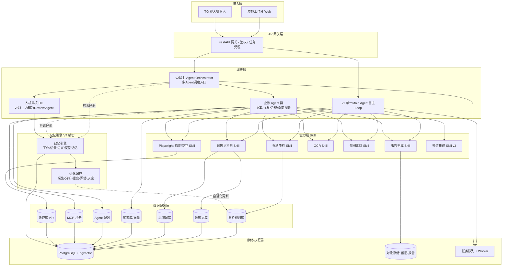
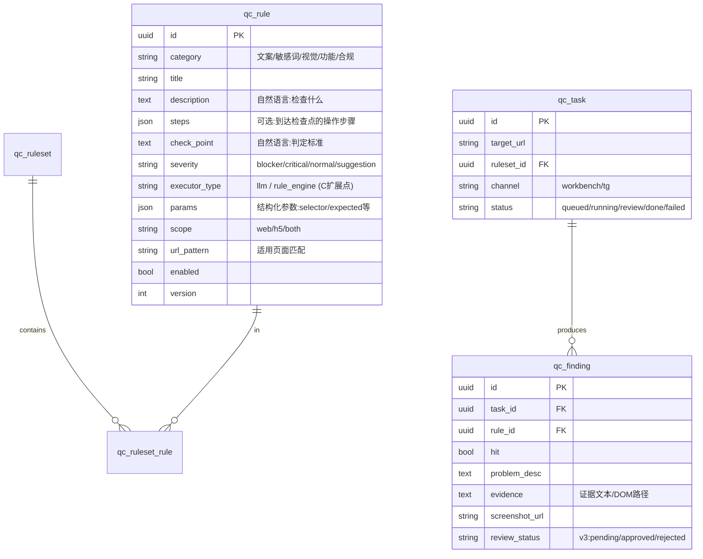
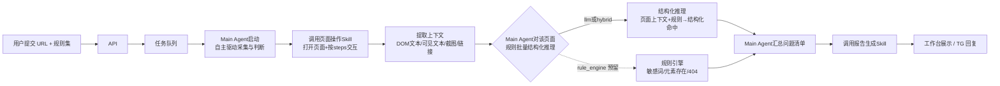
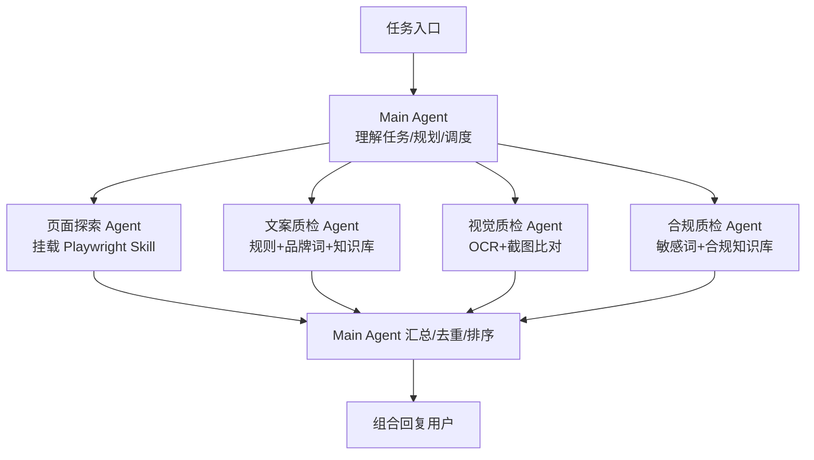
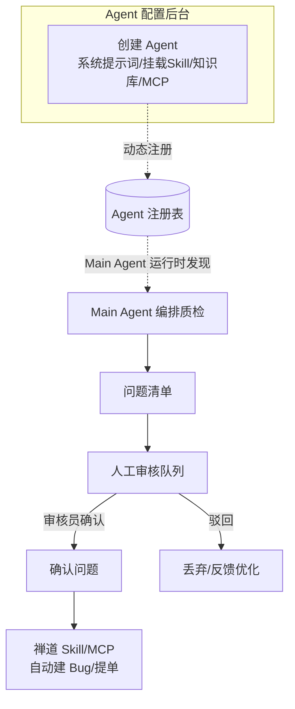
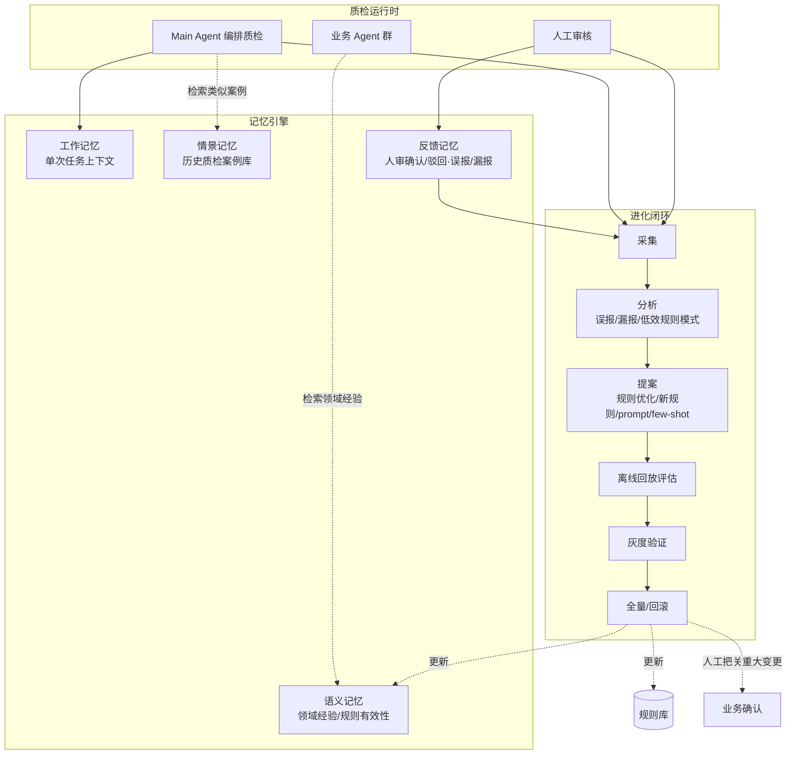

# AI Agent 质检平台 — 总体设计文档

> 版本：v0.3（设计阶段，修正v1架构表述）
> 日期：2026-06-30
> 技术栈：Python + Microsoft Agent Framework (Python, 最新版) + PostgreSQL
> LLM：OpenAI / x.ai
> 部署：云服务，团队 3 人
> 关联文档：
> - [模块交互流程细化设计](./2026-07-01-alioth-qc-workflow-detail.md)（数据源CRUD与Skill取数、Playwright采集分类命名、LLM循环质检、报告与人工审核的详细交互流程）
> - [Agent Loop 编排设计（对比真正的传统编程模式）](./2026-07-01-alioth-agent-loop-design.md)（Main Agent自主编排Skill的详细流程，v1起即采用；并与真正的传统代码编排模式做对比，v1与v2的差异是自主编排广度，而非代码编排与Agent编排之分）
> - [最终整合方案设计](./2026-07-03-alioth-integrated-solution-design.md)（权威整合版本：V1 单 Agent 的阶段/规则 Skill 分层细化，V2+V3 合并后的 Agent Orchestrator 与 Agent Loop Runtime 融合架构；本文档的 v1 表述已据此修正）

---

## 1. 背景与目标

构建一个 **AI Agent 驱动的自动化质检平台**，对 Web 与 H5 产品进行自动化质量检查。

- 质检由**统一的「质检规则数据源」驱动**：规则以自然语言描述「检查什么」，可选携带「到达检查点所需的页面操作步骤」。
- 规则、敏感词、品牌词、知识库等均为**独立数据源**，由业务后台维护，后期交由专业业务部门管理。
- 质检结果：**规则命中即列入问题清单**（含问题描述、证据、截图）。
- 交互入口：质检工作台（Web）、Telegram 聊天机器人。
- 最终形态：Main Agent 作为 AI 核心入口，自主调度多个业务 Agent，组合信息回复用户（含人机审核环节）；后台可创建不同职责的 Agent（自定义系统提示词、挂载 Skill / 知识库 / MCP）。

### 核心设计原则

**跨阶段唯一变化的是「编排层」，其余各层（接入层、Skill 能力层、数据配置层、存储层）全部复用。**
v1 起步即为单一 Main Agent 自主 Loop；v1 → v2+v3 的演进 = 把「单一 Main Agent 自主调度 Skill」扩展为「Agent Orchestrator 调度多个专职 Agent、各自内部再做 Agent Loop」，规则库 schema 与 Skill 接口保持不变。

**最终形态在最上层叠加「记忆引擎」**，让整套平台具备从人审反馈与历史质检中学习、自动优化规则/Prompt、并自我迭代进化的能力（V4）。

### 选定路线

- **v1 起步采用单一 Main Agent 自主 Loop**：Main Agent 调用分层 Skill（阶段 Skill + 规则 Skill + Tool，2026-07-05 起术语订正，见[最终整合方案设计](./2026-07-03-alioth-integrated-solution-design.md)开头提示）完成采集与逐页批量判断，暂不做多业务 Agent 委派拆分；细化设计见[最终整合方案设计](./2026-07-03-alioth-integrated-solution-design.md)第 4 节。
- **预留方案 C 扩展点**：规则表 `executor_type` 字段支持把高频确定性规则下沉到规则引擎（敏感词扫描、元素存在性、链接 404 等），实现降本，且不改表结构；本次整合新增 `hybrid` 混合判定态，详见[最终整合方案设计](./2026-07-03-alioth-integrated-solution-design.md)第 3.2 节。
- **V4 叠加记忆引擎**：作为横切层贯穿编排与数据层，驱动平台自我进化。

---

## 2. 分阶段路线图

| 阶段 | 编排方式 | 关键能力 | 目标 |
| --- | --- | --- | --- |
| **v1** | 单一 Main Agent 自主 Loop + 阶段/规则 Skill 分层 | 规则库 / Playwright 抓取 / 敏感词 / 报告 / 工作台 / TG | 单 Agent 跑通全链路，验证规则模型与 Skill 契约 |
| **v2+v3（合并）** | Agent Orchestrator + Agent Loop Runtime + 专职 Agent 群 + 内建人审 | 业务 Agent 群 / 知识库 / 自主抓取策略 / 人工审核队列 / 禅道自动化 / Agent 配置后台 / MCP | 多 Agent 生产级编排，人审内建为一等公民，闭环落地可运营 |
| **v4** | Main Agent + 记忆引擎 | 分层记忆 / 反馈学习 / 规则与 Prompt 自进化 / 灰度评估 | 自我迭代进化，越用越准 |

---

## 3. 分层架构（最终形态）

### 层职责说明

- **接入层**：质检工作台（任务提交、报告查看、规则/数据源后台）、TG 机器人（chat 入口直接发起质检）。
- **API 网关层**：FastAPI，负责鉴权、任务受理、统一返回。
- **编排层**：v1 为单一 Main Agent 自主 Loop；v2+v3 为 Agent Orchestrator 调度业务 Agent 群，人机审核（HIL）内建为 Review Agent。
- **能力层（Skill）**：把具体功能封装为可挂载的 Skill，供 Main Agent 或各专职 Agent 调用。Skill 接口稳定，跨阶段复用。
- **数据配置层**：规则库、敏感词库、品牌词库、知识库、Agent 配置、MCP 注册、凭证库，均为独立数据源。
- **存储/执行层**：PostgreSQL（业务数据 + pgvector 向量检索）、对象存储（截图/报告）、任务队列 + Worker（Playwright 执行）。
- **记忆引擎（V4 横切层）**：分层记忆存储 + 进化闭环，贯穿编排层与数据层，驱动规则/Prompt 自进化（详见第 8 节）。

---

## 4. 规则数据模型（地基）

### 关键字段设计

- `description` + `check_point`：自然语言，喂给 LLM 判断，业务后台可直接维护，加规则不改代码。
- `steps`：可空。对应「规则可能含操作步骤，也可能只描述检查点」。结构可为自然语言步骤数组，或结构化动作（`goto / click / fill / wait`）。
- `executor_type`：**B→C 的开关**。v1 默认全部 `llm`；后续把高频确定性规则改为 `rule_engine`，配合 `params` 字段实现确定性执行，**无需变更表结构**。
- `severity`：问题严重级别，用于报告排序与 v3 提单优先级。
- `scope` / `url_pattern`：规则适用范围（web/h5/both、页面匹配），用于自动筛选适用规则。

### 独立数据源（与规则库平级）

- `sensitive_word`：敏感词库（词条、类别、匹配方式、白名单例外）。
- `brand_term`：品牌词库（标准写法、禁用写法、大小写规范）。
- `knowledge_doc` + 向量表：知识库，供 v2+ 业务 Agent 检索（pgvector）。

---

## 5. v1 架构 — Main Agent 自主 Loop + 分层 Skill 判断

> v1 自 2026-07-03 整合后，阶段 Skill / 规则 Skill 的分层细节与执行循环、时序图，见[最终整合方案设计](./2026-07-03-alioth-integrated-solution-design.md)第 4 节；本节保留精简版流程供快速浏览。

### v1 流程步骤

1. 用户在工作台 / TG 提交 `target_url` + 选择 `ruleset`。
2. 任务入队（`qc_task` 状态 = queued），Main Agent 启动并接管任务，锁定规则集版本。
3. Main Agent 自主调用页面操作 Tool：Playwright 打开页面，按规则 `steps` 执行必要交互（导航/点击/等待），不是代码写死顺序。
4. 提取页面上下文：DOM 文本、可见文本、整页截图、链接列表。
5. Main Agent 按页面把适用规则分批做结构化推理判断：
   - `executor_type = llm`：把「页面上下文 + 规则 `description`/`check_point`」交给 Main Agent 自身推理，要求**结构化输出** `{hit, problem_desc, evidence, screenshot_region}`。
   - `executor_type = rule_engine`（C 预留）：敏感词扫描 / 元素存在性 / 链接 404 等确定性判断，由 Tool 直接产出结论。
   - `executor_type = hybrid`（本次整合新增）：Tool 先采证，Main Agent 基于证据复核并汇总。
6. 汇总命中项 → 写入 `qc_finding`。
7. Main Agent 调用报告生成 Tool（结构化问题清单 + 截图），存对象存储。
8. 工作台展示 / TG 回复。

### v1 边界（明确不做）

- 不做多业务 Agent 委派拆分（编排仍是单一 Main Agent 自主 Loop）。
- 不做登录态（仅跑公开页面）。
- 不做人工审核环节。
- 不做禅道集成。

### v1 不确定性控制

- LLM 输出强制结构化（JSON schema / function calling）。
- 规则判断附 few-shot 示例。
- 同一规则可配置「需复检」标记，低置信度结果在工作台高亮（为 v3 人审埋点）。

---

## 6. v2 架构 — Main Agent 自主编排

### 与 v1 的唯一差别

v1 是**单一** Main Agent 自主决定探索路径与规则判断方式；v2 在此基础上把部分工作**委派给专职业务 Agent**（各自可能内建自己的 Agent Loop），自主编排的对象从「调用哪个 Skill」扩展到「调用哪个 Agent」。v2 与 v3 的融合落地细节（Agent Orchestrator、Agent Loop Runtime、内建人审）见[最终整合方案设计](./2026-07-03-alioth-integrated-solution-design.md)第 5 节。

### 复用部分

- 规则库 / 敏感词库 / 品牌词库 / 知识库：完全复用。
- 所有 Skill：完全复用（业务 Agent 挂载同一批 Skill）。
- 数据流与存储模型：完全复用。

### v2 新增

- 业务 Agent 群（页面探索、文案、视觉、合规），各自挂载对应 Skill + 知识库。
- 知识库向量检索（pgvector），供 Agent 做 RAG。
- 凭证库 + 登录态支持（后台配置账号，质检时自动登录）。

---

## 7. v3 架构 — 人审 + 禅道自动化 + Agent 配置后台

> 本节能力在[最终整合方案设计](./2026-07-03-alioth-integrated-solution-design.md)第 5 节中与 v2 合并为同一套 Agent Orchestrator + Agent Loop Runtime 架构，人审内建为 Review Agent；本节内容作为该架构的能力清单来源保留。

### v3 能力

- **人工审核环节（HIL）**：问题清单进入审核队列，审核员确认 / 驳回；驳回结果反哺规则与 prompt 优化。
- **禅道自动化**：审核通过的问题，通过禅道 Skill / MCP 自动建 Bug / 提单（带截图、严重级别、复现步骤）。
- **Agent 配置后台**：在后台创建不同职责的 Agent，配置系统提示词、挂载 Skill / 知识库 / MCP，写入 `agent` 配置表。
- **动态 Agent 调度**：Main Agent 运行时从 Agent 注册表发现并调用后台配置的 Agent，完成不同职责的任务。

---

## 8. V4 架构 — 记忆引擎驱动的自我进化

### 8.1 分层记忆

| 记忆类型 | 内容 | 存储 | 用途 |
| --- | --- | --- | --- |
| **工作记忆** | 单次质检任务的上下文（页面快照、中间结论） | 内存/Redis | 任务内推理连贯 |
| **情景记忆** | 历史质检案例（task + findings + 人审结果） | PG + pgvector | Main Agent 检索类似案例 |
| **语义记忆** | 沉淀的领域经验、规则有效性统计、易错模式 | PG + pgvector | 业务 Agent RAG、规则进化依据 |
| **反馈记忆** | 人审确认/驳回、误报/漏报标注 | PG | 进化闭环的训练信号 |

### 8.2 自我进化闭环

1. **采集**：人审反馈 + 质检结果 + 规则命中统计 → 记忆引擎。
2. **分析**：识别误报模式、漏报模式、低效/高噪声规则。
3. **提案**：自动生成规则描述优化、新规则草案、Prompt 调整、few-shot 示例。
4. **评估**：用历史案例离线回放，量化改动对准确率/召回的影响。
5. **灰度**：小流量验证 → 达标全量 / 不达标回滚。
6. **人工把关**：重大变更（如删/改规则）经业务确认后生效。

### 8.3 记忆引擎对运行时的反哺

- 给 **Main Agent** 提供历史相似案例检索，提升编排决策质量。
- 给 **业务 Agent** 提供领域经验 RAG，减少重复犯错。
- 持续把高置信沉淀写回**语义记忆**与**规则库**，实现「越用越准」。

### 8.4 与前序阶段的衔接

- 复用 v3 的人审数据作为进化闭环的核心训练信号（v1 已埋点的低置信标记在此发挥价值）。
- 复用 `executor_type` / `version` 字段：进化产生的规则变更走版本化，可灰度可回滚。
- 不改变规则数据模型主结构，仅新增记忆相关表（情景/语义/反馈记忆）。

---

## 9. 技术选型

| 关注点 | 选型 | 说明 |
| --- | --- | --- |
| 语言 | Python | 团队栈 |
| Agent 框架 | Microsoft Agent Framework (Python 最新版) | Main Agent / 业务 Agent / Skill 挂载 |
| LLM | OpenAI / x.ai | 统一抽象层，便于切换 |
| Web 框架 | FastAPI | API 网关 / 工作台后端 |
| 浏览器自动化 | Playwright | 页面抓取、交互、截图 |
| OCR | 待定（PaddleOCR / 云 OCR） | 图片文字提取 |
| 数据库 | PostgreSQL + pgvector | 业务数据 + 向量检索 |
| 任务队列 | 待定（arq / Celery / RQ） | 异步质检任务 + Playwright Worker |
| 对象存储 | 待定（云 OSS / MinIO） | 截图、报告 |
| IM | Telegram Bot API | TG 聊天入口 |
| 记忆存储 (V4) | PostgreSQL + pgvector / Redis | 分层记忆与案例检索 |

---

## 10. 待确认 / 后续细化项（TODO）

- [ ] 规则 `steps` 的精确 schema（自然语言步骤 vs 结构化动作集）。
- [ ] OCR 方案选型。
- [ ] 任务队列与对象存储选型。
- [ ] LLM 抽象层与成本/限流策略。
- [ ] 工作台前端技术栈与页面清单。
- [ ] v1 首批固定规则集样例（用于联调）。
- [ ] 禅道 API / MCP 对接方式（v3）。
- [ ] 凭证库加密与登录态管理方案（v2）。
- [ ] 记忆引擎分层存储与进化闭环评估指标（v4）。
- [ ] 自进化变更的灰度策略与回滚机制（v4）。

---

## 11. 演进保障：为什么这个分层能平滑升级

1. **规则模型一以贯之**：自然语言规则 + 可选结构化字段，v1 由单一 Main Agent 判断，v2+v3 由多个专职 Agent 判断，规则库 schema 不变。
2. **Skill 接口稳定**：v1 单 Main Agent 与 v2+v3 各专职 Agent 调用同一批 Skill，能力层零重写。
3. **编排层可插拔**：v1 单 Agent 自主 Loop 与 v2+v3 多 Agent 编排是同一任务入口下自主编排广度不同的两种实现，可灰度共存。
4. **降本通道预留**：`executor_type` 开关（`llm`/`rule_engine`/`hybrid`）让确定性规则随时下沉规则引擎，不影响整体架构。
5. **进化能力叠加**：记忆引擎作为横切层在 V4 叠加，不改动既有运行时与规则主结构，仅新增记忆表并复用 v2+v3 阶段的人审数据，实现自我迭代进化。

> 本节所有结论的完整细化版本见[最终整合方案设计](./2026-07-03-alioth-integrated-solution-design.md)。
