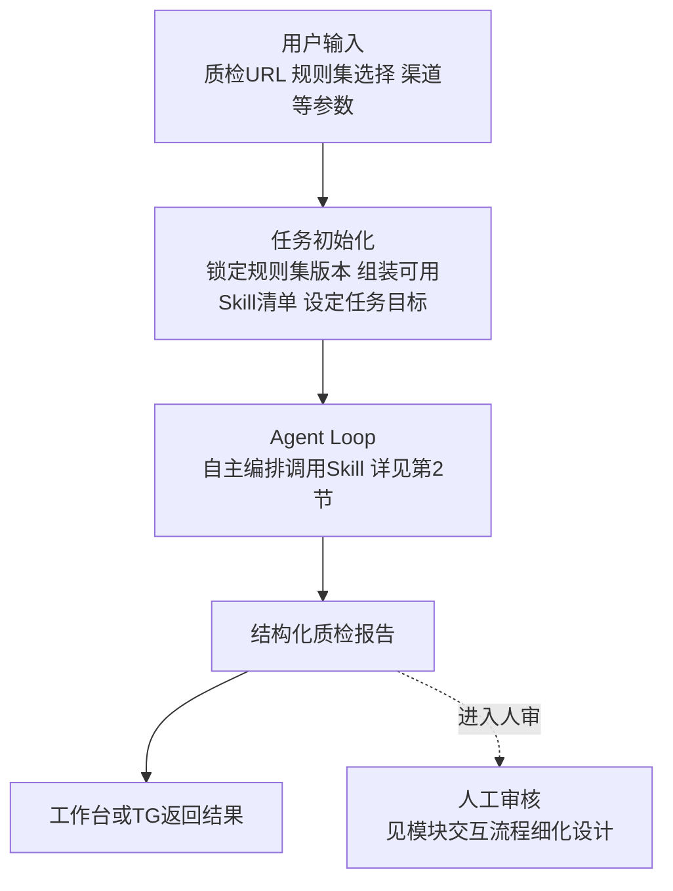
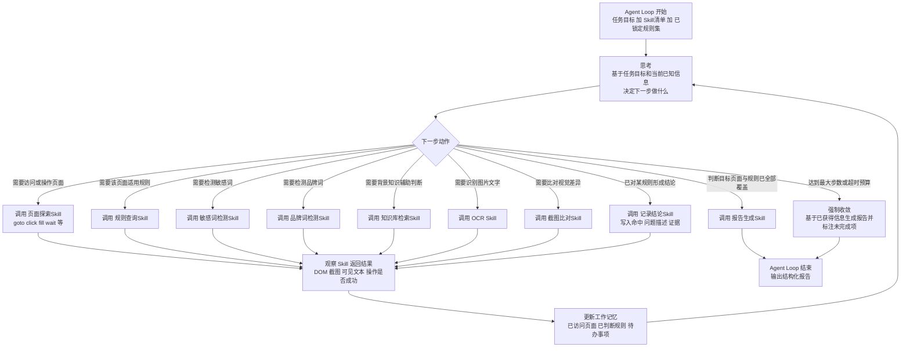
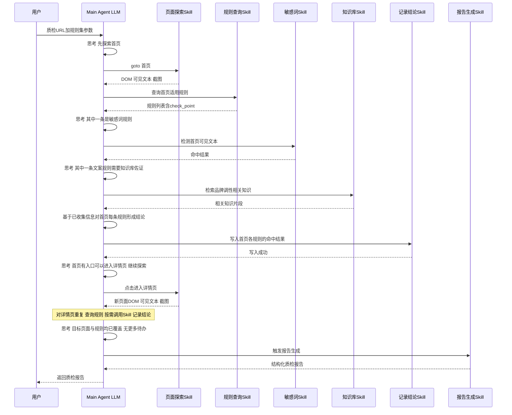
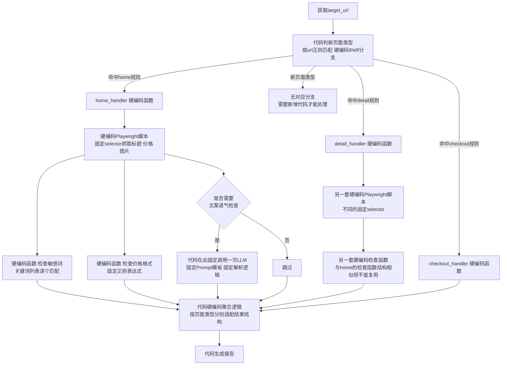
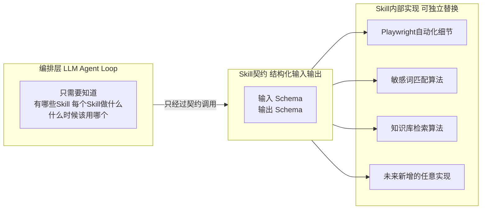

# AI Agent 质检平台 — Agent Loop 编排设计（对比真正的传统编程模式）

> 版本：v0.2（设计阶段，修正对比基线）
> 日期：2026-07-01
> 关联文档：
> - [2026-06-30-alioth-platform-design.md](./2026-06-30-alioth-platform-design.md)（总体架构与路线图）
> - [2026-07-01-alioth-qc-workflow-detail.md](./2026-07-01-alioth-qc-workflow-detail.md)（模块交互细化，与本文档同属 Agent Loop 编排方式的展开）
> - [2026-07-03-alioth-integrated-solution-design.md](./2026-07-03-alioth-integrated-solution-design.md)（最终整合方案设计，第 4 节是本文档 Skill 工具箱在单 Agent 场景下的阶段/规则 Skill 细化，第 5 节是多 Agent 场景下的扩展；**2026-07-05 起 Skill/Tool 术语订正，详见该文档开头提示与 [services/api/app/agents/README.md](../../services/api/app/agents/README.md)**）
> 范围：从用户输入质检 URL 到完整报告输出的全流程，重点展开 **Agent Loop 内部调用不同 Skill 完成不同工作** 的自主编排细节，并与**真正的传统编程模式**（代码写死全部业务分支，只在预先安排好的某个节点调用一次大模型处理特定数据）做对比
>
---

## 1. 总体流程：从用户输入到报告输出

先给出黑盒视角的总体流程，Agent Loop 内部细节在第 2 节展开。



- **用户输入**：质检 URL（可以是一个或多个入口）、选用的规则集、渠道（工作台 / TG）等参数。
- **任务初始化**：先通过 Skill 锁定本次生效的规则集版本（避免任务执行期间被后台修改影响结果），同时把当前任务可用的 Skill 清单、目标 URL、终止条件一并组装成 Main Agent 的初始上下文。
- **Agent Loop**：本文档的核心，见第 2 节，v1 起即采用此模式。
- **报告输出**：与《模块交互流程细化设计》复用同一份报告结构和人审流程，不受编排方式影响。

---

## 2. Agent Loop 详细编排流程（核心）

> 说明：本节展示的"单一 **Main Agent** 持有全部 Skill 自主循环调用"，对应 **v1** 的 Agent Loop 范围——数据采集（Playwright Skill）与规则质检（LLM 循环判断）都由同一个 Agent 在循环中自主决定，不是代码写死顺序。v2 在此基础上扩展：Main Agent 进一步把"页面探索 / 文案质检 / 视觉质检 / 合规质检"等工作动态委派给专职业务 Agent，自主编排的对象从"Skill"扩展到"Agent"，原理相同，只是多一层委派，见第 6 节。

> **2026-07-05 术语订正**：本节写作时"Skill"一词泛指"Main Agent 能调用的一切能力"，与 [Agent Skills 规范](https://agentskills.io) 定义的"Skill"（Agent 只读取、不执行的 `SKILL.md` 指导文档）含义不同。本节表格中列出的"页面探索/规则查询/敏感词检测/品牌词检测/知识库检索/OCR/截图比对/记录结论/报告生成"等条目实际都是**可执行函数**，按现行术语应称为 **Tool**（function calling），代码落点是 [agents/tools/](../../services/api/app/agents/tools/README.md)；而"阶段/规则怎么读取判断标准"对应的才是现行术语的 **Skill**，代码落点是 [agents/skills/](../../services/api/app/agents/skills/README.md)。完整对比与 Agent Loop 中二者协同机制见 [agents/README.md](../../services/api/app/agents/README.md)。历史行文保留不改，阅读时请在脑内替换。

### 2.1 Skill 工具箱一览

Main Agent 不直接操作浏览器、不直接比对敏感词表，它只知道"有哪些 Skill、每个 Skill 做什么、输入输出是什么"，具体怎么做交给 Skill 内部实现。

| Skill | 输入 | 输出 | 说明 |
| --- | --- | --- | --- |
| 页面探索 Skill | 动作类型（goto/click/fill/scroll/wait）、目标 url 或 selector、参数 | 执行状态、DOM、可见文本、截图、控制台日志 | 封装 Playwright 操作细节，Agent 只需表达"想做什么操作"，重试/等待等工程细节内置在 Skill 里 |
| 规则查询 Skill | 当前页面 url、scope | 该页面适用的规则列表（含 check_point、steps、severity） | 与《模块交互流程细化设计》第 2 节复用同一接口 |
| 敏感词检测 Skill | 文本 | 命中词、类别、位置 | 确定性判断，降低 LLM 推理负担和不确定性 |
| 品牌词检测 Skill | 文本 | 命中词、标准写法、是否违规 | 同上 |
| 知识库检索 Skill | query、top_k | 相关知识片段 | 为文案 / 合规类规则提供背景依据 |
| OCR Skill | 图片 | 识别出的文字内容 | 用于图片内文案类规则 |
| 截图比对 Skill | 两张截图 | 差异区域、差异程度 | 用于视觉类规则，如改版前后对比 |
| 记录结论 Skill | rule_id、hit、problem_desc、evidence、截图引用 | 写入成功状态 | 把 Main Agent 的判断结论结构化落库，对应 `qc_finding` |
| 报告生成 Skill | task_id | 结构化质检报告 | 循环结束时调用一次，汇总当前任务下全部结论 |

> 数据类 Skill（规则查询 / 敏感词 / 品牌词 / 知识库）的取数细节见《模块交互流程细化设计》第 2 节，本表补充自动化操作、结论写入、报告生成类 Skill。

### 2.2 编排循环流程图



要点：

- **THOUGHT → DECIDE → 调用某个Skill → OBS → UPDATE → 回到THOUGHT**，是一次完整的"思考-行动-观察"循环；每一轮循环由 Main Agent 自主决定调用哪个 Skill、传什么参数，代码层不写死顺序。
- 循环直到 Main Agent 判断"目标页面与规则均已覆盖"才调用报告生成 Skill 收尾；同时设置了"达到最大步数或超时预算"的强制收敛分支，防止无限循环（详见 2.4）。

### 2.3 典型执行轨迹示例

用一次具体的调用轨迹说明循环是如何展开的（时序图）：



可以看到：同样是"敏感词检测"和"知识库检索"，Main Agent 是**按需**调用的——只有当前规则要求时才触发，而不是像第 3 节的传统编程模式那样，每种检查手段的调用时机都在代码里写死。

### 2.4 循环终止条件与护栏

自主循环最大的风险是"停不下来"或"原地打转"，因此需要明确的护栏：

- **正常终止**：目标页面集合已全部访问，且适用规则均已产出结论（调用过记录结论 Skill）。
- **预算保护**：设置最大步数上限和最大时长上限，超过则强制进入收敛分支，用已获得的信息生成报告并标注"未完成项"，不无限循环。
- **卡死检测**：如果连续多次调用同一 Skill、同样的参数却没有带来新信息（工作记忆没有更新），判定为无进展，强制跳出并标记异常，交由人工介入。
- **动作留痕**：每一步"调用了哪个 Skill、传了什么参数、返回了什么"都落库（action trace），与《模块交互流程细化设计》中的 `action_log` 机制打通，便于事后审计、回放和调试。

---

## 3. 对比基线：真正的传统编程模式（非本平台方案）

> 提醒：以下是一个假设的、纯代码驱动的实现方式，**Alioth 平台并未采用**，仅用来对比说明为什么从 v1 起就选择 Agent Loop。

真正的传统编程模式下，**业务判断、调度顺序、页面处理方式全部由开发者写成固定代码**（if/elif 分支、状态机），大模型即使被用到，也只是嵌在某一行代码里的一个 narrow 工具函数——回答一个预先定义好的小问题，本身不知道、也无权决定"接下来该做什么"。



用一段伪代码看得更直观：

```python
# 传统编程模式：业务判断和调度逻辑全部写死在代码里
def run_qc(url):
    if re.match(r"^/home", url):
        data = scrape_home(url)                       # 硬编码 selector
        findings = []
        findings += check_sensitive_words(data.text)   # 硬编码检查函数
        findings += check_price_format(data.price)      # 硬编码检查函数
        if need_tone_check(data):
            # 大模型只是流程中固定一环的“工具函数”，不参与调度决策
            findings.append(call_llm_tone_check(data.text))
        return aggregate_home(findings)

    elif re.match(r"^/detail", url):
        data = scrape_detail(url)                       # 另一套硬编码 selector
        findings = []
        findings += check_detail_sensitive_words(data.text)  # 结构类似但不能复用
        # ... 每种页面类型都要重复一遍这一整套结构
        return aggregate_detail(findings)

    elif re.match(r"^/checkout", url):
        ...  # 继续复制

    else:
        raise NotImplementedError("新页面类型需要先写代码支持")
```

这段代码暴露的问题：

- **调度权在代码里**：先判断页面类型、每种类型下先做什么检查、要不要调用 LLM，全部固定；大模型即便出现（`call_llm_tone_check`），也只是被动等待代码调用它的那一刻，答完一个 narrow 问题就结束，不知道也管不了任务全局。
- **新增一个页面类型或一条规则 = 改好几处代码**：新增 `DETECT` 分支 + 新增一套抓取脚本 + 新增一套检查函数 + 调整聚合逻辑，软件工程上称为**霰弹式修改（Shotgun Surgery）**——改一个需求要联动改很多处，这就是"臃肿且不灵活"的根源。
- **页面结构一变就报错**：selector 写死在代码里，页面改版后旧 selector 抓不到元素，必须由开发人员改代码才能修复，无法临场适应。
- **与本平台的关系**：Playwright 采集与规则质检的完整细节见《模块交互流程细化设计》第 3～4 节；需要注意的是，那份文档目前把"Worker 循环调用 LLM"画成了代码驱动的固定循环，与本文档"v1 即 Agent Loop"的结论存在表述差异，建议后续统一（见第 7 节待确认事项）。

---

## 4. 核心差异对比

| 维度 | 传统编程模式（非本平台方案） | Agent Loop（本平台 v1 起采用） |
| --- | --- | --- |
| 控制流决策者 | 代码写死每一步：页面类型判断、检查顺序、要不要调用LLM，全部是 if/elif | Main Agent 在循环中自主决定下一步调用哪个 Skill |
| 页面采集方式 | 每种页面类型各写一套硬编码 Playwright 脚本，selector 写死 | 统一的页面探索 Skill，Agent 表达"想做什么操作"，细节封在 Skill 内部 |
| LLM 的角色 | narrow 工具函数，只在代码写死的某一行被调用一次，回答一个固定小问题 | 编排大脑，决定做什么、何时做、要不要换策略，贯穿整个任务 |
| 新增一种页面类型 | 新增 if/elif 分支 + 一套专属抓取脚本 + 一套专属检查函数 + 适配聚合逻辑 | 无需改代码，规则库按 url_pattern 匹配即可，Agent 自动套用统一 Skill |
| 新增一条检测规则 | 新写一个检查函数，还要确认它如何拼接进对应页面分支 | 规则库加一条自然语言规则数据，Agent 运行时自动纳入判断范围 |
| 代码改动的传播范围 | 霰弹式修改（Shotgun Surgery），改一处联动多处 | 新能力 = 加数据或加 Skill，编排代码零改动 |
| 业务逻辑与调度逻辑 | 紧密耦合，交织在同一批 if/elif 和函数里 | 彻底解耦，Skill 只暴露输入输出契约，调度权交给 Agent |
| 应对页面结构变化 | selector 写死，页面一改版代码就报错，需人工改代码 | Agent 可基于 DOM/可见文本临场适配，必要时换用 OCR 等替代手段 |
| 可预测性 | 高，路径完全固定 | 相对更灵活，需要护栏（最大步数、卡死检测）约束 |
| 维护成本随规则数量增长的趋势 | 接近线性甚至更快增长，代码规模持续膨胀 | 平稳，规则和 Skill 增长不影响编排代码规模 |

可以看到，传统编程模式的问题**不在于"用没用大模型"**，而在于业务判断与调度逻辑被写死在代码里——大模型即使被引入，也只是嵌在固定代码路径里的一个 narrow 工具函数，答完一个小问题就退场，不能反过来影响"接下来该做什么"。Alioth 从 v1 开始就选择 Agent Loop，就是要让大模型本身承担"接下来该做什么"的调度职责，而不只是在代码指定的某个节点上做一次性的数据处理。

---

## 5. 为什么"Skill化"是 Agent Loop 能成立的地基

Agent Loop 之所以能够正常工作、且比传统编程模式更有优势，前提是**检测规则、自动化操作等具体能力都被封装成了边界清晰的 Skill**，而不是让 LLM 直接面对原始的浏览器 API 或原始规则文本。原因如下：

1. **编排与实现彻底解耦**：Skill 对外只暴露"做什么"（结构化的输入输出契约），不暴露"怎么做"（内部实现细节，比如 Playwright 的具体 selector 逻辑、敏感词匹配算法）。Main Agent 只需要理解每个 Skill 的用途和输入输出，就能决定何时调用它，完全不需要理解内部实现。
2. **新增能力零编排成本**：只要新的检查手段（比如"链接可用性检测 Skill"）按统一契约封装好并注册进 Skill 清单，Main Agent 下次推理时就能"看到"并自主决定何时使用它，不需要修改任何编排代码或流程图。这正是与传统编程模式最大的差异：传统模式下"新增一种手段 = 改代码 + 改流程"；Agent Loop 模式下"新增一种手段 = 只加一个 Skill"。
3. **每个功能点可以独立维护、独立演进**：Skill 是职责单一的模块，可以由不同的人独立开发、测试、升级——比如敏感词 Skill 从关键词匹配升级成语义匹配模型——只要维持对外契约不变，内部怎么重构都不影响编排层和其他 Skill。
4. **检测规则和自动化操作都要 Skill 化，而不只是"取数"**：
   - **检测规则类**：把"怎么判断某条规则是否命中"封装成 Skill（敏感词检测、品牌词检测、链接可用性检测这些确定性判断，对应总体设计文档 `executor_type=rule_engine` 的降本路径）。Main Agent 不需要自己比对敏感词表，只需要调用 Skill 拿结论，大幅降低 LLM 的推理负担和不确定性，同时让确定性判断在代码层稳定、快速、便宜地执行。
   - **自动化操作类**：把"如何在页面上完成一次点击 / 填表 / 滚动 / 等待"封装成页面探索 Skill。Main Agent 不需要理解 Playwright API 细节，只需要表达"想做什么操作"，出错重试、等待策略等工程细节都在 Skill 内部处理，不污染编排层的决策逻辑。
5. **Skill 化也是让 Agent Loop 保持可控的关键**：每个 Skill 的输入输出都是受控、结构化的（不是自由文本），Main Agent 的每一步"行动"被限制在预先注册的 Skill 集合内，不能自己发明动作。这让原本"自由发挥"风险较高的 Agent Loop 变得可控、可审计、可测试——每一步都是"调用了哪个 Skill、传了什么参数、返回了什么"，可以完整记录和回放。



一句话总结：**Skill 化把"业务怎么做"和"接下来该做什么"两件事彻底分开——前者封在 Skill 内部独立维护，后者交给 LLM 在循环中自主编排**，这也是总体设计文档中"能力层 Skill 接口稳定、跨阶段复用"这一原则在编排层面的直接体现。

---

## 6. 与总体设计文档的对应关系

- 本文档第 2 节的 Agent Loop，对应 Alioth 平台 **v1 起** 就采用的编排方式：单一 Main Agent 调用 Playwright 采集 Skill 完成数据采集，再循环调用规则判断能力完成质检，全程由 Agent 自主决定下一步动作，而不是代码写死顺序。
- 总体设计文档 v2 在此基础上扩展："自主编排"的范围从"调用哪个 Skill"扩展到"调用哪个业务 Agent"——Main Agent 进一步把工作动态委派给页面探索 / 文案 / 视觉 / 合规等专职业务 Agent。**v1 与 v2 的差异是自主编排的广度，两者都属于 Agent Loop**，不是"代码编排 vs Agent 编排"的差异。
- 第 3 节的"传统编程模式"是一个假设的对比基线，**不对应 Alioth 平台的任何阶段**，仅用于说明为什么从 v1 起就选择 Agent Loop、以及 Skill 化为什么重要。
- 规则库、Skill 接口、数据模型在 v1～v4 中完全复用，只是自主编排的广度逐步扩大——这正是总体设计文档第 11 节"演进保障"的核心论点。

---

## 7. 待确认事项（TODO）

- [x] 《模块交互流程细化设计》中"Worker 循环调用 LLM"已同步修订为 Main Agent 自主循环调用 Skill，两份文档表述已统一。
- [ ] v1 阶段 Main Agent 的自主程度边界：哪些环节必须遵循固定顺序（如必须先采集再判断），哪些可以完全由 Agent 自由决定（如页面访问顺序、是否需要额外探索），需要在实现前明确，避免"自主"变成不可控。
- [ ] 单次 Agent Loop 的最大步数 / 超时的具体阈值。
- [ ] Skill 清单的具体粒度：页面探索 Skill 是拆成多个原子 Skill（goto/click/fill/extract），还是一个综合 Skill 内部再分子命令，需结合 Microsoft Agent Framework 的工具定义方式确定。
- [ ] 循环卡死检测的具体判定规则，如何量化定义"无进展"。
- [ ] Agent Loop 的成本监控与预算控制方案，单任务最大 LLM 调用次数或 token 预算。
