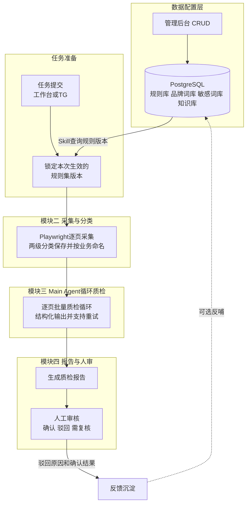
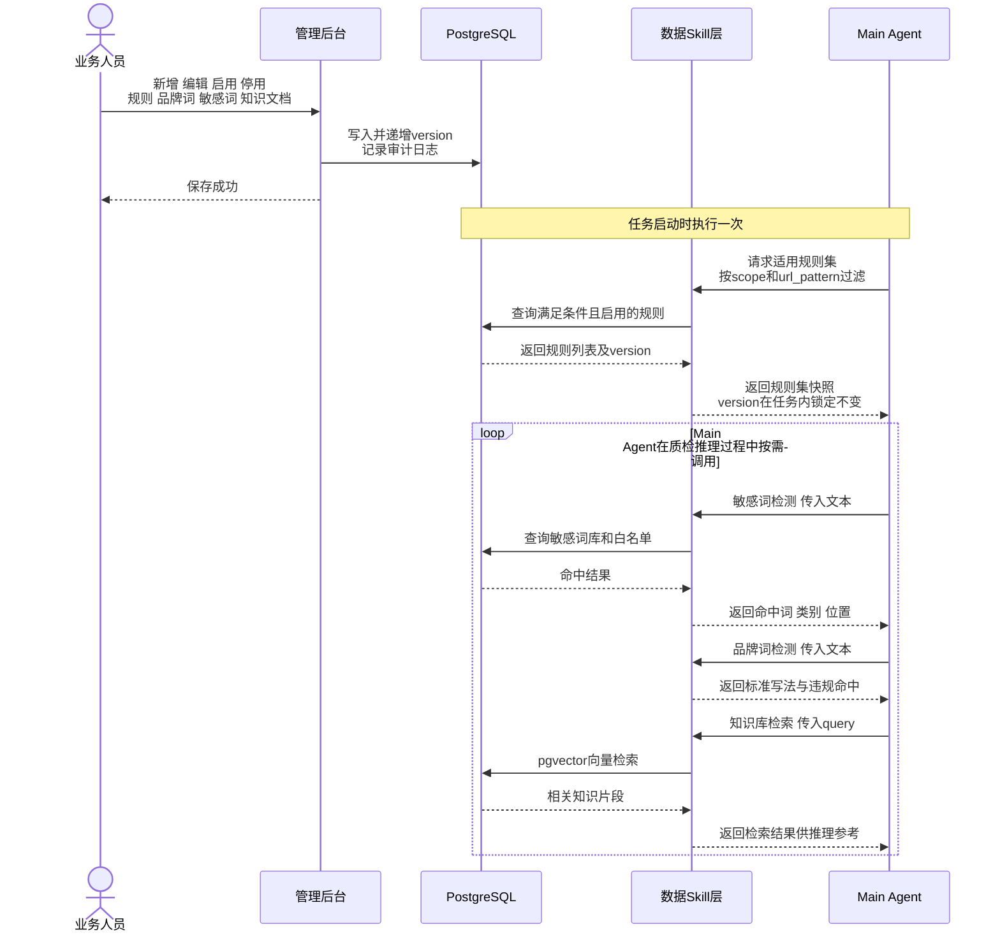
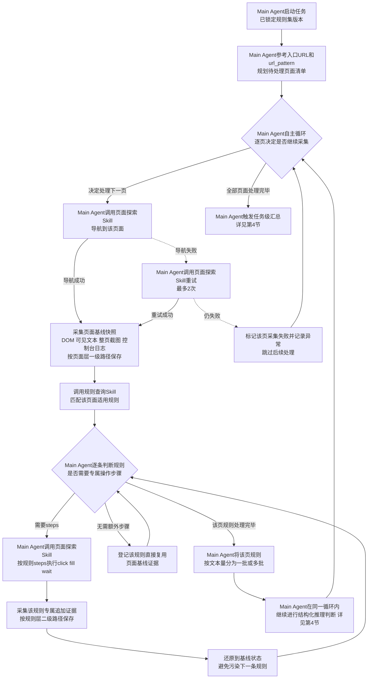
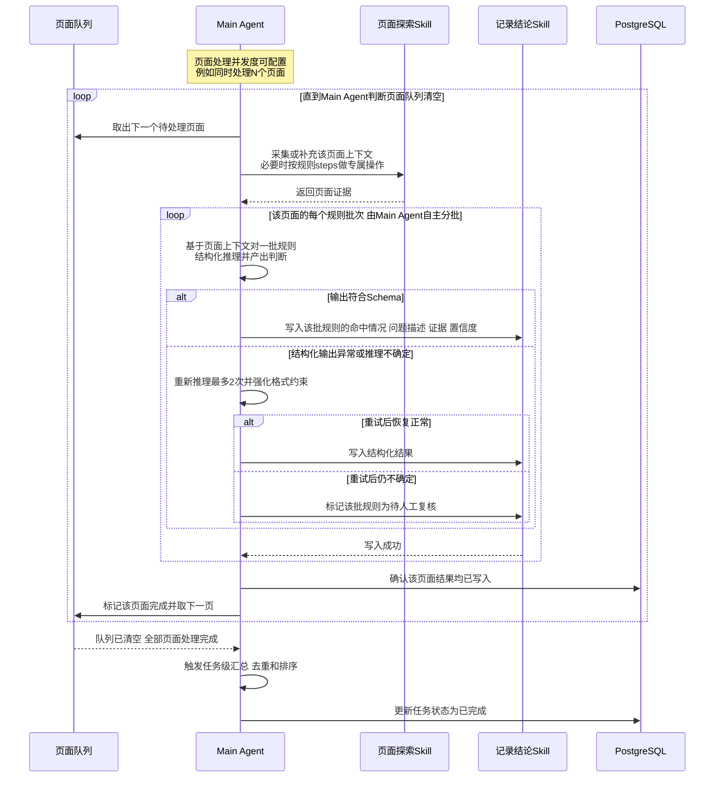
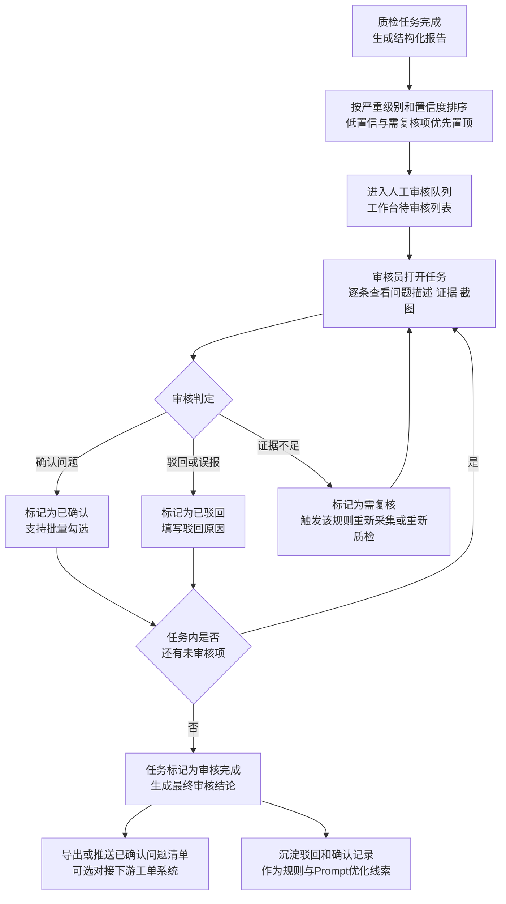
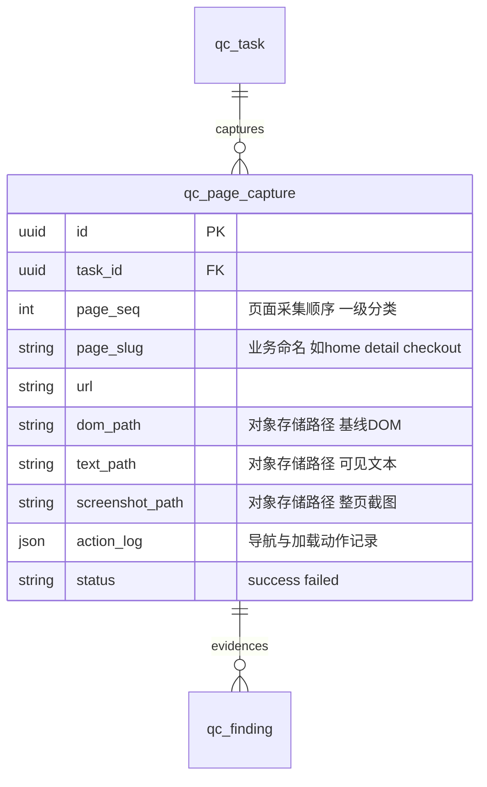

# AI Agent 质检平台 — 模块交互流程细化设计

> 版本：v0.2（设计阶段，修正编排主体）
> 日期：2026-07-01
> 关联文档：
> - [2026-06-30-alioth-platform-design.md](./2026-06-30-alioth-platform-design.md)（总体架构与分阶段路线图）
> - [2026-07-01-alioth-agent-loop-design.md](./2026-07-01-alioth-agent-loop-design.md)（Agent Loop 编排设计，本文档的采集与质检循环均由其中的 Main Agent 驱动）
> - [2026-07-03-alioth-integrated-solution-design.md](./2026-07-03-alioth-integrated-solution-design.md)（最终整合方案设计，V1 单 Agent 的阶段/规则 Skill 分层与 V2+V3 多 Agent 融合架构均复用本文档的采集分类与批量质检结论）
> 范围：本文档在总体设计基础上，对以下四个模块的交互流程做进一步细化：
> 1. 数据源（质检规则 / 品牌词库 / 敏感词库等）CRUD 与 Skill 取数流程
> 2. Playwright 采集、分类保存与业务命名规范
> 3. Main Agent 循环质检所有页面的处理流程
> 4. 检测报告产出后的人工审核流程
>
---

## 0. 文档定位与设计要点

本文档描述的是**通用的模块级交互细节**，不特别区分所属阶段（v1/v2/v3/v4）；各能力具体在哪个阶段启用，仍以总体设计文档的路线图为准。细化过程中，在总体设计基础上补充了以下设计要点：

1. **规则集版本快照**：任务启动时通过 Skill 一次性拉取并锁定当前生效的规则 / 品牌词 / 敏感词版本，任务执行期间即使后台被修改，也不影响本次已锁定的判断依据，保证结果可复现、可追溯。
2. **两级产物分类**：Playwright 采集的证据分为**页面层（一级）**与**规则层（二级）**——页面层是每个页面的基线快照，规则层仅在规则需要专属操作步骤时才产生追加证据；命名统一体现业务属性，便于人工溯源。
3. **Main Agent 按页面批量质检**：同一页面下的适用规则打包为一批（或按上限拆为多批），由 Main Agent 一次性结构化推理判断，而不是逐条规则单独调用，降低推理次数与成本；批次大小由规则文本量动态决定。
4. **结构化输出 + 有限重试**：Main Agent 的判断输出强制 JSON Schema 结构化，格式异常或推理结果不确定时最多重试 2 次，仍失败则将相关规则降级为"待人工复核"，不阻塞整体任务；页面处理支持失败跳过与断点续跑。
5. **人工审核为通用环节**：审核员对每条命中做"确认 / 驳回 / 需复核"三态处理，驳回原因与确认结果沉淀为后续规则与 Prompt 优化的输入。
6. **异常处理从简**：流程图仅在关键节点（页面导航、规则推理判断）体现简要的失败与重试分支，不追求覆盖所有异常场景。

---

## 1. 端到端总览流程

四个模块分别对应下文第 2～5 节，接口与数据结构保持一致，可独立理解、独立演进。

---

## 2. 模块一：数据源 CRUD 与 Skill 取数流程

质检规则、品牌词库、敏感词库、知识库均由业务人员在**管理后台**维护（CRUD），AI 侧（**Main Agent**）不直接读写数据库，而是通过封装好的 **Skill** 按需取数，保证权限隔离与数据校验统一收口。

### Skill 接口一览

| Skill | 输入 | 输出 | 说明 |
| --- | --- | --- | --- |
| 规则查询 Skill | scope、url_pattern、channel | 规则列表（含 version、steps、check_point 等） | 任务启动时调用一次，结果作为本次任务的规则集快照，任务内不再变化 |
| 敏感词检测 Skill | 待检测文本 | 命中词、类别、位置、是否命中白名单 | 供 LLM 判断前预处理，也可作为 `rule_engine` 执行器直接产出结论 |
| 品牌词检测 Skill | 待检测文本 | 命中词、标准写法、是否违规、位置 | 同上 |
| 知识库检索 Skill | query、top_k | 相关知识片段及相似度得分 | v2+ 业务 Agent 做 RAG；v1 可选接入，辅助 LLM 判断疑难规则 |

---

## 3. 模块二：Playwright 采集、分类保存与命名规范

### 3.1 两级分类与命名规范

| 层级 | 说明 | 存储路径示例 | 命名要素 |
| --- | --- | --- | --- |
| 任务层 | 本次质检任务所有产物的根目录 | `qc/{task_id}/` | task_id（UUID） |
| 页面层（一级） | 页面基线快照：DOM、可见文本、整页截图、控制台日志、导航与加载动作记录 | `qc/{task_id}/pages/{page_seq}-{page_slug}/baseline/` | page_seq（采集顺序，两位数字）+ page_slug（业务命名，如 home、detail、checkout） |
| 规则层（二级） | 仅当规则 `steps` 需要额外交互时产生的追加截图、DOM、动作记录 | `qc/{task_id}/pages/{page_seq}-{page_slug}/rules/{rule_seq}-{rule_code}/` | rule_seq（该页面下处理顺序）+ rule_code（规则类别缩写加编号，如 COPY-012、SENS-003） |

- `baseline/` 目录内文件：`dom.html`、`visible_text.txt`、`screenshot_full.png`、`action_log.json`、`console.log`（可选）。
- `rules/{rule_seq}-{rule_code}/` 目录内文件：`screenshot.png`、`action_log.json`，仅在该规则需要专属操作步骤时生成；否则直接复用页面基线证据，不重复采集。

### 3.2 采集流程

> 说明：以下流程由 **Main Agent** 在其自主循环中驱动——是否继续处理下一页、每条规则是否需要专属操作步骤，均由 Main Agent 自主判断并调用页面探索 Skill 完成，而不是代码写死的固定循环；完整的 Agent Loop 机制见《Agent Loop 编排设计》第 2 节。

> 说明：页面清单来源假设为任务提交时指定的入口 URL 集合，并结合规则 `url_pattern` 圈定适用范围；自动发现站内链接（爬虫式深度探索）留待 v2+ 页面探索 Agent 实现，本文档不展开。

---

## 4. 模块三：Main Agent 循环质检所有页面

> 说明：本节的循环由 **Main Agent** 自主驱动——是否继续处理下一页、要不要重新推理、什么时候任务完成，均由 Main Agent 自主决定。规则判断本身就是 Main Agent 的结构化推理，不是"代码 Worker 调用外部 LLM"；完整的 Agent Loop 机制见《Agent Loop 编排设计》第 2 节。

### 关键规则

- **批次大小**：按该页规则的文本总量或预估 token 数动态决定，超过阈值自动拆分为多批，避免单次推理超出模型上下文窗口。
- **并发度**：页面级处理支持有限并发（如同时 N 个页面），具体取值兼顾模型速率限制与成本，可配置。
- **断点续跑**：页面结果写库成功后才标记完成，任务中断重启时可从最后一个未完成页面继续，无需重新处理已完成页面。
- **降级策略**：连续重试仍无法产出结构化结果的批次不阻塞整体任务，相关规则标记为待人工复核，并保留原始推理输出用于排查。

---

## 5. 模块四：报告生成后的人工审核流程

> 说明：`review_status` 建议在总体设计文档现有取值基础上新增 `needs_recheck`，形成 `pending / approved / rejected / needs_recheck` 四态；下游工单系统对接（如禅道等）作为可选扩展点，具体接入时机参见总体设计文档路线图。

---

## 6. 附：配套数据模型建议

为支撑第 3 节的两级分类采集，建议在总体设计文档的规则数据模型基础上新增页面采集记录表，并对 `qc_finding` 做少量字段扩展。

在总体设计文档已有 `qc_finding` 表字段基础上（不改变原有字段），建议新增：

- `page_capture_id`（FK，关联 `qc_page_capture.id`）：标识该 finding 来自哪个页面采集记录。
- `rule_seq`（int）：该规则在所属页面下的处理顺序，对应二级分类命名。
- `action_log`（json，可空）：该规则专属追加操作记录，仅当规则 steps 产生额外交互时存在。
- `confidence`（float）：LLM 判断置信度，用于低置信高亮与人审排序。
- `review_reason`（text，可空）：人工驳回或标记需复核时填写的原因。
- `review_status` 取值扩展为 `pending / approved / rejected / needs_recheck`。

---

## 7. 待确认事项（TODO）

- [ ] 页面清单生成方式：人工指定入口 URL、`url_pattern` 圈定范围、还是自动发现站内链接，三者的优先级与组合规则。
- [ ] LLM 单批规则数量或 token 上限的具体阈值，需结合实际模型上下文窗口与规则文本长度压测确定。
- [ ] 页面级处理并发度与单任务整体超时时间的具体取值。
- [ ] `needs_recheck` 触发重新采集或重新质检时，具体重跑范围是仅该规则还是整页。
- [ ] 对象存储中截图与 DOM 快照等产物的保留周期与清理策略。
- [ ] 下游工单系统（如禅道等）对接的具体时机与接口方式，参见总体设计文档路线图。
