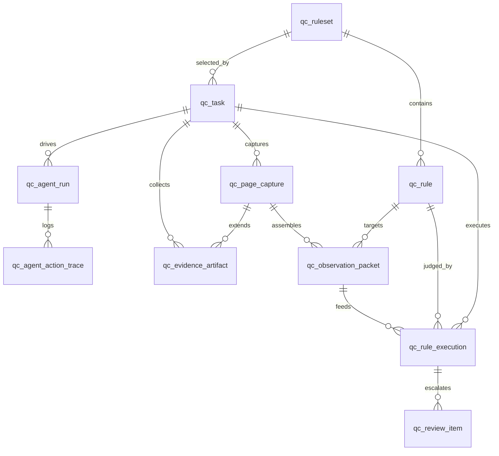

# Alioth 当前版本核心表结构设计

> 日期：2026-07-03
> 状态：M2 数据库设计基线
> 依据：[最终整合方案设计](2026-07-03-alioth-integrated-solution-design.md)、[实现落地路线](implementation-roadmap.md)

## 1. 设计目标

本文档定义 Alioth 当前版本进入 M2/M3/M4 所需的核心数据库表结构。范围不限定为 6 张表，而是覆盖最小可运行闭环与必要审计追溯：

1. 任务提交与队列消费。
2. 规则集版本快照与规则匹配。
3. 页面基线证据、规则补充证据与标准 Observation Packet。
4. 规则完整执行结果，V1 起直接主写 `qc_rule_execution`。
5. 人工审核项。
6. Agent 运行实例与动作留痕。
7. Agent Capability 契约注册（统一登记 Skill 与 Tool，详见第 16 节）。

## 2. 设计原则

| 原则 | 说明 |
| --- | --- |
| 结果模型统一 | V1 起主写 `qc_rule_execution`，`qc_finding` 不再作为新实现主表 |
| 状态可演进 | 状态字段使用 `varchar + CHECK`，暂不使用 PostgreSQL enum，降低后续状态扩展迁移成本 |
| 证据不散落 | 大文件进入对象存储，数据库只记录 artifact 与对象路径 |
| Agent 可回放 | 每个 Agent run 与每次能力选择、Skill 读取或 Tool 调用都有结构化留痕 |
| 队列先轻量 | PostgreSQL 保存长期任务状态，Redis 承担短期执行队列与取消信号 |
| JSONB 有边界 | JSONB 只存配置、Schema、结构化输入输出摘要，不存大体积原始产物 |

## 3. 表清单

| 表 | 领域 | 说明 |
| --- | --- | --- |
| `qc_ruleset` | rule | 规则集版本快照单位 |
| `qc_rule` | rule | 质检规则主表 |
| `qc_task` | task | 质检任务与队列状态 |
| `qc_page_capture` | task/evidence | 页面基线采集记录 |
| `qc_evidence_artifact` | evidence | 截图、DOM、OCR、HAR、console、AI IO 等证据产物 |
| `qc_observation_packet` | evidence | 规则判定的标准证据输入包 |
| `qc_rule_execution` | evidence | 每条规则的完整执行结果 |
| `qc_review_item` | review | 人工审核项 |
| `qc_agent_run` | task/agent | Agent 运行实例 |
| `qc_agent_action_trace` | task/agent | Agent 能力选择与单步执行留痕 |
| `qc_agent_capability_registry` | integration/agent | Agent 可见能力契约注册表，统一登记 Skill 与 Tool |

## 4. 关系总览



## 5. 基础扩展与通用触发器

```sql
CREATE EXTENSION IF NOT EXISTS pgcrypto;

CREATE OR REPLACE FUNCTION set_updated_at()
RETURNS trigger AS $$
BEGIN
    NEW.updated_at = now();
    RETURN NEW;
END;
$$ LANGUAGE plpgsql;
```

说明：

- 所有主键默认使用 `gen_random_uuid()`。
- `qc_agent_action_trace` 是 append-only 表，不设置 `updated_at`。

## 6. qc_ruleset

规则集是一次任务锁定规则版本的快照单位。任务启动后，规则集内容不应被原地修改。

```sql
CREATE TABLE qc_ruleset (
    id uuid PRIMARY KEY DEFAULT gen_random_uuid(),
    ruleset_code varchar(128) NOT NULL,
    name varchar(255) NOT NULL,
    version integer NOT NULL,
    status varchar(32) NOT NULL DEFAULT 'draft',
    description text,
    source_type varchar(32) NOT NULL DEFAULT 'manual',
    source_ref text,
    snapshot_hash varchar(128),
    rule_count integer NOT NULL DEFAULT 0,
    page_sampling_policy jsonb NOT NULL DEFAULT '{}'::jsonb,
    loop_guard jsonb NOT NULL DEFAULT '{}'::jsonb,
    created_by uuid,
    published_at timestamptz,
    archived_at timestamptz,
    created_at timestamptz NOT NULL DEFAULT now(),
    updated_at timestamptz NOT NULL DEFAULT now(),

    CONSTRAINT uq_qc_ruleset_code_version UNIQUE (ruleset_code, version),
    CONSTRAINT ck_qc_ruleset_status CHECK (
        status IN ('draft', 'enabled', 'disabled', 'archived')
    ),
    CONSTRAINT ck_qc_ruleset_source_type CHECK (
        source_type IN ('manual', 'spreadsheet', 'import', 'api')
    ),
    CONSTRAINT ck_qc_ruleset_rule_count CHECK (rule_count >= 0)
);

COMMENT ON TABLE qc_ruleset IS '规则集版本快照表，任务启动时锁定一组规则版本';
COMMENT ON COLUMN qc_ruleset.id IS '规则集主键';
COMMENT ON COLUMN qc_ruleset.ruleset_code IS '规则集业务编号，同一规则集跨版本保持不变';
COMMENT ON COLUMN qc_ruleset.name IS '规则集名称';
COMMENT ON COLUMN qc_ruleset.version IS '规则集版本号，与 ruleset_code 组成唯一版本';
COMMENT ON COLUMN qc_ruleset.status IS '规则集状态，见数据字典 lifecycle_status';
COMMENT ON COLUMN qc_ruleset.description IS '规则集说明';
COMMENT ON COLUMN qc_ruleset.source_type IS '规则集来源类型，见数据字典 ruleset_source_type';
COMMENT ON COLUMN qc_ruleset.source_ref IS '规则集来源引用';
COMMENT ON COLUMN qc_ruleset.snapshot_hash IS '规则集内容哈希，用于重复导入检测和审计追溯';
COMMENT ON COLUMN qc_ruleset.rule_count IS '规则集中规则数量';
COMMENT ON COLUMN qc_ruleset.page_sampling_policy IS '规则集默认页面抽样策略 JSON，见 JSONB 数据字典';
COMMENT ON COLUMN qc_ruleset.loop_guard IS '规则集默认 Agent Loop 护栏 JSON，见 JSONB 数据字典';
COMMENT ON COLUMN qc_ruleset.created_by IS '创建人用户 ID，IAM 未落地前作为外部用户占位';
COMMENT ON COLUMN qc_ruleset.published_at IS '规则集发布时间';
COMMENT ON COLUMN qc_ruleset.archived_at IS '规则集归档时间';
COMMENT ON COLUMN qc_ruleset.created_at IS '创建时间';
COMMENT ON COLUMN qc_ruleset.updated_at IS '最后更新时间';

CREATE INDEX idx_qc_ruleset_status
ON qc_ruleset (status, updated_at DESC);

CREATE TRIGGER trg_qc_ruleset_updated_at
BEFORE UPDATE ON qc_ruleset
FOR EACH ROW EXECUTE FUNCTION set_updated_at();
```

字段说明：

| 字段 | 说明 |
| --- | --- |
| `ruleset_code` / `version` | 规则集业务编号与版本，组成唯一约束 |
| `snapshot_hash` | 规则集内容 hash，用于审计与重复导入检测 |
| `page_sampling_policy` | 默认页面抽样策略 |
| `loop_guard` | 默认 Agent Loop 护栏 |

## 7. qc_rule

规则主表，承载规则分类、适用范围、判定方式与证据输入契约。
规则来源追溯由 `qc_ruleset.source_type`、`qc_ruleset.source_ref` 与规则集快照哈希承担，`qc_rule` 面向规则运行时定义。

```sql
CREATE TABLE qc_rule (
    id uuid PRIMARY KEY DEFAULT gen_random_uuid(),
    ruleset_id uuid NOT NULL REFERENCES qc_ruleset(id) ON DELETE RESTRICT,
    rule_code varchar(128) NOT NULL,
    name varchar(255) NOT NULL,
    description text,
    category varchar(32) NOT NULL,
    executor_type varchar(32) NOT NULL,
    severity varchar(32) NOT NULL DEFAULT 'medium',
    status varchar(32) NOT NULL DEFAULT 'enabled',
    scope varchar(128),
    channel varchar(32),
    page_type varchar(64),
    applicable_page_types jsonb NOT NULL DEFAULT '[]'::jsonb,
    url_pattern text,
    steps jsonb NOT NULL DEFAULT '[]'::jsonb,
    input_contract jsonb NOT NULL DEFAULT '{}'::jsonb,
    check_point text NOT NULL,
    judge_config jsonb NOT NULL DEFAULT '{}'::jsonb,
    manual_review_policy jsonb NOT NULL DEFAULT '{}'::jsonb,
    sort_order integer NOT NULL DEFAULT 100,
    created_by uuid,
    created_at timestamptz NOT NULL DEFAULT now(),
    updated_at timestamptz NOT NULL DEFAULT now(),

    CONSTRAINT uq_qc_rule_ruleset_code UNIQUE (ruleset_id, rule_code),
    CONSTRAINT ck_qc_rule_category CHECK (
        category IN ('text', 'visual', 'interaction', 'ad', 'payment', 'input_risk', 'player', 'compliance')
    ),
    CONSTRAINT ck_qc_rule_executor_type CHECK (
        executor_type IN ('llm', 'rule_engine', 'hybrid')
    ),
    CONSTRAINT ck_qc_rule_severity CHECK (
        severity IN ('low', 'medium', 'high', 'critical')
    ),
    CONSTRAINT ck_qc_rule_status CHECK (
        status IN ('draft', 'enabled', 'disabled', 'archived')
    ),
    CONSTRAINT ck_qc_rule_applicable_page_types CHECK (
        jsonb_typeof(applicable_page_types) = 'array'
    ),
    CONSTRAINT ck_qc_rule_channel CHECK (
        channel IS NULL OR channel IN ('workbench', 'telegram', 'api')
    )
);

COMMENT ON TABLE qc_rule IS '质检规则表，定义规则分类、适用范围、执行方式与判定契约';
COMMENT ON COLUMN qc_rule.id IS '规则主键';
COMMENT ON COLUMN qc_rule.ruleset_id IS '所属规则集 ID';
COMMENT ON COLUMN qc_rule.rule_code IS '规则业务编号，同一规则集内唯一';
COMMENT ON COLUMN qc_rule.name IS '规则名称';
COMMENT ON COLUMN qc_rule.description IS '规则说明';
COMMENT ON COLUMN qc_rule.category IS '规则分类，见数据字典 rule_category';
COMMENT ON COLUMN qc_rule.executor_type IS '规则执行器类型，见数据字典 judge_strategy';
COMMENT ON COLUMN qc_rule.severity IS '规则默认严重级别，见数据字典 severity';
COMMENT ON COLUMN qc_rule.status IS '规则状态，见数据字典 lifecycle_status';
COMMENT ON COLUMN qc_rule.scope IS '规则适用业务范围，如站点、产品线、租户或页面域';
COMMENT ON COLUMN qc_rule.channel IS '规则适用提交渠道，见数据字典 channel';
COMMENT ON COLUMN qc_rule.page_type IS '规则适用页面类型';
COMMENT ON COLUMN qc_rule.applicable_page_types IS '规则适用页面类型列表';
COMMENT ON COLUMN qc_rule.url_pattern IS '规则适用 URL 匹配表达式';
COMMENT ON COLUMN qc_rule.steps IS '到达检查点所需操作步骤 JSON 数组，见 JSONB 数据字典';
COMMENT ON COLUMN qc_rule.input_contract IS '规则所需证据输入契约 JSON，见 JSONB 数据字典';
COMMENT ON COLUMN qc_rule.check_point IS '规则检查点描述';
COMMENT ON COLUMN qc_rule.judge_config IS '规则判定配置 JSON，见 JSONB 数据字典';
COMMENT ON COLUMN qc_rule.manual_review_policy IS '人工复核策略 JSON，见 JSONB 数据字典';
COMMENT ON COLUMN qc_rule.sort_order IS '规则执行排序，数值越小越靠前';
COMMENT ON COLUMN qc_rule.created_by IS '创建人用户 ID，IAM 未落地前作为外部用户占位';
COMMENT ON COLUMN qc_rule.created_at IS '创建时间';
COMMENT ON COLUMN qc_rule.updated_at IS '最后更新时间';

CREATE INDEX idx_qc_rule_ruleset
ON qc_rule (ruleset_id, sort_order);

CREATE INDEX idx_qc_rule_match
ON qc_rule (ruleset_id, status, category, channel, page_type);

CREATE INDEX idx_qc_rule_code
ON qc_rule (rule_code);

CREATE INDEX idx_qc_rule_applicable_page_types_gin
ON qc_rule USING gin (applicable_page_types);

CREATE INDEX idx_qc_rule_input_contract_gin
ON qc_rule USING gin (input_contract);

CREATE TRIGGER trg_qc_rule_updated_at
BEFORE UPDATE ON qc_rule
FOR EACH ROW EXECUTE FUNCTION set_updated_at();
```

字段说明：

| 字段 | 说明 |
| --- | --- |
| `category` | 规则分类，直接映射规则 Skill |
| `executor_type` | `rule_engine` / `llm` / `hybrid` |
| `page_type` | 规则主适用页面类型 |
| `applicable_page_types` | 规则适用页面类型列表 |
| `steps` | 到达检查点需要的页面操作步骤 |
| `input_contract` | 所需证据，如截图、DOM、OCR、HAR、可见文本 |
| `judge_config` | 判定参数、Prompt 版本、阈值、工具配置 |
| `manual_review_policy` | 低置信、高风险、证据不足等复核策略 |
| 来源追溯 | 由所属 `qc_ruleset` 记录来源引用 |

## 8. qc_task

任务主表，作为长期任务状态源；Redis 负责短期分发队列与运行中结果缓存。

```sql
CREATE TABLE qc_task (
    id uuid PRIMARY KEY DEFAULT gen_random_uuid(),
    target_url text NOT NULL,
    ruleset_id uuid NOT NULL REFERENCES qc_ruleset(id) ON DELETE RESTRICT,
    channel varchar(32) NOT NULL DEFAULT 'workbench',
    status varchar(32) NOT NULL DEFAULT 'queued',
    priority integer NOT NULL DEFAULT 100,
    submitter_id uuid,
    task_config jsonb NOT NULL DEFAULT '{}'::jsonb,
    page_sampling_policy jsonb NOT NULL DEFAULT '{}'::jsonb,
    loop_guard jsonb NOT NULL DEFAULT '{}'::jsonb,
    locked_by varchar(128),
    locked_at timestamptz,
    attempt_count integer NOT NULL DEFAULT 0,
    max_attempts integer NOT NULL DEFAULT 3,
    next_run_at timestamptz NOT NULL DEFAULT now(),
    started_at timestamptz,
    finished_at timestamptz,
    last_error text,
    created_at timestamptz NOT NULL DEFAULT now(),
    updated_at timestamptz NOT NULL DEFAULT now(),

    CONSTRAINT ck_qc_task_status CHECK (
        status IN ('queued', 'running', 'review', 'done', 'failed', 'canceled')
    ),
    CONSTRAINT ck_qc_task_channel CHECK (
        channel IN ('workbench', 'telegram', 'api')
    ),
    CONSTRAINT ck_qc_task_attempts CHECK (attempt_count >= 0 AND max_attempts > 0)
);

COMMENT ON TABLE qc_task IS '质检任务表，作为长期任务状态源；Redis 负责短期分发队列与运行中结果缓存';
COMMENT ON COLUMN qc_task.id IS '任务主键';
COMMENT ON COLUMN qc_task.target_url IS '被质检目标 URL';
COMMENT ON COLUMN qc_task.ruleset_id IS '任务锁定使用的规则集 ID';
COMMENT ON COLUMN qc_task.channel IS '任务提交渠道，见数据字典 channel';
COMMENT ON COLUMN qc_task.status IS '任务状态，见数据字典 task_status';
COMMENT ON COLUMN qc_task.priority IS '队列优先级，数值越小越优先';
COMMENT ON COLUMN qc_task.submitter_id IS '提交人用户 ID，IAM 未落地前作为外部用户占位';
COMMENT ON COLUMN qc_task.task_config IS '任务级配置 JSON，见 JSONB 数据字典';
COMMENT ON COLUMN qc_task.page_sampling_policy IS '任务级页面抽样策略 JSON，可覆盖规则集默认值';
COMMENT ON COLUMN qc_task.loop_guard IS '任务级 Agent Loop 护栏 JSON，可覆盖规则集默认值';
COMMENT ON COLUMN qc_task.locked_by IS '当前抢占任务的 Worker 标识';
COMMENT ON COLUMN qc_task.locked_at IS '任务被 Worker 抢占的时间';
COMMENT ON COLUMN qc_task.attempt_count IS '已尝试执行次数';
COMMENT ON COLUMN qc_task.max_attempts IS '最大允许执行次数';
COMMENT ON COLUMN qc_task.next_run_at IS '下一次可被队列消费的时间';
COMMENT ON COLUMN qc_task.started_at IS '任务开始执行时间';
COMMENT ON COLUMN qc_task.finished_at IS '任务结束时间';
COMMENT ON COLUMN qc_task.last_error IS '最近一次失败错误摘要';
COMMENT ON COLUMN qc_task.created_at IS '创建时间';
COMMENT ON COLUMN qc_task.updated_at IS '最后更新时间';

CREATE INDEX idx_qc_task_queue
ON qc_task (status, next_run_at, priority, created_at)
WHERE status = 'queued';

CREATE INDEX idx_qc_task_status_created
ON qc_task (status, created_at DESC);

CREATE INDEX idx_qc_task_ruleset
ON qc_task (ruleset_id);

CREATE TRIGGER trg_qc_task_updated_at
BEFORE UPDATE ON qc_task
FOR EACH ROW EXECUTE FUNCTION set_updated_at();
```

队列职责边界：

- `qc_task` 保存长期任务状态、提交参数、重试次数、开始/结束时间与最近错误。
- Redis 队列负责短期任务分发、运行中状态查询与取消标记，记录带 TTL，不作为长期审计源。
- 后续如需启用 PostgreSQL 兜底领取机制，可复用 `status`、`priority`、`next_run_at`、`locked_by`、`locked_at` 等字段，但当前版本默认以 Redis 为执行队列。

字段说明：

| 字段 | 说明 |
| --- | --- |
| `status` | 任务状态机 |
| `locked_by` / `locked_at` | Worker 抢占任务使用 |
| `attempt_count` / `max_attempts` | 失败重试 |
| `page_sampling_policy` | 任务级页面抽样策略，可覆盖规则集默认值 |
| `loop_guard` | 任务级 Loop 护栏，可覆盖规则集默认值 |

## 9. qc_page_capture

页面基线采集记录。它不是规则结果，而是页面层证据的组织单位。

```sql
CREATE TABLE qc_page_capture (
    id uuid PRIMARY KEY DEFAULT gen_random_uuid(),
    task_id uuid NOT NULL REFERENCES qc_task(id) ON DELETE CASCADE,
    agent_run_id uuid,
    parent_page_capture_id uuid REFERENCES qc_page_capture(id) ON DELETE SET NULL,
    page_seq integer NOT NULL,
    page_slug varchar(128) NOT NULL,
    url text NOT NULL,
    page_type varchar(64),
    page_state varchar(64),
    capture_status varchar(32) NOT NULL DEFAULT 'pending',
    screenshot_path text,
    dom_path text,
    visible_text_path text,
    console_log_path text,
    action_log jsonb NOT NULL DEFAULT '[]'::jsonb,
    metadata jsonb NOT NULL DEFAULT '{}'::jsonb,
    captured_at timestamptz,
    created_at timestamptz NOT NULL DEFAULT now(),
    updated_at timestamptz NOT NULL DEFAULT now(),

    CONSTRAINT uq_qc_page_capture_seq UNIQUE (task_id, page_seq),
    CONSTRAINT ck_qc_page_capture_status CHECK (
        capture_status IN ('pending', 'captured', 'failed', 'skipped')
    ),
    CONSTRAINT ck_qc_page_capture_seq CHECK (page_seq > 0)
);

COMMENT ON TABLE qc_page_capture IS '页面基线采集记录表，组织页面级截图、DOM、文本和动作摘要';
COMMENT ON COLUMN qc_page_capture.id IS '页面采集主键';
COMMENT ON COLUMN qc_page_capture.task_id IS '所属任务 ID';
COMMENT ON COLUMN qc_page_capture.agent_run_id IS '产生该页面采集记录的 Agent Run ID';
COMMENT ON COLUMN qc_page_capture.parent_page_capture_id IS '父页面采集 ID，用于表达页面跳转或弹窗来源';
COMMENT ON COLUMN qc_page_capture.page_seq IS '任务内页面序号，从 1 开始';
COMMENT ON COLUMN qc_page_capture.page_slug IS '业务可读页面标识，如 home、detail-1';
COMMENT ON COLUMN qc_page_capture.url IS '采集时页面 URL';
COMMENT ON COLUMN qc_page_capture.page_type IS '页面识别类型';
COMMENT ON COLUMN qc_page_capture.page_state IS '页面状态，如 loaded、login_required、popup_open';
COMMENT ON COLUMN qc_page_capture.capture_status IS '采集状态，见数据字典 page_capture_status';
COMMENT ON COLUMN qc_page_capture.screenshot_path IS '页面截图对象存储路径';
COMMENT ON COLUMN qc_page_capture.dom_path IS '页面 DOM 对象存储路径';
COMMENT ON COLUMN qc_page_capture.visible_text_path IS '可见文本对象存储路径';
COMMENT ON COLUMN qc_page_capture.console_log_path IS '浏览器控制台日志对象存储路径';
COMMENT ON COLUMN qc_page_capture.action_log IS '到达该页面的动作摘要 JSON 数组';
COMMENT ON COLUMN qc_page_capture.metadata IS '页面采集扩展元数据 JSON';
COMMENT ON COLUMN qc_page_capture.captured_at IS '页面实际采集完成时间';
COMMENT ON COLUMN qc_page_capture.created_at IS '创建时间';
COMMENT ON COLUMN qc_page_capture.updated_at IS '最后更新时间';

CREATE INDEX idx_qc_page_capture_task
ON qc_page_capture (task_id, page_seq);

CREATE INDEX idx_qc_page_capture_type
ON qc_page_capture (task_id, page_type);

CREATE INDEX idx_qc_page_capture_agent_run
ON qc_page_capture (agent_run_id, page_seq);

CREATE TRIGGER trg_qc_page_capture_updated_at
BEFORE UPDATE ON qc_page_capture
FOR EACH ROW EXECUTE FUNCTION set_updated_at();
```

字段说明：

| 字段 | 说明 |
| --- | --- |
| `agent_run_id` | 产生当前页面采集记录的 Agent Run；任务重试时用于隔离每次运行的页面事实 |
| `page_slug` | 业务可读页面名，如 `home`、`detail-1` |
| `page_type` | 页面识别结果 |
| `*_path` | 对象存储路径，不直接存大文本或图片 |
| `action_log` | 到达该页面的操作摘要 |

## 10. qc_evidence_artifact

证据产物表。页面 baseline、规则补采、AI 输入输出都统一进入这里。

```sql
CREATE TABLE qc_evidence_artifact (
    id uuid PRIMARY KEY DEFAULT gen_random_uuid(),
    task_id uuid NOT NULL REFERENCES qc_task(id) ON DELETE CASCADE,
    page_capture_id uuid REFERENCES qc_page_capture(id) ON DELETE SET NULL,
    rule_execution_id uuid,
    artifact_type varchar(64) NOT NULL,
    source varchar(64) NOT NULL,
    storage_path text NOT NULL,
    content_type varchar(128),
    checksum varchar(128),
    size_bytes bigint,
    metadata jsonb NOT NULL DEFAULT '{}'::jsonb,
    created_at timestamptz NOT NULL DEFAULT now(),

    CONSTRAINT ck_qc_evidence_artifact_type CHECK (
        artifact_type IN ('screenshot', 'dom', 'visible_text', 'ocr_text', 'har', 'console_log', 'media_state', 'ai_io', 'report')
    ),
    CONSTRAINT ck_qc_evidence_artifact_source CHECK (
        source IN ('baseline', 'rule_supplement', 'ai_call', 'report')
    ),
    CONSTRAINT ck_qc_evidence_artifact_size CHECK (
        size_bytes IS NULL OR size_bytes >= 0
    )
);

COMMENT ON TABLE qc_evidence_artifact IS '证据产物表，统一记录截图、DOM、OCR、HAR、AI IO 和报告文件';
COMMENT ON COLUMN qc_evidence_artifact.id IS '证据产物主键';
COMMENT ON COLUMN qc_evidence_artifact.task_id IS '所属任务 ID';
COMMENT ON COLUMN qc_evidence_artifact.page_capture_id IS '关联页面采集 ID，可为空';
COMMENT ON COLUMN qc_evidence_artifact.rule_execution_id IS '关联规则执行结果 ID，可在规则执行表创建后补外键';
COMMENT ON COLUMN qc_evidence_artifact.artifact_type IS '证据产物类型，见数据字典 artifact_type';
COMMENT ON COLUMN qc_evidence_artifact.source IS '证据来源，见数据字典 artifact_source';
COMMENT ON COLUMN qc_evidence_artifact.storage_path IS '对象存储路径或内部存储引用';
COMMENT ON COLUMN qc_evidence_artifact.content_type IS '文件 MIME 类型';
COMMENT ON COLUMN qc_evidence_artifact.checksum IS '文件校验值，如 sha256';
COMMENT ON COLUMN qc_evidence_artifact.size_bytes IS '文件大小，单位字节';
COMMENT ON COLUMN qc_evidence_artifact.metadata IS '证据扩展元数据 JSON';
COMMENT ON COLUMN qc_evidence_artifact.created_at IS '创建时间';

CREATE INDEX idx_qc_evidence_artifact_task
ON qc_evidence_artifact (task_id, created_at DESC);

CREATE INDEX idx_qc_evidence_artifact_page
ON qc_evidence_artifact (page_capture_id);

CREATE INDEX idx_qc_evidence_artifact_rule_execution
ON qc_evidence_artifact (rule_execution_id);

CREATE INDEX idx_qc_evidence_artifact_type
ON qc_evidence_artifact (artifact_type, source);
```

说明：

- `rule_execution_id` 在建表时不直接加外键，避免与 `qc_rule_execution` 形成创建顺序循环。可在两表都存在后通过 `ALTER TABLE` 添加外键。
- 也可以只通过 `qc_rule_execution.evidence_artifact_ids` 关联，第一版不强制双向外键。

## 11. qc_observation_packet

Observation Packet 是 Rule Judge 的标准输入，避免规则直接读取散落文件。

```sql
CREATE TABLE qc_observation_packet (
    id uuid PRIMARY KEY DEFAULT gen_random_uuid(),
    task_id uuid NOT NULL REFERENCES qc_task(id) ON DELETE CASCADE,
    page_capture_id uuid REFERENCES qc_page_capture(id) ON DELETE SET NULL,
    rule_id uuid REFERENCES qc_rule(id) ON DELETE SET NULL,
    evidence_artifact_ids jsonb NOT NULL DEFAULT '[]'::jsonb,
    packet_payload jsonb NOT NULL DEFAULT '{}'::jsonb,
    quality_gate_status varchar(32) NOT NULL DEFAULT 'pending',
    quality_gate_reason text,
    created_by_agent_run_id uuid,
    input_fingerprint varchar(64),
    created_at timestamptz NOT NULL DEFAULT now(),
    updated_at timestamptz NOT NULL DEFAULT now(),

    CONSTRAINT ck_qc_observation_packet_quality CHECK (
        quality_gate_status IN ('pending', 'pass', 'fail')
    )
);

COMMENT ON TABLE qc_observation_packet IS 'Observation Packet 表，沉淀规则判定前的标准化证据输入包';
COMMENT ON COLUMN qc_observation_packet.id IS 'Observation Packet 主键';
COMMENT ON COLUMN qc_observation_packet.task_id IS '所属任务 ID';
COMMENT ON COLUMN qc_observation_packet.page_capture_id IS '关联页面采集 ID';
COMMENT ON COLUMN qc_observation_packet.rule_id IS '目标规则 ID';
COMMENT ON COLUMN qc_observation_packet.evidence_artifact_ids IS '输入证据产物 ID 列表 JSON 数组';
COMMENT ON COLUMN qc_observation_packet.packet_payload IS '结构化证据摘要 JSON，供 Rule Judge 判定使用';
COMMENT ON COLUMN qc_observation_packet.quality_gate_status IS '证据质量门禁状态，见数据字典 quality_gate_status';
COMMENT ON COLUMN qc_observation_packet.quality_gate_reason IS '证据质量门禁说明';
COMMENT ON COLUMN qc_observation_packet.created_by_agent_run_id IS '创建该证据包的 Agent Run ID';
COMMENT ON COLUMN qc_observation_packet.input_fingerprint IS '观察包证据绑定指纹，用于区分同一运行、页面和规则下的不同证据输入集合';
COMMENT ON COLUMN qc_observation_packet.created_at IS '创建时间';
COMMENT ON COLUMN qc_observation_packet.updated_at IS '最后更新时间';

CREATE INDEX idx_qc_observation_packet_task
ON qc_observation_packet (task_id, created_at DESC);

CREATE INDEX idx_qc_observation_packet_rule
ON qc_observation_packet (rule_id);

CREATE INDEX idx_qc_observation_packet_quality
ON qc_observation_packet (quality_gate_status);

CREATE INDEX idx_qc_observation_packet_artifacts_gin
ON qc_observation_packet USING gin (evidence_artifact_ids);

CREATE UNIQUE INDEX uq_qc_observation_packet_run_page_rule_input
ON qc_observation_packet (
    created_by_agent_run_id,
    page_capture_id,
    rule_id,
    input_fingerprint
)
WHERE created_by_agent_run_id IS NOT NULL
  AND page_capture_id IS NOT NULL
  AND rule_id IS NOT NULL
  AND input_fingerprint IS NOT NULL;

CREATE TRIGGER trg_qc_observation_packet_updated_at
BEFORE UPDATE ON qc_observation_packet
FOR EACH ROW EXECUTE FUNCTION set_updated_at();
```

字段说明：

| 字段 | 说明 |
| --- | --- |
| `evidence_artifact_ids` | 证据 ID 列表 |
| `packet_payload` | 给 Rule Judge 的结构化证据摘要 |
| `quality_gate_status` | 证据质量门禁结果 |
| `input_fingerprint` | 页面角色与证据产物绑定关系的 SHA-256 指纹 |

## 12. qc_rule_execution

规则执行结果主表。通过、失败、跳过、证据不足、异常都要记录。

```sql
CREATE TABLE qc_rule_execution (
    id uuid PRIMARY KEY DEFAULT gen_random_uuid(),
    task_id uuid NOT NULL REFERENCES qc_task(id) ON DELETE CASCADE,
    rule_id uuid NOT NULL REFERENCES qc_rule(id) ON DELETE RESTRICT,
    page_capture_id uuid REFERENCES qc_page_capture(id) ON DELETE SET NULL,
    observation_packet_id uuid REFERENCES qc_observation_packet(id) ON DELETE SET NULL,
    agent_run_id uuid,
    source_action_trace_id uuid,
    execution_status varchar(32) NOT NULL,
    judge_strategy varchar(32) NOT NULL,
    confidence numeric(5,4),
    severity varchar(32),
    result_summary text,
    problem_desc text,
    evidence_artifact_ids jsonb NOT NULL DEFAULT '[]'::jsonb,
    judge_input jsonb NOT NULL DEFAULT '{}'::jsonb,
    judge_output jsonb NOT NULL DEFAULT '{}'::jsonb,
    review_status varchar(32),
    review_reason text,
    error_code varchar(128),
    error_message text,
    started_at timestamptz,
    finished_at timestamptz,
    created_at timestamptz NOT NULL DEFAULT now(),
    updated_at timestamptz NOT NULL DEFAULT now(),

    CONSTRAINT uq_qc_rule_execution_once UNIQUE (task_id, rule_id, page_capture_id),
    CONSTRAINT ck_qc_rule_execution_status CHECK (
        execution_status IN ('pass', 'fail', 'warning', 'manual_review', 'evidence_insufficient', 'skipped', 'error')
    ),
    CONSTRAINT ck_qc_rule_execution_strategy CHECK (
        judge_strategy IN ('rule_engine', 'llm', 'hybrid')
    ),
    CONSTRAINT ck_qc_rule_execution_review_status CHECK (
        review_status IS NULL OR review_status IN ('pending', 'approved', 'rejected', 'needs_recheck')
    ),
    CONSTRAINT ck_qc_rule_execution_confidence CHECK (
        confidence IS NULL OR (confidence >= 0 AND confidence <= 1)
    )
);

COMMENT ON TABLE qc_rule_execution IS '规则执行结果主表，记录每条规则在任务和页面上的最终判定';
COMMENT ON COLUMN qc_rule_execution.id IS '规则执行结果主键';
COMMENT ON COLUMN qc_rule_execution.task_id IS '所属任务 ID';
COMMENT ON COLUMN qc_rule_execution.rule_id IS '被执行规则 ID';
COMMENT ON COLUMN qc_rule_execution.page_capture_id IS '关联页面采集 ID';
COMMENT ON COLUMN qc_rule_execution.observation_packet_id IS '本次判定使用的 Observation Packet ID';
COMMENT ON COLUMN qc_rule_execution.agent_run_id IS '产出该规则结论的 Agent Run ID；外键在 qc_agent_run 建表后补充';
COMMENT ON COLUMN qc_rule_execution.source_action_trace_id IS '产出该规则结论的 Agent 单步动作留痕 ID；外键在 qc_agent_action_trace 建表后补充';
COMMENT ON COLUMN qc_rule_execution.execution_status IS '规则执行状态，见数据字典 rule_execution_status';
COMMENT ON COLUMN qc_rule_execution.judge_strategy IS '实际判定策略，见数据字典 judge_strategy';
COMMENT ON COLUMN qc_rule_execution.confidence IS '判定置信度，取值 0 到 1';
COMMENT ON COLUMN qc_rule_execution.severity IS '本次结果严重级别，见数据字典 severity';
COMMENT ON COLUMN qc_rule_execution.result_summary IS '规则执行结果摘要';
COMMENT ON COLUMN qc_rule_execution.problem_desc IS '问题描述，失败或告警时必填';
COMMENT ON COLUMN qc_rule_execution.evidence_artifact_ids IS '支撑该结论的证据产物 ID 列表 JSON 数组';
COMMENT ON COLUMN qc_rule_execution.judge_input IS '判定输入摘要 JSON';
COMMENT ON COLUMN qc_rule_execution.judge_output IS '判定输出摘要 JSON';
COMMENT ON COLUMN qc_rule_execution.review_status IS '人工审核状态，见数据字典 review_status';
COMMENT ON COLUMN qc_rule_execution.review_reason IS '进入人工审核或审核结论说明';
COMMENT ON COLUMN qc_rule_execution.error_code IS '异常错误码';
COMMENT ON COLUMN qc_rule_execution.error_message IS '异常错误信息';
COMMENT ON COLUMN qc_rule_execution.started_at IS '规则执行开始时间';
COMMENT ON COLUMN qc_rule_execution.finished_at IS '规则执行结束时间';
COMMENT ON COLUMN qc_rule_execution.created_at IS '创建时间';
COMMENT ON COLUMN qc_rule_execution.updated_at IS '最后更新时间';

CREATE INDEX idx_qc_rule_execution_task
ON qc_rule_execution (task_id, created_at DESC);

CREATE INDEX idx_qc_rule_execution_rule
ON qc_rule_execution (rule_id);

CREATE INDEX idx_qc_rule_execution_status
ON qc_rule_execution (execution_status, review_status);

CREATE INDEX idx_qc_rule_execution_agent_run
ON qc_rule_execution (agent_run_id);

CREATE INDEX idx_qc_rule_execution_source_action
ON qc_rule_execution (source_action_trace_id);

CREATE INDEX idx_qc_rule_execution_artifacts_gin
ON qc_rule_execution USING gin (evidence_artifact_ids);

CREATE INDEX idx_qc_rule_execution_output_gin
ON qc_rule_execution USING gin (judge_output);

CREATE TRIGGER trg_qc_rule_execution_updated_at
BEFORE UPDATE ON qc_rule_execution
FOR EACH ROW EXECUTE FUNCTION set_updated_at();
```

建表后可补充双向引用：

```sql
ALTER TABLE qc_evidence_artifact
ADD CONSTRAINT fk_qc_evidence_artifact_rule_execution
FOREIGN KEY (rule_execution_id)
REFERENCES qc_rule_execution(id)
ON DELETE SET NULL;
```

字段说明：

| 字段 | 说明 |
| --- | --- |
| `execution_status` | 规则完整执行状态 |
| `judge_strategy` | 实际判定方式 |
| `judge_input` / `judge_output` | 判定输入输出摘要 |
| `review_status` | 人工审核状态 |

## 13. qc_review_item

人工审核项。它从 `qc_rule_execution` 派生，用于审核队列与反馈闭环。

```sql
CREATE TABLE qc_review_item (
    id uuid PRIMARY KEY DEFAULT gen_random_uuid(),
    rule_execution_id uuid NOT NULL REFERENCES qc_rule_execution(id) ON DELETE CASCADE,
    task_id uuid NOT NULL REFERENCES qc_task(id) ON DELETE CASCADE,
    trigger_reason varchar(64) NOT NULL,
    status varchar(32) NOT NULL DEFAULT 'pending',
    priority integer NOT NULL DEFAULT 100,
    reviewer uuid,
    review_reason text,
    reviewed_at timestamptz,
    created_at timestamptz NOT NULL DEFAULT now(),
    updated_at timestamptz NOT NULL DEFAULT now(),

    CONSTRAINT uq_qc_review_item_execution UNIQUE (rule_execution_id),
    CONSTRAINT ck_qc_review_item_trigger CHECK (
        trigger_reason IN ('low_confidence', 'high_risk', 'evidence_insufficient', 'loop_budget_exceeded', 'no_progress', 'manual_flag')
    ),
    CONSTRAINT ck_qc_review_item_status CHECK (
        status IN ('pending', 'approved', 'rejected', 'needs_recheck')
    )
);

COMMENT ON TABLE qc_review_item IS '人工审核项表，由规则执行结果派生，用于人工复核队列和反馈闭环';
COMMENT ON COLUMN qc_review_item.id IS '人工审核项主键';
COMMENT ON COLUMN qc_review_item.rule_execution_id IS '关联规则执行结果 ID';
COMMENT ON COLUMN qc_review_item.task_id IS '所属任务 ID';
COMMENT ON COLUMN qc_review_item.trigger_reason IS '触发人工审核原因，见数据字典 review_trigger_reason';
COMMENT ON COLUMN qc_review_item.status IS '审核状态，见数据字典 review_status';
COMMENT ON COLUMN qc_review_item.priority IS '审核队列优先级，数值越小越优先';
COMMENT ON COLUMN qc_review_item.reviewer IS '审核人用户 ID，IAM 未落地前作为外部用户占位';
COMMENT ON COLUMN qc_review_item.review_reason IS '审核说明或驳回原因';
COMMENT ON COLUMN qc_review_item.reviewed_at IS '审核完成时间';
COMMENT ON COLUMN qc_review_item.created_at IS '创建时间';
COMMENT ON COLUMN qc_review_item.updated_at IS '最后更新时间';

CREATE INDEX idx_qc_review_item_queue
ON qc_review_item (status, priority, created_at)
WHERE status = 'pending';

CREATE INDEX idx_qc_review_item_task
ON qc_review_item (task_id, created_at DESC);

CREATE TRIGGER trg_qc_review_item_updated_at
BEFORE UPDATE ON qc_review_item
FOR EACH ROW EXECUTE FUNCTION set_updated_at();
```

字段说明：

| 字段 | 说明 |
| --- | --- |
| `trigger_reason` | 为什么进入人工审核 |
| `status` | 审核处理状态 |
| `priority` | 审核队列排序 |

## 14. qc_agent_run

Agent 运行实例。V1 可以只创建 `main`，后续扩展 Planner / Explorer / Rule Judge。

```sql
CREATE TABLE qc_agent_run (
    id uuid PRIMARY KEY DEFAULT gen_random_uuid(),
    task_id uuid NOT NULL REFERENCES qc_task(id) ON DELETE CASCADE,
    parent_agent_run_id uuid REFERENCES qc_agent_run(id) ON DELETE SET NULL,
    agent_type varchar(64) NOT NULL,
    agent_name varchar(128) NOT NULL,
    status varchar(32) NOT NULL DEFAULT 'pending',
    input_context jsonb NOT NULL DEFAULT '{}'::jsonb,
    output_context jsonb NOT NULL DEFAULT '{}'::jsonb,
    working_memory jsonb NOT NULL DEFAULT '{}'::jsonb,
    loop_guard jsonb NOT NULL DEFAULT '{}'::jsonb,
    stop_reason varchar(128),
    error_message text,
    total_steps integer NOT NULL DEFAULT 0,
    total_ai_calls integer NOT NULL DEFAULT 0,
    total_tokens integer NOT NULL DEFAULT 0,
    total_cost numeric(12,6) NOT NULL DEFAULT 0,
    started_at timestamptz,
    finished_at timestamptz,
    created_at timestamptz NOT NULL DEFAULT now(),
    updated_at timestamptz NOT NULL DEFAULT now(),

    CONSTRAINT ck_qc_agent_run_type CHECK (
        agent_type IN ('main', 'planner', 'explorer', 'execution', 'evidence', 'rule_judge', 'review', 'report')
    ),
    CONSTRAINT ck_qc_agent_run_status CHECK (
        status IN ('pending', 'running', 'done', 'failed', 'aborted', 'canceled')
    ),
    CONSTRAINT ck_qc_agent_run_totals CHECK (
        total_steps >= 0 AND total_ai_calls >= 0 AND total_tokens >= 0 AND total_cost >= 0
    )
);

COMMENT ON TABLE qc_agent_run IS 'Agent 运行实例表，记录 Main Agent 和后续专职 Agent 的执行上下文与成本';
COMMENT ON COLUMN qc_agent_run.id IS 'Agent Run 主键';
COMMENT ON COLUMN qc_agent_run.task_id IS '所属任务 ID';
COMMENT ON COLUMN qc_agent_run.parent_agent_run_id IS '父 Agent Run ID，用于多 Agent 委派链路';
COMMENT ON COLUMN qc_agent_run.agent_type IS 'Agent 类型，见数据字典 agent_type';
COMMENT ON COLUMN qc_agent_run.agent_name IS 'Agent 实例名称';
COMMENT ON COLUMN qc_agent_run.status IS 'Agent Run 状态，见数据字典 agent_run_status';
COMMENT ON COLUMN qc_agent_run.input_context IS 'Agent 启动输入上下文 JSON';
COMMENT ON COLUMN qc_agent_run.output_context IS 'Agent 结束输出上下文 JSON';
COMMENT ON COLUMN qc_agent_run.working_memory IS 'Agent 工作记忆 JSON，见 JSONB 数据字典';
COMMENT ON COLUMN qc_agent_run.loop_guard IS 'Agent Loop 护栏 JSON，见 JSONB 数据字典';
COMMENT ON COLUMN qc_agent_run.stop_reason IS 'Agent 停止原因，如 completed、max_steps_reached、stuck_detected、timeout、canceled、error';
COMMENT ON COLUMN qc_agent_run.error_message IS 'Agent 失败错误信息';
COMMENT ON COLUMN qc_agent_run.total_steps IS '累计执行步骤数';
COMMENT ON COLUMN qc_agent_run.total_ai_calls IS '累计 AI 调用次数';
COMMENT ON COLUMN qc_agent_run.total_tokens IS '累计 Token 数';
COMMENT ON COLUMN qc_agent_run.total_cost IS '累计成本，币种由成本统计配置约定';
COMMENT ON COLUMN qc_agent_run.started_at IS 'Agent Run 开始时间；pending 阶段为空';
COMMENT ON COLUMN qc_agent_run.finished_at IS 'Agent Run 结束时间';
COMMENT ON COLUMN qc_agent_run.created_at IS '创建时间';
COMMENT ON COLUMN qc_agent_run.updated_at IS '最后更新时间';

CREATE INDEX idx_qc_agent_run_task
ON qc_agent_run (task_id, started_at DESC);

CREATE INDEX idx_qc_agent_run_parent
ON qc_agent_run (parent_agent_run_id);

CREATE INDEX idx_qc_agent_run_status
ON qc_agent_run (status, started_at DESC);

CREATE TRIGGER trg_qc_agent_run_updated_at
BEFORE UPDATE ON qc_agent_run
FOR EACH ROW EXECUTE FUNCTION set_updated_at();
```

字段说明：

| 字段 | 说明 |
| --- | --- |
| `working_memory` | visited_pages、pending_pages、executed_rules、evidence_map 等 |
| `loop_guard` | max_steps、max_duration、max_ai_calls、no_progress_limit |
| `total_*` | 成本与执行统计 |

## 15. qc_agent_action_trace

Agent 单步执行留痕。该表 append-only，不建议更新。

```sql
CREATE TABLE qc_agent_action_trace (
    id uuid PRIMARY KEY DEFAULT gen_random_uuid(),
    agent_run_id uuid NOT NULL REFERENCES qc_agent_run(id) ON DELETE CASCADE,
    task_id uuid NOT NULL REFERENCES qc_task(id) ON DELETE CASCADE,
    step_seq integer NOT NULL,
    phase varchar(64),
    thought_summary text,
    selected_capability varchar(128),
    capability_kind varchar(32),
    capability_input jsonb NOT NULL DEFAULT '{}'::jsonb,
    capability_output jsonb NOT NULL DEFAULT '{}'::jsonb,
    memory_delta jsonb NOT NULL DEFAULT '{}'::jsonb,
    cost jsonb NOT NULL DEFAULT '{}'::jsonb,
    latency_ms integer,
    status varchar(32) NOT NULL,
    error_code varchar(128),
    error_message text,
    created_at timestamptz NOT NULL DEFAULT now(),

    CONSTRAINT uq_qc_agent_action_trace_step UNIQUE (agent_run_id, step_seq),
    CONSTRAINT ck_qc_agent_action_trace_status CHECK (
        status IN ('ok', 'error', 'retried', 'skipped', 'terminated', 'denied')
    ),
    CONSTRAINT ck_qc_agent_action_trace_capability_kind CHECK (
        capability_kind IS NULL OR capability_kind IN ('tool', 'skill')
    ),
    CONSTRAINT ck_qc_agent_action_trace_latency CHECK (
        latency_ms IS NULL OR latency_ms >= 0
    )
);

COMMENT ON TABLE qc_agent_action_trace IS 'Agent 单步动作留痕表，append-only 记录每次能力调用、能力读取和决策摘要';
COMMENT ON COLUMN qc_agent_action_trace.id IS '动作留痕主键';
COMMENT ON COLUMN qc_agent_action_trace.agent_run_id IS '所属 Agent Run ID';
COMMENT ON COLUMN qc_agent_action_trace.task_id IS '所属任务 ID';
COMMENT ON COLUMN qc_agent_action_trace.step_seq IS 'Agent Run 内步骤序号，从 1 开始递增';
COMMENT ON COLUMN qc_agent_action_trace.phase IS '当前执行阶段，如 planning、exploring、judging、reporting';
COMMENT ON COLUMN qc_agent_action_trace.thought_summary IS '决策摘要，不保存完整模型思维链';
COMMENT ON COLUMN qc_agent_action_trace.selected_capability IS '本步骤选择的 Agent 能力名称';
COMMENT ON COLUMN qc_agent_action_trace.capability_kind IS '能力类型，见数据字典 capability_kind';
COMMENT ON COLUMN qc_agent_action_trace.capability_input IS '脱敏后的能力输入 JSON';
COMMENT ON COLUMN qc_agent_action_trace.capability_output IS '脱敏后的能力输出 JSON';
COMMENT ON COLUMN qc_agent_action_trace.memory_delta IS '本步骤对工作记忆的增量影响 JSON';
COMMENT ON COLUMN qc_agent_action_trace.cost IS '本步骤成本明细 JSON';
COMMENT ON COLUMN qc_agent_action_trace.latency_ms IS '本步骤耗时，单位毫秒';
COMMENT ON COLUMN qc_agent_action_trace.status IS '动作执行状态，见数据字典 action_trace_status';
COMMENT ON COLUMN qc_agent_action_trace.error_code IS '动作失败错误码';
COMMENT ON COLUMN qc_agent_action_trace.error_message IS '动作失败错误信息';
COMMENT ON COLUMN qc_agent_action_trace.created_at IS '创建时间';

CREATE INDEX idx_qc_agent_action_trace_run
ON qc_agent_action_trace (agent_run_id, step_seq);

CREATE INDEX idx_qc_agent_action_trace_task
ON qc_agent_action_trace (task_id, created_at DESC);

CREATE INDEX idx_qc_agent_action_trace_capability
ON qc_agent_action_trace (selected_capability, status);

CREATE INDEX idx_qc_agent_action_trace_output_gin
ON qc_agent_action_trace USING gin (capability_output);

ALTER TABLE qc_page_capture
ADD CONSTRAINT fk_qc_page_capture_agent_run
FOREIGN KEY (agent_run_id) REFERENCES qc_agent_run(id) ON DELETE SET NULL;

ALTER TABLE qc_rule_execution
ADD CONSTRAINT fk_qc_rule_execution_agent_run
FOREIGN KEY (agent_run_id) REFERENCES qc_agent_run(id) ON DELETE SET NULL;

ALTER TABLE qc_rule_execution
ADD CONSTRAINT fk_qc_rule_execution_source_action_trace
FOREIGN KEY (source_action_trace_id) REFERENCES qc_agent_action_trace(id) ON DELETE SET NULL;
```

字段说明：

| 字段 | 说明 |
| --- | --- |
| `thought_summary` | 只保存决策摘要，不保存完整模型思维链 |
| `capability_input` / `capability_output` | 脱敏后的结构化输入输出 |
| `memory_delta` | 本步骤对工作记忆的增量影响 |

## 16. qc_agent_capability_registry

Agent 可见能力契约注册表，统一登记 Skill 与 Tool。第一版可用 seed 数据维护，后续接管理后台。

> **2026-07-05 术语订正**：本节能力类型原枚举值 `tool`/`playbook` 中的 `playbook` 与 [Agent Skills 规范](https://agentskills.io) 术语相反，已订正为 `tool`/`skill`；`tool` 对应可执行函数（代码在 [agents/tools/](../../services/api/app/agents/tools/README.md)），`skill` 对应指导型 `SKILL.md`（代码在 [agents/skills/](../../services/api/app/agents/skills/README.md)）。下方 DDL 与 seed 数据已按新枚举值更新。

```sql
CREATE TABLE qc_agent_capability_registry (
    id uuid PRIMARY KEY DEFAULT gen_random_uuid(),
    capability_name varchar(128) NOT NULL,
    capability_kind varchar(32) NOT NULL,
    display_name varchar(255) NOT NULL,
    description text,
    version varchar(64) NOT NULL DEFAULT '1.0.0',
    status varchar(32) NOT NULL DEFAULT 'enabled',
    input_schema jsonb NOT NULL DEFAULT '{}'::jsonb,
    output_schema jsonb NOT NULL DEFAULT '{}'::jsonb,
    permission_level varchar(32) NOT NULL DEFAULT 'low',
    timeout_ms integer NOT NULL DEFAULT 30000,
    retry_policy jsonb NOT NULL DEFAULT '{}'::jsonb,
    owner_team varchar(128),
    implementation_ref varchar(255),
    created_at timestamptz NOT NULL DEFAULT now(),
    updated_at timestamptz NOT NULL DEFAULT now(),

    CONSTRAINT uq_qc_agent_capability_registry_name_version UNIQUE (capability_name, version),
    CONSTRAINT ck_qc_agent_capability_registry_kind CHECK (
        capability_kind IN ('tool', 'skill')
    ),
    CONSTRAINT ck_qc_agent_capability_registry_status CHECK (
        status IN ('draft', 'enabled', 'disabled', 'archived')
    ),
    CONSTRAINT ck_qc_agent_capability_registry_permission CHECK (
        permission_level IN ('low', 'medium', 'high_risk')
    ),
    CONSTRAINT ck_qc_agent_capability_registry_timeout CHECK (
        timeout_ms > 0
    )
);

COMMENT ON TABLE qc_agent_capability_registry IS 'Agent 可见能力契约注册表，统一维护 Skill 与 Tool 的版本、Schema 与权限';
COMMENT ON COLUMN qc_agent_capability_registry.id IS '能力注册记录主键';
COMMENT ON COLUMN qc_agent_capability_registry.capability_name IS '能力唯一名称';
COMMENT ON COLUMN qc_agent_capability_registry.capability_kind IS '能力类型，见数据字典 capability_kind';
COMMENT ON COLUMN qc_agent_capability_registry.display_name IS '能力展示名称';
COMMENT ON COLUMN qc_agent_capability_registry.description IS '能力功能说明';
COMMENT ON COLUMN qc_agent_capability_registry.version IS '能力版本号';
COMMENT ON COLUMN qc_agent_capability_registry.status IS '能力生命周期状态，见数据字典 lifecycle_status';
COMMENT ON COLUMN qc_agent_capability_registry.input_schema IS '能力输入 JSON Schema';
COMMENT ON COLUMN qc_agent_capability_registry.output_schema IS '能力输出 JSON Schema';
COMMENT ON COLUMN qc_agent_capability_registry.permission_level IS '能力权限级别，见数据字典 permission_level';
COMMENT ON COLUMN qc_agent_capability_registry.timeout_ms IS '能力单次调用超时时间，单位毫秒';
COMMENT ON COLUMN qc_agent_capability_registry.retry_policy IS '能力重试策略 JSON，见 JSONB 数据字典';
COMMENT ON COLUMN qc_agent_capability_registry.owner_team IS '能力责任团队';
COMMENT ON COLUMN qc_agent_capability_registry.implementation_ref IS '能力实现引用：Skill 指向 SKILL.md，Tool 指向 Python handler';
COMMENT ON COLUMN qc_agent_capability_registry.created_at IS '创建时间';
COMMENT ON COLUMN qc_agent_capability_registry.updated_at IS '最后更新时间';

CREATE INDEX idx_qc_agent_capability_registry_enabled
ON qc_agent_capability_registry (status, capability_kind, permission_level);

CREATE INDEX idx_qc_agent_capability_registry_name
ON qc_agent_capability_registry (capability_name);

CREATE INDEX idx_qc_agent_capability_registry_input_schema_gin
ON qc_agent_capability_registry USING gin (input_schema);

CREATE TRIGGER trg_qc_agent_capability_registry_updated_at
BEFORE UPDATE ON qc_agent_capability_registry
FOR EACH ROW EXECUTE FUNCTION set_updated_at();
```

字段说明：

| 字段 | 说明 |
| --- | --- |
| `capability_kind` | `tool` 表示可执行 Tool，`skill` 表示指导型 Skill（Agent Skills 规范） |
| `input_schema` / `output_schema` | JSON Schema，用于 Agent 调用校验 |
| `permission_level` | 高风险能力进入审批或边界约束 |
| `implementation_ref` | `capability_kind = skill` 指向 `agents/skills/` 下的 `SKILL.md` 路径；`capability_kind = tool` 指向 `agents/tools/` 下的 Python handler |

## 17. 第一批 Seed Skill/Tool

| capability_name | capability_kind | permission_level | implementation_ref |
| --- | --- | --- | --- |
| `task-planning` | skill | low | `services/api/app/agents/skills/phase/task-planning/SKILL.md` |
| `rule-matching` | skill | low | `services/api/app/agents/skills/rule/rule-matching/SKILL.md` |
| `text-rule` | skill | low | `services/api/app/agents/skills/rule/text-rule/SKILL.md` |
| `visual-rule` | skill | low | `services/api/app/agents/skills/rule/visual-rule/SKILL.md` |
| `interaction-rule` | skill | medium | `services/api/app/agents/skills/rule/interaction-rule/SKILL.md` |
| `ad-rule` | skill | medium | `services/api/app/agents/skills/rule/ad-rule/SKILL.md` |
| `payment-rule` | skill | high_risk | `services/api/app/agents/skills/rule/payment-rule/SKILL.md` |
| `input-risk-rule` | skill | medium | `services/api/app/agents/skills/rule/input-risk-rule/SKILL.md` |
| `player-rule` | skill | medium | `services/api/app/agents/skills/rule/player-rule/SKILL.md` |
| `record-result` | tool | medium | `services/api/app/agents/tools/registry.py`（`@tool(name="record-result")`） |

说明：

- `capability_kind = skill` 的行 `implementation_ref` 指向统一 Skill 目录下的 `SKILL.md`；`capability_kind = tool` 的行指向 `agents/tools/` 下声明该 Tool 的 Python 模块，二者路径来源不同，不再混用同一目录。
- `capability_kind = skill` 的 Skill 文档主要提供操作规程、规则策略和输出 Schema，Agent 只读取不执行。
- `capability_kind = tool` 的 Tool 除输入输出 Schema 外，还应声明具体 Python handler，例如 `services.api.app.agents.tools.rule_tools`。

## 18. 数据字典

### 18.1 枚举字典

| 字典 | 取值 | 含义 | 使用字段 |
| --- | --- | --- | --- |
| `lifecycle_status` | `draft` | 草稿，未对任务生效 | `qc_ruleset.status`、`qc_rule.status`、`qc_agent_capability_registry.status` |
| `lifecycle_status` | `enabled` | 已启用，可被新任务使用 | `qc_ruleset.status`、`qc_rule.status`、`qc_agent_capability_registry.status` |
| `lifecycle_status` | `disabled` | 已停用，不再被新任务使用 | `qc_ruleset.status`、`qc_rule.status`、`qc_agent_capability_registry.status` |
| `lifecycle_status` | `archived` | 已归档，仅保留审计与历史追溯 | `qc_ruleset.status`、`qc_rule.status`、`qc_agent_capability_registry.status` |
| `ruleset_source_type` | `manual` | 后台或人工维护 | `qc_ruleset.source_type` |
| `ruleset_source_type` | `spreadsheet` | 从表格文件导入 | `qc_ruleset.source_type` |
| `ruleset_source_type` | `import` | 从内部批量导入流程生成 | `qc_ruleset.source_type` |
| `ruleset_source_type` | `api` | 从外部 API 同步 | `qc_ruleset.source_type` |
| `channel` | `workbench` | 平台工作台提交 | `qc_rule.channel`、`qc_task.channel` |
| `channel` | `telegram` | Telegram 入口提交 | `qc_rule.channel`、`qc_task.channel` |
| `channel` | `api` | 开放 API 提交 | `qc_rule.channel`、`qc_task.channel` |
| `rule_category` | `text` | 文案、敏感词、品牌词等文本规则 | `qc_rule.category` |
| `rule_category` | `visual` | 截图视觉、样式、遮挡等规则 | `qc_rule.category` |
| `rule_category` | `interaction` | 点击、跳转、弹窗、路径可达性规则 | `qc_rule.category` |
| `rule_category` | `ad` | 启动广告、浮层广告、广告标识规则 | `qc_rule.category` |
| `rule_category` | `payment` | 支付、充值、提现等高风险流程规则 | `qc_rule.category` |
| `rule_category` | `input_risk` | 输入框、敏感信息提交、表单风险规则 | `qc_rule.category` |
| `rule_category` | `player` | 播放器、媒体状态、播放行为规则 | `qc_rule.category` |
| `rule_category` | `compliance` | 综合合规或平台政策规则 | `qc_rule.category` |
| `judge_strategy` | `rule_engine` | 确定性规则引擎判定 | `qc_rule.executor_type`、`qc_rule_execution.judge_strategy` |
| `judge_strategy` | `llm` | LLM/VLM 结构化判定 | `qc_rule.executor_type`、`qc_rule_execution.judge_strategy` |
| `judge_strategy` | `hybrid` | 规则引擎与 LLM/VLM 联合判定 | `qc_rule.executor_type`、`qc_rule_execution.judge_strategy` |
| `severity` | `low` | 低风险问题 | `qc_rule.severity`、`qc_rule_execution.severity` |
| `severity` | `medium` | 中风险问题 | `qc_rule.severity`、`qc_rule_execution.severity` |
| `severity` | `high` | 高风险问题 | `qc_rule.severity`、`qc_rule_execution.severity` |
| `severity` | `critical` | 严重阻断或重大合规风险 | `qc_rule.severity`、`qc_rule_execution.severity` |
| `task_status` | `queued` | 等待队列消费 | `qc_task.status` |
| `task_status` | `running` | 正在执行 | `qc_task.status` |
| `task_status` | `review` | 等待人工审核 | `qc_task.status` |
| `task_status` | `done` | 执行完成 | `qc_task.status` |
| `task_status` | `failed` | 执行失败且不再自动重试 | `qc_task.status` |
| `task_status` | `canceled` | 已取消 | `qc_task.status` |
| `page_capture_status` | `pending` | 等待采集 | `qc_page_capture.capture_status` |
| `page_capture_status` | `captured` | 采集成功 | `qc_page_capture.capture_status` |
| `page_capture_status` | `failed` | 采集失败 | `qc_page_capture.capture_status` |
| `page_capture_status` | `skipped` | 因策略或前置失败跳过 | `qc_page_capture.capture_status` |
| `artifact_type` | `screenshot` | 页面截图 | `qc_evidence_artifact.artifact_type` |
| `artifact_type` | `dom` | 页面 DOM 快照 | `qc_evidence_artifact.artifact_type` |
| `artifact_type` | `visible_text` | 页面可见文本 | `qc_evidence_artifact.artifact_type` |
| `artifact_type` | `ocr_text` | OCR 识别文本 | `qc_evidence_artifact.artifact_type` |
| `artifact_type` | `har` | 网络请求 HAR | `qc_evidence_artifact.artifact_type` |
| `artifact_type` | `console_log` | 浏览器控制台日志 | `qc_evidence_artifact.artifact_type` |
| `artifact_type` | `media_state` | 播放器或媒体状态 | `qc_evidence_artifact.artifact_type` |
| `artifact_type` | `ai_io` | AI 调用输入输出摘要 | `qc_evidence_artifact.artifact_type` |
| `artifact_type` | `report` | 质检报告产物 | `qc_evidence_artifact.artifact_type` |
| `artifact_source` | `baseline` | 页面基线采集产生 | `qc_evidence_artifact.source` |
| `artifact_source` | `rule_supplement` | 规则判定补采产生 | `qc_evidence_artifact.source` |
| `artifact_source` | `ai_call` | AI 调用过程产生 | `qc_evidence_artifact.source` |
| `artifact_source` | `report` | 报告生成流程产生 | `qc_evidence_artifact.source` |
| `quality_gate_status` | `pending` | 未完成证据质量检查 | `qc_observation_packet.quality_gate_status` |
| `quality_gate_status` | `pass` | 证据质量满足规则判定要求 | `qc_observation_packet.quality_gate_status` |
| `quality_gate_status` | `fail` | 证据不足或质量不满足判定要求 | `qc_observation_packet.quality_gate_status` |
| `rule_execution_status` | `pass` | 规则通过 | `qc_rule_execution.execution_status` |
| `rule_execution_status` | `fail` | 规则不通过 | `qc_rule_execution.execution_status` |
| `rule_execution_status` | `warning` | 存在风险提示但不判失败 | `qc_rule_execution.execution_status` |
| `rule_execution_status` | `manual_review` | 需要人工审核后确认 | `qc_rule_execution.execution_status` |
| `rule_execution_status` | `evidence_insufficient` | 证据不足，无法可靠判定 | `qc_rule_execution.execution_status` |
| `rule_execution_status` | `skipped` | 因范围不匹配或前置条件未满足跳过 | `qc_rule_execution.execution_status` |
| `rule_execution_status` | `error` | 执行异常 | `qc_rule_execution.execution_status` |
| `review_status` | `pending` | 待审核 | `qc_rule_execution.review_status`、`qc_review_item.status` |
| `review_status` | `approved` | 审核通过原结论 | `qc_rule_execution.review_status`、`qc_review_item.status` |
| `review_status` | `rejected` | 审核驳回原结论 | `qc_rule_execution.review_status`、`qc_review_item.status` |
| `review_status` | `needs_recheck` | 需要重新采集或重新判定 | `qc_rule_execution.review_status`、`qc_review_item.status` |
| `review_trigger_reason` | `low_confidence` | 判定置信度低 | `qc_review_item.trigger_reason` |
| `review_trigger_reason` | `high_risk` | 命中高风险规则或高风险 Skill | `qc_review_item.trigger_reason` |
| `review_trigger_reason` | `evidence_insufficient` | 证据不足 | `qc_review_item.trigger_reason` |
| `review_trigger_reason` | `loop_budget_exceeded` | Agent Loop 超出预算 | `qc_review_item.trigger_reason` |
| `review_trigger_reason` | `no_progress` | Agent Loop 连续无进展 | `qc_review_item.trigger_reason` |
| `review_trigger_reason` | `manual_flag` | 人工主动标记 | `qc_review_item.trigger_reason` |
| `agent_type` | `main` | V1 主 Agent | `qc_agent_run.agent_type` |
| `agent_type` | `planner` | 规划 Agent | `qc_agent_run.agent_type` |
| `agent_type` | `explorer` | 页面探索 Agent | `qc_agent_run.agent_type` |
| `agent_type` | `execution` | 页面执行 Agent | `qc_agent_run.agent_type` |
| `agent_type` | `evidence` | 证据采集 Agent | `qc_agent_run.agent_type` |
| `agent_type` | `rule_judge` | 规则判定 Agent | `qc_agent_run.agent_type` |
| `agent_type` | `review` | 人工审核辅助 Agent | `qc_agent_run.agent_type` |
| `agent_type` | `report` | 报告生成 Agent | `qc_agent_run.agent_type` |
| `agent_run_status` | `pending` | 已提交但 Worker 尚未开始执行 | `qc_agent_run.status` |
| `agent_run_status` | `running` | 正在运行 | `qc_agent_run.status` |
| `agent_run_status` | `done` | 正常完成 | `qc_agent_run.status` |
| `agent_run_status` | `failed` | 运行失败 | `qc_agent_run.status` |
| `agent_run_status` | `aborted` | 被人工或系统中止 | `qc_agent_run.status` |
| `agent_run_status` | `canceled` | 被用户或外部取消信号取消 | `qc_agent_run.status` |
| `action_trace_status` | `ok` | 单步执行成功 | `qc_agent_action_trace.status` |
| `action_trace_status` | `error` | 单步执行失败 | `qc_agent_action_trace.status` |
| `action_trace_status` | `retried` | 单步执行后触发重试 | `qc_agent_action_trace.status` |
| `action_trace_status` | `skipped` | 单步被策略跳过 | `qc_agent_action_trace.status` |
| `action_trace_status` | `terminated` | 本步触发护栏或取消导致 Agent Loop 终止 | `qc_agent_action_trace.status` |
| `action_trace_status` | `denied` | 本步被权限、边界或审批策略拒绝 | `qc_agent_action_trace.status` |
| `capability_kind` | `tool` | 可执行 Tool，会产生副作用或结构化返回 | `qc_agent_capability_registry.capability_kind`、`qc_agent_action_trace.capability_kind` |
| `capability_kind` | `skill` | 指导型 Skill（Agent Skills 规范），只影响 Agent 决策 | `qc_agent_capability_registry.capability_kind`、`qc_agent_action_trace.capability_kind` |
| `permission_level` | `low` | 低风险能力，可自动执行 | `qc_agent_capability_registry.permission_level` |
| `permission_level` | `medium` | 中风险能力，需要更严格边界和审计 | `qc_agent_capability_registry.permission_level` |
| `permission_level` | `high_risk` | 高风险能力，默认需要审批或强约束 | `qc_agent_capability_registry.permission_level` |

### 18.2 JSONB 字典

| 字段 | 建议顶层键 | 说明 |
| --- | --- | --- |
| `qc_ruleset.page_sampling_policy` / `qc_task.page_sampling_policy` | `mode`、`max_pages`、`include_page_types`、`exclude_page_types`、`depth_limit` | 页面抽样策略。`mode` 建议取 `all`、`first_n`、`by_page_type`、`custom` |
| `qc_ruleset.loop_guard` / `qc_task.loop_guard` / `qc_agent_run.loop_guard` | `max_steps`、`max_duration_seconds`、`max_ai_calls`、`max_tokens`、`no_progress_limit`、`stop_on_error` | Agent Loop 护栏，用于防止无限循环和成本失控 |
| `qc_task.task_config` | `browser`、`viewport`、`locale`、`auth_profile_id`、`network_profile`、`feature_flags` | 任务级运行配置，禁止存放明文凭证 |
| `qc_rule.applicable_page_types` | `[]` | 页面类型字符串数组，用于表达一条规则适用的多个页面类型 |
| `qc_rule.steps` | `action`、`target`、`selector`、`text`、`url`、`wait_ms`、`expected_page_type`、`note` | 到达检查点的步骤数组，每个元素表示一个页面操作或等待条件 |
| `qc_rule.input_contract` | `schema_version`、`target_clients`、`required_artifacts`、`optional_artifacts`、`required_fields`、`quality_gate` | 规则判定需要的证据契约 |
| `qc_rule.judge_config` | `schema_version`、`prompt_ref`、`model`、`temperature`、`thresholds`、`deterministic_rules`、`llm_checks`、`tool_refs` | 判定参数、Prompt 版本、模型、阈值、确定性规则与 LLM 检查项 |
| `qc_rule.manual_review_policy` | `triggers`、`min_confidence`、`high_risk_categories`、`reviewer_group` | 人工复核触发策略 |
| `qc_page_capture.action_log` | `seq`、`action`、`target`、`result`、`timestamp`、`artifact_ids` | 到达页面的动作摘要数组 |
| `qc_page_capture.metadata` | `schema_version`、`browser`、`viewport`、`page_title`、`extra` | 页面采集扩展信息 |
| `qc_evidence_artifact.metadata` | `schema_version`、`producer`、`capture_method`、`redaction`、`extra` | 证据产物扩展信息，记录生产者、脱敏与采集方式 |
| `qc_observation_packet.evidence_artifact_ids` / `qc_rule_execution.evidence_artifact_ids` | `[]` | UUID 字符串数组，只存证据产物 ID，不嵌入大体积证据内容 |
| `qc_observation_packet.packet_payload` | `schema_version`、`page`、`artifacts`、`observations`、`rule_context` | Rule Judge 标准输入摘要 |
| `qc_rule_execution.judge_input` | `schema_version`、`rule`、`packet`、`model_request_summary`、`tool_context` | 判定输入摘要，避免保存完整敏感上下文 |
| `qc_rule_execution.judge_output` | `schema_version`、`status`、`confidence`、`reasons`、`evidence_refs`、`suggested_review` | 判定输出摘要，必须可回放和可审计 |
| `qc_agent_run.input_context` | `task`、`ruleset_snapshot`、`assigned_rules`、`entrypoint` | Agent 启动上下文 |
| `qc_agent_run.output_context` | `summary`、`generated_artifacts`、`next_actions`、`stop_reason` | Agent 结束输出上下文 |
| `qc_agent_run.working_memory` | `visited_pages`、`pending_pages`、`executed_rules`、`evidence_map`、`findings`、`no_progress_count` | Agent 工作记忆，仅存可审计状态，不存完整思维链 |
| `qc_agent_action_trace.capability_input` | `schema_version`、`params`、`context_refs`、`redaction` | 能力输入摘要 |
| `qc_agent_action_trace.capability_output` | `schema_version`、`status`、`data`、`artifact_ids`、`errors` | 能力输出摘要 |
| `qc_agent_action_trace.memory_delta` | `add`、`update`、`remove`、`reason` | 单步对工作记忆的增量修改 |
| `qc_agent_action_trace.cost` | `ai_calls`、`input_tokens`、`output_tokens`、`total_tokens`、`cost`、`currency` | 单步成本统计 |
| `qc_agent_capability_registry.input_schema` / `qc_agent_capability_registry.output_schema` | JSON Schema 标准字段 | 能力输入输出 Schema，遵循 JSON Schema Draft 2020-12 或团队约定版本 |
| `qc_agent_capability_registry.retry_policy` | `max_retries`、`backoff_ms`、`retry_on`、`timeout_ms_override` | 能力调用重试策略 |

## 19. M2 实施建议

第一版 Alembic migration 建议按以下顺序创建：

1. `pgcrypto` 扩展与 `set_updated_at()`。
2. `qc_ruleset`。
3. `qc_rule`。
4. `qc_task`。
5. `qc_page_capture`。
6. `qc_evidence_artifact`。
7. `qc_observation_packet`。
8. `qc_rule_execution`。
9. `qc_review_item`。
10. `qc_agent_run`。
11. `qc_agent_action_trace`。
12. `qc_agent_capability_registry`。
13. `qc_page_capture.agent_run_id` 外键补充。
14. `qc_rule_execution.agent_run_id` 与 `qc_rule_execution.source_action_trace_id` 外键补充。
15. `qc_evidence_artifact.rule_execution_id` 外键补充。
16. Seed 第一批 Agent Capability Registry。

## 20. 暂不进入当前版本的表

| 表/能力 | 暂缓原因 |
| --- | --- |
| `qc_user` / `qc_role` / `qc_permission` | IAM 可先以 `submitter_id` / `created_by` 占位，完整权限后置 |
| `qc_credential_vault` | 登录态凭证涉及加密和安全策略，等 Playwright 登录能力明确后再建 |
| `qc_agent_definition` | 动态 Agent 配置后台后置，第一版用静态内置 Agent |
| `qc_mcp_registry` | MCP 动态接入后置 |
| V4 memory 相关表 | 依赖足够多的任务、审核与反馈数据 |
