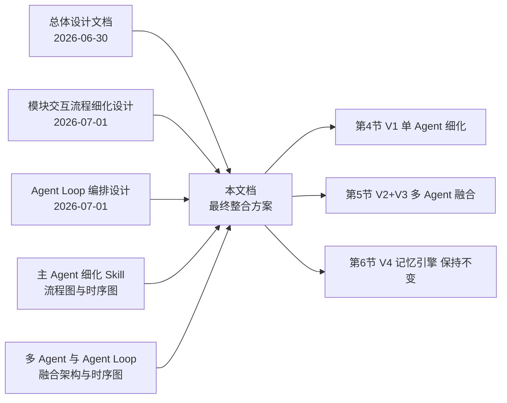
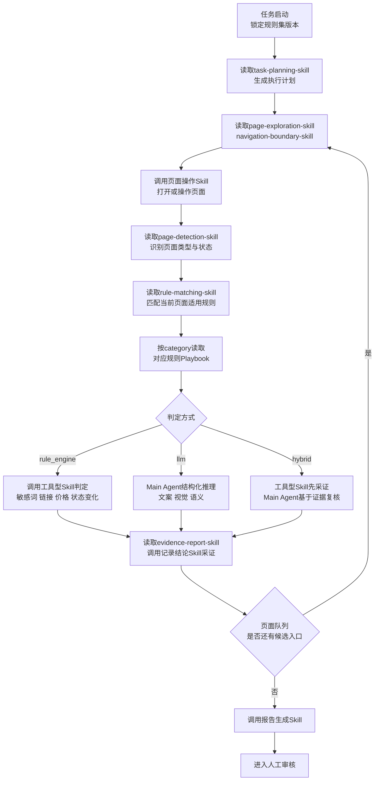
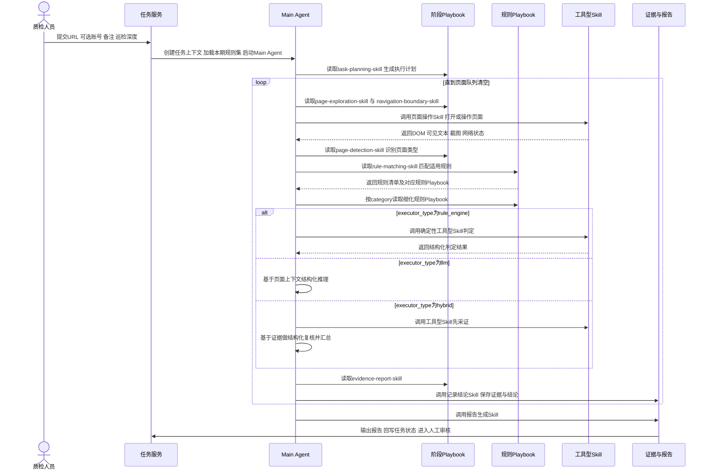
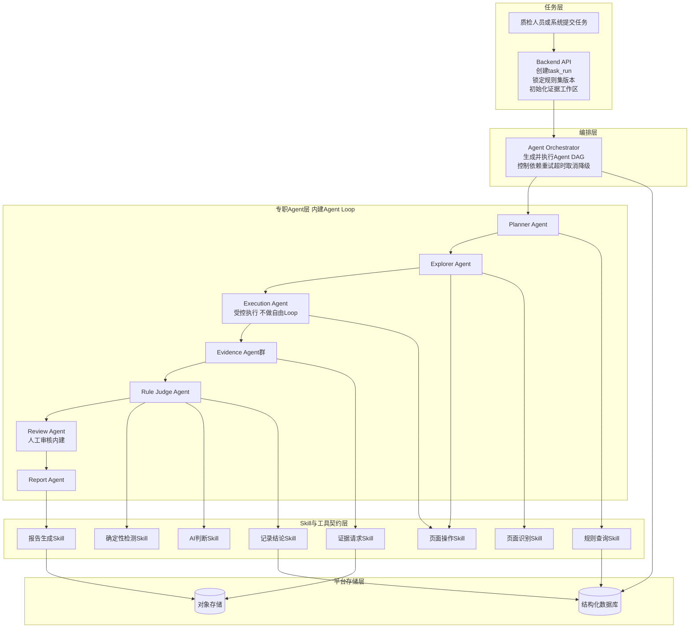
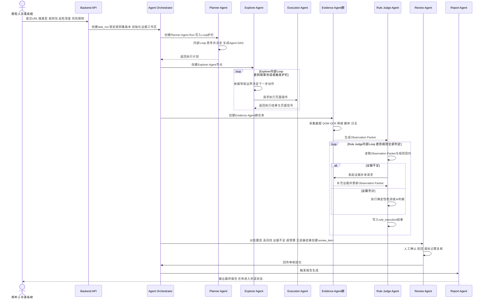
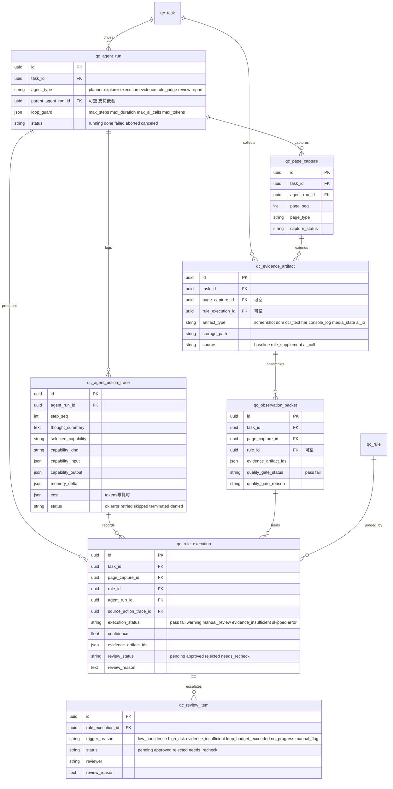

# AI Agent 质检平台 — 最终整合方案设计（V1 单 Agent 细化 + 多 Agent Loop 融合架构）

> 版本：v1.1（循环护栏新增识别门禁）
> 日期：2026-07-03
> 技术栈：沿用总体设计文档（Python + Microsoft Agent Framework + PostgreSQL + pgvector）
> 关联文档：
> - [2026-06-30-alioth-platform-design.md](./2026-06-30-alioth-platform-design.md)（总体架构、规则数据模型、v1~v4 路线图的原始版本；本文档第 2～3 节对其 v1 表述做了勘误，第 5 节是其 v2/v3 的权威细化版本）
> - [2026-07-01-alioth-qc-workflow-detail.md](./2026-07-01-alioth-qc-workflow-detail.md)（数据源 CRUD、两级证据分类、批量质检循环、人审流程的模块级细节；V1 与 V2+V3 均直接复用其结论）
> - [2026-07-01-alioth-agent-loop-design.md](./2026-07-01-alioth-agent-loop-design.md)（Agent Loop 基础机制与 Skill 化论证；本文档第 4 节是其在单 Agent 场景下的 Skill 分层细化，第 5 节是其在多 Agent 场景下的扩展）
> 来源草图：本文档已整合 `main_agent_granular_skills_flowchart.html`、`main_agent_granular_skills_sequence.html`、`自动化质检平台多Agent与AgentLoop融合架构流程图.html`、`自动化质检平台多Agent与AgentLoop融合执行时序图.html` 四份可视化草图的设计思路；四份草图可继续作为图形化速览保留，其中的结论已在本文档中落地为文字设计，不再单独演进新内容。

---

> **2026-07-05 术语订正（重要，先读）**：本文档第 4、5 节使用的"阶段 Playbook / 规则 Playbook"与"工具型 Skill"两个词，与业界 [Agent Skills 规范](https://agentskills.io) 的术语正好相反——该规范里"Skill"专指 Agent 只读取、不执行的 `SKILL.md` 指导文档（渐进式披露），而"可执行、有副作用的函数"对应的是 Tool（function calling）。代码落地时已按规范订正并互换目录：本文档的"阶段 Playbook""规则 Playbook" = 现在的 **Skill**（代码在 [agents/skills/](../../services/api/app/agents/skills/README.md)）；本文档的"工具型 Skill" = 现在的 **Tool**（代码在 [agents/tools/](../../services/api/app/agents/tools/README.md)）。下文历史行文不再逐处修改，阅读时按此映射替换即可；完整对比表与 Agent Loop 协同机制见 [agents/README.md](../../services/api/app/agents/README.md)，修复记录见 [docs/专项能力与高频回归规则.md](../专项能力与高频回归规则.md)。

## 0. 文档定位与阅读指南

本文档是当前 Alioth 质检平台设计的**权威整合版本**，在既有三份设计文档的基础上，把两类原本比较粗略的描述细化为可直接指导实现的方案：

1. **V1 单 Agent 架构**：把"Main Agent 自主调用 Skill"细化为**阶段 Playbook + 规则 Playbook + 工具型 Skill**三层结构，Main Agent 不再是一个笼统的黑盒，而是有清晰的"读什么、调什么、何时调"的分层依据。
2. **V2+V3 合并后的多 Agent 架构**：把"Main Agent 委派业务 Agent"细化为**Agent Orchestrator 全局调度 + 各专职 Agent 内部受控 Agent Loop**的生产级架构，并把原 v3 的人工审核直接内建为 Review Agent，不再是事后追加的环节。

既有三份文档**不作废**，仍是规则数据模型、采集分类规范、Agent Loop 基础机制、各阶段 TODO 的第一手来源；本文档聚焦"编排结构"与"Skill/Agent 如何拆分"，不重复其已经讲清楚的细节，只在需要处以链接引用。

**阅读建议**：先读第 4 节了解 V1 如何用一个 Agent 加分层 Skill 跑通全链路，再读第 5 节了解规模化之后如何演进为 Orchestrator 加多 Agent 加受控 Loop；第 6 节是两者的过渡说明；第 7 节给出合并后的总路线图。

### 0.1 一览：什么保持不变、什么被细化、什么被合并

| 事项 | 处理方式 |
| --- | --- |
| 规则数据模型 `qc_rule` / `qc_task` / `qc_rule_execution` | 以 `qc_rule_execution` 作为 V1 起的规则执行主表，`qc_finding` 仅作为兼容展示或历史别名处理 |
| Skill 接口稳定、跨阶段复用的原则 | 保持不变，是本文档细化的前提 |
| "v1 起就是 Agent Loop，不是固定流水线" 的结论 | 保持不变，本文档据此**修正**了总体设计文档中残留的"固定流水线/Worker 驱动"表述（见第 2.2 节） |
| 页面探索 Skill、规则查询 Skill 等既有 Skill 工具箱（2026-07-05 起术语订正为 Tool，见文首提示） | 保持不变，归类为本文档的"工具型 Skill"（即现在的 Tool），是分层能力体系的地基 |
| Main Agent 的职责边界 | 被**细化**：拆分为"阶段 Playbook"（怎么走流程，即现在的阶段 Skill）与"规则 Playbook"（每类规则怎么判，即现在的规则 Skill）两条主线 |
| v2 业务 Agent 群、v3 人审与禅道自动化 | 被**合并**为"V2+V3"一个阶段，用 Agent Orchestrator + Agent Loop Runtime 的融合架构落地，人审是其中的 Review Agent，不再是独立追加的模块 |
| v4 记忆引擎 | 保持不变，继续作为横切层叠加在合并后的 V2+V3 之上（见第 6 节） |
| 循环护栏 | 被**细化**：新增“识别门禁”约束同类页面的访问覆盖度，V1 见第 4.9 节，V2+V3 见第 5.9 节 |
---

## 1. 与既有设计的关系一览

第 10 节附有更细的"章节与来源映射表"，标注本文档每一节具体细化或修正了哪份既有文档的哪个章节。

---

## 2. 总体原则更新

延续总体设计文档"核心设计原则"，结合本次整合做以下更新：

1. **跨阶段唯一变化的是"自主编排的广度"，不是"要不要用 Agent"**：V1 是单一 Main Agent 内部对 Skill 的自主编排；V2+V3 是 Agent Orchestrator 之下多个专职 Agent、每个 Agent 内部再做小型 Agent Loop 编排。两者都是 Agent Loop，只是广度从"调用哪个 Skill"扩展到"调用哪个 Agent、该 Agent 内部再调用哪个 Skill"。
2. **Skill 契约稳定，调用者可以变化**：V1 中 Main Agent 直接持有的阶段 Playbook、规则 Playbook、工具型 Skill，到了 V2+V3 会按职责拆分挂载到不同专职 Agent 上——**契约不变，只是调用者从"一个 Main Agent"变成"多个专职 Agent"**。
3. **状态与证据永远落库，不放在模型记忆里**：`qc_task` / `qc_rule` / `qc_page_capture` / `qc_agent_run` / `qc_agent_action_trace` / `qc_evidence_artifact` / `qc_observation_packet` / `qc_rule_execution` / `qc_review_item` 共同构成可回放、可审计的执行留痕。`qc_finding` 不再作为 V1 主结果表，仅保留为兼容展示或历史别名。
4. **人工审核是一等公民，不是事后补丁**：原 v3 的人审环节，在合并后的 V2+V3 架构里内建为 Review Agent 与 `qc_review_item` 状态机，触发原因（低置信、高风险、证据不足、Loop 超预算、Loop 无进展、人工标记）在数据模型里显式建模，而不是隐含在流程描述里。

---

## 3. 规则数据模型细化

规则数据模型的整体结构以 `qc_ruleset` / `qc_rule` / `qc_task` / `qc_rule_execution` 为主线。本次整合除第 3.1、3.2 节的字段细化外，同时明确 V1 起直接使用 `qc_rule_execution` 记录每条规则的完整执行状态，避免先落 `qc_finding` 再做主表迁移。规则来源追溯由 `qc_ruleset.source_type`、`qc_ruleset.source_ref` 与快照哈希承担，`qc_rule` 面向规则运行时定义。`qc_rule.page_type` 表示规则主适用页面类型，`qc_rule.applicable_page_types` 表示规则适用页面类型列表。

### 3.1 `category` 细化为 8 类，对应规则 Playbook 分组

原枚举「文案 / 敏感词 / 视觉 / 功能 / 合规」中的"功能"过于宽泛，本次结合 HTML 草图里更细的规则分组，把"功能"拆分为 4 个更具体的类别，并把"敏感词"降级为跨类别的工具型 Skill（原因见第 4.4 节），最终细化为 8 类：

| 细化后 category | 说明 | 对应规则 Playbook |
| --- | --- | --- |
| `text` 文案 | 错别字、语法、文案柔顺度、叹号使用、大小写一致 | text-rule-skills |
| `visual` 视觉 | 图片清晰度、拉伸、页面空白、遮挡、列表整齐度 | visual-rule-skills |
| `interaction` 交互 | 外链打开、按钮反馈、点赞收藏状态、评论更新、退出登录 | interaction-rule-skills |
| `ad` 广告 | 倒计时、跳过按钮、弹窗关闭、落地页一致、广告加载失败 | ad-rule-skills |
| `payment` 支付 | 价格一致、优惠价低于原价、会员/金币商品展示 | payment-rule-skills |
| `input_risk` 用户输入风险 | 恶意链接、涉政涉恐、刷屏、防刷机制、私人广告 | input-risk-rule-skills |
| `player` 播放器 | 最近观看进度、广告秒开、广告失败后播放正片 | player-rule-skills |
| `compliance` 合规综合 | 不落在以上具体业务场景的兜底合规检查 | 复用敏感词/品牌词/知识库检索工具 Skill |

> 敏感词、品牌词检测**不再作为独立分类**，而是被 `text` / `input_risk` / `compliance` 三个规则 Playbook 共同调用的**工具型 Skill**（详见第 4.2 节的两层 Skill 划分），这样一条敏感词能力可以被多个业务分类复用，不用重复建模。

### 3.2 `executor_type` 新增 `hybrid`

| executor_type | 说明 | 典型场景 |
| --- | --- | --- |
| `llm` | 完全依赖 Main Agent / Rule Judge Agent 的结构化推理 | 文案柔顺度、违规语义等模糊判断 |
| `rule_engine` | 完全走确定性程序判断 | 敏感词扫描、元素存在性、链接 404、价格正则 |
| `hybrid`（新增） | 服务先采证/结构化分析，AI 基于证据复核，最终由 Agent 汇总 | 广告倒计时是否可跳过并结合文案语气判断是否违规诱导等需要"证据+语义"共同判断的规则 |

新增枚举值不改变字段类型，属于向后兼容的增量扩展，符合总体设计文档"executor_type 是 B→C 开关"的既定原则。

---

## 4. V1 设计：Main Agent + 分层 Skill（单 Agent 架构）

### 4.1 定位与核心原则

- Main Agent 是 v1 阶段**唯一**的编排者与执行者，负责"接下来做什么"的全部决策。
- Main Agent 不需要记住 40 条规则的全部细节，只需要知道：当前页面是什么类型、该检索哪个规则 Playbook、该调用哪个工具型 Skill、如何汇总结果。规则细节全部下沉到规则 Playbook。
- 与《Agent Loop 编排设计》第 2 节的关系：本节是对该文档"Skill 工具箱"的**分层细化**，不是替换——原有工具型 Skill 清单原样保留，本节新增的是"阶段 Playbook"与"规则 Playbook"这一层指导性知识。

### 4.2 Skill 两层分类：指导型 Playbook 与工具型 Skill

结合 HTML 草图与既有 Skill 工具箱，本文档把 Main Agent 可用的能力明确划分为两层，避免"Skill"一词含义混淆：

| 层级 | 定位 | Main Agent 的用法 | 举例 | 类比 |
| --- | --- | --- | --- | --- |
| **指导型 Playbook**（阶段 + 规则） | 自然语言的操作规程 / 判断标准，本身**不执行任何动作**，只影响 Main Agent 如何决策 | "读取"（检索/参考） | task-planning、page-exploration-policy、rule-matching、text-rule 等 | 类似本仓库 `.agents/skills/*/SKILL.md`，是给 Agent 看的知识文档 |
| **工具型 Skill** | 可执行函数，真正产生副作用或返回结构化数据 | "调用"（function calling） | 页面操作、规则查询、敏感词检测、品牌词检测、知识库检索、OCR、截图比对、记录结论、报告生成 | 等价于 Agent Framework 里挂载给 Agent 的 Tool |

这一区分解决了两组来源材料的术语重叠问题：《Agent Loop 编排设计》里的"Skill 工具箱"全部是**工具型 Skill**；HTML 草图里的"阶段 Skill / 规则 Skill"全部是**指导型 Playbook**。Main Agent 的一次决策通常是"先读一个指导型 Playbook 确定该怎么做，再调用一个或多个工具型 Skill 去执行"。

### 4.3 阶段 Playbook 一览

| Playbook | 职责 | 关键决策点 |
| --- | --- | --- |
| task-planning-skill | 任务级规划 | 如何拆阶段、设置边界、安排优先级、失败重试策略 |
| page-exploration-skill | 页面探索策略 | 如何打开入口、发现 Tab/列表/详情/广告/支付/设置等候选页面 |
| page-detection-skill | 页面识别标准 | 如何用 URL、DOM、OCR、截图、布局判断页面类型与状态 |
| navigation-boundary-skill | 导航边界 | 最大深度、外链、登录、支付、下载、高风险操作的限制；同类页面的识别门禁（按 `page_sampling_policy` 抽样而非全量访问，见第 4.9 节） |
| evidence-report-skill | 证据与报告规范 | 每条规则要保存什么证据，报告如何组织 |

这 5 个 Playbook 是对既有"页面探索 Skill"职责的**进一步拆分**：原文档中笼统的"页面探索 Skill"现在明确拆成"探索策略怎么定（page-exploration）""怎么识别页面（page-detection）""边界在哪（navigation-boundary）"三块指导内容，实际的浏览器操作仍由第 4.2 节的工具型"页面操作 Skill"执行。

### 4.4 规则 Playbook 一览

| Playbook | 职责 | 关联 category | 常用工具型 Skill |
| --- | --- | --- | --- |
| rule-matching-skill | 决定当前页面要跑哪些规则 | 全部 | 规则查询 Skill |
| text-rule-skills | 文案类判断标准 | text | 敏感词检测、品牌词检测、知识库检索 |
| visual-rule-skills | 视觉类判断标准 | visual | OCR、截图比对 |
| interaction-rule-skills | 交互类判断标准 | interaction | 页面操作、记录结论 |
| ad-rule-skills | 广告类判断标准 | ad | 页面操作、截图比对 |
| payment-rule-skills | 支付类判断标准 | payment | 页面操作、知识库检索 |
| input-risk-rule-skills | 用户输入风险判断标准 | input_risk | 敏感词检测、品牌词检测 |
| player-rule-skills | 播放器类判断标准 | player | 页面操作、截图比对 |

`rule-matching-skill` 内部逻辑：先调用工具型"规则查询 Skill"按 `scope`/`url_pattern` 取回本次任务锁定的规则集快照，再结合规则的 `applicable_page_types` / 主 `page_type` 与 page-detection-skill 输出的 `page_type`/`page_state`/`candidate_actions` 做二次过滤，最终产出"当前页面本轮要跑的规则清单及各自应读取的规则 Playbook"。

### 4.5 执行循环

### 4.6 执行时序

### 4.7 判定方式：服务优先、AI 补充、混合判定

| 判定方式 | 对应 executor_type | 使用原则 | 示例 |
| --- | --- | --- | --- |
| 服务判定优先 | rule_engine | 能确定性判断的规则优先走程序，不浪费 LLM 推理 | DOM 存在性、外链可用、倒计时数值、价格正则 |
| AI 判定补充 | llm | 模糊、语义类规则走结构化推理 | 文案柔顺度、错别字、视觉质量、违规语义 |
| 混合判定 | hybrid | 服务先采证/结构化分析，Agent 基于证据复核并汇总 | 广告跳过按钮是否可点 + 文案是否存在诱导语气 |

### 4.8 与采集分类和批量质检循环的衔接

本节的阶段 Playbook、规则 Playbook 不改变《模块交互流程细化设计》已确立的两个关键机制，而是为其提供更清晰的调用依据：

- **两级证据分类**（页面层 baseline / 规则层 rules）：page-exploration-skill 与 evidence-report-skill 共同决定"何时只需复用页面基线证据、何时需要为某条规则单独采集追加证据"，采集与存储路径规范维持《模块交互流程细化设计》第 3.1 节不变。
- **按页面批量质检**：rule-matching-skill 产出的"当前页面规则清单"就是批量质检循环里"该页面规则批次"的输入来源，批次大小仍按文本量动态拆分，结构化输出与有限重试机制维持《模块交互流程细化设计》第 4 节不变。

### 4.9 循环护栏（V1 版）

V1 只有一个 Main Agent，护栏相对简单，直接复用《Agent Loop 编排设计》第 2.4 节，并新增识别门禁约束页面覆盖范围：

- **正常终止**：目标页面集合全部访问，且适用规则均已产出结论。
- **识别门禁（页面覆盖度约束）**：同一 `page_type` 的候选页面不要求逐一全量访问，由 navigation-boundary-skill 持有 `page_sampling_policy` 抽样规则，Main Agent 在决定是否继续访问下一个候选页面时据此判断，从源头限制页面队列规模，避免因过度自由探索导致成本与证据量失控。
- **预算保护**：最大步数、最大时长上限，超过则强制收敛并标注未完成项。
- **卡死检测**：连续调用同一 Skill、同样参数却无新信息，判定无进展，跳出并标记异常。
- **动作留痕**：每一步调用记录能力名称、输入输出、状态与成本，落库供审计回放。

`page_sampling_policy` 的抽样策略：

| 策略 | 说明 | 适用场景 |
| --- | --- | --- |
| `all` 全量 | 该 `page_type` 下候选页面全部访问，不抽样 | 默认用于 `payment`、`input_risk` 等高风险类别，或候选页面基数本身很小的类型 |
| `first_n` 前 N 个 | 按发现顺序取前 N 个 | 列表页、频道页等有明显顺序的页面 |
| `random_n` 随机 N 个 | 从候选集合中随机抽取 N 个 | 内容高度同构、担心顺序偏差的页面 |
| `percentage` 按比例 | 按候选总数的百分比抽样，可设上下限 | 候选规模差异较大的页面类型，避免固定 N 在极端情况下过多或过少 |

未显式配置的 `page_type`，其默认抽样策略与具体 N / 比例取值列入第 9 节待确认事项；策略本身挂载在 ruleset 或任务提交参数上，具体落库位置同样列入第 9 节。

V2+V3 阶段的护栏在此基础上新增跨 Agent 维度的约束，并把识别门禁下沉为 Explorer Agent Loop 的前置约束，见第 5.9 节。

### 4.10 项目落点（预留代码路径）

当前仓库处于纯设计阶段，以下为**预留**的代码组织方式，供后续实现参考，不代表已存在的代码：

| 落点 | 说明 |
| --- | --- |
| `qc_agents/workflows/page_aware_qc_workflow.py` | 承载 v1 任务入口，内部启动并驱动 Main Agent |
| `qc_agents/agents/main_qc_agent.py` | Main Agent 本体，持有全部阶段 Playbook、规则 Playbook 与工具型 Skill 的调用权限 |
| `skills/phase/` | 存放阶段 Playbook 内容 |
| `skills/rule/` | 存放规则 Playbook 内容，与 `rule_sources/` 中的规则主数据配合 |
| `rule_sources/` | 规则主数据来源，供规则查询 Skill 读取 |

---

## 5. V2+V3 融合设计：Agent Orchestrator + Agent Loop Runtime（多 Agent 架构，人审内建）

### 5.1 融合定位与核心边界

原总体设计文档把 v2（业务 Agent 群）与 v3（人审 + 禅道自动化 + Agent 配置后台）分为两个阶段。经确认，本文档把二者**合并**为一个阶段落地：多 Agent 编排与人工审核是同一套生产架构的两个内建组成部分，不是先做多 Agent、再事后加人审。

核心边界（贯穿本节始终）：

> **Agent Orchestrator 决定"哪个 Agent 何时运行"；Agent Loop Runtime 决定"该 Agent 内部下一步调用哪个 Skill"。** 全局状态永远不放在大模型记忆里，必须落到 `qc_agent_run`、`qc_agent_action_trace`、`qc_evidence_artifact`、`qc_observation_packet`、`qc_rule_execution`、`qc_review_item`（第 5.10 节）。Agent Loop 增强的是专职 Agent 的**局部自主决策**，不能绕过 Orchestrator 的全局状态机、Skill 的工具权限、证据门禁、成本预算与人工复核。

### 5.2 全局架构

### 5.3 内建 Agent Loop 的专职 Agent 清单

| Agent | Loop 输入 | Loop 决定的事情 |
| --- | --- | --- |
| Planner Agent | 任务目标、规则包摘要、可用 Skill 清单、预算 | 执行阶段划分、Agent DAG 结构、并行分组、降级策略 |
| Explorer Agent | 页面信号、导航边界、已访问/待访问页面 | 下一步访问、点击、滚动、跳过或停止探索 |
| Rule Judge Agent | Observation Packet、规则 input_contract | 补采证据、走确定性检测、走 AI 专项判断、或转人工复核 |
| Specialist AI 子循环 | 视觉/内容安全/媒体专项输入 | 在 Rule Judge 或 Evidence Agent 内部做局部多模态推理，只输出结构化判断，不调度全局 |
| Report Agent | 规则结果、证据链、复核结论 | 组织报告结构、生成问题解释与摘要 |

**Execution Agent 不做自由 Agent Loop**：浏览器点击、输入、等待、截图是高风险副作用动作，必须由明确的工具权限、参数 Schema 与 navigation-boundary 约束执行，只接受 Explorer/Rule Judge 下发的结构化指令，不自主决策"要不要点这个按钮"。

### 5.4 Review Agent 与人工审核内建

原 v3 的人审能力，在合并后的架构里是 Review Agent 的职责，而不是独立追加的模块：

- Orchestrator 对**低置信、高风险、证据不足、Loop 超预算、Loop 无进展**的规则执行结果，自动创建 `qc_review_item`（触发原因显式记录，见第 5.10 节）。
- 审核员对每个 review_item 做 `pending → approved / rejected / needs_recheck` 三态处理；`needs_recheck` 可触发该规则重新采集或重新判定。
- 审核通过的问题，通过禅道 Skill/MCP 自动建 Bug/提单（复用总体设计文档 v3 的描述，接口细节不变）。
- 驳回原因与确认结果沉淀为 V4 记忆引擎的反馈记忆输入。

### 5.5 动态 Agent 注册与配置后台

延续总体设计文档 v3 的"Agent 配置后台"能力，作为 Orchestrator 发现可调度 Agent 的机制：后台创建 Agent 时配置系统提示词、挂载 Skill（阶段/规则 Playbook + 工具型 Skill）、知识库、MCP，写入 Agent 注册表；Orchestrator 运行时从注册表发现并调度这些动态配置的 Agent，与内置的 Planner/Explorer/Rule Judge 等核心 Agent 并存。

### 5.6 Skill 与工具契约映射

| Skill | 输入 | 输出 | 说明 |
| --- | --- | --- | --- |
| 页面操作 Skill | 动作类型 目标 参数 | 执行状态 DOM 截图 | 封装 Playwright 稳定等待、重试、截图 |
| 页面识别 Skill | URL DOM OCR 截图 可点击元素 | page_type page_state candidate_actions | 供 Explorer/Rule Judge 判断当前局面 |
| 规则查询 Skill | rule_set endpoint page_type applicable_page_types url_pattern | 版本锁定的规则快照 | 与 V1 的规则查询 Skill 是同一契约 |
| 证据请求 Skill | 证据类型 区域 页面引用 | evidence_request | 生成截图 DOM OCR 网络 媒体 日志的补采请求 |
| 确定性检测 Skill | 待检测文本或元素 | 命中结果 | 敏感词 品牌词 链接可用性 价格 倒计时 状态变化 |
| AI 判断 Skill | Observation Packet 规则契约 | 结构化判断 置信度 理由 | 通过 AI Gateway 调用 LLM/VLM，强制 JSON Schema、prompt 版本、成本与超时控制 |
| 记录结论 Skill | rule_execution 字段 | 写入成功状态 | 禁止 Agent 直接写数据库，统一收口 |
| 报告生成 Skill | task_id | 结构化报告 | 读取规则结果 证据 复核意见 |

> Skill 是 Agent 可见的能力契约，Service 是工程实现，Repository 是数据访问。Agent 只能通过 Skill/Tool 调用平台能力，不能直接使用浏览器 API、数据库连接、对象存储客户端或模型 SDK——这一约束从 V1 到 V2+V3 保持不变，只是 V2+V3 阶段需要显式的工具权限白名单来强制执行（见第 5.9 节）。

### 5.7 工作记忆与证据闭环

| 概念 | 内容 |
| --- | --- |
| Working Memory | 记录 visited_pages pending_pages executed_rules pending_rules evidence_map retry_count |
| Action Trace | 每轮记录 thought_summary selected_capability capability_input capability_output memory_delta cost status，对应 `qc_agent_action_trace` |
| Evidence Workspace | 统一管理截图 DOM OCR HAR 媒体状态 AI输入输出与报告产物，对应 `qc_evidence_artifact` |
| Observation Packet | 把 evidence_artifacts 合并为规则判定的唯一输入，避免规则直接读取散落文件，对应 `qc_observation_packet` |
| Quality Gate | 校验证据完整性 清晰度 时效性 关联性 可追溯性 与 AI 可复现性，通过后才能进入 Rule Judge |

### 5.8 执行时序详解

以上时序对应六个阶段，各阶段关键点：

1. **任务初始化与 Loop 运行边界**：Backend API 创建 `task_run`，锁定规则包版本，初始化证据工作区，Orchestrator 为 Planner 写入 `loop_guard`（max_steps、max_duration、max_ai_calls、max_tokens、no_progress_limit）。
2. **Planner Loop 生成执行计划**：Planner 读取任务目标、规则包摘要、可用 Skill 清单和历史策略，产出 `agent_plan`，Orchestrator 据此创建 Explorer/Execution/Evidence/Rule Judge 等 Agent DAG 节点。
3. **Explorer Loop 决定页面探索动作**：根据入口 URL、导航边界、已访问页面、候选入口决定 goto/click/scroll/wait/extract，Execution Agent 负责实际执行并返回结果，Explorer 更新工作记忆，无进展则触发卡死检测。
4. **Evidence Agents 生成标准证据**：视觉、网络、媒体、日志类证据能力采集截图、DOM、OCR、HAR、console、媒体状态、AI 输入输出，经 Quality Gate 后产物入对象存储，生成 Observation Packet。
5. **Rule Judge Loop 做规则判定与补采决策**：证据不足则请求补采，证据充分则走确定性检测或 AI 判断，写入 `rule_execution`（pass/fail/warning/manual_review/evidence_insufficient/skipped/error）。
6. **复核、报告、回放与沉淀**：Orchestrator 对需要关注的结果创建 `review_item`，Review Agent 处理人工结论，Report Agent 汇总生成报告，任务进入 completed。

### 5.9 循环护栏与生产约束

| 护栏 | 说明 |
| --- | --- |
| 识别门禁 | 同一 `page_type` 不要求全量访问，Explorer Agent 按 `page_sampling_policy` 抽样决定候选页面范围，高风险类别可配置强制全量覆盖；继承自 V1 第 4.9 节，作为 Explorer Loop 的前置约束 |
| 最大步数 | 每个 Agent Loop 设置 max_steps，超过后强制收敛，标记未完成项 |
| 时间与成本预算 | 限制 max_duration max_ai_calls max_tokens max_cost，超限进入降级或人工复核 |
| 无进展检测 | 连续相同 Skill 相同参数且无 memory_delta 时判定卡死，停止循环并记录异常 |
| 工具权限 | Agent 只能调用白名单 Skill，高风险动作需要 navigation_boundary 与审批策略 |
| Checkpoint | 每轮循环可恢复，异常重启后从 agent_run tool_calls memory 快照继续 |

自主循环的自由度只能用于"选择下一步"，不能绕过证据链、状态机、权限、成本、审计与人工复核。

### 5.10 数据模型增补

在 `qc_task` / `qc_rule` / `qc_page_capture` 基础上新增以下表，支撑 Agent Loop 留痕与证据闭环：

另需一张轻量注册表支撑 M0 阶段的 Agent Capability Registry：

| 字段 | 说明 |
| --- | --- |
| capability_name | 主键，如 page_operation、ocr、sensitive_word_detect |
| capability_kind | tool 或 skill |
| input_schema / output_schema | JSON Schema，用于校验 Agent 调用参数与返回结构 |
| permission_level | low / medium / high_risk，高风险动作需要人工审批策略 |
| owner_team | 负责维护该能力的团队或个人 |
| version | 版本号，配合灰度与回滚 |

**与 `qc_finding` 的关系**：V1 阶段直接使用上表的 `qc_rule_execution` 作为规则执行主表，记录每条规则的完整执行状态，而不是只记录命中项。`qc_finding` 如需保留，仅作为兼容展示视图、报表导出别名或历史数据迁移入口，不再承载新的规则判定主数据。这样可以让 V1 的单 Agent 链路与 V2+V3 的多 Agent 链路复用同一套结果模型，避免后续主表迁移。

### 5.11 与 V1 的关系和迁移路径

- V1 阶段积累的阶段 Playbook、规则 Playbook、工具型 Skill **原样保留**，V2+V3 只是把"谁来调用"从"一个 Main Agent"拆分给"多个专职 Agent"：
  - task-planning-skill → Planner Agent
  - page-exploration-skill / page-detection-skill / navigation-boundary-skill → Explorer Agent
  - rule-matching-skill 及各规则 Playbook → Rule Judge Agent
  - evidence-report-skill → Evidence Agent 群与 Report Agent
- 迁移建议：先把 V1 单 Agent 跑通、验证 Skill 契约稳定后，再引入 Orchestrator，把 Main Agent 的职责按上表拆分委派给专职 Agent；拆分过程中 Skill 输入输出契约不变，只是新增 Orchestrator 层的调度、Agent Loop Runtime 的护栏与 Evidence Workspace/Observation Packet 的中间层。

### 5.12 落地路线 M0 至 M4

| 里程碑 | 内容 |
| --- | --- |
| M0 Loop 契约 | 定义 Agent Capability Registry、Agent Loop State、Working Memory、Tool Call schema |
| M1 Planner/Explorer Loop | 先让规划和页面探索使用受控循环，Execution 仍走稳定工具 |
| M2 证据闭环 | 接入证据请求、Observation Packet、Quality Gate 和补采机制 |
| M3 Rule Judge Loop | 规则判定按 input_contract 决定补采、确定性检测和专项 AI 判断 |
| M4 复核报告 | 将低置信、高风险、循环异常、证据不足统一进入 Review Agent 与报告 |

M0～M4 是"V2+V3"这个宏观阶段内部的交付顺序，不是与 v1～v4 平级的新编号。

---

## 6. V4：记忆引擎叠加层

V4 记忆引擎设计维持总体设计文档第 8 节不变，作为横切层继续叠加在合并后的 V2+V3 架构之上：

- **工作记忆**：对应本文档第 5.7 节的 Working Memory，任务内推理连贯。
- **情景记忆 / 语义记忆**：Main Agent（V1）或 Planner/Rule Judge Agent（V2+V3）检索历史相似案例与领域经验，提升编排与判断质量。
- **反馈记忆**：Review Agent 产生的确认/驳回记录（`qc_review_item`）是进化闭环的核心训练信号。
- **进化闭环**：采集、分析、提案、离线回放评估、灰度验证、全量或回滚，最终更新规则库与语义记忆，重大变更经业务确认后生效。

本次整合不改变记忆引擎的分层设计与进化闭环流程，详见总体设计文档第 8 节。

---

## 7. 更新版路线图总表

| 阶段 | 编排方式 | 关键能力 | 目标 |
| --- | --- | --- | --- |
| **v1** | 单一 Main Agent 自主 Loop + 阶段 Playbook / 规则 Playbook 分层 | 规则库、Playwright 采集、敏感词、报告、工作台、TG | 单 Agent 跑通全链路，验证 Skill 契约与规则模型 |
| **v2+v3（合并）** | Agent Orchestrator + Agent Loop Runtime + 专职 Agent 群 + 内建人审 | Planner/Explorer/Execution/Evidence/Rule Judge/Review/Report Agent、Agent Capability Registry、Evidence Workspace、Quality Gate、禅道自动化、Agent 配置后台 | 多 Agent 生产级编排，人审内建为一等公民，闭环落地可运营 |
| **v4** | + 记忆引擎 | 分层记忆、反馈学习、规则与 Prompt 自进化、灰度评估 | 自我迭代进化，越用越准 |

---

## 8. 演进保障（更新版）

1. **规则模型一以贯之**：自然语言规则加可选结构化字段，v1 由 Main Agent 判断，v2+v3 由多个专职 Agent 判断，规则库 schema 不变。
2. **Skill 契约稳定**：v1 单 Main Agent 与 v2+v3 各专职 Agent 调用同一批工具型 Skill 与指导型 Playbook，能力层零重写。
3. **编排层可插拔**：v1 单 Agent 编排与 v2+v3 多 Agent 编排是同一任务入口下自主编排广度不同的两种实现，可灰度共存。
4. **降本通道预留**：`executor_type` 三态开关让确定性规则随时下沉规则引擎，混合判定覆盖需要证据加语义共同判断的场景，不影响整体架构。
5. **人审与证据闭环内建**：`qc_review_item` 与 `qc_observation_packet` 让人工复核和证据质量门禁成为架构的一等公民，而不是事后补丁。
6. **进化能力叠加**：记忆引擎作为横切层在 V4 叠加，不改动既有运行时与规则主结构，复用 V2+V3 阶段 Review Agent 产生的反馈数据，实现自我迭代进化。

---

## 9. 待确认事项（TODO，合并三份既有文档并新增）

延续事项（详见各自来源文档，未重复列出全部背景）：

- [ ] 规则 `steps` 精确 schema、OCR 方案选型、任务队列与对象存储选型、工作台前端技术栈（总体设计文档）。
- [ ] 页面清单生成方式的优先级与组合规则、LLM 单批规则数量或 token 上限阈值、页面级并发度与超时（模块交互流程细化设计）。
- [ ] v1 阶段 Main Agent 自主程度边界、单次 Loop 最大步数/超时阈值、Skill 清单粒度、卡死检测量化规则（Agent Loop 编排设计）。

本次整合新增事项：

- [ ] 如需兼容旧数据，补充 `qc_finding` 历史数据导入 `qc_rule_execution` 的一次性脚本；新实现不再新增 `qc_finding` 主写路径。
- [ ] `page_sampling_policy`（识别门禁：全量/前N个/随机N个/按比例，以及各 `page_type` 的默认策略、N 或比例取值、高风险类别强制全量名单）的具体字段与落库位置，是否挂载在 `qc_ruleset` 层级或任务提交参数层级。
- [ ] Agent Capability Registry（`capability_name`/`input_schema`/`output_schema`/`permission_level`）的具体落库位置与校验流程，是否用 JSON Schema Store 或直接建表。
- [ ] Agent DAG 的具体建模方式（显式 DAG 定义 vs Planner 运行时动态生成）与 Orchestrator 的重试/超时/降级策略参数化细节。
- [ ] `loop_guard`（max_steps、max_duration、max_ai_calls、max_tokens、no_progress_limit）在 Planner/Explorer/Rule Judge 三类 Loop 上的具体取值，是否需要分角色差异化配置。
- [ ] Specialist AI 子循环具体挂载在 Evidence Agent 还是 Rule Judge Agent 内部，或作为可选的第三方专项服务接入。
- [ ] M0～M4 具体排期与团队分工（3 人团队下的优先级取舍）。

---

## 10. 附录：章节与来源映射表

| 本文档章节 | 细化/修正的既有文档章节 | 参考的 HTML 草图 |
| --- | --- | --- |
| 第 2.1 节 勘误说明 | 总体设计文档 选定路线、第 5 节 v1 架构 | — |
| 第 3 节 规则数据模型细化 | 总体设计文档 第 4 节 | 两组草图的规则分类描述 |
| 第 4 节 V1 设计 | Agent Loop 编排设计 第 2 节 Skill 工具箱与编排循环 | `main_agent_granular_skills_flowchart.html`、`main_agent_granular_skills_sequence.html` |
| 第 4.8 节 | 模块交互流程细化设计 第 3～4 节 | — |
| 第 5 节 V2+V3 融合设计 | 总体设计文档 第 6～7 节（v2 业务 Agent 群、v3 人审与配置后台） | `自动化质检平台多Agent与AgentLoop融合架构流程图.html`、`自动化质检平台多Agent与AgentLoop融合执行时序图.html` |
| 第 6 节 V4 | 总体设计文档 第 8 节 | — |
| 第 7 节 路线图总表 | 总体设计文档 第 2 节 | — |
