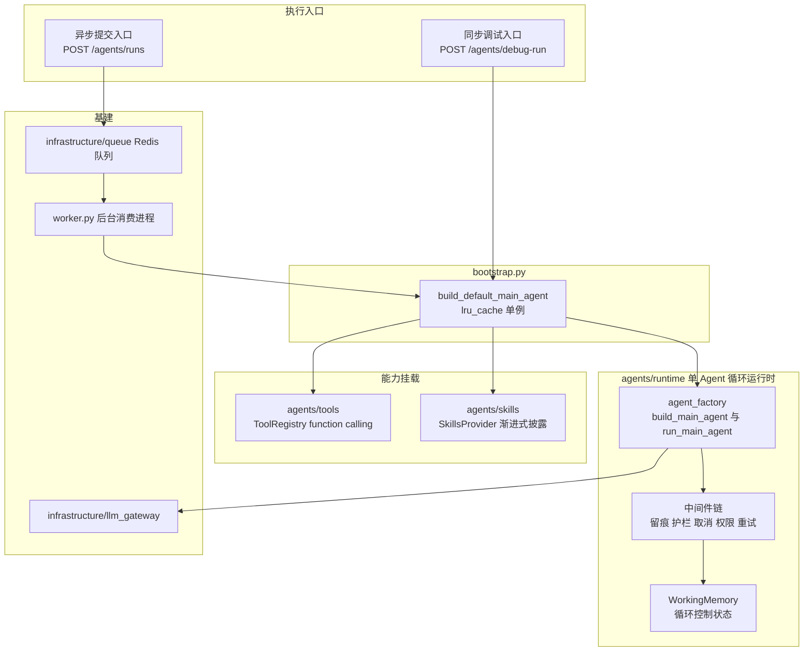
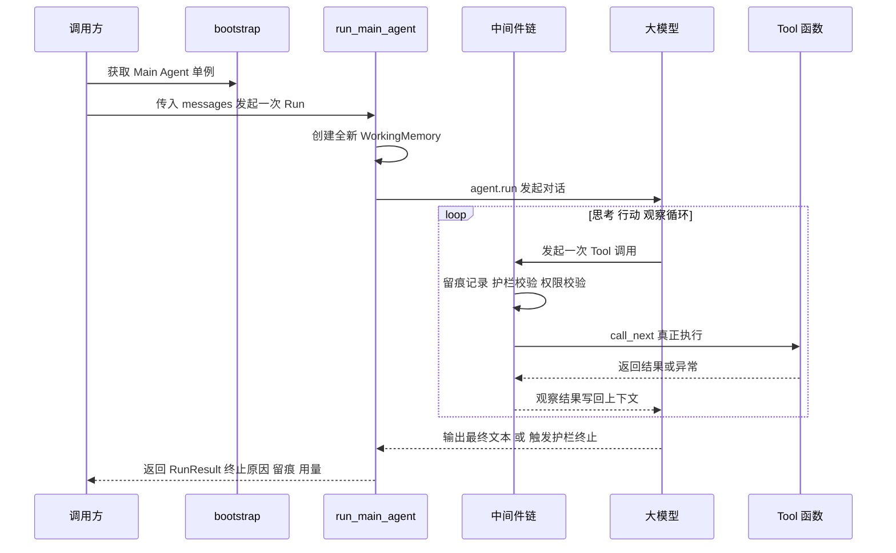
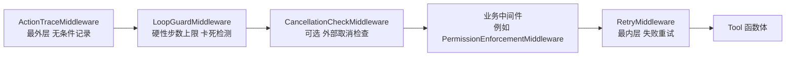
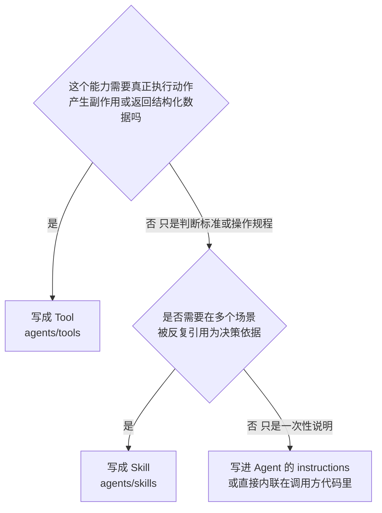
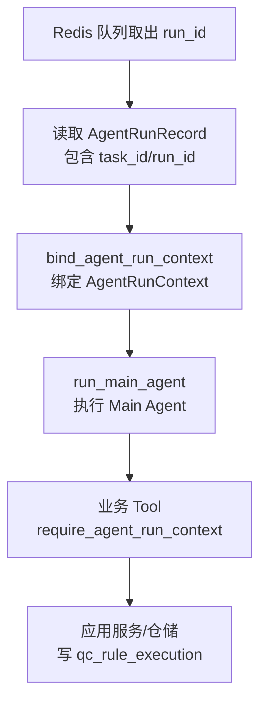

# Alioth Agent Skill / Tool 开发指导文档

> 日期：2026-07-05
> 定位：面向"如何在现有 Agent Runtime 上继续开发质检业务能力"的实操指南，权威性低于设计文档，高于口头约定。
> 前置阅读：[services/api/app/agents/README.md](../../services/api/app/agents/README.md)（Skill/Tool 概念与协同机制）、[services/api/app/agents/runtime/README.md](../../services/api/app/agents/runtime/README.md)（Runtime 职责与实测结论）。
> 范围说明：本文档聚焦 Agent Runtime/Agent Loop 本身与 Skill/Tool 开发方法，不涉及数据库表设计与持久化（按当前任务要求排除）。

## 0. 文档结构

1. 现状回顾：Agent Runtime 与 Agent Loop 是什么
2. 审查结论：现状是否足以支撑后续业务开发
3. 开发指南一：如何开发一个新 Tool
4. 开发指南二：如何开发一个新 Skill
5. 如何把新 Tool/Skill 集成到 Agent 里
6. 面向质检业务的开发路线建议
7. 新增 Tool / Skill 检查清单
8. 参考文档索引

---

## 1. 现状回顾：Agent Runtime 与 Agent Loop 是什么

### 1.1 整体架构



- **Agent Loop**：单个 Agent 内部"思考 → 行动 → 观察"的自主循环，由 Microsoft Agent Framework 1.10.0 的 `Agent`/`FunctionInvocationLayer` 驱动，模型自主决定下一步调用哪个 Tool、是否读取某个 Skill。
- **Agent Runtime**（[runtime/](../../services/api/app/agents/runtime/README.md)）：支撑这个循环"跑得稳"的运行时设施——工作记忆、动作留痕、循环护栏、取消检查、失败重试。V1 只有一个 Main Agent 用它；V2+V3 多个专职 Agent 会各自复用同一套 Runtime 契约（`build_main_agent`/`run_main_agent` 已按通用参数设计，非 Main Agent 专属逻辑硬编码）。
- **Agent Orchestrator**（[orchestrator/](../../services/api/app/agents/orchestrator/README.md)）：V2+V3 才会落地的"哪个 Agent 何时运行"的全局调度层，当前仍是空目录+README。本文档不展开，只在第 5 节给出面向它的前瞻性写法建议。

### 1.2 两个执行入口

| 入口 | 路径 | 特点 |
| --- | --- | --- |
| 同步调试 | `POST /api/v1/agents/debug-run` | 仅允许 `safe` 权限级别 Tool；同步等待结果；不经过 Redis 队列，适合本地联调新 Tool/Skill |
| 异步提交 | `POST /api/v1/agents/runs` + `GET /api/v1/agents/runs/{run_id}` + `POST /api/v1/agents/runs/{run_id}/cancel` | 入队后由独立 [worker.py](../../services/api/app/worker.py) 进程消费执行，支持跨进程取消 |

两个入口共享同一个 `build_default_main_agent()` 单例（见 [bootstrap.py](../../services/api/app/agents/bootstrap.py)），意味着**新增的 Tool/Skill 只要注册进 `default_registry`/`skills/phase`、`skills/rule` 目录，两个入口会同时生效**，无需分别接线。

### 1.3 一次 Run 的生命周期



关键实现点（[agent_factory.py](../../services/api/app/agents/runtime/agent_factory.py)）：

- `build_main_agent`：构建**无状态**、可跨多次 Run 复用的 `Agent`，只把 `max_iterations` 写入框架自带的往返轮次防护；框架 `max_function_calls` 会在并行批次完成后统一计数，不承担 `max_steps` 语义，工具步数统一由本地 `LoopGuardMiddleware` 硬性控制。
- `run_main_agent`：每次调用都新建一个 `WorkingMemory` 和一整条护栏中间件，用 `asyncio.wait_for` 包裹墙钟超时，把异常分类为 `ErrorCategory.LLM_PROVIDER`（`OpenAIError`）或 `ErrorCategory.UNKNOWN`，最终统一返回结构化的 `RunResult`（终止原因、留痕、用量快照）。
- **Agent 对象本身无状态、可复用；每次 Run 的"状态"完全由 `run_main_agent` 现场创建**——这是后面第 3.4 节"有状态 Tool"要解决的核心矛盾：Agent 本身是单例，但业务 Tool 往往需要知道"这是哪个任务、哪次 Run"。

### 1.4 中间件链详解



| 中间件 | 职责 | 终止语义 |
| --- | --- | --- |
| `ActionTraceMiddleware` | 用 try/except/finally 包裹每次调用，无条件记录 `step`/`tool_name`/`arguments`/`status`/`duration_seconds`/`error_message`/`retry_count`，即便调用被内层中间件拦截也会被记录 | 不终止，只记录 |
| `LoopGuardMiddleware` | 在第一次异步让出前同步完成终止锁存、`max_steps` 预算预占和调用签名登记；超额调用只留痕、不占预算 | 命中即 `raise MiddlewareTermination`（硬终止，整个 Run 结束） |
| `CancellationCheckMiddleware` | 调用前查询外部 `is_cancelled` 回调，配合 Redis 队列实现"用户请求取消正在运行的 Run" | 命中即硬终止；未传 `is_cancelled` 时不启用（如调试入口） |
| `PermissionEnforcementMiddleware`（业务中间件示例） | 按运行上下文允许的权限级别集合校验每次 Tool 调用 | **软阻断**：不调用 `call_next`，只设置 `context.result` 为拒绝提示，循环继续 |
| `RetryMiddleware` | 对 `TimeoutError`/`ConnectionError`/`OSError` 等基础设施异常在同一次调用尝试内自动重试，次数写入调用独立的 `FunctionInvocationContext.metadata` | 并行重试互不污染，且对外层步数计数透明 |

**顺序不能打乱**，原因已在各模块文档字符串与 [runtime/README.md](../../services/api/app/agents/runtime/README.md) 中说明；新增自定义中间件时，先判断它是"硬终止类"（放在 `LoopGuardMiddleware`/`CancellationCheckMiddleware` 附近，`extra_middleware` 位）还是"软阻断类"（同样放 `extra_middleware`，但语义上不调用 `call_next` 即可），不要往 `RetryMiddleware` 外层插入任何东西。

### 1.5 Skill 与 Tool 的分工回顾

完整对比表与协同流程图见 [agents/README.md](../../services/api/app/agents/README.md)"两个核心概念：Skill 与 Tool"一节（本文档不重复贴图，避免后续演进出现两处不一致）。核心结论：

- **Skill**（`agents/skills/`）：`SKILL.md` 自然语言文档，遵循 [Agent Skills](https://agentskills.io) 规范的渐进式披露（discovery 摘要常驻系统提示词 → 命中后 `load_skill` 加载全文 → 按需 `read_skill_resource` 加载附属资源）。**Agent 只读取、用于决策，本身不执行任何动作**。
- **Tool**（`agents/tools/`）：`@tool` 装饰的可执行函数，对应 Agent Framework 的 function calling。**Agent 调用后真正执行，可能产生副作用**（写结论、操作浏览器、调用外部 API）。
- 二者挂载在同一个 `Agent` 上但走两条独立通路：`tools=` 参数负责 function calling，`context_providers=[SkillsProvider]` 负责渐进式披露。
- 一句话判断准则：**"这是一段该怎么做的说明"→ Skill；"这是一个要真正跑起来的动作"→ Tool**。第 3.1/4.1 节会展开更细的判断标准。

### 1.6 运行时配置一览

来自 [core/config.py](../../services/api/app/core/config.py) 的 `AgentRuntimeSettings` 默认值：

| 配置项 | 默认值 | 含义 |
| --- | --- | --- |
| `max_steps` | 30 | 已被 LoopGuard 接纳的工具预算硬上限；护栏拦截尝试仍留痕但不占预算 |
| `max_iterations` | 40 | 框架自带软上限（`function_invocation_configuration`） |
| `max_duration_seconds` | 600.0 | 单次 Run 墙钟超时 |
| `stuck_window` | 3 | 卡死检测窗口：连续 N 次相同 Tool + 相同参数判定无进展 |
| `retry_max_attempts` | 3 | 单次 Tool 调用的最大重试次数 |
| `retry_backoff_seconds` | 0.5 | 重试退避基准时间 |

新增 Tool/Skill 时不需要改这些默认值；只有当某个 Tool 本身耗时较长（例如页面截图、OCR）导致误触发护栏时，才需要评估是否要按场景调整（作为 `runtime_settings` 的调用方参数传入，而不是改全局默认值）。

---

## 2. 审查结论：现状是否足以支撑后续业务开发

### 2.1 结论先行

> **对"无状态、确定性"的 Tool/Skill 开发（敏感词检测、品牌词检测、知识库检索、规则路由类 Skill 等）：现状已经足够，可以立即开始，不需要等待任何架构调整。**
>
> **对"有状态、依赖任务/Run 上下文"的规则 Tool 开发（候选规则查询、记录质检结论）：基础上下文绑定已经落地，可按 3.4 节现有模式继续扩展。页面操作、证据采集等依赖浏览器会话/对象存储/业务工作记忆的 Tool 仍需补齐 G2/G3 及页面资源上下文扩展。**

### 2.2 已具备且可直接复用的能力

对照 [AGENTS.md](../../AGENTS.md) 的六项最高优先级逐一检查：

| AGENTS.md 优先级 | 现状评估 |
| --- | --- |
| 领域边界清晰 | ✅ Skill/Tool/Runtime/Orchestrator 四个概念边界清晰且已有文档强调"不重叠"；`agents/` 与 `domain/`/`application/`/`infrastructure/` 分层职责明确 |
| 权限模型可扩展 | 🟡 部分具备：`PermissionEnforcementMiddleware` 的软阻断模型设计合理、可扩展，但当前 `PermissionLevel` 枚举只有两档，与设计文档的三档不一致（见 G3） |
| 接口命名一致 | ✅ 2026-07-05 已完成 Skill/Tool 术语订正（见 [专项能力与高频回归规则.md](../专项能力与高频回归规则.md)），当前命名与 `agentskills.io`/Agent Framework 官方语义一致 |
| 数据结构稳定 | ⚪ 本轮范围排除数据库设计，暂不评估；但 `RunResult`/`ToolMetadata`/`WorkingMemory` 等内存态结构已经比较稳定 |
| 审计链路完整 | ✅ `ActionTraceMiddleware` 保证"无条件记录"，包括被拦截的越权尝试，审计链路设计扎实 |
| 前端可维护性高 | ⚪ 本轮未涉及前端 |

此外，以下几点是明确的架构优势，值得在后续开发中延续：

- `build_main_agent`/`run_main_agent` 的参数是**通用的**（`instructions`/`tools`/`context_providers`/`name` 均可传入），已经为 V2+V3 构建 Explorer/Rule Judge 等其他角色 Agent 做好了准备，不需要另起一套工厂函数。
- 中间件链的顺序、终止语义（硬终止 vs 软阻断）经过真实实验验证并写入了代码文档字符串，新增中间件时有据可依。
- 测试约定成熟：用真实 `Agent` + 伪造 `ChatClient`（[support/fake_chat_client.py](../../services/api/tests/support/fake_chat_client.py)）而不是直接 mock 中间件内部结构，规避了框架内部上下文对象难以手工构造的问题。

### 2.3 关键缺口与已收口项清单

按优先级排列，🔴 高（建议在开发第一个真实业务 Tool 前解决）/ 🟡 中（可以边开发边补）/ 🟢 低（暂不阻塞）/ ℹ️ 信息性（非缺陷）。

#### ✅ G1　有状态 Tool 的基础运行上下文绑定已落地

- **当前实现**：[run_context.py](../../services/api/app/agents/runtime/run_context.py) 通过 `contextvars` 提供 `AgentRunContext(task_id, agent_run_id)`；[worker.py](../../services/api/app/worker.py) 在执行 `run_main_agent()` 前绑定上下文；[rule_tools.py](../../services/api/app/agents/tools/rule_tools.py) 通过 `require_agent_run_context()` 读取当前任务与 Run 标识。
- **已解决的问题**：`candidate_rules_tool` 与 `record_rule_execution_tool` 不再要求模型传入 `task_id`/`agent_run_id`，避免系统标识被模型编错或被外部输入污染。
- **边界**：该机制目前覆盖任务/Run 标识绑定；浏览器会话、对象存储客户端、页面业务工作记忆等按次资源仍未落地，后续 M5 页面采集阶段需要继续扩展。

#### ✅ G2　WorkingMemory 已组合循环控制与独立页面状态

- **现象**：[runtime/README.md](../../services/api/app/agents/runtime/README.md) 早期在"职责"一节写明工作记忆应包含 `visited_pages`/`pending_pages`/`executed_rules`/`pending_rules`/`evidence_map`，当时 [working_memory.py](../../services/api/app/agents/runtime/working_memory.py) 只有循环控制字段。当前页面工作记忆已拆分到 `PageInspectionState` 并由 `WorkingMemory` 组合，循环预算、调用级中间件状态和页面领域状态继续保持职责分离。
- **边界**：新增业务进度时应继续使用独立状态组件并由 `WorkingMemory` 组合，不得把页面、规则或审计细节直接堆入循环预算字段；单次 Tool 的临时状态使用 `FunctionInvocationContext.metadata`，不得退回 Run 级共享标量。

#### 🔴 G3　`PermissionLevel` 只有两档，与设计文档的三档不一致

- **现象**：[registry.py](../../services/api/app/agents/tools/registry.py) 的 `PermissionLevel` 枚举只有 `SAFE`/`SENSITIVE` 两档；但设计文档中 `qc_agent_capability_registry.permission_level` 定义的是 `low`/`medium`/`high_risk` 三档。支付类 Tool（`payment` 规则分类）在设计上应当标记为 `high_risk`，需要比普通 `sensitive` 更严格的默认拒绝策略，当前二档模型无法表达这种差异。
- **改动面评估**：涉及 `registry.py`（枚举定义）、`permissions.py`（`allowed_permission_levels` 默认值语义）、业务 Tool 注册、[api/v1/agents.py](../../services/api/app/api/v1/agents.py)（debug-run 的允许级别集合）、`test_tools_registry.py`、`test_tools_permissions.py`——全部是"改枚举值+搜索引用点"级别的小改动，越早做改动成本越低，建议在写第一个 `sensitive`/`high_risk` 级别的真实业务 Tool 之前完成。

#### 🟡 G4　Tool 的 `category` 是自由字符串，未与 8 类质检规则分类对齐

- **现象**：`ToolMetadata.category`/`tool()` 装饰器的 `category` 参数类型是裸 `str`，没有枚举约束。质检业务的 `qc_rule.category` 有 8 个规范值（`text`/`visual`/`interaction`/`ad`/`payment`/`input_risk`/`player`/`compliance`），如果 Tool 的 `category` 不对齐，未来按分类做统计/权限策略/路由时容易出现拼写漂移。
- **建议**：新增一个与 `qc_rule.category` 对齐的共享枚举（例如 `RuleCategory`），供 Tool 注册与 Skill 路由共同引用；允许 Tool 的 `category` 落在这个枚举之外（比如"通用基础设施类"工具），但业务规则相关的 Tool 应尽量对齐。

#### 🟢 G5　结构化输出已有框架能力支撑，只需养成编码习惯

- **说明**：这一条**不是代码缺口**，而是容易被误解为缺口的地方，特此澄清：Agent Framework 的 `tool()` 会自动从函数签名（类型标注）推断 JSON Schema，无需任何额外声明。只要业务 Tool 的参数用 `StrEnum`/`Pydantic` 模型/精确类型标注（而不是裸 `str`/`dict`），就能获得与 `execution_status` 七态等业务枚举对齐的结构化约束，不需要等待任何架构改动。
- **唯一的真实小限制**：仓库自己的 `tool()` 装饰器（[registry.py](../../services/api/app/agents/tools/registry.py) 第 80-116 行）目前只把 `name`/`description` 转发给 `agent_framework.tool()`，没有透传官方支持的 `schema=`/`approval_mode=` 等参数。绝大多数场景用不到（类型标注推断已够用），只有当某个 Tool 需要脱离函数签名单独指定 Schema，或需要启用框架原生的人工审批模式时才会碰到，届时再扩展这个装饰器即可，**不建议现在预先改**（没有实际用例前扩展接口容易猜错形状）。

#### 🟢 G6　Skill 文档引用的 Tool 名称缺少一致性校验

- **现象**：`SKILL.md` 里提到的 Tool 名称（如 `rule-matching/SKILL.md` 里的"规则查询 Tool"）目前是纯文本引用，没有任何自动化手段校验该名称在 `ToolRegistry` 中确实存在。Skill 文档改名、Tool 改名都可能导致引用悬空且无人发现。
- **建议**：不急需立即处理，可以在业务 Tool 数量变多后，写一个轻量的一致性检查脚本/测试（扫描 `skills/**/*.md` 里以约定格式标注的 Tool 名 vs `default_registry.list_all()`），作为 CI 的一环。

#### 🟡 G7　可观测性：目前只有内存态/日志态 Trace Sink，没有面向监控告警的指标输出

- **现象**：`ActionTraceSink` 目前只有 `InMemoryActionTraceSink`/`LoggingActionTraceSink` 两个实现，留痕数据不落库（本轮范围排除）也不对接任何指标系统。当规则数量、Tool 调用量上升后，"哪类 Tool 失败率高""哪类规则平均耗时长"这类运营视角的问题目前无法回答。
- **建议**：作为独立的基建任务规划（不属于本文档讨论的 Skill/Tool 开发范畴），届时可以新增一个 `MetricsActionTraceSink` 实现同一个 `ActionTraceSink` 接口，不需要改动中间件本身。

#### 🟢 G8　Checkpoint/断点续跑尚未实现

- **现象**：[runtime/README.md](../../services/api/app/agents/runtime/README.md) 的"职责"一节提到"Checkpoint：支持异常重启后从快照继续"，但当前 V1 实现表格中没有任何模块对应这一项。
- **评估**：V1 单次 Run 有 `max_duration_seconds=600s` 硬性超时兜底，异常重启后重新跑一次的成本可接受，暂不阻塞当前开发；等任务粒度变大（例如一次质检覆盖成百上千个页面）后再考虑。

#### 🟢 G9　框架原生 `approval_mode` 人工审批能力尚未被利用

- **现象**：Agent Framework 的 `tool()`/`FunctionTool` 原生支持人工审批模式（模型发起调用后暂停等待人工确认），当前 `PermissionEnforcementMiddleware` 用的是自建的"软阻断"模型，两者不是一回事。
- **评估**：现有软阻断模型已经能满足"越权就拒绝"的需求；`approval_mode` 更适合"允许但需要人工确认"的场景（例如支付类操作即使有权限也要人工过一遍）。可以留到真正开发 `payment` 类高风险 Tool 时再评估是否引入。

#### ℹ️ G10　Agent Orchestrator/多 Agent 编排尚为空目录

- **说明**：这是既定路线图的一部分（V2+V3 才落地），不是缺陷。第 5.3 节给出面向它的前瞻性写法建议，确保现在写的 Runtime/Tool/Skill 代码不会在 V2+V3 阶段被推倒重来。

#### 🟡 G11　部分关键实测结论只存在于 AI 助手的私有仓库记忆中，尚未沉淀进团队可见文档

- **现象**：[runtime/README.md](../../services/api/app/agents/runtime/README.md) 与 [permissions.py](../../services/api/app/agents/tools/permissions.py) 的文档字符串都写了"详见仓库记忆"（`/memories/repo/project-structure.md`），但这是本 AI 助手的私有持久化记忆，**团队成员或全新的 AI 会话都无法访问**。核对 [专项能力与高频回归规则.md](../专项能力与高频回归规则.md) 后确认：里面记录的是"Skill/Tool 命名互换"这次重构的过程，并**不包含**"中间件顺序为什么不能变""软阻断 vs 硬终止的实测结论""`usage_details` 跨调用轮次的累加行为"这些具体技术结论。
- **建议**：找时间把"V1 Agent 核心运行基建"这部分实测结论从私有记忆誊抄进 [专项能力与高频回归规则.md](../专项能力与高频回归规则.md)，让新成员/新会话不必重新摸索一遍。这一条本文档不代为处理（不在本次任务范围内），仅作为发现记录在此。

---

## 3. 开发指南一：如何开发一个新 Tool

### 3.1 判断准则：Tool 还是 Skill



常见判断例子：

| 能力 | 判断 | 理由 |
| --- | --- | --- |
| 敏感词检测 | Tool | 需要真正执行匹配算法并返回命中结果 |
| 记录规则执行结论 | Tool | 需要真正写入状态/存储，是副作用操作 |
| 页面操作（点击/滚动/截图） | Tool | 需要真正驱动浏览器 |
| "文案类规则的判断标准是什么" | Skill | 是自然语言判断规程，Agent 读了之后自己判断，不涉及执行 |
| "先识别页面类型，再路由到对应规则 Skill" | Skill | 是操作规程/决策流程说明 |

### 3.2 决策清单：无状态 Tool vs 按次上下文 Tool

写代码前先回答：

1. 这个 Tool 的行为是否只依赖模型传入的参数，不需要知道"当前是哪个任务/哪次 Run"？
   - 是 → **无状态 Tool**，走 3.3 节，直接使用模块级 `@tool` 装饰器。
   - 否（需要 `task_id`/`agent_run_id`/浏览器会话/业务工作记忆等） → **按次上下文 Tool**，走 3.4 节。
2. 这个 Tool 是否有副作用、失败后是否需要人工兜底？据此选择 3.5 节的权限级别。

### 3.3 无状态 Tool 开发步骤

以"敏感词检测 Tool"为例（`compliance`/`text`/`input_risk` 等多个规则分类共用）：

```python
"""services/api/app/agents/tools/sensitive_word_tools.py（业务示例）

敏感词检测：rule_engine 执行方式的确定性 Tool，不依赖任务/Run 上下文，
使用模块级 @tool 装饰器注册。
"""

from services.api.app.agents.tools.registry import PermissionLevel, tool


@tool(
    name="detect_sensitive_words",
    description="对给定文本执行敏感词检测，返回命中的敏感词列表与位置。",
    category="text",
    permission_level=PermissionLevel.SAFE,
)
def detect_sensitive_words(text: str) -> list[dict[str, str | int]]:
    """检测文本中的敏感词命中情况。

    Args:
        text: 待检测的原始文本。

    Returns:
        命中列表，每项包含 word 与 position；未命中时返回空列表。
    """
    # 真实实现：调用词库匹配算法或外部服务，此处省略。
    ...
```

步骤拆解：

1. 决定文件落点：单一职责，一个业务领域一个文件（如 `sensitive_word_tools.py`），不要把多个不相关 Tool 堆进同一模块。
2. 用 `@tool(name=..., description=..., category=..., permission_level=...)` 装饰普通函数（同步或 `async def` 均可）。
3. `description` 要写清楚"做什么、什么时候该调用"，因为这是模型决定是否调用它的唯一依据（等价于函数级的 L1 摘要）。
4. 参数与返回值尽量用精确类型标注（`StrEnum`/`list[...]`/`dict[...]` 优于裸 `str`/`Any`），框架会自动据此生成 JSON Schema（对应 2.3 节 G5 的说明）。
5. 如果这个新 Tool 替换了历史占位能力，同步移除对应占位注册与文档说明。

### 3.4 当前 Run Context 绑定模式

当前代码库已经采用 `AgentRunContext + contextvars` 的方式绑定单次 Run 的系统上下文，不再采用历史建议中的 `TaskRunContext` 工厂模式，也不需要让模型把 `task_id`/`agent_run_id` 作为 Tool 参数传入。

核心思路：**任务/Run 标识由 Worker 在进入 Agent Loop 前绑定到当前异步上下文，业务 Tool 在函数体内读取该上下文**。模型只负责传入它应该决策的业务参数，例如 `page_type`、`rule_id`、`execution_status`、`confidence` 等。



实际落点：

| 文件 | 职责 |
| --- | --- |
| [run_context.py](../../services/api/app/agents/runtime/run_context.py) | 定义 `AgentRunContext`、`bind_agent_run_context()`、`get_agent_run_context()`、`require_agent_run_context()`。 |
| [worker.py](../../services/api/app/worker.py) | 在执行 `run_main_agent()` 前绑定 `AgentRunContext(task_id=record.task_id, agent_run_id=record.run_id)`。 |
| [rule_tools.py](../../services/api/app/agents/tools/rule_tools.py) | `candidate_rules_tool` 与 `record_rule_execution_tool` 读取当前上下文，调用应用服务查询候选规则或写入规则执行结果。 |

业务 Tool 编写要求：

1. `task_id`/`agent_run_id` 等系统标识不得暴露为模型可填参数，必须通过 `require_agent_run_context()` 获取。
2. Tool 可以保留模型需要决策的业务参数，例如 `rule_id`/`rule_code`、`execution_status`、`judge_strategy`、`confidence`、`evidence_artifact_ids`。
3. 调试入口未绑定业务任务时，调用依赖 `require_agent_run_context()` 的业务 Tool 会抛出明确错误；这符合预期，业务规则闭环应走异步任务入口。
4. 后续页面操作、截图、OCR、对象存储等按次资源接入时，应优先复用当前 Run Context 模式；如确实需要绑定浏览器会话或业务工作记忆，再扩展上下文对象或新增并行上下文，不要让模型直接传系统资源标识。

### 3.5 权限分级怎么选

| 场景 | 建议级别（现状二档） | 建议级别（若采纳 G3 三档扩展） |
| --- | --- | --- |
| 只读查询、纯计算（敏感词检测、页面识别、知识库检索） | `SAFE` | `low` |
| 写入结论、下载文件、普通页面操作 | `SENSITIVE` | `medium` |
| 支付相关操作、账号安全相关操作、任何"出错代价很高"的动作 | `SENSITIVE`（现状只能退而求其次） | `high_risk` |

调试入口（`POST /agents/debug-run`）目前硬编码只允许 `SAFE`；新业务 Tool 如果是 `SENSITIVE`/`high_risk`，只能通过异步入口（`POST /agents/runs`）联调。

### 3.6 输入输出契约设计建议

- 参数用 `StrEnum`/字面量约束业务状态机（如 3.4 节的 `ExecutionStatus` 七态），不要用裸 `str` 让模型自由发挥。
- 返回值优先返回**对模型友好的简短文本或小型结构化数据**（列表/字典），不要返回大段原始 HTML/超长日志——大模型的上下文窗口和 token 成本都要考虑。
- 涉及标识类参数（`task_id`/`agent_run_id`/`rule_id` 中的前两者）不要作为函数参数暴露给模型；`rule_id` 这类"模型确实需要自己选择"的业务参数可以保留。

### 3.7 异常处理与重试的边界

- Tool 函数体内**不需要自己写重试逻辑**——基础设施类瞬时失败（`TimeoutError`/`ConnectionError`/`OSError`）已由 `RetryMiddleware` 统一处理。
- Tool 函数体内**应该**捕获"业务性失败"（如"页面元素未找到""规则参数不合法"）并作为正常返回值告知模型（例如返回 `"未找到匹配元素，请确认选择器"`），而不是让异常抛出——异常会被当作"工具执行失败"处理，可能触发不必要的重试或被记录为 `error` 状态，而业务性失败往往应该让模型看到结果后自行决策下一步（换个选择器、跳过、标记 `manual_review`）。
- 只有真正意外的基础设施异常才应该让它自然抛出，交给 `RetryMiddleware`/`ActionTraceMiddleware` 处理。

### 3.8 测试写法模板

参考 [test_tools_registry.py](../../services/api/tests/test_tools_registry.py)（纯注册表行为）与 [test_agent_runtime_integration.py](../../services/api/tests/test_agent_runtime_integration.py)（完整循环集成测试）两种粒度：

```python
"""services/api/tests/test_sensitive_word_tools.py（示例）"""

from services.api.app.agents.tools.registry import PermissionLevel, ToolRegistry
from services.api.app.agents.tools.sensitive_word_tools import detect_sensitive_words


def test_detect_sensitive_words_returns_hits() -> None:
    """命中敏感词时应返回非空列表。"""
    result = detect_sensitive_words("这里包含一个测试敏感词")
    assert isinstance(result, list)


def test_tool_registered_with_expected_metadata() -> None:
    """确认 Tool 已按预期的 category/permission_level 注册进 default_registry。"""
    from services.api.app.agents.tools.registry import default_registry

    metadata = default_registry.get("detect_sensitive_words")
    assert metadata is not None
    assert metadata.category == "text"
    assert metadata.permission_level == PermissionLevel.SAFE
```

如果这个 Tool 需要验证"在完整 Agent Loop 里被正确调用"，用 [support/fake_chat_client.py](../../services/api/tests/support/fake_chat_client.py) 的 `ScriptedChatClient` 编排一次真实 `Agent` + 假 `ChatClient` 的集成测试，不要直接 mock 中间件内部结构。

### 3.9 常见坑清单

- ❌ 忘记检查同名 Tool 是否已在 `default_registry` 注册（重复注册会在导入期直接抛 `ValueError`，而不是运行期）。
- ❌ 让 `task_id`/`agent_run_id` 作为模型可自由填写的函数参数（见 G1，应改用 3.4 节的 Run Context 绑定模式）。
- ❌ 用裸 `str` 表示本该是枚举的业务状态（`execution_status` 等），错失框架自动生成结构化 Schema 的能力。
- ❌ 在 Tool 函数体内吞掉/重新实现瞬时失败重试逻辑（应交给 `RetryMiddleware`）。
- ❌ `category` 随手写自由文本，未来无法按 8 类质检规则分类统计（见 G4）。
- ❌ 只在 `debug-run` 里测试过 `SENSITIVE`/`high_risk` 级别 Tool（该入口硬编码只放行 `SAFE`，验证不出权限校验是否生效）。

---

## 4. 开发指南二：如何开发一个新 Skill

### 4.1 判断准则

见 3.1 节的判断树。补充一点：如果发现自己在写"如果 A 就调用 Tool X，否则调用 Tool Y"这种**决策流程**，说明这应该是一个 Skill，而不是把决策逻辑硬编码进某个 Tool 的实现或 Agent 的 `instructions` 里。

### 4.2 SKILL.md 标准结构

以已完整落地的 [rule-matching/SKILL.md](../../services/api/app/agents/skills/rule/rule-matching/SKILL.md) 为范本，标准结构如下：

```markdown
---
name: <skill-id，短横线命名>
description: <一段稠密的摘要：做什么、什么时候读、输入输出概览。这段文字会常驻系统提示词，是模型决定"要不要加载这个 Skill 全文"的唯一依据，务必写清楚触发条件。>
---

# <skill-id>

## 职责

一两句话说清楚这个 Skill 回答什么问题、不负责什么（明确排除边界，避免和相邻 Skill 职责重叠）。

## 何时读取

哪个 Agent（V1 是 Main Agent，V2+V3 写清楚具体是哪个专职 Agent）在什么时机读取这个 Skill。

## 输入

这个 Skill 的判断/决策依赖哪些上游数据（工作记忆里已有的、还是需要先调用某个 Tool 获取的）。

## 处理步骤

编号列出具体的判断/决策步骤，遇到分支给出表格（如按 category 路由到不同下游 Skill）。

## 输出格式（示意）

给一个 JSON 示例，并注明"最终字段与落库 Schema 对齐，具体 JSON Schema 待业务落地阶段补全"。

## 边界情况

列出已知的特殊情况及处理方式（空结果、重复触发、数据不一致等）。

## 与其他 Skill/Tool 的关系

- 上游依赖：...
- 下游交接：...
- 不负责：...（明确排除，减少职责重叠）

## 参考

链接回相邻 Skill 的 README；不要链接 `docs/` 下的设计文档（详见下文说明）。
```

> **`参考` 小节的部署安全约束**：`docs/` 目录不随 Docker 部署产物分发（[infra/docker/api/Dockerfile](../../infra/docker/api/Dockerfile) 只 `COPY services`），而 `SKILL.md` 是运行时会被 `SkillsProvider` 加载进 Main Agent 上下文的内容——**不要**用 Markdown 链接语法指向 `docs/design/*.md` 等仓库设计文档，否则部署后是悬空引用。如需保留历史设计背景，改用不可点击的纯文本注明文档名 +"仅源码仓库可查阅、不随部署分发、Agent 运行时不应尝试读取"，写法参考 [qc-workflow/SKILL.md](../../services/api/app/agents/skills/qc-workflow/SKILL.md) 的"参考"小节。`services/` 内部路径（相邻 Skill/README）随部署产物分发、长期有效，可以正常使用 Markdown 链接。

### 4.3 渐进式披露与 description 写作要点

- `description` 是 **L1 摘要**，会和其他所有 Skill 的 `description` 一起常驻系统提示词——写得越精确，模型误触发/漏触发的概率越低。参考 `rule-matching` 的写法：一句话说清楚"决定什么、什么时候读、基于什么输入、产出什么"。
- 正文（`load_skill` 加载后的 L2 全文）可以写得详细，但仍要避免堆砌——真正的"按需加载资源"（L3，`read_skill_resource`）目前本仓库还没有实践案例（`references/`/`scripts/` 等附属资源），如果某个 Skill 的正文本身已经很长且包含大段参考资料，可以考虑拆出附属资源文件，但不要为了拆而拆。
- 避免在 `description` 里出现和另一个 Skill 高度相似的触发描述——如果两个 Skill 的 `description` 让人分不清该选哪个，模型也分不清。

### 4.4 目录放置与 loader 注册

- 阶段类 Skill（"任务整体该怎么规划"）放 `skills/phase/`；规则类 Skill（"某类规则该怎么判断"）放 `skills/rule/`。
- 总控类 Skill（“串联全部阶段/规则 Skill 的任务级执行循环”）放 `skills/qc-workflow/`——2026-07 已新增此第三个分类，唯一成员 [qc-workflow/SKILL.md](../../services/api/app/agents/skills/qc-workflow/SKILL.md) 是 Main Agent 系统指令强制最先读取的总控 Skill。
- [loader.py](../../services/api/app/agents/skills/loader.py) 的 `_DEFAULT_SUB_DIRS = ("phase", "rule", "qc-workflow")` 会扫描这三个子目录下的所有 `SKILL.md`；新增 Skill 只需要在对应子目录下建文件夹+`SKILL.md`，**不需要改代码**。
- 如果未来需要新增第四个及以上的 Skill 分类，才需要再次修改 `_DEFAULT_SUB_DIRS`。

### 4.5 Skill 与 Tool 的引用一致性

- SKILL.md 正文里提到"调用某个 Tool"时，尽量使用该 Tool 在 `ToolRegistry` 里注册的准确 `name`（或至少在括号里标注），减少和实际代码脱节的风险（对应 G6，目前没有自动化校验，需要作者自觉维护）。
- 新增/重命名 Tool 后，搜索一遍 `skills/**/*.md` 里是否有旧名称的残留引用。

### 4.6 测试写法模板

参考 [test_skills_loader.py](../../services/api/tests/test_skills_loader.py) 的冒烟测试写法：

```python
"""确认新增 Skill 能被 loader 正确扫描到。"""

from services.api.app.agents.skills.loader import build_skills_context_provider


def test_new_skill_is_discoverable() -> None:
    """新增的 SKILL.md 应该出现在 SkillsProvider 扫描结果里。"""
    provider = build_skills_context_provider()
    # 具体断言方式参考 test_skills_loader.py 现有用例
    # （按 SkillsProvider 暴露的属性/方法核实 skill 数量或名称列表）。
```

新增 Skill 后建议至少手工跑一次 `debug-run`，观察系统提示词里是否出现了新 Skill 的摘要（`description`），确认 discovery 阶段确实生效。

---

## 5. 如何把新 Tool/Skill 集成到 Agent 里

### 5.1 bootstrap.py 的作用

[bootstrap.py](../../services/api/app/agents/bootstrap.py) 的 `build_default_main_agent()` 是 V1 唯一的 Agent 组装入口，`lru_cache` 保证进程内单例。它做三件事：

1. 用 `build_chat_client(settings.llm)` 构建大模型客户端。
2. 用 `build_main_agent(...)` 组装 Agent，传入 `tools=default_registry.list_tools()` 与 `context_providers=[build_skills_context_provider()]`。
3. 供 HTTP 调试入口与 Worker 进程共享，避免两套重复实现。

### 5.2 V1 单 Agent：新增能力自动生效的前提

只要满足：

- 新 Tool 用 `@tool(...)` 装饰并且模块被 import 过一次（触发装饰器的注册副作用）——目前 [bootstrap.py](../../services/api/app/agents/bootstrap.py) 只导入真实业务 Tool；新增业务 Tool 模块后，需要在 `bootstrap.py` 或 `tools/__init__.py` 里补充导入。
- 新 Skill 的 `SKILL.md` 放进了 `skills/phase/` 或 `skills/rule/` 对应子目录。

……新能力就会**自动**同时出现在同步调试入口和异步提交入口，不需要额外接线。

依赖 Run Context 的业务 Tool 仍可作为常驻 Tool 自动注册，但只有在 Worker 已绑定 `task_id`/`agent_run_id` 的异步任务运行中才能正常调用；同步 `debug-run` 未绑定业务任务，调用这类 Tool 会返回明确错误。

### 5.3 面向 V2+V3 多 Agent 的前瞻性建议

当前 `build_main_agent`/`run_main_agent` 的参数设计（`instructions`/`tools`/`context_providers`/`name` 均可自定义）已经具备了构建其他角色 Agent（Explorer/Rule Judge/Review 等）的能力，不需要重新设计工厂函数。给后续 V2+V3 开发者的建议：

- **不要**假设"只有一个 Main Agent"，新写的业务 Tool/Skill 尽量不要在 `description`/正文里写死"Main Agent 应该……"这种表述，改用更中性的"负责判断的 Agent"（`rule-matching/SKILL.md` 已经是这么写的，是个好范例）。
- 每个专职 Agent 各自的 `tools`/`context_providers` 子集，建议通过 `ToolRegistry.list_by_category(...)` 之类的过滤方法组装，而不是全量塞给每个 Agent——这也是 `category` 字段（G4）需要尽早规范化的原因之一。
- Agent 之间"谁先运行、依赖关系、失败重试策略"是 `orchestrator/` 的职责，不要让某个 Skill/Tool 里出现"调用另一个 Agent"这种跨层耦合。

### 5.4 联调方式

**同步调试**（本地验证新 Tool/Skill 最快的方式，仅 `SAFE` 权限）：

```
POST /api/v1/agents/debug-run
{
  "messages": [{"role": "user", "content": "现在几点？"}]
}
```

**异步提交**（验证 `SENSITIVE`/未来 `high_risk` 权限 Tool，或需要跨进程取消能力时）：

```
POST /api/v1/agents/runs        # 提交，返回 run_id
GET  /api/v1/agents/runs/{id}   # 轮询状态
POST /api/v1/agents/runs/{id}/cancel  # 取消
```

异步入口需要 Worker 进程实际运行（`python -m services.api.app.worker` 或对应启动脚本），本地联调前先确认 Worker 已启动且能连上 Redis（[infrastructure/queue/README.md](../../services/api/app/infrastructure/queue/README.md)）。

---

## 6. 面向质检业务的开发路线建议

### 6.1 建议的实现优先级

结合 `qc_rule.category` 的 8 个分类与 `executor_type`（`rule_engine`/`llm`/`hybrid`）给出建议顺序：

**第一批：基础设施类 Tool（不依赖页面采集，被多个分类复用，价值高、实现简单）**

| 顺序 | Tool/能力 | 覆盖分类 | 说明 |
| --- | --- | --- | --- |
| 1 | 记录规则执行结论 Tool | 全部 8 类 | 已落地为 `record_rule_execution_tool`；后续可继续收紧 `execution_status` 等参数枚举与权限策略 |
| 2 | 敏感词检测 Tool | `text`/`input_risk`/`compliance` | `rule_engine` 型，无状态，可立即开始（3.3 节示例） |
| 3 | 品牌词检测 Tool | 同上 | 同上 |
| 4 | 知识库检索 Tool | `compliance` 兜底 | 依赖知识库与向量检索方案，先做接口占位或 mock 数据 |

**第二批：页面相关 Tool（依赖 `infrastructure/browser/`，对应路线图 M5）**

| 顺序 | Tool/能力 | 覆盖分类 | 说明 |
| --- | --- | --- | --- |
| 5 | 页面识别 Tool（`page_type`/`page_state`/`candidate_actions`） | 全部（page-detection 的输入源） | 几乎所有阶段 Skill 的前置依赖，优先级很高 |
| 6 | 页面操作 Tool（`goto`/`click`/`fill`/`scroll`/`wait`） | `interaction`/`ad`/`payment`/`player` | 需要绑定浏览器会话等按次资源，应基于 3.4 节 Run Context 模式扩展 |
| 7 | 截图/比对 Tool | `visual`/`ad`/`player` | 依赖 `infrastructure/storage/` |
| 8 | OCR Tool | `visual`/`text`（图片内文案） | 可与截图 Tool 并行开发 |

**Skill 补全顺序建议**：

1. `text-rule` 补全实质内容——只需第一批的敏感词/品牌词 Tool 即可跑通 `rule_engine` 部分，`llm`/`hybrid` 部分可以后补。
2. `interaction-rule`/`ad-rule`——依赖页面操作+截图，逻辑相对独立，适合第二批跟进。
3. `payment-rule`——建议放在 G3（权限三档扩展）完成之后再开始，因为设计上要求 `high_risk` 级别与更严格的默认人工复核策略。
4. `player-rule`/`visual-rule`——依赖较多证据基建，可与 M5 并行推进。
5. `compliance`——按 [rule-matching/SKILL.md](../../services/api/app/agents/skills/rule/rule-matching/SKILL.md) 的设计，本身没有专属 Skill，直接复用第一批 Tool 即可，随时可跑。

### 6.2 与 implementation-roadmap.md 的衔接

- [implementation-roadmap.md](implementation-roadmap.md) 的"M4 Agent Runtime 最小版"要求"能按 `qc_agent_capability_registry` 契约执行 mock tool"——当前 V1 的 `ToolRegistry`+权限分级框架已满足骨架要求，`rule_tools.py` 已提供真实规则查询/写回 Tool，后续无页面依赖的确定性 Tool 可继续按模块级 `@tool(...)` 注册。
- [implementation-roadmap.md](implementation-roadmap.md) 的"M5 Playwright 与证据采集"才需要真正接入 `infrastructure/browser/`/`infrastructure/storage/`——对应上面"第二批"的页面相关 Tool，届时应在当前 `AgentRunContext` 模式上扩展浏览器会话、对象存储客户端或并行业务上下文。
- 建议在开始 M5 之前，优先处理 G2/G3：补齐页面业务工作记忆，并把权限分级扩展到可表达 `high_risk` 的形态。G1 的基础任务/Run 上下文绑定已经完成，不需要重新设计。

---

## 7. 新增 Tool / Skill 检查清单

**新增 Tool 前**：

- [ ] 已按 3.1 节判断准则确认这确实该是 Tool 而不是 Skill。
- [ ] 已按 3.2 节判断这是无状态 Tool 还是按次上下文 Tool。
- [ ] 已确认 `name` 未与 `default_registry` 中现有 Tool 重复。
- [ ] 已按 3.5 节选定合适的 `permission_level`。
- [ ] 参数/返回值使用了精确类型标注（`StrEnum`/结构化类型），而非裸 `str`/`Any`。

**新增 Tool 后**：

- [ ] 补充了单元测试（3.8 节模板），覆盖正常路径与至少一个异常/边界路径。
- [ ] 如果是替换历史占位能力，已同步移除对应占位注册与文档说明。
- [ ] 已在 `debug-run`（`SAFE`）或异步入口（`SENSITIVE`/更高）跑通至少一次真实调用。
- [ ] `ruff check services/api` 与 `pytest services/api/tests -q` 均通过。

**新增 Skill 前**：

- [ ] 已按 3.1/4.1 节判断准则确认这确实该是 Skill 而不是 Tool 或 instructions 内联说明。
- [ ] 已确认放置目录（`phase/` 还是 `rule/`，或是否属于 `qc-workflow/` 这类任务级总控 Skill）。

**新增 Skill 后**：

- [ ] `SKILL.md` 遵循 4.2 节标准结构（职责/何时读取/输入/处理步骤/输出格式/边界情况/关系/参考）。
- [ ] `参考` 小节未使用 Markdown 链接语法指向 `docs/` 下的文件（`docs/` 不随部署产物分发，只能用不可点击的纯文本引用，见 4.2 节说明）。
- [ ] `description` 摘要清楚写明触发条件，与现有其他 Skill 不冲突/不雷同。
- [ ] 正文中引用的 Tool 名称与 `ToolRegistry` 实际注册名一致。
- [ ] 用 `debug-run` 手工确认新 Skill 的摘要出现在系统提示词里（discovery 阶段生效）。
- [ ] `pytest services/api/tests -q` 通过（至少 `test_skills_loader.py` 相关用例）。

---

## 8. 参考文档索引

- [services/api/app/agents/README.md](../../services/api/app/agents/README.md) —— Skill/Tool 概念对比表、协同流程图、V1 实现现状
- [services/api/app/agents/runtime/README.md](../../services/api/app/agents/runtime/README.md) —— Runtime 职责、V1 实现表、实测结论索引
- [services/api/app/agents/tools/README.md](../../services/api/app/agents/tools/README.md) —— Tool 注册表与权限模型
- [services/api/app/agents/skills/README.md](../../services/api/app/agents/skills/README.md) —— Skill 目录规划
- [services/api/app/agents/orchestrator/README.md](../../services/api/app/agents/orchestrator/README.md) —— V2+V3 Orchestrator 规划
- [docs/design/2026-07-03-alioth-integrated-solution-design.md](2026-07-03-alioth-integrated-solution-design.md) —— 最终整合方案设计（4/5 节：Agent Loop、Runtime、Skill/Tool 契约）
- [docs/design/2026-07-01-alioth-qc-workflow-detail.md](2026-07-01-alioth-qc-workflow-detail.md) —— 模块交互流程细化设计
- [docs/design/2026-07-03-alioth-core-schema-design.md](2026-07-03-alioth-core-schema-design.md) —— 核心数据模型（`qc_rule`/`qc_rule_execution`/`qc_agent_capability_registry` 等）
- [docs/design/implementation-roadmap.md](implementation-roadmap.md) —— M0-M6 里程碑
- [docs/专项能力与高频回归规则.md](../专项能力与高频回归规则.md) —— 已验证问题与修复记录（含 Skill/Tool 命名订正历史）
- [AGENTS.md](../../AGENTS.md) —— 平台协作与最高优先级约定

---

## 9. 后续可选实现（需用户确认后再排期）

当前仍需排期的后续改动：

1. 扩展 `PermissionLevel` 为三档（`low`/`medium`/`high_risk`），对齐设计文档（G3，改动面小）。
2. 新增任务级业务工作记忆或页面运行上下文扩展（G2/M5），优先复用现有 `AgentRunContext` 模式。
3. 新增与 `qc_rule.category` 对齐的共享枚举，供 Tool 注册与 Skill 路由引用（G4）。
4. 把"V1 Agent 核心运行基建"相关实测结论从私有记忆誊抄进 [专项能力与高频回归规则.md](../专项能力与高频回归规则.md)（G11）。

如需要，请明确告知是否要现在实施其中任意一项。
