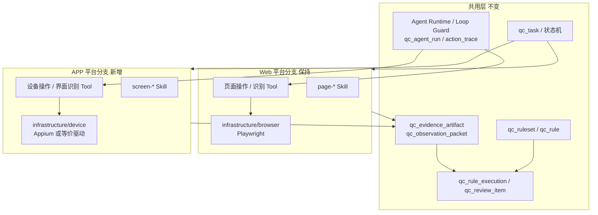
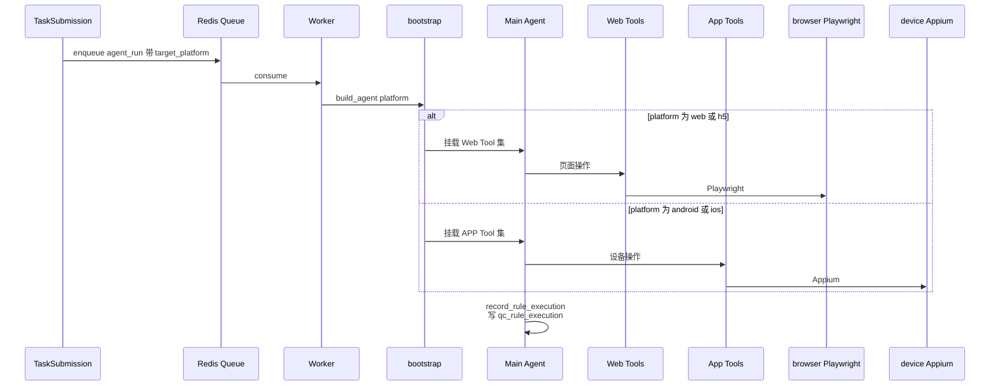

# AI Agent 质检平台 — 原生 APP 质检（平台分支）设计修订稿

> 版本：v0.1（设计阶段修订稿）
> 日期：2026-07-08
> 状态：平台分支设计；**不替换**既有 Web/H5 执行层
> 关联文档：
> - [2026-07-03-alioth-integrated-solution-design.md](./2026-07-03-alioth-integrated-solution-design.md)（权威整合版本；编排与 Skill/Tool 分层仍以其为准）
> - [2026-07-03-alioth-core-schema-design.md](./2026-07-03-alioth-core-schema-design.md)（核心表；本文档提出平台分支增量字段）
> - [2026-07-01-alioth-qc-workflow-detail.md](./2026-07-01-alioth-qc-workflow-detail.md)（两级证据与批量质检；APP 复用抽象、替换采集实现）
> - [2026-06-30-alioth-platform-design.md](./2026-06-30-alioth-platform-design.md)（总体目标原为 Web 与 H5；本文档将其扩展为并列平台分支）
> - [implementation-roadmap.md](./implementation-roadmap.md)（工程落地；APP 执行层排在 Web M5 旁路，不挤占 Web Playwright 里程碑）

---

## 0. 文档定位与硬约束

### 0.1 要解决什么问题

现有设计与工程基线以 **Web / H5 + Playwright** 为唯一执行路径。业务需要增加 **原生 Android / iOS APP 自动化质检**，且必须：

1. **符合现有分层与领域模型**（任务 / 规则 / 证据 / 人审 / Agent Runtime 共用）。
2. **Web 有 Web 质检，APP 有 APP 质检**：两条平台分支并列，互不吞并。
3. **现有 Web 执行层不得被替换为 Mobile 执行层**：`infrastructure/browser`（Playwright）继续服务 Web；另建 `infrastructure/device`（或等价命名）服务原生 APP。

### 0.2 硬约束（不可违背）

| 编号 | 约束 | 说明 |
| --- | --- | --- |
| C1 | 双执行层并存 | 禁止把 Playwright 驱动改造成「既跑 Web 又跑 App」的万能驱动 |
| C2 | 结果模型单一 | 规则结论仍写 `qc_rule_execution`；不另开 `qc_app_finding` 一类平行主表 |
| C3 | Agent 不碰驱动 | Agent 只通过 Tool 表达意图；浏览器细节在 `browser/`，设备细节在 `device/` |
| C4 | 渠道 ≠ 平台 | `qc_task.channel`（workbench/telegram/api）继续表示**提交入口**；平台类型用独立字段表达 |
| C5 | 先领域后页面 | Workstation「创建 APP 任务」表单不得早于 `target_platform` 契约与 Tool 集约定落地 |
| C6 | 渐进演进 | V1 可先复用同一 Main Agent + 按平台挂载不同 Tool；不因 APP 提前拆第二套 Orchestrator |

### 0.3 一句话结论

> **共用领域与编排，分叉执行与证据形态；Web 质检路径保持不变，原生 APP 作为并列平台分支接入。**

---

## 1. 与现状的关系：什么变、什么不变



| 层级 | Web 现状 | APP 修订 | 是否替换 Web |
| --- | --- | --- | --- |
| 领域表 / 状态机 / 人审 | 已有 | 增量字段 + 证据类型扩展 | 否 |
| Agent Runtime / Worker | 已有 | 按 `target_platform` 选 Tool 集 | 否 |
| 阶段 / 规则 Skill | page-* / category-* | 增 screen-*；规则 Skill 尽量复用 | 否 |
| Tool 层 | 页面操作等（规划中） | 新增设备 / 界面操作 Tool | 否 |
| 基建驱动 | `infrastructure/browser` | 新增 `infrastructure/device` | **禁止替换** |
| 工作台 | Web 任务表单 | 增加平台切换与 APP 目标输入 | 否 |

---

## 2. 平台分支模型

### 2.1 `target_platform`（任务级平台）

在任务上显式区分被测端，与 `channel` 解耦：

| 值 | 含义 | 执行层 |
| --- | --- | --- |
| `web` | 桌面 / 响应式 Web | Playwright（`browser/`） |
| `h5` | 移动浏览器 H5 | Playwright + 移动 viewport（仍属 `browser/`） |
| `android` | 原生 Android | `device/` |
| `ios` | 原生 iOS | `device/` |

默认值：`web`（保证存量任务与现有 API 行为不变）。

> **说明**：H5 仍走 Web 执行层，不因「手机上的页面」误入 Appium。原生壳内 WebView 若需质检，先按 Web 规则处理；若必须点原生控件再进 WebView，列入后续「混合栈」专题，不阻塞本修订稿主路径。

### 2.2 推荐落点（优先可逆方案）

**首选（推荐）**：`qc_task` 增加显式列：

```sql
target_platform varchar(32) NOT NULL DEFAULT 'web',
CONSTRAINT ck_qc_task_target_platform CHECK (
    target_platform IN ('web', 'h5', 'android', 'ios')
)
```

**备选**：仅写入 `task_config.target_platform`。实现快，但列表筛选、规则匹配与 Worker 分流不便，仅适合原型验证。

规则侧建议同步增加可选字段 `qc_rule.target_platforms jsonb`（默认 `["web","h5"]`），用于规则集内按平台过滤；**不要**复用已改义的 `qc_rule.scope`（现行含义为业务范围字符串，不再是 web/h5/both）。

### 2.3 目标定位字段泛化

| 平台 | 对外输入 | 落库建议 |
| --- | --- | --- |
| web / h5 | URL | 继续用 `target_url` |
| android | packageName + activity / deep link | `target_url` 可存 deep link；结构化目标进 `task_config.app` |
| ios | bundleId + deep link | 同上 |

`task_config` 平台相关建议形状（禁止明文凭证）：

```json
{
  "target_platform": "android",
  "browser": { "...": "仅 web/h5 使用，APP 任务可省略" },
  "app": {
    "os": "android",
    "package_name": "com.example.app",
    "bundle_id": null,
    "launch_activity": ".MainActivity",
    "app_version": "1.2.3",
    "deep_link": "myapp://home",
    "device_profile_id": "uuid-or-slug",
    "install_artifact_ref": "可选：安装包对象存储引用"
  }
}
```

Webhook / API 校验规则：`target_platform in (android, ios)` 时必须具备 `app.package_name` 或 `app.bundle_id`（按 OS），否则拒绝提交。

---

## 3. 界面采集抽象：页面 → 界面会话，不绑死 DOM

### 3.1 实体复用策略

继续使用 `qc_page_capture` 作为**一级界面基线组织单位**（避免立刻拆第二套 capture 表）。语义上把它理解为「Screen Capture / 界面会话」，Web 场景仍是页面，APP 场景是 Activity / 路由屏 / 弹层。

| 字段 | Web 语义 | APP 语义（metadata 或注释扩展） |
| --- | --- | --- |
| `url` | 页面 URL | deep link / 当前路由 / activity 标识（必填字符串） |
| `page_slug` | home、detail | home、player、pay-sheet |
| `page_type` / `page_state` | 页面类型与状态 | 屏类型与状态（login_required、permission_dialog 等） |
| `dom_path` | DOM HTML | **可空**；改存层级转储路径到 artifact |
| `console_log_path` | 浏览器 console | **可空**；改用设备日志 artifact |
| `metadata` | browser / viewport | device / os_version / app_version / orientation |

若后续审计强烈要求表语义对齐，可再做一次重命名迁移（如 `qc_ui_capture`）；**本期不做**，以免拖慢 Web 主线。

### 3.2 证据类型增量

在既有 `artifact_type` 上**增量扩展**，不删除 Web 类型：

| 新增 artifact_type | 说明 | 主要平台 |
| --- | --- | --- |
| `view_hierarchy` | XML/JSON 控件树（UiAutomator / XCUI） | android / ios |
| `accessibility_tree` | 无障碍树摘要 | android / ios |
| `device_log` | logcat / os_log 片段 | android / ios |
| `screen_recording` | 可选短录屏 | 两者可选 |

既有 `screenshot` / `visible_text` / `ocr_text` / `media_state` / `ai_io` / `report` **两边共用**。`dom` / `har` / `console_log` 继续主要服务 Web。

### 3.3 两级证据路径（与 Web 对齐）

路径形态与《模块交互流程细化》一致，仅目录内容按平台变化：

```text
qc/{task_id}/screens/{page_seq}-{page_slug}/baseline/
qc/{task_id}/screens/{page_seq}-{page_slug}/rules/{rule_seq}-{rule_code}/
```

> Web 路径可继续用既有 `pages/`；APP 建议用 `screens/`，避免与 DOM 基线目录混淆。对象存储键由 Tool → storage 统一生成，Agent 不手拼路径。

基线内容对比：

| 产物 | Web baseline | APP baseline |
| --- | --- | --- |
| 截图 | `screenshot_full.png` | `screenshot.png` |
| 结构 | `dom.html` | `view_hierarchy.xml`（或 json） |
| 文本 | `visible_text.txt` | 可见文案 / content-desc 抽取 |
| 动作 | `action_log.json` | 同左（动作抽象一致） |
| 日志 | `console.log` 可选 | `device_log.txt` 可选 |

判定输入一律经 `qc_observation_packet`，Judge / 规则 Skill **不直接读散落文件**。

---

## 4. 执行层并列设计

### 4.1 基建目录

```text
services/api/app/infrastructure/
  browser/     # 现有：Playwright，仅 Web/H5
  device/      # 新增：原生设备自动化，仅 android/ios
  storage/     # 共用
  ...
```

`device/` 职责（对标 `browser/README.md`）：

- 封装会话创建 / 销毁、稳定等待、重试、截图、控件树提取、输入法与权限弹窗处理。
- 对上只暴露「想做什么」（点击、滑动、回到前台、读层级），不把 Appium 细节泄露给 Agent。
- 驱动选型默认建议：**Appium 2.x**（Android + iOS 统一协议）；若团队已有 Maestro 资产，可在 `device/` 内做适配器，对外 Tool 契约不变。

### 4.2 Tool 并列（禁止改名挤占）

| Web Tool（保留） | APP Tool（新增） | 共用 Tool |
| --- | --- | --- |
| 页面操作 Tool | 设备操作 Tool（tap/swipe/back/launch） | 规则查询、敏感词、品牌词、知识库检索 |
| 页面识别 Tool | 界面识别 Tool（屏类型 / 状态） | OCR、截图比对（输入皆为图像） |
| DOM / HAR 相关 | 控件树 / device_log 相关 | `record_rule_execution`、报告生成 |

注册策略：

- `agents/bootstrap`（或等价装配点）按 `target_platform` **挂载对应 Tool 子集**。
- Web 任务不得看到设备安装 / 卸载类高风险 Tool；APP 任务不得看到 Playwright 导航类 Tool（除非明确启用混合栈）。
- 能力仍登记到 `qc_agent_capability_registry`；APP 安装应用、授权隐私、支付确认等标为高风险权限。

### 4.3 阶段 Skill 并列

| Web 阶段 Skill | APP 对应 | 是否共用 |
| --- | --- | --- |
| task-planning | 同名扩展平台分支说明 | 共用文档 + 平台段落 |
| page-exploration | **screen-exploration** | 新建 |
| page-detection | **screen-detection** | 新建 |
| navigation-boundary | **interaction-boundary**（含权限弹窗、系统设置、支付） | 新建或加 APP 附录 |
| evidence-report | 扩展产物清单 | 共用骨架 |
| rule-matching + 8 类规则 Skill | 按 `target_platforms` 过滤 | **尽量共用** |

交互 / 广告 / 支付 / 播放器等规则 Skill 的判定标准大多可共用；差异集中在「如何采证到检查点」——由平台 Tool 完成。平台专属规则（如通知权限、后台杀活、商店评分弹窗）用 `target_platforms` 限定，不要硬塞进 Web 规则集污染匹配。

### 4.4 Worker / Runtime



仍复用同一 Worker、同一 Loop Guard（步数 / 超时 / 识别门禁 / 取消）。仅 **Tool 集与基建驱动**分流。

---

## 5. 规则与 Observation 契约

### 5.1 `input_contract` 平台感知

`qc_rule.input_contract` 增加 `target_clients`（已有字段意图可对齐）示例：

```json
{
  "schema_version": "1",
  "target_clients": ["android", "ios"],
  "required_artifacts": ["screenshot", "view_hierarchy", "visible_text"],
  "optional_artifacts": ["ocr_text", "device_log"],
  "required_fields": ["page_type", "page_state"],
  "quality_gate": { "min_screenshot_px": 720 }
}
```

Web 规则继续要求 `dom` / `har` 等；匹配阶段若当前任务平台不在 `target_clients`，直接 `skipped`，不报错。

### 5.2 `steps` 动作抽象

`qc_rule.steps` 保持动作数组，但 **selector 语义按平台解释**：

| 字段 | Web | APP |
| --- | --- | --- |
| `selector` | CSS / role | accessibility id / resource-id / xpath |
| `action` | click / goto / type | tap / swipe / launch / grant_permission |
| `url` | http(s) | deep link |

禁止在规则步骤里写死「调用 Playwright」或「调用 Appium」；步骤只描述业务意图，由对应 Tool 解释。

---

## 6. API / 应用层 / 前端

### 6.1 API

沿用 `POST /api/v1/tasks`，增量字段：

| 字段 | 必填 | 说明 |
| --- | --- | --- |
| `target_platform` | 否，默认 `web` | 见第 2.1 节 |
| `target_url` | web/h5 必填；APP 可用 deep link 或占位 | 与既存契约兼容 |
| `task_config.app` | android/ios 必填 | 见第 2.3 节 |

不新增 `/api/v1/app-tasks`。列表与详情返回中带上 `target_platform`，前端用其切换展示文案与证据预览组件。

### 6.2 Application

- `TaskSubmissionService`：校验平台与 `task_config`；写入 `target_platform`；入队消息携带平台。
- Agent bootstrap：按平台装配 Tool / 选择性注入 screen-* Skill。
- `record_rule_execution` / 人审用例：**零分叉**。

### 6.3 前端（Workstation）

创建任务页增加平台选择：

1. Web / H5 → 现有 URL + browser 配置。
2. Android / iOS → 包名 / BundleId、版本、设备档位、deep link。

报告与审核页**共用** `qc_rule_execution`；证据预览按 `artifact_type` 分支渲染（截图共用，DOM 查看器 vs 控件树查看器）。

菜单与路由：无需因 APP 新建顶级模块；仍归「质检任务」域。若需权限点，后续 IAM 增加 `qc.task.submit.app` 即可。

---

## 7. 非目标与边界

本期**明确不做**：

1. 用 Mobile 驱动替换 Playwright，或把 browser 目录改成通用 automation。
2. 另起一套「APP 质检」微服务或独立结果库。
3. 把 `channel` 改成承载平台语义。
4. 完整覆盖真机农场调度、厂商 ROM 碎片、游戏引擎渲染树（可作为后续设备资源层设计）。
5. 混合栈（原生 + WebView）的完整编排（可列为 V2 专题）。
6. 因 APP 提前实现完整 V2 Orchestrator。

---

## 8. 落地分期（不打断 Web M5）

| 阶段 | 目标 | 主要落点 | 与 Web 关系 |
| --- | --- | --- | --- |
| A0 契约 | 本修订稿评审通过；schema 增量约定 | docs + core-schema 勘误条目 | 无代码冲突 |
| A1 数据 | `target_platform` 列 / 字典；artifact 类型扩展 | migration | 默认 `web`，存量无感 |
| A2 基建骨架 | `infrastructure/device` README + 会话接口 | device/ | 与 browser 并列空实现 |
| A3 Tool | 设备操作 / 界面识别 / 控件树 Tool + registry | agents/tools | Web Tool 不动 |
| A4 Skill | screen-exploration / screen-detection | agents/skills | page-* 不动 |
| A5 联调 | 单机模拟器跑通 1 条 android 规则 | worker + device | 不占用 Playwright 人力时可并行 |
| A6 工作台 | 创建任务平台切换 + 证据预览分支 | workstation | 增量 UI |

推荐依赖：**Web M5（真实 Playwright）与 APP A2–A5 可并行**，共用 M2 表与 M4 Runtime；冲突点仅在迁移字典扩展时短会合入。

---

## 9. 对既有文档的勘误与同步点

评审通过后，建议在下列文档追加短注（本文档已给出设计口径，避免大段重写）：

| 文档 | 同步点 |
| --- | --- |
| 总体设计 | 目标由「Web 与 H5」修订为「Web/H5 与原生 APP 并列平台分支」 |
| 核心 schema | 增加 `target_platform`、artifact 枚举、`task_config.app`、`qc_rule.target_platforms` |
| 模块交互流程 | 第 3 节注明 Playwright 为 Web 路径；APP 见本文档第 3–4 节 |
| 整合方案 | 第 4 节 Tool / 阶段 Skill 表增加 APP 行；强调执行基建分叉 |
| 落地路线 | 增加 A0–A6 旁路里程碑，标明不替换 M5 |

权威编排结论仍以整合方案为准；**平台执行分叉以本文档为准**。

---

## 10. 验收标准（设计层）

满足以下条件即可认为平台分支设计收口：

1. 任意 `target_platform=web` 任务仍只依赖 `browser/` + 页面 Tool，行为与现约定一致。
2. `target_platform=android|ios` 任务不加载 Playwright Tool，结论仍写入 `qc_rule_execution`。
3. 文档与 README 中不存在「将 Web 执行层替换为 Mobile」的表述。
4. `channel` 与 `target_platform` 语义分离有测试或校验用例约定。
5. 规则匹配能按平台跳过不适用规则（`skipped`），不产生错误执行态噪音。

---

## 11. 开放问题（评审时拍板）

1. **驱动选型**：默认 Appium 2.x，是否接受 Maestro 作为 android 快路径适配器？
2. **设备来源**：首期仅本地模拟器 / 自管真机，还是必须对接远控设备云？
3. **`qc_page_capture` 重命名**：本期复用还是尽快迁到 `qc_ui_capture`？
4. **安装包治理**：任务是否允许每次安装指定 APK/IPA，还是只测预装版本？

> 在未拍板前，工程实现按「Appium + 本地模拟器 + 预装应用 + 复用 page_capture」推进，假设变更成本最低。
