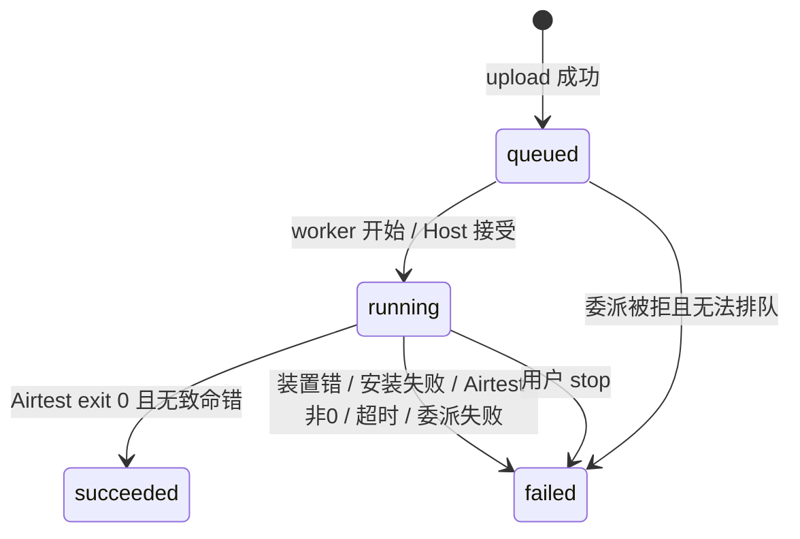
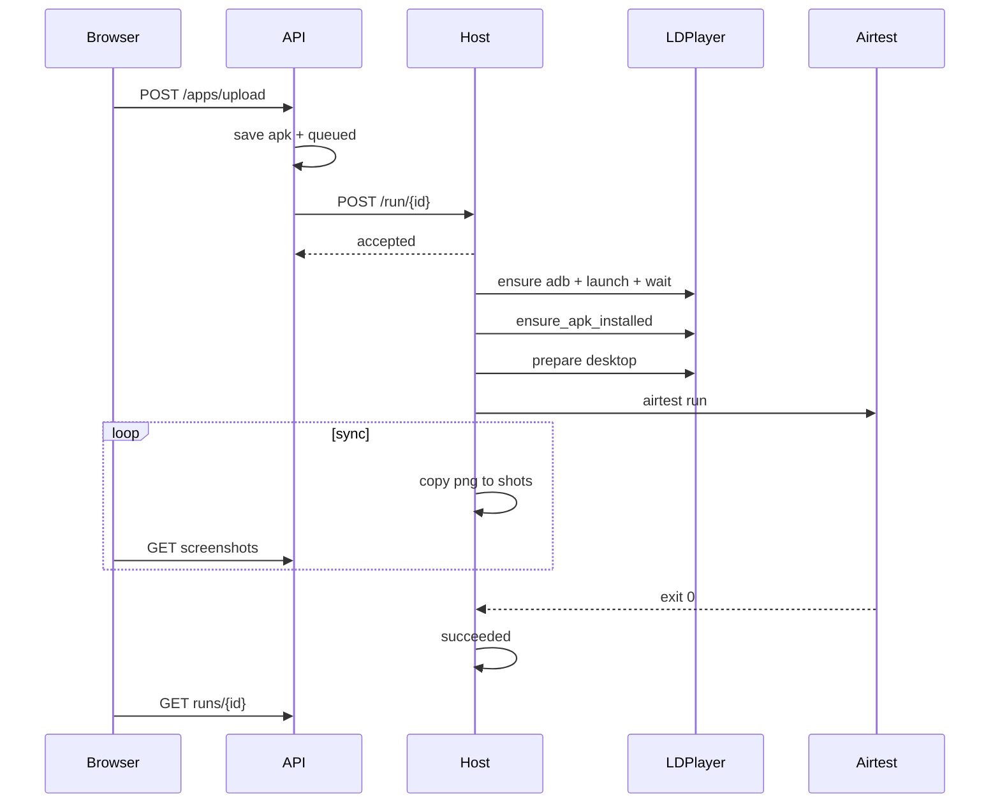

# Alioth 原生 APP 自动化 — 方案详细设计

> 版本：v1.0  
> 日期：2026-07-10  
> 状态：详细设计（可指导实现与评审）  
> 定位：在整体方案 / 整合方案之上，把**模块边界、接口契约、状态机、执行流水线、错误模型、并发与配置**写到可落地粒度  
> 关联文档：
> - [2026-07-10-alioth-app-qc-integrated-solution.md](./2026-07-10-alioth-app-qc-integrated-solution.md)（整合视图与里程碑）
> - [2026-07-10-alioth-app-automation-overall-solution.md](./2026-07-10-alioth-app-automation-overall-solution.md)（部署与运维 SOP）
> - [2026-07-08-alioth-native-app-qc-platform-branch.md](./2026-07-08-alioth-native-app-qc-platform-branch.md)（平台双轨领域契约）
> - [2026-07-03-alioth-integrated-solution-design.md](./2026-07-03-alioth-integrated-solution-design.md)（Agent 编排权威）
> - [2026-07-05-alioth-agent-skill-tool-dev-guide.md](./2026-07-05-alioth-agent-skill-tool-dev-guide.md)（Skill/Tool 开发规范）

---

## 0. 文档定位

| 文档类型 | 回答的问题 | 对应文件 |
| --- | --- | --- |
| 平台分支设计 | Web/APP 为何并列、领域怎么扩 | 2026-07-08 |
| 整合方案 | 怎么收敛进 Alioth、里程碑 | 2026-07-10 整合 |
| 整体方案 | 正式机怎么装、怎么运维 | 2026-07-10 整体 |
| **本文（详细设计）** | **模块怎么拆、接口长什么样、状态怎么转、错误怎么分、并发怎么控** | 本文 |

阅读对象：后端 / 装置层开发、架构评审、测试方案编写。

---

## 1. 设计目标与范围

### 1.1 目标

1. 支撑「上传 APK → 装置就绪 → 安装 → 执行检测动作 → 截图/证据 → 可查询结果」闭环。  
2. 装置执行与 API 编排解耦：Docker API 可编排，Windows Host 可执行。  
3. 模拟器长期保留；真机 USB/WiFi 以同一装置协议扩展。  
4. 当前 Demo 可运行；接口形状尽量可平滑迁到 `qc_task` + Tool。  

### 1.2 范围内

- Mobile Demo API 与 Host Runner 协议  
- `infrastructure/device` 模块设计（含现有 LDPlayer 与目标协议）  
- Run 状态机、产物目录、截图同步  
- APP Tool 输入输出契约（第一批）  
- 配置、错误码、并发锁、安全边界  

### 1.3 范围外（本期不展开实现细节）

- Workstation 完整 UI 交互稿  
- iOS 专用驱动细节  
- 真机农场调度算法  
- 大模型 Prompt 全文  

---

## 2. 逻辑架构与物理架构

### 2.1 逻辑分层

```text
┌─────────────────────────────────────────────────────────┐
│ 表现层：Demo HTML / 未来 Workstation APP 任务页           │
├─────────────────────────────────────────────────────────┤
│ API 层：mobile-demo（过渡） / tasks（目标）               │
├─────────────────────────────────────────────────────────┤
│ 应用编排：Demo worker（过渡） / Agent+Tool（目标）         │
├─────────────────────────────────────────────────────────┤
│ 装置协议：MobileDevice（目标）                            │
│   ├─ LdPlayerDevice（现有实现主体）                       │
│   └─ AdbPhysicalDevice（后续）                            │
├─────────────────────────────────────────────────────────┤
│ 执行宿主：Host Runner（Windows）                          │
├─────────────────────────────────────────────────────────┤
│ 外部进程：ldconsole / adb / airtest / 模拟器或真机         │
└─────────────────────────────────────────────────────────┘
```

### 2.2 物理部署

```text
[浏览器] --HTTP:8000--> [Docker: alioth-api]
                              |
                              | 共享卷 .alioth-mobile-demo
                              | POST host.docker.internal:8765
                              v
                        [Windows Host Runner]
                              |
                              +--> LDPlayer (F: 或 C:)
                              +--> adb / airtest python
```

设计约束：

- API 容器**不得**直接调用 `ldconsole.exe`。  
- Host **仅**绑定 `127.0.0.1`。  
- APK 与截图路径必须经 `ALIOTH_WORKSPACE_HOST` 做容器↔本机映射。  

### 2.3 现有代码映射

| 逻辑模块 | 当前文件 | 目标演进 |
| --- | --- | --- |
| Demo API | `api/v1/mobile_demo.py` | 保留演示；能力上提 Application/Tool |
| Run 模型 | `MobileDemoRun` dataclass | 映射 `qc_task` |
| Worker | `_demo_worker` | Tool 序列或 Agent Loop |
| Host | `mobile_demo_host_runner.py` | 协议稳定，可服务化 |
| 雷电控制 | `infrastructure/device/ldplayer.py` | 实现 `MobileDevice` |
| 启动 | `scripts/start-mobile-demo-host.ps1` | 正式机 STAGE=prod |

---

## 3. 模块详细设计

### 3.1 模块职责矩阵

| 模块 | 职责 | 不负责 |
| --- | --- | --- |
| `mobile_demo` API | 上传、查询、停止、内嵌页、委派判断 | 直接操作模拟器 UI |
| `_demo_worker` | 编排装置步骤、写 run 状态/日志、跑 Airtest、同步截图 | 解析业务规则是否违规 |
| Host Runner | 接收 run/stop、本机执行 worker、清进程 | 持久化业务库 |
| `ldplayer` | ldconsole/adb 封装、安装策略、ADB 开关、路径解析 | HTTP、Agent Prompt |
| Airtest 脚本 | 业务点击与 save_screen | 安装 APK、启动模拟器 |
| 未来 Tool 层 | 把装置动作暴露给 Agent | 持有全局锁策略细节（可下沉） |

### 3.2 包结构（目标）

```text
services/api/app/
  api/v1/
    mobile_demo.py          # 过渡入口（可逐步变薄）
    tasks.py                # 正式入口（增量 android）
  application/
    mobile/
      run_service.py        # 创建/查询/停止 run 或 task
      screenshot_service.py
  infrastructure/device/
    protocol.py             # Protocol / ABC
    models.py               # AppVersionInfo, InstallResult, DeviceInfo
    ldplayer.py             # 现有
    adb_client.py           # 后续纯 adb
    physical.py             # 后续真机
    factory.py
    path_resolve.py         # stage / home 解析（可从 ldplayer 抽出）
  mobile_demo_host_runner.py
  agents/tools/
    app_device_tools.py     # 后续
```

### 3.3 依赖方向（允许 / 禁止）

```text
api → application → infrastructure/device
api → mobile_demo_host_runner（仅 HTTP 客户端，不 import 业务环）
agents/tools → infrastructure/device
infrastructure/device ✗→ api
infrastructure/device ✗→ agents
```

---

## 4. 数据设计

### 4.1 Demo Run 模型（当前）

```text
MobileDemoRun
  run_id: str
  status: queued | running | succeeded | failed
  message: str
  apk_filename: str
  apk_path: str                 # 容器或本机路径字符串
  package_name: str | null
  screenshots: list[str]        # 文件名列表
  created_at / started_at / finished_at: float | null
```

持久化：`{DATA_DIR}/runs/{run_id}/run.json`（JSON 文件，非 PG）。

### 4.2 目录布局

```text
{ALIOTH_MOBILE_DEMO_DATA_DIR}/
  uploads/
    {run_id}_{original_apk_name}
  runs/
    {run_id}/
      run.json
      run.log
      airtest_stdout.log
      airtest_stderr.log
      shots/
        after_click_*.png
        chrome_after_ad_click*.png
        ...
```

设计规则：

1. `uploads` 与 `runs` 分离，避免脚本目录污染。  
2. `shots` 只放**结果图**；模板 `tpl*` 不复制。  
3. 路径在 Docker 内可能是 `/workspace/...`，Host 执行前必须 `_resolve_path_for_os`。  

### 4.3 正式任务扩展（目标）

| 字段路径 | 类型 | 约束 |
| --- | --- | --- |
| `qc_task.target_platform` | enum | `web\|h5\|android\|ios`，默认 web |
| `task_config.app.device_target` | enum | `emulator\|usb\|wifi` |
| `task_config.app.device_serial` | string | usb/wifi 建议必填 |
| `task_config.app.ldplayer_index` | int | emulator 默认 0 |
| `task_config.app.install_artifact_ref` | string | 对象存储键或本地映射键 |

### 4.4 Run 状态机



状态写入规则：

- 每次关键阶段更新 `message` + `_save_run` + `_append_log`。  
- `finished_at` 仅在终态写入。  
- 终态后不再接受同一 `run_id` 的重复执行。  

### 4.5 截图纳入规则

| 条件 | 行为 |
| --- | --- |
| 文件名匹配 `tpl*` | 排除 |
| 非 png / 文件头非 PNG | 排除 |
| 文件大小在短窗口内仍变化 | 视为半写入，本轮跳过 |
| mtime < airtest_started_at | 排除历史图 |
| 其余 png | 复制到 `shots/` 并进入列表 |

前端：增量 DOM 更新，禁止整表清空造成闪烁。

---

## 5. API 详细设计

### 5.1 Demo API（前缀 `/api/v1/mobile-demo`）

| 方法 | 路径 | 说明 |
| --- | --- | --- |
| GET | `/version` | 版本页；`?format=json` → `{"version"}` |
| GET | `/demo` | 内嵌操作页 |
| POST | `/apps/upload` | multipart `apk`；忙则 409 |
| POST | `/stop` | 停止本机+Host |
| GET | `/runs/{run_id}` | 状态 |
| GET | `/runs/{run_id}/log` | 文本日志 |
| GET | `/screenshots?run_id=` | 截图名列表 |
| GET | `/screens/{file}?run_id=` | 取图 |
| GET | `/runs/{id}/screens/{file}` | 取图备用 |

#### Upload 契约

成功 200：

```json
{"run_id": "uuid", "status": "queued", "message": "已入队"}
```

| HTTP | 场景 |
| --- | --- |
| 400 | 非 apk / 空文件 |
| 409 | 已有 active Demo |
| 500 | 写盘失败 |

鉴权：当前无；正式并入 tasks 前必须加网关/平台鉴权。Host 仍靠 loopback，不靠公网鉴权。

### 5.2 Host Runner API

基址：`http://127.0.0.1:8765`  
OpenAPI/docs/redoc：关闭；**无** `GET /health`

| 方法 | 路径 | 行为 |
| --- | --- | --- |
| POST | `/run/{run_id}` | 非阻塞接受；后台跑 worker |
| POST | `/stop` | 杀相关进程；释放锁 |

接受：`{"ok": true, "run_id": "...", "accepted": true}`  
忙碌：`{"ok": false, "run_id": "...", "message": "Host Runner 忙碌中..."}`

要点：

- HTTP 内不跑完整个 Airtest。  
- 设 `FORCE_LOCAL=1`，防止二次委派。  
- `chdir` 仓库根，保证 data dir 一致。  

### 5.3 正式 Tasks API 增量（目标）

沿用 `POST /api/v1/tasks`，增量 `target_platform` + `task_config.app`。不新增 `/app-tasks`。

---

## 6. 装置层详细设计

### 6.1 协议（目标 `MobileDevice`）

```text
info() -> DeviceInfo
ensure_ready(timeout_seconds) -> serial
install_apk(apk, timeout_seconds) -> InstallResult
ensure_apk_installed(apk, ...) -> InstallResult
prepare_for_script(package, settle_seconds) -> log
screenshot(dest) -> None
device_uri_for_airtest() -> str   # 过渡期
```

错误：统一 `DeviceError`（现有 `LdPlayerError` 可作子类）。

### 6.2 LDPlayer 后端要点（现有）

| 能力 | 实现要点 |
| --- | --- |
| 路径解析 | STAGE → DEV/PROD；HOME 覆盖 |
| launch | `ldconsole launch --index N` |
| ADB | `ldconsole adb --index N --command` |
| serial | 过滤 error/not found 伪 serial |
| 等待 | device + boot_completed=1 |
| ADB 开关 | `leidian{N}.config` 的 `basicSettings.adbDebug` |
| 恢复 | grace 后写 1 + setprop + reboot，有限次 |
| 安装 | 优先 adb install -r；验包名；版本比较跳过 |
| 脚本前 | force-stop + HOME×2 + settle；禁止先 runapp |

### 6.3 真机后端要点（后续）

| 能力 | USB | WiFi |
| --- | --- | --- |
| ensure_ready | adb devices | adb connect/pair 后同上 |
| install | adb -s serial install -r | 同左 |
| 无 ldconsole | 不 launch 雷电 | 同左 |
| 断线 | 提示重插 | reconnect N 次 |

### 6.4 Factory

```text
emulator → LdPlayerController(index)
usb|wifi → AdbPhysicalDevice(serial, adb_exe)
```

---

## 7. 执行流水线详细设计

### 7.1 Demo Worker 阶段

| 阶段 | 名称 | 成功判据 | 失败示例 |
| --- | --- | --- | --- |
| S0 | 加锁/置 running | 获锁 | （上传已 409） |
| S1 | 解析 stage/home | 日志有路径 | 无 ldconsole |
| S2 | ADB 开关确保 | config=1 | 写配置失败 |
| S3 | launch | returncode 0 | 启动失败 |
| S4 | wait ADB | 得 serial | 超时 |
| S5 | 安装决策 | 跳过或安装成功 | install 失败 |
| S6 | 桌面准备 | settle 完成 | ADB 中断 |
| S7 | Airtest | 进程结束 | 非 0 / 超时 |
| S8 | 收尾截图 | shots 更新 | 可仅告警 |
| S9 | 解锁 | finally 释放 | — |

每阶段：`message` + `run.log`。

### 7.2 委派决策

```text
FORCE_LOCAL=1 → 不委派
Docker / 非 Windows → 委派
Windows 且有 ldconsole → 本地
否则若有 HOST_EXECUTOR → 委派
```

### 7.3 Airtest 子进程

- `{python} -m airtest run {script} --device {uri}`  
- 注入雷电 `adb.exe`  
- 超时默认 900s  
- 日志写文件，避免 PIPE 死锁  
- 停止：杀进程树 + orphan cleanup  

### 7.4 截图同步

- 周期默认 1s；worker 写盘，API 只读  
- 前端约 0.8s 增量拉列表  

---

## 8. APP Tool 详细契约（第一批）

### 8.1 `app_ensure_device_ready`

```text
Input:  device_target, device_serial?, ldplayer_index?=0, timeout_seconds?=120
Output: ok, serial, backend, airtest_uri?, log
Errors: DEVICE_NOT_FOUND / ADB_TIMEOUT / LDPLAYER_NOT_FOUND / WIFI_CONNECT_FAILED
```

### 8.2 `app_install_apk`

```text
Input:  artifact_path_or_ref, package_name?, force?=false
Output: installed_now, package_name, apk_version, installed_version, reason, log
```

### 8.3 `app_screenshot`

```text
Input:  name, page_slug?
Output: artifact_id, width?, height?
```

### 8.4 `ad_dismiss_common`

```text
Input:  strategy=template|corner_scan|agent_assist, max_attempts?=3
Output: dismissed, attempts, evidence_names
```

默认 SAFE；含外跳确认则 SENSITIVE。

### 8.5 装配

```text
android/ios → shared + app tools；skills + screen-*
web/h5     → shared + web tools
```

---

## 9. 错误模型

| 错误码 | 含义 | 建议 |
| --- | --- | --- |
| `LDPLAYER_NOT_FOUND` | 无 ldconsole | 查 STAGE/路径 |
| `ADB_SWITCH_OFF` | 开关关 | 自动恢复/手动开 |
| `ADB_TIMEOUT` | 无 device | 重启模拟器/Host |
| `INSTALL_FAILED` | 安装失败 | 看 install 日志 |
| `PACKAGE_MISSING` | 装后无包 | 换安装策略 |
| `AIRTEST_NONZERO` | 脚本失败 | 看日志截图 |
| `AIRTEST_TIMEOUT` | 超时 | 调超时/查卡死 |
| `HOST_BUSY` | 锁占用 | 强制停止 |
| `HOST_UNREACHABLE` | 委派失败 | 启 Host |
| `PATH_MAP_FAILED` | 路径映射失败 | 配 WORKSPACE_HOST |

传播：`DeviceError` → worker → `failed` + 中文 message + 详细 log。禁止把 stderr 当 serial。

---

## 10. 并发与锁

| 锁 | 位置 | 目的 |
| --- | --- | --- |
| `_demo_lock` | API | 全局单 Demo |
| `_host_run_lock` | Host | 全局单执行 |
| run.json | 单 run | 单写者 |

停止：API `/stop` + Host `/stop` → 杀进程 → 释放锁。  
未来多装置：按 serial/index 装置锁；Demo 阶段保持 N=1。

---

## 11. 配置设计

优先级：进程环境变量 > env 文件 > 代码默认。

| 键 | 默认 | 用途 |
| --- | --- | --- |
| `ALIOTH_MOBILE_DEMO_STAGE` | 推断/dev | 阶段 |
| `ALIOTH_LDPLAYER_HOME_DEV` | F:\LDPlayer\LDPlayer9 | 开发路径 |
| `ALIOTH_LDPLAYER_HOME_PROD` | C:\LDPlayer\LDPlayer9 | 正式路径 |
| `ALIOTH_LDPLAYER_HOME` | 空 | 强制覆盖 |
| `ALIOTH_LDPLAYER_INDEX` | 0 | 实例 |
| `ALIOTH_LDPLAYER_AUTO_ENABLE_ADB` | 1 | 自动开 ADB |
| `ALIOTH_LDPLAYER_ADB_WAIT_SECONDS` | 90 | ADB 超时 |
| `ALIOTH_LDPLAYER_ADB_BOOT_GRACE_SECONDS` | 30 | 恢复前缓冲 |
| `ALIOTH_LDPLAYER_ADB_RECOVER_MAX` | 2 | 恢复次数 |
| `ALIOTH_MOBILE_DEMO_HOST_EXECUTOR` | host.docker.internal:8765 | 委派 |
| `ALIOTH_MOBILE_DEMO_HOST_BIND` | 127.0.0.1 | 绑定 |
| `ALIOTH_MOBILE_DEMO_HOST_PORT` | 8765 | 端口 |
| `ALIOTH_WORKSPACE_HOST` | 开发常见 F:/alioth | 路径映射 |
| `ALIOTH_MOBILE_DEMO_AIRTEST_SCRIPT` | Temp untitled | 脚本 |
| `ALIOTH_MOBILE_DEMO_AIRTEST_PYTHON` | 探测 | 解释器 |
| `ALIOTH_MOBILE_DEMO_APP_SETTLE_SECONDS` | 5 | 桌面等待 |
| `ALIOTH_MOBILE_DEMO_DATA_DIR` | .alioth-mobile-demo | 产物根 |

Host 启动应打印：stage、home 是否含 ldconsole、airtest 可 import、bind/port、script 是否存在。

---

## 12. 安全设计

| 威胁 | 控制 |
| --- | --- |
| Host 被局域网滥用 | 127.0.0.1；禁 health/docs |
| 任意文件读取 | screens 限制在 run shots 内，防 `..` |
| 磁盘打满 | 后续大小限制与清理 |
| 高风险操作 | Tool 权限分级 |
| 广告误点费用 | 测试广告位；探索护栏 |
| 凭证泄漏 | task_config 禁明文密码 |

---

## 13. 可观测性

必须日志关键字：

```text
mobile-demo stage=
ldplayer home=
adb switch config
launch emulator
adb ready:
apk package=
will install / skip install
launcher ready
airtest device=
screenshots found=
run succeeded|failed
```

后续指标：成功率、ADB 恢复次数、install/airtest 耗时、Host 忙碌拒绝次数。

---

## 14. 测试设计

| 用例集 | 覆盖 |
| --- | --- |
| `test_ldplayer_apk_version.py` | 版本比较 |
| `test_ldplayer_adb_switch.py` | ADB 开关 |
| `test_ldplayer_stage.py` | STAGE 路径 |

补充：`normalize_adb_serial`、截图过滤、`/workspace` 映射。

手工验收：dev→F:、prod→C:、关 ADB 后自动恢复、同版本跳过安装、强制停止可重跑、`8765/health`=404。

---

## 15. 演进兼容

| 变更 | 策略 |
| --- | --- |
| Demo API | 正式上线后 deprecated ≥1 迭代 |
| Host | 只增 POST，不恢复 GET 页面 |
| Tool 改名 | capability registry 别名 |
| 换驱动 | MobileDevice 不变，换适配器 |

---

## 16. 开放问题

1. `run_id` 对齐 `qc_task.id` 还是 `qc_agent_run.id`？  
2. Host 第一期是否 Windows Service？  
3. hierarchy 采集进 M-A2 还是 M-A3？  
4. 多开模拟器何时支持？  
5. 引入 Appium 的触发条件？  

---

## 17. 附录

### 17.1 Demo 成功时序



### 17.2 文档关系

```text
07-08 平台分支（领域）
  → 07-10 整合方案（怎么并进平台）
    → 本文 详细设计（怎么实现）
      → 07-10 整体方案（怎么部署运维）
```

### 17.3 修订记录

| 版本 | 日期 | 说明 |
| --- | --- | --- |
| v1.0 | 2026-07-10 | 首版：分层/模块/API/装置协议/流水线/Tool 契约/错误/锁/配置/安全/测试 |
