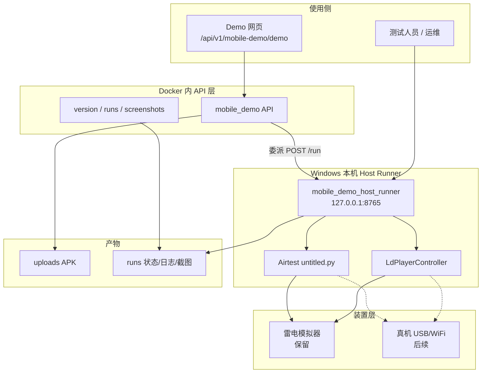

# Alioth 原生 APP 自动化整体方案（含正式部署）

> 版本：v1.0  
> 日期：2026-07-10  
> 状态：工程方案 + 正式部署说明（基于当前 Mobile Demo 落地能力）  
> 关联文档：
> - [2026-07-10-alioth-app-qc-integrated-solution.md](./2026-07-10-alioth-app-qc-integrated-solution.md)（**APP 质检整合方案详细版**：目标态全景、迁移与里程碑）
> - [2026-07-10-alioth-app-automation-detailed-design.md](./2026-07-10-alioth-app-automation-detailed-design.md)（**方案详细设计**：模块/接口/流水线/错误与锁）
> - [2026-07-08-alioth-native-app-qc-platform-branch.md](./2026-07-08-alioth-native-app-qc-platform-branch.md)（平台分支权威设计：Web/APP 双轨）
> - [2026-07-03-alioth-integrated-solution-design.md](./2026-07-03-alioth-integrated-solution-design.md)（Agent / Skill / Tool 分层）
> - [implementation-roadmap.md](./implementation-roadmap.md)（工程里程碑；APP 为 Web 旁路）

---

## 0. 文档目标与范围

### 0.1 要回答什么

1. **整体方案**：Alioth 原生 APP 自动化如何分层、如何与 Web 质检并存。  
2. **当前能力**：已落地的 Mobile Demo（APK → 雷电 → 安装 → Airtest → 截图）能做什么、边界在哪。  
3. **正式部署**：测试人员 / 正式环境如何安装、配置、启动、验收与运维。  
4. **演进路线**：真机 USB/WiFi、Tool 抽象、任务体系接入、广告 Agent 探索等后续能力。

### 0.2 硬约束（与平台分支一致）

| 编号 | 约束 |
| --- | --- |
| C1 | Web（Playwright）与 APP（device）双执行层并存，互不替换 |
| C2 | 结果模型最终仍归入 `qc_task` / `qc_rule_execution` / 证据体系（Demo 阶段可先独立） |
| C3 | Agent 不直接碰驱动；设备细节落在 `infrastructure/device` |
| C4 | 正式部署必须可复现：路径、版本、Host Runner、脚本位置均可配置 |

### 0.3 一句话架构

> **Docker 内 FastAPI 负责上传、状态与截图 API；Windows Host Runner 负责雷电模拟器与 Airtest 执行；开发阶段默认 F 盘雷电，正式测试阶段默认 C 盘雷电；模拟器路径长期保留，真机/WiFi 作为后续并列装置后端。**

---

## 1. 整体架构

### 1.1 逻辑分层



### 1.2 与平台双轨的关系

| 层级 | Web 质检 | APP 自动化（本方案） |
| --- | --- | --- |
| 入口 | `/api/v1/tasks`（正式） | 当前：`/api/v1/mobile-demo`（Demo）；目标：并入 tasks |
| 执行基建 | `infrastructure/browser`（Playwright） | `infrastructure/device`（LDPlayer / 后续真机 ADB） |
| 脚本/策略 | page-* Skill + Tool | 当前固定 Airtest；目标 app-* Tool + screen-* Skill |
| 证据 | 页面截图 / DOM 等 | 当前 `runs/*/shots`；目标 `qc_evidence_artifact` |
| 是否替换对方 | 否 | 否 |

权威设计见：[2026-07-08-alioth-native-app-qc-platform-branch.md](./2026-07-08-alioth-native-app-qc-platform-branch.md)。

### 1.3 关键代码位置

| 路径 | 职责 |
| --- | --- |
| `services/api/app/api/v1/mobile_demo.py` | Demo API、内嵌网页、worker、委派 Host、截图同步 |
| `services/api/app/mobile_demo_host_runner.py` | Windows Host Runner（仅 `/run`、`/stop`） |
| `services/api/app/infrastructure/device/ldplayer.py` | 雷电控制、ADB、安装策略、阶段路径、ADB 开关恢复 |
| `scripts/start-mobile-demo-host.ps1` | Host 一键启动与旧进程清理 |
| `infra/env/.env.local.example` | 开发环境变量模板 |
| `infra/env/.env.production.example` | 正式环境变量模板 |
| `infra/docker-compose.yml` | API 容器注入 Host 委派地址与 workspace 映射 |

---

## 2. 当前端到端能力（Demo 闭环）

### 2.1 流程

```text
1. 打开 Demo 页：http://127.0.0.1:8000/api/v1/mobile-demo/demo
2. 上传 APK → POST /api/v1/mobile-demo/apps/upload
3. API 写入 .alioth-mobile-demo/uploads 与 runs/{run_id}/run.json
4. 若在 Docker：委派 POST http://host.docker.internal:8765/run/{run_id}
5. Host / 本机 worker：
   a. 检查并开启雷电 ADB 开关（basicSettings.adbDebug=1）
   b. ldconsole launch 启动模拟器
   c. 等待 ADB device + boot_completed=1
   d. 解析包名/版本；未安装或上传版本更新则 adb install -r
   e. force-stop + 回桌面 settle（不先 runapp，留给脚本点图标）
   f. python -m airtest run untitled.py --device Android:///<serial>
   g. 执行中同步截图到 runs/{run_id}/shots/
6. 前端轮询状态 / 日志 / 截图；可强制停止
```

### 2.2 已具备能力清单

| 能力 | 说明 |
| --- | --- |
| APK 上传与 run 状态机 | queued → running → succeeded/failed |
| 雷电启动与 ADB 就绪等待 | 含超时与错误 serial 过滤 |
| ADB 开关自动开启 | 配置关闭时写 config + setprop，必要时 reboot |
| 版本比较安装 | versionCode 优先，其次 versionName；旧包跳过 |
| Airtest 脚本执行 | 固定 untitled.py（可环境变量覆盖） |
| 截图实时展示 | after_click_*、chrome_after_ad_click* 等；过滤 tpl* |
| 强制停止 | 清 airtest/untitled 进程 + 释放忙碌锁 |
| 开发/正式双阶段路径 | F:（dev）/ C:（prod） |
| Host 安全收敛 | 仅 loopback；无 /health；无 docs |

### 2.3 明确边界（当前不做）

- 未接入正式 `/api/v1/tasks`、Worker 调度、权限审计  
- 未支持真机 USB / WiFi（方案已评估，见第 7 节）  
- 未抽象为 Tool Registry 的 app-* Tool  
- 未做 Agent 自主探索广告（可行性见第 7 节）  
- Airtest 脚本仍绑定本机 Temp 路径，正式部署必须改配置  

---

## 3. 部署拓扑

### 3.1 推荐拓扑（正式测试环境）

```text
┌─────────────────────────────────────────────────────────┐
│  Windows 测试机（正式）                                   │
│                                                         │
│  ┌──────────────┐    host.docker.internal:8765          │
│  │ Docker       │ ──────────────────────────────────┐   │
│  │  alioth-api  │                                   │   │
│  │  :8000       │                                   ▼   │
│  └──────────────┘                         ┌─────────────┐│
│         │ 挂载 F:\alioth → /workspace     │ Host Runner ││
│         ▼                                 │ 127.0.0.1   ││
│  .alioth-mobile-demo/                     │ :8765       ││
│    uploads / runs                         └──────┬──────┘│
│                                                  │       │
│                                                  ▼       │
│                                         C:\LDPlayer\     │
│                                         LDPlayer9        │
│                                         + Airtest Python │
└─────────────────────────────────────────────────────────┘
```

要点：

1. **API 可在 Docker**，但 **雷电与 Airtest 必须在 Windows 本机**。  
2. **Host Runner 必须常驻**（测试窗口保持打开，或后续做成 Windows 服务）。  
3. **数据目录与仓库同盘共享**（compose 挂载 `..:/workspace`），避免容器与 Host 各写一份。  
4. **正式阶段雷电默认 `C:\LDPlayer\LDPlayer9`**（测试人员标准安装位置）。

### 3.2 开发拓扑

与正式相同，差异仅在：

| 项 | 开发 | 正式 |
| --- | --- | --- |
| `ALIOTH_MOBILE_DEMO_STAGE` | `dev` | `prod` |
| 雷电路径 | `F:\LDPlayer\LDPlayer9` | `C:\LDPlayer\LDPlayer9` |
| `ALIOTH_WORKSPACE_HOST` | 开发机仓库路径（如 `F:/alioth`） | 正式机仓库路径 |
| 调试 | 可开更多日志 | 以稳定与 SOP 为准 |

### 3.3 端口与暴露面

| 服务 | 地址 | 暴露建议 |
| --- | --- | --- |
| API | `0.0.0.0:8000`（容器映射） | 内网访问；正式环境加鉴权/网关 |
| Host Runner | **`127.0.0.1:8765`** | **禁止绑 0.0.0.0**；仅本机与 Docker Desktop 访问 |
| 雷电 ADB | 模拟器本地 | 仅开「本地连接」，勿开远程 ADB |

Host Runner **无** `/health`、**无** OpenAPI 文档页，仅：

- `POST /run/{run_id}`
- `POST /stop`

---

## 4. 正式部署步骤（详细）

### 4.1 机器与软件清单

| 项 | 要求 |
| --- | --- |
| OS | Windows 10/11 x64 |
| 磁盘 | 系统盘 C: 足够空间；雷电安装于 `C:\LDPlayer\LDPlayer9` |
| Docker Desktop | 已安装并启用 WSL2 / Hyper-V（按公司标准） |
| Python | 建议 3.11+；已 `pip install airtest`（与 Host 同一解释器） |
| 雷电模拟器 9 | 安装完成；至少创建 index=0 实例 |
| 仓库 | 拉取 Alioth 代码到固定路径（例：`C:\alioth` 或 `D:\alioth`） |
| VT | BIOS 开启虚拟化（雷电要求） |

### 4.2 安装雷电并完成首次手工确认

1. 安装 LDPlayer9 到 **`C:\LDPlayer\LDPlayer9`**。  
2. 启动模拟器，进入设置 → 其他设置：  
   - **ADB 调试 = 打开本地连接**  
   - （按需）Root  
3. 保存并重启模拟器。  
4. 在安装目录验证：

```powershell
cd C:\LDPlayer\LDPlayer9
.\ldconsole.exe list2
.\ldconsole.exe isrunning --index 0
.\ldconsole.exe adb --index 0 --command "devices"
```

期望：`adb devices` 能看到 `emulator-5554`（或对应 serial）为 `device`。

> 说明：平台已支持「ADB 开关被关掉时自动写回并重启」；正式环境仍建议首次手工确认一次，避免首次跑 Demo 因冷启动过久超时。

### 4.3 安装 Airtest 与脚本

```powershell
python -m pip install airtest
python -c "import airtest; print('ok')"
```

将质检用 Airtest 工程放到**固定路径**（不要依赖个人 Temp），例如：

```text
C:\alioth-mobile\scripts\untitled.air\untitled.py
```

并在环境变量中指定（见 4.5）。

### 4.4 拉取代码与环境文件

```powershell
# 示例：仓库在 C:\alioth
cd C:\alioth
```

复制正式环境变量：

```powershell
copy infra\env\.env.production.example infra\env\.env.production
```

编辑 `infra\env\.env.production`，至少确认：

```env
ALIOTH_ENVIRONMENT=production
ALIOTH_MOBILE_DEMO_STAGE=prod

# 两套路径都保留；STAGE=prod 时使用 PROD
ALIOTH_LDPLAYER_HOME_DEV=F:/LDPlayer/LDPlayer9
ALIOTH_LDPLAYER_HOME_PROD=C:/LDPlayer/LDPlayer9

# 仓库在 Windows 上的真实路径（Docker /workspace 映射用）
ALIOTH_WORKSPACE_HOST=C:/alioth

ALIOTH_MOBILE_DEMO_HOST_EXECUTOR=http://host.docker.internal:8765
```

若 Airtest 不在默认 Temp 路径，在 Host 启动前额外设置（系统环境变量或启动脚本前）：

```powershell
$env:ALIOTH_MOBILE_DEMO_AIRTEST_SCRIPT = "C:\alioth-mobile\scripts\untitled.air\untitled.py"
$env:ALIOTH_MOBILE_DEMO_AIRTEST_PYTHON = "C:\Users\<user>\AppData\Local\Programs\Python\Python312\python.exe"
```

### 4.5 启动顺序（必须按序）

**步骤 A — 启动 Host Runner（先）**

```powershell
cd C:\alioth
$env:ALIOTH_MOBILE_DEMO_STAGE = "prod"
# 如需覆盖脚本路径，先设 AIRTEST_SCRIPT / AIRTEST_PYTHON
powershell -File .\scripts\start-mobile-demo-host.ps1
```

启动窗口应打印类似：

```text
=== Mobile Demo Host Runner ===
Stage:    prod
LDPlayer: C:\LDPlayer\LDPlayer9
Listen:   http://127.0.0.1:8765 (POST /run, /stop only; no /health)
```

**保持该窗口不关闭。**

**步骤 B — 启动 Docker API**

按项目既有方式启动 compose，并指定正式 env 文件，例如：

```powershell
cd C:\alioth\infra
$env:ALIOTH_ENV_FILE = "./env/.env.production"
docker compose up -d alioth-api
```

（具体服务名以当前 `docker-compose.yml` 为准。）

**步骤 C — 验收**

```powershell
# API 版本（仅 API 版本页）
curl.exe http://127.0.0.1:8000/api/v1/mobile-demo/version?format=json

# Host 应无公开 health（期望 404）
curl.exe -o NUL -w "%{http_code}" http://127.0.0.1:8765/health
```

打开 Demo：

```text
http://127.0.0.1:8000/api/v1/mobile-demo/demo
```

上传测试 APK，确认日志出现：

```text
mobile-demo stage=prod
ldplayer home=C:\LDPlayer\LDPlayer9 ...
adb switch ...
launch emulator
adb ready: emulator-xxxx
```

并最终有截图产出。

### 4.6 开发环境快速对照

```powershell
cd F:\alioth
$env:ALIOTH_MOBILE_DEMO_STAGE = "dev"   # 或不设，默认 dev
powershell -File .\scripts\start-mobile-demo-host.ps1
# 另开终端启动 local compose / .env.local
```

雷电期望路径：`F:\LDPlayer\LDPlayer9`。

---

## 5. 配置说明（完整）

### 5.1 阶段与路径（正式必读）

| 变量 | 作用 |
| --- | --- |
| `ALIOTH_MOBILE_DEMO_STAGE` | `dev` 或 `prod`（亦接受 development/local、production/formal） |
| `ALIOTH_LDPLAYER_HOME_DEV` | 开发雷电路径，默认 `F:/LDPlayer/LDPlayer9` |
| `ALIOTH_LDPLAYER_HOME_PROD` | 正式雷电路径，默认 `C:/LDPlayer/LDPlayer9` |
| `ALIOTH_LDPLAYER_HOME` | **强制覆盖**上述阶段选择（特殊机器用） |
| `ALIOTH_ENVIRONMENT` | 未设 STAGE 时：`production` 推断为 prod |

解析优先级：

```text
ALIOTH_LDPLAYER_HOME（若有）
  → 否则 STAGE=prod → ALIOTH_LDPLAYER_HOME_PROD
  → 否则 STAGE=dev  → ALIOTH_LDPLAYER_HOME_DEV
```

### 5.2 Host / 委派

| 变量 | 默认 | 说明 |
| --- | --- | --- |
| `ALIOTH_MOBILE_DEMO_HOST_EXECUTOR` | `http://host.docker.internal:8765` | Docker API 委派地址 |
| `ALIOTH_MOBILE_DEMO_HOST_BIND` | `127.0.0.1` | Host 绑定；正式勿改 0.0.0.0 |
| `ALIOTH_MOBILE_DEMO_HOST_PORT` | `8765` | Host 端口 |
| `ALIOTH_MOBILE_DEMO_FORCE_LOCAL` | Host 启动脚本设为 `1` | 禁止二次委派 |
| `ALIOTH_WORKSPACE_HOST` | 开发常为 `F:/alioth` | `/workspace` → Windows 路径 |

### 5.3 执行与稳定性

| 变量 | 默认 | 说明 |
| --- | --- | --- |
| `ALIOTH_LDPLAYER_INDEX` | `0` | 模拟器实例编号 |
| `ALIOTH_LDPLAYER_BOOT_WAIT_SECONDS` | `15` | launch 后最小等待 |
| `ALIOTH_LDPLAYER_ADB_WAIT_SECONDS` | `90` | ADB 就绪超时 |
| `ALIOTH_LDPLAYER_ADB_BOOT_GRACE_SECONDS` | `30` | 无 device 后才开始自动恢复 |
| `ALIOTH_LDPLAYER_ADB_RECOVER_MAX` | `2` | 自动恢复次数 |
| `ALIOTH_LDPLAYER_AUTO_ENABLE_ADB` | `1` | 设 `0` 关闭自动开 ADB |
| `ALIOTH_MOBILE_DEMO_APP_SETTLE_SECONDS` | `5` | 回桌面后等待 |
| `ALIOTH_MOBILE_DEMO_AIRTEST_TIMEOUT_SECONDS` | `900` | 脚本超时 |
| `ALIOTH_MOBILE_DEMO_SHOT_SYNC_SECONDS` | `1.0` | 截图同步周期 |
| `ALIOTH_MOBILE_DEMO_AIRTEST_SCRIPT` | Temp 下 untitled.py | **正式务必改** |
| `ALIOTH_MOBILE_DEMO_AIRTEST_PYTHON` | 自动探测 | 建议显式指定 |
| `ALIOTH_MOBILE_DEMO_DATA_DIR` | `.alioth-mobile-demo` | 产物根目录 |

---

## 6. 运维 SOP

### 6.1 每次改代码后

Host Runner **无热重载**。修改 `mobile_demo.py` / `ldplayer.py` / `host_runner.py` 后必须：

```powershell
powershell -File .\scripts\start-mobile-demo-host.ps1
```

脚本会先杀掉占用 `:8765` 的旧进程再启动。  
同时重启 / 重建 API 容器以加载新代码。

### 6.2 版本核对

```powershell
curl.exe http://127.0.0.1:8000/api/v1/mobile-demo/version?format=json
```

Demo 跑起来后看 run 日志是否含当前版本行为特征（如 `mobile-demo stage=`、`adb switch`）。  
若日志仍是旧格式，说明 Host 未重启。

### 6.3 常见故障

| 现象 | 原因 | 处理 |
| --- | --- | --- |
| `等待 ADB 装置就绪超时` | ADB 开关关 / 模拟器未起 / Host 旧码 | 看日志是否有 adb switch；重启 Host；确认雷电 ADB 本地连接 |
| `Host Runner 忙碌` | 上次 run 未释放锁 | Demo 页点「强制停止」或 `POST .../stop` |
| `device not found` | serial 错误或 ADB 断 | 等 boot；自动恢复；必要时手动 reboot 模拟器 |
| 截图不显示 | 过滤规则 / 文件未写完 / 浏览器缓存 | 看 shots 目录；Ctrl+F5；确认非 tpl* |
| Docker 委派失败 | Host 未开或 bind 错误 | 确认 `:8765` 监听；勿绑错网卡 |
| 正式机找不到雷电 | STAGE 仍为 dev 或路径不对 | 设 `STAGE=prod`；确认 `C:\LDPlayer\LDPlayer9\ldconsole.exe` |

### 6.4 强制停止

- Demo 页：「强制停止」  
- 或：

```powershell
curl.exe -X POST http://127.0.0.1:8000/api/v1/mobile-demo/stop
```

会转调 Host `/stop`，清理 airtest/untitled 相关进程并释放锁。

### 6.5 产物与清理

```text
{REPO}/.alioth-mobile-demo/
  uploads/     # 上传的 APK
  runs/{id}/
    run.json
    run.log
    airtest_*.log
    shots/*.png
```

正式环境建议定期清理过期 `uploads` / `runs`（可后续做成定时任务）。

### 6.6 安全基线（正式）

1. Host 仅 `127.0.0.1`，不对外网开放 8765。  
2. 不恢复 Host `/health` 页面。  
3. 雷电 ADB 仅「本地连接」。  
4. Demo API 当前无鉴权 → **正式上线前必须加网关鉴权或并入平台权限模型**。  
5. 测试包使用测试广告位，避免误点真实商业广告产生费用。

---

## 7. 演进路线（方案级，非当前实现）

### 7.1 装置抽象（保留模拟器）

```text
MobileDevice
├── LdPlayerDevice      # 现有，长期保留
└── AdbPhysicalDevice   # 真机 USB / WiFi
```

上层流程不变：上传 → 选装置 → 安装 → 脚本 → 证据。

### 7.2 真机 USB

- 开发者选项 + USB 调试  
- `adb devices` 取 serial  
- `adb -s {serial} install -r`  
- Airtest：`Android:///{serial}`  
- 仍由 Windows Host Runner 执行（Docker 碰不到 USB）

### 7.3 真机 WiFi ADB

- Android 11+ 无线调试，或 `adb tcpip` + `adb connect IP:port`  
- serial 形如 `192.168.x.x:5555`  
- 要求：手机与 Host 同网段、关闭 AP 隔离、断线自动重连  
- 与 USB 共用 `AdbPhysicalDevice`，仅连接方式不同

### 7.4 Tool 化与任务体系

| 阶段 | 内容 |
| --- | --- |
| 近 | 拆 app-launch / device-operation / screen-capture / ad-detection 等 Tool 原型 |
| 中 | Demo run 映射到 `qc_task` 状态与 `qc_evidence_artifact` |
| 远 | screen-* Skill + Agent 编排；广告探索 Agent（有步数/误点护栏） |

### 7.5 广告 Agent 自主探索

可行，但必须：

- 最大步数 / 超时  
- 优先关广告，禁止支付/乱下载  
- 模板匹配 + 视觉模型兜底  
- 每步截图证据  

推荐「固定脚本处理 80% + Agent 兜底 20%」。

---

## 8. 验收清单（正式上线前）

### 8.1 环境

- [ ] 雷电安装于 `C:\LDPlayer\LDPlayer9`，`ldconsole.exe` 可用  
- [ ] ADB 本地连接已开，`adb devices` 有 device  
- [ ] Python + airtest 可用；脚本路径已用环境变量固定  
- [ ] `ALIOTH_MOBILE_DEMO_STAGE=prod`  
- [ ] `ALIOTH_WORKSPACE_HOST` 指向本机仓库真实路径  

### 8.2 进程

- [ ] Host Runner 窗口常驻，打印 Stage=prod、LDPlayer=C:\...  
- [ ] `8765/health` 返回 404  
- [ ] API `:8000` 可访问 Demo 页  

### 8.3 功能

- [ ] 上传 APK 可创建 run  
- [ ] 日志含 `stage=prod`、`adb ready`  
- [ ] 版本不需更新时可跳过安装  
- [ ] Airtest 跑完有结果截图  
- [ ] 强制停止可解除忙碌  

### 8.4 运维

- [ ] 改码后重启 Host 的 SOP 已培训  
- [ ] 故障表（第 6.3）已交给测试人员  
- [ ] 产物目录磁盘空间监控有人负责  

---

## 9. 角色分工建议

| 角色 | 职责 |
| --- | --- |
| AI/平台开发 | 维护 Demo API、device 层、Host Runner、文档与版本 |
| 测试人员 | 按正式 SOP 启停 Host、上传 APK、反馈失败日志与截图 |
| 运维 | Docker/Windows 机器、磁盘清理、网络与权限、开机自启（后续） |

---

## 10. 附录

### 10.1 关键 URL

| 用途 | URL |
| --- | --- |
| Demo 页 | `http://127.0.0.1:8000/api/v1/mobile-demo/demo` |
| API 版本 | `http://127.0.0.1:8000/api/v1/mobile-demo/version` |
| Host（仅本机） | `http://127.0.0.1:8765`（无页面；仅 POST） |

### 10.2 启动命令速查

```powershell
# 正式 Host
cd C:\alioth
$env:ALIOTH_MOBILE_DEMO_STAGE = "prod"
powershell -File .\scripts\start-mobile-demo-host.ps1

# 开发 Host
cd F:\alioth
$env:ALIOTH_MOBILE_DEMO_STAGE = "dev"
powershell -File .\scripts\start-mobile-demo-host.ps1
```

### 10.3 与设计文档的差异声明

| 设计（2026-07-08） | 当前工程 |
| --- | --- |
| 建议 Appium | 现用 **LDPlayer + Airtest**（Demo 探路） |
| 接入 `/api/v1/tasks` | 仍为独立 `/mobile-demo` |
| screen-* Skill / Tool | 尚未拆分 |

本文件描述的是**已落地 Demo + 正式部署方法**；平台分支目标架构仍以 2026-07-08 文档为准，后续里程碑应逐步收敛。

---

## 11. 修订记录

| 版本 | 日期 | 说明 |
| --- | --- | --- |
| v1.0 | 2026-07-10 | 首版：整体方案、双阶段路径、Host 安全、ADB 自动恢复、正式部署 SOP、演进路线 |
