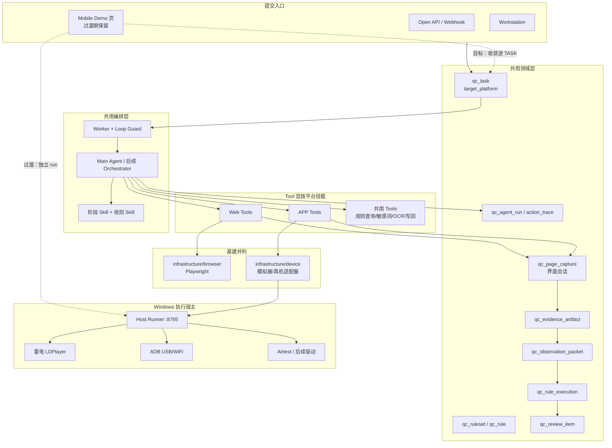
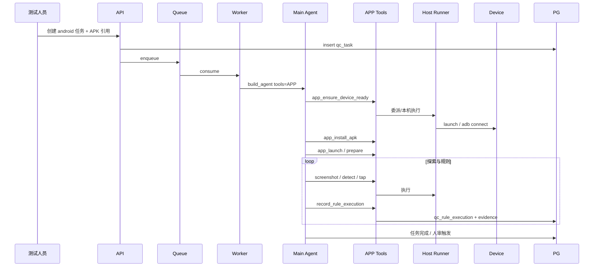

# Alioth 原生 APP 质检 — 整合方案（详细版）

> 版本：v1.0  
> 日期：2026-07-10  
> 状态：整合方案（设计 + 工程现状 + 正式部署 + 演进收敛）  
> 定位：把「平台双轨设计」「当前 Mobile Demo 落地」「正式环境部署」「后续真机/Tool/任务接入」收成一份可执行的整合说明  
> 关联文档：
> - [2026-07-03-alioth-integrated-solution-design.md](./2026-07-03-alioth-integrated-solution-design.md)（平台 Agent / Skill / Tool 权威整合；本文不重复其 Web 编排细节）
> - [2026-07-08-alioth-native-app-qc-platform-branch.md](./2026-07-08-alioth-native-app-qc-platform-branch.md)（Web/APP 双轨领域契约）
> - [2026-07-10-alioth-app-automation-overall-solution.md](./2026-07-10-alioth-app-automation-overall-solution.md)（部署 SOP 与运维清单的工程细则）
> - [2026-07-10-alioth-app-automation-detailed-design.md](./2026-07-10-alioth-app-automation-detailed-design.md)（**方案详细设计**：模块/API/状态机/装置协议/Tool 契约）
> - [2026-07-05-alioth-agent-skill-tool-dev-guide.md](./2026-07-05-alioth-agent-skill-tool-dev-guide.md)（Skill/Tool 开发规范）
> - [implementation-roadmap.md](./implementation-roadmap.md)（工程里程碑；APP 为 Web 旁路）

---

## 0. 文档怎么读

| 你想了解 | 读哪一节 |
| --- | --- |
| 一句话结论与硬约束 | 第 1 节 |
| 目标态全景（Web + APP 如何拼在一起） | 第 2 节 |
| 当前 Demo 已做到哪、差在哪 | 第 3 节 |
| 领域模型 / 任务 / 证据如何接 APP | 第 4 节 |
| Skill / Tool / device 分层怎么落 | 第 5 节 |
| 装置后端（模拟器 / USB / WiFi） | 第 6 节 |
| 端到端执行时序（目标态） | 第 7 节 |
| 正式部署与环境阶段 | 第 8 节 |
| Demo → 正式任务的迁移路径 | 第 9 节 |
| 广告探索 Agent 等进阶能力 | 第 10 节 |
| 分阶段里程碑与验收 | 第 11 节 |
| 风险、协同、术语 | 第 12～13 节 |

### 0.1 与既有文档的分工

| 文档 | 权威范围 | 本文关系 |
| --- | --- | --- |
| 2026-07-03 整合方案 | Web 为主的 Agent 编排、规则 8 类、V1/V2+V3 | **复用**；APP 侧按同一编排原则扩展 |
| 2026-07-08 平台分支 | `target_platform`、证据类型、双执行层 | **服从**；本文补工程收敛与部署 |
| 2026-07-10 整体方案 | Demo 架构、Host、正式 SOP | **互补**；部署命令级细节以其为准，本文给整合视图 |
| 本文 | APP 质检从 Demo 到正式平台的**整合收敛** | 跨文档「怎么拼起来」的主文档 |

### 0.2 术语订正（与平台一致）

| 本文用语 | 含义 |
| --- | --- |
| Skill | 只读指导文档（`SKILL.md`），不执行副作用 |
| Tool | function calling 可执行能力，可有副作用 |
| device 层 | `infrastructure/device`，对标 `infrastructure/browser` |
| Mobile Demo | 当前独立入口 `/api/v1/mobile-demo`，探路用 |
| 正式 APP 任务 | 未来 `target_platform=android|ios` 的 `qc_task` |

---

## 1. 一句话结论与硬约束

### 1.1 一句话

> **共用 Alioth 领域、编排与证据模型；Web 继续走 Playwright；APP 走 device 层（现阶段雷电+Airtest Demo，目标抽象为 Tool + 可插拔装置后端）；正式部署用 Windows Host Runner + 双阶段雷电路径（开发 F: / 正式 C:）；模拟器长期保留，真机 USB/WiFi 作为并列后端接入。**

### 1.2 硬约束

| 编号 | 约束 | 违反后果 |
| --- | --- | --- |
| C1 | 双执行层并存，禁止用 device 替换 Playwright | Web 主线被拖垮 |
| C2 | 正式结果仍写 `qc_rule_execution` 等统一表，不另开平行主表 | 报表/人审分裂 |
| C3 | Agent 不直接调 ldconsole/adb/Appium；只调 Tool | 驱动细节泄漏进 Prompt |
| C4 | Demo 可独立，但不得永久成为第二套任务体系 | 运维与权限失控 |
| C5 | Host Runner 仅本机 loopback，不对外暴露执行端口 | 安全风险 |
| C6 | 正式测试人员默认 C 盘雷电；开发默认 F 盘；两套路径同时配置 | 环境不可复现 |

---

## 2. 目标态全景：Web + APP 如何整合

### 2.1 总架构图



### 2.2 分层对照表（整合视图）

| 层级 | Web | APP（目标） | APP（当前 Demo） |
| --- | --- | --- | --- |
| 入口 | Workstation / tasks API | 同左 + APP 表单字段 | `/mobile-demo/demo` |
| 任务 | `qc_task` + `target_platform=web/h5` | `android/ios` + `task_config.app` | `runs/{id}/run.json` |
| 编排 | Main Agent + Loop Guard | **同一套**，换 Tool 集 | 固定 Python worker |
| Skill | page-* + 8 类规则 Skill | screen-* + 规则 Skill 复用 | 无（写死 untitled.py） |
| Tool | 页面操作 / 识别 | 设备操作 / 界面识别 / 安装 | 无 Tool，直调 ldplayer |
| 基建 | `browser/` Playwright | `device/` 适配器 | `device/ldplayer.py` |
| 宿主 | API 进程内或专用 worker | **Windows Host Runner** | 已有 Host Runner |
| 证据 | pages/ + screenshot/dom | screens/ + screenshot/hierarchy | `runs/*/shots/*.png` |
| 结论 | `qc_rule_execution` | 同左 | 仅日志 + 截图 |

### 2.3 不变与变化

**不变（与 2026-07-03 一致）**

- Agent Loop 不是固定流水线  
- Skill 契约稳定、调用者可变  
- 状态与证据落库，不放模型记忆  
- 人审是一等公民（V2+V3 Review Agent）  
- 规则 8 类（含 `ad`）继续服务 APP  

**变化（APP 增量）**

- 任务增加 `target_platform`  
- 基建增加 `device/`，**不改** `browser/`  
- Tool / Skill 增加 APP 子集  
- 执行宿主明确为 Windows（模拟器/真机 ADB）  
- 证据类型增量：`view_hierarchy` / `device_log` / `screen_recording`  

---

## 3. 工程现状（Mobile Demo）与差距分析

### 3.1 已落地闭环

```text
上传 APK
  → API 存 uploads + 建 run
  →（Docker）委派 Host POST /run/{id}
  → 开启 ADB 开关（必要时）
  → 启动雷电 → 等 ADB ready
  → 版本比较安装
  → 回桌面 settle
  → Airtest untitled.py
  → 同步截图到 runs/*/shots
  → Demo 页展示
```

关键实现：

| 模块 | 路径 |
| --- | --- |
| Demo API / 网页 / worker | `services/api/app/api/v1/mobile_demo.py` |
| Host Runner | `services/api/app/mobile_demo_host_runner.py` |
| 雷电 / ADB / 安装 | `services/api/app/infrastructure/device/ldplayer.py` |
| 启动脚本 | `scripts/start-mobile-demo-host.ps1` |

### 3.2 已具备的「可复用资产」

这些能力应在整合时**上提为正式能力**，而不是推倒重来：

1. **装置控制雏形**：launch、ADB 等待、安装策略、回桌面、截图同步  
2. **Host 委派模式**：Docker API ↔ Windows 执行的正确边界  
3. **ADB 开关自动恢复**：`basicSettings.adbDebug` 读写 + reboot  
4. **双阶段路径**：`ALIOTH_MOBILE_DEMO_STAGE` + `HOME_DEV` / `HOME_PROD`  
5. **并发护栏**：单 Demo 锁、Host 忙碌锁、强制停止清进程  
6. **广告相关脚本经验**：开屏/插屏、Chrome 外跳、close、BACK 回 App（在 untitled.py）

### 3.3 差距矩阵（Demo → 正式整合）

| 能力域 | Demo | 正式整合目标 | 优先级 |
| --- | --- | --- | --- |
| 任务模型 | 独立 run.json | `qc_task` + `target_platform` | P0 |
| 权限审计 | 无 | 平台鉴权 + action_trace | P0 |
| Tool 化 | 无 | app-launch / tap / screenshot / … | P0 |
| Skill | 无 | screen-exploration / screen-detection | P1 |
| 规则执行写回 | 无 | `record_rule_execution` | P0 |
| 证据模型 | 本地 shots | `qc_evidence_artifact` + Observation | P0 |
| 装置抽象 | 仅 LDPlayer | MobileDevice 接口 + 真机 | P1 |
| 驱动 | Airtest 固定脚本 | Tool 编排；驱动可换适配器 | P1 |
| 多装置 | index=0 | 装置列表 / serial 选择 | P2 |
| Agent 广告探索 | 脚本硬编码 | 受控 Explorer + 护栏 | P2 |
| Host 服务化 | 手工开窗口 | Windows 服务 / 开机自启 | P1 |

---

## 4. 领域与数据整合

### 4.1 任务创建（目标契约）

创建 APP 任务时最小字段：

```json
{
  "target_platform": "android",
  "channel": "workbench",
  "ruleset_code": "alioth-first",
  "task_config": {
    "app": {
      "os": "android",
      "package_name": "com.example.app",
      "launch_activity": ".MainActivity",
      "app_version": "1.3.4",
      "deep_link": null,
      "device_target": "emulator",
      "device_serial": null,
      "install_artifact_ref": "s3://.../app.apk"
    },
    "execution": {
      "host_profile": "windows-lab-01",
      "max_steps": 40,
      "timeout_seconds": 900
    }
  }
}
```

校验规则：

- `target_platform in (android, ios)` 时必须有 `package_name` 或 `bundle_id`  
- `device_target=physical` 时建议强制 `device_serial`（多机环境）  
- 禁止明文账号密码写入 `task_config`

### 4.2 Demo run → 正式任务映射（迁移表）

| Demo 字段 | 正式落点 |
| --- | --- |
| `run_id` | `qc_task.id` 或 `qc_agent_run.id`（二选一策略见 9.2） |
| `status` | `qc_task.status` |
| `message` / `run.log` | 任务日志 artifact + action_trace |
| `apk_path` / uploads | `install_artifact_ref` + 对象存储 |
| `package_name` | `task_config.app.package_name` |
| `screenshots[]` | `qc_evidence_artifact`（`screenshot`） |
| Host busy | Worker 队列占用 / 装置锁 |

### 4.3 界面会话与证据

继续复用 `qc_page_capture` 作为「界面会话」：

| 字段 | APP 语义 |
| --- | --- |
| `url` | deep link / activity / 路由标识 |
| `page_slug` | home / player / ad-splash |
| `page_type` / `page_state` | 屏类型；含 `permission_dialog`、`ad_fullscreen` |
| `dom_path` | 可空；改存 hierarchy 路径 |
| `metadata` | device / os / app_version / orientation / serial |

证据路径建议：

```text
qc/{task_id}/screens/{seq}-{slug}/baseline/
qc/{task_id}/screens/{seq}-{slug}/rules/{rule_seq}-{rule_code}/
```

判定一律经 `qc_observation_packet`，规则 Skill **不直接读散落 PNG**。

### 4.4 规则侧整合

- 8 类 `category` **复用**（尤其 `ad` / `interaction` / `payment` / `player`）  
- `qc_rule.target_platforms` 过滤平台专属规则  
- `input_contract.required_artifacts` 对 APP 可要求 `screenshot` + `view_hierarchy`  
- `executor_type=hybrid` 适合「广告是否可跳过 + 文案是否诱导」类规则  

---

## 5. Skill / Tool / device 整合设计

### 5.1 装配原则

```text
Worker 读 qc_task.target_platform
  → bootstrap 选择 Tool 子集
  → Main Agent 挂载：
       共用 Tool（规则查询、写回、OCR…）
     + 平台 Tool（Web 或 APP）
  → Skill Context：
       共用规则 Skill
     + page-* 或 screen-* 阶段 Skill
```

**禁止**：Web 任务看到 `install_apk`；APP 任务看到 Playwright `goto`（除非显式混合栈）。

### 5.2 APP Tool 清单（第一批）

| Tool 名（建议） | 权限 | 输入 | 输出 | 副作用 |
| --- | --- | --- | --- | --- |
| `app_ensure_device_ready` | SAFE | device_target / serial | serial, uri | 可能启动模拟器 / connect WiFi |
| `app_install_apk` | SENSITIVE | artifact_ref, package | installed_bool, version | 安装/覆盖 |
| `app_launch` | SAFE | package / activity / deeplink | focus_info | 启动 App |
| `app_force_stop` | SAFE | package | ok | 停进程 |
| `app_tap` | SAFE | x,y 或 template_ref | ok | 点击 |
| `app_swipe` | SAFE | 起终点 | ok | 滑动 |
| `app_back` / `app_home` | SAFE | — | ok | 按键 |
| `app_screenshot` | SAFE | name | artifact_id | 写存储 |
| `app_dump_hierarchy` | SAFE | — | artifact_id | 写控件树 |
| `app_wait_idle` | SAFE | timeout | ok | 等待 |
| `app_return_to_app` | SAFE | package | ok | 多级 BACK / 重入 |
| `app_detect_screen` | SAFE | — | page_type, page_state | 无（或缓存） |
| `ad_dismiss_common` | SAFE | strategy | dismissed_bool | 点击关闭类控件 |

高风险（后续）：`app_grant_permission`、支付确认、卸载、远程 ADB 开启 → `high_risk` + 审批。

### 5.3 阶段 Skill（APP）

| Skill | 作用 | 与 Web 关系 |
| --- | --- | --- |
| `task-planning` | 扩展 android/ios 分支说明 | 共用 + 附录 |
| `screen-exploration` | 屏探索策略、广告/权限优先处理 | 新建（对标 page-exploration） |
| `screen-detection` | 屏类型/状态识别标准 | 新建 |
| `interaction-boundary` | 禁止进系统设置乱点、支付护栏 | 新建 |
| `evidence-report` | APP 产物清单 | 共用骨架 |
| 8 类规则 Skill | 判定标准 | **尽量共用** |

### 5.4 device 层适配器

```text
infrastructure/device/
  protocol.py          # MobileDevice 协议
  ldplayer.py          # 现有雷电实现（保留）
  adb_physical.py      # 后续：USB/WiFi
  factory.py           # 按 device_target 创建后端
  README.md
```

`MobileDevice` 最小协议（示意）：

```text
ensure_ready() -> serial
install_apk(path) -> InstallResult
prepare_foreground(package) -> None
screenshot(dest) -> Path
airtest_device_uri() -> str   # 过渡期；正式 Tool 可不暴露
```

**驱动演进策略**：

| 阶段 | 驱动 | 说明 |
| --- | --- | --- |
| 现在 | LDPlayer + Airtest | Demo 已验证广告点击链路 |
| 近 | 同上，但经 Tool 调用 | 不改驱动，先改边界 |
| 中 | 增加纯 ADB 真机后端 | 模拟器仍保留 |
| 远 | 可选 Appium 适配器 | Tool 契约不变，换实现 |

> 与 2026-07-08「默认建议 Appium」不冲突：Appium 是目标统一协议选项；当前 Airtest 是已验证探路实现，经适配器收敛即可。

---

## 6. 装置后端整合（模拟器保留）

### 6.1 三种后端

| device_target | 连接方式 | serial 形态 | 适用 |
| --- | --- | --- | --- |
| `emulator` | 雷电 ldconsole + 本地 ADB | `emulator-5554` | 开发/回归默认 |
| `usb` | USB 调试 | 设备号 | 实验室真机 |
| `wifi` | 无线调试 / adb connect | `IP:port` | 多机无线台 |

### 6.2 选择逻辑

```text
task_config.app.device_target
  ├─ emulator → LdPlayerDevice(index)
  ├─ usb      → AdbPhysicalDevice(serial)
  └─ wifi     → AdbPhysicalDevice(connect IP:port → serial)
```

未指定时：正式环境默认 `emulator`（稳定、可复现）；实验室可配置默认真机池。

### 6.3 WiFi ADB 要点（整合进 Host）

1. Host 执行 `adb connect` / `adb pair`（Android 11+）  
2. 断线重试纳入 `app_ensure_device_ready`  
3. 要求同网段、关闭 AP 隔离  
4. 不在 Docker 内做 USB/WiFi，一律 Host  

### 6.4 模拟器为什么必须保留

- 开发与 CI 低成本  
- 广告模板回归可复现  
- 不依赖测试人员手机在线  
- 与真机结果对照（兼容性矩阵）  

---

## 7. 目标态端到端时序

### 7.1 正式 APP 任务（目标）



### 7.2 过渡期 Demo（现状，保留）

```text
U → Demo 页 → mobile-demo API → Host /run → LDPlayer+Airtest → shots → 页展示
```

过渡期允许两套入口并存，但 **新功能优先做在可映射到正式模型的方向**（见第 9 节）。

---

## 8. 正式部署整合说明

> 命令级 SOP、故障表、验收勾选详见  
> [2026-07-10-alioth-app-automation-overall-solution.md](./2026-07-10-alioth-app-automation-overall-solution.md) 第 4～6、8 节。  
> 本节只写**整合视角**必须统一的部署原则。

### 8.1 部署单元

| 单元 | 跑在哪 | 职责 |
| --- | --- | --- |
| `alioth-api` | Docker | 任务/Demo API、状态、截图读取 |
| Host Runner | Windows 本机 | 雷电/ADB/Airtest 执行 |
| LDPlayer | Windows 本机 | 模拟器 |
|（可选）真机 | USB/WiFi | 物理装置 |
| Postgres/Redis | Docker/集群 | 正式任务后必需 |

### 8.2 双阶段环境（整合配置）

| 阶段 | STAGE | 雷电默认 | 典型使用者 |
| --- | --- | --- | --- |
| 开发 | `dev` | `F:\LDPlayer\LDPlayer9` | 开发机 |
| 正式测试 | `prod` | `C:\LDPlayer\LDPlayer9` | 测试人员 |

两套路径**同时写入**环境文件：

```env
ALIOTH_LDPLAYER_HOME_DEV=F:/LDPlayer/LDPlayer9
ALIOTH_LDPLAYER_HOME_PROD=C:/LDPlayer/LDPlayer9
ALIOTH_MOBILE_DEMO_STAGE=prod   # 正式机
```

`ALIOTH_LDPLAYER_HOME` 仅用于特殊机器强制覆盖。

### 8.3 安全整合基线

1. Host 绑定 `127.0.0.1:8765`，无 `/health`，无 OpenAPI  
2. 雷电 ADB 仅本地连接  
3. Demo API 过渡期可无鉴权；**并入 tasks 时必须走平台权限**  
4. 高风险 Tool 默认拒绝或人工审批  
5. 测试广告位，避免真实商业点击费用  

### 8.4 启动顺序（整合）

```text
1) 雷电可启动且 ADB 本地开
2) Host Runner 常驻（STAGE 正确）
3) Docker API / 依赖服务
4) 验收 version + 试跑一条 APK
```

Host **无热重载**：改 device/worker 代码必须重启 Host。

### 8.5 正式机最小检查清单

- [ ] `C:\LDPlayer\LDPlayer9\ldconsole.exe` 存在  
- [ ] `ALIOTH_MOBILE_DEMO_STAGE=prod`  
- [ ] Host 窗口打印 `LDPlayer: C:\LDPlayer\LDPlayer9`  
- [ ] `8765/health` 为 404  
- [ ] Airtest 脚本路径已用环境变量固定（非个人 Temp）  
- [ ] 试跑 APK 日志含 `stage=prod` 与 `adb ready`  

---

## 9. Demo → 正式平台迁移路径

### 9.1 原则

- **不中断**现有 Demo 演示能力  
- **先映射、再替换**：每个 Demo 能力找到正式落点后再切流  
- **一次只收敛一层**（先证据，再任务，再 Agent）  

### 9.2 推荐三步收敛

#### 步骤 A — 证据与日志对齐（不改入口）

- Demo 截图写入时同步生成符合 `qc_evidence_artifact` 形状的元数据（可先落本地 JSON）  
- run.log 结构化关键事件（adb ready / install skip / airtest exit）  

#### 步骤 B — 任务外壳对齐

- 新增「从 Demo 创建正式任务」或上传 API 同时写 `qc_task(target_platform=android)`  
- Worker 仍可暂时调用现有 `_demo_worker` 适配器  
- Demo 页改为读正式 task 状态（或双写）  

#### 步骤 C — Tool 替换脚本

- 把 untitled.py 步骤拆成 Tool 调用序列  
- Main Agent 或确定性编排器驱动 Tool  
- Airtest 降为可选后端 / 模板匹配实现细节  

### 9.3 切换判据（可上正式任务的最低标准）

- [ ] `target_platform=android` 任务可创建并排队  
- [ ] 安装 / 启动 / 截图经 Tool，不经 Demo 专用 HTML 硬编码  
- [ ] 至少 1 条 `ad` 或 `interaction` 规则写出 `qc_rule_execution`  
- [ ] 证据可在 Workstation 任务详情查看  
- [ ] 停止/取消与任务状态一致  
- [ ] 权限模型覆盖上传与执行  

---

## 10. 进阶能力整合

### 10.1 广告处理：脚本 → Tool → Agent

| 层级 | 做法 | 何时用 |
| --- | --- | --- |
| L1 固定脚本/模板 | untitled / `ad_dismiss_common` | 已知 SDK 样式，回归 |
| L2 规则 Skill + hybrid | 采证后判是否违规诱导 | 质检结论 |
| L3 探索 Agent | 截图→决策→点击，有步数护栏 | 未知弹窗 / 换皮广告 |

L3 护栏（必须）：

- `ALIOTH_AGENT_MAX_STEPS` / 超时  
- 点击区域策略（优先四角关闭）  
- 禁止支付 / 未知安装  
- 同屏 hash 去重  
- 每步证据入库  

### 10.2 与规则 category=`ad` 的衔接

探索成功关闭广告 ≠ 质检通过。整合时分开：

1. **处置 Tool**：把广告关掉，回到可测主路径  
2. **规则执行**：对倒计时、跳过可点性、落地页一致性等写 `qc_rule_execution`  

### 10.3 多装置与批次

后续可在任务层支持：

```json
"device_matrix": [
  {"device_target": "emulator", "index": 0},
  {"device_target": "usb", "serial": "R58M..."},
  {"device_target": "wifi", "serial": "192.168.1.20:5555"}
]
```

每个装置一个子 run / 子 agent_run，共享同一 APK 与规则集。

---

## 11. 分阶段里程碑与验收

### 11.1 里程碑总表

| 阶段 | 名称 | 目标 | 主要交付 |
| --- | --- | --- | --- |
| **M-A0** | Demo 稳跑 | 正式机可复现演示 | 部署 SOP；ADB 自动恢复；双阶段路径 |
| **M-A1** | device 协议 | 模拟器经统一接口 | `MobileDevice` + LdPlayer 适配；Tool 雏形 3～5 个 |
| **M-A2** | 任务接入 | android 任务进平台 | `target_platform`；上传→qc_task；证据落库 |
| **M-A3** | 规则闭环 | 至少一类 APP 规则可判定 | ad/interaction + observation_packet |
| **M-A4** | 真机 | USB + WiFi | AdbPhysicalDevice；装置选择 UI |
| **M-A5** | Agent 化 | screen-* Skill + 受控探索 | 替换固定脚本主路径 |
| **M-A6** | 生产加固 | 服务化 Host、鉴权、清理、指标 | Windows 服务、审计、成功率看板 |

> 与 2026-07-08 的 A0–A6 旁路对齐；**不挤占** Web Playwright 主里程碑。

### 11.2 M-A0 验收（当前应完成）

- [x] APK 上传 → 雷电 → 安装 → Airtest → 截图  
- [x] Host 仅 loopback，无 /health  
- [x] STAGE dev/prod 双路径可配置  
- [x] ADB 开关自动开启与恢复  
- [ ] 正式机按 SOP 独立验收通过（测试人员执行）  
- [ ] Airtest 脚本路径脱离个人 Temp（正式机配置）  

### 11.3 M-A2 验收（任务接入）

- [ ] 创建 `target_platform=android` 任务  
- [ ] Worker 能调度到 Host 执行  
- [ ] 截图进入证据表并可在任务详情打开  
- [ ] 停止/取消与任务状态一致  

### 11.4 近期工作拆解（建议顺序）

1. 正式机 M-A0 验收（配置 STAGE=prod、固定脚本路径）  
2. 抽出 `MobileDevice` 协议，LdPlayer 实现迁入  
3. 注册首批 APP Tool（ensure_ready / install / screenshot）  
4. `qc_task.target_platform` 迁移与创建 API  
5. Demo 上传双写正式任务（步骤 B）  
6. 真机 USB 最小闭环  
7. WiFi ADB 与装置列表  

---

## 12. 风险与协同

| 风险 | 影响 | 缓解 |
| --- | --- | --- |
| Host 未重启导致旧逻辑 | ADB/安装行为异常 | SOP 强制；version/日志特征核对 |
| Airtest 模板漂移 | 广告点击失败 | 模板规范 + 后续 hierarchy/Agent 兜底 |
| Demo 与正式双轨长期并存 | 维护成本、权限空洞 | 按第 9 节设切换判据，到期关 Demo 写入口 |
| 真机网络不稳（WiFi） | 误报失败 | 重连策略；关键回归仍用模拟器/USB |
| 广告误点产生费用/合规 | 业务与法务风险 | 测试广告位；高风险 Tool 审批 |
| 设计建议 Appium vs 现用 Airtest | 选型争论拖期 | 适配器模式：契约稳定，实现可换 |

**需协同**

- 测试：正式机 C 盘雷电标准安装、SOP 演练  
- 运维：Host 常驻、磁盘清理、后续服务化  
- 产品：Workstation APP 任务表单字段（等 M-A2 契约冻结后）  
- 规则：APP 适用规则的 `target_platforms` 标注  

---

## 13. 附录

### 13.1 关键 URL / 端口

| 项 | 值 |
| --- | --- |
| Demo | `http://127.0.0.1:8000/api/v1/mobile-demo/demo` |
| Version | `http://127.0.0.1:8000/api/v1/mobile-demo/version` |
| Host | `127.0.0.1:8765`（仅 POST /run、/stop） |

### 13.2 环境变量速查（整合）

| 变量 | 用途 |
| --- | --- |
| `ALIOTH_MOBILE_DEMO_STAGE` | dev / prod |
| `ALIOTH_LDPLAYER_HOME_DEV` / `_PROD` | 双路径 |
| `ALIOTH_LDPLAYER_HOME` | 强制覆盖 |
| `ALIOTH_MOBILE_DEMO_HOST_EXECUTOR` | Docker 委派 |
| `ALIOTH_WORKSPACE_HOST` | /workspace 映射 |
| `ALIOTH_MOBILE_DEMO_AIRTEST_SCRIPT` | 正式脚本路径 |
| `ALIOTH_LDPLAYER_AUTO_ENABLE_ADB` | ADB 自动开 |

完整表见整体方案文档第 5 节。

### 13.3 文档决策优先级

发生冲突时：

1. **领域 / 双轨原则** → 2026-07-08  
2. **Agent 编排 / Skill-Tool 语义** → 2026-07-03（+07-05 术语订正）  
3. **APP 整合收敛与里程碑** → **本文**  
4. **部署命令与故障 SOP** → 2026-07-10 整体方案  

### 13.4 与「整体方案」文档如何配合使用

| 场景 | 先读 |
| --- | --- |
| 给领导/架构讲「怎么整合进 Alioth」 | **本文** |
| 给测试人员「机器怎么装、怎么启」 | 整体方案第 4～6、8 节 |
| 给开发「Tool 怎么写」 | 本文第 5 节 + 07-05 开发指南 |
| 给产品「任务字段长什么样」 | 本文第 4 节 + 07-08 平台分支 |

### 13.5 修订记录

| 版本 | 日期 | 说明 |
| --- | --- | --- |
| v1.0 | 2026-07-10 | 首版：目标态全景、Demo 差距、领域/Tool/装置整合、迁移路径、里程碑、部署整合原则 |
