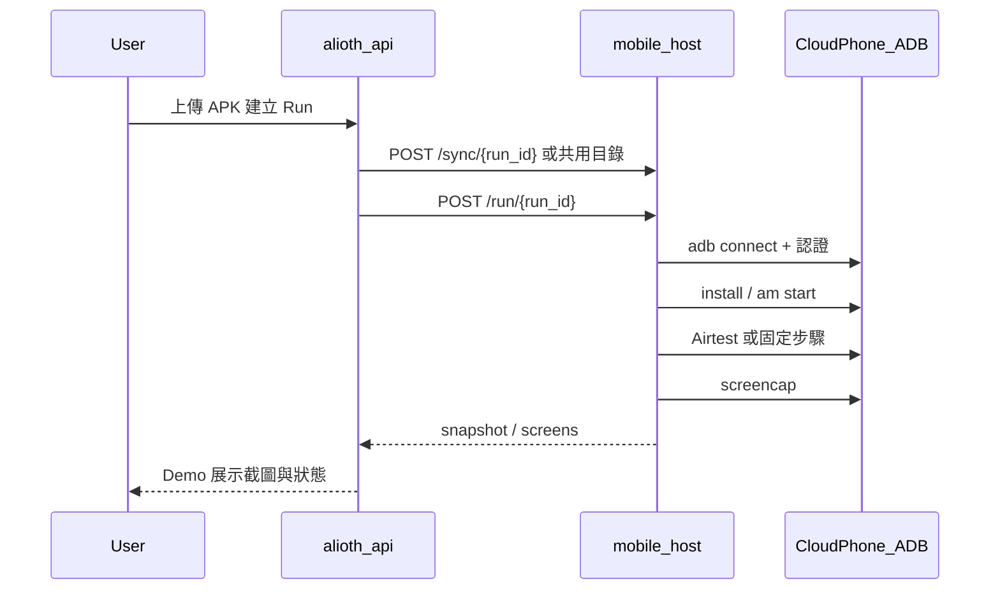
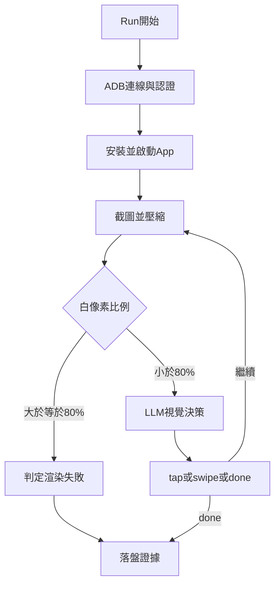

# Alioth 雲手機裝置面技術方案

> 日期：2026-07-27  
> 狀態：方案稿（含 POC 實測結論）  
> 定位：原生 APP 自動化質檢的**雲手機裝置後端**技術方案；與本機／容器**模擬器**並列，不另起產品線。  
> 關聯：  
> - POC 操作：[`2026-07-26-cloud-phone-ai-poc.md`](2026-07-26-cloud-phone-ai-poc.md)  
> - Docker 模擬器：[`2026-07-20-docker-android-emulator-integration.md`](2026-07-20-docker-android-emulator-integration.md)  
> - Path B：[`2026-07-25-path-b-vmware-docker-redroid.md`](2026-07-25-path-b-vmware-docker-redroid.md)  
> - Demo 依賴：[`2026-07-13-mobile-demo-deps-docker-integration.md`](2026-07-13-mobile-demo-deps-docker-integration.md)  
> - APP 詳細設計：[`2026-07-10-alioth-app-automation-detailed-design.md`](2026-07-10-alioth-app-automation-detailed-design.md)

---

## 1. 背景與問題

### 1.1 業務目標

上傳 APK → 裝置就緒 → 安裝／啟動 → UI 操作（找廣告、滑動、截圖）→ 證據回寫 → 人審／報告。

裝置控制面本質依賴 **ADB**（裝包、啟動、輸入、截圖）。AI 可替代「點哪／滑哪」的決策，**不能**替代「有一台能渲染的 Android 裝置」。

### 1.2 現有「模擬器」路線痛點（實測）

本專案曾以 **Docker ReDroid／官方 Emulator（WSL 或 VMware）** 作為安卓裝置面，協定層（ADB、Host、跨服 sync）可打通，但在**目標業務包**上反覆失敗：

| 路線 | 結論 | 典型問題 |
|------|------|----------|
| Windows Docker Desktop + ReDroid | 不可行 | 無穩定 KVM／binderfs |
| WSL Docker ReDroid | 不可行 | 無 binderfs，ADB 連不上 |
| WSL Google Emulator + Docker Host | 協定通 | x86 跑純 ARM Flutter → 白屏／ANR |
| VMware Ubuntu + ReDroid（Path B） | 協定通 | `gpu_mode=guest` 下 Flutter Skia 失敗，截圖全白 |
| 本機模擬器（需關閉 Hypervisor） | 與 Docker／WSL 互斥 | 開模擬器全速則本機 Docker 掛；開 Hypervisor 則模擬器變慢或不穩 |

ReDroid／x86 模擬器上實測 Flutter App（如 `me.mfanv.npymci`）日誌：

```text
Failed to set up Skia Gr context
Failed to create platform view rendering surface
```

→ App 進程在、焦點在，但**無渲染表面**，業務截圖全白。質檢要的是「看得見 UI／廣告」，不是「進程還活著」。

### 1.3 為什麼要改用雲手機

**一句話：模擬器能連 ADB，但跑不動我們要測的 App 畫面；雲手機用 ARM 真機級環境補上渲染，並避開本機虛擬化死結。**

| 原因 | 說明 |
|------|------|
| 1. 渲染／GPU | 業務包多為 **純 ARM + Flutter／廣告 SDK**。x86 模擬器／guest GPU 常建不起 Skia／OpenGL 表面 → **全白截圖**，腳本與 AI 都無法作業。雲手機多為 **ARM + 真機級 GPU**，畫面可出。 |
| 2. 虛擬化衝突 | 本機要「模擬器全速」往往需關 Hypervisor，則 **Docker／WSL 不可用**；要 Docker 則模擬器變慢或不穩。雲手機把裝置放到廠商側，**主站仍可跑 Docker**，不必二選一。 |
| 3. 協定可複用 | 雲手機若提供 `adb connect`，可沿用現有 Host／`cloud_phone` 適配，**不必重做質檢協定**。 |
| 4. 與 AI 分工 | 雲手機解決「有畫面」；LLM 視覺解決「點哪／滑哪」。AI **不能**代替裝置渲染。 |

因此：模擬器路線保留作**輕量／非 Flutter／有 x86 的包**或 Linux 集成實驗；**重渲染業務包與演示閉環改以雲手機為主裝置面**。

---

## 2. 目標與非目標

### 2.1 目標

- 裝置後端新增 **`cloud_phone`**，與 `google_emulator`／`redroid` 等**模擬器後端**並列。  
- 主站 API／Host Runner／跨服 `/sync` `/run` `/snapshot` **協定不變**。  
- 支援：**腳本（Airtest）** 與 **AI 視覺閉環（POC→正式 Tool）** 兩種執行器。  
- 供應商可替換：只要最終提供可連的 ADB 端點（或等價 SSH 隧道）。

### 2.2 非目標（本方案階段）

- 不綁死單一雲手機廠商私有 RPA 為唯一執行引擎。  
- 不在本階段自建雲手機機房。  
- 不以「無 ADB、純廠商 HTTP 點擊」取代平台 Tool 契約（可作適配器內部實現，對外仍是裝置 Tool）。  
- 不解決 OpenAI／LLM 帳號額度問題（屬運營配置）。

---

## 2.3 費用邊界（MoreLogin 類雲手機，務必寫進預算）

以 MoreLogin Remote Phone 為準（其他廠商類似，以官網為準）：

| 費用項 | 說明 | 是否免費 |
|--------|------|----------|
| **雲手機時長** | 新用戶僅約 **100 分鐘免費試用** | 僅前 100 分鐘 |
| **逾時後雲手機** | **100 分鐘用盡後開始產生雲手機相關費用**（按分鐘／套餐計費，以廠商帳單為準） | **否，需付費** |
| **SOCKS5 代理** | 開機**強制**要求 SOCKS5；本機網路／多數本地代理不可用 | **否，需另行購買代理** |
| LLM／OpenAI | AI 視覺路徑另計（與雲手機無關） | 依模型帳號 |

結論：

1. 「免費」**只涵蓋最多約 100 分鐘雲手機時長**，不是無限免費。  
2. 超過 100 分鐘後，必須準備**雲手機使用費**。  
3. 即便仍在免費分鐘內，若未購買並綁定 **SOCKS5 代理**，雲手機**無法開機**，代理費為**額外剛需成本**。  
4. 正式／CI 環境應按「雲手機時長 + SOCKS5 代理 +（可選）LLM」三筆分開估價，勿只寫「免費雲手機」。

---

## 3. 總體架構

```text
┌──────────────── Alioth 主站 ────────────────┐
│  alioth-api / worker / Workstation           │
│  ALIOTH_DEVICE_BACKEND=cloud_phone           │
│  ALIOTH_MOBILE_DEMO_HOST_EXECUTOR=…:8765     │
└────────────────────┬─────────────────────────┘
                     │ HTTP 委派（可本機或跨服 REMOTE_SYNC）
                     ▼
┌──────────────── Host Runner ────────────────┐
│  mobile_demo_host_runner :8765               │
│  ├─ CloudPhoneController（遠端 ADB）         │
│  ├─ Airtest 腳本執行（可選）                 │
│  └─ AI Driver：screencap → LLM → tap/swipe   │
└────────────────────┬─────────────────────────┘
                     │ adb connect + 廠商認證
                     ▼
┌──────────────── 雲手機供應商 ───────────────┐
│  例：MoreLogin Cloud Phone（ARM）            │
│  ├─ SOCKS5 代理（強制；需另行購買）          │
│  ├─ 時長：僅約 100 分鐘免費，其後計費         │
│  ├─ ADB / SSH 隧道                           │
│  └─ 瀏覽器串流畫面（人工監看，可選）         │
└──────────────────────────────────────────────┘
```

### 3.1 分層職責

| 層 | 職責 | 不負責 |
|----|------|--------|
| 領域／Agent | 任務、規則、證據、人審 | 不直連 ADB |
| API | Run 狀態機、委派 Host | 不持裝置鎖細節以外的廠商 SDK |
| Host Runner | ADB、安裝、啟動、截圖、腳本／AI | 不存 LLM 完整大圖進對話歷史 |
| Device 適配 | `cloud_phone` 端點解析、connect、serial 固定 | 不實現質檢規則 |
| 雲手機廠商 | 提供可渲染 Android + ADB | 不承載 Alioth 業務狀態 |

### 3.2 與現有後端對照

| `ALIOTH_DEVICE_BACKEND` | 裝置來源 | 適用 |
|-------------------------|----------|------|
| `google_emulator` | 官方 SDK 模擬器（AVD） | Linux KVM／輕量 POC |
| `redroid` | Docker 容器模擬器 | Linux + binderfs 集成 |
| **`cloud_phone`** | **遠端雲手機 ADB** | **Flutter／重 GPU／避開本機虛擬化衝突** |

實現上：`CloudPhoneController` 複用遠端 ADB 的 connect／install／launch；端點來自 `ALIOTH_CLOUD_PHONE_ADB`（回退 `ALIOTH_REDROID_ADB`）。

---

## 4. 核心實體與配置

### 4.1 配置項

| 變數 | 說明 |
|------|------|
| `ALIOTH_DEVICE_BACKEND=cloud_phone` | 啟用雲手機後端 |
| `ALIOTH_CLOUD_PHONE_ADB` | `host:port` 或廠商隧道位址 |
| `ALIOTH_CLOUD_PHONE_ADB_AUTH` | 可選；連線碼／`glogin`／shell 密碼（廠商差異） |
| `ALIOTH_MOBILE_DEMO_HOST_EXECUTOR` | Host 位址 |
| `ALIOTH_MOBILE_DEMO_REMOTE_SYNC` | 跨機時 `1` |
| `ALIOTH_MOBILE_DEMO_AI_DRIVER` | `1` 時允許走 AI 視覺路徑 |
| `ALIOTH_LLM_*` | 視覺決策模型（建議 `chat_completion` + 多模態模型） |

### 4.2 供應商側實體（映射，不必落庫也可先 env）

| 概念 | 說明 |
|------|------|
| CloudPhoneProfile | 廠商環境 ID（如 MoreLogin `envId`） |
| ProxyBinding | SOCKS5 等；部分廠商開機強制 |
| AdbEndpoint | `ip:port` + 認證碼 |
| Session | 開機計費時段；斷線／欠費需重連 |

正式化後建議表或配置中心記錄：`provider`、`env_id`、`adb_endpoint`、`last_auth_at`、`billing_mode`，並進審計。

---

## 5. 協定與流程

### 5.1 Demo／Host 主流程（腳本路徑）



### 5.2 AI 視覺閉環（POC → Tool）



約束（對齊平台規則）：

- 完整截圖落本地／對象存儲；進 LLM 僅 **壓縮 JPEG／縮小邊長**。  
- 模型只輸出結構化 JSON（`action/x/y/...`），由代碼執行 `adb shell input`。  
- 敏感操作（支付、卸載）仍走權限與審計，不因「AI 決定」繞過。

### 5.3 MoreLogin 特例（實測）

| 步驟 | 說明 |
|------|------|
| Local API | 客戶端開啟後 `http://127.0.0.1:40000` |
| 創建 | `POST /api/cloudphone/create`（如 `skuId=10002` Android 12） |
| 開機 | `POST /api/cloudphone/powerOn`，body 為單個 `id`（非整列 `ids`） |
| **強制代理** | 未設 SOCKS5 時開機失敗：`云手机启动失败，代理未设置` → **必須購買並綁定 SOCKS5** |
| **時長計費** | 新用戶約 **100 分鐘免費**；**超過後產生雲手機相關費用** |
| ADB | `updateAdb` → `batchAdbInfo` 取 `adbIp/adbPort`；連線後可能需 `shell <連線碼>` |
| 限制 | 雲手機必須 SOCKS5；不支援部分本地代理產品；免費僅限時長試用段 |

POC 已創建環境示例：`CP-1` / `envId=1716908500297143`（需先購 SOCKS5 並綁定後方可啟動；留意 100 分鐘免費額度）。

---

## 6. 代碼落點（現狀與演進）

| 路徑 | 角色 |
|------|------|
| `services/api/app/infrastructure/device/backend.py` | `cloud_phone` 解析 |
| `services/api/app/infrastructure/device/cloud_phone.py` | 遠端 ADB 控制器 |
| `services/api/app/api/v1/mobile_demo.py` | Demo 裝包／啟動分支 |
| `services/api/app/mobile_demo_host_runner.py` | Host health 暴露 `cloud_phone_adb` |
| `services/api/app/mobile_demo_ai_driver.py` | AI 視覺閉環 |
| `scripts/verify-cloud-phone-adb.ps1` | 連通＋白屏門檻 |
| `scripts/run-cloud-phone-ai-smoke.py` | AI smoke |
| `scripts/start-mobile-demo-cloud-phone.ps1` | 合併 env 啟動 Host |
| `infra/env/.env.cloud-phone.example` | 環境樣例 |

演進：

1. Demo 旁路驗證（已完成程式骨架）。  
2. 映射為 APP Tool：`app_ensure_device_ready`／`app_install_apk`／`app_screenshot`／`app_tap`…  
3. Agent Loop 按 `target_platform=android` 掛載；下線硬編碼步驟。

---

## 7. 供應商選型建議

| 維度 | 要求 |
|------|------|
| 架構 | 優先 **ARM**（純 ARM APK／Flutter） |
| 自動化 | 必須有 **ADB** 或穩定等價通道 |
| 網路 | **強制 SOCKS5**；需單列**代理採購費用** |
| 計費 | **僅約 100 分鐘免費**；其後雲手機按量／套餐收費；與 CI 併發匹配 |
| 合規 | 資料出境、截圖留存、帳號風控 |

候選參考：MoreLogin（已 POC）、XCloudPhone、APKless、自建雲真機／Device Farm。  
**適配層只認 ADB 端點**，避免業務綁死一家。

---

## 8. 階段與驗收

### 階段 A — POC（當前）

- [x] `cloud_phone` 後端與腳本／AI smoke  
- [x] MoreLogin 建機 API 打通  
- [ ] 代理配置後開機 + ADB 認證成功  
- [ ] 91cg 截圖白像素 &lt; 80%  
- [ ] AI 完成至少 1 輪 tap 並落盤  

### 階段 B — Demo 穩定

- Host 一鍵啟動；Demo 頁 `device_backend=cloud_phone`  
- 斷線重連、開機超時、白屏自動 fail  
- 秘密（LLM Key、廠商 Token、代理帳密）僅 env／密管，不進 git  

### 階段 C — 平台合併

- APP Tool 化；證據進 Observation Packet  
- 矩陣：多雲手機 profile 串行／有限並行  
- 與模擬器後端（`google_emulator`／`redroid`）在配置層可切換，同一套任務模型  

### 驗收指標

| 指標 | 門檻 |
|------|------|
| ADB `device` | 開機後 3 分鐘內 |
| 目標 APK 渲染 | 白像素 &lt; 80%，且無 Skia surface 錯誤 |
| 單次煙測 | sync→run→≥1 張有效業務截圖 |
| AI 可選 | JSON 動作可執行且有 after 截圖 |

---

## 9. 風險與對策

| 風險 | 影響 | 對策 |
|------|------|------|
| 廠商強制代理 | 無 SOCKS5 無法開機 | **預算必須含代理購買費**；無法「只領免費分鐘就跑」 |
| ADB 隧道不穩 | 任務中斷 | 重試 connect；Run 狀態可恢復 |
| LLM 無額度／延遲 | AI 路徑不可用 | 腳本路徑兜底；監控 429 |
| **100 分鐘免費用盡** | 無法繼續演示／任務 | 預先充值雲手機時長或改包月；CI 控制單次時長 |
| 虛擬化與本機 Docker 衝突 | 運維複雜 | 雲手機路徑減少本機模擬器依賴 |
| 安全 | Key／ADB 密碼外洩 | 輪換 Key；`.env.local` 不提交；審計日誌 |

---

## 10. 決策摘要

1. **雲手機作為 Alioth APP 質檢的一級裝置後端**，專門承接**模擬器渲染失敗**的業務包（見 §1.3）。  
2. **對外統一遠端 ADB**；廠商差異封裝在適配與連線腳本。  
3. **AI 只做視覺決策**，執行與權限仍在代碼與 Tool。  
4. **模擬器路線保留**：輕量包、Linux 集成實驗；與雲手機可配置切換，不互相取代領域模型。  
5. **成本**：MoreLogin 類方案僅 **約 100 分鐘免費**；其後有雲手機費用；**SOCKS5 代理需另行購買**，否則無法開機。

---

## 11. 附錄：本機操作速查

```powershell
# 驗證 ADB
$env:ALIOTH_CLOUD_PHONE_ADB = "<ip:port>"
powershell -File scripts/verify-cloud-phone-adb.ps1

# AI smoke（需有效 LLM 額度）
python scripts/run-cloud-phone-ai-smoke.py

# 啟動 Host
powershell -File scripts/start-mobile-demo-cloud-phone.ps1
```

MoreLogin Local API 基址：`http://127.0.0.1:40000`（客戶端需登入運行）。
