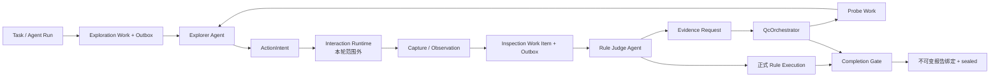

# 探索 Agent、质检 Agent 与 Orchestrator 串联审查及实施计划

日期：2026-08-10

审查基线：`dev_1.5@1733f98`

实施后基线：`dev_1.5@9652edb`

## 1. 结论

当前代码已经具备一条可运行的 V2 控制面主链，但还不能宣称“全场景、生产级完整串联”。

- Explorer Agent 与 Rule Judge Agent 的职责隔离基本成立：二者都不持有 Driver，正式 V2 Agent 不挂业务 Tool；Explorer 只返回探索决策，Rule Judge 只消费交接并输出判定。
- PostgreSQL 工作事实、租约、Outbox/Inbox、Completion Gate 与不可变报告绑定已经形成较稳固的基础设施。
- 本轮已补齐三个直接影响串联的缺口：active-session Inspection Work 可被消费、Probe Work 可续租、任务完整收口与 sealed 报告恢复统一交给 `QcOrchestrator`。
- 尚存三项任务范围内的关键缺口：Judge 没有在发布时锁定不可变 Observation Packet；Evidence Request 没有持久化路由状态与可靠重试；顶层 Agent Run 仍把 Redis 记录当作 Worker 启动事实。
- 另有两个已确认的 App 生产闭环阻断：没有确定性的 `objective_satisfied` 生产者、Surface Session 正常关闭未接入。本任务明确排除 App/浏览器运行时，因此本轮只记录边界，不修改对应模块。
- H5 仍走 V1 Main Agent 全工具集。完整迁移会进入浏览器运行时、页面探索和规则质检实现，本轮不扩张范围；在迁移完成前不得把 H5 标记为 V2 严格角色隔离链路。

因此，准确口径是：**Agent/Orchestrator 控制面已经可以局部串联，关键恢复路径比审查前完整；整体业务链仍是“部分可用、不可宣称生产闭环”。**

## 2. 审查范围

本轮纳入：

- Explorer Agent、Rule Judge Agent 的装配、输入输出契约与能力边界；
- Exploration/Probe Work、Inspection Work Item、Attempt、lease、Outbox/Inbox；
- Agent Run 到 Worker 的派发事实；
- Evidence Request 到 Probe 的 Orchestrator 路由；
- Completion Gate、报告绑定与任务封存；
- 为上述模块服务的 PostgreSQL、Redis 唤醒和测试基建。

本轮排除：

- 浏览器、ADB、设备、App Interaction Runtime 的具体实现；
- 页面识别、页面探索策略、候选动作算法；
- 规则内容、规则匹配、规则判定业务逻辑；
- 工作台页面、前端路由和菜单。

审查过程中只读追踪了排除模块的接线，用于证明链路是否闭合；没有在这些模块内实施修改。

## 3. 当前架构与串联状态



图中实线代表已有代码路径，不代表每个生产场景都已闭环。当前主要断点位于：

1. `Task / Agent Run` 顶层派发仍依赖 Redis 完整记录；
2. Inspection Work 发布时没有锁定 Judge 将消费的 Packet 身份；
3. Evidence Request 路由失败只记日志，没有持久化重试状态；
4. App Runtime 范围内缺确定性完成事实与正常 Session Close。

## 4. 分模块成熟度

成熟度是架构审查评级，不是测试覆盖率。

| 模块 | 评级 | 已具备 | 主要缺口 |
| --- | --- | --- | --- |
| Explorer Agent | B | 独立 MAF Agent、无 Tool、严格 Work/Frontier/ActionIntent 合同、预算与终态校验 | App 完成事实没有生产者；H5 仍是 V1 混合 Agent；风险策略仍需依赖运行时真实节点语义 |
| Rule Judge Agent | B | 独立无 Driver/无 Tool Agent、结构化 Handoff、PG Work Item/Attempt/lease、正式执行写回 | Packet 在 Judge 时重建而非发布时锁定；Evidence Request 缺可靠状态机 |
| QcOrchestrator | B | MAF 确定性 Work 发布、Probe 路由、Draining、Gate；本轮新增完整收口与 sealed 报告恢复唯一入口 | Evidence Request 仍是临时组装；完整收口是多个 MAF facade 的顺序组合，尚非单一可观测 Workflow |
| 控制面基础设施 | B | PostgreSQL work/lease/outbox/inbox、Redis wakeup、Gate 快照、报告 hash 绑定 | 顶层 Run 派发仍 Redis-first；真实 PG/Redis 并发与断连组合未验收 |
| 端到端生产闭环 | C | App V2 局部链路可运行，snapshot/active-session 工作均有消费入口 | App 完成事实与 Session Close 阻断；H5 未迁移；真实设备与生产环境未验收 |

### 4.1 Explorer Agent

成立的边界：

- `services/api/app/agents/explorer/maf_agent.py` 构建的 MAF Agent 使用 `tools=None`；
- Agent 消费持久化 Exploration/Probe Work，只输出动作意图或终态，不直接操作 Driver；
- `completed` 必须同时看到 Frontier metadata 中的 `objective_satisfied=true`，模型不能自行宣布完成。

未闭合之处：生产侧没有发现该 metadata 的确定性生产者。现有测试主要通过 fixture 直接注入它，所以“Agent 能拒绝假完成”已覆盖，“生产事实能驱动真完成”尚未覆盖。该生产者属于 Surface/App Runtime 范围，本轮不改。

### 4.2 Rule Judge Agent

成立的边界：

- `services/api/app/agents/rule_judge/maf_agent.py` 只把 `InspectionHandoff` 转换为 Judge Request；
- 语义 Judge 的 MAF Agent 使用 `tools=None`；
- Inspection Work Item 经过 PostgreSQL claim、lease、Attempt、判定持久化、正式 `qc_rule_execution` 写回后再终结；
- 本轮后 Redis wakeup 会回 PostgreSQL 领取 `snapshot` 或同 owner Run 的 `active_session` 工作。

未闭合之处：`InspectionWorkItemRule` 在发布时只有规则身份与 contract hash；Handoff 只有 Capture/role，没有每条规则的持久化 Packet ID。Packet ID 是 Judge 运行后才回填到成员。发布与判定之间如果源证据发生变化，审计链无法证明判定消费的是发布时同一份不可变输入。

### 4.3 QcOrchestrator

成立的边界：

- Exploration/Probe 发布、Exploration Draining、Session Draining、Completion Gate 已通过确定性 MAF Workflow 执行；
- 本轮新增 `AdvanceTaskFinalizationCommand`，Worker 不再复制 `open → exploration_draining → session_draining → Gate/report` 状态分支；
- 已封存任务的报告恢复绑定也必须通过 Orchestrator 校验 owner Run、Gate Snapshot 与正式报告标记；
- Worker 中不再直接调用各阶段收口或 `bind_report` 仓储接口。

未闭合之处：Evidence Request 路由仍允许临时创建默认 Orchestrator，逐条异常只写日志；请求没有 durable status、attempt、next retry、terminal reason。完整收口目前由 Orchestrator 顺序调用多个 MAF facade，尚缺一个贯穿整段的 Workflow trace。

## 5. 本轮已实施批次

### 批次一：接通 active-session Inspection Work

提交：`1b7e9e1 [AI编程] fix: 接通活跃会话质检工作项消费`

- `InspectionWorkItemConsumer` 新增参数化 `drain_available`；
- snapshot 专用入口保留兼容；
- Redis wakeup 不再硬编码 snapshot，而是回 PostgreSQL 领取当前 Run 有权消费的工作；
- owner Run、session dependency 与 lease 仍由仓储强制约束。

### 批次二：修复 Probe Work 续租

提交：`78c0f99 [AI编程] fix: 允许Probe工作续租`

- 去除共用 lease renew SQL 中隐含的 `work_type='exploration'`；
- Exploration Work 与 Probe Work 继续使用 work identity、owner、token、expiry、row version 共同校验；
- 补充 Probe 共用续租契约测试。

### 批次三：统一任务收口编排入口

提交：`9652edb [AI编程] refactor: 统一任务收口编排入口`

- `QcOrchestrator` 接管完整收口状态推进；
- Worker 只提交 Run、执行结论、质量结论和最终报告，不再维护第二套状态机；
- 支持从 persisted draining 阶段恢复、sealed 幂等返回、错误 owner Run 拒绝；
- sealed 后的正式报告恢复绑定也统一经过 Orchestrator；preview 报告不能进入该入口；
- 同步更新专项回归规则。

## 6. 后续最优实施方案

### 批次四：在 Work Item 发布时锁定不可变 Observation Packet

目标：Judge 只消费发布时已确定的证据输入，禁止 V2 enforced 路径在 claim 后重新构建输入。

设计：

1. 为每个 `InspectionWorkItemRule` 在发布事务内创建或引用不可变 Packet；
2. 成员持久化 `observation_packet_id`、`packet_hash`、manifest/artifact 引用摘要；
3. Work Item `input_hash` 必须覆盖有序规则合同和 Packet 身份；
4. claim 后把这些引用写入 `InspectionHandoff`；
5. Judge 通过 repository `load_packet` 加载并校验 hash、任务、Capture、规则与质量门禁；
6. V2 enforced 缺 Packet 时 fail-closed；legacy 路径保留显式兼容分支，不能静默回退。

验收：发布后修改源 Capture/Artifact 读模型，Judge 输入和结论仍保持不变；Packet ID 能一路追踪到 Attempt、Work Item member 和正式 Rule Execution。

预计影响：Inspection Work Item/Observation Packet 应用契约、PostgreSQL repository、Alembic migration、Judge Handoff 与测试；不需要修改规则判定业务逻辑。

### 批次五：建立 Durable Evidence Request 状态机

目标：Judge 请求补证后，即使路由失败、进程重启或 Redis 断连，也能确定性恢复。

设计：

1. 新增持久化 Evidence Request aggregate，至少包含 `pending/routing/routed/satisfied/failed/dead_letter`；
2. 保存 Work Item、Attempt、rule、request hash、Probe Work、attempt count、next retry、last error 与 terminal reason；
3. Request 与 Probe Work/Outbox 在同一 PostgreSQL 事务中推进；
4. Result Writer 注入同一个 Orchestrator/Evidence Request port，不在函数内临时组装；
5. 路由失败进入 retry，证据补齐后把原 Work Item 从 `waiting_evidence` 原子恢复为 `pending`。

验收：route fail 后可重试；重复事件不产生第二个 Probe；补证成功后同一 Work Item/Attempt 链可继续；超过上限进入明确终态并阻断 Gate。

### 批次六：让 PostgreSQL 成为 Agent Run 唯一派发事实

目标：Redis 过期或丢记录不能让已提交任务永久消失。

设计：

1. Task、Agent Run 与 Agent Run Outbox 在同一 PostgreSQL 事务创建；
2. Redis 只投递 `run_id` wakeup，不保存 Worker 启动所需的唯一完整事实；
3. Worker 收到 wakeup 后通过 PostgreSQL claim/load，校验状态、owner 与 dispatch lease；
4. Redis 消息缺失由 PostgreSQL sweeper 重放；Redis 有消息但 PG 无可 claim Run 时安全 ACK；
5. 迁移期只保留显式 legacy 兼容读取，并设置移除条件和指标。

验收：Redis record TTL、Redis 断连、重复 wakeup、Worker crash、双 Worker 并发 claim、PG 恢复后重放。

### 批次七：补齐 Orchestrator 全链 trace

目标：在不改变领域事实源的前提下，把完整 finalization 与 durable evidence request 编排成可观测的 MAF Workflow。

设计原则：Workflow 只组合命令、状态和端口；不创建 Agent、不持有 Driver、不执行规则判断。每一步仍以 PostgreSQL 状态和乐观锁为准，MAF trace 不是新的事实源。

### 范围外后续

以下工作需要用户另行扩大范围后实施：

- App/Surface 侧确定性 `objective_satisfied` producer；
- Session `draining → closing → closed` 与 Driver close 的生产接线；
- H5 从 V1 Main Agent 迁移到 Work + Web Interaction Runtime + 独立 Explorer/Rule Judge；
- 页面探索策略、实际节点风险判断和规则质检内容优化。

## 7. 验证结果与未验证边界

本轮组合回归：

```text
134 passed
```

覆盖测试文件：

- `test_v2_agent_architecture.py`
- `test_worker.py`
- `test_inspection_work_item_consumer.py`
- `test_inspection_wakeup.py`
- `test_v2_control_plane_repositories.py`
- `test_app_exploration_turn.py`
- `test_task_completion_gate.py`
- `test_task_finalization_persistence.py`

静态检查：相关 Python 文件 `ruff check` 通过，`git diff --check` 通过。
迁移检查：Alembic 为单一 head `20260810_0044`；本轮三个代码批次没有新增迁移。

没有完成的验收：

- 真实 PostgreSQL 上的双 Worker 并发 claim、lease renew 与 row-version 冲突；
- Redis 断连/TTL 与 PostgreSQL 恢复的组合 E2E；
- 真实 App/浏览器 Session、真实设备和生产环境；
- H5 V2 串联；
- App 完成事实与正常 Session Close。

这些边界不能由单元测试替代，后续报告必须继续明确区分“仓库证据”和“生产验收”。

## 8. 提交与评审策略

- 每个批次只包含一个可回滚的协议目标；
- 涉及迁移的批次先提交领域/应用契约与 migration，再提交 consumer/producer 接线；
- 每批执行定向测试、组合回归、`ruff`、`git diff --check`、cached diff 复审后再本地提交；
- 不暂存用户已有的未跟踪设计稿、`.testagent/`、本地配置或运行产物；
- 未经明确授权不 push。
