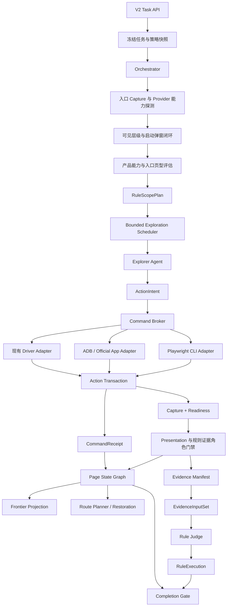
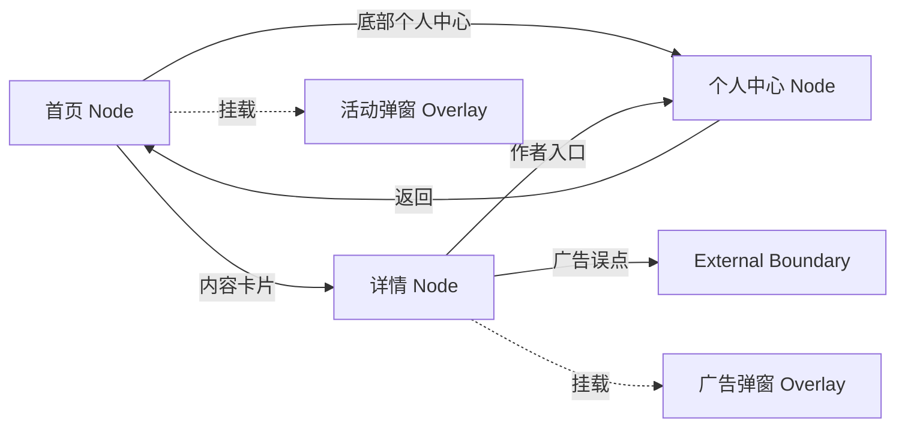
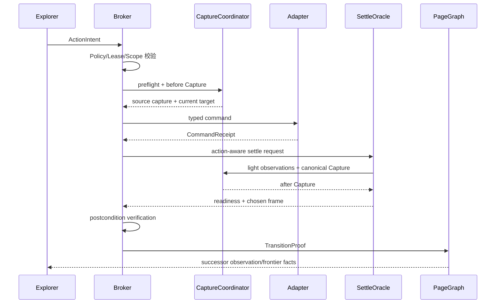
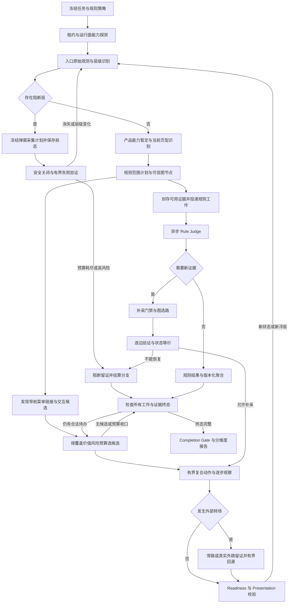

# Alioth 有限自主探索、页面状态图与可信证据详细设计

> 日期：2026-09-02
>
> 更新：2026-09-03 · lichuan / qingyunke 反馈整合
>
> 版本：Design v1.1
>
> 状态：方案已收敛，尚未实现
>
> 适用平台：H5、桌面 Web、Android/iOS App
> 目标读者：产品、架构、后端、Agent Runtime、前端、测试与运维人员

## 0. 文档定位

本文把 2026-09-02 头脑风暴中确认的六项产品决策，固化为可实施、可测试、可灰度、可回滚的详细设计：

1. 探索采用**有限度自由发现**，不退化成固定页面脚本，也不允许无限漫游；
2. 局部 Tab、筛选和展开态默认属于同一页面的不同状态版本；
3. 弹窗是正式质检目标，但通常不作为业务页面节点；
4. 外部广告落地页只留存外跳证据，默认不计被测产品业务覆盖；
5. 补采等价性由规则声明，支付、登录、授权等高风险场景从严；
6. 正式 Agent 允许有限度 Shell，但必须经过受控 Command Broker，禁止任意 Bash。

本文是以下既有设计的专项增量，不重新定义整个平台：

- [Alioth V2 探索、交互观测、证据与规则质检解耦方案](./2026-07-30-alioth-v2-agent-decoupling-architecture.html)
- [App 页面探索 V2 流程](./2026-08-11-app-page-exploration-v2-flow.html)
- [页面探索、证据留存与规则质检详细流程](./2026-08-13-page-exploration-evidence-rule-inspection-flow.html)
- [任务级质检证据输入集合设计](./2026-08-14-task-scope-evidence-input-set-design.md)
- [H5 页面探索运行时稳定性设计](../superpowers/specs/2026-08-14-h5-page-exploration-runtime-stability-design.md)

若发生冲突：既有 V2 的任务、租约、Capture、Manifest、Inspection Work、RuleExecution 和 Completion Gate 仍是平台权威边界；本文仅在探索策略、页面图、执行 Broker、截图稳定性、弹窗质检与补采恢复方面具有优先级。

v1.1 补充产品能力前置评估、可见层级门禁、弹窗关闭闭环、规则执行范围、外跳旁路、长图证据、复合交互与完整运行闭环。逐条反馈裁决见第 35 节，端到端串联见第 36 节，外部能力核验来源见第 37 节。本文仍然是设计，不代表这些能力已经实现。

---

## 1. 执行结论

### 1.1 目标架构

本次不是把自研 Runtime 整体替换成 Playwright CLI 或 ADB，而是把它们作为受控执行 Provider 接入现有平台：

```text
Task / Provider 能力快照
        │ 启动入口，先观察启动层、弹窗和可见业务内容
        ▼
ProductCapabilityAssessment + PresentationStackAssessment
        │ 产品能力暂定、入口页型、规则适用与执行范围；随发现修订
        ▼
Explorer Agent / Skill
        │ 产生语义 ActionIntent，不持有浏览器或设备句柄
        ▼
Bounded Exploration Scheduler
        │ 预算、价值、风险、停止条件
        ▼
Command Broker
        │ Session/Lease/Origin/Package/Policy 校验
        ▼
Playwright CLI Adapter / ADB Adapter / Existing Driver
        │
        ▼
Action Transaction
        │ preflight → before capture → execute → settle → after capture → postcondition
        ▼
Immutable Capture / Action Ledger / Command Receipt
        │
        ├── Page State Graph + Overlay Target
        ├── Frontier 与恢复规划
        └── Manifest → EvidenceInputSet → RuleExecution → Completion Gate
```

### 1.2 三个必须修正的直觉

1. **“自由探索”不等于“任意执行”。** Agent 可以自由选择受支持的语义动作，但不能扩大域名、Package、设备、文件系统和副作用权限。
2. **“页面探索树”不应是唯一事实源。** 页面有多入口、返回、循环和重进，底层必须是有向多重图；树只用于默认展示和某一次恢复路径。
3. **“文件 Hash 正确”不等于“证据正确”。** 证据还必须证明来源、时间一致性、页面语义和规则充分性。

### 1.3 实施优先级

| 优先级 | 能力 | 原因 |
| --- | --- | --- |
| P0 | Action Transaction、稳定截图、外跳熔断、证据时间一致性 | 直接决定动作和证据是否可信 |
| P0 | 页面身份与 `page_type` 解耦、Page State Graph 影子写入 | 是探索、去重、恢复和补采的共同地基 |
| P1 | 弹窗一等质检目标、页面类型判别卡 | 解决遮挡与类型漂移 |
| P1 | Playwright CLI / ADB Command Broker 影子接入 | 获得灵活性且不破坏现有控制面 |
| P1 | 基于图的恢复与补采 | 提升证据不足页面的找回成功率 |
| P2 | 前端探索图、路径诊断和旧专项分支退役 | 在事实链稳定后提升运营效率 |

---

## 2. 当前基线与问题归因

### 2.1 可复用能力

当前系统已经具备以下重要底座，不应推倒重来：

- H5 已经通过 Playwright 完成页面动作和 Capture；
- App V2 已有设备租约、动作前后 Capture、视觉候选重验证和 Package/Activity 边界；
- `qc_action_execution` 已表达动作幂等、命令序号、before/after Capture 和动作终态；
- `qc_page_capture` / `qc_capture` 是页面事实与跨平台 Capture 入口；
- H5 Frontier 有来源 Capture、状态版本、父状态和 lineage；
- App 全局 Frontier 有来源页面身份、候选指纹和 `navigation_path`；
- `qc_evidence_manifest`、`qc_evidence_input_set`、Observation Packet、RuleExecution 和 Completion Gate 已组成证据消费链；
- 补采已有 EvidenceRequest、Restoration、State Equivalence 和 EvidenceSupplement 契约，但正式 Runtime 仍 fail-closed。

关键代码入口：

- [H5 Runtime 组合根](../../services/api/app/application/h5_runtime_composition.py)
- [H5 Frontier 领域模型](../../services/api/app/domain/exploration/h5_frontier.py)
- [浏览器 Capture Runtime](../../services/api/app/infrastructure/browser/capture_runtime.py)
- [浏览器页面采集](../../services/api/app/infrastructure/browser/page_capture.py)
- [App 探索 Turn](../../services/api/app/application/app_exploration_turn.py)
- [App Capture Coordinator](../../services/api/app/application/capture_coordinator.py)
- [App 交互 Runtime](../../services/api/app/application/app_interaction_runtime.py)
- [App 全局 Frontier](../../services/api/app/domain/exploration/app_frontier.py)
- [证据 Manifest](../../services/api/app/application/evidence_manifests.py)
- [Completion Gate](../../services/api/app/domain/task/completion.py)

### 2.2 根因不是单一 Tool 不够灵活

当前问题是一个因果链：

```text
候选发现不足或候选失效
→ 点击/滑动未命中或被安全门禁阻断
→ 动作后截图仍在加载、弹窗层或错误页面
→ 页面类型识别漂移或置信度不足
→ 新页面不计覆盖
→ 来源状态无法证明恢复
→ Frontier 提前耗尽或循环
→ 证据不足、规则未执行、Completion Gate 不通过
```

因此只把工具换成 CLI，最多改善动作表达能力，不能自动解决页面身份、稳定截图、到达证明、恢复和证据可信问题。

### 2.3 当前数据模型缺口

| 当前事实 | 已有能力 | 缺口 |
| --- | --- | --- |
| `qc_task_page_node` | 展示 journey/discovered 顺序 | 没有稳定身份、状态版本、父边和恢复语义 |
| H5 Frontier | 候选来源、lineage、执行状态 | 是动作队列，不是页面节点图 |
| App Frontier | 候选指纹、来源身份、路径 JSON | 路径不可独立查询与验证 |
| Capture | 截图、DOM/UI Tree、页面识别 | 缺少跨平台统一稳定性 Assessment |
| ActionExecution | 动作与 before/after Capture | 缺少底层命令 Receipt 和细粒度后置条件结果 |
| 页面类型 Catalog | 页面类型、signals、导航知识 | App 输入不足，缺少正反判别与易混淆类型 |
| EvidenceRequest/Supplement | 协议和等价性边界 | 正式 Runtime 尚未 ready，缺少图恢复数据源 |

### 2.4 七项优化与现状问题、收益的逐项映射

七项优化不是七个互相独立的功能。它们依次解决“能不能操作、是否知道自己在哪里、能否回去、
是否认对页面、是否在正确时机采集、动作是否真正命中、证据是否可信”七层问题。任一层缺失，
后续覆盖率或规则结论都可能建立在错误事实之上。

| 编号 | 优化点 | 主要解决的现状问题 | 直接优化与系统提升 |
| --- | --- | --- | --- |
| 1 | H5 使用 Playwright CLI + Skill，App 使用 ADB + Skill | 现有封装动作集合有限，遇到新控件、新页面结构或非标准流程时容易停止；H5/App 扩展方式不统一 | 提升动作组合能力和新页面适应速度；减少站点/页面专项 Tool；统一由 Broker 审计和灰度 |
| 2 | 页面状态图与树形投影 | Frontier 只知道待执行动作，不知道稳定页面身份、状态版本、到达边和是否已充分探索 | 去重、进度判断、路径解释和覆盖统计更准确；避免重复探索与“Frontier 空即完成” |
| 3 | 基于图路径的页面补采 | 证据不足后只能重新盲找、依赖旧坐标或脆弱固定路径，高风险页面无法证明恢复等价 | 缩短找回时间、减少 Token/设备分钟；支持替代路径和逐边验证；高风险场景安全失败关闭 |
| 4 | 页面描述增强的 PageTypeCard | 同一页面因加载阶段、文案或局部状态不同被识别成不同类型，错误类型又污染规则匹配和覆盖分母 | 提升页面类型稳定性、可解释性和规则适用准确度；改判保留历史且不再分裂 PageNode |
| 5 | Settle Oracle 与稳定截图 | 固定等待导致加载慢时截早、加载快时空等；截图、DOM/UI Tree 和页面身份可能不同窗 | 提升正式 Capture 稳定率，降低错帧、重采和无效等待；为识别与规则判断提供一致输入 |
| 6 | Action Transaction 与精准交互 | ref/坐标过期、关闭广告误触外跳、滑错容器、命令成功却页面无变化 | 提升真实到达率，降低 stale target、no-effect、misroute 和外跳中断；动作结果可补偿、可追溯 |
| 7 | 五层可信证据链 | 文件存在或 Hash 正确无法证明证据属于正确页面、正确动作和正确时间；补采可能与原证据混淆 | 让规则结果可复现、可审计、可重判；错误证据在进入 Judge 前被拒绝，Completion Gate 不再表面通过 |

#### 2.4.1 优化点 1：受控 Playwright CLI / ADB + Skill

**解决的现状问题**

- 自研 Tool 只能覆盖预先设计好的动作参数，页面出现新控件、新滚动方式、新 Tab/Window 或系统 Dialog 时，Agent 缺少可组合的观察与操作能力；
- H5 与 App 分别堆积专项分支，新增站点或设备形态时重复开发；
- Tool 返回成功常被误解为交互成功，底层命令参数和运行环境也缺少统一审计。

**优化机制**

- Skill 负责告诉 Agent 如何观察、选择动作、验证结果和处理异常，不授予执行权限；
- Playwright CLI/ADB 作为 Adapter 提供标准底层能力，Agent 只提交语义 `ActionIntent`；
- Command Broker 冻结 Session、Origin/Package、设备、风险级别和 argv，并为每个命令生成 Receipt；
- 先影子观测，再开放低风险动作，现有 Driver 保留 fallback。

**带来的优化和提升**

- 探索层：可组合观察与动作增多，遇到未知页面时不必等待新增专用 Tool；
- 交付层：新站点/新 App 的适配更多落在 Skill、Catalog 和策略配置，而不是复制执行代码；
- 安全层：自由度增加但权限不扩大，所有正式动作仍有统一租约、策略和审计；
- 效率层：降低 `unsupported_action`、无意义重试和专项脚本维护成本，提高可信页面/分钟与可信页面/Token。

**建议验证指标**：`unsupported_action_rate`、`command_receipt_coverage`、
`verified_arrival_rate`、唯一可信 PageNode/分钟、站点专项执行分支数量，以及新旧 Driver shadow 差异率。

#### 2.4.2 优化点 2：页面状态图与树形投影

**解决的现状问题**

- Frontier 记录的是候选动作，无法独立回答页面是否已经到达、处于哪个状态、由哪条边到达以及是否完成质检；
- 同一页面可能从多个入口进入、循环返回或在不同状态间切换，单父节点树会丢失真实关系；
- 弹窗若作为页面混入树，会造成节点爆炸、覆盖虚高和恢复路径错误；
- 一个 `explored=true` 无法区分已发现、已稳定采集、规则已执行、证据不足和补采完成。

**优化机制**

- 以 `PageNode + PageStateRevision + TransitionEdge` 保存事实关系；默认树只是从图中选择一条父边的 UI 投影；
- Overlay 使用独立 `OverlayTarget/OverlayEvent`，挂在页面状态上而不污染业务页面节点；
- 探索进度拆分为发现、到达、稳定采集、规则质检、证据充分和终态等可审计维度；
- 节点身份由业务 landmarks 与结构决定，`page_type` 只作为可修订判定。

**带来的优化和提升**

- 正确性：减少同页重复建点、不同页错误合并和弹窗污染覆盖；
- 探索效率：已完成状态可以安全跳过，未完成状态能够精准重排优先级；
- 可解释性：工作台可以展示“从哪里来、做了什么、为什么算到达”；
- 平台能力：为补采选路、返回验证、循环检测和 Completion Gate 提供统一事实底座。

**建议验证指标**：重复 PageNode/Capture 占比、`page_identity_conflict_rate`、
孤立成功边数量、已完成状态重复探索率、图事实与 Capture/Action 对账一致率。

#### 2.4.3 优化点 3：基于页面图的精准补采

**解决的现状问题**

- EvidenceRequest 虽然能描述缺什么证据，但缺少“如何回到目标状态”的可信数据源；
- 固定路径、历史坐标和简单 BACK 容易因登录态、启动广告、页面改版或弹窗变化失效；
- 找回页面通常从入口重新盲目探索，消耗大量 Token 和云手机时长；
- 支付、登录、授权等状态如果只恢复到“看起来相似”的页面，会产生高风险错证据。

**优化机制**

- 从 Page State Graph 选择成功率高、最近验证、风险低、步骤少的候选路径；
- 每一步重新 Capture、rebind 和校验后置条件，路径失效时重新规划而不是继续回放；
- 规则显式声明 `exact_state`、`equivalent_state`、`fresh_observation` 或 `manual_only`；
- 通过 Evidence Exit Gate、Restoration Attempt 和 State Equivalence Gate 后才允许追加补采证据。

**带来的优化和提升**

- 效率：降低平均恢复时长、路径长度、Token 和设备分钟；
- 成功率：旧路径失效时可以选择已验证替代路径，提高证据不足页面的找回率；
- 安全性：高风险场景无法证明完全一致时自动 `evidence_insufficient/manual_review`；
- 审计性：可以解释为什么选择该路径、在哪一步失效、补采证据与原证据是什么关系。

**建议验证指标**：`restoration_success_rate`、平均恢复时长、平均验证路径长度、
`RESTORATION_ROUTE_STALE` 占比、`supplement_equivalence_pass_rate`，以及“无法找回页面”导致的证据不足占比。

#### 2.4.4 优化点 4：页面描述增强的页面类型识别

**解决的现状问题**

- 同一页面在 skeleton、加载完成、空态、错误态或不同局部 Tab 下可能被模型判成不同页面类型；
- 仅靠类型名称或一段宽泛描述，难以区分结构相似的列表、详情、支付确认和登录拦截页；
- 如果把 `page_type` 当节点身份，模型改判会新增节点、重复质检并污染覆盖率；
- 错误类型会选错规则，产生漏检、误检或不必要的 `manual_review`。

**优化机制**

- PageTypeCard 同时提供业务描述、必须信号、支持信号、排除信号、易混淆类型和示例边界；
- 将 URL/route、DOM/UI Tree、可见文本、结构 landmarks、视觉语义和来源转场联合输入判定；
- 页面稳定身份与类型判定解耦，类型改判形成 Assessment revision，不覆盖历史；
- 低置信度或正反信号冲突时显式 `ambiguous`，不强行归类。

**带来的优化和提升**

- 准确性：减少同页类型抖动和相似页面误分类；
- 规则质量：提高适用规则匹配精度，降低规则漏跑和错跑；
- 覆盖可信度：模型改判不再改变 PageNode 数量和业务覆盖分母；
- 可运营性：判定结果能够展示命中/排除证据，便于人工修订 Catalog。

**建议验证指标**：`page_type_conflict_rate`、同一 PageNode 的类型翻转率、
标注集准确率/召回率、规则误匹配率、类型冲突导致的 `manual_review` 占比。

#### 2.4.5 优化点 5：动作感知的 Settle Oracle 与截图时机

**解决的现状问题**

- 固定 sleep 在慢页面上截到加载态，在快页面上浪费时间；
- `networkidle` 无法正确处理 SPA、长轮询、广告、视频和实时 Feed；
- 截图、DOM/UI Tree、可见文本和页面身份可能来自不同时间点；
- 转场中间帧、骨架屏、键盘动画和弹窗动画被错误当作正式证据。

**优化机制**

- 按导航、局部 Tab、弹窗关闭、滚动、返回等动作使用不同 settle profile；
- 综合结构 quiet、loader、关键请求、页面身份、视觉变化和动作后置条件形成稳定 quorum；
- 使用动态区域 mask 与稳定 landmarks 处理本来就不会像素静止的页面；
- 将转场 Witness 与正式 canonical Capture 分开，并执行 identity-before/after 时间一致性三明治。

**带来的优化和提升**

- 证据质量：显著减少加载中、错页和跨时间窗组合进入正式 Manifest；
- 效率：页面已稳定时立即采集，未稳定时有界等待，降低固定等待和盲目重采；
- 下游质量：页面识别、OCR、视觉候选和 Rule Judge 获得一致输入；
- 可诊断性：能够明确区分超时、动态页面、后置条件失败和 Artifact 不同窗。

**建议验证指标**：`stable_capture_rate`、平均/p95 settle 时长、过早截图拒绝率、
正式 Capture 重采率、跨时间窗 Artifact 拒绝率、因错帧导致的证据不足占比。

#### 2.4.6 优化点 6：精准点击、滑动、返回与外跳熔断

**解决的现状问题**

- DOM ref、UI Tree 节点或视觉坐标在页面重绘后失效，仍按旧位置点击；
- 广告关闭按钮框小或存在诱导区域，误点后跳往浏览器、商店或其他 Package；
- 滑动命中了错误容器，返回动作回到未知页面，底层命令成功却没有业务效果；
- 误点后继续在外部页面探索，导致后续截图、类型、路径和覆盖连续污染。

**优化机制**

- 动作前对当前 Capture epoch 重新解析唯一、可见、可交互、无遮挡目标；
- 通过 UI Tree hit-test、视觉框安全内缩、滚动容器识别和风险分级选择执行方式；
- 每个动作必须满足专属 postcondition，命令成功与页面到达分开结算；
- 检测到 Origin/Tab/Package 越界时立即熔断、留证、有界恢复并重新 Capture。

**带来的优化和提升**

- 操作准确性：降低 stale target、误点、滑错容器和 no-effect；
- 流程连续性：外跳不会演变为整条探索链中断或错误漫游；
- 到达可信度：只有后置条件成立的动作才生成成功 Transition；
- 恢复能力：失败动作保留 before/after 和错误分类，可安全重试、换路或收口。

**建议验证指标**：目标重绑定成功率、`stale_target_rate`、`no_effect_rate`、
`misroute_rate`、`verified_arrival_rate`、`external_escape_rate` 和 `external_recovery_success_rate`。

#### 2.4.7 优化点 7：证据正确性与可信留存

**解决的现状问题**

- 文件存在、可解码或 Hash 一致，只能证明文件未损坏，不能证明它来自正确页面、状态和动作；
- 截图与 DOM/UI Tree 可能不同窗，before/after 可能串 Session，补采结果可能与原始事实混淆；
- 规则所需证据角色不完整时仍可能开始判断，产生看似明确但依据错误的结果；
- 只看任务状态、HTTP 202、Frontier 为空或 RuleExecution 行存在，无法证明完成质量。

**优化机制**

- Artifact 不可覆盖，并绑定 Task、Run、Session、Capture、Action、Command、设备、应用版本与时间窗；
- Manifest 校验完整性、来源性、时间一致性和语义一致性；
- EvidenceInputSet 按规则 Capture Plan 封存 before/during/after、作用域、顺序和质量结论；
- 补采只追加新事实并关联 request/route/equivalence，Completion Gate 校验整条可追溯链。

**带来的优化和提升**

- 规则可信度：Judge 只消费来源、可见层级和时间角色均与规则要求匹配的证据；
- 可复现性：同一封存输入可以重判并解释模型、规则集或策略变化；
- 审计性：能够从规则结论追溯到每个 Artifact、页面状态、动作和命令；
- 治理能力：真实失败、证据不足、人工复核和技术失败不会被混成一个表面“完成”。

**建议验证指标**：`command_receipt_coverage=100%`、成功 Transition 的 after Capture/后置条件覆盖率
`=100%`、非稳定 Capture 冒充稳定页面证据的数量 `=0`、孤立 Artifact 数量 `=0`、
RuleExecution 到 EvidenceInputSet/Manifest/Capture 的可追溯率 `=100%`，以及重判结果可复现率。

### 2.5 收益解释边界

- 上述“提升”是需要通过 M0 基线和 shadow/真实任务对照验证的目标，不代表文档完成后已经获得实际提升；
- 效率提升不能以降低安全门禁、缩短证据链或减少应执行规则为代价；
- 某些拒绝类指标在首期可能上升，例如证据来源拒绝率上升可能意味着系统终于识别出过去未发现的错证据；
- 最终判断必须同时查看正确性、效率、规则结果分布和 Completion Gate，不能用单一覆盖率或页面数量代替。

### 2.6 2026-09-03 反馈的代码现状复核

以下来自 `dev_1.5 / c9dfb7c73` 工作区的只读检查，属于代码能力与风险，不是本轮真实设备验收：

| 已确认事实 | 对反馈和实施方式的影响 |
| --- | --- |
| H5 已跟踪关键请求、DOM quiet、loader/transition、可见媒体和 Flutter bootstrap（page_capture.py 2336–2662） | 网络辅助判断不是从零增加；优先抽出并补齐现有 Readiness 事实，统一到 CLI/Driver，不重复造等待循环 |
| H5 DOM 当前会清理 script/style、替换 data URI，并在超过 2MiB 时截断；Web bootstrap 使用视口截图 | 先准确标记 sanitized/truncated 与缺口，再做无损压缩、派生摘要与长图；不能称现有 DOM 是无限完整或已充分脱敏的原文 |
| 存在受开关与签名限制的高 z-index 遮挡隐藏兜底，默认开关关闭；它设置 display/visibility/pointer-events/aria-hidden，不是删除节点或设置 z-index=-1（7176–7271） | 启用路径的后续采集确实受到页面改造影响；应将隐藏/JS 派发标为诊断分支，并检查所有 Writer 是否保留该标记，不泛化成“所有正式证据已污染” |
| Web Surface manifest 当前声明 same_context_new_surface=false、surface_pin=false | 独立外跳 Surface 仍需真实接线与生命周期验收，不能因 Playwright 底层支持 Tab 就称平台已经支持 |
| H5 Flutter 已有 semantics 与视觉坐标校验；Android 存在 canonical_px 1080×1920 映射，运行时 UI Tree 不等于已经持久化为证据 | 优先复用当前变换/观察能力，补齐原帧、坐标空间和持久化一致性；不能假设所有 App/Flutter 只能视觉，也不能假设原生几何已完备 |
| AppTargetProfile / AppExplorationTargetSnapshot 已声明并冻结产品目标；PageTypeAssessmentSet 与 app-page-type-applicability.v2 已有本 Run 的证据评估 | 产品能力前置是把这些已有合同串起来，不是新增一套可任意裁剪分母的 Agent 判断 |
| PageTypeDefinition 已有 coverage_required、entry_hints、navigation_aliases、next_page_candidates 等；AppVisualCandidate 已绑定语义与来源 Capture | 导航菜单进入候选队列，继续复用 Catalog/Registry；实际可信到达后才创建页面节点 |
| 候选规则已有页型/URL/平台/channel/auth 条件；聚合输入已有 page/task/journey/environment_matrix 范围 | RuleScopePlan 是既有规则合同与 Work Item 的派生执行计划；频控/素材复用是增量，不另建规则范围权威 |
| 规则执行与 Inspection Work Item 已有局部幂等，alioth_17 已有 App 广告 source/landing pair 特例；尚无通用广告位/弹窗实例频控 | 需审计原特例语义，避免把“某条规则本 Run 仅消费一次”推广为所有广告规则只跑首页 |

代码入口：[H5 采集与遮挡处理](../../services/api/app/infrastructure/browser/page_capture.py)、
[Web Capture Writer](../../services/api/app/infrastructure/browser/capture_runtime.py)、
[Web 探索入口](../../services/api/app/application/web_exploration_workflow.py)、
[Web Surface Driver](../../services/api/app/infrastructure/browser/surface_driver.py)、
[H5 视觉坐标合同](../../services/api/app/domain/exploration/h5_visual_navigation.py)、
[Android Driver](../../services/api/app/infrastructure/device/android_surface_driver.py)、
[App Capture 持久化](../../services/api/app/application/app_capture_persistence.py)。

产品与规则入口：[Catalog](../../services/api/app/domain/page/catalog.py)、
[产品目标画像](../../services/api/app/domain/exploration/app_target_profile.py)、
[提交时目标快照](../../services/api/app/application/app_exploration_target.py)、
[运行时页型评估](../../services/api/app/domain/exploration/page_type_assessment.py)、
[候选规则查询](../../services/api/app/application/task_query.py)、
[规则查询条件](../../services/api/app/infrastructure/db/task_repository.py)、
[聚合规则配置](../../services/api/app/application/aggregate_rule_config.py)、
[规则封存输入](../../services/api/app/domain/evidence/input_set.py)、
[广告落地现有特例](../../services/api/app/application/rule_evaluation_runs.py)。

---

## 3. 目标、非目标与完成定义

### 3.1 目标

1. AI 在安全范围内对 H5/App 做有限自主探索；
2. 可靠区分页面、页面状态、弹窗、加载态和外部落地；
3. 每个动作具备可信来源、执行记录、稳定结果和后置条件；
4. 通过页面状态图复原“从哪里来、做了什么、到了哪里”；
5. 证据不足时能够按规则允许的方式精确恢复和补采；
6. 页面、状态、弹窗和规则覆盖分别可计算、可解释；
7. 新能力可以影子运行、灰度切换和快速回滚。

### 3.2 非目标

- 不开放任意 Bash、任意 JavaScript `eval` 或任意 ADB Shell；
- 不把外部广告站点纳入被测产品业务页面覆盖；
- 不穷举所有筛选、排序、分页和展开组合；
- 不把模型置信度当作唯一页面身份来源；
- 不允许 Rule Judge 直接操作浏览器或设备；
- 不在首批次删除现有 H5/App Driver；
- 不把补采重新执行的结果覆盖原始 Capture；
- 不以测试绿、HTTP 202、任务 `review` 或 Frontier 为空单独证明质检通过。

### 3.3 完成定义

生产切换必须同时满足：

- 所有生产命令都有受信 CommandReceipt；
- 所有 after Capture 都有 Readiness 与 Presentation Assessment；成功页面到达必须使用稳定且规则所需区域实际可见的证据；
- 页面图可从 Capture/Action 反向校验且无孤立成功边；
- 页面类型冲突不会分裂页面节点或污染覆盖分母；
- 弹窗在关闭前完成规则采集计划与前态留证，可关闭性等交互规则在取得后态后完成判断，不要求先等所有 Judge 结果；
- 外部跳转不污染业务覆盖，且可审计恢复；
- 补采通过 Evidence Exit Gate、恢复路径验证和 State Equivalence Gate；
- RuleExecution 可追溯到封存 EvidenceInputSet、Manifest、Capture、Action 和页面图；
- Completion Gate 显式校验页面图、稳定性、证据来源和补采等价性。

---

## 4. 核心术语与不变量

### 4.1 术语

| 术语 | 定义 |
| --- | --- |
| PageObservation | 一次不可变 Capture 所表达的原始页面事实 |
| PageNode | 稳定业务页面身份，不包含页面类型模型结论 |
| PageStateRevision | PageNode 下具有质检意义的局部状态版本 |
| OverlayTarget | 通常挂在 PageStateRevision；入口底层未知时先挂 Session/Capture 的一等质检弹窗/遮挡目标 |
| TransitionEdge | 从一个页面状态到另一个页面状态或外部边界的动作结果 |
| FrontierItem | 尚待执行或结算的候选动作，不等同于页面节点 |
| ActionTransaction | 从当前帧校验到动作后证据和后置条件的逻辑事务；UI 副作用不能假装可原子回滚 |
| Settle Oracle | 判断页面是否到达可采集稳定态的确定性服务 |
| Command Broker | 把 Agent 的有限 Shell 意图编译成受控命令的唯一执行入口 |
| CommandReceipt | 底层命令执行的不可变审计收据 |
| EvidenceInputSet | Rule Judge 可以消费的封存证据输入集合 |
| ProductCapabilityAssessment | 基于产品声明与已观测入口形成的版本化能力画像，不是预设页面清单 |
| PresentationStackAssessment | 当前可见页面、遮挡层、窗口、目标区域和命中关系的同帧评估 |
| RuleScopePlan | 规则适用性、执行粒度、触发时机、复用条件及失效条件的版本化计划 |
| InteractionPlan | 有界复合交互，每个子步骤独立观察、校验、审计；不是盲执行 Shell 脚本 |
| CaptureSeries | 多次滚动/时间采集的帧集合，拼接图只是其派生展示 |

### 4.2 不变量

1. Capture、ActionExecution、CommandReceipt 和 TransitionEdge 的身份必须可相互校验；
2. 一个 Surface Session 同一时刻只有一个动作所有者；
3. `page_type`、页面标题和模型描述不进入 PageNode 核心身份；
4. Overlay 默认不进入业务 PageNode，但必须进入正式质检目标和动作审计；
5. Driver 或 CLI 返回成功只表示命令执行完成，不表示业务动作成功；
6. 只有后置条件通过且 after Capture 可信时，Transition 才能标记 `arrived`；
7. 坐标和 CLI Snapshot ref 仅在当前 Capture epoch 内有效；
8. 任何补采都只能追加证据，不得改写原证据；
9. Redis 只负责唤醒/加速，PostgreSQL 才是状态和审计事实源；
10. 任意不确定性必须进入显式 `ambiguous`、`evidence_insufficient`、`manual_review` 或技术失败状态。
11. “未发现某功能”不能自动变成“产品不存在该功能”或删除必检目标；
12. DOM 中存在的底层内容不等于用户当前可见，类型判断、点击与证据消费必须绑定同一 Presentation；
13. 删除 DOM、降低 z-index、强制点击或拦截改写网络只能进入显式诊断分支，不产生自然交互通过或业务覆盖；
14. 规则的全局复用、逐页检查、逐广告位检查和逐弹窗检查必须由 RuleScopePlan 决定，不能统一按“广告规则”限流；
15. 非稳定时间序列可用于声明接受它的加载/动画/关闭失败规则，但不得冒充稳定页面到达证据。

---

## 5. 总体分层架构



### 5.1 职责边界

| 模块 | 负责 | 不负责 |
| --- | --- | --- |
| Explorer Agent | 理解当前观测、选择语义动作和目标 | 直接执行 Shell、持有 Driver、写 DB |
| Scheduler | 预算、队列、价值评分、停止条件 | 页面识别和设备操作 |
| Command Broker | 权限、参数、Session、风险校验和命令编译 | 自主决定探索目标 |
| Adapter | 调用 Playwright CLI、ADB 或现有 Driver | 修改 Frontier、认定页面到达 |
| Action Transaction | before/action/settle/after/postcondition | 决定规则结论 |
| Page Understanding | 页面、状态、Overlay 和候选识别 | 写 RuleExecution |
| Capability / Scope Planner | 产品能力画像、页型适用性、规则范围与复用键 | 根据一次未发现把必检规则改成不适用 |
| Presentation Resolver | 可见层级、区域遮挡、窗口归属和目标命中校验 | 删除/隐藏被测界面来制造可见性 |
| Page Graph | 节点、状态、边、Overlay 生命周期投影 | 替代不可变 Capture/Action 事实 |
| Evidence Pipeline | Artifact、Manifest、InputSet 与质量门禁 | 自主补采或页面导航 |
| Rule Judge | 消费可信输入并给出规则结论/声明 EvidenceRequest | 直接调用 Broker |
| Orchestrator | Work、租约、重试、补偿、终态和 Gate | 代替 Agent 做页面语义判断 |

---

## 6. 有限自主探索策略

### 6.0 入口观察与产品能力前置评估

采纳“产品页型识别前置”，但它不是在没有证据时先猜产品全貌。实际顺序是：

```text
冻结产品声明与任务要求
→ 连接运行环境并采集入口原始 Capture
→ 识别最上层窗口/启动广告/登录或公告层
→ 前态留证与安全关闭，或明确 entry_blocked
→ 取得可见入口页面证据
→ 产品能力暂定画像 + 当前入口页型判别
→ 规则适用与执行范围计划
→ 首批导航候选进入 Frontier
```

三个维度必须分开：

| 维度 | 示例语义 | 用途 |
| --- | --- | --- |
| 产品能力/形态 | 导航聚合、内容浏览、交易服务、混合型、unknown | 调整候选排序、预期能力与规则适用，不制造页面 |
| 当前业务页型 | 导航目录、广告列表、详情、个人中心 | PageTypeCard 识别与当前规则匹配 |
| 当前展示层 | 页面内广告位、启动全屏层、登录弹窗、系统确认框 | Presentation/Overlay 质检与关闭策略 |

“首页”是入口角色，不保证一定是内容首页。一个产品可以只有导航/广告列表而没有详情或个人中心；
但这些页型名称先映射到已发布 Catalog，新增正式类型必须走 Catalog 版本化，不直接扩展运行时枚举。
导航页面中的广告卡片是页面区域目标，浮在其上的阻断层才是 Overlay。

`ProductCapabilityAssessment` 至少记录 `assessment_id/revision`、`product_ref`、
`build_or_site_version`、`source_capture_ids`、`declared_capabilities`、`observed_capabilities`、
`capability_status`、`reason_codes`、`coverage_policy_hash`、`catalog_hash`。
每项能力状态使用 `present / absent_verified / unknown / blocked`：

- 有实际页面/功能证据才能标记 `present`；
- `absent_verified` 需要受信产品声明或按明确负向验证协议完成检查；
- 首页没有入口、当前预算没找到、登录/弹窗阻断都只能是 `unknown/blocked`；
- 不得因模型认为“不像有个人中心”就删掉用户指定必检项或扩大 `not_applicable`；
- 后续发现与暂定画像冲突时追加 revision，重新计算受影响规则计划，并保留前后覆盖分母；不回写历史结论。

落地时复用 `AppTargetProfile → AppExplorationTargetSnapshot` 的声明/冻结链，
以及 `PageTypeAssessmentSet`、`app-page-type-applicability.v2` 的本 Run 证据链。
`ProductCapabilityAssessment` 是组合这些事实的版本化评估投影；不能把原始必检目标快照改成运行时可变对象。
动态排除只能按既有适用性协议提交理由与证据，保留原始目标、适用目标和未知缺口三套口径。
H5/Web 复用相同语义合同，但不声称 App 的画像解析器已经跨端实现。

收益：导航型产品不再被迫寻找不存在的模板页面，同时不会把“没有探索到”伪装成“不需要探索”。
验收重点为无详情/无个人中心导航产品、入口被全屏层遮挡、登录后新增功能和中途出现反证四类样本。

### 6.1 三队列调度

每个任务维护三个逻辑队列：

1. `coverage_queue`：尚未满足的指定页面类型、规则前置页面和已知高价值导航；
2. `discovery_queue`：可能产生新 PageNode、PageState、OverlayTarget 或新规则证据的候选；
3. `recovery_queue`：来源恢复、兄弟分支返回、关键证据补齐和任务封存前检查。

默认预算建议为：

```text
coverage_queue = 70%
discovery_queue = 20%
recovery_queue = 10%
```

比例是首轮实验默认值，必须由版本化 `ExplorationPolicy` 注册表配置，不允许模型或普通 API 调用方直接修改。

### 6.2 探索价值评分

候选排序采用可解释的版本化评分：

```text
expected_value =
    coverage_gap_value
  + expected_novelty
  + rule_evidence_value
  + restoreability_bonus
  - risk_penalty
  - expected_time_cost
  - repeat_penalty
  - external_scope_penalty
```

各项含义：

- `coverage_gap_value`：预计补齐指定页面类型或规则覆盖的价值；
- `expected_novelty`：新页面、新状态、新 Overlay 或新语义路径概率；
- `rule_evidence_value`：预计能满足的 Evidence Requirement；
- `restoreability_bonus`：成功后容易返回且不会破坏账号状态；
- `risk_penalty`：副作用、隐私、外跳、未知权限风险；
- `expected_time_cost`：历史动作延迟、加载时长和恢复成本；
- `repeat_penalty`：相同来源、目标、动作、结果指纹的重复次数；
- `external_scope_penalty`：越过 Origin/Package 边界的惩罚，默认直接阻断。

权重必须写入 `policy_hash`，保证同一 Run 可重放解释。

### 6.3 自由发现成功标准

一次自由发现只有满足以下至少一项才算产生进展：

- 新增一个稳定且经过到达证明的 PageNode；
- 新增一个具有质检意义的 PageStateRevision；
- 新增一个去重后的 OverlayTarget；
- 使一个页面或弹窗从 `unexpanded` 进入 `exhausted`；
- 满足一个尚未完成的 Evidence Requirement；
- 证明一个候选不可达或被风险策略阻断，并形成终态事实。

单纯点击成功、URL 变化、Capture 数量增加、相同页面重新识别或 Driver 返回 0 不算进展。

### 6.4 停止条件

命中任一硬条件即停止当前分支：

- 任务 deadline 或动作/Token预算耗尽；
- 超出允许 Origin、Package、设备或账号作用域；
- 命中禁止副作用或不可恢复状态；
- 连续 `no_progress_limit` 次动作没有图或证据进展；
- 相同页面状态与候选集合重复达到 `repeat_limit`；
- 来源状态无法恢复且没有其他可信路径；
- 页面持续 `transitional/loading` 超过稳定性 deadline；
- 当前 Overlay 无可信可执行动作且阻断底层内容。

以下组合可形成任务探索完成：

- 指定覆盖目标满足；
- Discovery 预算已完成或连续候选低于价值阈值；
- Frontier 无 pending/executing/retry_wait；
- 所有重要 PageNode/PageState/OverlayTarget 均处于终态；
- 没有未结算 ActionTransaction 或 Evidence Work。

若仅预算、阻断或证据不足导致结束，任务必须进入 `evidence_insufficient`、`review` 或明确的有界终态，不能伪报探索完成。

### 6.5 混合发现：导航候选不是预设一级页面

首帧可见菜单、导航、链接、按钮和视觉卡片只生成 `CandidateAction`，记录来源 Capture、区域、
发现方式、目的地假设、风险与待验证状态；不会直接生成“已到达一级 PageNode”。采集顺序可形成第一层候选，
页型仍要在实际到达并通过 Presentation/Readiness 后判断。

| 候选证据 | 允许的发现/进入方式 | 不能宣称的结论 |
| --- | --- | --- |
| 当前 DOM 中观察到的受允许 HTTP(S) href，适合无副作用导航 | 可受控 direct URL 打开，保留 href 来源和上下文 | 不证明原按钮可点击、事件处理或返回链正确 |
| 点击事件、SPA 路由、表单或运行时生成目的地 | 语义候选 + 有界真实点击 + 前后观察 | 不根据猜测拼 URL，不把静态爬取不到当作页面不存在 |
| 原生 App/Canvas/无结构控件 | UI Tree/可用 Semantics 与视觉联合探索 | 不把视觉框当长期坐标或链接事实 |
| 已知外部落地 href | 按第 17 节进入受控旁路 | 不计业务覆盖，不代替真实广告点击有效性验证 |

因此采用“候选发现 + 按候选选执行方式”的混合模式，不把一次任务锁死为纯爬虫或纯视觉。
选择路径本身确实需要证据，但可先读取有界语义摘要、当前视口和相关 DOM 片段；已有合法 Capture 可复用，
只在 epoch 变化或不足时增量补采，不为每次规划重新读取全量 DOM、长图与网络正文。

---

## 7. 页面状态图

### 7.1 为什么是图而不是树

页面可能从首页、搜索、通知、Deep Link 和恢复入口多次到达；返回、Tab 切换和登录回跳形成环；同一来源动作也可能到达不同结果。因此真实结构是有向多重图：



前端默认展示一棵以首次可信到达路径生成的树，用户可切换“全部关系”查看其他入边、失败边和恢复边。

### 7.2 PageNode 身份

PageNode 核心身份采用平台事实和稳定结构，不使用模型页面类型：

H5/Web 建议输入：

- task/run/platform；
- 规范化 Origin；
- 规范化 route/history state；
- 逻辑 Surface 标识；
- 稳定 DOM/Accessibility landmarks；
- Frame/Tab 作用域；
- 身份协议版本。

App 建议输入：

- task/run/platform；
- package；
- activity/window；
- 稳定 UI Tree landmarks；
- 顶层导航语义；
- 身份协议版本。

以下字段禁止进入 PageNode 核心身份：

- `page_type`、`page_title`、模型描述和置信度；
- 当前 Overlay；
- 滚动坐标、光标、动画帧、倒计时；
- 图片 URL、广告素材和随机推荐内容；
- CLI Snapshot ref、像素点击坐标。

### 7.3 PageStateRevision

PageStateRevision 只保存会改变规则适用、候选集合、可见业务内容或恢复前置条件的状态：

- 局部 Tab；
- 筛选等价类；
- 排序方式；
- 展开/收起业务模块；
- 登录态、会员态、可访问性状态；
- 有限分页阶段或媒体播放阶段；
- 与规则有关的表单阶段。

不保存为业务状态的典型值：

- 精确 scroll offset；
- 动画中间帧；
- 光标、悬浮和瞬时焦点；
- 时间戳、随机推荐排序；
- 与任何规则和候选无关的像素变化。

### 7.4 Tab 的提升规则

不能因为控件名叫 Tab 就全部归为状态：

| 场景 | 默认建模 |
| --- | --- |
| 页面内“评论/简介”“全部/待处理” | 同一 PageNode 的不同 PageStateRevision |
| 筛选、排序、折叠展开 | 同一 PageNode 的不同 PageStateRevision |
| 底部“首页/发布/消息/我的” | 通常是不同 PageNode |
| 独立 route、返回栈、权限或规则集合 | 不论 UI 名称，提升为不同 PageNode |
| 仅视觉选中态变化，无业务内容变化 | 不产生新状态 |

### 7.5 节点状态维度

禁止使用一个 `explored` 布尔值表达全部进度。PageNode/PageState 至少包含：

- `reach_status`：`discovered/reached/unreachable/blocked`；
- `classification_status`：`unknown/candidate/confirmed/conflicting`；
- `expansion_status`：`unexpanded/expanding/exhausted/blocked`；
- `evidence_status`：`none/partial/ready/stale/invalid`；
- `rule_status`：`not_started/running/complete/review_required`；
- `restoration_status`：`unknown/replayable/non_replayable/degraded`。

### 7.6 合并、拆分与冲突

- PageObservation 永远不可变；
- PageNode 是对 Observation 的可修订聚类投影；
- 新身份协议发布时，不原地改旧 Node，而是建立 alias/merge/split 审计；
- 同一 Node 出现不同 `page_type` 时进入 `classification_status=conflicting`；
- 同一 route 但稳定 landmarks、业务合同和候选集合显著不同，可由确定性策略建议拆分；
- 自动 merge/split 必须有版本化原因码和来源 Capture；高风险冲突进入人工复核。

---

## 8. 弹窗作为一等质检目标

### 8.1 双重角色

弹窗同时具备两种角色：

1. **质检目标**：需要检查文案、可关闭性、按钮、广告、隐私、遮挡和展示质量；
2. **探索障碍物**：遮挡底层候选，需要在留证后安全关闭或明确阻断。

因此弹窗不应被丢弃，也不应默认成为业务 PageNode。它通常以 `OverlayTarget` 挂在当前 PageStateRevision 下。
启动时底层页面尚不可见，可先挂在 SurfaceSession 与入口 Capture 下，`page_state_id=null`；
待底层身份取得证据后追加关联事件，不能为了给启动广告找父节点而虚构“首页已到达”。

### 8.2 Overlay 分类

采用“统一展示层协议、多轴语义分类”，不能把系统公告、支付和二维码一律叫广告：

| 分类轴 | 建议值或例子 |
| --- | --- |
| `presentation_kind` | modal、sheet、full_screen、banner、toast、system_dialog；是否为 Overlay 取决于展示与交互阻断关系 |
| `semantic_kind` | advertisement、recharge_offer、authentication、personal_credential、version_update、announcement、privacy_consent、permission_request、payment_confirmation、url_notice、qr_code、save_confirmation、unsaved_changes、error、guide、unknown |
| `trigger_kind` | startup、navigation、timer、user_action、external_return、system_event |
| `blocking_scope` | none、region、page、application、system；页面内普通广告卡片属于 AdPlacement 区域目标 |
| `dismissibility` | unknown、dismissible、delayed、non_dismissible、attempt_failed |
| `action_roles` | dismiss、cancel、skip、defer、confirm、login、pay、install、copy、save；角色决定副作用风险 |

保留 `startup_ad/interstitial_ad/update_prompt` 等旧 Catalog 别名，通过版本化映射到上述分类轴，
不直接破坏既有枚举与历史规则。充值页若是独立 route/返回栈则仍是 PageNode；二维码也可能是页面内区域，
不能只按内容词把它们强制变成弹窗。

### 8.3 Overlay 指纹与去重

Overlay 身份可组合：

- 来源 PageState；
- 结构树/DOM signature；
- 标题与主文案规范化摘要；
- 按钮角色集合；
- 素材感知 Hash；
- 位置和覆盖层级；
- Catalog 类型；
- 身份协议版本。

OverlayTarget 表示可去重的逻辑目标，每次出现都有独立 occurrence 与来源页面/状态/Presentation。
重复素材可以复用规则允许的内容判断，但可关闭性、遮挡、外跳和交互效果按新 occurrence 或广告位验证，
不能因目标已见过就省略当前层级与安全检查。文案、按钮结构或素材实质变化时产生新版本。

### 8.4 弹窗质检顺序

```text
取得当前层级可证明的 Overlay 观察
→ 生成 OverlayTarget / occurrence
→ RuleScopePlan 确定前/中/后态需求
→ 提交 before evidence 与静态规则 Inspection Work
→ 解析当前最上层 dismiss 控件
→ 执行安全关闭，或等待有证据的关闭倒计时
→ Settle Oracle
→ 验证目标层消失、剩余栈关系与底层 PageState
→ 写入 dismissed / dismiss_failed / blocked / external_jump
→ 前后态证据齐备后执行可关闭性等交互规则
```

隐私同意、系统权限、购买和登录提交不得为了继续探索而自动确认；只能关闭、拒绝、跳过或按任务风险策略进入人工复核。

“关不掉”必须作为待验证结果处理，而不是无限换坐标：

1. 无关闭按钮、倒计时未结束、被更上层遮挡、目标过期、点击无效、误点外跳分别记录原因；
2. 在 `overlay_attempt_budget` 内刷新同帧目标，只有新的目标/层级证据才允许再次动作；
3. 相同 `overlay_signature + action + outcome` 无进展达到阈值即熔断，不能返回首页后再关八次相同弹窗；
4. 规则要求可关闭、当前证据足够且验证失败时，Judge 可判 `fail`；仅因看不清按钮或运行时不可用时判 `evidence_insufficient/manual_review`，不能混淆；
5. 保留被阻断分支与失败证据，允许继续其他独立可达分支；不强行支付、登录或安装更新来绕过阻断；
6. 不等待所有静态规则异步判完才关闭，前态证据持久化和规则计划完成后即可执行；关闭规则必须等待后态。

入口的首个 Overlay 可以先按锁定规则集、渠道、账号/环境与当前层语义生成局部 RuleScopePlan，
不必等待底层产品画像；需要未知底层页型的规则保留 pending/不足，不猜成首页后强行匹配。
关闭成功先证明目标层消失、剩余栈/前景符合预期：底层已知才核对等价性，底层未知则在首次真实可见后判型建图。
出现下一层弹窗不等于原层关闭失败，也不等于业务页面已到达；分别记录本次 dismiss 结果与后续阻断。

### 8.5 覆盖率

分别报告：

- `business_page_coverage`；
- `page_state_coverage`；
- `overlay_type_coverage`；
- `overlay_instance_rule_coverage`；
- `effective_rule_coverage`。

禁止把弹窗数量与业务页面数量简单相加形成一个无法解释的总覆盖率。

### 8.6 PresentationStackAssessment：层级是正式证据门禁

采纳“痛点在层级”的判断。原有完整性/来源/时间/语义五层框架并非无用，但“语义一致性”过于抽象，
必须落成可执行的 `PresentationStackAssessment`，在页面识别、目标解析和 Manifest 三处复用。

每次 Capture 至少记录：

```text
presentation_id / source_capture_id / epoch
base_page_hypothesis / base_page_visibility
layers[]: layer_id, parent_layer_id, overlay_occurrence_id,
          frame_or_window_ref, semantic_kind, bounds, visible_region,
          occlusion_relations, interaction_blocking, evidence_sources
topmost_interactive_layer_id
target_region / exposure_status / hit_test_status / uncertainty
mutation_mode: natural | instrumented_diagnostic
```

- H5/Web：只读采集 DOM/AX、computed styles、bounds、stacking context、top-layer 状态与命中点；同帧截图用于确认实际呈现。`z-index` 数字不能跨 stacking context 简单排序，浏览器 top layer 也不能按普通 z-index 解释。[CSS 层叠与 top layer](https://www.w3.org/TR/css-position-4/)
- 点击目标必须由当前命中关系确认可接收事件；Playwright 的可操作性检查也区分可见与能否接收指针事件，不能以 `force` 绕过遮挡来证明正常点击。[Playwright Actionability](https://playwright.dev/docs/actionability)
- Native App：优先平台窗口/Accessibility/UI Tree 的可见与边界信息，再结合截图；UI Tree 中的底层文本不能直接当作前景可见文本。
- Flutter/Canvas：有可用 Semantics/可访问结构就使用；无结构时降级为视觉层级、当前帧框与更严格置信门禁，`hit_test_status=unavailable` 不伪装成已通过。
- 每条规则声明 `target_layer_id`、`target_region` 和 `exposure_required`。全屏广告在最上层时可质检广告，不得用被盖住的详情 DOM + 广告截图证明“详情已展示”。部分遮挡则按规则需要的具体区域判断，不要求一律全屏无遮挡。

### 8.7 不采纳在正式分支删 DOM 或把 z-index 设为负值

这两种操作改变了被测界面，可能让框架重新生成节点、保留透明阻断层或跳过真正关闭事件，
既不能证明弹窗可关闭，也不能证明用户能到达底层页面。“规则判完再删”仍会污染后续探索状态。

如确需定位问题，只允许另建受控诊断分支并记录 `mutation_mode=instrumented_diagnostic`、
变更前后截图、脚本版本和差异；该分支及其派生 Capture 不计自然业务覆盖，不用于正常关闭/交互通过。
回到正式分支必须重建自然环境并重新验证；不能只把 CSS 值改回就声明状态已恢复。

---

## 9. 页面识别与 Catalog

### 9.1 页面类型卡片

`PageTypeDefinition` 建议增加或结构化以下字段：

```text
description
positive_signals
negative_signals
required_anchors
forbidden_anchors
confusable_types
disambiguators
entry_hints
exit_hints
transition_priors
applicable_overlay_types
```

H5、Web 和 App 应消费同一版本化 Catalog 语义，但可以有平台专属 signal。

### 9.2 检测输出

页面检测结果应至少包含：

- Top-K 页面类型候选；
- 每个候选的置信度；
- 支持证据和反证据；
- 易混淆类型及排除原因；
- 页面标题及其来源，仅供展示；
- Catalog version/hash；
- model/provider/version；
- 是否允许规则匹配；
- 冲突和低置信度原因码。

### 9.3 判定规则

- 模型输出不能直接改 PageNode 身份；
- 确定性后处理必须校验 required/forbidden anchors；
- 转场上下文可以提高排序，但不能替代当前页面证据；
- `recognized` 需要达到平台阈值且不存在强反证；
- 多候选接近时记录 `conflicting`，不强制猜测；
- 未稳定/被完全遮挡的 Capture 不确认底层业务页型；仍可按规则合同识别当前 Overlay、加载态或错误态；
- `page_type` 改判保留 revision，不覆盖历史 Assessment。

补充输出 `base_page_type_hypothesis`、`active_surface_type`、`presentation_id`、
`target_layer_id` 和 `exposure_status`。例如“底层详情候选 + 顶层充值弹窗”必须同时保留，
不能将截图标成裸详情，也不能把弹窗替换为 PageNode 类型导致页面身份漂移。

### 9.4 RuleScopePlan：广告规则不能统一压到首页一次

采纳降低重复规则成本的目标，不采纳按“广告”这个大类统一限流。先盘点现有规则 ID 与合同，
逐条补齐下列范围；缺少明确定义的规则保留原行为或进入配置审查，不由 Agent 自行减少执行。

| 规则关注点 | 建议执行粒度 | 复用边界 |
| --- | --- | --- |
| 产品级声明、全局配置或只依赖同一素材正文的静态规则 | `task/context_once` 或 `creative_version`，在首个满足证据条件的目标执行 | 不强制必须首页；规则/素材/账号/实验组等相关上下文变化即失效 |
| 页面广告存在性、布局、遮挡与当前页面关系 | `page_state + ad_placement` | 每个新页面/相关状态与广告位有独立覆盖，不能仅凭素材相同复用布局结论 |
| 广告有效性：可见/可点/实际转场或落地一致 | `page_state + ad_placement + required_transition` | 按规则所需角色补足，直接打开 URL 不替代真实点击证据 |
| 弹窗关闭、倒计时、确认/取消、返回后重现 | `overlay_occurrence` 或规则声明的交互 episode | 每次出现先做轻量层级与风险校验；全量内容判断仅在合同允许时复用 |
| 跨页面一致性或任务级汇总 | `task_aggregate` | 必须消费已封存成员集合，不用首页单例代替全体成员 |

`RuleScopePlan` 字段包括 `rule_id/rule_revision`、`applicability_status`、
`product_assessment_revision`、`target_scope`、`trigger`、`frequency`、
`evidence_roles`、`reuse_conditions`、`invalidation_conditions`、`scope_policy_hash`。
计划复用既有规则元数据、匹配器、Inspection Work 与 EvidenceInputSet，不另起一套广告规则引擎。

具体接线为 `TaskQueryService.list_candidate_rules → CandidateRule → Inspection Work Item → EvidenceInputSet`；
现有匹配还包含规则集锁定、启用态、channel、target_clients、登录态与 URL 范围，必须全部保留。
现有聚合配置的 `page/task/journey/environment_matrix` 是输入范围；上表的 `creative_version`、
`overlay_occurrence` 等是目标/频控维度，不可直接塞进现有枚举。新增字段必须随规则配置协议版本化，
历史规则缺配置时不自动降频。

执行幂等键应由规则合同决定：

```text
task + rule_revision + scope_policy_hash + scope_instance_key + relevant_evidence_version
```

复用时写 `reused_from_execution_id` 与等价依据，不能无审计地标成 pass 或 skipped。
新状态出现反证要让复用失效并重评；失败也不能靠重跑直至通过覆盖掉。
收益要分别统计“全量 Judge 调用减少”和“逐页/广告位应有覆盖保留”，二者同时满足才算优化。

### 9.5 多模态分工不是全平台固定“纯视觉为主”

| 运行面 | 识别与定位优先来源 | 必须保留的交叉验证 |
| --- | --- | --- |
| H5 / 桌面 Web | 可见 DOM/AX 语义、可信 locator、已观察到的链接 | 当前视口截图、层级/命中测试、真实动作后置条件；URL 只证明地址 |
| Native App | 可用 Accessibility/UI Tree + 平台窗口身份 | 截图/OCR 与当前坐标空间；结构缺失明确降级 |
| 可调试 Hybrid WebView | DOM/AX 与原生窗口结构联合 | Frame/WebView 边界、屏幕位置与页面截图；调试通道不可用时回到 App 路径 |
| Flutter / Canvas / 自绘 | 先探测 Semantics/可访问结构；不可用时视觉主导 | 当前帧 bbox、缩放/方向、连续观察与风险门禁，不虚构 DOM 或 hit-test |

Flutter 并非一律只能纯视觉：其框架具备可访问性支持，Web 也能将 Semantics 暴露为可访问 DOM；
实际 APK/站点是否暴露、暴露是否完整，仍要运行时探测，不能强制开启或注入后冒充自然状态。
[Flutter 可访问性](https://docs.flutter.dev/ui/accessibility)、[Flutter Web Semantics](https://docs.flutter.dev/ui/accessibility/web-accessibility)

Android WebView 的 DOM/网络调试需要应用提供可用的调试通道，不能因为设备已连 ADB 就假定全部 WebView 可读。
[Chrome WebView 调试前提](https://developer.chrome.com/docs/devtools/remote-debugging/webviews)

---

## 10. Frontier 与页面图的关系

### 10.1 权威边界

- Page Graph 保存“已经观察或证明的页面、状态、Overlay 和转场”；
- Frontier 保存“尚待执行或结算的候选动作”；
- Scheduler 基于目标、图和 Frontier 做下一步选择；
- Frontier 不能反向篡改图中的历史事实；
- 图中没有可信 target state 的动作不能标记 visited/arrived。

### 10.2 FrontierItem 新引用

H5/App Frontier 建议增量增加：

- `source_page_node_id`；
- `source_page_state_id`；
- `proposed_transition_id`；
- `queue_kind=coverage/discovery/recovery`；
- `policy_hash`；
- `novelty_score`；
- `expected_evidence_requirements`；
- `candidate_epoch`。

旧 `navigation_path` 和 H5 lineage 暂时保留兼容，但不再被视为已验证恢复路径。

### 10.3 候选失效

候选执行前必须重新观察并验证：

- source PageState 一致；
- Overlay 状态一致；
- ref/locator/UI node 在当前 epoch 唯一；
- 目标可见、可交互且未被遮挡；
- Package/Activity/Origin/Tab 未漂移；
- 风险级别未升级；
- candidate 未过期或被 supersede。

失败时结算旧 FrontierItem，并基于新 Observation 生成新候选；禁止直接重放旧坐标。

---

## 11. 有限 Shell 与 Command Broker

### 11.1 设计原则

“有限度 Shell”不是把模型输出传给 `bash -lc` 再做字符串黑名单。生产 Agent 只能调用平台提供的两个 Shell-like Wrapper：

```text
alioth-browserctl <subcommand> [typed arguments]
alioth-appctl     <subcommand> [typed arguments]
```

Wrapper 把请求转成 `CommandRequest`；Broker 通过参数数组启动固定版本二进制。禁止 shell 展开、重定向、管道和子命令。

### 11.2 风险等级

| 等级 | 能力 | 默认策略 |
| --- | --- | --- |
| R0 | snapshot、screenshot、DOM/UI Tree、console/network 摘要、dumpsys | 自动允许 |
| R1 | click/tap、scroll/swipe、back、hover、wait | 当前帧绑定和后置条件通过后允许 |
| R2 | fill、submit、登录、打开外部链接、文件选择 | 必须由任务/规则策略显式允许 |
| R3 | 支付、删除、发布、同意权限、清数据、安装卸载、系统设置 | 禁止自动执行或人工审批 |

### 11.3 禁止项

- 原始 `bash`、`sh`、PowerShell；
- `eval`、Playwright `run-code`、任意 Node/Python；
- `;`、`&&`、`||`、管道、重定向、命令替换；
- 任意 `curl/wget/ssh/scp`；
- 任意文件系统路径和外部 profile；
- Cookie/storage/token 导出；
- 未绑定 Session 的 Playwright 会话；
- 未绑定 serial 的 ADB；
- `adb kill-server`、`pm clear`、任意 `am start`、系统设置修改；
- 从页面文本直接拼接可执行参数。

上述禁止针对 Agent 提交任意代码。平台内部可以实现已审查、只读、版本锁定的 DOM/层级/网络 Collector，
其调用只接受 typed 参数，不接受脚本文本，不修改 DOM/CSS/事件处理器；代码版本进入 Receipt。
不能为了实现层级判断，重新把 `eval/run-code` 作为自由入口开放。

### 11.4 CommandRequest

```json
{
  "protocol_version": "command-request.v1",
  "task_id": "uuid",
  "agent_run_id": "uuid",
  "session_id": "surface-session",
  "action_execution_id": "action-execution:...",
  "provider": "playwright_cli",
  "operation": "click_ref",
  "arguments": {"ref": "e42"},
  "source_capture_id": "uuid",
  "candidate_epoch": 17,
  "risk_tier": "R1",
  "policy_hash": "sha256:...",
  "deadline_at": "2026-09-02T...Z"
}
```

客户端不能提交 executable、cwd、环境变量、设备凭证和原始命令字符串。

### 11.5 Broker 校验顺序

1. 协议、必填字段和 payload hash；
2. Task/Run/Session/Lease/ActionExecution 归属；
3. command sequence 与 finalization epoch；
4. provider 与 SurfaceKind 匹配；
5. operation allowlist 与风险策略；
6. current Capture epoch 与 candidate 身份；
7. Origin/Package/Tab/serial 作用域；
8. 参数 schema、长度、字符集和对象引用；
9. deadline、并发单写和输出上限；
10. 生成不可变 CommandReceipt。

### 11.6 CommandReceipt

Receipt 至少保存：

- task/run/session/action/capture 身份；
- provider、operation、固定 binary/version；
- 规范化 argv 的脱敏 payload 与 hash；
- risk tier、policy id/version/hash；
- 开始/结束时间、deadline；
- exit code、status、error code；
- stdout/stderr 的 hash、截断标识和受控对象引用；
- origin/package/activity/tab 的前后事实；
- 关联 before/after Capture；
- 是否满足 command-level postcondition。

凭证、Cookie、Token、用户输入密码、完整环境变量不得进入 Receipt。

---

## 12. H5/Web Playwright CLI Adapter

### 12.1 接入边界

```text
Command Broker
→ PlaywrightCliAdapter
→ 固定版本 playwright-cli
→ 独立命名 Session / 临时 Profile
→ RawSurfaceObservation / RawArtifactSet / CommandReceipt
```

CLI 不直接写 Capture、Frontier、Page Graph 或 RuleExecution。

### 12.2 首批开放能力

影子阶段：

- snapshot；
- screenshot；
- console/network 摘要；
- trace start/stop；
- current URL/title/tabs；
- element ref 与可访问性摘要。

低风险动作阶段：

- click ref；
- scroll；
- back；
- key press；
- wait for trusted condition。

`fill`、`submit`、下载、上传、外部导航和存储操作留在后续 R2 能力。

### 12.3 Ref 生命周期

- ref 必须绑定 `session_id + source_capture_id + candidate_epoch + snapshot_hash`；
- 页面 DOM 或 frame 变化后 ref 失效；
- 执行动作前重新 snapshot 并 rebind；
- ref 不唯一、离屏、被遮挡或不可交互时 fail-closed；
- 不允许 Agent 退化到任意 CSS/XPath 或像素坐标绕过失败。

### 12.4 会话与来源限制

- 一个 Surface Session 对应一个受管命名 CLI 会话；
- Profile 由服务端创建并在 Session 关闭后回收；
- initial target、allowed origins 和 redirect policy 由任务快照冻结；
- 新 Tab、popup window 和 cross-origin frame 都必须形成显式 Surface/External 事件；
- CLI 崩溃不能自动创建无归属新会话；必须由 Orchestrator 恢复并产生新的 Session/SurfaceRef 事实。

### 12.5 与现有 Python Playwright 共存

- 首期 CLI 仅影子观测，现有 Driver 继续执行动作；
- 对比 snapshot、截图、readiness、页面指纹和候选集合；
- 低风险动作灰度按任务/租户/站点 profile 开启；
- 任意一致性指标下降可立即切回现有 Driver；
- 不允许同一个 Session 同时由两个执行器写动作。

### 12.6 已核验的 CLI 能力与生产接入边界

截至 2026-09-03，Microsoft 官方 CLI 文档列出截图、快照、标签管理、请求列表与明细、网络 route、
trace 以及执行代码入口；这证明底层存在相关能力，不证明项目当前固定版本已经接入，更不表示全部可授予 Agent。
[Microsoft Playwright CLI](https://github.com/microsoft/playwright-cli)

- 首期优先被动请求观测与截图/快照；route/mock/abort 会影响被测请求，只进入显式测试/诊断 profile；
- 生产动态请求计数需要持续 Collector，不能仅凭两次 CLI 请求列表长度相同推断没有未完成请求；
- `ProviderCapabilitySnapshot` 固定 cli/library/browser 版本、网络事件能力、full-page、AX/DOM、窗口/Frame、坐标空间与限制；缺能力显式 unavailable；
- Shell 输出只回传有界摘要和 Artifact 引用，DOM/网络正文按需读取；“压缩存储”不等于减少模型上下文，需单独摘要预算；
- UI 控件操作使用真实 locator/input 路径；JS dispatch/HTMLElement.click 与 force click 只能记录为诊断动作，不计自然点击验证。

### 12.7 分辨率、UA 与设备模拟

采纳一致的设备 Profile，但目标是还原目标终端条件与复现问题，不承诺“模拟得真实就能绕过人机校验”。
Playwright 支持 viewport、UA、screen、触摸与设备像素比例等模拟参数；这不等于真实设备、真实 GPU、
操作系统 WebView 和反自动化行为完全一致。[Playwright Emulation](https://playwright.dev/docs/emulation)

同一正式 Run 冻结 `viewport/screen/device_scale_factor/is_mobile/has_touch/user_agent/browser_version/
locale/timezone/orientation` 与网络 profile，记录为 `device_profile_hash`。
遇到验证码/风控页，留存 challenge 证据并标记环境阻断；通过经授权的测试账号、测试环境白名单或人工接管解决，
不随机轮换 UA、注入“隐身脚本”或自动绕过后把结果记为自然通过。兼容性与高风险验收仍需真实设备。

---

## 13. App ADB / Official Adapter

### 13.1 目标

ADB 只作为设备传输与低层输入能力，不承担页面语义、到达证明或证据结论。

允许的基础能力：

- screencap；
- UIAutomator/UI Tree dump；
- foreground package/activity/window 查询；
- input tap/swipe/keyevent BACK；
- 经过策略允许的受控文本输入；
- 设备尺寸、方向、键盘和窗口状态查询。

### 13.2 目标解析优先级

1. 当前同一 Capture 时间窗内唯一的 Accessibility/UI Tree 节点；
2. 可信结构和语义目标；
3. 视觉模型 bounding box，经 UI Tree hit-test 与安全内缩；
4. 当前 Capture epoch 内的临时坐标。

历史坐标、固定右上角关闭点和跨 Capture 坐标重放一律禁止。

### 13.2.1 现有链路迁移前置

当前 `AndroidAdbSurfaceDriver` 的兼容解析路径调用 `resolve_android(...)` 时，尚未像
`xingyu_runtime/device_bridge.py` 一样显式传入本轮 `runtime_observation`。因此新 Broker
接管动作前，必须把“先采集当前 UI Tree/窗口观察，再绑定同一 Capture epoch 解析目标”
收敛成唯一入口；否则语义目标仍可能退化为参数坐标，无法满足本方案的安全闭环。

### 13.3 设备作用域

- serial、云手机 env/profile、package allowlist 由 Session 冻结；
- 所有命令显式绑定 serial，禁止使用隐式“当前设备”；
- 不得关闭共享 ADB Server；
- 设备重连、云手机恢复和 lease settlement 由 Orchestrator 负责；
- MoreLogin/供应商凭证只保存在运行时安全配置，不进入 Agent prompt、Receipt 或文档。

### 13.4 外部 Package 熔断

动作后发现 foreground package 离开被测 Package：

1. 立即停止业务动作；
2. Capture 外部目标并记录 `ExternalTransitionEvent`；
3. 只允许有界 BACK、关闭外部界面或 warm restore；
4. 恢复后重新 Capture/UI Tree/页面理解；
5. 成功恢复则原动作结算 `external_jump` 或 `misroute`，不得结算 `arrived`；
6. 无法恢复则当前分支 blocked，任务按证据和覆盖情况收口。

---

## 14. Action Transaction

### 14.1 标准流程



### 14.2 与现有 ActionExecution 状态映射

现有稳定状态不必首批次重建：

| ActionTransaction 阶段 | `qc_action_execution.status` |
| --- | --- |
| intent persisted / waiting | `planned` |
| preflight / command executing | `executing` |
| settle / after capture / postcondition | `evidence_pending` |
| transition proof accepted | `completed` |
| readiness/artifact failed | `evidence_failed` |
| policy/source/target blocked | `blocked` |
| adapter/command failure | `failed` |
| deadline exhausted | `timed_out` |

细粒度 `transaction_stage` 和时间点进入 ActionExecution event/result payload，避免破坏既有状态机。

### 14.3 通用后置条件

| 动作 | 必须证明 |
| --- | --- |
| 页面导航 | 目标 PageNode/PageState 的稳定 landmarks，不能只看 URL |
| 局部 Tab | 选中态与内容区域改变，PageNode 保持一致 |
| 弹窗关闭 | 目标层消失且剩余栈符合预期；底层已知时核对等价，未知时首次可见再建图 |
| 滑动 | 目标滚动容器内容锚点或范围发生变化 |
| 返回 | 到达可信父状态或显式替代状态 |
| 外部链接 | 外部边界被记录，不计业务到达 |
| 文本输入 | 指定字段值/掩码状态符合预期且未误触提交 |
| 媒体控制 | 播放状态和时间轴变化，需要前后或时间序列证据 |

---

## 15. Settle Oracle 与截图时机

### 15.1 不能使用单一固定等待

固定 sleep 会同时产生两个问题：加载慢时截早，加载快时浪费时间。`networkidle` 也不能单独代表稳定：SPA、长轮询、视频、广告和后台请求可能永远不 idle，页面也可能 URL 不变但业务内容已经切换。

Playwright 官方也不建议把 `networkidle` 作为测试就绪结论；它应与页面断言共同使用，
不能把静默窗口从 500ms 调到 2～3 秒就当成通用加载完成证明。[Playwright 页面就绪语义](https://playwright.dev/docs/api/class-page#page-wait-for-load-state)

### 15.2 采样流程

默认参考流程：

1. 动作完成后立即保存一帧 `transition_witness`；
2. 按配置在约 200/500/1000/2000ms 采集轻量 Observation；
3. 比较平台身份、结构、可见内容、loader、Overlay 和动作专属后置条件；
4. 连续 `stable_quorum` 次达到阈值后采集 canonical after Capture；
5. 再做一次 identity-after 校验；
6. 超过 deadline 时保存时间序列，返回 `transitional` 或 `timeout`；
7. 非 stable Capture 不产生业务到达；仅可进入规则明确接受的转场/加载/失败时间序列证据角色。

时间点只是默认 profile，实际由平台和动作类型配置，不能散落在代码中。

### 15.3 H5/Web 信号

- Origin、URL/history state、frame/tab；
- DOM mutation quiet；
- 关键 XHR/fetch 状态；
- loading/transition/skeleton；
- 可见文本、语义树和核心 landmarks；
- viewport 与 layout；
- 图片/视频关键资源；
- SPA logical surface；
- Overlay signature；
- 动作专属目标条件。

### 15.4 App 信号

- foreground package/activity/window；
- UI Tree 结构和可见文本 hash；
- screenshot pHash/SSIM；
- loader、动画、键盘、权限窗和 Overlay；
- 屏幕尺寸、方向、系统栏；
- 关键元素存在性和可点击状态；
- 动作专属目标条件。

### 15.5 时间一致性“三明治”

```text
identity-before
→ screenshot + DOM/UI Tree + visible text + metadata
→ identity-after
```

前后身份不一致、Artifact 时间差超阈值或采集期间页面版本漂移时，当前组合不能冒充单一稳定 Capture。
原始帧保留为诊断或规则声明的时间序列，不能拼接成一个虚假的同帧事实。系统可以重试，但必须有界。

### 15.6 动态区域

视频画面、倒计时、轮播、实时 Feed 和广告动画可能持续变化。稳定性比较应使用：

- 结构与业务 landmarks；
- 动态区域 mask；
- 容忍阈值；
- 规则需要时保存短时间序列，而不是强求全屏像素静止。

### 15.7 CaptureReadiness 状态

建议统一：

- `stable`；
- `loading`；
- `transitional`；
- `timeout`；
- `identity_drift`；
- `artifact_skew`；
- `capture_failed`。

页面到达、静态布局和底层页面可见性等证据角色要求 `stable`，并同时通过 Presentation 门禁。
加载超时、动画、弹窗关闭失败等规则可声明接受来源与时间均可证明的时间序列。
Manifest 的质量 PASS 表示“符合声明证据角色”，不等于页面稳定或业务规则 pass。

### 15.8 网络信号：采纳辅助判断，不采纳单一“无新请求”

建议首先实现被动观测，而非“拦截才能知道网络”。请求开始、响应头到达、响应体结束和请求失败是不同事件；
只看“最近 2～3 秒没有新请求”会漏掉仍在下载的首个慢请求，HTTP 请求终止也不证明业务成功。
[Playwright 请求事件](https://playwright.dev/docs/api/class-request)

```text
network_capability = complete | partial | unavailable
network_ready =
    blocking_inflight == 0
    AND relevant_network_quiet_ms >= profile.quiet_ms
    AND required_response_conditions satisfied
capture_ready =
    identity_and_layer_consistent
    AND required_landmarks_present
    AND required_action_postcondition_observed_when_applicable
    AND visual_or_structural_quorum
    AND network_ready when available and required by the profile
```

- `quiet_ms=2000～3000` 只是待 M0 对照的可选 profile，不是所有点击/滚动都必须额外等待；快页面可使用更短的已验证组合；
- Collector 在进入页面/触发动作前注册，记录 request/response/finished/failed 以及来源 Frame/Window、资源类型、请求关联和能力缺口；
- “关键请求”按当前规则与展示依赖定义；广告正在被质检时，其素材请求不能因为属于广告域名就忽略；
- 心跳、统计、长轮询、WebSocket/SSE 按 profile 分类而非全量等 idle；缓存、Service Worker、本地计算、图像解码与定时器仍需结构/视觉信号；
- requestfailed/4xx/5xx 可证明失败事实，不能算所需内容成功加载；长时间 loading 保留失败时间线，不抛弃证据；
- unavailable/partial 不得编码成 inflight=0 或“无网络请求”，降级路径和置信限制写入 Readiness。

| 环境 | 可行性 | 实施边界 |
| --- | --- | --- |
| Playwright Library / 受管 H5/Web | 可监听请求事件；CLI 提供请求查询，持续计数由 Adapter Collector 补齐 | 被动观测优先；Service Worker/Frame 能力按固定版本验证，不默认修改被测网络行为 |
| Android 调试 WebView | 调试通道可用时可增加 Web 网络信号 | ADB 已连接不代表 WebView 自动可调试 |
| 任意原生 APK，仅 ADB | 不能据此保证获得应用级完整 HTTPS 请求生命周期 | ADB 主要提供设备/进程/输入通道；流量字节变化不是页面请求就绪证明 |
| 经授权调试构建/应用网络埋点 | 可提供关键请求完成信号 | Android Network Inspector 本身也有网络库支持限制；不能泛化到所有 APK/Flutter 网络栈 |

官方能力边界见 [Playwright Network](https://playwright.dev/docs/network)、
[Service Workers](https://playwright.dev/docs/service-workers)、
[ADB](https://developer.android.com/tools/adb)、
[Android Network Inspector](https://developer.android.com/studio/debug/network-profiler)。
代理、证书安装、流量改写和绕过证书绑定不作为默认质检步骤；需要额外授权、环境标记与单独验收。

---

## 16. 交互精准度

### 16.1 点击

点击前必须验证：

- 目标来自当前 Capture epoch；
- 目标唯一、可见、启用、可交互；
- 目标位于最上层可操作 Surface；
- 点击点位于控件安全内区；
- UI Tree/DOM hit-test 命中目标而非父容器、遮罩或广告主体；
- 目标风险角色与 ActionIntent 一致；
- 当前页面/Overlay 指纹未漂移。

关闭按钮必须具有 `dismiss/close/cancel/skip` 等受信角色，并位于当前 Overlay 内。模型看到“右上角可能有 X”不能直接构成可执行目标。

### 16.2 滑动

- 先解析实际 scrollable container；
- 避开系统边缘手势、广告和固定操作栏；
- 使用容器内部安全滑动轨迹；
- 动作后比较内容锚点、滚动范围或 UI Tree；
- 无变化只允许有界重试；
- 不允许通过无限滑动制造 Capture 数量。

### 16.3 返回与恢复

- 优先使用经过验证的应用内返回控件；
- 其次使用浏览器 history/back 或 Android BACK；
- 返回后必须重新识别，不假设一定回到父节点；
- 返回到启动广告、登录或弹窗时先进入对应 Overlay/生命周期处理；
- 超过恢复重试上限后重新规划，不重复同一路径。

### 16.4 误点与无效果

- `command_succeeded`：命令发送成功；
- `interaction_effect_observed`：页面确有可观察变化；
- `postcondition_satisfied`：变化符合意图；
- `transition_arrived`：目标页面/状态稳定且可信。

四者必须分开，只有最后一项能形成成功页面边。

### 16.5 连贯操作：有界 InteractionPlan，而非连续盲点

支持“先滚动到目标，再点击”，但一次用户意图不等于一次无检查脚本。标准计划：

```text
定位候选所在容器
→ scroll_until_target_visible
→ 新 Capture 与 Presentation/Readiness
→ 重新绑定目标
→ click/tap
→ 新 Capture 与后置条件
```

每个子步骤记录 `plan_id/step_id/action_execution_id`、前态 epoch、风险、预算和失败路径；
滚动方向、步长、次数与停止 landmarks 受策略约束。任何新 Overlay、页面变化或超出目标容器都暂停计划并重规划。
同一 Surface 仍只有一个动作所有者，不把点击发出后尚未稳定的页面交给下一条盲操作。
Playwright locator 支持自动滚动后点击，但平台仍要记录实际目标、来源与结果；
虚拟列表中元素尚未挂载时必须有界滚动发现，不能靠旧 selector 或 JS 直接触发隐藏元素。[Playwright 交互行为](https://playwright.dev/docs/input)

计划恢复先检查已执行子步骤效果，不重放不幂等操作。UI 动作已经发生不能靠数据库回滚撤销，
因此发生超时/进程重启后标记效果未知，先重新观察；提交、支付、授权等不能自动重试。

### 16.6 坐标空间与动作来源

`CoordinateSpaceDescriptor` 随每个 Capture 固定：

- `viewport_css_size`、`visual_viewport_offset/scale`、`device_pixel_ratio`；
- `screenshot_pixel_size`、裁剪区域、模型输入缩放/letterbox；
- `screen_input_size`、方向、系统栏/安全区、Frame/WebView 区域和滚动容器偏移；
- `capture_epoch`、`transform_version`、坐标变换矩阵与误差估计。

模型框在缩放截图上时，先反变换到原图，再映射到当前输入空间；Web 通常为 viewport CSS 坐标，
ADB 为设备输入坐标，不能把两者混用。方向、DPR、缩放、窗口大小或 epoch 改变即重新采集和绑定。
归一化坐标只能便于存储，不能代替变换与同帧校验；变换不明确、目标太小或安全内区不足时拒绝点击。

| 动作来源 | 应保存的审计事实 | 可信度边界 |
| --- | --- | --- |
| DOM/AX locator 真实点击 | locator/ref、当前 bbox、Frame、命中校验；运行时可得时保存实际输入点 | 坐标并非 Agent 必填，不应为未观测输入点编造坐标 |
| 视觉/原生坐标点击 | 源图 bbox、变换链、最终坐标、方向/系统栏与 epoch | 无 UI Tree 时标明纯视觉降级，强化帧复核和风险限制 |
| JS dispatch/HTMLElement.click/force click | 脚本或动作版本、目标与 `synthetic=true` | 不一定存在真实物理点击点，不证明用户可点；仅诊断分支 |

---

## 17. 外部广告落地与边界

### 17.1 默认语义

外部广告落地页默认：

- 不生成被测产品 PageNode；
- 不计业务页面覆盖；
- 生成 `ExternalTransitionEvent`；
- 保存来源广告、动作、外部 URL/Package/Activity、截图和恢复结果；
- 预期广告外跳记为 `external_jump`；关闭/返回等意图误入外部才记为 `misroute`，不能混用。

### 17.2 规则例外

若特定规则需要验证广告素材与落地页一致性：

- 必须由规则合同显式声明；
- 使用隔离 Tab/Surface 或可恢复外部 Activity；
- 冻结 allowed origin/package；
- 采集 source/landing 成对证据；
- 仍不加入业务页面覆盖；
- 无法取得成对可信证据时返回 `evidence_insufficient`。

### 17.3 失败处理

外部跳转恢复失败时：

- 当前 PageState 的 restoration_status 降级；
- 当前分支 blocked；
- 其他独立分支仍可继续；
- 任务最终区分业务质检结论和外部环境/恢复失败。

### 17.4 优先外部观察旁路，但不能承诺所有外跳都可无损隔离

采纳“尽量保留主页面，旁路只观察”的方向，不把“新标签/进程”当成万能回滚机制。
BrowserContext 可以容纳多个 Page，但同一 context 的标签仍共享部分浏览器状态；新进程/新 context
也不等于复制了原标签的 JS 内存、history、sessionStorage 与服务端会话。[Playwright Pages](https://playwright.dev/docs/pages)、
[状态复用边界](https://playwright.dev/docs/auth#session-storage)

| 情况 | 处理方式 | 证据边界 |
| --- | --- | --- |
| 产品真实点击本来打开新 Tab/Window | 捕获真实 popup 事件，保留 source 页面，注册子 Surface 后采集并关闭 | 可记录真实 source-action-landing 链，仍不计业务覆盖 |
| 已观察到可安全打开的外部 href，规则只需落地内容 | 在受控 external sidecar 打开；默认不复制被测产品凭证 | 标记 `direct_url_observation`，不证明原广告可点或其 JS 点击链正确 |
| JS、POST、一次性 Token、同标签跳转决定目标 | 先真实操作验证；可在已证明等价的恢复分支执行，或允许原面有界外跳 | 不能靠改 target、拦截/abort 后复制 URL 伪造自然转场；拿不到真实链则证据不足 |
| App 拉起外部浏览器/商店/其他 Activity | 使用现有设备 Session 的外部观察与 warm resume；不默认重启源 App | ADB 无法普遍克隆原生进程状态；第二台设备/实例需独立授权与等价验证 |

`ExternalObservation` 至少记录 `source_capture_id/source_layer_or_placement_id/action_execution_id`、
`parent_surface_ref/external_surface_ref`、`opening_mode`、实际目的地与重定向链、
`session_equivalence_status`、`capture_ids`、`return_status`、`business_coverage=false`。

默认旁路仅允许 open/wait/observe/capture/close，受 Origin、协议、重定向次数、网络/时间/进程预算限制；
禁止继续点广告、提交、下载、安装或授予权限。加载外部页面本身会执行脚本和请求，不能称为“零副作用”；
需要额外业务动作验证时回到规则风险审批，不自动扩大旁路权限。

优先顺序是保留真实 source → 关闭自然 popup 返回 source → 已验证 warm resume → 图路径恢复。
每次回源先检测入口/Overlay 签名是否重复；命中同一循环预算就结算 `restore_loop_detected`，
不再重新启动并重复清障。截图正确性与恢复状态均需结算，不能为了避免循环丢掉失败事实。

---

## 18. 可信证据链

### 18.1 五层可信度

1. **完整性**：文件可解码、尺寸/类型正确、hash 匹配、不可覆盖；
2. **来源性**：绑定 task/run/session/capture/action/command/device/profile/catalog/model；
3. **时间一致性**：单帧证据同窗，时间序列明确逐帧时间与身份，不把多时刻拼成一个事实；
4. **语义与可见层一致性**：Presentation 证明规则目标位于哪一层、哪些区域实际可见/可操作；不能用被遮挡 DOM 解释顶层弹窗截图；
5. **规则充分性**：满足具体规则所需的 before/during/after、范围和来源等级。

### 18.2 完整追溯

```text
RuleExecution
→ sealed EvidenceInputSet
→ EvidenceManifest
→ EvidenceArtifact
→ CaptureReadinessAssessment
→ PresentationStackAssessment / target layer
→ Capture
→ ActionExecution
→ CommandReceipt
→ PageState / OverlayTarget / TransitionEdge
```

### 18.3 规则采集计划

不同规则需要不同 Capture Plan：

| 规则类型 | 证据计划 |
| --- | --- |
| 静态文案/布局 | stable canonical Capture |
| 弹窗可关闭性 | popup before + dismiss action + after；正常关闭需目标层消失，失败可用规则接受的有界时间序列 |
| 导航正确性 | source + action + target + transition proof |
| 媒体播放 | before + time sequence + after |
| 广告落地一致性 | source ad + external transition + landing |
| 加载性能 | transition witness + readiness samples + 成功时 canonical frame，或超时/加载失败的末态与时间序列 |
| 多状态一致性 | 同一 PageNode 下多个封存 PageState 成员 |

### 18.4 Manifest 门禁

质量 PASS Manifest 必须包含或引用：

- 所声明角色的 Readiness 条件；`stable_page` 角色必须 readiness=`stable`；
- Artifact 完整性和 hash；
- identity-before/after；
- 已确认的 page node/state/overlay 关联；入口底层未知时仅关联合法 Session/Capture/Overlay，不造页面；
- Presentation、target layer/region、exposure 与 mutation_mode；
- 实际发生的 action/command lineage；初始/被动采集无语义动作时注明原因，不编造点击；
- Capture Plan 完成情况；
- Catalog/model/profile/protocol 版本；
- 质量缺口为空。

Manifest 质量通过不等于 RuleExecution 通过，也不等于整个页面可覆盖。规则要求底层页面可见但
Presentation 显示被遮挡时，即使 DOM、Hash、时间都正确也拒绝该输入角色；反过来，持续加载时间序列
能够支持“加载超时”的失败判断，不应因画面始终不稳定就把真实缺陷证据全部丢弃。

### 18.5 长图、局部截图与多帧证据

采纳长图，但保留原始视口事实，并将单帧、扩展截图与拼接派生物分开：

| Artifact 角色 | 采集方式 | 适用与限制 |
| --- | --- | --- |
| `viewport_raw` | 当前屏幕/视口截图，与 UI Tree/DOM/Presentation 同窗 | 点击、遮挡、弹窗和用户当前可见性规则的主证据 |
| `region_crop` | 从有来源的原图裁剪，记录原图 ID 与 ROI | 给 Judge 降低上下文成本；不替代整幅来源图和外部遮挡上下文 |
| `full_page_capture` | Web 支持时使用 full-page | 提供文档扩展上下文；不证明所有区域曾在同一真实视口可见，不能覆盖虚拟列表未加载内容 |
| `scroll_capture_series` | 有界滚动，每步采集原始帧/偏移/时间/目标容器 | App 长页面、懒加载、嵌套滚动；每帧独立来源与状态校验 |
| `stitched_overview` | 对 CaptureSeries 生成带拼接元数据的长图 | 仅派生展示；记录重叠、缺口、动态区、固定头/浮层，不伪装成同一时刻原图 |

Playwright 支持 full-page 与元素截图；其存在不替代页面懒加载、真实曝光和动态内容校验。
[Playwright Screenshots](https://playwright.dev/docs/screenshots)

每个 `CaptureSeries` 固定 `series_id`、成员 Capture 顺序、scroll container/offset、开始/结束时间、
每帧 page_state/presentation/geometry、`max_frames/max_scroll_distance/deadline` 和
`derived_artifact_id`。状态、账号、广告层或数据集合中途变化时分段；不能拼成一张看似一致的长图。
App 不承诺通过一次 adb screencap 获得完整长页；完整采集和 Token 限额分别预算。

### 18.6 DOM 留存、压缩与模型读取

“格式化、压缩、摘要”是三个不同动作：

- 留存层：按租户隐私策略采集并脱敏，允许 gzip/zstd 等无损压缩；保存 `codec`、存储 Hash、
  解码后载荷 Hash、长度、编码、采集版本与脱敏说明。可压缩不代表可以无上限存全量网络正文/秘密；
- 阅读层：格式化 DOM、AX/可见文本、层级摘要是可追溯派生 Artifact，保留源 Hash、节点定位和变换版本；
  格式化后的空白/顺序变化不能悄悄覆盖原采集载荷；
- 模型层：按规则目标层/区域获取有界片段，注明截断、缺失字段和隐藏/可见来源；压缩文件仍需解码，
  不会自动节省模型 Token，不能把没有送给模型的字段当不存在；
- 完整性层：DOM 通常不包含 Canvas 像素、跨源 Frame 的全部内容或所有 Shadow/运行时状态；采集缺口需显式记录，
  不以“HTML 已保存”推断页面所有事实都已留存；
- 安全层：证据查看器将 HTML 作为文本或受限离线展示，不执行其脚本、发请求或加载远端资源；页面内容仍是不可信输入。

### 18.7 自然证据、诊断证据与时间角色不得混用

`capture_role + mutation_mode + presentation_id + source_lineage` 共同决定可消费范围：

- 自然稳定视口可以在区域可见条件成立时用于页面识别、规则与覆盖；
- 自然时间序列只能用于声明接受该时间角色的加载、动画、倒计时、失败验证等规则；
- 删 DOM、改 z-index、强制点击、改网络或偏离冻结 Profile 的运行时环境修改必须单独标记为诊断；
- 任务创建时声明的不同 UA/设备 Profile 可以作为独立正式测试条件，但不得与原环境混作同一状态证据；
- 诊断帧能帮助定位问题，但不能证明原页面可关闭、真实导航可达或自然状态已恢复；
- 初始入口 Capture 可以没有业务 PageNode，但必须有合法 Session/Presentation/Artifact 归属，不能因此成为“孤立证据”。

---

## 19. 图路径恢复与补采

### 19.1 补采策略

每条规则声明：

| 策略 | 要求 |
| --- | --- |
| `exact_state` | 原账号、原页面、原业务对象、关键数据和状态完全匹配 |
| `equivalent_state` | PageNode 与规则声明的 invariants 匹配，可接受新 Capture |
| `fresh_observation` | 允许重新进入当前业务页面采集新事实 |
| `manual_only` | 禁止自动补采，进入人工复核 |

支付、登录、授权、隐私同意、订单、删除与发布默认使用 `exact_state` 或 `manual_only`。

### 19.2 路径规划

恢复不盲目沿首次树路径执行，而是在 Page Graph 上选择最低成本可信路径：

```text
route_cost =
    expected_latency
  + failure_rate_penalty
  + risk_penalty
  + stale_edge_penalty
  + side_effect_penalty
  + obstruction_penalty
```

只允许使用：

- 最近成功且 postcondition 已证明的边；
- 当前策略允许的风险级别；
- 对当前账号/Session 仍然有效的路径；
- 不含不可重复副作用的边。

### 19.3 验证式回放

每一步都执行：

1. 验证当前 source state；
2. 处理并记录当前 Overlay；
3. 从新 Snapshot 动态 rebind 语义目标；
4. 执行动作事务；
5. 验证 target state；
6. 失败则结算当前边并重新规划；
7. 到达目标后执行 State Equivalence Gate；
8. 生成新的 Supplemental Capture 和 Manifest；
9. 重新封存 EvidenceInputSet 并触发新的 Rule Attempt；
10. 原 RuleExecution、Capture 和证据保留不变。

### 19.4 正式启用门槛

补采 Runtime 在以下条件全部验证前保持关闭：

- Producer/Router/Queue/Claim/Runner/Driver/Attach 全链路门禁；
- 页面图恢复路径和替代路径；
- State Equivalence 多维校验；
- Overlay、登录态、业务对象和关键元素不变量；
- Supplemental Manifest 质量；
- Rule 重新判定和 attempt 血缘；
- Completion Gate 与最终报告；
- H5/App 真实环境 E2E；
- 关闭开关后不残留可执行 Work。

---

## 20. 持久化设计

### 20.1 继续复用的表

| 表 | 用途 | 处理 |
| --- | --- | --- |
| `qc_page_capture` / `qc_capture` | 不可变页面/跨平台 Capture | 保持事实身份，不承载页面图聚类主键 |
| `qc_action_execution` | 动作事务主账本 | 保留现有状态，扩展 versioned payload/event |
| `qc_page_exploration_action` | H5 动态动作兼容投影 | 继续写，逐步引用 PageState |
| `qc_app_exploration_frontier` | App 全局 Frontier | 增量引用 PageState/queue_kind |
| `qc_task_page_node` | 旧任务详情页面序列投影 | 保持兼容，由 Page Graph projector 写入 |
| `qc_evidence_manifest` | Capture 证据质量与不可变 Manifest | 增加 readiness/graph lineage 引用 |
| `qc_evidence_input_set` / member | Rule Judge 封存输入 | 继续作为 Judge 权威输入 |
| `qc_rule_execution` | 规则结论 | 不允许直接引用未封存图事实 |
| `qc_app_evidence_index` / result | App 最终证据索引与结果 | 保持 sealed/hash 约束 |

### 20.2 新增 `qc_exploration_page_node`

建议字段：

```text
page_node_id                varchar(96) PK
task_id                     uuid
agent_run_id                uuid
target_platform             varchar(16)
identity_protocol_version   varchar(64)
identity_hash               varchar(128)
identity_payload            jsonb
canonical_location          text nullable
first_capture_id            uuid
latest_capture_id           uuid
reach_status                varchar(32)
classification_status       varchar(32)
expansion_status            varchar(32)
evidence_status             varchar(32)
rule_status                 varchar(32)
restoration_status          varchar(32)
row_version                 bigint
first_reached_at            timestamptz nullable
created_at / updated_at     timestamptz
```

约束：

- `UNIQUE(agent_run_id, identity_protocol_version, identity_hash)`；
- `identity_payload` 必须为 object 且 hash 可重算；
- first/latest Capture 必须同 task/run/platform；
- `page_type`、title 不出现在 identity payload；
- 所有状态转换通过仓储 CAS/row_version。

### 20.3 新增 `qc_exploration_page_state`

```text
page_state_id               varchar(96) PK
task_id / agent_run_id      uuid
page_node_id                varchar(96) FK
state_protocol_version      varchar(64)
state_hash                  varchar(128)
state_payload               jsonb
first_capture_id            uuid
latest_capture_id           uuid
expansion_status            varchar(32)
evidence_status             varchar(32)
restoration_status          varchar(32)
created_at / updated_at     timestamptz
```

`state_payload` 只包含业务有效状态，不包含 Overlay 和瞬时坐标。

### 20.4 新增 `qc_exploration_transition`

```text
transition_id               varchar(96) PK
task_id / agent_run_id      uuid
surface_session_id          varchar(128)
source_page_state_id        varchar(96)
target_page_state_id        varchar(96) nullable
action_execution_id         varchar(96)
candidate_id                varchar(128) nullable
semantic_action             varchar(64)
risk_tier                   varchar(8)
result_kind                 varchar(32)
before_capture_id           uuid
after_capture_id            uuid nullable
postcondition_hash          varchar(128)
postcondition_payload       jsonb
restoration_eligible        boolean
failure_code                varchar(128) nullable
occurred_at                 timestamptz
```

`result_kind` 建议：

- `arrived`；
- `same_state`；
- `state_changed`；
- `overlay_appeared`；
- `overlay_dismissed`；
- `external_jump`；
- `misroute`；
- `no_effect`；
- `blocked`；
- `failed`。

成功边必须同时存在可信 after Capture 和通过的 postcondition。

### 20.5 新增 `qc_exploration_overlay_target`

```text
overlay_target_id           varchar(96) PK
task_id / agent_run_id      uuid
surface_session_id          varchar(128)
page_state_id               varchar(96) nullable
parent_overlay_target_id    varchar(96) nullable
overlay_protocol_version    varchar(64)
overlay_identity_hash       varchar(128)
overlay_identity_payload    jsonb
overlay_type                varchar(64) nullable
presentation_kind           varchar(32)
semantic_kind               varchar(64)
blocking_scope              varchar(32)
dismissibility              varchar(32)
classification_status       varchar(32)
lifecycle_status            varchar(32)
evidence_status             varchar(32)
rule_status                 varchar(32)
first_capture_id            uuid
latest_capture_id           uuid
occurrence_count            integer
created_at / updated_at     timestamptz
```

入口底层未知时 page_state_id 允许为空，但 Session、Capture 与 Presentation 归属必须完整。
后续通过追加绑定事件关联到可信 PageState；每次 occurrence 的实际层级和几何信息属于该次 Capture，不能只存在目标聚合行上。

### 20.6 新增 `qc_exploration_overlay_event`

追加式保存：

- appeared；
- assessed；
- dismiss_planned；
- dismiss_succeeded；
- dismiss_failed；
- external_jump；
- superseded；
- blocked。

每个事件绑定 occurrence、Session、Capture、Presentation 和 Catalog Assessment；存在动作时绑定 ActionExecution。
业务页面尚未识别时不强求 TransitionEdge，不能伪造 source PageState；Projection 表中的 lifecycle_status 由事件重建。

### 20.7 新增 `qc_command_receipt`

保存 11.6 节定义的命令审计。关键约束：

- `UNIQUE(action_execution_id, command_sequence)`；
- task/run/session/action 复合外键；
- payload/hash 一致；
- stdout/stderr 大内容只保存对象引用与 hash；
- secrets redaction 结果必须通过后才能落库；
- completed/failed/timed_out 都有 finished_at。

### 20.8 新增 `qc_capture_readiness_assessment`

```text
readiness_id                varchar(96) PK
task_id / agent_run_id      uuid
capture_id                  uuid
action_execution_id         varchar(96) nullable
profile_id / profile_hash   varchar
status                      varchar(32)
sample_count                integer
stable_quorum               integer
identity_before_hash        varchar(128)
identity_after_hash         varchar(128)
artifact_window_ms          integer
presentation_assessment_id  varchar(96)
network_capability          varchar(32)
sample_payload              jsonb
chosen_frame_artifact_id    uuid nullable
failure_code                varchar(128) nullable
created_at                  timestamptz
```

Assessment 采用追加 revision，不修改 Capture 原始事实。

### 20.9 迁移原则

- 必须基于实施时唯一 Alembic head 创建线性迁移；
- 首批次只新增表/列/索引，不删除旧字段；
- 新表先影子写入，不参与 Completion Gate；
- backfill 只从可信 Capture/Action 构建 `legacy_imported` 图，无法证明的边不得猜测；
- `qc_task_page_node` 保持旧 API 兼容，由新 projector 双写；
- 影子一致性通过后再把 Gate 和恢复读侧切向 Page Graph；
- 最后才评估退役旧 path/lineage 投影，且需要独立迁移和回滚方案。

### 20.10 v1.1 增量记录复用方案

以下先作为版本化事实载荷进入已有 Run 快照、Capture/Action/Manifest 元数据和事件日志，按实际查询压力再评估独立表；
不为了文档里的每个概念都新建数据库表：

| 事实 | 首选载体 | 必须保留的关联 |
| --- | --- | --- |
| ProductCapabilityAssessment | 复用目标快照、PageTypeAssessmentSet 与运行时 applicability 事实的追加投影 | 产品版本、证据 Capture、Catalog/覆盖策略、前后 revision |
| RuleScopePlan | 既有规则配置/CandidateRule、Inspection Work 与 InputSet 的版本化计划 | rule revision、scope instance、复用来源、失效原因 |
| PresentationStackAssessment | 复用 AppVisualAnalysis 的 page_state/overlay_signature/surface_facts 与 H5 logical-surface 事实，Capture 绑定 | capture、layer/region、hit-test 能力、自然/诊断标记 |
| InteractionPlan / CoordinateSpace | ActionIntent/ActionExecution 计划与子步骤元数据 | plan/step、epoch、Receipt、源图/输入变换 |
| ExternalObservation | 既有 Surface/External 事件与 Artifact 元数据 | parent/child surface、opening mode、实际转场与回源状态 |
| CaptureSeries | 既有 Manifest/InputSet 成员与派生 Artifact 元数据 | 有序原帧、scroll/time/geometry、拼接变换、缺口 |

数据库唯一键与外键仍用于正式幂等、归属及复用校验，JSON 载荷不是绕过合同的自由字段。
只有可查询的不可变事实是权威；Agent WorkingMemory 不保存唯一副本。

---

## 21. 协议、API 与事件

### 21.1 版本化协议

建议注册：

- `exploration-policy.v1`；
- `page-node-identity.v1`；
- `page-state.v1`；
- `overlay-target.v1`；
- `command-request.v1`；
- `command-receipt.v1`；
- `capture-readiness.v1`；
- `transition-proof.v1`；
- `external-transition.v1`；
- `restoration-route.v1`；
- `product-capability-assessment.v1`；
- `presentation-stack.v1`；
- `rule-scope-plan.v1`；
- `interaction-plan.v1`；
- `coordinate-space.v1`；
- `external-observation.v1`；
- `capture-series.v1`。

用于页面身份和语义去重的稳定键排除 wall-clock、重试次数和数据库生成时间。
这不适用于原始证据/Receipt 的完整性 Hash：时间、来源等本就是不可变载荷的一部分，不能为了去重从证据中删掉。

### 21.2 任务输入

普通调用方只提交注册策略 ID：

```json
{
  "exploration_policy_id": "bounded-default-v1",
  "shell_policy_id": "brokered-low-risk-v1",
  "supplement_policy_id": "rule-declared-v1"
}
```

服务端在任务创建时冻结完整 snapshot/hash，避免任务执行中配置漂移。管理员专用 API 才能管理策略注册表。

### 21.3 只读查询 API

建议增加：

```text
GET /api/v1/tasks/{task_id}/exploration-graph
GET /api/v1/tasks/{task_id}/exploration-graph/nodes/{page_node_id}
GET /api/v1/tasks/{task_id}/exploration-graph/states/{page_state_id}
GET /api/v1/tasks/{task_id}/overlay-targets
GET /api/v1/tasks/{task_id}/transitions
GET /api/v1/tasks/{task_id}/external-transitions
GET /api/v1/tasks/{task_id}/command-receipts
GET /api/v1/tasks/{task_id}/capture-readiness
GET /api/v1/tasks/{task_id}/product-capability-assessments
GET /api/v1/tasks/{task_id}/rule-scope-plans
GET /api/v1/tasks/{task_id}/captures/{capture_id}/presentation
```

写操作只由 Runtime 应用服务执行，不开放给前端直接构造图、Receipt 或 readiness。

### 21.4 事件

通过 Transactional Outbox 发布：

- `PageNodeDiscovered`；
- `PageStateReached`；
- `PageClassificationConflicted`；
- `OverlayTargetObserved`；
- `OverlayTargetAssessed`；
- `TransitionVerified`；
- `TransitionFailed`；
- `ExternalTransitionObserved`；
- `CaptureReadinessAssessed`；
- `ProductCapabilityAssessmentRevised`；
- `PresentationAssessed`；
- `RuleScopePlanRevised`；
- `OverlayDismissExhausted`；
- `ExternalObservationSettled`；
- `RestorationRouteFailed`；
- `SupplementalEvidenceReady`。

事件用于投影和唤醒，不代替 PostgreSQL 权威事实。

---

## 22. 前端工作台设计

### 22.1 页面探索图

默认视图为树投影：

- 树前展示“入口观测 → 产品能力/页型识别 → 规则范围确认”；这些是流程节点，不冒充业务 PageNode；
- 根节点为首个可信业务页面；
- 节点显示页面标题、当前类型、置信度和多维状态；
- 局部状态折叠在 PageNode 下；
- Overlay 以节点角标/侧挂卡片显示；
- 外跳以红色虚线边显示；
- 失败和未验证边默认弱化，可切换显示；
- 支持切换“树视图/完整图视图/恢复路径视图”。

入口被遮挡时显示启动层和 `entry_blocked`，不绘制一个虚假的“已探索首页”。

### 22.2 节点详情

展示：

- 身份协议与 identity facts；
- 页面类型 Assessment 历史和冲突；
- PageState 列表；
- OverlayTarget 与规则结果；
- before/after Capture；
- 入边、出边、失败边和恢复可用性；
- Evidence Manifest/InputSet；
- 当前 Presentation 图层、目标区域遮挡原因、自然/诊断标记、长图原帧索引；
- 规则执行范围、复用来源与重新评估原因；
- CommandReceipt 和错误码；
- 是否计入各类覆盖率。

### 22.3 任务概览

必须分开显示：

- 业务页面覆盖；
- 页面状态覆盖；
- Overlay 类型覆盖；
- Frontier 执行覆盖；
- 稳定 Capture 率；
- 有效规则覆盖；
- Evidence Insufficient / Manual Review；
- Completion Gate 状态。

另展示能力画像中的 present/unknown/blocked/absent_verified、网络信号可用性、
弹窗关闭失败类型、外跳循环次数和验证码阻断，不能将能力不可见自动折算为零。

禁止用一个“探索进度百分比”掩盖其中任一维度。

---

## 23. Completion Gate 扩展

建议新增事实：

- `page_graph_consistent`；
- `page_graph_unresolved_success_edge_count`；
- `page_identity_conflict_count`；
- `capture_readiness_complete`；
- `unstable_formal_capture_count`；
- `command_receipt_complete`；
- `unbound_command_count`；
- `overlay_target_terminal`；
- `overlay_unassessed_count`；
- `external_transition_settled`；
- `path_replay_verified`；
- `supplement_equivalence_verified`；
- `evidence_provenance_valid`；
- `product_capability_exclusions_verified`；
- `rule_scope_coverage_complete`；
- `presentation_scope_consistent`；
- `instrumented_evidence_excluded_from_natural_pass`；
- `interaction_plan_settled`；
- `external_observation_children_settled`。

门禁原则：

- 存在成功 ActionExecution 但无可信 TransitionEdge，失败关闭；
- 稳定页面证据角色引用非 stable 或被遮挡的 Capture，失败关闭；规则声明的真实时间序列不因此丢弃；
- Overlay 已关闭但未先冻结采集计划和留存前态，按规则范围阻断或转 review；不能要求关闭规则在关闭前已得出结论；
- 外跳未恢复或未结算，任务不能伪报正常完成；
- 页面类型冲突影响规则适用或覆盖分母时转 review；
- 补采证据缺少 route/equivalence/manifest lineage 时不可进入 Judge。
- 产品能力 unknown/blocked 被当作 absent、规则全局复用缺乏等价依据或广告位覆盖缺失时不能用高覆盖率掩盖；
- 诊断改造分支污染自然通过、sidecar 当成真实点击证据或拼接图冒充同帧证据时拒绝输入；
- 所有复合动作、旁路 Surface、待判规则与补采请求都必须终态化；质量 fail 可以被完整报告，不代表运行时仍在执行。

---

## 24. 安全与威胁模型

### 24.1 页面提示词注入

页面文本、Accessibility 名称、DOM 属性、二维码内容和广告文案全部是不可信输入。它们只能成为 Observation，不能：

- 修改 allowlist；
- 指示 Agent 运行额外命令；
- 获取环境变量、Cookie 或 Token；
- 修改任务预算和风险等级；
- 关闭审计、证据或 Gate；
- 触发 R2/R3 副作用。

### 24.2 Shell 逃逸

- Broker 不启动通用 Shell；
- executable 和 argv 由服务器映射；
- 参数按 schema 编码，不做二次解析；
- 运行在隔离用户、受限工作目录和资源配额下；
- 网络、文件和进程权限按 provider profile 限制；
- 输出做 secret/PII 扫描和大小限制；
- 任何拒绝都产生稳定原因码和 Receipt。

### 24.3 多租户与凭证

- task/session/device/account 复合归属校验；
- Provider Token 通过 opaque handle 注入 Adapter；
- Agent 只看到脱敏环境事实；
- Artifact 下载使用短期受权 URL；
- CommandReceipt 和日志不保存用户密码、Cookie、Authorization Header；
- 证据保留和脱敏遵循任务/租户策略。

### 24.4 副作用防护

- R3 动作默认拒绝；
- R2 需要规则/任务双重授权；
- ActionIntent 中的风险不得低于目标解析得出的实际风险；
- 风险升级时重新审批/阻断，不静默执行；
- 补采不得自动重复不可逆动作。

---

## 25. 错误合同

建议新增稳定错误码：

| 错误码 | 含义 | 默认处理 |
| --- | --- | --- |
| `COMMAND_OPERATION_NOT_ALLOWED` | operation 不在 allowlist | blocked |
| `COMMAND_SHELL_SYNTAX_REJECTED` | 检测到 shell 语法 | blocked + 安全审计 |
| `COMMAND_SCOPE_MISMATCH` | task/session/origin/package 不一致 | blocked |
| `COMMAND_RECEIPT_MISSING` | 正式动作无 Receipt | evidence_failed |
| `SOURCE_STATE_MISMATCH` | 当前页面状态与候选来源不一致 | supersede + reobserve |
| `TARGET_REBIND_FAILED` | 当前帧无法唯一重定位目标 | blocked/retry bounded |
| `TARGET_HIT_TEST_FAILED` | 目标被遮挡或命中其他控件 | blocked |
| `CAPTURE_NOT_STABLE` | 到 deadline 仍未稳定 | 不计页面到达；按规则保留失败时间序列或证据不足 |
| `CAPTURE_IDENTITY_DRIFT` | 采集前后页面身份改变 | retry bounded |
| `CAPTURE_ARTIFACT_SKEW` | screenshot 与 DOM/UI Tree 不在同一窗口 | retry/evidence_failed |
| `POSTCONDITION_NOT_SATISFIED` | 有动作效果但结果不符合意图 | failed/misroute |
| `OVERLAY_DISMISS_NO_PROGRESS` | 关闭后同一 Overlay 未变化 | bounded/block |
| `EXTERNAL_TRANSITION_DETECTED` | 离开允许 Origin/Package | 熔断并恢复 |
| `PAGE_IDENTITY_CONFLICT` | 页面聚类或类型存在冲突 | review |
| `RESTORATION_ROUTE_STALE` | 图中路径已不再成立 | replan |
| `STATE_EQUIVALENCE_FAILED` | 补采目标状态不等价 | evidence_insufficient/manual_review |
| `ENTRY_BLOCKED_BY_OVERLAY` | 启动层阻断且无法取得底层业务事实 | 留证并阻断该分支 |
| `PRESENTATION_LAYER_MISMATCH` | 截图与规则目标层/DOM 归属不一致 | 拒绝该证据角色并重采 |
| `OVERLAY_DISMISS_EXHAUSTED` | 关闭/返回相同签名无进展达到预算 | 停止循环，判定 fail 或证据不足 |
| `NETWORK_OBSERVABILITY_UNAVAILABLE` | 网络生命周期无法可靠观察 | 记录缺能力并按 profile 降级，不视为 idle |
| `RULE_SCOPE_UNVERIFIED` | 规则复用/不适用缺合同依据 | 保留待检或配置复核 |
| `SYNTHETIC_EVIDENCE_NOT_ALLOWED` | 诊断改造帧用于自然通过 | 拒绝输入 |
| `EXTERNAL_RESTORE_LOOP` | 回源反复进入相同弹窗/页面循环 | 有界收口并保留分支阻断 |
| `COORDINATE_TRANSFORM_UNVERIFIED` | 源图到输入坐标空间不可证明 | 禁止点击并重新观察 |
| `CHALLENGE_BLOCKED` | 人机校验/风控阻断 | 环境留证与人工/授权测试入口 |
| `EVIDENCE_SERIES_DISCONTINUITY` | 长图原帧身份/滚动或时间连续性失败 | 分段或拒绝拼接角色 |

错误消息不得包含凭证、原始 DOM 大文本、命令环境和 Provider Secret。

---

## 26. 可观测性与指标

### 26.1 正确性指标

- `verified_arrival_rate`：满足后置条件的到达数 / 导航动作数；
- `stable_capture_rate`：通过稳定页面角色的 canonical Capture / 该角色采集尝试；不混入时间序列帧；
- `page_identity_conflict_rate`；
- `overlay_evidence_before_dismiss_rate` 与 `overlay_dismiss_verified_rate`；
- `command_receipt_coverage`；
- `external_escape_rate` 与 `external_recovery_success_rate`；
- `supplement_equivalence_pass_rate`；
- `evidence_provenance_rejection_rate`。
- `presentation_layer_mismatch_rate`、`occluded_page_false_coverage_count`；
- `unsupported_capability_false_exclusion_count`、`rule_scope_invalid_reuse_count`；
- `overlay_repeat_loop_count`、`external_restore_loop_count`；
- `synthetic_evidence_leak_count`、`capture_series_lineage_complete_rate`；
- `network_capability_distribution` 与 `challenge_blocked_count`。

### 26.2 效率指标

- 唯一可信 PageNode / 分钟；
- 唯一可信 PageState / 100 次动作；
- 有效规则证据 / 1M Token；
- 平均 settle 时长和 p95；
- 平均页面恢复时长和路径长度；
- CLI/ADB 与现有 Driver 的动作耗时对比；
- 重复 Capture、重复页面识别和 no-effect 动作占比。
- 规则全量 Judge 调用与受信复用数量分开统计，逐页/广告位覆盖不得因复用而消失；
- 原始 Artifact 存储量、压缩比、模型实际读取 Token、长图帧数分别计量。

### 26.3 质量分布

必须分开报告：

- pass；
- fail；
- evidence_insufficient；
- manual_review；
- skipped/not_applicable；
- technical_failed；
- Completion Gate blocker。

### 26.4 Trace 关联

统一 trace 至少包含：

```text
task_id
agent_run_id
surface_session_id
work_id
frontier_item_id
action_execution_id
command_receipt_id
before_capture_id
after_capture_id
page_node_id
page_state_id
overlay_target_id
transition_id
manifest_id
input_set_id
rule_execution_id
```

### 26.5 七项优化的指标归属

| 优化点 | 领先指标：机制是否真正生效 | 结果指标：是否解决现状问题 | 失败护栏 |
| --- | --- | --- | --- |
| 1. CLI/ADB + Skill | Receipt 覆盖、Broker 拒绝分类、shadow 一致率 | unsupported action 下降、可信页面/时间与 Token 提升 | 越权命令为 0，外跳率不得上升 |
| 2. 页面状态图 | Capture/Action/Graph 对账率、成功边证据覆盖 | 重复探索下降、页面身份冲突下降、覆盖可解释 | 孤立成功边为 0，Overlay 不污染业务分母 |
| 3. 图路径补采 | 路径逐边验证率、等价性 Assessment 覆盖 | 恢复成功率提升、恢复耗时和“无法找回”下降 | 高风险非 exact 恢复不得自动通过 |
| 4. 页面描述识别 | 正反 signals 命中记录、Assessment revision 保留 | 类型翻转和规则误匹配下降 | 类型改判不得新增 PageNode 或改写历史 |
| 5. 稳定截图 | Readiness/Presentation 覆盖、identity sandwich 通过率 | stable Capture 提升、错帧补采和等待浪费下降 | 非 stable/遮挡帧冒充稳定页面证据为 0 |
| 6. 精准交互 | preflight/rebind/postcondition 覆盖 | stale/no-effect/misroute 下降、verified arrival 提升 | 越界后继续业务探索次数为 0 |
| 7. 可信证据 | Manifest/InputSet/Trace 闭包完整率 | 错来源拒绝、重判可复现和审计效率提升 | 无来源 Artifact 和不可追溯 RuleExecution 为 0 |

看板需要同时显示基线值、当前值、样本量、置信区间或误差范围、任务类型与运行版本。
禁止只展示“提升百分比”而隐藏绝对数量、失败分布或安全护栏。

---

## 27. 实施路线与交付批次

### M0：契约与基线

- 冻结 ExplorationPolicy、页面身份、状态、Overlay、CommandRequest/Receipt、Readiness 协议；
- 建立当前 H5/App 基线指标；
- 增加架构边界测试，防止 Agent 直接 import/call Driver、ADB、CLI；
- 不改变生产动作。

验收：协议 hash 稳定、配置可冻结、现状指标可重复读取。

### M1：Action Transaction 与 Settle Oracle

- 在现有 CaptureCoordinator 上统一 transaction stage；
- 实现 H5/App CaptureReadinessAssessment；
- 增加 identity sandwich、Artifact skew 和动作专属后置条件；
- 补齐 PresentationStackAssessment、被动网络可观测性与按证据角色划分的就绪门禁；
- 审计现有高层级隐藏/JS 派发兜底及所有 Capture Writer，隔离 diagnostic 分支与后续事实；
- 先把现有弹窗处理接入前态→安全尝试→后态→失败/循环终态的最小闭环，再在 M3 完善分类和频控；
- Completion Gate 先 shadow 记录，不阻断生产。

验收：正式 Capture 都能解释稳定/不稳定原因，旧行为仍可回滚。

### M2：Page State Graph 影子写入

- 新增 PageNode/PageState/Transition/Overlay 表和仓储；
- 从现有 Capture/Action 双写图；
- `qc_task_page_node` 继续兼容；
- 图不参与调度和 Gate。

验收：图可由底层事实重建；无孤立成功边；类型改判不分裂 Node。

### M3：Catalog 与弹窗质检

- 页面类型判别卡；
- 入口能力评估接目标快照与 PageTypeAssessmentSet；导航候选不预建 PageNode；
- Overlay 分类合同、识别、去重和规则发布，不扩充业务页型分母；
- 弹窗关闭前计划/证据门禁，关闭后完成可关闭性规则；关闭失败与回源循环有界终止；
- RuleScopePlan 接既有规则范围与封存输入，逐条声明频控和复用失效条件；
- 页面/状态/弹窗覆盖分开统计。

验收：弹窗既能质检又不会污染业务页面树。

### M4：Command Broker 影子接入

- 新增 browserctl/appctl、Command Broker 和 Receipt；
- Playwright CLI/ADB 先只观测；
- 对比现有 Driver 与新 Adapter 的 Observation、readiness、候选和性能；
- 固定版本、镜像和安全 profile。
- 记录网络、Semantics、窗口与多 Surface 能力快照；设备模拟参数保持一致，挑战阻断不自动绕过。

验收：100% 命令可审计，0 个任意 Shell，影子结果差异可解释。

### M5：有限自主探索灰度

- 三队列 Scheduler；
- 低风险 click/scroll/back 灰度；
- InteractionPlan 分步重观察/rebind；完整记录坐标变换和动作来源；
- 外跳旁路只在能力/授权/语义成立时启用，恢复重试计数跨重启保留；
- Page Graph 参与候选去重、no-progress 和恢复；
- 保留现有 Driver 快速切换。

验收：有效到达率和唯一页面效率不低于基线，误点/外跳不恶化。

### M6：图恢复与补采

- Route Planner；
- State Equivalence Gate；
- EvidenceRequest → ProbeWork → Capture → Attach → Rejudge；
- residual work 与开关关闭门禁；
- 长图/滚动 CaptureSeries 和派生 DOM/摘要保留原帧血缘、缺口与规则角色；
- H5/App 真实环境 E2E。

验收：不允许不等价补采；关闭开关后无副作用；Gate 和报告完整。

### M7：工作台、Gate 切换与旧代码退役

- 页面图 UI、路径诊断和覆盖拆分；
- Gate 从 shadow 转 enforcement；
- 按指标逐步退役页面/站点专项分支；
- 删除旧路径前完成兼容和回滚评审。

### 27.1 建议提交批次

每批独立审查、验证和提交；提交说明必须包含模块、数据库迁移、前端菜单/路由及未覆盖风险：

1. `[AI编程] doc: 冻结有限自主探索与页面状态图协议`
2. `[AI编程] feat(exploration): 增加稳定采集与动作事务事实`
3. `[AI编程] feat(exploration): 影子写入页面状态图`
4. `[AI编程] feat(overlay): 增加弹窗质检目标与覆盖统计`
5. `[AI编程] feat(runtime): 接入受控 CLI 与 ADB Command Broker`
6. `[AI编程] feat(exploration): 灰度启用有限自主探索调度`
7. `[AI编程] feat(evidence): 启用图恢复与规则声明式补采`
8. `[AI编程] feat(workstation): 展示页面图与可信证据状态`

---

## 28. 测试策略

### 28.1 单元与属性测试

- identity/state hash 稳定、字段排除和版本兼容；
- 页面类型变化不改变 PageNode identity；
- 局部 Tab 生成 State，主导航生成 Node；
- Overlay 指纹去重和素材变化拆分；
- scheduler 预算守恒、优先级、no-progress 和停止条件；
- Broker 参数 schema、allowlist、风险升级和 shell 逃逸拒绝；
- settle quorum、动态区域、identity drift 和 artifact skew；
- postcondition 的导航、Tab、弹窗、滑动和外跳场景；
- route cost、stale edge、替代路径和等价性策略。
- 产品画像反证修订、unknown/blocked 不等于 not_applicable；
- 规则复用键、失效条件、广告位/弹窗实例范围守恒；
- top-layer/stacking context、JS 诊断标记传递与时间序列证据角色；
- request/response/requestfinished/requestfailed 生命周期、网络不可见不等于零请求。

### 28.2 持久化测试

- 复合归属外键；
- payload/hash 重算；
- 幂等重放；
- CAS/row_version 冲突；
- append-only Overlay event；
- 成功 Transition 必须有 after Capture/postcondition；
- Receipt 与 ActionExecution/Capture 绑定；
- readiness revision 不修改 Capture；
- 线性 Alembic head、upgrade/downgrade/offline SQL。

### 28.3 Runtime 集成测试

- before/action/settle/after/postcondition 全链；
- CLI/ADB 进程失败、超时、输出截断和 Session 丢失；
- DOM/UI Tree 在动作前失效后的动态 rebind；
- 点击广告主体导致新 Tab/Package 的熔断；
- 弹窗关闭后出现下一层弹窗；
- 加载慢、永不稳定、视频持续变化；
- 同 URL SPA 页面切换；
- App screenshot 与 UI Tree 时间漂移；
- Frontier 兄弟恢复和图路径重规划；
- 补采 attach、rejudge 与 Completion Gate。
- 长图惰性加载/虚拟列表断档、滚动前后页面变更、压缩解压与派生 Artifact 血缘；
- 天然新 Tab、独立 URL 观察、JS 同标签外跳与 App 外部 Activity 的分支收口；
- 滚动后尺寸/DPR/方向变化、点击点失效、闭环中途进程崩溃后先观察而非盲重放。

### 28.4 Shadow 对比

对同一任务比较：

- 当前 Driver 与 CLI/ADB Adapter 的 Capture；
- PageNode/PageState 数量及对应关系；
- 候选集合与动作选择；
- readiness 结论；
- 页面类型 Assessment；
- 有效到达率、耗时和 Token；
- Evidence Manifest 与 RuleExecution 分布；
- Completion Gate blocker。

影子事实不得进入正式规则输入和覆盖统计。

### 28.5 真实环境矩阵

H5/Web 至少包含：

- 标准 DOM、SPA、Flutter/Canvas；
- 多层弹窗、启动广告、登录拦截；
- 同 URL 不同业务页面；
- 长轮询、视频、慢图和持续动画；
- 新 Tab、跨域广告、无法返回；
- 页面重新渲染导致 ref 失效。

App 至少包含：

- Accessibility 完整和缺失的 APK；
- 多层广告、误点外跳、系统权限窗；
- Activity 不变但 UI 业务页面切换；
- 横竖屏、软键盘、长列表和嵌套滚动；
- 云手机断线、Session 恢复和 Package 漂移；
- 支付、登录等高风险页面的 fail-closed。

本次反馈追加的 12 类回归及每类预期终态见第 36.6 节；必须纳入上述真实环境矩阵，不能仅以静态示例代替。

---

## 29. 验收标准

### 29.1 硬性正确性

- [ ] 生产 Agent 无任意 Bash/ADB/Playwright CLI 入口；
- [ ] 所有执行命令 100% 绑定 Receipt；
- [ ] 所有成功 Transition 100% 有 stable after Capture 与 postcondition；
- [ ] 0 个非 stable/遮挡帧进入稳定页面证据角色；真实超时/关闭失败时间序列仍可按规则验收；
- [ ] 0 个旧坐标/ref 跨 epoch 重放；
- [ ] 同一页面的 page_type 改判不新增 PageNode；
- [ ] Overlay 关闭前已按适用规则留证，或有明确跳过原因；
- [ ] 外部落地不进入业务页面覆盖；
- [ ] 补采证据均绑定 request/route/equivalence/manifest；
- [ ] Completion Gate 能阻断图、Receipt、Readiness 和来源缺口。
- [ ] 0 个遮挡底层页、诊断改造帧或独立 URL 观察冒充自然页面/点击证据；
- [ ] unknown/blocked 不缩小原始必检分母，所有规则复用都有来源与失效合同；
- [ ] 关闭/回源循环受独立预算约束，耗尽后不会由重启或新 Work Item 重置；
- [ ] 长图和 DOM 派生件能追溯原帧/源件，不掩盖截断、拼接断档和时间差。

### 29.2 效果门槛

在固定样本和同等预算下：

- verified arrival rate 不低于基线；
- unique verified PageNode / 分钟提升；
- 重复 Capture、stale target 和 no-effect 动作下降；
- stable Capture rate 提升；
- external escape rate 不上升，恢复成功率提升；
- evidence_insufficient 中由错帧、误点、错页导致的占比下降；
- Completion Gate 不因新系统隐藏既有失败。

具体百分比应在 M0 获取基线后冻结，禁止先拍一个无法验证的数字。

### 29.3 交付边界

- 自动测试只证明代码合同；
- Shadow 一致性只证明新旧执行层差异可控；
- 真实 H5/App 运行证明环境动作与证据链；
- 只有完整 RuleExecution、EvidenceInputSet 和 Completion Gate 才能证明正式质检结果。

---

## 30. 回滚与兼容

- 所有新能力使用独立 feature flag 和策略 ID；
- CLI/ADB Adapter 与现有 Driver 并存，按 Session 固定，运行中不切换动作所有者；
- Page Graph 先双写，不改变旧查询；
- Gate 先 shadow，再 warning，最后 enforcement；
- 补采开关与 runtime readiness 分离；
- 回滚只停止新调度/执行，不删除已写入审计事实；
- 新表和新字段至少跨一个稳定版本保留；
- 旧任务没有策略 snapshot 时回退到 `legacy-controlled-v1`，不得猜测新默认值；
- 前端遇到无 Page Graph 的历史任务继续显示旧 timeline。

---

## 31. 预计代码影响范围

### 31.1 后端领域与应用层

建议新增职责单一模块，避免继续扩大现有大文件：

```text
services/api/app/domain/exploration/exploration_policy.py
services/api/app/domain/exploration/page_graph.py
services/api/app/domain/exploration/overlay_target.py
services/api/app/domain/interaction/command_protocol.py
services/api/app/domain/interaction/capture_readiness.py
services/api/app/application/bounded_exploration_scheduler.py
services/api/app/application/page_graph_service.py
services/api/app/application/command_broker.py
services/api/app/application/settle_oracle.py
services/api/app/application/graph_restoration.py
```

主要适配现有模块：

- `h5_runtime_composition.py`；
- `h5_exploration_turn.py`；
- `h5_exploration_workflow.py`；
- `capture_coordinator.py`；
- `app_exploration_turn.py`；
- `app_screenshot_exploration.py`；
- `app_interaction_runtime.py`；
- `supplemental_evidence_policy.py`；
- `task_finalization_repository.py`。

v1.1 的新增概念优先适配现有事实与服务：

| 增量责任 | 现有挂接模块 | 必须补齐而非另造的内容 |
| --- | --- | --- |
| 产品能力与首批导航 | app_target_profile.py、app_exploration_target.py、page_type_assessment.py、app_terminal.py、domain/page/catalog.py 与 registry.py | 声明/观察分离、入口评估投影、候选来源、适用性反证修订 |
| 规则范围与频控 | task_query.py、task_repository.py、aggregate_rule_config.py、aggregate_inspection_publication.py、domain/evidence/input_set.py | 保留原匹配条件，增量目标范围/复用合同；审计 rule_evaluation_runs.py 的广告特例 |
| 展示层级与弹窗关闭 | page_capture.py、capture_runtime.py、app_obstruction_controls.py、h5_logical_surface_evidence.py、domain/exploration/app_visual.py | 自然/诊断传递、遮挡角色、关闭前后证据、未知与失败分流 |
| 几何与长图血缘 | h5_visual_navigation_runtime.py、android_target_resolver.py、adb_ops.py、app_capture_persistence.py | 变换链、原帧/派生件、UI Tree 持久化、连续滚动缺口 |

本轮仅修订文档，以上全部是实现接线清单；没有改动这些模块、开关、规则配置或数据库。

### 31.2 基础设施

```text
services/api/app/infrastructure/browser/playwright_cli_adapter.py
services/api/app/infrastructure/device/adb_command_adapter.py
services/api/app/infrastructure/process/command_broker_runtime.py
services/api/app/infrastructure/db/page_graph_repository.py
services/api/app/infrastructure/db/command_receipt_repository.py
services/api/app/infrastructure/db/capture_readiness_repository.py
```

需要新增线性数据库迁移，但迁移编号以实施时 head 为准。

### 31.3 API 与前端

- V2 task schema 增加策略 ID；
- Task Insight / page timeline 增加图、状态、Overlay、Readiness 和 Receipt 只读投影；
- 工作台增加页面图与覆盖分维度展示；
- 不需要新增主菜单，优先扩展任务详情页；
- 前端类型、报告导出和历史任务 fallback 必须同步。

### 31.4 文档与规则

- 更新 OpenAPI 和运行时操作手册；
- 新增 Broker 安全策略与审批矩阵；
- 实现阶段若修复可复用问题，同步更新 `docs/专项能力与高频回归规则.md`；
- 发布前更新部署 Runbook、Feature Flag 和回滚 SOP。

---

## 32. 风险与缓解

| 风险 | 影响 | 缓解 |
| --- | --- | --- |
| Page Graph 与旧 Frontier 双事实漂移 | 恢复和展示不可信 | Capture/Action 为底层事实、shadow 对账、Graph hash |
| 页面聚类过度合并 | 不同业务页面被吞并 | landmarks/业务合同、冲突状态、可审计 split |
| 页面聚类过度拆分 | 覆盖虚高、重复探索 | page_type/title 排除身份、alias/merge、重复惩罚 |
| Overlay 进入业务树 | 图混乱、覆盖失真 | 独立 OverlayTarget 与独立覆盖分母 |
| CLI 灵活性绕过安全 | 任意代码、泄密、副作用 | Broker、无 Shell、固定 argv、隔离 profile、Receipt |
| Settle 过严 | 动态页面永不稳定 | 动态区域 mask、结构 quorum、动作专属 profile |
| Settle 过松 | 错帧进入证据 | identity sandwich、后置条件、Manifest Gate |
| 补采恢复到相似但错误状态 | 错证据、错误规则结论 | rule-declared invariants、State Equivalence、fail-closed |
| Shadow 成本过高 | Token/设备时长上涨 | 采样、任务比例灰度、只存摘要、阶段性关闭 |
| 旧任务无法显示新图 | 历史兼容问题 | legacy projector/fallback，不强制 backfill 猜测 |

---

## 33. 尚需在 M0 冻结的参数

以下不影响当前架构决策，但实现前必须固化为版本化策略：

1. 70/20/10 预算比例及按 H5/App 的默认差异；
2. `no_progress_limit`、`repeat_limit`、最大分支深度和 discovery patience；
3. 各动作的 settle sampling、quorum、deadline 和动态区域阈值；
4. PageNode merge/split 自动化阈值；
5. Overlay 去重作用域：任务、Run、页面状态或素材活动；
6. R2 动作的审批主体和超时；
7. 外部页面证据保留、脱敏和域名策略；
8. 补采四类策略与现有规则的映射；
9. Graph/Receipt/Readiness 的保留周期和归档策略；
10. Shadow 样本、基线指标及正式切换阈值；
11. 网络 quiet 窗口、关键请求集合与降级策略，长图尺寸/帧数/预算上限；
12. 弹窗关闭与回源循环的指纹、次数、截止时间及人工升级条件；
13. 规则目标/频率/复用合同与现有广告特例的迁移映射；
14. 诊断分支污染标记、账号隔离、清理与重建自然环境的验证条件。

---

## 34. 最终决策摘要

```text
exploration_mode        = bounded_discovery
budget_initial          = coverage 70 / discovery 20 / recovery 10
page_local_tab          = state_revision
global_navigation_tab   = page_node when business contract changes
popup_qc_target         = true
popup_business_page     = false by default
external_landing_cover  = false
supplement_policy       = rule_declared
shell_mode              = brokered_allowlist
raw_bash                 = forbidden
page_graph_source        = immutable capture + action facts
product_scope            = declared targets + evidence-backed applicability
visible_target           = presentation + capture + layer/region
formal_evidence          = rule-scoped readiness + natural provenance + manifest + sealed input set
diagnostic_mutation      = isolated, never natural UI proof
external_sidecar         = capability + policy + semantics conditional
rule_frequency           = contract declared, never blanket advertising once
```

本设计的核心不是让 AI 拥有更多无约束工具，而是让它在可证明、可恢复、可审计的边界内拥有更自由的决策空间。

---

## 35. 2026-09-03 团队反馈逐条裁决

### 35.1 lichuan 反馈

| 反馈 | 合理性与采纳结论 | 结合方式与需要修改的内容 |
| --- | --- | --- |
| L1. 状态图首页前增加产品页型识别；导航页与广告弹窗分开 | 采纳，但先有入口观测才能识别；不能把没有发现当成没有功能 | 第 6.0 节增加产品能力暂定画像；第 9 节区分产品形态、页型和当前展示层；第 22 节树前显示前置流程 |
| L2. 补全充值、登录/凭证、版本更新等，核心是关不掉 | 采纳，关闭失败是 P0 闭环，不只是补枚举 | 第 8 节多轴分类、顶层定位、延迟关闭、取消/确认风险区分、重复熔断、fail 与证据不足分流 |
| L3. 无新请求 2～3 秒判加载完成，调研 ADB/CLI | 仅采纳网络辅助信号，不采纳单一判定与全平台能力假设 | 第 15.8 节增加未完成关键请求与静默窗口、能力分级；复用已有 H5 readiness；Native ADB 不声称能完整监听 HTTPS |
| L4. 外跳单开标签/进程只截图，避免回源反复关弹窗 | 条件采纳，Web 可优先旁路，原生进程不能普遍克隆 | 第 17.4 节区分自然 popup、direct URL 和 JS/POST/Activity；保留真实转场证据；增加回源签名循环熔断 |
| L5. 证据痛点是层级，删 DOM/改 z-index 后继续；Flutter 纯视觉 | 层级诊断值得采纳；正式分支删改 DOM 不采纳；Flutter 判断需修正 | 第 8.6/18.4 节增加 Presentation 门禁；第 8.7 节隔离诊断变更；第 9.5 节按实际 Semantics 能力选多模态 |
| L6. 广告规则首页一次，广告有效性每页 | 采纳去重目标，不采纳广告大类统一首页限流 | 第 9.4 节按 task/context、素材版本、页面广告位、弹窗 occurrence、实际转场与任务汇总拆分；复用必须可审计 |
| L7. 爬虫无法发现 JS 点击链接，选路也要先看证据 | 采纳 | 第 6.5 节混合候选发现；真实 href 可作内容观察，JS 路由必须交互验证；增量读取证据而非每步全量采集 |

L5 的现状补充：当前仓库发现的是受开关与签名约束的样式隐藏兜底，不是普遍删除 DOM 或改 z-index。
风险仍然成立，但实施应针对实际开启路径、后续 Artifact 和 Writer 传播范围核对，不基于口头描述删除整条旧链。

### 35.2 qingyunke 反馈

| 反馈 | 合理性与采纳结论 | 结合方式与需要修改的内容 |
| --- | --- | --- |
| Q1. 长图、长 DOM 格式化/压缩 | 采纳，区分原始证据与派生展示 | 第 18.5/18.6 节定义 viewport/full-page/series/stitch、无损存储、格式化派生与模型有界片段；原始缺口和截断显式记录 |
| Q2. 连贯操作，例如先滑到位置再点 | 采纳，不支持盲串命令 | 第 16.5 节 InteractionPlan；每步新 epoch、预算、观察和后置条件，发现弹窗或页面变化立即暂停 |
| Q3. 启动广告、公告、支付、网址通知、二维码、信息保存统一归类 | 统一观察/处理协议值得采纳，全部归为广告不合理 | 第 8.2 节按展示形式、业务语义、阻断范围和动作风险分类；页面、页面区域和浮层分别建模 |
| Q4. 首页先收导航/菜单并定义一级采集点，是否属于页型 | 候选优先发现值得采纳，但一级候选不是已存在页面类型或已到达页面 | 第 6.0/6.5 节先发现候选，再选择动作，到达后判型；导航型首页本身可有自己的 Catalog 页型 |
| Q5. 点击/JS 注入与坐标分辨率关系 | 采纳坐标审计；真实输入与程序派发不能混为一谈 | 第 16.6 节记录源图、缩放、DPR、Frame/窗口、输入空间和实际点；JS 点击没有物理点时不编造，且不计自然点击通过 |
| Q6. 更真实的分辨率/UA 模拟，避免人机校验 | 采纳一致设备配置，不承诺防风控或默认绕过 | 第 12.7 节冻结 Profile；验证码作为环境阻断，采用授权测试入口或人工接管，真机验收单列 |
| Q7. App 纯视觉主、DOM 辅；Web 可直接 URL | 修正后采纳，按运行面与能力探测决定 | 第 9.5 节 DOM/AX/Native Tree/Semantics/视觉分工；第 6.5 节 direct URL 只证明内容可达，不替代点击链和业务前置状态 |

### 35.3 实施改动清单与优先级

| 优先级/批次 | 必须改动 | 复用边界与验收结果 |
| --- | --- | --- |
| P0 / M0–M1 | Presentation 同帧层级、目标区域与自然/诊断标记，贯穿 Capture→Writer→Manifest→InputSet→Gate | 优先抽取现有 H5 遮挡/Readiness 能力；底层详情 DOM + 顶层广告截图必须被拒绝 |
| P0 / M1 | 弹窗前态计划、关闭尝试、后态验证、循环预算与失败判据 | 保留不可关闭缺陷；不自动支付/登录/更新；旧样式隐藏与 JS fallback 进入诊断范围 |
| P1 / M0–M3 | 产品能力 Assessment、入口页型和 RuleScopePlan | 不预设详情/个人中心；不把未知能力自动排除；广告去重不减少广告位/交互覆盖 |
| P1 / M2–M5 | 图节点/启动浮层归属、混合候选发现、InteractionPlan 与 CoordinateSpace | 复用 Frontier/ActionExecution/现有视觉变换；滑动后必须重新绑定 |
| P1 / M4–M5 | CLI 被动网络 Collector、网络能力分级、external sidecar 与子 Surface 生命周期 | 不把 ADB 当网络嗅探器；不假设当前 Surface manifest 已支持多 Tab；回源循环有终态 |
| P1 / M1–M6 | 证据角色、长页 CaptureSeries、DOM 无损存储/派生摘要、图恢复与规则等价补采 | 原帧可追溯，诊断/拼接/时间序列不冒充自然同帧页面；补采只追加 |
| P2 / M7 | 工作台前置画像、图层视图、规则复用/范围、外跳/关闭失败诊断与覆盖拆分 | 能解释每个未检、复用、阻断、失败与完成门禁 |

以上仅列实施计划，本轮不修改业务代码、规则启用状态或运行时开关。

---

## 36. 整体流程串联与闭环

### 36.1 总流程



此图表达依赖，不新增第三个自由 Agent。Explorer 只选择候选/意图，Runtime 唯一操作设备，
Judge 异步消费证据；画像、图层、范围计划与门禁属于现有应用服务中的确定性流程。

### 36.2 每一步输入、产物、出口

| 步骤 | 输入与操作 | 持久化产物/继续条件 | 失败如何闭环 |
| --- | --- | --- | --- |
| S0 冻结任务 | 产品声明、入口、测试账号范围、规则集、页面目标、预算、允许域/Package | TaskSpec、规则/策略/环境版本与 hash | 缺授权或互相冲突的高风险要求先返回配置问题，不启动动作 |
| S1 获取运行面 | 设备/浏览器租约，Provider 与 UI/网络能力探测；先注册监听再进入入口 | Session/SurfaceRef、ProviderCapabilitySnapshot、设备 Profile | 能力不可用显式降级或 blocked；不将 unavailable 当空数据 |
| S2 入口原始观测 | 截图、可得结构、平台身份、网络摘要与层级 | immutable Capture、Presentation；允许业务 PageNode 尚未知 | 错帧/身份漂移有界重采；启动层可独立留证 |
| S3 阻断层处理 | 当前顶层、采集计划、前态与可信关闭候选 | OverlayTarget/occurrence、before/after、关闭/外跳/阻断结果 | 无关闭/倒计时/误点/无效果分别结算；重现不重置预算 |
| S4 画像与页型 | 产品声明 + 当前可见入口和后续观测 | ProductCapabilityAssessment revision、PageTypeAssessment、RuleScopePlan | 未发现记 unknown；明确反证追加 revision 并使受影响计划失效 |
| S5 可信图与范围 | 稳定页面区域、类型判别、到达后置条件 | PageNode/PageState/Transition；页面、广告位、Overlay 目标分别编号 | 被遮挡底层仅保留假设，不增加页面覆盖 |
| S6 证据与候选分流 | 当前有界结构/截图/已见 href、规则需求 | Inspection Work + 封存输入；Frontier CandidateAction | 证据不齐保留缺口；候选发现不算到达 |
| S7 排序并执行 | 三队列、当前状态、风险、剩余预算 | InteractionPlan；每步 Intent/Receipt/新 epoch/结果 | 新浮层或漂移暂停；不确定副作用先观察，不盲重试 |
| S8 外跳与后置观察 | 自然 popup、已知 href 或真实 JS/Activity 转场 | ExternalObservation、来源/落地、回源结果；新的 Readiness/Presentation | 子 Surface 不计覆盖；恢复循环熔断；不能伪造点击链 |
| S9 提交事实与唤醒 | Artifact 已写入并验证、动作/采集结果 | 当前组件事务写事实与 Outbox；下游幂等投影 Graph/Inspection | Redis 仅唤醒；丢通知可按 DB 重投；孤立 Blob 由受控对账回收 |
| S10 规则判断 | 规则版本、scope key、合法证据角色与封存 InputSet | RuleExecution 或声明式 EvidenceRequest；合法复用带来源 | fail、证据不足、人工、技术失败分开；Judge 不碰设备 |
| S11 补采闭环 | EvidenceRequest、预算、Live Session、图路径与规则等价策略 | RestorationAttempt → 每边验证 → Equivalence → 新 Capture/InputSet → 新规则尝试 | 超时/一次性状态/高风险不可恢复则明确不足或人工；原证据/原结论不覆盖 |
| S12 收口与报告 | 停止新动作，排空 Frontier、复合动作、子 Surface、规则工作、证据请求并冻结报告输入 | 同 Run/Epoch 的探索终态、规则分布、证据充分性、Gate、资源释放结果 | 预算耗尽不是产品无功能；Gate 故障记 unavailable，不能借用旧 Run 通过；工作未终态不得表面完成 |

### 36.3 单个动作与异步质检如何衔接

1. 先以当前 `source_capture_id + presentation_id + candidate_epoch` 创建 ActionIntent；
2. Broker 获得唯一 Session 动作所有权并校验计划与风险；写入 planned/执行序号；
3. 复合动作每步按 preflight → 执行 → Receipt → observe 进行，不能跨 epoch 复用坐标；
4. Artifact 先持久化和核验，再提交拥有者负责的事实与 Outbox。Graph/Inspection 可异步投影，但必须从同一事实追溯；
5. 静态证据齐备可并行送 Judge；需要动作结果的规则等待 after/时间序列，不能提前假定通过；
6. Judge 提出补采只写 EvidenceRequest；Orchestrator 放入 recovery 队列并重新进行风险与预算检查；
7. 运行时崩溃后的 `executing/evidence_pending` 先查 Receipt 与当前面，不能“看不到 completed 就再点一次”；
8. UI 本身不支持原子回滚，所有恢复都是可验证补偿；数据库幂等只解决重复写入，不等于重复点击安全。

### 36.4 四个必须走通的具体例子

**A. 导航型首页 + 启动广告**

- 启动时只看到广告：记录入口 Overlay，不先伪造内容首页；
- 前态保存后安全关闭，出现导航/广告列表；画像记录导航型、详情/个人中心 unknown；
- 页内广告区域与浮层分开，导航菜单进入候选；只有可靠产品声明/负向验证才可将缺失功能排除；
- 全局素材静态规则可按合同复用，每个广告位的可见性/点击/遮挡仍按要求验证。

**B. 版本更新弹窗只有“确定/取消”**

- 依据语义识别为 update，不是 advertisement；“确定”可能安装或重启，不能视为普通关闭；
- 先记录前态和适用规则，解析当前最上层取消/稍后控件；
- 若取消后不消失，保存动作和后态。规则要求可取消且证据充分则 fail；控件不可识别则不足/人工；
- 终结该阻断或继续其他独立分支，不删节点来宣称关闭成功。

**C. 广告 JS 在原标签外跳**

- 没有可靠 href 时通过受允许真实点击收集转场链，不能静态猜地址；
- 产品天然 popup 则用子 Surface；原标签确实跳出则只做有界落地观察和回源；
- 回源反复出现相同启动弹窗时触发循环熔断；若改用 direct URL 旁路，只用于落地内容，不补造原按钮有效性；
- source/landing/return 全部结算，业务页面覆盖保持不变。

**D. 滚动到详情按钮 + 长页证据**

- 从当前容器有界滚动，每步保存新帧/偏移，发现目标后重新绑定；
- 用真实输入点击，验证详情区域确实在当前层可见，再建立成功边；
- 长图由有序原帧派生，懒加载/广告刷新导致集合变化时分段；
- Judge 缺少下半部分证据时声明补采，按图恢复和等价门禁补帧，追加 InputSet 后重判。

### 36.5 预算、覆盖与最终完成不可混为一谈

- 三队列比例用于探索分配，另预留最终证据封存、Judge 排空、外部面关闭与租约释放的收口预算；
- 到达截止时间先停止新业务动作，将未执行候选和未满足规则标记原因，不将其改为不存在/不适用；
- 产品能力画像变化只追加 revision；必检分母变化必须保留依据，不能为了 Gate 通过追减目标；
- 探索完成、规则工作排空、证据充分、规则 pass/fail 与资源关闭五个维度分别报告；
- 原始证据正确、规则得到 fail，是可信质检结果；流程中断或证据不足，不得被格式完整的报告伪装成 pass；
- Overlay 失败、网络不可观测、验证码、外跳恢复失败都保留专属原因与后续处理入口。
- 进入 finalization 时冻结本 Run/Epoch 的图、范围、Manifest/InputSet 与规则结果引用；晚到结果先核验 epoch，不能改写已封存报告输入；
- 报告生成重试复用同一输入集合，Gate 缺失/计算异常明确标为 unavailable；不读取其他 Run 的历史通过结果补洞；
- 失败、取消和 Gate 异常也执行租约/子 Surface 清理，并单独报告释放成功与否；释放资源不是正式质检通过。

### 36.6 v1.1 新增真实验收场景

| 场景 | 验收断言 |
| --- | --- |
| 仅导航/广告列表、无详情与个人中心的产品 | 不预置模板页面；负向能力判定有依据，unknown 不伪装 absent |
| 详情 DOM 在后、全屏充值层在前 | 详情曝光/到达不通过；充值层可以独立留证和质检 |
| 多层弹窗、倒计时后关闭、取消无效、回源连续重现 | 按顶层依次验证；关闭预算不随重启归零，真实失败可报告 |
| 无新请求但旧慢请求未完成；长轮询/WebSocket；网络完全不可见 | 不误判 ready，也不无限等待；能力缺口显式记录 |
| 自然新 Tab、JS 同标签、POST/一次性链接与原生外部 Activity | 每种 opening mode 可追溯；旁路不替代真实点击链，不越权继续操作 |
| 相同素材在不同页面广告位出现 | 内容复用合法；位置、遮挡与有效交互覆盖不丢失 |
| 页型中途改判、登录后发现个人中心 | 追加画像/类型 revision，重算范围有历史，不分裂原节点 |
| 不同 DPR/旋转/云手机 letterbox、虚拟列表先滚后点 | 变换正确，旧 epoch 失效；无结构时不伪造 hit-test |
| Flutter 有 Semantics 与无 Semantics 两组 | 有结构时使用，无结构时视觉降级；不能硬编码框架即能力缺失 |
| full-page、滚动长图、超长 DOM、敏感字段、派生裁剪 | 原图/原帧与缺口可追溯，摘要不覆盖原事实，脱敏和大小限制有效 |
| DOM 隐藏/JS 派发 fallback 开启的诊断样本 | 诊断标记到达全部 Writer、Manifest、InputSet 和 Gate，不进入自然通过 |
| Agent/Worker 崩溃、Outbox 重投、预算耗尽、晚到结果/取消/Gate 异常 | 不重复副作用，同 Run/Epoch 输入可追溯，记录未完成/Gate unavailable，旁路/请求/租约最终可结算 |

---

## 37. 外部能力核验与来源

核验时间：2026-09-03。以下为官方能力资料，不等于本项目已接入或完成真实验收；实现必须锁定实际依赖版本。

| 依据 | 支持的判断 |
| --- | --- |
| [Microsoft Playwright CLI](https://github.com/microsoft/playwright-cli) | CLI 存在请求查询、快照、截图与标签等能力；生产放行仍由 Broker 决定 |
| [Playwright 请求生命周期](https://playwright.dev/docs/api/class-request)、[Network](https://playwright.dev/docs/network) | 请求开始与完成不同，被动观测不要求修改响应 |
| [Playwright Page 就绪](https://playwright.dev/docs/api/class-page#page-wait-for-load-state)、[Service Workers](https://playwright.dev/docs/service-workers) | networkidle 不能独自证明 UI 就绪；网络可见性具有运行时边界 |
| [Actionability](https://playwright.dev/docs/actionability)、[Actions](https://playwright.dev/docs/input) | 可见、稳定、命中与启用是不同校验；程序派发不能代替用户点击可达性 |
| [Screenshots](https://playwright.dev/docs/screenshots)、[Emulation](https://playwright.dev/docs/emulation) | 支持扩展截图与设备模拟参数，不代替真实视口曝光或真机验收 |
| [Pages](https://playwright.dev/docs/pages)、[Authentication](https://playwright.dev/docs/auth#session-storage) | 多标签可用，但会话状态复用不是原标签内存和完整 UI 状态克隆 |
| [ADB](https://developer.android.com/tools/adb)、[Network Inspector](https://developer.android.com/studio/debug/network-profiler)、[WebView 调试](https://developer.chrome.com/docs/devtools/remote-debugging/webviews) | 设备连接、网络库支持与 WebView 可调试性是不同能力 |
| [CSS Positioned Layout / Top Layer](https://www.w3.org/TR/css-position-4/) | 遮挡关系不等价于全局比较 z-index 数值 |
| [Flutter Accessibility](https://docs.flutter.dev/ui/accessibility)、[Flutter Web Accessibility](https://docs.flutter.dev/ui/accessibility/web-accessibility) | Flutter 可有可访问语义，是否可读须探测，不能一律只用视觉 |
