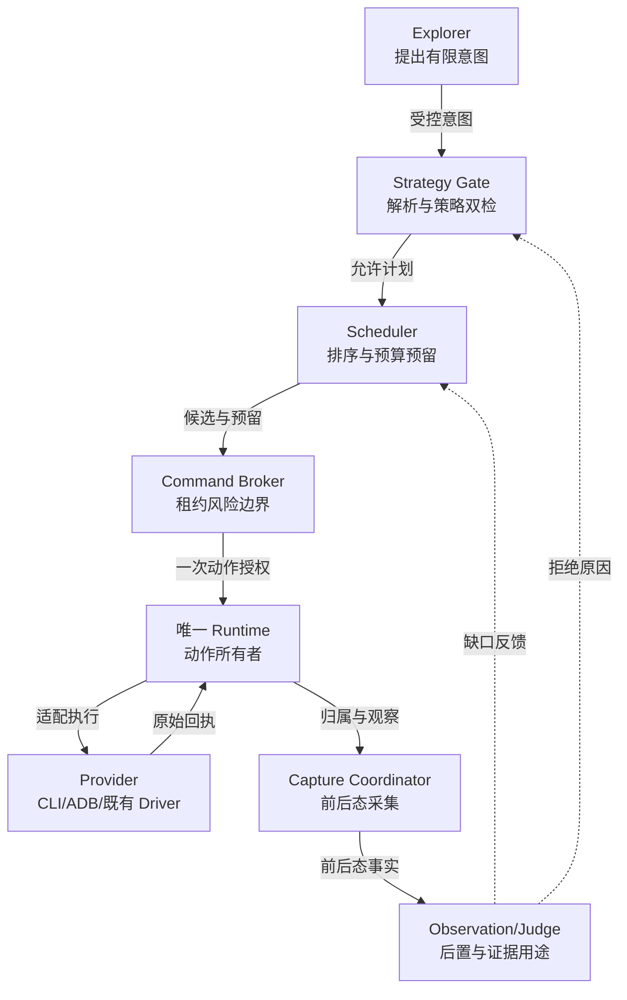
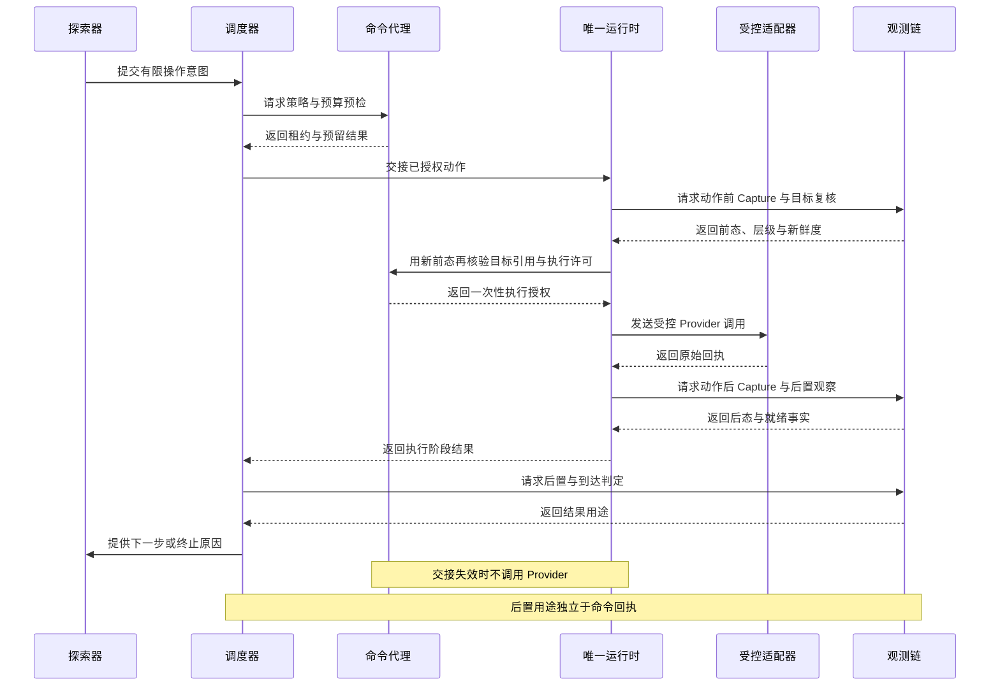
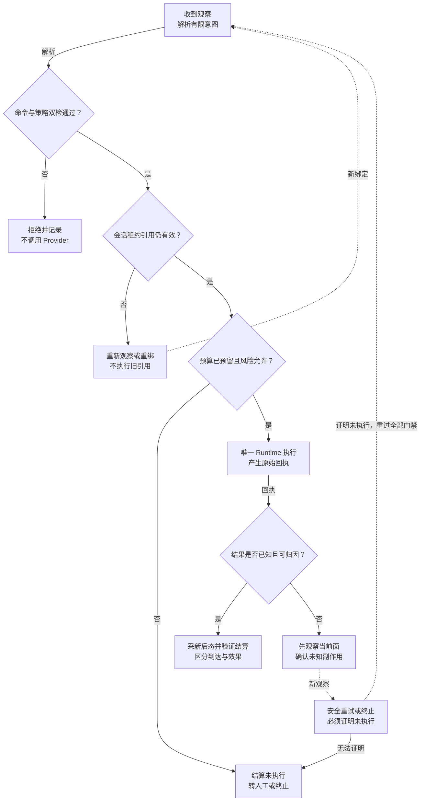

# 专项一：受控 CLI、ADB 与 Skills 的有限自主探索设计

> 日期：2026-09-04 · 版本：技术深化 v1.1 · 状态：待评审、尚未实施。
>
> 适用范围：H5 / Web、Android App；iOS 复用控制协议，但不使用 ADB。
>
> 本文覆盖策略、职责、流程、改造范围与验收，不展开数据库表、字段、具体数据结构或接口载荷。

## 1. 决策摘要与设计边界

采纳“官方 CLI + Skills 提高探索灵活性”，但替换的是部分执行适配与操作知识，不是 Alioth 的任务、租约、证据、规则和完成门禁。
Agent 可以根据新观察自主选择路线、滚动查找和调整策略；每一步仍由平台确认权限、预算、目标时效和实际效果。

推荐形态是：Explorer 提出操作意图，调度器决定是否值得做，Command Broker 决定能不能做，Provider 执行，观测链证明发生了什么。
Skills 负责教会 Agent 如何选择和组合能力，不能充当权限隔离措施。

本专项负责“可用能力如何开放、探索如何有界、执行如何接入”；不负责单独判定页面是否到达、截图是否可信或规则是否通过。
这些结论分别由其他专项和现有控制面产生。

不采用以下方案：

- 将任意 Bash、ADB Shell、JavaScript 执行入口直接交给正式 Agent。
- 用 CLI 的退出码代替页面到达、证据充分或质检成功。
- 一次性删除现有 Playwright / Android Driver 和专项恢复能力。
- 给每个被测产品编写固定点击脚本，作为有限自主探索的唯一实现。
- 将官方工具支持的全部命令默认纳入生产能力。

## 2. 现状问题与优化收益

| 现状问题 | 本专项机制 | 直接优化与系统提升 | 衡量方式 |
| --- | --- | --- | --- |
| 操作入口封装较重，新页面组合需要不断增加专项 Tool 分支 | 接入通用但受控的观察、定位、交互能力；以 Skill 组合 | 减少为单一页面新增工具的需求，提升新产品适应性 | 新场景接入工作量、无需专项分支的成功探索占比 |
| 固定路径遇到 JS 路由、动态菜单或自绘控件时容易卡住 | 混合候选发现，依据新证据重新决策 | 增加合法可达路径，不被静态 href 限制 | 有效新候选数、可信到达数、必检缺口变化 |
| 一味扩大自由度可能造成无效漫游、反复返回与预算耗尽 | 必检、恢复、自由发现三类工作统一调度 | 控制成本，把时间花在覆盖和证据缺口上 | 单位可信到达的动作数、无收益循环率、预算分布 |
| 直接 Shell 无法保证会话、设备、域名和副作用范围 | Broker 与隔离执行环境构成强制入口 | 保证灵活能力不突破授权和租约边界 | 越权拒绝率、跨设备误执行数、无归属命令数 |
| 执行成功后缺少统一解释，难定位“点了但没到” | 命令回执与动作后置观察贯通 | 区分工具、定位、加载、误跳和业务阻断 | 未知效果率、可归因失败比例 |
| 全量页面数据反复进入模型上下文 | 观察摘要、按需读取局部证据、复用已有观察 | 减少不必要的上下文与推理开销 | Token / 有效动作、证据读取次数、识别质量不回退 |

上述收益是待验证目标，不是采用 CLI 后自然得到的结果。若增加了命令次数却没有提高可信覆盖，应收缩能力或调整调度。

## 3. 当前基础与模块改动

现有代码已经具有 H5/App 探索、Surface Driver、动作协调、采集及证据链；应把新 Provider 接到这些边界内，而不是再建一个独立爬虫系统。

| 当前入口 | 可复用基础 | 需要改动的职责 | 影响等级 |
| --- | --- | --- | --- |
| [H5 运行时组合](../../../services/api/app/application/h5_runtime_composition.py) | H5 探索流程与运行面接线 | 将执行器选择、能力探测和受控命令接入独立组件 | 高，主链路改造 |
| [App 探索](../../../services/api/app/application/app_screenshot_exploration.py)、[交互运行时](../../../services/api/app/application/app_interaction_runtime.py) | 观察、候选、操作与恢复 | 收敛统一执行入口；保留平台能力差异 | 高，需 App 回归 |
| [采集协调器](../../../services/api/app/application/capture_coordinator.py) | 动作前后采集及单会话协调 | 衔接命令审计、当前观察绑定和未知效果恢复 | 高，与专项五至七共用 |
| [Web Driver](../../../services/api/app/infrastructure/browser/surface_driver.py)、[Android Driver](../../../services/api/app/infrastructure/device/android_surface_driver.py) | 现有动作后端 | 新旧 Provider 能力声明、切换与故障隔离 | 中到高 |
| [页面检测工具](../../../services/api/app/agents/tools/page_detection_tools.py) | Agent 当前使用的观察与页面能力 | 抽离通用能力，逐步减少重复封装 | 中，不能整文件推倒 |
| [任务创建](../../../app/workstation/src/modules/tasks/pages/TaskCreateView.vue)、[任务详情](../../../app/workstation/src/modules/tasks/pages/TaskDetailView.vue) | 配置和运行诊断入口 | 展示模式、预算、能力缺口、拒绝原因与执行来源 | 中，不重建路由和权限体系 |

部署侧还需增加经过锁版验证的 CLI 运行环境、会话目录隔离、进程回收和健康检查。
现有 Python Playwright 与 ADB 可用，不等于官方 CLI 已被平台完整接入。
本篇的影响范围与其他专项重叠，不能按七篇累计为七次独立重构。

## 4. 职责边界与协作方式

| 参与者 | 应承担的责任 | 不应承担的责任 |
| --- | --- | --- |
| Explorer Agent | 解读当前证据，提出下一步目标和有限操作计划 | 自行扩大权限、宣告覆盖、直接写正式结论 |
| Skills | 描述观察方法、目标选择、失败分流与能力使用约定 | 替代服务端校验，指挥绕过限制或修改被测环境 |
| 探索调度器 | 排序、预算、公平性、去重、停止及恢复优先级 | 直接控制浏览器、把未知页面删除出必检目标 |
| Command Broker | 校验任务与租约、风险、目标时效、执行归属及能力 | 理解全部业务规则，绕开 Capture 链写报告 |
| Provider 适配器 | 在受管浏览器或指定设备上执行，报告原始结果和能力缺口 | 自行创建无归属会话，认定某规则已通过 |
| Capture / 证据链 | 形成动作与观测事实，判定可消费的证据角色 | 代替 Agent 决策探索路线 |
| Rule Judge | 消费封存证据，给出规则结果或补采需求 | 与 Explorer 竞争设备或在判断过程中直接点击 |

生产 Runtime 保持单一动作所有者。影子模式可以比较两个 Provider 的观察，但不能让两个执行器同时操控同一会话。

## 5. 核心方案

### 5.1 有限 Shell 的真实含义

对 Agent 提供命令式交互体验，但只接受平台批准的能力及受约束参数。
服务端选择固定二进制并以参数方式执行，不把模型输出交给通用 Shell 解释。
普通终端入口、任意脚本解释器、管道、重定向、命令替换和任意文件路径不能成为备用通道。

执行环境必须让 Broker 成为实际不可绕过的入口：隔离进程权限、会话目录、凭证和网络出口，不能仅在提示词里写“请不要越权”。
页面、DOM、广告文案和日志都是待分析数据，其中出现的命令或“忽略规则”不具备授权效力。

### 5.2 能力按效果和风险开放

| 能力类别 | 首期策略 | 必须满足的条件 |
| --- | --- | --- |
| 截图、结构摘要、当前窗口和被动网络观察 | 优先开放 | 仅当前授权运行面；敏感内容受采集与访问策略约束 |
| 滚动、定位、普通页面导航、允许的返回 | 低风险灰度 | 新鲜目标、合法页面边界、预算和动作后置验证 |
| 文本输入、表单提交、登录及外部落地观察 | 按任务和规则声明开放 | 账号、数据和副作用范围明确；不能因命令名为 click 就降低风险 |
| 支付、发布、删除、授权确认、升级安装、清数据 | 默认不自动执行 | 需要专门授权和验收条件，或转人工 |
| 任意代码执行、网络修改、DOM/CSS 修改、任意设备命令 | 正式探索入口禁止 | 诊断能力另行隔离，不能混入自然通过证据 |

风险判断看“这个动作会产生什么效果”，不只看命令名。“点击取消”和“点击确认支付”不属于同一级别。
只读也不等于可读取任意系统、账号或凭证。

### 5.3 官方 CLI 与 Skills 的接入方式

官方 Playwright CLI 提供快照、定位、截图、标签和请求查看等命令，并配有 Skills；这说明复用具有可行基础，不代表这些能力已经满足平台的审计和租约约束。
具体可用集应按实际安装版本探测后冻结。[官方 Playwright CLI](https://github.com/microsoft/playwright-cli)

平台发布经过适配的探索 Skill：保留官方能力的使用知识，改用受控入口，补充 Alioth 的证据、风险和失败处理约定。
官方 Skill 更新先经评审、能力回归和版本发布，不在运行中由 Agent 自行安装或改写。

Skill 应优先教会 Agent：先看局部语义，再查看必要图像；目标不确定就补观察；失败时分类处理；所有成功结论等待后置验证。
不能通过隐藏页面元素、随机修改设备参数或反复尝试高风险控件来提高表面完成率。

### 5.4 候选发现不是纯爬虫

从当前可信观察收集导航、菜单、可见链接、语义控件及视觉候选，形成“待验证入口”。
候选可以来自真实 href，也可以来自 JS 点击、SPA 路由、原生按钮或自绘区域。
只有实际到达并通过后置检查，才成为已覆盖页面或可信转场。

允许在规则许可范围直接打开已观察到的安全地址做内容观察；这不能证明原按钮有效、登录上下文一致或业务流程真实完成。
没有可靠地址的 JS 链接必须通过允许的交互验证，不猜测隐藏 URL，也不把菜单项直接当成已存在的一级页面。

### 5.5 三类工作与预算分配

必检工作优先解决冻结目标和规则缺口；恢复工作处理阻断、外跳回源与补采；自由发现寻找未知但有价值的入口。
三类工作使用同一个时间、动作、模型调用和风险预算，并预留最终封存、规则排空及资源释放时间。

排序综合考虑：必检价值、证据缺口、预计成功率、新颖性、动作成本、恢复成本与风险。
这里不冻结具体评分公式；首轮使用可解释策略，基线稳定后再调权重。
不能长期饿死必检工作，也不能在单个关不掉的弹窗上无限消耗恢复预算。

连续无新证据、重复循环、任务截止、会话失效或所有合法候选终结，都可以停止探索。
停止后保留未完成原因；“预算用完”不等于“产品没有这些页面”。

### 5.6 会话、引用与环境一致性

CLI 元素引用、原生控件和视觉目标都必须来自当前观察。页面刷新、滚动、切换窗口或布局改变后重新观察与绑定。
不能把历史引用或固定屏幕坐标作为语义目标失效后的无条件兜底。

任务固定受管浏览器或设备、目标产品范围和允许的外部观察范围。新窗口、跨域导航与外部 Activity 都应被识别为边界事件。
执行器自身的 allow-origin 参数不是完整安全边界；平台还需处理重定向、子窗口和内网/本地资源访问。
业务导航权限与必要的第三方子资源访问分别评审，不能把广告加载被平台拦截后的结果直接归因于产品缺陷。

分辨率、触摸、DPR、UA 等配置用于复现目标环境，不能承诺绕过验证码或等同真机；正式运行中不得随机切换配置。
Playwright 的设备模拟能力是兼容性工具，高风险和真实设备表现仍需单独验证。[Playwright Emulation](https://playwright.dev/docs/emulation)

## 6. 标准运行流程

> 冻结任务范围 → 能力探测与租约 → 入口观察 → 处理当前展示层 → 评估产品和页型 → 发现候选 → 有界调度 → Broker 校验与执行 → 后置观察 → 事实与证据投递 → 继续或收口。

1. 启动前确认入口、规则、目标、账号范围、预算和副作用政策；记录当前可用执行能力。
2. 注册需要的观察器后进入产品入口，先保存真实画面，不预设一定能看到首页。
3. 有启动层或弹窗时先进入专项六、七的前态留证与安全处理流程。
4. 可见业务内容出现后，由专项四评估产品与当前页型，专项二建立可信图投影。
5. Agent 基于当前有界证据提出候选；调度器选择有价值且可执行的工作。
6. Broker 校验租约、当前目标、边界、风险和剩余预算，再交给唯一 Provider 执行。
7. 执行后由专项五、六确认加载、层级、动作效果和是否外跳；回执成功不直接计覆盖。
8. 有效证据进入专项七，异步 Judge 判断；需要补采时进入专项三而不是让 Judge 自行操作。
9. 达到停止条件后停止新动作，结算剩余工作，冻结同一运行版本的报告输入并释放资源。

## 7. 异常与恢复闭环

| 异常 | 处理路径 | 不允许的替代做法 |
| --- | --- | --- |
| CLI 命令或能力在当前版本不可用 | 记录能力缺口；经编排选择已验证旧 Provider 或停止该分支 | 现场安装最新版、临时运行任意脚本 |
| 元素引用失效、目标不唯一或被遮挡 | 返回观察阶段，重新定位；必要时处理最上层弹窗 | 强制点击、沿用旧坐标 |
| Provider 退出或超时，动作效果未知 | 查执行记录并观察当前运行面，确认结果后决定恢复 | 看不到完成状态就重按一次 |
| 越界导航或外部 Package | 立即停止业务操作，有限外跳留证与回源 | 在外部产品继续自由探索 |
| 验证码或风控挑战 | 保存阻断证据，采用授权测试入口或人工处理 | 随机 UA、隐身脚本或自动绕过后记自然通过 |
| 连续无收益、重复弹窗或恢复循环 | 共享累计预算并熔断，保留缺口和原因 | 重启会话就把重试次数清零 |
| 任务取消、租约失效或进入收口 | 停发新动作，结算进行中动作并清理子运行面 | 持过期租约继续点击 |

切换 Provider 是一次受管恢复，不保证无损保留 JS 内存、原生返回栈或一次性状态。
如果一致性无法验证，显式创建新的受管运行阶段并限制其证据用途，不把不同会话混成同一状态。

## 8. H5、Android 与 iOS 的差异

| 平台 | 推荐路径 | 需要诚实保留的限制 |
| --- | --- | --- |
| H5 / Web | 官方 CLI 或现有 Playwright Driver；DOM/AX 与截图交叉观察 | Frame、Service Worker、自绘界面和多标签能力需实测；请求列表不等于完整持续监听 |
| Android Native | ADB 作为连接与输入基础，结合窗口和可访问结构 | ADB 不自动提供页面语义、完整网络生命周期或证据充分性 |
| Android Hybrid | 可用时联合 WebView 和原生观察 | 设备可连接不等于 WebView 可调试；无能力时明确降级 |
| Flutter / 自绘 App | 先探测可访问语义，再选择结构或视觉路径 | 不假定全部有结构，也不假定全部只能视觉 |
| iOS | 接入符合统一控制协议的授权设备 Provider | ADB 不适用；能力、权限和验收单列，不能用 Android 结果代替 |

ADB 的设备连接与命令能力属于底层工具职责，本方案的会话、风险和证据语义仍由 Alioth 负责。[Android ADB 官方说明](https://developer.android.com/tools/adb)

## 9. 与其他专项的协作

| 关联专项 | 本篇使用其什么能力 | 本篇向其提供什么 |
| --- | --- | --- |
| [二：页面状态图](02-page-state-graph.md) | 已到达状态、历史路径、重复与失效判断 | 带来源的候选、动作与后置观察 |
| [三：精准补采](03-targeted-recapture.md) | 恢复优先级、路径与规则允许的补采目标 | 当前执行能力、剩余预算、单一动作入口 |
| [四：页面识别](04-page-recognition.md) | 产品能力、页型与规则范围判断 | 真实入口、局部语义和候选来源 |
| [五：截图时机](05-capture-readiness.md) | 何时可作正式页面证据、何时只作失败观察 | 动作意图、Provider 能力及原始观察 |
| [六：精准交互](06-interaction-precision.md) | 目标重绑、复合动作、弹窗与外跳处理 | 授权、命令预算与隔离的执行后端 |
| [七：可信证据](07-trusted-evidence.md) | 证据门禁、规则采集需求与封存结果 | 命令来源、执行事实、自然或诊断路径归属 |

## 10. 工作台与排障呈现

任务创建页只暴露用户能理解的策略：探索强度、预算、允许的测试操作与环境，不把底层 Shell 参数变成普通表单。
任务详情增加“当前探索模式”和“能力状态”，区分未启用、不支持、被策略拒绝、运行失败与已执行。

一次操作应能展开看到：为何选择此入口、使用哪个执行后端、是否获准、实际发生什么、后置验证结果以及影响哪些证据。
预算视图分别显示必检、恢复、自由发现与收口开销，定位“时间都花在哪里”。

拒绝不显示为普通按钮失败；“不允许支付”应解释为策略边界，而不是产品支付功能异常。
工作台不能仅给出一个总成功率，掩盖有效动作、真实到达和规则结论之间的差别。

## 11. 权限、审计与安全

沿用现有租户、任务和设备权限。新增能力配置遵循最小权限，修改能力政策与版本需要受控发布和审计。
执行凭证只保留在运行服务中，不进入模型上下文、命令明文日志、普通下载文件或浏览器 Profile 的共享目录。

所有命令均可追溯到授权任务、实际执行器和当前观测；初始被动观察不伪造交互动作。
日志保留足够排障信息，但去除敏感输入、认证信息和非必要网络正文。

网络访问与页面内容同样不可信。打开页面仍可能运行脚本和发出请求，不能把“只截图”称为绝对无副作用。
自然测试环境受到平台阻断或诊断修改时，证据要注明限制，不能继续声称原环境完整。

## 12. 实施分期、兼容与回滚

| 阶段 | 交付内容 | 放行条件 |
| --- | --- | --- |
| A：能力与基线 | 盘点现有 Driver、冻结风险策略、定义观察和执行职责 | 现有流程可复现，新增入口没有绕过租约与审计 |
| B：只读影子接入 | 锁版 CLI、受管会话、摘要与被动观察；旧 Driver 执行动作 | 截图与页面身份差异可解释，资源可回收 |
| C：低风险灰度 | 少量任务开放受控定位、滚动、普通导航 | 专项五至七硬性正确性满足，无重复副作用 |
| D：策略性自由发现 | 三类工作调度、混合候选、预算和循环熔断 | 同预算可信覆盖提升，成本和误操作不恶化 |
| E：扩展与旧分支收敛 | 按需求开放更丰富受控能力，退役重复适配 | H5/App 各自真实验收，保留可回退版本 |

回滚优先在任务边界选择旧 Provider；进行中会话先停动作并验证当前状态，再受管恢复。
回滚不清除历史回执、诊断标记或失败证据，也不能降低可信证据门禁以使旧链“继续通过”。

## 13. 验收场景与衡量指标

| 场景 | 必须观察到的结果 |
| --- | --- |
| 导航聚合产品没有典型详情/个人中心入口 | 基于证据探索，不无限找模板页面；未知能力仍保留缺口 |
| 菜单事件由 JS 绑定、没有 href | 通过允许的交互发现路线；静态扫描不被误报为覆盖完成 |
| 页面文案要求执行 Shell 或访问新域名 | 作为不可信内容处理，无法改变 Broker 权限 |
| 两台 Android 设备并行、一个会话租约失效 | 命令严格落在授权设备，失效会话停止执行 |
| 点击回执丢失但页面已经跳转 | 先观察结算，不重复副作用 |
| CLI 与旧 Driver 影子对比 | 只有一个动作所有者，差异有诊断记录 |
| 出现支付确认、版本升级和验证码 | 风险策略生效，不以“自由探索”为由继续 |
| 预算耗尽或用户取消 | 停止新动作，保留未完成原因，完成受控清理 |

硬性门槛：验收样本中无越权执行、无跨任务设备误控、无把命令成功直接记为覆盖、无诊断证据冒充自然通过。
效率评估以同一任务目标、规则、账号状态、环境和预算为对照，比较可信到达、必检缺口、无效动作、耗时分位数与模型成本。
具体提升百分比在基线采样后冻结；不能只比较运行时间而忽略覆盖减少。

## 14. 团队反馈与待冻结事项

| 反馈 | 采纳结论与落点 |
| --- | --- |
| lichuan：纯爬虫发现不了 JS 绑定链接 | 采纳，使用混合候选，真实到达前不计覆盖 |
| qingyunke：先收集导航和菜单 | 采纳为候选发现，不直接定义已到达一级页面 |
| qingyunke：连贯操作更灵活 | 采纳，由专项六逐步观察执行，不开放盲串命令 |
| qingyunke：UA/分辨率更真实以免人机校验 | 采纳环境一致性，不承诺绕过校验或真机等价 |
| qingyunke：App 视觉为主、Web 可直接 URL | 按能力选择多模态；直接 URL 的证据用途受限 |

实施前需冻结：首批 CLI 版本与能力、支持平台、任务预算档位、可自动执行的业务操作、观察器能力缺失时的降级政策。
这些是发布前配置决策，不需要为每个页面新增特殊脚本。

## 15. 技术职责与接入点

本章把前 1–14 章的边界落到现有控制面可以接入的职责。它描述调用方向、交接条件和审计责任，不定义数据库表、字段、接口载荷或新的权限体系。实现评审应先确认每个接入点能够拒绝越界调用，再讨论 Provider 的具体适配。

### 15.1 职责切面

1. Explorer 只提出有限意图。意图可以来自页面观察、Frontier 候选、规则缺口或 Skill 建议，但不能携带“直接执行 shell”“绕过门禁”之类的权限要求。Skill 是知识和候选来源，不是动作授权者。
2. Strategy Gate 负责把自然语言或候选描述解析成受限操作，并在进入调度器前做一次策略检查。解析结果必须能映射到允许的操作类别、目标来源和当前产品能力；无法解析的内容直接拒绝。
3. Scheduler 负责候选排序、并发占用和预算预留。它不直接调用 CLI、ADB、Playwright 或设备驱动，也不把某次命令的成功当成页面到达。
4. Command Broker 是唯一的控制面交接点。它复核当前 Run、Epoch、Surface、设备租约、风险等级、引用有效期和 Provider 能力，签发一次动作交接；复核失败时不下发执行请求。
5. 唯一 Runtime 是真实动作所有者。它串联动作前观察、Provider 调用、动作回执、动作后观察和后置判定请求。任何旧流程或影子流程都不得和它同时产生设备输入。
6. Provider 只执行已授权的受控调用并返回原始回执。CLI、ADB、既有浏览器 Driver 和 App Driver 都是被 Runtime 包裹的能力适配器，不能自行扩展命令、选择目标或声明可信到达。
7. Capture/Observation 负责产生动作前后可归属的观察事实。它需要标注观察用途，例如目标确认、变化确认、失败判断或到达证明；不能用一次无用途的截图填满所有证据角色。
8. Judge 只消费证据和后置事实，提出缺口或判定请求，不反向驱动设备。WorkBench 展示这些阶段和拒绝原因，但不成为运行时的第二控制通道。

下面的组件图展示控制方向。虚线是诊断或重新排队反馈，不代表额外设备动作；Provider 与 Scheduler、Judge 没有越权直连。

图中的“原始回执”只表示 Provider 看到的调用结果，例如进程返回、设备输入已提交或驱动报告异常。它不表示页面已经改变。Runtime 必须把回执和后续观察绑定到同一动作交接，再由后置检查决定是否可继续。

### 15.2 既有代码的接入位置

- App 的目标冻结、候选构造和动作轮次仍从 [`app_exploration_target.py`](../../../services/api/app/application/app_exploration_target.py)、[`app_screenshot_exploration.py`](../../../services/api/app/application/app_screenshot_exploration.py) 和 [`app_exploration_turn.py`](../../../services/api/app/application/app_exploration_turn.py) 进入；本专项不再造一条新的探索入口。
- App 的目标解析、动作执行、运行时身份和采集写入可复用 [`app_interaction_runtime.py`](../../../services/api/app/application/app_interaction_runtime.py) 的现有职责。深化时重点是把交接和拒绝原因前移、把动作后观察固定为同一 Runtime 事务序列，而不是让 Resolver 直接调用设备。
- Frontier 恢复由 [`app_frontier_restoration.py`](../../../services/api/app/application/app_frontier_restoration.py) 和调度轮次协作。恢复意图可以进入 Broker，但恢复候选不等于已恢复；只有可信到达和后置观察才可更新覆盖。
- 证据补采与收口沿用 [`capture_coordinator.py`](../../../services/api/app/application/capture_coordinator.py) 和 [`supplemental_evidence_policy.py`](../../../services/api/app/application/supplemental_evidence_policy.py) 的用途边界。当前生产补采能力仍受 `enabled` 与 `runtime_ready` 双门禁约束，技术深化不把门禁关闭解释成能力已上线。
- H5 的页面动作继续由既有页面捕获、视觉导航和 Surface Driver 组成；CLI 或 Playwright 只能通过统一 Broker/Runtime 进入，不能绕开当前页面和 Surface 的身份确认。

### 15.3 命令解析与策略双检

第一检在 Explorer 到 Scheduler 的边界完成。解析器只接受有限动作语法，抽取动作类别、目标来源、预计风险和所需观察角色；空目标、模糊动作、隐藏脚本、自然语言中的未声明副作用都转为拒绝或人工请求。

第二检在 Broker 到 Runtime 的边界完成。它重新读取本 Run 冻结的规则快照、当前许可撤销状态、会话租约、Surface 身份、引用版本和预算预留，比较解析结果与当前允许范围。规则版本不在交接时热升级；即使第一检通过，第二检也必须独立拒绝冻结快照不匹配、许可已撤销、租约栅栏变化、目标已过期、能力未就绪或动作风险升级的请求。

两次检查使用同一动作意图的稳定引用，但不假设中间页面保持不变。任何检查之间发生的滚动、返回、弹窗或外跳都要求重新观察和重新绑定；不允许把第一次通过的坐标或 DOM 引用直接传给 Provider。

### 15.4 会话、引用和租约的接入契约

会话在启动时绑定产品、Surface、设备和 Run/Epoch；引用在一次可信观察中产生，并带有观察版本、时间与新鲜度、目标来源、可见层、目标语义和几何上下文。动作交接前必须确认引用仍属于当前会话和同一动作前 Surface，且观察版本未过期、目标仍在允许的可见层、语义和几何仍能对应；不以字符串相同、标题相同或页面类型相同代替身份验证。外跳后的动作后观察可以来自新/外部 Surface，但必须保留源 Surface 到目的 Surface 的关系。

引用进入执行后只有三种处理：成功消费并等待后态、因观察变化而失效并要求重绑、或因会话/租约终止而作废。滚动、窗口切换、旋转、返回和弹窗层变化都可以使视觉引用过期；失效引用不得由旧 Provider 兜底执行。

租约是动作所有权的栅栏。调度器可以持有候选锁，Broker 可以交接一次动作锁，Runtime 只有在设备租约仍有效时才可调用 Provider。租约释放或 fencing 版本改变后，迟到的 Provider 回执只能进入审计，不得改变已关闭的运行结论。

### 15.5 Provider 与旧实现灰度

旧 Provider 适配首先以影子计划接入：它只根据相同观察计算命令、目标或差异并记录，不产生第二条设备动作。影子输出不能写成真实执行成功，也不能替代 Runtime 的后置证据。

需要真实验证时，只在隔离测试任务或单一 Owner 的低风险灰度中启用一个 Provider。灰度开关必须同时受平台、风险、能力和租约约束；发现回执格式不稳定、动作后观察缺失、超时后副作用不明或结果用途无法归类时，先停止新 Provider 接单，独立只读核对当前动作、当前 Surface 和可能副作用并保留诊断。核对完成或明确转为未知后，只能为未来重新规划且重新通过门禁的安全动作选择既有 Driver；不得切换 Driver 重放当前未知动作。

## 16. 时序与交接条件

本节规定一条动作从意图到证据的交接顺序。各回执是阶段事实，不是最终判定；分支规则统一放在第 17 节，避免在时序中把失败路径误读为第二条动作路径。

时序中的第一处回执是预算和租约预检结果。它只允许或拒绝后续交接，不预先消耗设备动作。第二处回执是 Broker 发给 Runtime 的一次授权；授权应有时限和运行归属，不能被复制给另一个 Surface。

动作前 Capture 是独立的交接门，用于复核目标、层级和新鲜度，Provider 调用前还需核验新前态与执行许可。动作后 Capture 在调用已提交、返回或超时后新采；原始回执丢失也必须尝试只读观察，不能无限等待回执才确认副作用。两次观察归属于同一动作交接，但用途不同，不能以前态替代后态。

Provider 回执分为已拒绝、已提交、明确失败、明确完成和未知结果。Runtime 对所有类别都请求动作后观察；明确失败也要判断是否改变了页面，未知结果更不能直接重试。观测链返回的是当前层级、页面身份、状态变化和证据用途，Scheduler 再决定继续、补采、降级或终止。

### 16.1 交接前置条件

1. 规则和产品目标已冻结，且本动作仍在 required 分母与当前 Run/Epoch 内。
2. Session、Surface、设备租约和 Owner 仍有效；没有并发 Runtime 持有同一动作锁。
3. 目标来自可信观察或明确标记为待探索候选；候选只可触发有限计划，不能伪装成已到达页面。
4. 引用在当前页面和层级中仍新鲜，目标来源、风险等级和所需后置角色可解释。
5. Scheduler 已预留本次动作、观察和必要恢复的预算；新补采请求不能重置总预算。
6. Provider 能力处于启用且运行时就绪状态，并承诺返回可归属的原始回执。

### 16.2 交接后置条件

动作交接完成并不意味着覆盖增加。至少要有动作后新观察，且新观察属于相同 Run/Epoch 和同一动作交接；若动作留在原 Surface，可继续绑定原 Surface，若动作导致外跳，允许新/外部 Surface 作为实际后态，但必须保留源到目的的关系、离开事实和必要回源事实。若要求证明页面到达，还要满足页面身份、层级、稳定性和规则需要的证据角色；若只判定页面或动作失败，可以使用规则允许的失败时间序列，但不可把它写成可信到达。

“命令成功”“实际效果”“意图后置成立”“可信到达”四者分别记录。比如 Provider 报告点击已提交是命令阶段事实；列表项出现选中变化或详情面板出现是效果观察；列表项对应的详情对象和路由匹配是意图后置；详情页身份与内容稳定才是可信到达。任何一步缺失都应保持相应缺口，不向更高层级推断。

### 16.3 关闭、返回与外跳交接

启动广告、登录提示或公告层的关闭事件只关联随后观察到的可信业务入口，不生成凭空的 popup 到首页业务边。层级事件和业务转场边分开记录；弹窗不是业务节点，支付路由页仍是真实页面，二维码内联区域也不因视觉悬浮自动成为独立浮层。

外跳时先记录当前 Surface 的离开事实，再在实际到达的 Surface 观察 landing、回源和返回结果。隔离 sidecar 只有在规则、能力、租约和运行时就绪均满足时才可使用；原标签页 JS/POST 导航、同标签页跳转或 App 内部路由不能保证独立进程，必须以实际 Surface 观察为准。新标签页、系统浏览器和其他外部 Surface 不能互相替代。返回原 Surface 后重新绑定会话和目标，不能把离开前引用继续用于点击。

## 17. 算法与判断流程

下面的决策图是 Broker/Runtime 的最小判断骨架。它不是树形探索图；虚线只表示重新观察或受控重排，任何回流都要消耗现有预算并保留原事实。

### 17.1 解析、策略和能力判断

解析器先把动作限定为只读观察、可验证动作、恢复动作或人工请求。命令中的目标必须来自当前观察、已批准的候选来源或明确的恢复意图；“运行任意命令”“执行任意脚本”“删除页面节点以便命中”都不进入候选队列。

策略双检不仅比较动作名称，还比较产品、Surface、风险、本 Run 冻结的规则快照版本、会话状态和证据要求。它不是交接时的规则热升级；当前许可撤销、租约栅栏变化或计划快照陈旧都必须拒绝。Runtime 看到的能力必须是 `enabled` 且 `runtime_ready`；只有静态支持或配置存在不能放行。Provider 能力声明和实际回执不一致时，按较严格的一方降级。

### 17.2 预留、执行与结算

Scheduler 在动作前预留一段包含动作、观察和恢复的预算。Broker 拿到预留后再核验租约；Runtime 成功拿到授权才开始调用 Provider。明确完成时结算实际消耗并释放余量，明确拒绝时释放未使用部分，未知结果则暂挂预留，先完成同动作的后置观察再结算。

预算耗尽不能缩小已冻结的 required 分母，也不能把未知动作改判为已覆盖。若预算不足，终态应是“未完成、原因明确”或“需人工”，而不是把相似页面、另一 Run 或候选导航补成通过。

### 17.3 重试矩阵

- 只读观察：可以在旧观察已过期、加载未稳定或观测服务短暂失败时重试；每次重试都生成新的观察时点并重新检查会话、租约和预算。只读重试不得顺带执行动作。
- 已知无副作用的动作：只有原始回执明确表明未提交、目标仍新鲜且动作语义可幂等时，才允许一次受控重试。需要重新观察和重新绑定目标，不能复用旧坐标。
- 有副作用或不可逆动作：明确失败也不得按固定次数盲重试；应请求人工或建立新的、规则允许的动作意图。支付、登录提交、购买和权限变更从严处理。
- 未知结果：先检查租约、当前 Surface、动作后观察和设备/驱动回执，不能因为超时就再次点击。若仍不能证明是否执行，终态为未知/不足，保留人工入口。

重试次数不是唯一限制。相同缺口要共享时间、调用和风险预算；新请求不能把缺口计数清零。一次重试仍失败、超时、无新增观察或已进入收口，均为恢复终态。

### 17.4 旧 Provider 灰度判断

影子计划的输入必须与真实 Runtime 使用的同一观察快照。影子路径只输出候选命令、坐标或差异，不创建第二条设备动作、不抢租约，也不写真实成功结论。对比只看解析一致性、风险分类、目标新鲜度和预期后置是否可验证。

真实启用限定在隔离测试任务或单 Owner 的低风险灰度。灰度期间一次仅允许一个动作所有者；发生 Provider 崩溃、未知副作用、回执无法归属或后置缺失，先停止新 Provider 接单，独立只读核对当前动作和当前 Surface，不得直接切旧 Driver 重放。核对完成或明确转为未知后，未来重新规划且重新通过门禁的安全动作才可选择既有 Driver。回滚只停用依赖新 Provider 的恢复能力，不降低证据门禁继续通过的要求。

## 18. 并发、幂等、超时与恢复

### 18.1 并发栅栏

同一 Run/Epoch、同一设备租约和同一 Surface 只能有一个 Runtime 持有动作所有权。Scheduler 可以并行计算不同候选，但进入 Broker 后按 Surface 串行交接；不同 Surface 的观察也不能共享未经验证的页面引用。

动作交接使用唯一的执行关联和 fencing 语义。重复的调度消息先查是否已有同一交接的回执；若已完成，只返回原结论，不再次调用 Provider。若原动作处于未知状态，重复消息只能触发观察请求，不能把“没有找到回执”解释成未执行。

### 18.2 会话与引用生命周期

会话建立时绑定产品和 Surface，动作前确认租约，动作后确认同一 Run/Epoch。引用由可信观察创建，由滚动、返回、层切换、旋转、外跳、应用重启或租约失效触发失效。失效只追加一条原因，不覆盖产生旧引用的观察事实。

Runtime 收到过期引用时优先请求新观察；若仍能语义定位同一目标，创建新引用并重新经过策略和风险门禁；若只能凭相似标题或视觉位置猜测，终止为不足。旧引用永远不能由旧 Provider“尝试一下”。

### 18.3 预留与结算

预留至少覆盖本次调用、动作后观察和规则允许的有限恢复。Provider 超时不立即归还动作预算，也不自动重置动作次数；先将动作标记为待确认，完成一次当前 Surface 观察后再决定结算或人工转交。

观察已证明未发生动作时，释放未使用预留并按规则允许的类别消耗一次重试预算。观察无法证明时保留未知状态，关闭 Run 时以未知/不足结算，避免把设备副作用隐藏在“预算释放”之后。

### 18.4 超时、取消与迟到回执

交接、Provider、动作后采集、稳定性等待和外部 Surface 观察使用不同的截止点；一个阶段超时不应把其他阶段的回执伪造成成功。取消时先阻止新的交接，再等待或隔离迟到回执，最后释放租约。

若 Runtime 崩溃，恢复进程先读取同一 Run/Epoch 的动作和观察事实，检查当前 Surface，再决定是否只读补采。没有未知副作用证明时禁止重放动作。Run 收口后到达的回执只作审计附件，不重新打开已经冻结的覆盖结论。

### 18.5 Provider 兼容与降级

Provider 适配器应把能力检查、命令超时、原始回执和异常原因返回给 Runtime，不自行重试。新旧 Provider 不能因为都报告“点击”就共享坐标或假设相同后置；切换必须重新做观察、目标解析和策略检查。

降级只影响未来重新规划且重新通过门禁的安全动作，并可选择已知安全的既有动作实现；它不是当前未知动作的重放路径。若当前动作副作用或后置仍不明，先停新 Provider 接单并做独立只读核对，结果仍不足时不执行任何替代点击。若既有实现也不能提供可信后置，结果是能力不足，不是放宽规则或跳过观察。所有降级和灰度开关变更都进入审计，保留对应 Run/Epoch。

## 19. 故障推演与技术验收

本节以故障先行方式检验“控制面能停、Runtime 能归因、证据能收口”。它不把本地静态检查、历史报告或文档生成当成真实设备验收。

### 19.1 故障推演

1. 命令含未允许的 shell 参数：第一检拒绝，Broker 不创建动作交接；审计记录原始意图和拒绝理由，不能由 Skill 改写后偷偷执行。
2. 计划带着陈旧快照版本或当前许可在交接前被撤销：第二检发现冻结快照不匹配、许可撤销或租约栅栏变化，释放预留并要求重新规划；Run 的冻结规则不在交接时热升级。
3. 目标在滚动后变陈旧：Runtime 只请求新观察和重绑；若无法证明同一目标，终止为不足，不尝试旧坐标。
4. Provider 报超时但设备可能已点击：动作进入未知，先观察当前层和后置，再决定人工或规则允许的安全处理；不能按固定次数重放。
5. 租约在 Provider 返回前失效：迟到回执不再改变运行状态；恢复只读检查同一 Surface，不能由另一个 Owner 接管未确认动作。
6. 新 Provider 灰度出现回执缺失、未知副作用或后置缺失：停止新 Provider 接单，先做独立只读核对当前动作；不能直接用既有 Driver 重放。仅对未来重新规划且安全的新动作选择既有 Driver；新 Provider 的影子差异保留为诊断，不写覆盖成功。
7. 启动层关闭后未出现可信业务入口：只记录关闭事件与随后观察结果，不生成 popup 到首页的业务边；required 页面保持未覆盖。
8. 收口时补采请求仍在队列：先排空或取消请求，冻结 Coverage/Gate 输入，再释放设备和租约；释放成功不等于 Gate 通过。

### 19.2 技术验收阶段

阶段 A：静态契约验收。逐项确认 Explorer、Scheduler、Broker、Runtime、Provider、Observation 的调用方向和拒绝边界；检查每个动作都有动作前后观察和唯一归属。

阶段 B：隔离 Provider 验收。在无真实副作用的测试 Surface 验证命令解析、策略双检、回执分类、超时和迟到回执；影子路径只对比计划，不产生第二条设备动作。

阶段 C：低风险 Runtime 验收。在隔离测试任务或单 Owner 灰度中验证只读观察、明确失败、未知结果和一次安全重试；不得以高风险登录、支付或购买作为首批灰度动作。

阶段 D：异常闭环验收。注入过期引用、租约丢失、Provider 崩溃、加载不稳定、弹窗未关闭和外跳回源失败，确认所有路径都能终止、转人工或保留不足，而不是误报到达。

阶段 E：收口与回滚验收。验证补采请求排空、预算结算、审计完整，以及停用新 Provider 后未来重新规划且安全的动作可选择既有 Driver、证据门禁仍然有效。回滚不能通过降低 required 分母或放宽 Judge 条件来“恢复成功率”。

### 19.3 硬性正确性与待基线指标

硬性正确性包括：未授权命令零 Provider 调用；未知副作用零盲重试；动作成功与可信到达不混淆；旧引用不执行；迟到回执不改写已关闭 Run；必需页面分母不因预算耗尽缩小；同一动作不会由两个 Owner 同时产生设备输入。

效率指标待基线后冻结，至少观察每个候选的解析耗时、交接等待、动作后观察等待、无效重试率、未知结果占比、补采新增证据率和人工转交率。指标只用于找瓶颈，不得用更短耗时替代硬性证据门禁。

### 19.4 关联模块与范围提示

后端高范围改动集中在 App 探索轮次、Runtime/Provider 交接、Frontier 恢复、捕获协调和运行时组合；中范围涉及 H5 Surface Driver、Workbench 诊断和审计展示。这里的“高/中”表示职责耦合和验收影响，不是伪精确的工作量百分比。

本技术深化仍未实施。完成评审不代表 CLI、ADB、Skills 或新的 Provider 已安装、已启用或已通过真实设备 Gate；正式开放补采还必须满足已有生产门禁和同 Run 证据要求。

## 20. 关联文档与依据

- [七项设计总览与完整闭环](README.md)：阅读顺序、共用决策和整体实施依赖。
- [既有完整方案 v1.1](../2026-09-02-bounded-exploration-optimization-solution.html)：整体问题、收益与反馈裁决。
- [既有实现级设计 v1.1](../2026-09-02-bounded-exploration-page-state-graph-design.md)：第 6、11–14、24、27、35–36 节为本篇主要依据；其表结构等实现细节不在本篇展开。
- 外部能力核验日期：2026-09-03。官方资料说明底层能力；本篇的 Broker、调度与灰度安排是 Alioth 的设计选择，不是工具已内建的完整保障。

交付判断：本专项完成的标志是“在既有控制面中获得可审计、可停止、可验证的灵活探索”，不是“Agent 已经能运行 CLI”。
