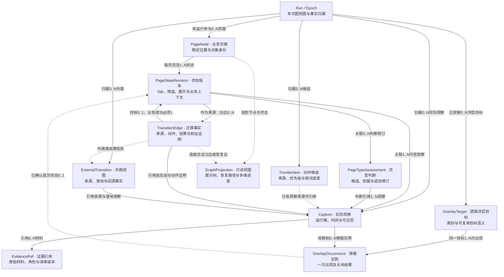
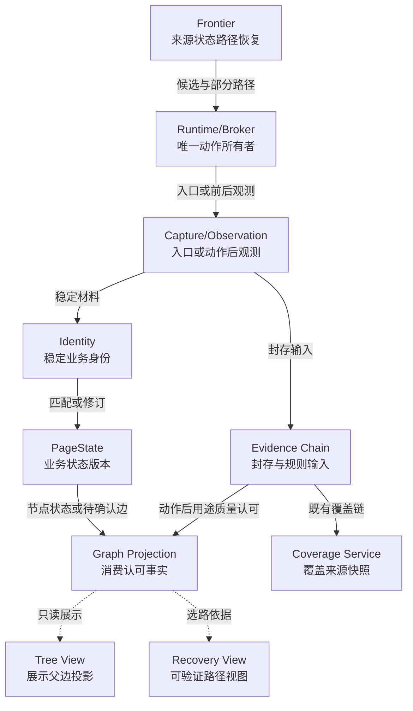
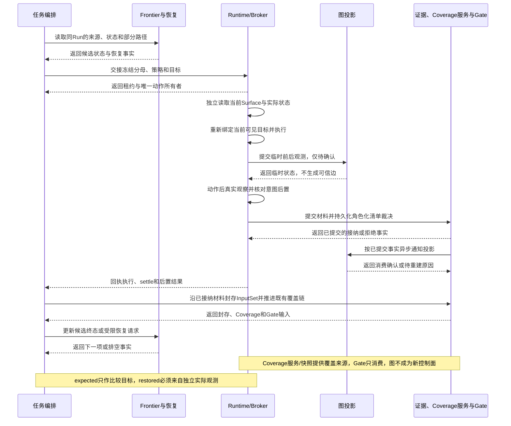
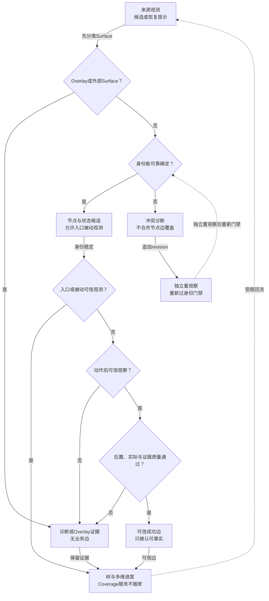

# 专项二：页面状态图与树形投影设计

> 日期：2026-09-04
>
> 版本：技术深化 v1.2 · 增补概念数据结构图
>
> 状态：图投影已落地；覆盖业务身份已迁到 `app_visual_page_identity`（不含 page_type）。**Coverage↔图影子对账已挂探索收口／覆盖元数据**（`app_coverage_page_graph_shadow`，恒 `coverage_authority_changed=false`）；Coverage／Gate 权威未迁图，Gate SQL 仍只读 `coverage_summary`。生产补采工厂仍 `runtime_ready=false`；Lab／组合根可显式 `build_lab_supplemental_evidence_policy`／`lab_supplemental_ready=True`。Settle 影子已固定 ACTION_AFTER／REOBSERVE 剖面写入审计；完整六层 Oracle／生产开闸／可替换 ADB 生产切换仍后续。有界 `scroll→rebind→click` InteractionPlan 切片已落地。
>
> 范围：H5、桌面 Web、Android/iOS App 的有限探索、覆盖统计、路径恢复和诊断。
>
> 限制：本文说明机制、流程、边界与验收，并在第 5.10 节补充概念数据结构及关系；不展开数据库表、字段类型、API 载荷或 SQL。

本文承接既有总设计，不重新定义任务、租约、Capture、Manifest、Inspection Work、RuleExecution 和 Completion Gate 的权威边界。

本系列：[01-controlled-exploration.md](./01-controlled-exploration.md) · [02-page-state-graph.md](./02-page-state-graph.md) · [03-targeted-recapture.md](./03-targeted-recapture.md) · [04-page-recognition.md](./04-page-recognition.md) · [05-capture-readiness.md](./05-capture-readiness.md) · [06-interaction-precision.md](./06-interaction-precision.md) · [07-trusted-evidence.md](./07-trusted-evidence.md) · [README.md](./README.md)

总设计依据：[2026-09-02 有限探索、页面状态图与可信证据详细设计](../2026-09-02-bounded-exploration-page-state-graph-design.md)。

## 1. 决策摘要与边界

页面状态图是探索事实的有向多重图，同一对状态之间允许有多条语义、来源或结果不同的边。

树只用于工作台展示和某一次恢复路径投影，不是底层事实源；Frontier 仍然是候选动作队列。

候选被发现不等于动作已执行，动作已执行也不等于可信到达。

PageType、标题和识别置信度不是 PageNode 身份；PageType 是可修订的语义判断，PageState 是业务有效状态版本。

局部 Tab、筛选和展开默认是同一节点下的不同状态；登录态或会话上下文变化本身默认只形成同一业务节点下的新状态版本，只有业务位置/对象、页面职责或路由/返回语义发生实质变化时，才可能形成不同节点。

启动弹窗先绑定 Session 观测，底层业务页未知时不能伪造首页；弹窗是质检目标，但不混入业务节点。

图节点与状态可由可信入口/被动观测或动作后可信事实投影；动作成功边还必须有动作意图、后置条件和证据用途认可。失败、尝试、无效果和阻断边可留作诊断，但不计页面覆盖。

required 分母在任务创建时冻结，未知、预算耗尽、识别冲突或能力不足都要保留原因，不能缩小分母。

本专项不替换现有 Driver、租约、权限、证据封存和 Gate，也不承诺所有 Surface 都可以克隆或无损恢复。

## 2. 现状问题与收益

| 问题 | 机制 | 提升 | 指标 |
| --- | --- | --- | --- |
| 候选被误算为到达 | 分离发现、执行、观测、后置验证 | 覆盖统计可信 | 可信到达率 |
| 树无法表达回路和多入口 | 保存有向多重边，树只做投影 | 路径可解释 | 多入口解释率 |
| PageType 漂移造成重复页 | 身份与类型解耦 | 改判不分裂节点 | 身份冲突率 |
| Overlay 污染业务页面 | 独立目标和 occurrence | 遮挡可单独质检 | 误计页面率 |
| Frontier 空被当成完成 | 按节点、边、规则缺口收口 | 预算和完成分开 | 错误完成率 |
| 失败动作污染覆盖 | 成功边要求可信 after Capture | 失败不造假路径 | 失败边计覆盖率 |
| 旧页面序列与新图切换时可能口径不一致 | 新图影子投影和对账 | 可兼容回滚 | 事实与投影对账一致率 |

第一收益是事实可解释，不是立即减少动作数。

效率指标必须在同一任务分母、Run/Epoch、设备能力和证据要求下比较。

## 3. 当前基础与模块改动

现有系统已经有页面 Capture、动作账本、H5 Frontier、App Frontier 和证据消费链。

H5 候选与状态可复用 [H5 Frontier](../../../services/api/app/domain/exploration/h5_frontier.py)。

App 候选指纹与路径语义可复用 [App Frontier](../../../services/api/app/domain/exploration/app_frontier.py)。

统一身份判断可复用 [App 页面身份](../../../services/api/app/domain/exploration/app_page_identity.py)。

视觉页型、状态和遮挡事实可复用 [AppVisualAnalysis](../../../services/api/app/domain/exploration/app_visual.py)。

本次运行的页型与适用性评估可复用 [PageTypeAssessment](../../../services/api/app/domain/exploration/page_type_assessment.py)。

任务目标冻结可复用 [App 探索目标](../../../services/api/app/application/app_exploration_target.py)。

运行编排可复用 [App 全局 Frontier](../../../services/api/app/application/app_global_frontier.py)。

证据收口可复用 [证据需求与清单就绪服务](../../../services/api/app/application/capture_evidence_readiness.py) 和 [Manifest Writer](../../../services/api/app/application/evidence_manifest_writer.py)。这里的证据就绪是需求集与清单收口，不是专项五的画面稳定等待，两者不能混为一谈。

本专项新增确定性图投影、状态查询、边结果归档和影子对账；Explorer 不直接维护图事实，Runtime 在可信观测后提交事实。

影响范围分为高/中两档，不使用伪精确百分比。

| 模块 | 高影响范围 | 中影响范围 |
| --- | --- | --- |
| 后端 | 身份协议、状态/边判定、事实投影、恢复读侧与同 Run/Epoch 对账 | Frontier 兼容投影、事件唤醒、查询筛选和历史序列适配 |
| 工作台 | 图与树切换、节点/边状态、Overlay 和覆盖解释 | 路径筛选、冲突详情、失败聚合和旧页面序列兼容展示 |

高影响范围改变事实判定或完成依据，中影响范围主要改变投影、查询和诊断呈现。

## 4. 职责边界

| 角色 | 负责 | 不负责 |
| --- | --- | --- |
| Explorer | 发现候选、提出语义动作、说明目标状态 | 直接写图、绕过 Broker、宣称到达 |
| Frontier/Scheduler | 队列、预算、风险、优先级 | 代替识别和后置验证 |
| Runtime/Broker | Session、租约、策略校验，执行并观察 | 扩大域名、Package、设备或分母 |
| 图投影 | 从可信 Capture/动作事实投影节点、状态、边 | 从失败尝试猜成功 |
| Catalog/Assessment | 类型、能力画像、冲突修订 | 以类型名充当身份 |
| Judge | 消费封存证据、提出缺口 | 操作设备或图恢复 |
| 工作台 | 展示图、树、失败原因、证据链 | 构造 Runtime 图事实 |
| Gate | 按冻结分母和封存结果判完成 | 删除未知或借用其他 Run |

旧页面序列和新图可以暂时双写，但只能由事实投影更新，不能让两套读侧各自修改事实。

## 5. 核心设计

### 5.1 图事实与树投影

PageNode 表示稳定业务位置；PageState 表示该位置的业务有效状态版本；Transition 表示带来源、动作和结果的迁移观测。

同一节点可从多个入口进入、经多个动作返回或形成循环。

树投影选择一个展示父边，不删除其他入口和回路。

恢复投影选择一条可验证路径，不声称它是唯一真实路径。

对账比较的是节点归属、已选父边合法性、状态和覆盖口径，不要求树包含图中的所有边。没有前序业务动作的初始入口，可以由可信入口观察建立根节点；不为补齐路径而伪造点击或弹窗到首页的导航。

### 5.2 身份、类型与状态

身份核心是稳定业务路由、业务位置和业务对象；landmark 结构与可重算语义证据只作佐证，不能只因视觉或结构变化就裂节点。

时间、重试次数、数据库生成时间、临时坐标和短暂渲染噪声不参与稳定身份。

标题、PageType 或置信度变化只产生新的评估 revision，不自动新建 PageNode。

局部 Tab、筛选和展开默认是同一节点的新 PageState；登录态或会话变化本身默认仍是状态版本，只有业务位置/对象、页面职责或路由/返回语义实质变化时才可能分裂节点。

状态只表达对业务结果有效的内容；Overlay、指针和瞬时坐标另行记录。

身份冲突保留冲突观测，不能以最后一次标题覆盖历史。

### 5.3 成功边与到达证明

每次动作依次确认前态、执行动作、等待 settle、采集后态并验证后置条件。

命令返回成功只说明 Driver 接受了命令；视觉变化只说明发生了变化。

只有后态可信、目标状态可解释且后置条件通过，才投影成功到达边。

同状态返回、状态改变、Overlay 出现、Overlay 关闭、外部跳转、误路由、无效果和失败分开结算。

遮挡层在前面时，底层变化不能直接算业务到达。

### 5.4 Overlay 与业务页面

OverlayTarget 表示可独立质检的启动广告、公告、登录阻断、支付层、更新提示或系统授权提示。

出现次序、顶层关系、关闭尝试和关闭结果属于该次 Presentation 观测。

底层 PageState 尚未知时，Overlay 可先归属 Session 和 Capture，但不能补写假首页。

二维码内联区域是页面区域，不因包含二维码自动成为浮层。

真实路由到支付页是业务页面，不把整页当 Overlay。

自然新 Tab、同标签 JS 跳转和原生外部 Activity 需要按 Surface 语义区分。

### 5.5 Frontier、候选与去重

Frontier 项表示下一步可能执行的动作或观察机会，来源可以是视觉、DOM、Accessibility、Semantics、链接或历史边。

候选的存在不能创建 PageNode；候选指纹只用于避免重复排队。

已知 href 可以作为内容观察候选，但不替代真实点击链；JS 路由没有可靠 href 时必须受控交互验证。

去重先比较稳定身份，再比较业务状态和动作上下文，不能按标题、类型或截图相似直接合并。

同一弹窗重复出现属于 Overlay 循环，不是首页新节点；循环不能重置整个探索预算。

### 5.6 画像、规则范围与覆盖

ProductCapabilityAssessment 是随运行观测修订的能力画像，不是页面身份。

初始画像来自产品声明、目标快照和当前可见证据；发现新能力时追加 revision，不能静默改变任务声明。

RuleScopePlan 决定规则在任务、页面、状态、广告位或 Overlay occurrence 上的适用范围。

广告规则不能未经声明地统一“全局一次”；素材、位置、页面状态和发生次数的复用必须可审计。

规则执行统计与页面/交互覆盖统计分开，规则复用不能减少覆盖分母。

### 5.7 版本、循环与收口

同一状态重复到达可增加观测次数，但不制造新业务状态。

PageType 改判、能力变化和规则范围变化都追加 revision，并记录影响范围。

失败边保留诊断价值，不增加覆盖；未知和未完成不等于不存在。

进入收口后冻结本 Run/Epoch 的图、范围、证据和规则输入，晚到结果先核对 epoch，不能改写已封存报告。

### 5.8 多维进度、冲突与重新打开

不能只用 visited 布尔值表示完成；至少分开已到达、相关状态已探索、证据已齐、规则已判和当前不可达。

新候选只重新打开候选队列；证据缺口重新打开证据维度；发现相关 PageState 或规则版本变化，重新打开受影响状态与规则维度。

本次运行的规则版本已经冻结；规则版本变化只能发生在新运行或明确审计的受管变更边界，不能在运行中静默替换已封存的规则与输入。

当前不可达必须保留阻断原因和重试边界，不能改写为不存在或已完成。

多入口合并冲突时保留各入口观测，按身份协议追加冲突 revision；错误合并或错误拆分只修订投影，不覆盖原 Capture、动作和边事实。

一页多路径示例：首页经 Tab 和搜索两条路线进入同一业务位置，图保留两条边，树可选择一条展示。

嵌套弹窗示例：启动广告上叠更新提示，分别记录两层 occurrence；关闭事件和业务转场边不混写。

### 5.9 树形展示示意

以下仅是已经可信到达后的展示示例，不预设所有产品都有这些页面：

```text
业务页面树（选择一条父路径展示）
入口页
├─ 列表页
│  └─ 详情页 ← 搜索页也可进入同一详情，保留额外图边
└─ 搜索页

列表页状态：默认 / 筛选后 / 局部展开
浮层记录：当前列表页上的公告 → 关闭 → 新广告层
外跳记录：广告来源 → 外部落地 → 回源结果
```

状态和浮层可以在节点详情展开，但不会成为业务页面树的子页面。真实返回路径取决于本次进入详情的来源，不按树上选定的父节点强行返回。

### 5.10 页面状态图的概念数据结构与关系

这张图回答“系统需要保存哪些概念、它们如何关联”，不是执行流程图或数据库 ER 表设计。方框代表逻辑对象，实线代表包含或事实引用，虚线代表可选关联或派生关系；箭头不表示发生先后。`1` 表示一个，`0..1` 表示可以未知/缺失，`0..N` 表示零到多个，`1..N` 表示至少一个。

这里将前文的 PageState 追加版本明确称为 **PageStateRevision**：它仍是“同一页面的状态版本”，不是再新增一套状态实体。Run/Epoch 是本次图视图的归属和证据接纳边界；Session/Surface 继续沿用既有运行面引用，不在图内重建。



**各部分保存什么、为什么分开：**

| 逻辑对象 | 应表达的信息 | 关系与约束 |
| --- | --- | --- |
| Run / Epoch | 本次探索归属、冻结范围、当前接纳阶段；引用既有 Session/Surface | 限定本次图参与的事实，不是新增任务/租约对象。稳定业务身份可以重算匹配，但其他 Run 的观察不能自动充当本次证据 |
| PageNode | 稳定业务位置、对象与身份依据 | 一个页面可有多个状态、入口和返回路径；页型改判不改身份；弹窗和外部广告落地不成为其业务子节点 |
| PageStateRevision | 在该页面上有业务意义的 Tab、筛选、展开、用户态或内容上下文，以及版本间关系 | 每个版本只属于一个 PageNode。真实业务状态变化才追加版本；同状态重复截图追加观察，不制造新版本 |
| TransitionEdge | 真实动作关联、实际结果、来源状态、可确认的目标状态及后置验证依据 | 有可信来源时才建立图内动作边；业务成功边必须有已证明的目标。失败、未证明或 external_jump 的目标业务状态可以为空，不能把计划目标填入目标端；外跳类型不计业务成功覆盖 |
| Capture | 某次实际看到的运行面、展示层和时间窗口，以及可得材料与限制 | 同一状态可有多份 Capture；一份单运行面 Capture 的底页状态关联为 `0..1`，未知、被完全遮挡或外部观察时可为空。Capture 不能用预计状态生成 |
| EvidenceRef | 对已有 Artifact、Manifest、证据角色和版本的引用 | 是既有证据链的引用视图，不再复制一套证据正文或裁决。Capture 可能只保留失败元信息而无有效材料；文件存在也不等于某规则用途合格 |
| PageTypeAssessment | 对当前状态的类型解释、证据依据、冲突和修订 | 同一状态允许多次追加判断；一份判断可引用多个已接纳观察。改变判断不覆盖 Capture，也不改变页面身份或 required 分母 |
| OverlayTarget | 浮层逻辑目标、类别和可复用的目标语义 | 图中表示实际已观察到的目标，可关联多次 occurrence；相同类别不自动合并为同一目标，更不代表每次关闭行为可以复用 |
| OverlayOccurrence | 一次实际出现的弹窗实例、所属目标、出现/关闭观察与结果 | 同一实例可出现在多份 Capture 中；层级和几何以各次 Capture 为准，不在实例上假设永远不变。底页未知时仍归属运行面和观察；嵌套层保留各自实例关系 |
| FrontierItem | 待做的动作/观察机会、来源依据、优先级、领取与尝试进度 | 候选不是 PageNode，也不是已发生的 TransitionEdge；执行后以真实动作事实关联尝试，不把候选记录“升级改名”为成功边。入口种子可以只有运行归属，页内候选应保留观察来源 |
| ExternalTransition | 既有外跳类动作结果、来源/落地/原页保留或回源 Capture 的关联视图 | 不是第二份外跳事实或新数据库对象。有可信来源时可引用 external_jump 边，来源未知时只保留边界观察；两者都不计业务覆盖，缺失的落地/回源不能补造 |
| GraphProjection | 从已接纳节点、状态和边生成的展示树、恢复路径及多维进度 | 是可重建的读侧视图，不保存另一套权威事实。树只选展示父边，保留图的其他入口和环；完成进度仍引用现有 Coverage/规则事实，不重新计算一套分母 |

EvidenceRef、ExternalTransition 和 GraphProjection 在图中是便于说明的引用/视图名称，不要求创建同名服务、表或接口。OverlayTarget 与 occurrence 分开表达“可复用的逻辑目标”和“这一次出现”，原始事实仍回溯到同 Run/Epoch 的 Capture 与动作账本。

**三组容易混淆的关系：**

1. **页面—状态—观察是三层。** “商品列表页”“该列表选择某筛选”“此刻截到的一帧”分别属于 PageNode、PageStateRevision、Capture。一次业务状态可以反复观察；一份新截图不必产生新页面或新状态。
2. **转场连接实际状态，不连接计划页型。** 同一个来源到同一个目标可以有多条动作语义或发生次数不同的边；无效果可以回到同一状态。若来源也未知，仅在动作账本/诊断中留存，不能制造正式业务边。入口被动观察可建立页面与状态，但没有凭空的来源边。
3. **弹窗和外跳通过观察关联业务图。** 一份 Capture 可以同时看见多个层；同一弹窗 occurrence 可跨多帧，因此 Capture 与 occurrence 是多对多观察关系，不是每张截图新建一个弹窗。关闭再重现是新 occurrence，不是新业务页面；真实支付路由另按业务页面处理。

**一个具体例子：** 用户在列表默认态筛选后进入商品详情。图中保留“列表页面的默认/筛选两个状态”和“详情页面的实际状态”，以两条真实动作边记录筛选与进入详情；每个状态可以关联多份观察。详情随后弹出充值层，则新增该层的 occurrence 及观察，不新增“充值弹窗页面”。若误点后外跳，独立记录来源、落地和回源事实，不创建业务覆盖成功边。树仍可以显示“列表 → 详情”，补采则需要进一步指定详情的哪个状态、哪次弹窗或哪条动作证据有缺口。

这套分层分别解决重复页面/状态膨胀、页型漂移、路径丢失、弹窗污染和错证补采；它提供定位与审计依据，但“关系存在”本身仍不能证明已探索完成、证据齐全或 Gate 通过。

## 6. 标准流程

1. 冻结任务目标、required 分母、规则版本、策略和资源范围。
2. 获取 Session、租约和运行面能力，不把 unavailable 当成空页面。
3. 保存入口 Capture，识别自然展示层和可能的阻断层。
4. 底层未知时先处理 Overlay，不伪造首页。
5. 对可见业务内容形成暂定 PageType 和导航候选。
6. 稳定采集后建立或匹配 PageNode 与 PageState。
7. Frontier 排序候选，候选本身不产生成功边。
8. Runtime 逐步执行动作并保存前态、后态和后置结果。
9. 图投影仅从可信事实生成成功边，失败事实进入诊断。
10. Evidence 和规则异步消费已封存 Capture。
11. 规则缺口进入补采请求，Runtime 重新检查权限、预算和路径。
12. 停止新动作后排空 Frontier、请求、规则工作和子 Surface，再交给 Gate。

## 7. 异常闭环

启动广告正常关闭：保存前态、关闭事件和后态；随后出现可信业务入口时，再关联独立的入口观察和业务转场边。

Overlay 层级事件与业务转场边分开，不能凭空生成 popup→首页业务导航边。

启动广告无法关闭：保留 Overlay 缺陷和阻断原因，不把业务页标为已覆盖。

点击导航无效果：保存候选、Receipt、后态和无效果判定，不建目标成功边。

点击误路由：记录 misroute；实际到达的错误页面可有观测，但不伪造目标边。

慢页面仍有关键请求：状态保持未稳定，不能以固定静默窗口替代 Readiness。

弹窗反复出现：增加 occurrence 并触发循环预算，不重置整个任务预算。

页型中途改判：保存旧判断和新 revision，重新评估受影响规则范围。

Runtime 崩溃：先观察当前 Surface 和最后可信 Capture，再决定是否继续。

动作副作用不确定：禁止以“没有 completed”为由盲重试。

预算耗尽：停止新动作，保留未探索候选和 required 缺口原因。

Gate 计算异常：标记 unavailable；租约释放成功也不等于质检通过。

## 8. H5 与 App 差异

| 维度 | H5 | App |
| --- | --- | --- |
| 主要观察 | DOM、截图、网络辅助信号 | 视觉、Accessibility、Native Tree、Semantics |
| 路由线索 | href、History、同源导航 | Activity、Intent、Window、返回栈 |
| 状态风险 | SPA 路由、异步渲染 | 生命周期、进程和系统层 |
| Overlay | CSS 层、全屏容器、popup | Dialog、系统授权、原生支付或 WebView 层 |
| 恢复依据 | 历史和可验证链接 | 设备状态、视觉重绑定和返回语义 |

H5 的 direct URL 只辅助内容观察，不替代点击链和前置状态。

App 不能假定所有进程、标签或原生 Surface 都能克隆。

两端都必须按实际能力探测结果决定图投影可信度。

## 9. 与其余专项协作

与 [01-controlled-exploration.md](./01-controlled-exploration.md) 协作，图只在有界策略内扩展。

与 [03-targeted-recapture.md](./03-targeted-recapture.md) 协作，补采用图选路但逐边重新证明。

与 [04-page-recognition.md](./04-page-recognition.md) 协作，Catalog 改判只追加评估，不重写身份。

与 [05-capture-readiness.md](./05-capture-readiness.md) 协作，未稳定 Capture 不能成为成功边依据。

与 [06-interaction-precision.md](./06-interaction-precision.md) 协作，每个复合动作步骤都产生可验证边结果。

与 [07-trusted-evidence.md](./07-trusted-evidence.md) 协作，图事实和证据封存保持同一 Run/Epoch。

Judge 只提出证据请求；Runtime 是唯一设备操作方；图投影不从 WorkingMemory 读取唯一事实。

## 10. 工作台与排障

默认视图可以展示入口树，但用户应能切换完整有向图查看回路和替代入口。

节点详情区分发现、到达、稳定、规则、证据和恢复状态。

边详情区分候选、执行、成功、无效果、阻断和失败。

Overlay 详情显示出现层级、关闭尝试和对底层判定的影响。

排障先看当前 Surface 和最后可信 Capture，再看动作 Receipt、settle/readiness、后置条件和 PageType revision。

不能从工作台树反推设备真实状态；图树不一致时显示各自 Run/Epoch 和投影时间。

## 11. 权限、审计与安全

图查询沿用任务对象访问范围和租户隔离，不因只读而绕过 Artifact 或审查权限。

Runtime 写入继续经过 Session、租约、策略和命令审计。

页面文本、Overlay 文案、链接和视觉内容都是不可信输入，不能改变身份、分母、域名、Package 或风险策略。

外部跳转必须有来源、落地和回源边界；支付、登录、授权等敏感页面不写入凭证。

诊断变更和自然观测必须区分证据角色。

## 12. 分期、兼容与回滚

A 冻结身份、状态、边结果和树投影规则，建立不可变事实与投影的对账基线。

B 在现有 Runtime 事实提交后影子写图，不改变 Gate 读侧。

C 双写旧页面序列和新图，比较节点、边、Capture 和覆盖分母。

D 开放图查询与排障视图，保留旧读侧兼容回退。

E 让补采使用图路径，但每条边仍需实时重绑定和后置验证。

F 一致性达标后灰度切换工作台和恢复读侧。

任何阶段不删除旧事实、不重算历史 Capture、不覆盖旧规则结论。

投影异常时可停写新图，保留旧探索链和不可变事实；回滚退化为停用依赖图的恢复，不能降低证据门禁继续通过，且必须标记版本和原因。

## 13. 验收与指标

硬性正确性：

- 候选不会单独产生 PageNode 或成功边。
- 交互转场没有可信 after Capture 不计到达；初始根节点依据可信入口观察建立，不编造动作。
- PageType、标题和置信度变化不单独造成身份分裂。
- 局部 Tab、筛选和展开默认保持同一节点下的状态变化。
- 登录态变化本身默认不分裂节点；业务位置/对象、页面职责或路由/返回语义实质变化才可以分裂节点。
- Overlay 不统计为业务页面。
- 失败、尝试和阻断不增加覆盖。
- required 分母不因 unknown、预算耗尽或能力不足减少。
- 图节点/状态可追溯到同一 Run/Epoch 的入口或动作 Capture；动作边还须追溯动作意图、后置条件和认可事实。
- 树投影异常不改变图事实和 Gate 结论。

效率指标需真实基线验证：

| 指标 | 观察意义 | 不能单独说明 |
| --- | --- | --- |
| 重复节点率 | 身份去重 | 页面完整 |
| 重复动作率 | Frontier 排队 | 交互成功 |
| 可信页面/设备分钟 | 路径效率 | 证据充分 |
| 恢复成功率 | 图路径收益 | 可放宽高风险门禁 |
| 事实与投影对账一致率 | 身份、父边、状态及覆盖口径正确 | 树包含全部图边或 Gate 通过 |
| 规则缺口闭环率 | 图证据协作 | 不足变通过 |

验收覆盖正常、失败、崩溃、外跳、循环、预算耗尽和 Gate unavailable。

## 14. 团队反馈与待冻结项

已纳入入口先观测、导航候选与到达分离、弹窗独立质检、层级诊断和真实点击审计。

已纳入局部 Tab 默认同节点、全局业务语义变化可分节点的裁决。

已纳入长页、异步加载、外部 Surface、回源循环和广告位置去重边界。

待冻结身份 landmarks 词典、状态等价边界、冲突优先级和树投影默认父边。

待冻结各产品 required 分母、能力 unknown 的报告措辞和 H5/App 最小可信 Capture 条件。

待冻结图投影落后、Outbox 重投和 Run/Epoch 交错时的报告顺序。

冻结前只能影子验证，不能声称已实现。

## 15. 技术组件与代码接入

本章只规定现有组件接入图投影的责任和顺序，不创建第二套探索控制面。Frontier 不是只负责发现：它已经携带来源 Capture、状态版本、部分导航路径、候选状态和有限恢复事实，图投影应读取这些事实并保留其原有状态语义。

H5 侧沿用 `H5TaskFrontierSnapshot` 的 source state、lineage、sibling、selected/terminal 事实；App 侧沿用 `AppFrontierItem` 的来源业务身份、候选指纹、navigation path、lease 和 retry 状态。它们仍是候选与运行编排的事实源，不由图投影重新解释为成功到达。

身份接入点是 `app_page_identity` 的稳定业务身份解析。`page_type`、标题和视觉置信度只进入 PageTypeAssessment 或新的评估 revision；它们不得作为 PageNode 主键，也不得因改判而搬动 Coverage 分母。

`AppVisualAnalysis`、DOM、Accessibility、Semantics 和链接解析只提供观测材料与候选来源。Explorer 可以提出候选，不能写入 PageNode 或成功边；Runtime/Broker 在同一 action owner、Session、租约和 Run/Epoch 下提交动作前后 Capture，图投影再消费可信事实。

普通页面恢复继续复用现有 Frontier restoration 的当前帧重绑定、显式 BACK、warm restore 和有界 restore-only 尝试。它是恢复视图的执行能力，不代表已有真实恢复图；形式化补采仍由专项三的门禁决定。

生产环境的正式补采保持 `runtime_ready=False`，图侧只能记录其不可执行原因或提供规划输入；普通局部恢复的已存在能力不能被报告成正式补采已执行。

证据就绪服务、Manifest Writer、InputSet、RuleExecution 与 Completion Gate 继续使用既有读写链。图是可信观察转场的投影，不是 Coverage 权威；现有 Coverage 服务/快照仍是覆盖来源，Gate 只消费其结果，required 分母和 Gate 结论不能迁移到图侧重新计算。



接入顺序固定为：先完成既有入口/动作观测与动作账本，再解析身份和状态；入口可先投影节点状态，正式动作边还要等后置与证据用途质量认可。任何组件异常都只能降低图侧可信度或留下诊断事实，不能用空 Frontier、最后标题或树上的父边补成成功事实。

图投影写入采用事实之后的影子接入；Explorer、Judge、工作台和恢复视图都只能读投影。切换读侧前必须能按同一 Run/Epoch 从原始 Capture、动作 Receipt 和 Manifest 重建，且不改变现有 Coverage 服务/快照读侧；Gate 继续消费 Coverage，不因图投影增加新的完成控制面。

## 16. 调用时序与交接

一次跨页动作的交接必须先核对任务已冻结的 required 分母、规则版本和 Run/Epoch，再分配同一 Runtime 的唯一动作所有者；不是逐次动作重定义分母。Frontier sibling 可以并列排队，但同一 Session 不允许两个 owner 同时执行；树的选择也不能越过这道门。



交接检查按以下条件化伪代码执行；任何 `defer` 都保留原因，不把暂时不可领取当作无候选。

```text
if not denominator.is_frozen or run_epoch.is_closed:
    return defer("分母或Run/Epoch未处于可写阶段")
frontier_item = frontier.read_same_run_item()
if frontier_item is None or frontier_item.is_terminal:
    return stop("没有可执行的Frontier事实")
permit = runtime.claim(frontier_item)
if permit.owner_is_not_unique or permit.lease_is_expired:
    runtime.read_only_check_pending_action(frontier_item)
    return defer("动作所有者或租约不满足排他条件")
actual_before = runtime.observe_independently()
candidate = runtime.rebind(actual_before, frontier_item)
if candidate is None:
    return replan_from(actual_before, reason="当前目标未重现")
result = runtime.execute_with_before_after_capture(candidate)
actual_after = result.independent_after_observation
if actual_after is None or not actual_after.is_trusted:
    return diagnose_without_success_edge(result)
if actual_after.is_overlay_only or actual_after.is_external_surface:
    return retain_non_business_observation(actual_after)
if result.side_effect_is_unknown:
    return hold_for_readback_without_success_edge(result)
if not intent_postcondition_passed(actual_after, result.intent):
    return replan_from(actual_after, reason="后置条件未通过")
if result.command_failed:
    record_receipt_discrepancy(result)
if not evidence_use_quality_accepted(result):
    return pending_without_business_edge(result)
return project_accepted_fact(result, run_epoch=run_epoch)
```

这里的 `expected_target` 或意图约束只来自候选、动作意图或规则声明，不能写入 `actual_after`、`restored` 或 PageState。恢复验收必须重新读取设备、浏览器或 App Surface 的独立实际状态；命令回执失败不自动否定可信到达，若独立实际到达、意图后置和证据用途质量均通过，可记录回执偏差后投影；副作用未知或实际观测来源与期望输入无法区分时，结论只能是未证明。

动作回执、图投影回执和证据封存回执分别记录。临时观测可以进入待确认投影，但正式可信业务边必须在动作后真实观察、意图后置和证据用途质量认可之后才投影；Graph 只消费已提交的认可事实，不成为 Gate 新控制面。图投影迟到时保留 Capture 与 Receipt，Coverage 服务/快照和 Gate 仍按既有链路收口；不能用图投影回执代替 Manifest，也不能用租约释放回执代替 Gate。

## 17. 算法与决策

决策先分类是否为 Overlay/外部 Surface；确认是业务面后再判断身份和状态，最后才判断动作边是否可信并更新展示和多维进度。PageType 是帮助解释状态的修订材料，不是身份合并条件；同一页面的局部 Tab、筛选、展开和登录上下文变化默认是同节点的新状态。可信入口或被动观测可以建立节点与状态，但不伪造动作边，也不要求每个节点都存在 after-action。



身份冲突的处理顺序是稳定业务路由/位置/对象、可重算 landmark 佐证、最后才是视觉或标题材料。冲突不能以最后一次识别覆盖历史；可以追加冲突 revision，但未消歧时只能保留诊断/待确认事实，不能合并业务节点、创建可覆盖的业务状态、投影成功边或增加覆盖。只有独立重观察后重新进入身份门禁且冲突消失，才允许继续状态匹配。

可信入口、初始根或被动状态观测可以在身份稳定后建立 PageNode/PageState；它们没有动作意图，因此不生成动作边。动作成功边要求动作后真实观察、意图后置条件、独立实际状态和证据用途质量均通过。命令成功、视觉变化、Overlay 出现或外部落地都不单独满足成功边；Overlay 分类和外部 Surface 分类必须发生在业务成功边之前。Overlay 可以独立质检，但通常只保留 occurrence 与层级事实；外部跳转保留来源、落地、回源证据，不计业务页面覆盖。

进度使用向量而不是一个 `visited` 布尔值：业务节点到达、相关 PageState 探索、证据齐备、规则已判、当前不可达分别收口。新候选只打开候选维度，缺证只打开证据维度，不能顺便重置已封存结论或缩小冻结分母。

算法的条件化伪代码如下，树只在最后生成展示/恢复投影；身份冲突不允许直接落入状态创建。

```text
observation = read_trusted_capture()
if observation.is_overlay_only or observation.surface_is_external:
    retain_non_business_evidence(observation)
    return no_business_edge()
identity = resolve_stable_business_identity(observation)
if identity.is_conflicted:
    append_identity_revision(observation)
    independent = request_bounded_reobservation_via_runtime()
    if independent is None:
        return identity_pending_without_node_or_edge()
    if not independent.is_committed_and_trusted:
        return identity_pending_without_node_or_edge()
    observation = independent
    if observation.is_overlay_only or observation.surface_is_external:
        retain_non_business_evidence(observation)
        return no_business_edge()
    identity = resolve_stable_business_identity(observation)
    if identity.is_conflicted:
        return identity_pending_without_node_or_edge()
state = match_or_create_state(identity, observation)
if observation.is_trusted_entry_or_passive:
    return project_node_state_without_action_edge(state)
if not observation.has_action_intent:
    return project_node_state_without_action_edge(state)
if not observation.has_trusted_after_capture:
    append_diagnostic_attempt(observation)
    return progress.evidence_pending()
if observation.side_effect_is_unknown:
    return hold_for_readback_without_success_edge(observation)
if observation.is_overlay_only or observation.surface_is_external:
    retain_non_business_evidence(observation)
    return no_business_edge()
if not independently_verified_intent_postcondition(observation):
    append_failure_edge(observation)
    return progress.arrival_unproven()
if not evidence_use_quality_accepted(observation):
    return progress.evidence_pending_without_business_edge()
edge = project_trusted_transition_from_accepted_fact(identity, state, observation)
tree = choose_display_parent(edge, without_deleting_other_edges=True)
return update_progress(edge, tree=tree, coverage_source="existing-coverage-service-snapshot")
```

最短树路径只说明工作台选择了一个父边，不能当作设备真实恢复路线；真实恢复应从当前独立状态重新绑定，并可以沿图中的另一条可信边或普通局部恢复候选前进。没有可信边时只能进入探索、阻断或证据不足，不能把树路径当作已执行路径。

这里的“身份能确定”同时包含可信地匹配既有节点和可信地识别一个新业务页面，不要求所有新页都先有历史节点。“副作用未知”指在新后态核对后仍未消歧，而非仅因原始回执超时就永久否定到达。图投影器没有设备调用权；补观察伪代码表示向既有 Runtime 提出有界请求，必须等新事实接纳后重算。

## 18. 一致性、并发与恢复

图事实以不可变 Capture、动作 Receipt 和后置观测为输入，投影是可重建的派生结果。事件到达顺序不等于业务顺序：投影按 Run/Epoch、来源状态和动作事实关联，不能按消息到达顺序直接追加边。

同一事实的重复通知应幂等确认，不再生成节点、边或覆盖计数。相同逻辑动作出现互相矛盾的观测时，保留两份事实并产生冲突 revision；不能把后一条当作修正后的唯一真相。

旧 Epoch 的迟到事件可以保留审计，但不得写入已冻结的当前投影。当前 Epoch 内的乱序事件先等待必要的前后观测，收口时从不可变事实重建；重建失败只说明图侧不可用，不得改写现有 Coverage 服务/快照，也不得改写由其结果驱动的 Gate 结论。

并发边界由同一 Runtime 的 action owner、Session 租约和 finalization freeze 共同约束。Frontier 的多个 sibling 可以被发现和排序，但只有持有者能执行；owner 丢失时先只读核对未决动作、最近 Receipt 和实际 Surface，不自动重放；取消或截止时刻到达时停止新动作，并把未决项留下明确终态。

恢复不读取“计划中的目标状态”作为当前状态。正确顺序是读取当前 Surface、独立观察并识别，再用图或既有 restore-only 候选重规划；期望状态仅用于比较和解释。

```text
on_projection_event(event):
    if event.run_epoch != active_run_epoch:
        retain_for_audit(event)
        return ignore_for_current_projection()
    if same_immutable_fact_already_seen(event):
        return idempotent_ack()
    append_fact(event)
    if predecessor_or_after_observation_missing(event):
        return wait_for_evidence_without_device_retry()
    return rebuild_projection_from_facts()

accept_restore(expected):
    actual = runtime.observe_independently()
    restored = identify_and_classify(actual)
    if restored is derived_from(expected):
        return unproven("expected不得合入restored")
    if not actual.is_trusted:
        return failed_or_replan("实际状态不可信")
    if not satisfies_declared_invariants(restored, expected.invariants):
        return failed_or_replan("实际状态不满足声明不变量")
    if acceptance_uses_observation_ids():
        return unproven("不得以新旧观察ID证明恢复")
    return accepted("由独立实际状态和声明不变量证明")
```

恢复验收不要求 `restored` 与 `expected` 做全对象相等，也不比较新旧观察 ID；只按规则声明的不变量核对独立 `actual`，例如稳定业务身份、目标对象、路由/返回语义和必要的状态条件。树投影可以选择最短或最易读的父边，但必须标注它是展示/恢复视图；真实恢复图保留多入口、回路和失败旁证。树与图不一致时先对账身份、状态、边来源和 Run/Epoch，再决定是否停用视图，不能通过删边让二者看似一致。

## 19. 故障推演与技术验收

下表是失败重试矩阵。重试只在既有预算、租约、策略和 Run/Epoch 仍有效时发生；“不重试”表示保留事实并进入诊断或人工，不表示把缺口当成通过。

| 故障 | 首次处理 | 允许的重试或恢复 | 终态与验收含义 |
| --- | --- | --- | --- |
| 重复事件或重复 Capture 通知 | 按不可变事实幂等确认 | 不重新执行设备动作 | 不增节点、边或覆盖 |
| Capture 乱序到达 | 等待缺失前后观测并重建投影 | 只重试事实消费，不盲重放动作 | 事实未齐则 evidence_pending |
| 身份冲突 | 追加冲突 revision，保留诊断/待确认事实 | 先独立重观察，再重新进入身份门禁 | 未消歧不得建业务状态、合并节点、成功边或覆盖 |
| 回执失败但独立实际到达 | 分开记录回执偏差与实际观测 | 仅在意图后置、证据用途质量和其他门禁均通过时接纳 | 可投影到达并保留回执偏差 |
| 无可信 after Capture | 记录执行与失败原因 | 仅按 Capture/Readiness 预算补采 | 无证明不生成成功边 |
| Popup 遮挡或外部落地 | 记录 occurrence、来源和回源 | 按既有安全恢复候选有限尝试 | Overlay/外部证据默认不计业务覆盖 |
| owner 丢失、租约过期或取消 | 停止动作并只读核对未决动作、Receipt和Surface | 新 owner 且租约有效时重新领取；不自动重放 | 未完成项 blocked 或 cancelled |
| 后置条件与实际状态不符 | 读取当前状态并重规划 | 走另一条可信边或有限候选 | 不把 expected 合入 restored |
| 收口后迟到事件 | 保留审计并拒绝写入冻结投影 | 不重开已封存 Run/Epoch | Coverage服务/快照与Gate不被迟到事件改写 |

技术验收至少复核以下不变量：Frontier 的来源、状态、部分路径和恢复事实仍可追溯；稳定业务身份与 `page_type` 标签解耦；未消歧身份只保留诊断/待确认，不合并节点、状态、成功边或覆盖；入口/被动观测可建节点状态但不伪造动作边；图只在动作后真实观察、意图后置和证据用途质量均认可后投影可信业务边；树不冒充图或设备事实；弹窗可质检但通常不成为业务节点；外部只留证、不计覆盖；普通局部恢复与正式补采门禁不混淆；恢复验收读取独立实际状态并按声明不变量核对；exact、equivalent、fresh、manual 按规则预声明且 fresh 不修复旧 exact 缺口；命令回执与实际到达分开结算，副作用未知不自证；同一 Runtime 只有一个动作 owner；现有 Coverage 服务/快照仍为覆盖来源，Gate 只消费；required 分母、Run/Epoch 和 Gate 门禁继续复用。

静态验收还要用一条多入口、一条回路、一条入口被动观测、一条身份冲突、一条回执失败但实际到达、一条无效果动作、一条弹窗遮挡、一条外部跳转和一条乱序事件进行影子对账。对账需同时看到原 Capture、动作 Receipt、意图后置、证据用途质量、投影 revision、树父边和现有 Coverage 服务/快照输入；只看到空 Frontier、工作台成功或租约释放均不足以通过。

本技术深化仍是未实施设计；展示层、索引和脚本接入必须遵守上述事实顺序与 Coverage/Gate 权责，正式补采生产 `runtime_ready=False` 的状态需在外部报告中保持可解释。

## 20. 关联文档依据

总设计第 2、6、8、9、16、18、19 节提供身份、候选、弹窗、交互、证据和恢复原则。

第 20 节提供图投影与 Capture、Action、Manifest、InputSet 的复用边界。

第 21 节提供协议、只读查询和 Outbox 事件方向。

第 22 节提供树形投影、节点详情和工作台原则。

第 23–30 节提供 Gate、安全、错误、指标、实施、测试、验收和回滚约束。

第 35 节裁决入口画像、弹窗分类、广告去重、混合候选和证据层级反馈。

第 36 节给出从任务冻结到图、规则、补采、Gate 和释放的闭环流程。

本文件只是页面状态图专项设计，不表示源码已经完成对应能力。
