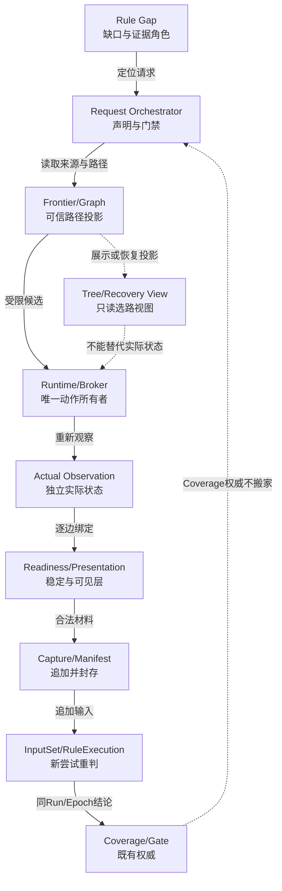
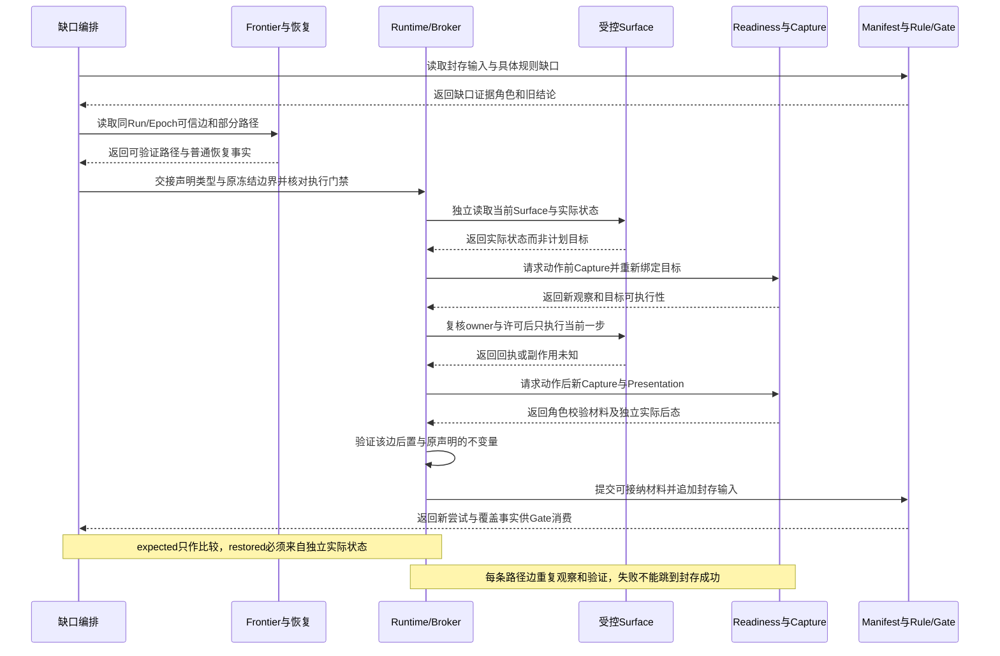
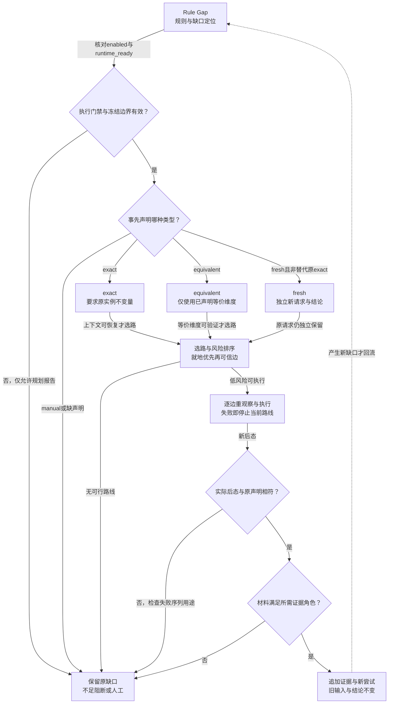

# 专项三：基于页面图的精准补采设计

> 日期：2026-09-04
>
> 版本：技术深化 v1.1
>
> 状态：设计未实现
>
> 范围：H5、桌面 Web、Android/iOS App 在证据不足、状态恢复和规则重判场景下的有界补采。
>
> 限制：本文说明机制、流程、边界与验收；不展开表设计、字段清单、API 载荷、详细数据结构或 SQL。

精准补采不是把原流程盲目重播一遍，也不是用相似页面或别的 Run 的证据填洞。

它是基于同一 Run/Epoch 的页面状态图，针对明确规则缺口提出的可审计追加观测。

本系列：[01-controlled-exploration.md](./01-controlled-exploration.md) · [02-page-state-graph.md](./02-page-state-graph.md) · [03-targeted-recapture.md](./03-targeted-recapture.md) · [04-page-recognition.md](./04-page-recognition.md) · [05-capture-readiness.md](./05-capture-readiness.md) · [06-interaction-precision.md](./06-interaction-precision.md) · [07-trusted-evidence.md](./07-trusted-evidence.md) · [README.md](./README.md)

总设计依据：[2026-09-02 有限探索、页面状态图与可信证据详细设计](../2026-09-02-bounded-exploration-page-state-graph-design.md)。

## 1. 决策摘要与边界

补采的发起原因必须是可定位的证据缺口、规则请求或恢复需要。

每个规则先声明 exact、equivalent、fresh 或 manual，Runtime 再按声明选择路径。

支付、登录、凭证、授权、价格和一次性链接默认从严，不能用普通页面等价替代。

补采前检查实时 Session、租约、预算、授权、运行面能力和目标状态是否仍然存在。

补采能力同时满足 enabled 和 runtime_ready 两道门禁；只配置 enabled 不代表可以执行。

Judge 只能提出证据请求，Runtime 是唯一操作设备、浏览器和外部 Surface 的组件。

路径成本综合风险、成功率、剩余预算、前置条件和状态副作用，不只选择最短路径。

每条边都要重新观察、重新绑定目标、重新做 Readiness 和可见层后置验证。

不允许把旧坐标、旧元素句柄或一串宏命令当作恢复证明。

新 Capture、InputSet 和规则尝试只追加，旧结论不覆盖。

同一页面不代表相同广告、用户、价格、登录状态或一次性上下文。

崩溃后无法确定副作用时先观察当前 Surface，不能因缺少完成标志就盲重试。

无法恢复时明确证据不足、阻断或人工处理，不借用其他 Run 或相似页通过。

收口要排空补采请求和异步工作，并把 Gate 结果与租约释放结果分开报告。

## 2. 现状问题与收益

| 问题 | 机制 | 提升 | 指标 |
| --- | --- | --- | --- |
| 证据不足只能盲找 | 图路径定位缺口来源 | 找回路径可解释 | 缺口闭环率 |
| 旧坐标失效 | 每边重新观察和绑定 | 降低误点 | 重绑定成功率 |
| 页面相同被误认为等价 | 明确 exact/equivalent/fresh | 降低错证据 | 等价误用率 |
| Judge 直接驱动设备 | 请求与执行分离 | 降低越权和副作用 | Judge 设备调用数 |
| 补采覆盖旧结论 | 追加版本和尝试 | 历史可审计 | 旧结论覆盖率 |
| enabled 被当成可执行 | enabled/runtime_ready 双门禁 | 失败更早可解释 | 未就绪执行率 |
| 崩溃后盲重试 | 先观察副作用 | 降低重复支付等风险 | 不确定重试率 |

精准补采首先提升证据正确性和可追溯性。

设备分钟、Token 和动作次数的减少只有在同一分母、同一规则要求下才有意义。

## 3. 当前基础与模块改动

现有页面身份、Frontier、恢复兜底、补充证据策略、Capture 编排、InputSet 和证据链可作为补采基础。

恢复目标的身份匹配可复用 [App 页面身份](../../../services/api/app/domain/exploration/app_page_identity.py)。

候选队列可复用 [App Frontier](../../../services/api/app/domain/exploration/app_frontier.py)，恢复兜底可复用 [Frontier Restoration](../../../services/api/app/application/app_frontier_restoration.py)。

已有恢复入口提供有限 fallback 和恢复检查，但不等于完整图规划；路线仍需由页面状态图按风险和可验证性选择。

补充证据策略可复用 [Supplemental Evidence Policy](../../../services/api/app/application/supplemental_evidence_policy.py)，Capture 编排可复用 [Capture Coordinator](../../../services/api/app/application/capture_coordinator.py)。

输入集合语义可复用 [Input Set](../../../services/api/app/domain/evidence/input_set.py)，运行目标可复用 [App 探索目标](../../../services/api/app/application/app_exploration_target.py)。

App 运行编排可复用 [App 全局 Frontier](../../../services/api/app/application/app_global_frontier.py)；证据需求与清单收口可复用 [证据就绪服务](../../../services/api/app/application/capture_evidence_readiness.py)。画面稳定性由专项五衔接现有采集能力，不能把清单就绪当成画面已经稳定。

证据追加和封存可复用 [Manifest Writer](../../../services/api/app/application/evidence_manifest_writer.py)。

规则缺口和范围判断可复用 [Rule 配置](../../../services/api/app/application/aggregate_rule_config.py) 与 [Task Query](../../../services/api/app/application/task_query.py)。

现有 enabled + runtime_ready 是补采前置门禁；本文保持双门禁，不将 enabled 当成可执行。

当前改动集中在 EvidenceRequest 到 Runtime 的编排、图路径查询、等价性门禁、追加证据和排空收口。

恢复编排、状态等价与证据追加属于高影响主链路；图查询和工作台路径诊断属于中等影响扩展。继续复用权限、租约与规则执行，不重建第二套控制面；与其他专项的改动范围重叠，不能相加。

不新增第二个设备控制面，不让 Judge 复制 Runtime 操作逻辑。

## 4. 职责边界

| 角色 | 负责 | 不负责 |
| --- | --- | --- |
| Judge | 根据封存输入识别缺口并提出请求 | 选择设备动作、操作页面、直接重试 |
| EvidenceRequest 编排 | 解释规则声明、预算和优先级 | 伪造已满足条件 |
| 图路径规划 | 选择可验证的候选路线 | 只按最短路绕过风险 |
| Runtime/Broker | 检查门禁、逐边执行、提交追加事实 | 使用旧句柄、绕过租约或扩大范围 |
| Readiness/Presentation | 证明帧稳定、层级和可见目标 | 以视觉相似替代业务等价 |
| Manifest/InputSet | 封存新证据及其来源 | 覆盖原始证据或旧结论 |
| RuleExecution | 基于新输入重判并保留版本 | 直接请求设备或修改历史结果 |
| Gate/收口 | 检查请求、规则、证据和资源终态 | 将释放资源当作通过 |

补采请求的提出和补采动作的执行必须能在审计链中区分。

## 5. 核心设计

### 5.1 缺口先分类

每个缺口先定位到规则、页面状态、动作边、Overlay occurrence 或证据角色。

exact 表示原规则相关上下文严格一致；只有规则明确要求原发生实例时才要求同一 occurrence；equivalent 允许规则声明的等价状态；fresh 必须获得当前时刻新观测；manual 表示证据强度或副作用风险不足而转人工。

原 exact 请求不能由 Runtime 改成 fresh；原状态无法证明时结算不足或人工，另有规则声明的新 fresh 请求和新结论必须独立。

分类由规则合同声明，不能由补采 Runtime 为了成功自行放宽。

### 5.2 双门禁与运行前检查

enabled 只表示策略允许尝试，runtime_ready 还要证明 Provider、Session、租约、权限和证据写入路径可用。

任一门禁失败都不执行，缺口结算为 blocked 或 evidence_insufficient；开始前再次核对取消状态、Run/Epoch、预算、测试授权和目标范围。

网络能力未知不能解释为网络正常，也不能自动切换危险旁路。

### 5.3 目标上下文与等价性

目标上下文包括来源 PageState、用户会话、产品版本、规则版本、展示层、广告位置和外部转场语义。

同一 PageNode 或同一截图不证明广告素材、价格、用户、登录态、前置条件和后置状态相同。

exact 要求原规则相关上下文严格一致；只有规则明确要求原发生实例时才要求同一 occurrence，已消失的一次性事件不能重现原实例。equivalent 要逐项验证规则允许的状态、位置、素材和时间范围；fresh 要标明新观测时间和触发原因。

### 5.4 图路径规划

正式恢复路线优先来自同一运行允许使用的可信成功边。尚未验证的候选动作单列为探索机会，不当作已知可达路线；是否额外尝试由有限发现策略和独立预算决定。

路径成本同时考虑风险、成功率、动作数、等待、预算、租约剩余时间和副作用；最短路径若经过支付或一次性授权，不优先于较长的低风险路径。

失败边只能用于避让和诊断；没有可信路径时结算不足或人工，不用固定脚本猜测。

### 5.5 逐边重新绑定

进入每条边前重新确认当前 Surface、PageState、可见层和目标候选，旧 Capture 的坐标、DOM 引用、Accessibility 节点和窗口序号默认失效。

动作前再次检查风险和范围，动作后等待 settle 并采集新观测；出现 Overlay、页型改判、外跳或层级变化就暂停并重新分类。

成功边要求可信 after Capture、目标状态证明和通过的后置条件；命令成功但目标不变只记 no_effect。

### 5.6 Readiness 与可见层后置验证

Readiness 判断采集时机稳定，Presentation 判断目标在正确层级、窗口和 Surface 可见，两者都不直接替代业务到达判断。

未稳定帧不能证明稳定业务到达；但加载/关闭失败时间序列若满足来源、完整性和证据角色规则，可进入正式失败判断。

补采材料不总需要动作；当前页只缺局部证据时可就地观察或补帧，不编造 after 动作。

自然用户证据不能用诊断隐藏、DOM 修改或程序派发替代；长页按原帧顺序追加，派生拼接不能遮掩缺帧和加载缺口。

结构缺失可以降级视觉判断，但必须保留能力限制和可信度边界。

### 5.7 证据追加和规则重判

新 Capture 先通过来源、完整性、Readiness 和 Presentation 检查；是否进入正式规则输入由证据角色决定，未稳定帧不得声称稳定到达，但合法的加载/关闭失败时间序列可以用于正式失败判断。

新 InputSet 只引用本次合法证据，不修改原 InputSet。

新规则尝试保留规则版本、缺口来源和补采原因；旧结论不可变，新结果以 revision 或独立尝试表达。

证据复用要记录来源、等价判断和失效原因，Judge 只消费封存输入，不读 Runtime 临时状态。

### 5.8 外跳、Overlay 与一次性上下文

自然 popup、同标签 JS、POST 落地和原生外部 Activity 的恢复能力不同；旁路只记录允许的外部观察，不计入被测业务覆盖。

回源必须重新观察启动层；相同弹窗触发循环预算。支付、登录、授权即使视觉相似，也不能用普通页面证据替代。

二维码内联区域不是自动 Overlay，真实路由支付页按业务页面处理。

### 5.9 崩溃、不确定副作用与收口

崩溃后先读取当前 Surface、最后 Receipt、最近 Capture 和租约状态；若动作可能已发生，先观察后态和副作用，再决定补偿或人工。

不能因为执行状态缺失就再次点击支付、提交或授权；收口前排空请求、运行中动作、迟到写入和规则重判。

同一缺口请求去重并共享重试、时间和调用预算，新请求不能重置预算；排空后再做 Gate，资源释放单独结算。

### 5.10 有界迭代与就地补采

目标已在当前页面且等价可证时优先就地补帧，避免回首页；缺局部证据可只观察，不强造动作。

已知可信路线与未验证候选分开标记；无路径时若策略另允许探索，使用独立有限发现预算，候选不计恢复成功边。

恢复失败、超时、无新增证据和收口排空均为终态，不无限递归创建请求。

## 6. 标准流程

1. Judge 从封存输入确认具体规则缺口及证据角色。
2. 规则声明 exact、equivalent、fresh 或 manual。
3. 编排器绑定原 PageState、动作边、Run/Epoch 和补采原因。
4. 检查 enabled、runtime_ready、Session、租约、预算、授权和目标范围。
5. 从图中计算至少一条低风险可验证路径和放弃条件。
6. Runtime 到达路径起点并重新确认当前状态。
7. 每条边重新发现候选、绑定目标、执行、settle 和观察。
8. 发生漂移、Overlay 或外跳时暂停并重新分类，不盲接下一步。
9. 完成目标后做 Readiness、Presentation 和后置条件验证。
10. 追加 Capture、Manifest、InputSet 和规则尝试。
11. Judge 消费新封存输入并重判；仍有缺口则创建下一请求。
12. 所有请求和动作进入终态后，Gate 独立判定并报告资源释放。

## 7. 异常闭环

**完整例子一：当前长页的局部证据缺口。**

规则只缺当前长页某段内容，运行面已经停在该段，目标在视口内可见但上次材料未完整留存。编排器检查状态等价后就地补帧，不回首页，也不编造点击。

先检查 Readiness、目标区域和可见层，再追加原帧与封存输入，Judge 基于新材料判断。若目标尚在屏幕下方，则由专项六执行有界滚动、观察与重绑，每次滚动都保留真实前后态。单纯缺帧仍是证据缺口，只有合法序列确实证明加载或关闭异常时，才支持对应失败判断。

同一广告位出现不同素材：位置覆盖不能因素材复用而消失，规则复用需声明版本关系。

登录已过期：不能用匿名页面补采登录后规则，转阻断或人工授权。

**完整例子二：原登录/支付状态失效。**

原 exact 请求要求原登录/支付上下文；当前状态失效或价格变化时，Runtime 不能改成 fresh，原请求明确不足或人工。

若规则事先另允许当前事实评估，独立创建 fresh 请求和新结论，不能填补原 exact 缺口；一次性事件已消失也不能重现原 occurrence。

取消更新按钮无效：记录关闭失败和后态，不能把 Overlay 删除后继续。

一次性链接已消费：图上仍可看到历史边，但不能重播；按 manual 或 evidence_insufficient 结算。

旧坐标落在新广告层：Presentation 后置验证失败，当前边作 misroute 或 no_effect。

滚动后虚拟列表重排：旧目标失效，重新观察列表和目标区域，不复用旧坐标。

H5 direct URL 可打开落地页：只证明内容可达，不证明原点击链或产品内覆盖。

App 外部 Activity 返回失败：保留外部转场和回源失败，不把外部截图放入业务页面证据。

Runtime 崩溃在提交动作后：先观察副作用和 Receipt，禁止重复支付、登录或授权。

补采预算耗尽：保留规则缺口和放弃原因，不能使用相似页或别 Run 的 Capture。

Gate 计算故障：报告 unavailable；租约释放成功仍单独报告。

## 8. H5 与 App 差异

| 维度 | H5 | App |
| --- | --- | --- |
| 路径来源 | href、History、DOM 和截图 | 视觉、Native Tree、Semantics、返回栈 |
| 可用旁路 | 可有限使用 direct URL 观察内容 | 不能普遍克隆进程或原生 Surface |
| 会话恢复 | Cookie、Storage、标签和 History 需核对 | 进程、Activity、Window、设备状态需核对 |
| Overlay 风险 | CSS 层、popup、异步脚本 | Dialog、系统权限、WebView、原生支付 |
| 等价验证 | 路由、DOM、用户态和网络窗口 | 视觉层级、设备配置、生命周期和返回语义 |

H5 的网络辅助信号不能单独证明页面已稳定。

App 的纯视觉降级不能自动放宽支付、登录和授权等价性。

两端都必须记录实际能力缺口，不把 unavailable 当作无缺口。

## 9. 与其余专项协作

与 [01-controlled-exploration.md](./01-controlled-exploration.md) 协作，补采不能扩大原策略、域名、Package 或预算边界。

与 [02-page-state-graph.md](./02-page-state-graph.md) 协作，图提供路线，补采逐边重新证明。

与 [04-page-recognition.md](./04-page-recognition.md) 协作，页型改判追加 revision 并触发范围复核。

与 [05-capture-readiness.md](./05-capture-readiness.md) 协作，未稳定帧不能证明稳定到达；满足来源和角色规则的加载/关闭失败时间序列仍可进入正式失败判断。

与 [06-interaction-precision.md](./06-interaction-precision.md) 协作，每步都要重新绑定坐标和可见目标。

与 [07-trusted-evidence.md](./07-trusted-evidence.md) 协作，补采证据角色、来源和自然/诊断边界不可混用。

Judge、Runtime、Manifest 和 Gate 之间通过既有任务事实与异步工作衔接。

## 10. 工作台与排障

工作台首先显示缺口来源：规则、Capture、页面状态、动作边还是 Presentation。

然后显示候选路径、风险解释、预计成本、放弃条件和当前门禁状态。

每条补采边应能展开前态、重新绑定结果、Receipt、settle、后态和后置条件。

等价性视图区分规则声明、实际观测和未证明项。

证据视图区分原始 Capture、派生产物、新旧 InputSet 和规则尝试。

排障先看当前 Surface 和副作用，再看执行状态；不从“未完成”推断“未执行”。

同一缺口多次失败时，显示失败原因分布和预算消耗，不只显示最后错误。

收口视图分开展示请求排空、规则排空、Gate 状态和租约释放。

## 11. 权限、审计与安全

补采请求必须继承原任务的租户、owner、规则和 Artifact 访问范围。

Runtime 继续遵守现有 Session、设备租约与策略，并接入专项一设计的 Command Broker；不能将拟新增的 Broker 说成当前已经完整实现。

Judge 输出、页面文本、链接和外部内容都是不可信输入，不能扩大补采权限。

支付、登录、授权和凭证动作需要显式授权；缺授权直接 blocked，不尝试绕过。

补采不得把 secrets、完整会话凭证或外部响应敏感内容写入诊断事实。

自然证据和诊断证据分开标识，诊断修改不能被规则当作自然用户结果。

所有补采写入都保留原因、来源和 Run/Epoch，便于复核与撤销读侧。

## 12. 分期、兼容与回滚

A 冻结 exact/equivalent/fresh/manual 的规则声明和失败分类。

B 仅记录缺口和候选路径，不执行自动补采，建立真实基线。

C 对低风险路径做影子规划和门禁计算，只比较计划，不产生第二条设备动作。

D 接入追加 Capture、Manifest、InputSet 和规则尝试，保持旧结论不可变。

E 对 H5 低风险场景灰度启用，真实执行只在隔离测试任务或单一动作所有者的低风险灰度；App 维持更严格能力和授权门禁。

F 接入外跳、Overlay、一次性上下文和崩溃恢复场景。

G 通过对账和收口门禁后，才允许影响正式证据缺口闭环。

回滚时停止新补采请求和 Runtime 执行，保留已追加事实和旧结论。

回滚不删除 Capture、不合并尝试、不把追加结果写回历史输入。

## 13. 验收与指标

硬性正确性：

- 每个补采都有明确缺口、规则声明和 Run/Epoch。
- Judge 不直接调用设备或浏览器。
- enabled 不足以启动补采，runtime_ready 必须同时成立。
- 每条路径边都重新观察、重新绑定并验证后置条件。
- 没有可信 after Capture 的结果不得声称成功到达；加载/关闭失败时间序列若满足来源、完整性和证据角色要求，可以进入正式失败判断。
- exact/equivalent/fresh/manual 不得在 Runtime 内隐式放宽。
- 新 Capture、InputSet 和规则尝试只追加，旧结论不覆盖。
- 不能使用其他 Run、相似页面或未证明等价证据通过。
- 不确定副作用先观察，不盲重试高风险动作。
- 请求、动作、规则、Gate 和租约释放分别进入可解释终态。

效率指标需待真实基线后比较：

| 指标 | 观察意义 | 不能单独说明 |
| --- | --- | --- |
| 缺口闭环率 | 规则证据恢复效果 | 没有等价误用 |
| 平均恢复动作数 | 路径效率 | 高风险安全 |
| 恢复设备分钟 | 资源效率 | 证据可信 |
| 重绑定成功率 | 交互适应性 | 业务到达 |
| 追加后重判率 | 规则链路完整性 | 规则正确性 |
| 失败原因可分类率 | 排障质量 | 自动恢复能力 |
| 不确定重试率 | 副作用控制 | 全部崩溃已恢复 |

验收必须覆盖支付、登录、授权、广告 occurrence、外跳、慢加载、长页、崩溃、取消和 Gate unavailable。

## 14. 团队反馈与待冻结项

已纳入 exact/equivalent/fresh/manual 声明、支付/登录/凭证/价格/一次性状态从严和 enabled/runtime_ready 双门禁；路径成本不只看最短、逐边重绑定、不盲宏回放、同页不等价、新证据追加、旧结论不覆盖、Judge 请求与 Runtime 操作分离。

已纳入崩溃未知副作用先观察、无法恢复转不足/人工和收口排空；待冻结各规则的等价性证明项、上下文变化和 freshness 窗口，以及各平台/Provider/外部 Surface 的 runtime_ready 最小条件。

待冻结补采预算、循环阈值、人工接管入口和 Gate unavailable 报告格式；冻结前只能影子验证，不能声称已实现。

## 15. 技术组件与代码接入

本章把精准补采接到既有 EvidenceRequest、Frontier、Runtime、Capture 和规则链，不新增设备控制面、第二套权限模型或新的证据权威。Frontier 已有来源、状态、部分路径和恢复事实，不是只做发现；补采编排应消费这些事实，并把未验证候选与可信成功边分开。

`AppFrontierItem` 的来源 Capture、业务身份、候选指纹、navigation path、优先级和任务归属用于定位缺口来源；`AppFrontierRestoration` 的当前帧重绑定、BACK/warm restore 和有界 restore-only 继续承担普通局部恢复。H5 Frontier 同样保留来源状态、lineage、sibling 和终态，不由补采重新发明路径事实。

正式补采要经过既有 `SupplementalEvidencePolicy` 的 enabled 与 runtime_ready 双门禁。当前生产策略的正式补采 `runtime_ready=False`，因此只能记录缺口、规划路径或报告不可执行，不能把 enabled 当成生产可执行；普通局部恢复已有能力与正式补采能力必须分别结算。

`CaptureCoordinator` 继续保证动作前后 Capture、settle、lease owner 和 finalization epoch；`CaptureEvidenceReadiness` 负责证据需求/清单就绪，不替代专项五的画面稳定判断。`EvidenceManifestWriter`、InputSet 和 RuleExecution 只追加合法证据与新尝试，旧结论不可变。

Page identity、PageTypeAssessment、Rule 配置和 Task Query 只提供目标上下文与适用性判断。图路径是可信观察的选路投影，树只用于展示/恢复视图；Coverage 仍由既有覆盖服务/快照提供，Gate 消费覆盖与排空事实。补采成功回执不能替代二者，也不能修改任务提交时冻结的 required 分母。



接入顺序固定为“先受理缺口、再复核门禁、再读图选路、逐边执行并重新证明、最后追加证据和重判”。Judge 只提出请求，Runtime/Broker 才能操作设备、浏览器和外部 Surface；工作台不能从树路径生成成功证据。

## 16. 调用时序与交接

补采请求的提出、路径规划、动作执行、证据封存和重判必须保持可区分的交接。请求继承任务已冻结的 required 分母、规则版本和目标 Run/Epoch，交接时核对而非重新定义这些基线；动作 owner 是可到期的执行许可，不是永久冻结值。每个边检查点都重新读取实际状态。



形式化补采在生产仍视为未就绪：

```text
policy = current_supplemental_policy()
if not policy.enabled or not policy.runtime_ready:
    return blocked_or_insufficient("正式补采运行面未就绪")
if request.run_epoch.is_closed or request.denominator.is_not_frozen:
    return defer("Run/Epoch或必检分母不满足收口边界")
permit = runtime.claim_single_owner(request.session)
if permit.owner_conflicts or permit.lease_expired:
    return defer("同一Runtime不能并发执行补采")
actual = runtime.observe_independently()
target = rebind_from_actual(actual, request.source_state)
if target is None:
    return replan_or_manual(actual)
before = capture_fresh_before_and_rebind(target)
if not executable_now(before, permit):
    return replan_or_manual(before)
receipt = runtime.execute_one_authorized_step(before.target)
after = capture_fresh_after(receipt)
if not arrival_and_declared_context_proven(after, request):
    preserve_gap_and_old_conclusion()
    return evaluate_allowed_failure_sequence_or_insufficient(before, receipt, after)
accepted = adjudicate_material_for_requested_role(after, request)
if not accepted:
    return preserve_old_conclusion_and_replan(after)
return append_and_rejudge(accepted, same_run_epoch=request.run_epoch)
```

`request.source_state` 和规则声明只约束要证明什么，不得被注入当前 `actual` 或 `restored`。如果恢复结果只是在 expected 上合并出来，或无法证明观察来自真实 Surface，验收必须失败闭环。

## 17. 算法与决策

补采决策先确定结论类型，再确定缺口边界和路径。exact、equivalent、fresh、manual 是事前规则声明，不是 Runtime 运行中的放宽旋钮；fresh 即使成功，也不能修复原 exact 缺口，只能产生独立的新请求和新结论。



图中的三条声明分支互不回退：exact 验证失败不能接着尝试 equivalent 或 fresh；缺少原上下文时回到缺口/人工。停止补采成功路径不等于丢弃材料：若规则允许，完整的加载或关闭失败序列仍可形成一项有来源的新失败判断，但不得宣称原目标已恢复。

缺口合并只允许在同一规则、同一 Run/Epoch、同一证据角色和兼容目标上下文下进行；不同 occurrence、不同登录/价格/素材窗口或不同结论类型必须保持独立。equivalent 的逐项证明缺一项就不能合并，fresh 不得回写 exact 请求。

路径排序把当前实际页上的就地观察放在第一层；其次是同一运行的可信成功边；再次才是低风险、可重新绑定的恢复边和有限发现候选。动作数量较少但会触发支付、授权、一次性链接、跨 Surface 或不可逆副作用的路径，不因“最短”而优先。

每条边均有动作前状态、目标重绑定、动作 Receipt、settle/Readiness、动作后实际观察、Presentation 和后置条件。Overlay 可质检但通常不进入业务图，外部跳转只留来源/落地/回源证据且不计业务覆盖。

条件化决策伪代码：

```text
kind = request.declared_kind
if kind == "exact" and not can_prove_original_context(request):
    return insufficient("exact上下文不可证明")
if kind == "equivalent" and not prove_each_declared_dimension(request):
    return insufficient("equivalent仍有未证明项")
if kind == "fresh" and request.replaces_original_exact:
    return reject("fresh不能修复旧exact缺口")
if target_is_visible_on_current_actual_state():
    plan = local_observation_before_navigation()
elif trusted_path_exists_in_same_run():
    plan = rank_trusted_paths_by_risk_and_budget()
elif limited_discovery_is_allowed():
    plan = bounded_candidate_attempt_without_coverage()
else:
    return manual_or_insufficient("没有可验证路线")
for edge in plan:
    actual = observe_independently()
    if not rebind_execute_capture_and_verify(edge, actual):
        preserve_partial_observations_without_claiming_target_recovery()
        return bounded_replan_or_terminal_from_independent_actual_state()
final_actual = observe_target_without_injecting_expected()
if not proves_declared_invariants_and_evidence_role(final_actual, request):
    return allowed_failure_judgment_or_insufficient_without_closing_original_gap()
return append_only_evidence_and_new_attempt(final_actual)
```

## 18. 一致性、并发与恢复

补采缺口的受理边界是“可定位、可归属、可声明、未被同一结论终态覆盖”。相同规则和同一上下文的重复请求可以幂等合并；只要 Run/Epoch、证据角色、occurrence、用户态、价格、素材或 freshness 窗口不同，就必须拆开。合并不会删除任何原始 Capture 或旧结论。

事件乱序时先按事实来源和 Run/Epoch重建缺口视图，再决定是否可继续；重复事件只确认一次。若相同动作收到冲突的 after 观测，保留两份事实并把结论标为冲突/不足，不能以最后一条消息自证成功。

逐边检查点至少覆盖当前实际状态、目标绑定、动作回执和后置条件。检查点失败时从最新独立实际状态重规划，不能从原计划索引继续盲跑，也不能把树上最短路径当成真实恢复图。

同一 Runtime 由单一 action owner 持有设备动作权；Frontier sibling、Judge 和图查询只能排队或读取。owner 失效、租约过期、取消或 deadline 到达时停止新动作，保留已追加事实。新 owner 接管必须先只读核对未决动作；策略和期限仍允许且未知副作用已处理后，才可重新规划，不能从旧路径索引自动重放。

生产正式补采继续保持 `runtime_ready=False`，因此所有生产请求都必须走 blocked/insufficient/manual 的真实报告分支；普通局部 restore-only 仍可按既有能力和恢复次数执行，但不能把它伪装成正式补采。

required 分母从任务提交起保持冻结。收口先停止新请求准入，再按现有边界排空已接纳的动作、Capture 和规则工作；排空期内合法的在途结果仍须核对 Run/Epoch 后接纳。最终封存 InputSet/覆盖快照后，迟到 Capture、Outbox 或重判只进审计或新的受控运行，不能改写本次封存输入与 Gate。资源释放、请求排空和 Gate 结论分别报告。

```text
merge_request(existing, incoming):
    if not same_run_epoch(existing, incoming):
        return keep_separate("Run/Epoch不同")
    if not same_rule_and_evidence_role(existing, incoming):
        return keep_separate("规则或证据角色不同")
    if not compatible_context(existing, incoming):
        return keep_separate("上下文或occurrence不同")
    if existing.kind != incoming.kind:
        return keep_separate("exact/equivalent/fresh/manual不可隐式合并")
    return idempotently_merge_request_without_overwriting_history()

after_edge_failure(edge):
    actual = runtime.observe_independently()
    if actual.is_external_or_obstructed:
        return preserve_external_or_overlay_evidence(actual)
    if owner_or_deadline_invalid():
        return terminal_without_retry("owner/期限门禁失败")
    return replan_from(actual, allowed_by_existing_budget=True)
```

恢复验收只接受“独立实际状态与声明目标相符、来源可信、逐边后置条件通过”的结果。`expected` 是比较项，`restored` 必须由实际观察解析；不得把 expected、树选择或旧 Capture 注入 restored。

## 19. 故障推演与技术验收

以下失败重试矩阵沿用既有预算、租约、取消和 Run/Epoch 门禁；未授权的重试不因为“请求还没成功”而自动增加次数。

| 故障 | 首次处理 | 允许的重试或重规划 | 终态与结论 |
| --- | --- | --- | --- |
| enabled=false | 不创建执行动作 | 仅等待策略变更后的新请求 | blocked，不产生补采证据 |
| 生产 runtime_ready=false | 记录能力未就绪 | 可规划/报告，不能操作设备 | insufficient 或 manual |
| Frontier 只有未验证候选 | 与可信边分开 | 仅在独立有限发现预算内尝试 | 不计恢复成功边 |
| 当前目标未重现 | 保存当前实际状态和原因 | 从当前状态重绑或走已有恢复边 | 无路线则 blocked/manual |
| Readiness/Presentation失败 | 不封存为稳定到达 | 按采集预算补观察，不盲重放 | evidence_insufficient |
| owner冲突、租约过期 | 停止新动作并保留未决记录 | 新 owner 先只读核对副作用，再在有效期限内重新规划 | 无法消歧则 insufficient/manual |
| 取消或deadline到达 | 立即停止新动作 | 不跨截止时刻重试 | 资源与结论分开报告 |
| exact上下文消失 | 保留原 exact 缺口 | 不能改成 fresh；另有声明才新建请求 | 原结论不足/人工 |
| duplicate/乱序证据 | 幂等接纳或等待重建 | 只重试消费，不重复动作 | 不重复追加结论 |
| Overlay或外部落地 | 留 occurrence、来源和回源证据 | 按安全恢复候选有限尝试 | 默认不计业务覆盖 |
| Gate或收口不可用 | 标记 Gate unavailable | 不用租约释放或请求排空冒充通过 | 质检结论未闭合 |

技术验收要逐项证明：缺口能追溯到同一 Run/Epoch 的规则、Capture、状态或边；Frontier 的来源/状态/部分路径/恢复事实没有丢失；身份与 `page_type` 解耦；图只投影可信观察，树只作展示/恢复视图；普通局部恢复与正式补采区分；生产正式补采保持 `runtime_ready=False`；恢复实际状态独立读取；exact/equivalent/fresh/manual 预声明且 fresh 不修复旧 exact；同一 Runtime 单一 owner；冻结 required 分母；Coverage 权威和 Gate 门禁不搬家。

静态影子验收至少覆盖当前页就地补帧、多入口恢复、局部状态变化、弹窗遮挡、外部回源、一次性上下文消失、动作后崩溃、租约失效、乱序事件和迟到封存。每个案例都要同时检查旧结论、新 Capture/InputSet、重判 revision、失败原因和 Gate 状态，不能只看“请求已完成”。

本技术深化仍是未实施设计。进入实施前需由产品、质检和运行时负责人确认各规则的等价性证明项、fresh 窗口、缺口合并边界、恢复重试上限、人工接管入口、事件重建窗口及正式补采未就绪时的外部报告格式。文档和图示不代表运行面已启用。

## 20. 关联文档依据

总设计第 16–21 节提供交互、外跳、证据、图恢复、持久化复用、事件和同 Run/Epoch 原则；第 23–30 节提供 Gate、安全、错误、指标、实施、测试、验收和回滚约束。

总设计第 35 节裁决补采等价性、外跳、层级、广告复用和能力门禁反馈；第 36 节给出 Judge、Runtime、异步质检、补采、收口和释放闭环。本文件只是精准补采专项设计，不表示源码已经完成对应能力。
