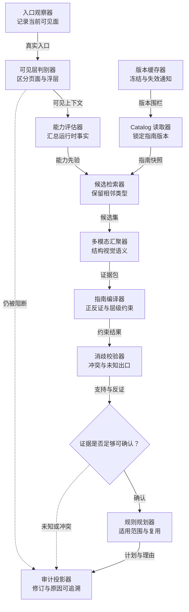
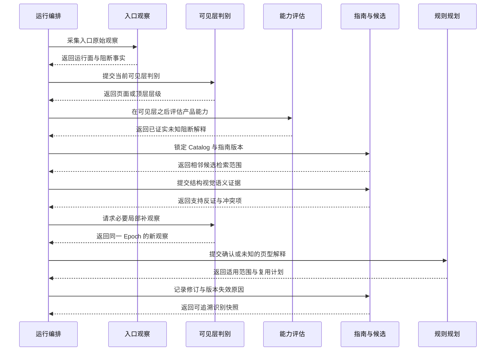
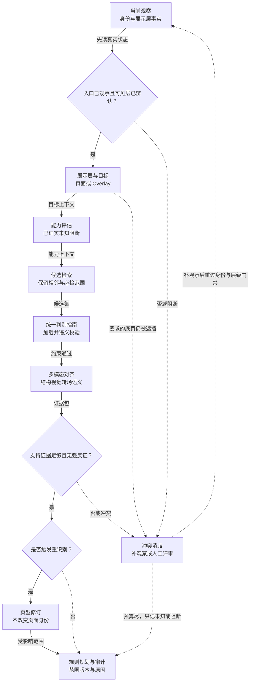

# 专项四：产品能力、页面类型与规则适用的精准识别设计

> 日期：2026-09-08 · 版本：技术深化 v1.2 · 状态：判别指南影子已升至 `app-page-discrimination-guide.v2` 并注入 App Vision；App 运行时能力影子（`app-runtime-capability-shadow.v1`）已写入覆盖元数据且不改冻结分母；跨端切读与正式能力权威仍待评审。
>
> 适用范围：H5 / Web、Native、Hybrid 与 Flutter 等自绘界面；共享业务语义，按实际能力采集证据。
>
> 本文说明识别机制、业务边界、流程、改造和验收，不定义数据库表、字段、具体数据结构或接口载荷。

## 1. 决策摘要与设计边界

采纳“给页面类型增加描述”，并将其升级为版本化页面类型判别指南：不仅解释是什么，还说明凭什么识别、与哪些类型容易混淆、什么反证应阻止判断。
仅增加一句描述不足以解决类型漂移、底层 DOM 被弹窗遮住和错误规则分配。

同时采纳产品能力前置评估，但顺序是先观察入口与当前展示层，再识别真正可见的业务内容。
“首页”是入口角色，不代表产品一定有内容列表、详情或个人中心。导航型、广告聚合型产品不应被强行套入内容 App 模板。

必须分开三件事：产品整体可能有哪些能力、当前业务页面是什么、此刻真正显示在用户面前的是哪一层。
页面类型判断可以修订，但不能直接更改页面身份，不能为了提高覆盖率而缩小已冻结必检目标。

本专项负责识别、适用性解释和执行范围规划；不负责自己操作设备、判定动作成功或创建第二套规则引擎。
页面身份由专项二管理，可见层与证据合法性由专项五、七约束。

## 2. 现状问题与优化收益

| 现状问题 | 设计机制 | 直接优化与系统提升 | 验证指标 |
| --- | --- | --- | --- |
| 同一页面多次被识别为不同类型，触发重复探索和错误规则 | 统一判别指南、相邻类型消歧、历史修订与身份解耦 | 降低错误改判，防止类型漂移分裂图节点 | 页型误判率、同状态不合理漂移率、重复节点率 |
| 只根据 URL、标题或一张图强制选一种类型 | 多模态证据、强反证、允许未知和冲突 | 将不确定性暴露出来，减少错误高置信度结论 | 错误确认率、冲突处置率、未知原因完整率 |
| 产品首页是导航/广告列表，却持续寻找详情和个人中心 | 入口后建立暂定产品能力评估 | 调整探索优先级，减少模板式无效寻找 | 无效候选占比、目标缺口可解释率 |
| DOM 是详情，截图却是充值或登录弹窗 | 业务页型与当前展示层独立判断 | 不把被遮挡内容当成当前曝光证据 | 层级错配进入正式判断的数量 |
| “没找到”被解释为“不适用”，必检范围漂移 | 产品声明、已观察能力、未知/阻断分开，保留冻结基线 | 覆盖口径稳定，避免通过率被人为抬高 | 无依据排除数、目标变更审计完整率 |
| 广告规则重复执行，或一刀切只跑首页造成漏检 | 按规则关注点定义范围、频率与可复用边界 | 减少静态重复判断，同时保留广告位和交互覆盖 | Judge 调用减少量、应检范围保留率 |

识别稳定不等于识别正确。不能通过永远沿用第一次判断来制造“零漂移”；必须用人工标注和实际反证评估准确性。

## 3. 当前基础与模块改动

现有代码已经包含页型 Catalog、产品目标画像、提交快照、运行时页型评估和规则筛选条件，属于可复用主线。

| 代码入口 | 已有基础 | 本次改动定位 |
| --- | --- | --- |
| [Catalog](../../../services/api/app/domain/page/catalog.py)、[Registry](../../../services/api/app/domain/page/registry.py)、[判别指南](../../../services/api/app/domain/page/discrimination_guide.py) | 页型定义、导航提示、相关规则等统一入口 | 已发布 `app-page-discrimination-guide.v2`（影子注入 Vision）；正式页型权威仍在 Catalog |
| [产品目标画像](../../../services/api/app/domain/exploration/app_target_profile.py)、[目标冻结](../../../services/api/app/application/app_exploration_target.py)、[运行时能力影子](../../../services/api/app/application/app_runtime_capability_assessment.py) | 产品声明与任务提交时的目标约束 | 入口后能力影子已写入覆盖元数据；冻结分母不可因「未找到」缩小 |
| [页型评估](../../../services/api/app/domain/exploration/page_type_assessment.py)、[评估适配](../../../services/api/app/application/app_page_type_assessment_adapter.py) | 本次运行的证据判断 | 增加层级条件、冲突解释、修订与跨端一致语义 |
| [App 终态与适用性](../../../services/api/app/domain/exploration/app_terminal.py) | 运行时适用性和最终缺口口径 | 区分确认不存在、未知、阻断和真正不适用 |
| [候选规则查询](../../../services/api/app/application/task_query.py)、[规则查询实现](../../../services/api/app/infrastructure/db/task_repository.py) | 规则集、启用态、平台、账号、页型和 URL 条件 | 保留既有条件，衔接新的适用解释与执行计划 |
| [聚合规则配置](../../../services/api/app/application/aggregate_rule_config.py)、[规则封存输入](../../../services/api/app/domain/evidence/input_set.py) | 页面、任务、旅程及环境聚合范围 | 区分已有聚合范围与新增频控/复用语义，不另造规则权威 |
| [工作台任务详情](../../../app/workstation/src/modules/tasks/pages/TaskDetailView.vue)、[规则管理](../../../app/admin/src/views/QcRulesView.vue) | 运行诊断与规则配置 | 展示前置画像、识别依据和范围；仅在需要可配置能力时增量改规则表单 |

改动主要集中在领域说明、识别服务、规则发布衔接和工作台解释；不需要重建用户、租户、菜单或整套规则管理。
App 已有相关画像与适用性实现，不代表 H5 已完整复用，需要补跨端接线与回归。

## 4. 职责划分与协作边界

产品方或任务配置提供受信声明；Catalog 管理正式类型及其语义；识别服务从当前证据提出判断；确定性校验阻止违背强约束的结果。
模型用于理解复杂界面，不拥有扩大权限、删除目标或直接生成正式规则结论的权力。

| 判断对象 | 要回答的问题 | 对后续流程的作用 |
| --- | --- | --- |
| 产品能力 | 产品有哪些已证实能力，哪些仍未知或被阻断？ | 候选排序、探索预期与规则适用解释 |
| 业务页型 | 当前可见业务内容遵循什么页面功能与交互语义？ | 页面规则匹配与展示说明 |
| 展示层 | 用户当前看到的是页面、内联区域、浮层还是系统窗口？ | 决定采集目标、关闭流程及证据可用范围 |
| 规则范围 | 哪个规则应对哪个目标、状态或交互执行？ | 生成可审计工作，避免重复和漏检 |

页面图仍持有稳定业务身份。类型改判影响解释和相关规则计划，不直接创造新页面或把历史事实删除。

## 5. 核心识别方案

### 5.1 入口先观察，产品能力后评估

启动后先辨认可见窗口和阻断层。若只能看到启动广告或更新弹窗，应记录入口被阻断，不猜测背后一定是首页。
保存前态并完成允许的关闭后，再对露出的业务内容建立暂定产品判断。

产品能力采用有证据的分级解释：已看到的能力、经过受信声明或明确负向验证确认不存在的能力、尚未发现的能力、被登录/弹窗等条件阻断的能力。
首页没有某入口、当前预算没找完或模型觉得“这个产品不像有个人中心”，都不够证明功能不存在。

后续登录、进入更多菜单或发现新路由时，追加评估修订。
新反证必须让受影响的探索优先级和规则计划重新评估，历史判断仍可追溯。
即使某规则最终有充分依据不适用，也保留原始任务目标与排除理由；用户明确要求的目标不能被模型静默删除。

### 5.2 页面类型描述升级为判别指南

每一种正式类型都应该让评审者理解：业务用途是什么、最有区分度的可见证据是什么、哪些特征只是弱提示、哪些反证足以拒绝判断。
对于容易混淆的类型，给出成对比较和来自真实界面的正反样例，而不是只堆类型名称。

例如，导航目录页的主要作用是组织入口；广告列表可能以广告素材与外部去向为主；内容详情通常围绕一个具体对象展示正文与相关操作。
都可能有卡片、标题和按钮，单个图形元素不足以分类。列表项是否有内部详情，也不能从卡片外观直接推断。

指南应兼容同类产品的不同文案、皮肤和布局，不绑定某个产品固定坐标。
平台专属证据可以不同，但业务类型的语义应一致；运行时选择的指南版本在本次运行内固定。

新增类型经过 Catalog 评审与版本发布。Agent 发现无法归类的界面，先保留候选和证据，不现场增加正式类型或编造规则映射。

### 5.3 识别采用分层证据，不以单一模态定论

先确认当前运行面和可见层，再读取目标区域的结构、可访问语义与截图，必要时结合已验证转场。
URL、标题、前一页和点击意图可以缩小候选，但不能替代当前画面的证据。

识别可以先筛选少量相关类型以控制上下文，但必须保留相邻易混淆类型和“暂不能确认”的出口。
不能因为产品画像暂定为导航型，就把之后真正出现的详情类型完全排除。

模型提出判断后，由规则化检查验证必要锚点、明确反证与层级条件。
支持证据不足、多个候选接近或不同模态冲突时，保留未知/冲突，安排低成本补观察或人工评审，不强制选第一名。

### 5.4 页面与弹窗分开，按展示形式和语义交叉理解

| 观察到的界面 | 正确解释 | 不应如何处理 |
| --- | --- | --- |
| 首页是导航与广告卡片列表 | 业务页面可以是导航/聚合类，广告卡片是区域目标 | 把整页叫广告弹窗，或假定后面必有详情 |
| 详情上覆盖充值弹层 | 底层详情可以保留历史/假设，当前目标是充值浮层 | 用底层 DOM 声称详情在当前画面完整可见 |
| 独立支付路由与返回语义 | 支付业务页面，同时施加高风险动作约束 | 因为包含支付就一律当弹窗排出页面图 |
| 系统更新确认或权限提示 | 系统层/浮层目标，确认和取消风险不同 | 将“确定”当通用关闭按钮 |
| 页面内展示二维码或保存提示文字 | 根据实际布局判断为区域或提示 | 看见关键词就归类为广告弹窗 |

统一处理入口可以覆盖广告、充值、登录凭证、升级、公告、权限、网址通知、二维码、保存和错误提示，但统一入口不等于统一业务类别。
关闭行为由专项六执行，本篇只提供可解释语义和风险提示。

### 5.5 规则适用、执行范围和执行频率分开

先按原有规则合同判断是否适用，再决定本次要覆盖哪个目标，最后决定在什么条件下执行或允许复用。
不能把“适用于广告”直接翻译成“全任务只跑一次”。

| 规则关注点 | 推荐执行范围 | 允许复用的前提 |
| --- | --- | --- |
| 受同一产品声明或全局上下文决定的静态判断 | 首个满足条件的目标或任务上下文 | 规则明确允许，相关声明、账号和环境未变化 |
| 同一广告素材的静态正文或内容 | 素材版本 | 素材与规则相关上下文等价，不把布局和交互一起复用 |
| 广告位可见性、布局、遮挡与页面关系 | 每个相关页面状态及广告位 | 只有规则能证明等价时才复用，默认保留逐位验证 |
| 可点击性、导航有效性与落地一致 | 规则要求的实际交互过程 | 有源广告、动作和落地证据；直接 URL 不替代点击 |
| 弹窗关闭、倒计时、取消与重现 | 每次出现或规则定义的一段交互 | 内容可按合同复用，当前层级和交互不能省略 |
| 跨页一致性与任务汇总 | 封存的成员集合 | 成员完整且版本一致，不用首页样本替代全体 |

因此可以采纳“减少重复广告判断”，但不能整体采纳“广告规则首页做一次”。
第一次合格的证据也未必出现在首页。规则没有声明复用条件时，保持原行为或进入配置审查，不自动降频。

现有 [广告规则执行特例](../../../services/api/app/application/rule_evaluation_runs.py) 只能按其具体合同评估，不能推广成所有广告规则的全局频控。
复用必须显示来源与原因；素材、用户、实验条件、页面状态或规则版本发生相关变化时失效。

### 5.6 类型修订与规则计划失效

识别修订只追加，不覆盖历史。新证据让“列表”改判“导航目录”时，保留原观测、原判断和改变依据。
图节点不随之分裂；受影响的规则工作按新的判断重新审视，未受影响的内容不无故重跑。

已经封存的规则输入和结果不被悄悄替换；需要更正时形成新的受管尝试和可追溯结论。
不能通过反复改判或重跑把已经证实的失败洗成通过。正式收口后到达的修订也不能改写冻结报告输入。

## 6. 标准识别与规则分配流程

> 冻结目标与 Catalog → 入口原始观察 → 判断可见层 → 安全处理阻断 → 暂定产品能力 → 当前页型候选与消歧 → 证据约束校验 → 规则适用与范围计划 → 图与工作台更新。

1. 保留产品声明、任务必检目标、规则版本和环境条件；不依赖模型猜测建立任务分母。
2. 采集入口或动作后观察，先判断真实可见层；底页未知时暂不确认业务页型。
3. 若存在阻断，冻结适用的弹窗采集计划，由交互与证据专项完成处理或形成阻断终态。
4. 基于可见内容与受信声明评估产品能力，标清已证实、未知与阻断。
5. 选取相关判别指南，读取必要的局部证据，给出候选和支持/反对理由。
6. 检查层级、必要证据与强反证；允许确认，也允许未知或冲突。
7. 由专项二关联稳定页面身份；本篇追加识别修订，不重建同一页面。
8. 保留原规则筛选条件，形成当前目标的执行与复用计划；足够证据进入专项七。
9. 菜单和导航交给专项一形成候选；候选不是已到达页型，下一次到达后再次执行本流程。
10. 后续证据改变判断时局部修订与失效处理；收口展示原始目标、适用范围、未知缺口和实际执行结果。

## 7. 异常与恢复闭环

| 情况 | 处理 | 结果边界 |
| --- | --- | --- |
| 启动广告遮住所有业务内容 | 识别当前层，前态留证后尝试允许的关闭 | 不虚构首页，不确认底层页型 |
| 标题像详情、视觉像导航、结构证据不全 | 保留冲突；补局部观察或重新采集 | 不凭置信度最高的一项强行定论 |
| 菜单没有个人中心入口 | 继续按预算探索或记录未知 | 不等于证实不存在，不自动删必检项 |
| 登录后出现此前未知页面 | 追加产品能力及识别修订，更新受影响计划 | 不覆盖原判断，不把登录前后证据混为同一状态 |
| 未发布类型或模型输出非法类型 | 进入待归类/人工入口，保留证据 | 不修改 Catalog，不随意套近似规则 |
| 规则复用后出现素材或上下文变化 | 使复用失效，重新收集必要证据并判断 | 不能只因素材名字一样继续复用 |
| 识别服务失败或模型不可用 | 利用仍然可信的确定性事实，标记识别缺口 | 页面观察可以保留，但不伪造页型成功 |
| 任务已收口，识别结果晚到 | 校验所属运行与阶段，留作后续受控处理 | 不覆盖已冻结报告或借用其他运行结论 |

## 8. H5 / App 的识别差异

| 运行面 | 主要证据 | 必须交叉验证 |
| --- | --- | --- |
| H5 / Web | 当前可见 DOM、可访问树、页面语义 | 视口截图、展示层、Frame 边界和实际转场 |
| Native App | 可用的 UI/可访问结构与窗口身份 | 截图、控件位置及是否真正在前台 |
| 可调试 Hybrid | WebView 语义与原生窗口联合 | 内容是否属于当前 WebView、屏幕区域是否一致 |
| Flutter / Canvas / 自绘 | 先探测 Semantics，缺失时用视觉与连续观察 | 当前帧、局部语义、几何一致性和风险限制 |

Flutter 框架支持可访问语义，但被测构建是否暴露、暴露是否完整，需要现场探测，不能一概认定只能纯视觉。
[Flutter 可访问性](https://docs.flutter.dev/ui/accessibility)、[Flutter Web 可访问性](https://docs.flutter.dev/ui/accessibility/web-accessibility)

Android WebView 调试有应用侧前提，连接 ADB 不代表所有页面结构和网络可读。[WebView 调试说明](https://developer.chrome.com/docs/devtools/remote-debugging/webviews)
缺失结构时应降低可确认范围，而不是伪造 DOM 或将视觉推测写成确定结构事实。

## 9. 与其余专项的协作关系

| 关联专项 | 协作要求 |
| --- | --- |
| [一：受控探索](01-controlled-exploration.md) | 产品能力影响候选优先级，不限制成固定模板；新候选必须提供来源 |
| [二：页面状态图](02-page-state-graph.md) | 类型是可修订解释，不是页面身份；局部状态和新页面的区分遵循统一业务语义 |
| [三：精准补采](03-targeted-recapture.md) | 原类型一致不能独自证明状态等价；补采之后必要时重新识别和匹配范围 |
| [五：截图时机](05-capture-readiness.md) | 确认业务页型需满足对应可见和就绪条件；加载态/错误态可按专门角色识别 |
| [六：精准交互](06-interaction-precision.md) | 提供顶层语义和取消/确认的风险提示，不代替当前目标绑定 |
| [七：可信证据](07-trusted-evidence.md) | 识别解释必须能回到合法证据；规则复用不能绕过输入充分性门禁 |

## 10. 工作台与排障呈现

在探索图之前显示“入口观察 → 当前阻断 → 产品能力暂定 → 页型识别”的前置阶段，让导航型产品和被弹窗挡住的入口有清楚解释。
产品能力展示已证实、未知、阻断与确认不存在的依据，不只显示一个产品类型标签。

节点详情同时展示业务类型、当前展示层、判别理由、反证、历史修订和当前适用规则。
能够从“为什么没执行这条规则”追溯到权限、账号、URL、类型、证据或复用条件，而不是统一显示 skipped。

对复用结果显示来自哪个目标、为什么可复用、哪些条件会使其失效。
对真实执行、合法复用、证据不足、不适用、人工和失败分别呈现，不用同一种颜色制造都已完成的印象。

## 11. 权限、审计与安全

Catalog、规则合同和复用政策属于受控配置，沿用现有权限发布；Agent 不能在运行过程中修改正式定义。
人工更正识别也要保留原证据、理由和操作者，并评估受影响规则，不能只改显示文字。

页面内容是不可信输入。文案中出现“这是首页”“本页面不需要检测”或要求忽略规则，不是产品声明或规则豁免。
类型判别所需的账号和敏感信息按最小范围读取，模型输入不得包含无关凭证或完整个人资料。

识别版本、规则版本和运行上下文应可审计。同一任务的后续修订不能混入其他运行的结论，也不能丢失原分母和排除历史。

## 12. 实施分期、兼容与回滚

| 阶段 | 交付内容 | 放行条件 |
| --- | --- | --- |
| A：基线与易混淆集 | 盘点现有类型，采集正反样例，确认规则影响 | 区分真实误判、层级问题与目标配置问题 |
| B：判别指南影子运行 | 不改变正式规则，只比较新旧识别和冲突处理 | 人工真值集上误判改善，未知原因可解释 |
| C：产品与层级接线 | 串联入口观察、暂定能力、可见层与识别修订 | 不虚构首页，不无依据缩减必检目标 |
| D：规则范围灰度 | 逐条审查规则，开放有依据的静态复用 | Judge 成本下降且位置/交互应检范围保留 |
| E：跨端与工作台完善 | H5/App 统一解释，增加修订和复用排障 | 跨端场景与收口结果均可追溯 |

回滚时对新任务切回原 Catalog/识别策略，保留已经生成的版本事实。
频控可独立关闭并恢复原执行频率；不能通过撤销范围校验使缺失证据变成通过。
历史规则未声明新复用条件时保持原语义，不能默认优化掉一次执行。

## 13. 验收场景与衡量指标

| 场景 | 验收要求 |
| --- | --- |
| 只有导航和广告列表、没有已声明详情能力的产品 | 正确识别当前形态；未知能力与受信不存在结论分开 |
| 详情 DOM 被全屏充值层遮住 | 不确认当前详情曝光；充值层独立质检 |
| 同一页面换皮肤、标题或局部筛选 | 在业务语义不变时保持合理判型，不分裂节点 |
| 页面从列表进入单对象详情 | 依当前证据正确区分，不能为稳定率粘住旧类型 |
| 登录之后新增个人中心 | 保留前后画像与规则计划修订，冻结目标可追溯 |
| 导航卡片绑定 JS，没有可爬 href | 作为候选等待交互，不能先计一级页面覆盖 |
| 同素材在多页广告位出现 | 静态内容按合同复用；位置、关闭和有效性不漏检 |
| Flutter 两个构建分别有和没有 Semantics | 按能力选择证据路径，缺失能力显式可见 |
| 模型给出未发布类型或互相矛盾判断 | 进入未知/冲突出口，不随意匹配规则 |

正确性硬门槛：验收集内无层级错配放行、无无依据目标排除、无因类型改判产生重复身份、无非法规则复用。
准确性使用人工真值集按平台和页型统计混淆情况，特别关注错误确认而不只关注总体准确率。

效率同时衡量识别耗时、上下文成本、重复 Judge 调用、规则覆盖和补观察成本。
不要单独压低未知比例：有证据地承认未知，比高置信度误判更符合质检目标。

## 14. 团队反馈与待冻结事项

| 反馈 | 采纳结论 |
| --- | --- |
| lichuan：状态图首页前增加产品页型识别 | 采纳前置评估，但必须在真实入口与层级观察之后 |
| lichuan：导航页和广告弹窗要分开 | 采纳，分产品、业务页型、展示层三个维度 |
| lichuan：弹窗不只广告，核心是关不掉 | 补全语义并交给专项六闭环，不把分类完成当关闭成功 |
| lichuan：广告首页一次、有效性每页 | 采纳降低重复成本，改为按具体规则范围与证据合同复用 |
| qingyunke：所有提示、公告、支付、二维码统一归类 | 统一观察入口，保留页面/区域/浮层和业务语义差异 |
| qingyunke：首页先收导航、是否就是一级页型 | 候选收集值得采纳；候选位置不等于页型，也不等于到达 |
| qingyunke：视觉为主、DOM 为辅 | 按平台能力与可见层选多模态，不统一硬编码优先级 |

实施前冻结：首批易混淆类型、正式 Catalog 发布流程、强反证要求、未知/冲突处置预算、能力不存在的证据要求、逐条规则复用清单。
阈值通过样本校准，不在设计阶段承诺一个适用于所有平台的统一置信度数字。

## 15. 组件与接入点（技术深化）

本章只细化待实现的组件边界和接入顺序，不表示运行时代码已经接入。所有组件都必须在同一 Agent Run、页面状态和 Catalog 快照内工作；任务提交时冻结的必检目标仍是工作分母，运行时识别只能补充证据、标记阻断或修订解释，不能删减分母。

### 15.1 组件职责

- **入口观察器**：在任何产品能力推断前采集当前前台窗口、可见区域、初始截图或结构事实、来源动作和阻断迹象。它只回答“此刻看到了什么”，不把入口命名为首页。
- **可见层判别器**：确定页面、页面内区域、浮层、系统窗口或外部落地哪一层真正位于用户可见面；若目标是底页，遮挡会影响底页角色，若目标是 Overlay，则按 Overlay 自身可见区域与规则角色继续质检。
- **运行时能力评估器**：在可见层已确认或阻断已记录后，汇总实际观察、受信产品声明和已完成的探索，产生已证实、未知、阻断或受信不存在等解释。它不能凭“像一个内容 App”补出能力。
- **Catalog 指南提供器**：读取发布期已经编译的 Catalog 指南产物及其版本，固定本次运行使用的发布版本；运行时只加载和校验，不对每次识别完整重编译。它不是第二份页型字典。
- **候选检索器**：以当前可见语义、入口意图和平台能力缩小检索上下文，但始终保留易混淆类型和未知出口；缩小的是推理上下文，不是 required 分母。
- **指南编译器与语义校验器**：把 Catalog 描述编译为正证、弱提示、强反证、层级条件和需要补采的判别步骤，并拒绝自相矛盾、缺少未知出口或引用了未发布类型的指南。
- **多模态证据汇聚器**：按可信层级对齐结构、可访问语义、截图、局部视觉、路由和动作后转场。H5 有 DOM/AX 时应使用其可见事实并由视觉确认展示；App 视觉输入可能来自代码或通用说明，不能因此宣称所有 App 都没有页面描述。
- **冲突消歧器**：面对标题与截图、DOM 与顶层浮层、App 通用说明与视觉帧不一致时保留冲突，安排最低成本的补观察或人工路径，不把最高分候选强行变成结论。
- **规则适用规划器**：先按规则合同判断适用，再决定目标范围和频率，最后计算可复用证据；它消费识别解释，不改变识别事实。
- **版本围栏与缓存管理器**：阻止不同 Catalog、指南编译版本、运行面能力或规则合同的结果混用；失效时只使派生判断和计划失效，保留原始观察。
- **审计投影器**：把入口观察、可见层、能力评估、候选、反证、修订、规则范围和复用理由提供给工作台及收口逻辑；前端不重算判断。

### 15.2 组件与现有代码的接线

1. Catalog 接入优先复用 `domain/page/catalog.py` 与 `domain/page/registry.py`。现有 H5 Catalog 已有完整描述，新增的是统一判别指南的编译与审查语义，不是给每个类型另造一组散落常量。
2. 页面类型评估接入 `domain/exploration/page_type_assessment.py`，沿用其 Catalog 版本、内容摘要、可审计引用和 Run 范围约束。评估修订是新事实，不能覆写页面状态图中的稳定身份。
3. App 侧接入 `application/app_page_type_assessment_adapter.py`。适配器收到的 `visual_page_type`、页面状态和通用 surface facts 必须先映射到统一指南；视觉输入偏代码/通用说明时，只表示输入来源不同，不推导“App 无描述”。
4. H5 侧接入现有页面可见性、转场和逻辑表面观察；URL、标题和点击意图只进入候选先验，不能越过可见层判别器直接确认页型。
5. 产品能力评估接入目标画像与运行时评估链，保留任务提交时声明和 required 目标；登录、更多菜单或新路由产生新能力时追加修订，不重写前态。
6. 规则规划接入既有规则查询、规则执行特例和聚合配置。复用策略作为规则合同的解释层，不能在识别器内偷偷把全局广告频率改成首页一次。
7. 工作台只消费审计投影，显示“入口观察 → 可见层 → 能力 → 页型 → 规则范围”的顺序；没有事实时显示未知或阻断，不显示一个看似完整的类型标签。

### 15.3 接入关系图



图中实线表示当前阶段的交接，虚线表示阻断或未知回到可解释输出；它没有把“能力评估”放在入口观察之前，也没有把候选位置当成已经到达的页型。

### 15.4 指南编译的最小产物

发布期编译器对每个已发布类型至少生成以下可审查指南产物：业务用途的语义摘要、最小正证集合、弱提示集合、足以否定该类型的强反证、相邻类型比较点、当前展示层前提、不可确认时的补观察动作和规则适用说明。运行时只加载与冻结版本一致的产物并做语义校验，不在每次识别时从 Catalog 完整重编译。这里是判别知识的行为约束，不是数据库字段或 API 载荷定义。

语义校验器逐条检查：正证不能同时被列为强反证；反证不能只依赖坐标或单一文案；类型名称和规则引用必须来自同一 Catalog 快照；“未知”与“确认不存在”必须有不同的证据要求；指南不得暗示 Agent 可以删除 required 目标。校验失败时冻结发布，不在运行中临时修文案。

## 16. 时序与交接条件（技术深化）

识别时序是一个受 Run/Epoch 约束的交接链。入口观察必须先于产品能力评估；能力评估必须建立在真实可见层或明确阻断上；页型候选只有在当前证据足够时才可进入规则适用规划。

### 16.1 阶段与交接

- **入口原始观察**完成的条件：记录了运行面、可见区域、来源动作和是否有顶层阻断；如果启动广告或系统窗口遮住业务内容，状态是阻断观察完成，不是首页观察完成。
- **可见层判别**完成的条件：给出当前最上层及其可见范围，或给出“无法确认”的理由。底层结构的存在不能替代这一交接。
- **能力评估**完成的条件：每个声明被分为已观察、受信确认不存在、未知或阻断，并指向观察来源；未探索不等于不存在。
- **候选检索**完成的条件：候选来自已冻结 Catalog，包含相邻易混淆类型和未知出口；不允许使用暂定产品画像过滤掉后续详情或个人中心。
- **证据判别**完成的条件：指南版本、支持证据、反证、层级前提和冲突处理结果均可回溯；模型只提出候选，规则校验器才允许确认。
- **规则规划**完成的条件：每条规则都有适用判断、目标范围、频率和复用依据；required 目标没有被静默移除。

### 16.2 标准交接时序



时序图中的“入口观察”不是产品能力评估的别名。若第二行返回阻断，编排器先交给安全处理或形成阻断终态；不能直接把未见到的底层内容猜成首页。若证据返回冲突，补观察必须仍属于同一 Run/Epoch；无法补足就保留冲突，不以重试次数换取确定标签。

### 16.3 身份与类型的交接边界

页面身份由页面状态图按路径和运行事实管理；本专项只在同一身份上追加页型判断和修订。URL、Activity、窗口或主要展示层变化时，先让状态图决定是否为新节点，再触发本专项重新识别。换皮肤、筛选或滚动等局部变化若没有语义变化，可以复用候选检索上下文，但必须重新检查层级和规则目标。

任何交接失败都要携带失败阶段、原始证据和下一动作建议。`unknown` 表示证据不足，`blocked` 表示有安全、权限或展示层阻断，`not_applicable` 只在规则合同和可信负向证据都满足时使用；三者不能在工作台上折叠成同一个“跳过”。

## 17. 算法与决策（技术深化）

### 17.1 可信优先级与候选检索

判别采用“先硬约束、再多模态语义、后弱先验”的优先级：

1. 运行面身份、前台状态和当前可见层是硬前提；无法证明用户看到的层级时，不确认被遮挡的业务页型。
2. 规则所需的可见 landmark、可访问语义、结构关系、截图和连续转场是主要证据。H5 的完整 Catalog 描述与已有多模态能力必须被编译为统一指南；不能把 H5 继续当成只有 URL 的路径。
3. App 的截图、可得 UIA/语义节点以及代码或通用说明共同形成候选证据。代码/通用说明是来源受限的语义输入，不是运行时可见事实；UIA 不可用时允许视觉降级，但要保留能力缺口。
4. URL、标题、动作意图、前一页类型和产品能力画像只是弱先验，用于检索和排序，不能单独定论。
5. 网络域名、请求数量或素材名称不能证明页型；网络信号最多作为规则所需的辅助证据。

候选检索先排除明显不属于当前展示层的解释，再保留业务语义相邻者。例如导航目录、广告列表和内容详情都可以有卡片、标题和按钮，必须检索并比较它们，而不是因为“卡片”命中列表就删除其他候选。对 `coverage_required` 类型的集合，检索器只能改变当前推理上下文，不能改变 required 分母。

### 17.2 指南编译与语义校验

编译后的判别步骤按以下顺序执行：先校验层级，再校验用途锚点，再比对结构/视觉/语义证据，最后应用强反证和动作后转场。对每一步注明证据来源和时间关系，保证“底层 DOM + 顶层截图”不会被拼成同一可见事实。

语义校验包括：

- 将同义文案、皮肤差异和布局差异归一为业务语义，禁止固定坐标成为唯一条件。
- 将“存在某关键词”降级为弱提示，除非 Catalog 指南同时声明可区分的结构和用途。
- 将“确认后出现某层”“返回后回到来源”“选中态与局部内容同步”等转场事实作为区分条件，而不是把点击成功当到达。
- 将任何“不要检查”“这是首页”“当前不需要该规则”的页面文案视为不可信输入。
- 当指南引用了未发布类型、缺少冲突出口或正反证互相矛盾时，返回指南无效，不能降级为模型自由发挥。

### 17.3 冲突消歧与重识别触发

以下冲突默认不强行解决：标题像详情但可见布局只呈导航；DOM 是详情但充值/登录顶层完全遮盖；App 通用代码说明像个人中心但截图没有对应可见语义；旧页型仍在缓存中但当前动作已出现新的单对象内容。Overlay 本身若是当前质检目标，不因遮住底页就被忽略，而是按自身区域、语义和规则角色独立判别。处理顺序是保留各模态事实、请求最小局部补观察、再次运行指南校验，仍不一致则标记冲突并交人工。

触发重识别的事件包括：顶层展示层出现或消失、路由或 Activity 变化、主要 landmark 发生语义变化、登录/账号上下文变化、跨 WebView 或原生窗口切换、Semantics/UIA 能力等级变化、来源动作完成后的转场证据到达，以及 Catalog/指南快照变更。单纯压缩、颜色或无语义滚动不必创造新身份，但仍要检查规则位置和可见性。

### 17.4 判别条件伪代码

```text
函数识别(运行, 当前观察, 冻结快照):
    如果 当前观察.入口未完成:
        返回 阻断("入口没有真实观察")
    可见层 = 判别可见层(当前观察)
    如果 可见层.无法确认:
        返回 未知("层级证据不足")
    目标 = 按规则合同选择当前展示层目标(可见层)
    如果 目标.是底页 且 目标.被Overlay遮挡:
        返回 阻断("底页当前不可见")
    如果 目标.是Overlay:
        继续按Overlay自身区域和规则角色判别
    能力 = 评估运行时能力(运行声明, 当前观察, 已完成探索)
    候选 = 检索(冻结快照.Catalog, 可见层语义, 能力, 保留相邻类型=真)
    指南 = 加载并校验(冻结快照.指南编译产物, 候选)
    如果 指南无效:
        返回 未知("指南未通过语义校验")
    证据 = 汇聚(结构, 可访问语义, 截图, 转场, 弱先验)
    结果 = 比对(证据, 指南.正证, 指南.强反证, 指南.层级前提)
    如果 结果.存在强反证:
        如果 结果.触发相邻类型:
            回流到消歧(保留冲突和原始证据)
        返回 未知("当前候选被强反证否定")
    如果 结果.多个候选接近或模态冲突:
        返回 未知("需要补观察或人工评审")
    如果 结果.支持不足:
        返回 未知("没有足够可见业务证据")
    页型解释 = 确认候选(结果)
    计划 = 规划规则(原始required分母, 页型解释, 冻结快照.规则合同)
    返回 追加修订(页型解释, 计划, 不改页面身份=真)
```

伪代码中的“接近”“支持不足”和时间预算由真实样本校准，不在本稿承诺跨平台统一数字。任何评分只用于排序；强反证、层级门禁、required 分母和 Catalog 合法性是确定性条件。

### 17.5 规则适用与频率复用的具体决策

先回答“规则合同要求的目标是否存在及可观察”，再回答“本次是否要覆盖该目标”，最后才回答“已有哪一份证据可以复用”。

- 全局声明类规则可在首个满足合同的目标上完成，但必须说明声明、账号、环境和版本未变化；不能以首页名称代替条件证明。
- 同一素材的静态正文可在素材语义和规则上下文等价时复用；位置、遮挡、关闭、跳转和落地有效性仍按各自目标执行。
- 广告位可见性、布局关系、遮挡和交互有效性默认按页面状态/位置保留，不因素材相同而整体复用。
- 弹窗每次出现、倒计时、取消、关闭后重现和支付/授权确认按规则定义的交互实例执行；静态文案复用不等于关闭行为复用。
- 跨页汇总只对已封存且成员完整的集合复用；成员变动、上下文变化或指南版本变更时重新规划。

规则没有明确复用条件时保持原执行频率。素材、用户、实验、页面状态、展示层、规则版本或证据角色任一相关变化都会使复用失效；失效只影响受影响计划，不回写原始评估。

### 17.6 判定图



图的判断顺序表达了本专项的硬约束：必须先有入口事实并辨认可见层，才评估产品能力；Overlay 作为当前目标时可独立进入页型和规则判别，只有被遮挡的底页角色被阻断；候选不等于到达；未知/冲突回流到补观察，不回流去缩小 required 分母；类型修订进入解释和规则计划，不拆分页面身份。

## 18. 超时、并发、幂等与失效（技术深化）

### 18.1 版本冻结与缓存

任务提交时冻结产品声明、required 目标和规则适用基线；Agent Run 开始时固定 Catalog 内容摘要、已发布指南编译版本、运行面能力快照和规则合同引用。运行中 Catalog 发布新版本时，当前 Run 不混入新指南；必须采用新版本时，创建带新边界的受控修订或新 Run，重新审计受影响判断，不能在原冻结输入内热替换。

指南编译缓存与 assessment/plan 缓存分开管理。指南缓存只返回与 Catalog 内容摘要、编译器版本和语义校验版本一致的不可变编译产物；动态展示层、账号、页面 epoch 和来源证据变化不会使该不可变编译产物失效。assessment/plan 缓存另行检查当前展示层、账号、权限、素材、位置、用户上下文、页面 epoch、规则合同和证据状态。两类缓存都不是事实来源，原始观察始终优先。

Catalog 正反证、编译器或语义校验规则升级会使指南编译缓存失效；新的强反证、错帧/污染/不完整证据、账号或展示层变化只使受影响的 assessment/plan 派生结果失效。规则合同、素材、位置、用户上下文或页面 epoch 变化也只影响相关计划。失效时禁止消费派生结果，不删除历史观察、原判断和失败记录。

### 18.2 超时与部分结果

识别预算按入口观察、层级判别、能力评估、候选检索、多模态补观察和规则规划分段消费，并保留收口与审计余量；每段采用动作/平台 profile 的有界 deadline，不用一个总等待把阻断拖成成功。

入口观察超时只能结算“入口未确认”；候选检索超时结算未知并保留已见候选；补观察超时保留冲突或证据不足；规则规划超时不能删掉 required 目标，只能延迟、人工或受控失败。上一轮页型不能作为超时默认值。

### 18.3 并发与幂等

- 同一 Run/Epoch/页面状态的识别修订按追加顺序串行提交，避免两个模态结果互相覆盖；不同页面状态可以并行读取同一不可变 Catalog。
- 同一来源观察、同一冻结快照和同一判别输入重复到达时，应返回等价的评估事实，不重复创造页面身份或规则工作；输入证据发生变化时必须形成新修订而非复用旧 ID。
- 规则规划器只允许一个受控版本持有目标频率决策；重复的规划请求读取已提交结论，不能因为并发重试而把一次静态复用扩成多次或把逐位检查缩成一次。
- 版本失效与修订提交采用比较后追加：若快照已变，旧结果只能作为历史，不能覆盖新结果；若运行已收口，晚到判断进入后续受控处理。

### 18.4 条件伪代码

```text
函数读取或重算(运行, 页面状态, 输入证据):
    快照 = 运行.冻结快照
    如果 快照已过期 或 输入证据已失效:
        标记派生结果失效
        返回 重新规划(保留原始事实=真)
    如果 存在同一输入和同一快照的已提交评估:
        返回 已提交评估
    如果 运行剩余预算不足以完成层级和证据门禁:
        返回 未知或阻断(原因=预算耗尽)
    获取短暂修订锁(只保护尝试登记)
    尝试:
        再次确认快照仍为当前版本
        如果 同一输入已有已提交评估或正在计算的尝试:
            返回 已有事实或等待该尝试
        尝试 = 注册识别尝试(绑定已提交输入观察，不伪造新观察)
    finally:
        释放短暂修订锁
    结果 = 运行识别与规则规划(尝试, 无锁执行慢操作)
    获取提交栅栏
    try:
        如果 运行阶段已关闭 或 提交前快照或源观察版本已失效:
            保存结果为历史候选
            返回 失效待重算
        如果 同一输入已有已提交评估:
            返回 已提交评估
        追加结果
    finally:
        释放提交栅栏
    返回 结果
```

重试只对可重观察、未提交副作用的识别阶段开放；新一轮观察必须生成新的尝试边界，不能让同一个请求代号跨轮次去重或拼接证据。短锁和提交栅栏不包住慢速模型、设备或页面采集，`finally` 必须释放；失效只影响 assessment/plan 等派生消费，不删除原始事实，也不能借机改变 Catalog、删目标或把页型粘在旧结论上。

## 19. 故障推演与技术验收（技术深化）

### 19.1 故障重试矩阵

下列矩阵是行为约束，不是持久化表、字段定义或接口 JSON。是否重试由剩余预算、风险和规则合同决定，所有重试均为有界且可审计。

- **入口观察超时**：重试条件为仍有观察预算且运行面未变化；保留入口帧和阻断原因；失败结算为入口未知/阻断；禁止猜首页。
- **顶层浮层无法辨认**：重试条件为可获得新的可见层事实；保留底层结构但标为不可见；若 Overlay 自身是质检目标，仍按其区域和规则角色单独判别；失败进入人工或阻断，不能把底层页型计入当前曝光。
- **Catalog/指南读取失败**：只在同一冻结版本可重读时重试；保留版本读取失败审计；仍失败则不确认页型、不生成规则计划；不得回退到未验证的“最新版本”。
- **指南语义校验失败**：不自动重试模型生成；修复发布输入后新版本再运行；保留候选和失败原因；当前结果为未知。
- **多模态冲突**：只请求最小局部补观察或人工；保留各模态原始来源；补足前不确认；不能以循环重试制造高置信度。
- **候选检索超时**：若已有合法相邻候选则保留为未完成候选集；否则结算未知；不缩小 required 分母；后续重试必须使用同一快照。
- **规则计划过期**：重新计算受影响目标的适用和频率；保留已封存计划及失效理由；不重跑无关目标；复用失效后按合同补证。
- **并发修订冲突**：丢弃待提交的派生写入但保留输入；读取最新快照后有界重算；不覆盖先到修订；不能创建重复页面身份。
- **运行已收口后结果晚到**：不重开原报告、不改原分母；保存为晚到诊断并由新受控 Run 决定是否补采；原结论保持不可变。

### 19.2 技术验收条件

验收集需要同时覆盖 H5、Native、Hybrid、Flutter/自绘和 App 视觉输入偏代码/通用说明的场景。判定为通过必须满足：

1. 每个样本都有入口真实观察和可见层结论；阻断时没有猜测首页或底层曝光。
2. H5 现有完整 Catalog 描述被统一指南消费；没有因为接入编译器而声称旧描述不存在。
3. App 的代码/通用说明、截图和可得运行时语义按来源区分；UIA 缺失时显示能力缺口，不能伪造空树或把视觉推断写成结构事实。
4. 产品能力评估发生在入口和层级观察之后；登录或新路由出现时形成追加修订，前态声明与 required 分母仍可追溯。
5. 页型改判不产生重复页面身份；旧判断、支持证据、反证和受影响规则计划均可读取。
6. 同一规则只有在合同明确的目标、上下文、证据角色和版本条件成立时才复用；同素材不同位置的可见性与交互没有漏检。
7. Catalog、指南、规则或上下文失效时派生结果不再被消费；原始事实、失败时间序列和人工入口保留。
8. 超时、并发重复和晚到结果不会缩小 required 分母、制造重复身份或洗掉失败；unknown、blocked、not_applicable 的理由可解释。

### 19.3 待确认的实施参数

实施前仍需由产品、质检和运行时共同冻结：首批易混淆类型与真值样本；各平台模态可信排序的校准方法；强反证与未知出口的最小证据；候选检索、补观察和人工评审预算；Catalog 发布与缓存失效窗口；各规则逐条复用条件；收口后晚到修订的保留周期。上述事项确认前，本稿不承诺统一置信度、统一超时或统一频率数字。

本稿至此仍为技术设计深化，产品能力尚未实施；规则、运行时与数据链路仍待按本稿验收后接入。

## 20. 关联文档与依据

- [七项设计总览与完整闭环](README.md)：共用决策、阅读顺序和跨专项关系。
- [既有完整方案 v1.1](../2026-09-02-bounded-exploration-optimization-solution.html)：反馈及整体收益。
- [既有实现级设计 v1.1](../2026-09-02-bounded-exploration-page-state-graph-design.md)：第 6、8–9、26、35–36 节为主要依据；本篇保留机制，省略实现级定义。
- 代码依据为 2026-09-03 对当前工作区相关链路的只读复核，外部能力资料核验同日；本文不代表新判别与规则复用已上线。

交付判断：系统应能解释“为什么这是该页型、哪些内容当前可见、为什么这些规则要执行或可复用”，而不是只给出一个更稳定的标签。
