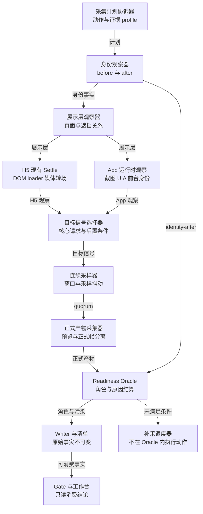
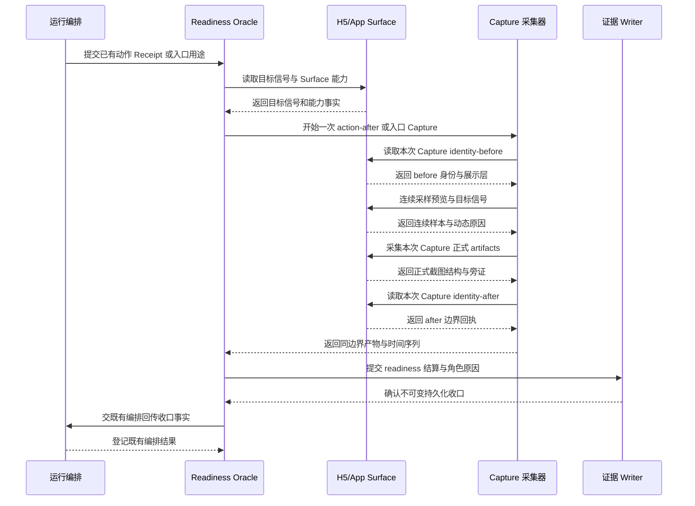
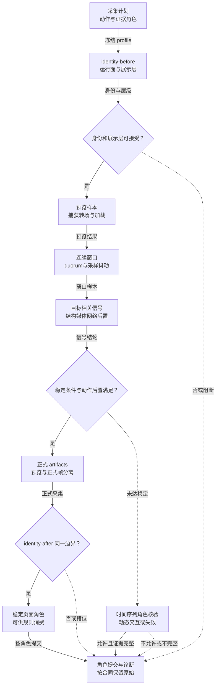

# 专项五：截图时机与页面就绪判定设计

> 状态：M1 加深已落地——入口层协议（`app_entry_layer`，恒 APP_READY≠业务首页、不伪造底层首页）与 Settle ACTION_AFTER／REOBSERVE 审计捆已写入覆盖元数据；**2026-09-09 #5**：`app_page_stability_assessment.v1` 组合前台／窗口／UIA／连续帧 quorum，缺网只记 `capability_gaps` 且 `network_stable` 恒 false；`formal_settle_oracle` 仅在显式 `AUTHORITY_M1` 时为 true，并写 `settle_enforcement_preview`；**`gate_consumes_settle`／Completion Gate SQL 仍关闭**。正式开闸见 [`2026-09-09-app-m1-formal-settle-oracle-review.md`](../2026-09-09-app-m1-formal-settle-oracle-review.md)。
>
> 日期：2026-09-04
> 版本：技术深化 v1.1
> 适用范围：H5/Web 与 App 的动作后观察、稳定性判定、证据角色选择和排障展示。
> 设计边界：本稿不定义表设计、字段清单、具体 API 或 API 载荷；只定义可审计的行为、边界、协作职责和验收方式。
> 关联稿件：同目录的 [受控探索](./01-controlled-exploration.md)、[页面状态图](./02-page-state-graph.md)、[精准补采](./03-targeted-recapture.md)、[页面识别](./04-page-recognition.md)、[交互精准度](./06-interaction-precision.md)、[可信证据](./07-trusted-evidence.md)。

## 1. 决策摘要与边界

Settle Oracle 的职责是回答“当前帧是否足以承担声明中的证据角色”，不是回答“页面是否看起来安静”。

1. `page_capture` 已有页面稳定等待、在途请求、DOM 变更、可见加载层、媒体和 Flutter 启动信号；本方案优先抽取并统一这些能力，不从零另造一套等待器。
2. 两到三秒没有新请求只能是一个可选的静默窗口。它不能覆盖仍在下载的关键请求、失败请求、缓存命中、本地渲染、长轮询、WebSocket、Service Worker 或未接入网络观测的运行面。
3. `ready` 需要由身份、可见层、核心结构、视觉或结构 quorum、动作专属后置条件共同决定；网络只在能力可用且规则要求时加入条件。若规则要求网络信号而能力不可用，必须进入证据不足或人工路径，不能跳过该必需信号后 stable 通过。
4. 身份前观测、采集、身份后观测必须能组成同一时间边界。身份漂移或产物时间错位时，原始证据仍可保留，但不能拼成稳定同帧事实。
5. 非稳定帧不是无价值数据。加载、动画、关闭失败、倒计时和错误状态可按规则进入时间序列或失败证据角色，但不得计为稳定业务到达。
6. 不可见不等于没有请求；网络不可用不等于请求数为零。能力缺口必须落到 readiness 诊断和最终报告中。
7. 正式证据不允许靠删除 DOM、改样式、强制点击或任意脚本派发制造“稳定”。现有受约束的遮挡隐藏和 JS fallback 只能是诊断路径，并传播污染标记。

本稿不承诺更快的运行时间或更高的业务覆盖率；收益必须由真实 H5/App 矩阵实测。它也不把第三方网络拦截、证书绕过、验证码绕过或任意 APK 的 HTTPS 解密纳入默认能力。

## 2. 问题 → 机制 → 收益 → 指标

| 问题 | 机制 | 预期收益 | 观察指标 |
| --- | --- | --- | --- |
| 快页面被固定等待拖慢，慢页面在首个安静窗口前被截取 | 按动作类型采样，结合身份、结构、视觉和后置条件 | 减少无效等待与过早 Capture | 首次可用 Capture 延迟、过早帧比例 |
| 静默窗口掩盖慢请求或后台关键请求 | 记录在途、完成、失败和能力等级；按规则识别关键请求 | 降低“看似 ready、内容未到”的误判 | 关键请求未完成误判率、网络不可见占比 |
| 动态内容永远不静止 | 结构 landmark、quorum、动态区域和有限时间序列 | 允许可解释的动态证据 | 稳定证据成功率、动态规则误拒率 |
| 弹窗或顶层层级遮住核心内容 | 单独评估 Presentation 与 readiness，先留前态 | 防止底层 DOM 加顶层截图冒充同帧 | 遮挡漏检率、错误底层通过数 |
| 身份在采集期间漂移 | identity-before → artifacts → identity-after | 保持 PageState 与 Capture 的可追溯性 | 漂移发现率、错帧进入正式输入数 |
| App 只有截图而 UI Tree/网络不可用 | 能力分级和保守降级，不填充假信号 | 把“不可观测”与“失败”区分开 | 能力缺口完整率、人工接管准确率 |

指标用于比较方案，不直接构成 Completion Gate。Gate 仍要看同一 Run/Epoch 的覆盖、规则工作、证据充分性、失败和资源终态。

## 3. 现有基础与模块改动

### 3.1 H5/Web 已有能力

- [`_wait_for_page_settle`](../../../services/api/app/infrastructure/browser/page_capture.py) 已按可见文本、核心内容、必要媒体、可见 loader、过渡、Flutter 启动和关键在途请求等待，并使用有界 deadline。
- [`_install_page_state_monitor`](../../../services/api/app/infrastructure/browser/page_capture.py) 已通过 MutationObserver、路由事件、加载事件和资源计数形成会话内变更观察；它是现有 readiness 的底层基础，而不是正式证据本身。
- [`_read_page_readiness`](../../../services/api/app/infrastructure/browser/page_capture.py) 已区分核心容器、当前视口媒体、阻断层、局部 loader、过渡和 Flutter bootstrap；它没有等待所有懒加载资源，边界需要在规则 profile 中声明。
- [`_assess_page_inspection_readiness`](../../../services/api/app/infrastructure/browser/page_capture.py) 已在等待耗尽后区分 blocked 与 inspectable dynamic，并保留网络在途和动态原因；后续应把它提升为可被编排器与工作台复用的统一语义。
- [`_attach_observers`](../../../services/api/app/infrastructure/browser/page_capture.py) 已记录 request、response、finished、failed 和内存中的 inflight；这支持被动观测，但不等于可以监听任意 App 网络。
- [`_collect_artifacts`](../../../services/api/app/infrastructure/browser/page_capture.py) 已可按请求采集 DOM、可见文本、截图、UI snapshot、媒体状态及视觉导航视口帧；整页截图与视口截图的角色必须继续分开。

### 3.2 App 已有能力与缺口

- [`AndroidAdbSurfaceDriver.describe_capabilities`](../../../services/api/app/infrastructure/device/android_surface_driver.py) 将截图、UI Tree 和 UI snapshot 声明为可用，并固定 canonical 设备尺寸；UI Tree 的说明同时明确它只是运行时事实、不作为截图 Artifact 持久化。
- [`observe_runtime_state`](../../../services/api/app/infrastructure/device/android_surface_driver.py) 通过受控 UI hierarchy dump 获取内存观察，失败时返回不可用事实，不静默伪造。
- [`capture`](../../../services/api/app/infrastructure/device/android_surface_driver.py) 目前主要落一张 PNG，同时读取显示尺寸、前台身份和截图流水线耗时；没有与 H5 对等的页面 DOM、网络在途和稳定 quorum。
- [`AndroidRuntimeObservation`](../../../services/api/app/infrastructure/device/android_runtime_observation.py) 支持可见、启用、可点击节点和点位命中判断，但它是当前 Runtime 内存观察，不能独立替代同帧截图或持久化证据。
- 因此 App readiness 首期必须允许“截图 + 身份 + UIA/视觉可用性”的受限组合；ADB 已连接不能被解释为网络可见，更不能解释为任意 HTTPS 解密。

### 3.3 需要改动的边界

1. 在现有 Capture 编排附近抽取统一 Oracle，保留旧等待结果作为兼容 fallback。
2. 为 H5 增加动作 profile 与能力分级的确定性计算；网络 Collector 只被动记录，不改写被测响应。
3. 为 App 增加截图前后身份与设备状态核对、短序列观察和能力缺口结算；不把 UIA XML 直接写成正式截图证据。
4. 让 Capture writer、Manifest、InputSet 和 Gate 消费同一 readiness 角色，而不是各自重新猜测。
5. 工作台只读展示 readiness 结论和原因，不在浏览器端重算稳定性或发设备动作。

### 3.4 高/中模块改动范围

- **高影响模块**：现有 Capture 编排/Collector、H5 `page_capture`、App Surface 观察与动作后 Capture、证据 Writer/Manifest/InputSet、Gate 消费路径。它们共同决定 readiness 是否能被正式证据信任。
- **中影响模块**：任务详情的只读投影、规则配置的采集 profile、页面状态图/弹窗/外跳子流程、补采与排障日志。它们消费统一结论，不各自重算。
- **回归关注模块**：历史任务读取、报告导出、前端局部失败提示和已有旧等待 fallback。它们保持兼容，但不能绕过身份、层级和诊断污染门禁。

设计推论只借用官方能力的边界：Playwright 的 [Network](https://playwright.dev/docs/network)、[Request 生命周期](https://playwright.dev/docs/api/class-request) 支持被动观察方向，[页面就绪语义](https://playwright.dev/docs/api/class-page#page-wait-for-load-state) 不支持把静默窗口单独当作业务 ready。它们不等于本项目已经实现全部门禁，也不承诺能看见任意 Web 网络。

## 4. 职责边界

### 4.1 Oracle 负责什么

- 依据当前采集计划判断是否达到某一证据角色的最低条件。
- 给出稳定、加载、转场、超时、身份漂移、产物错位和采集失败等可解释终态。
- 聚合可见层、结构、视觉、动作后置条件与网络能力，不替代页面类型识别。

### 4.2 Oracle 不负责什么

- 不决定页面是否属于业务覆盖；由 PageNode/PageState 与页面识别负责。
- 不选择下一个动作；由 Frontier/InteractionPlan 负责。
- 不执行关闭、支付、登录、授权或重试；Runtime/Broker 负责，Judge 不操作设备。
- 不把任意网络请求的成功状态解释为业务成功，也不负责凭证、代理或证书安装。

### 4.3 证据所有权

Capture collector 负责采集事实，writer 负责不可变留存，Manifest/InputSet 负责声明证据角色，Gate 负责最终组合。任一层都不得覆盖原始帧或把诊断产物改名为自然证据。

## 5. 核心方案

### 5.1 Settle Oracle 的分层条件

将“可截图”拆成六个依赖层：

1. **身份层**：运行面、来源页面或 Activity/窗口仍是当前预期对象。
2. **展示层**：当前最上层可见，阻断弹窗、系统层和广告遮挡被识别；不可只看底层 DOM。
3. **核心结构层**：规则所需的核心 landmark、内容容器或 UIA/语义节点存在。
4. **视觉/结构 quorum 层**：连续有限样本满足稳定阈值；动态区域不强求全屏像素静止。
5. **动作后置层**：点击、滑动、返回、输入等意图的专属可观察效果已经出现。
6. **网络条件层**：只有 profile 声明需要且能力可用时，关键请求完成、失败或已满足允许的信号条件。

六层中任一必需层未满足，不能返回对应的稳定证据角色；不需要的层必须显式说明“未纳入本 profile”，不能伪称通过。

### 5.2 采样与 quorum

- 合法 before 完成后，由外部 Runtime 执行动作；动作触发立即取 transition witness，避免只保留 settle 后帧而丢失转场。
- 按平台和动作 profile 取有限样本，例如短间隔初样本和较长 deadline 内的补样本；默认时间点不是永久常数。
- 稳定 quorum 比较身份、核心 landmark、可见文本/语义、loader/动画、Overlay 和动作后置条件。
- 若页面含实时 Feed、视频、轮播或倒计时，使用结构与关键区域一致性；需要时附带有限时间序列。
- 中间帧可以作为诊断或时间规则证据，但不自动升级为 stable。

纯入口或被动 observe 没有动作触发，不编造 transition witness；它们只按入口/观察 profile 取合法 before 与后续样本。

### 5.3 动作 profile 对照

| 动作 profile | 可称为 ready 的最低组合 | 单独什么不够 |
| --- | --- | --- |
| 初始导航 | 来源身份正确、核心入口可见、展示层已识别、结构/视觉达到 quorum；若规则声明网络依赖，关键请求还须完成或明确失败 | URL 已变化、DOM 有内容、短静默窗口或一张截图本身 |
| 滚动 | 目标容器明确，内容锚点/可见范围按计划变化，滚动后层级和身份一致，目标需要时重新绑定 | 手势发送成功、scrollTop 改变、出现旧目标矩形 |
| 关闭弹窗 | 当前顶层 Overlay 已留前态，安全关闭动作有效，后态确认 Overlay 消失/换层且未误跳；底页需另行 ready | 点击命令成功、z-index 变小、底层 DOM 暴露、关闭一层就宣称底页到达 |
| 局部 Tab | 目标 Tab/局部内容身份正确，选中状态和局部 landmark 稳定，未把局部更新误当整页导航 | 文本出现、URL 不变、Tab click 成功或只截一张局部帧 |
| 外部落地 | 真实外部转场或规则允许的受限内容旁路已识别，landing 身份与可见层稳定，来源/回源关系可追溯 | 已知 href 可打开、外部 URL 变化、外部页面首帧或 sidecar 打开本身 |

表中“ready”是该 profile 的证据角色就绪，不自动代表业务规则 pass 或业务覆盖增加。

### 5.4 网络信号的正确语义

网络观察至少区分开始、响应到达、完成、失败和当前在途。关键请求按规则依赖与当前展示层确定，广告素材在被测时不能因域名是广告域而排除。

静默窗口只能在“没有未完成关键请求、静默持续达到 profile、所需响应条件满足”时作为辅助条件。心跳、统计、长轮询、WebSocket/SSE、缓存、Service Worker、本地计算和解码分别归类，不强行当作全量 idle。

网络能力分为“在声明观测范围内完整”、部分、不可用三类。这里的完整只表示已声明范围内的生命周期可观测，不承诺浏览器能完整看见任意 Web 网络。部分或不可用必须进入 readiness 诊断和置信限制，绝不把它们归零成“没有请求”。

### 5.5 动态区域与 mask

- mask 只用于比较派生结果中的噪声，不得遮住被测广告、关闭控件、核心内容或遮挡关系。
- 原始截图和原始 UI/DOM 事实永远不改；mask、裁剪、压缩、派生摘要另存为诊断或比较产物，原图不因 mask 发生任何变化。
- 动态区域超出容忍阈值时，转入有限时间序列或动态失败，不无限等待。
- 规则若要求检验广告素材本身，广告素材区域不能被 mask 规避；它只能被标记为动态并改变证据角色。

### 5.6 三明治时间一致性

标准顺序是 identity-before → 原始截图与可得结构/文本 → identity-after。两侧身份不一致、Frame/窗口发生变化、Capture 间隔超阈值或页面 epoch 变化时，组合降级为漂移或时间序列。

身份后检查不能被省略为“采集已经成功”。它是防止页面在截图与 DOM 之间切换的最后一道门。

### 5.7 Capture Readiness 与证据角色

- **stable**：身份、展示层、结构、quorum 和 profile 必需条件全部满足，可承担稳定页面/区域证据。
- **loading**：核心证据不足且仍处于加载，保留可证明的加载事实。
- **transitional**：动作效果或页面变化已观察，但未稳定到业务到达。
- **timeout**：deadline 耗尽，按阻断原因与已有证据分别结算。
- **identity drift**：采集前后不是同一运行面或同一页面状态。
- **artifact skew**：产物之间无法证明同一时间边界。
- **capture failed**：截图、结构或持久化失败，不能冒充业务状态。

stable 不是规则 pass；loading/transitional 也不是自动拒收。Manifest 只说明它适合哪些声明角色，Gate 再根据规则合同判断。

### 5.8 Presentation 门禁

页面底层结构存在而顶层充值、登录、更新或广告层遮挡时，展示层不一致，底层详情不能通过。z-index 数值大小不是完整遮挡关系，需结合可见性、几何覆盖、pointer hit-test、top layer 和语义层判断。

正式分支不删除 DOM、不强行把样式设为隐藏、不改 z-index、不 force click。既有受签名约束的 style-hide 与 JS dispatch fallback 如被启用，必须标为诊断污染，不能计入自然点击或自然稳定通过。

### 5.9 H5 的视觉 quorum

H5 结构可用时优先使用 DOM/AX/UI snapshot，视觉帧用于可见性、层级和最终展示校验。Flutter Web 有 Semantics 时使用语义覆盖；没有 Semantics 时降级到视觉并提高复核限制，不能因框架名称直接判定不可观测。

### 5.10 App 的最小 quorum

App 首期使用截图、前台 Package/Activity、屏幕尺寸/方向、可得 UIA 节点和连续帧变化组成受限 quorum。UIA 失败时记录 unavailable 并使用视觉降级，不生成虚假的空层级。网络不可见时只让不依赖网络的规则继续，依赖网络完成的规则进入证据不足或人工。

## 6. 标准流程

1. 冻结任务、规则、运行面能力、设备/浏览器 profile 和本次采集计划。
2. 在进入页面或触发动作前注册被动观察器，完成合法 before，确认当前身份与展示层。
3. 若有动作，由外部 Runtime 执行；动作触发立即保存 transition witness。纯入口或被动采集不编造动作或 witness。
4. 在有界 deadline 内按 profile 轮询身份、核心 landmark、可见层、媒体、动画和请求生命周期。
5. 每轮更新稳定 quorum；发现新弹窗、路由变化、Activity 切换或目标漂移立即切换到重规划。
6. 达到对应角色条件后采集规范帧，并执行一次 identity-after；有动作时它是 after Capture，纯被动采集不编造动作后态。
7. 将稳定、动态、加载或失败角色写入统一 readiness 结论；原始帧与派生摘要保持可追溯。
8. writer 验证产物和污染标记后提交事实；Judge 只消费事实，不在等待期间发动作。
9. 若未稳定但有规则可接受的时间证据，按声明角色继续；否则进入补采、人工或分支终态。
10. 将 readiness、能力缺口、Presentation 和后置条件显示在工作台，不用一个总百分比掩盖失败维度。

## 7. 异常闭环

### 7.1 deadline 到期

保存最后一组原始帧、原因和时间线。若核心内容仍缺失，结算 loading/timeout；若已有可检查动态页面，结算 inspectable dynamic，并禁止升级为稳定业务到达。

### 7.2 请求未完成或失败

仍在途的关键请求阻止对应 stable；失败请求可证明失败事实，但不能当作成功加载。若规则要求网络而能力是 partial/unavailable，必须结算证据不足或人工，不能跳过必需信号；不依赖网络的规则仍可按自己的 profile 判断，不无限等待。

### 7.3 身份漂移与产物错位

丢弃当前组合的稳定资格，保留各自产物作为诊断/时间证据；重新获取当前身份和展示层后有界重采。不得把漂移前的 DOM 与漂移后的截图拼接。

### 7.4 动态永不静止

先判断规则是否允许时间序列；允许则记录有限连续帧和动态原因，不允许则返回 transitional/timeout。不要用扩大 mask 或无限延长 deadline 规避问题。

### 7.5 Overlay 阻断

readiness 先停在 Presentation 阻断，等待弹窗采集计划处理。关闭一层之后必须重新观察，关闭成功不等于已到达底页；倒计时、无按钮、无效果、取消失败、误跳和支付/更新确认分别结算。

### 7.6 截图或写入失败

区分截图失败、结构采集失败、网络观测失败、持久化失败。既有原始产物若完整可保留诊断角色，但不以空截图或空结构补齐必需证据。

### 7.7 Runtime 崩溃或重启

先观察当前 Surface 与动作 Receipt，再决定是否补采。未看到 completed 不代表动作没发生；对提交、支付、授权、安装等副作用不自动重试。Readiness 只负责观察结算，不负责回滚副作用。

### 7.8 晚到结果

回到同一 Run/Epoch 校验来源；晚到的 frame、网络事件或 Judge 结果不能改写已封存报告输入，也不能在已经结束的 Run 上自动继续补采。若仍需证据，必须创建新的受控任务/Run，并重新过风险、权限和预算门禁。

## 8. H5/App 差异

| 维度 | H5/Web | App |
| --- | --- | --- |
| 主要结构 | DOM、AX、UI snapshot、可见文本 | UIA（可得时）与视觉帧 |
| 网络 | Playwright 被动生命周期可用，按 Frame/Service Worker 能力降级 | ADB 不代表应用网络生命周期可用 |
| 视口 | CSS viewport、DPR、frame、视觉视口和整页/视口角色 | 设备尺寸、方向、系统栏和截图路径 |
| Flutter | Semantics 可用时优先；不可用时视觉降级 | 原生 Flutter UIA 可能缺失，不能假设有树 |
| 证据重点 | 页面身份、可见层、DOM/AX 与视觉同帧 | 前台身份、屏幕稳定、UIA/视觉一致性 |

H5 的 Playwright Surface 当前暴露 DOM、截图、文本、UI snapshot、媒体和时间序列能力，但其 Surface manifest 目前声明同 context 新 Surface 与 surface pin 为 false，不能把通用多标签隔离能力写成现状。参见 [`PlaywrightSurfaceDriverAdapter.describe_capabilities`](../../../services/api/app/infrastructure/browser/surface_driver.py)。

App 当前 driver 只在截图元数据中带设备显示与前台身份，不能把 H5 的 DOM readiness 直接移植到 Android。

## 9. 其他专项协作

- **页面识别**：决定核心 landmark、页型和动作后置条件的业务含义；Oracle 只判断这些条件是否被观察。
- **页面状态图**：接收 stable PageState、transitional 状态和漂移/失败边；不把每一帧都提升为节点。
- **精准交互**：提供动作来源 epoch、目标和预期后置条件；Oracle 返回效果和稳定性，支持下一步重绑。
- **专项六的弹窗子流程**：先冻结适用采集计划与前态，再允许关闭与后态判定；不等待全部 Judge 完成才关闭。
- **精准补采**：只追加新证据；沿图路径验证等价性，不能用 direct URL 或诊断帧补造自然到达。
- **可信证据**：传播原始、派生、诊断、时间序列和污染角色；DOM 底层与顶层截图不合并成详情证据。
- **专项六的外跳子流程**：source、landing、return 都重新执行 readiness；只有外部 landing 不计业务 coverage，source 仍按正常业务页规则计入，重复回源不新增覆盖。
- **工作台**：读取只读投影，展示原因、能力缺口和可操作排障入口，不在前端重放 settle 算法。

## 10. 工作台与排障

现有任务详情已经以 [`TaskDetailView.vue`](../../../app/workstation/src/modules/tasks/pages/TaskDetailView.vue) 的并行只读加载承载时间线、截图、日志、App 阶段和质检工作项；readiness 应作为任务详情扩展，不新增主菜单或独立运行控制台。

建议工作台按以下层次展示：

1. 当前页面/Overlay 的 readiness 状态和“为什么未 ready”。
2. 稳定 quorum 的人类可读摘要：身份、可见层、核心内容、动作后置、视觉/结构一致性。
3. 网络能力与关键请求分类，清楚标注“不可见”而非“无请求”。
4. 原始帧、时间序列、DOM/UIA/视觉派生证据及其角色；诊断证据单独显示。
5. 重采建议、阻断原因、可继续分支、人工复核入口和预算剩余。

当前 [`task-insight.api.ts`](../../../app/workstation/src/services/task-insight.api.ts) 只有时间线、规则、统计、截图、日志、App 阶段和工作项读取；新增 readiness 只读投影应挂到同一任务详情加载链，并保留部分模块失败的降级提示。前端不写图、Receipt 或 readiness 事实。

排障视图不得把“等待中”渲染成成功，也不得把网络不可用隐藏为 0。刷新只重新读取同一任务事实，不触发设备动作。

## 11. 安全、审计与权限

- Collector 默认只观察，不修改请求、响应、DOM、样式、证书或设备代理。
- 任何诊断 style-hide、JS dispatch 或强制路径都必须经过显式开关、来源 Capture 验签和污染传播；正式 Gate 不能消费其自然通过结果。
- 网络日志只保留规则允许的必要摘要，凭证、秘密表单和敏感响应不进入普通 readiness 证据。
- 外部页面和跨域资源遵守已冻结的域名、协议、重定向、时间和数据预算；旁路打开仍可能执行脚本和请求，不称为零副作用。
- App UIA/XML 与截图都遵守租约和任务权限；不可把模型生成的节点、文本或边界当作运行时事实。
- 工作台只读权限与证据下载权限分离；短时文件授权不得扩展任务范围。
- 审计记录策略版本、运行面能力、诊断开关和结算理由，但不记录秘密值。

## 12. 分期、兼容与回滚

### A：统一语义与影子计算

复用现有 H5 settle/readiness/网络观察；新增 Oracle 只并行计算并记录差异，不改变旧动作和 Gate。冻结 profile、关键请求分类、quorum 阈值、mask 规则和能力分级。

### B：H5 受控切换

先将 H5 的动作后 Capture 接入统一角色和 Presentation 门禁，再扩大到滚动、外跳和 Flutter。旧结果作为对照保留，发现误拒或误放时才退回旧等待链；退回仍必须保留身份一致性、Presentation 层级和诊断污染门禁，不能因为新 Oracle 误拒就开放旧链自然通过。

### C：App 受限接入

先接截图、前台身份、屏幕 profile 和 UIA 可用性；网络保持不可用/部分的真实标记。只对明确不依赖网络的规则启用 stable 组合，其他规则仍走证据不足或人工。

### D：工作台与 Gate

工作台先展示差异与缺口，待真实矩阵验证后再让 Gate 读取新的角色。回滚只切换消费路径，不删除原始 Capture 或历史原因。

### 兼容原则

- 历史 Capture 没有 readiness 结论时显示“历史兼容”，不补造 stable。
- 新投影缺失时保留现有时间线、截图和日志页面。
- Oracle 失败、网络 Collector 崩溃或前端读取失败都应退回可解释的旧结果/人工入口，不自动通过；旧等待链同样要继续执行身份、Presentation 和诊断污染门禁。

## 13. 验收场景和指标

| 场景 | 必须看到的结果 |
| --- | --- |
| 两秒无新请求但慢关键请求仍在途 | 不返回稳定；显示关键请求未完成 |
| 长轮询或 WebSocket 常驻 | 按 profile 分类，不无限等待；结构/视觉满足时可有条件稳定 |
| 网络完全不可见 | readiness 标记能力不可用；依赖网络的规则不冒充通过 |
| 详情 DOM 已存在但顶层充值遮挡 | Presentation 阻断；底层详情不计稳定业务证据 |
| 加载动画持续但已有可检验错误文案 | 保留非稳定时间序列/失败证据，不能伪造稳定页 |
| 身份在截图前后切换 | 结算 identity drift，原始帧可诊断，禁止同帧组合 |
| Flutter 有 Semantics 与无 Semantics | 前者使用结构辅助，后者视觉降级并记录能力差异 |
| 动态广告区域持续变化 | 动态区域不遮被测内容；按规则保存有界序列或失败 |
| App UIA dump 失败 | 返回 unavailable 并保留截图，不构造空树 |
| Capture 写入超时 | 记录持久化失败；不以空产物满足必需角色 |

建议 A 只冻结指标口径，不冻结最终目标值：稳定角色的误放率、应稳定却超时的比例、关键请求误判率、identity drift 发现率、Presentation 漏检率、网络能力缺口完整率、诊断污染进入自然通过的数量、单任务平均额外等待和重采次数。所有目标值必须由 H5/App 真实矩阵建立基线后再定。

## 14. 团队反馈及待冻结参数

### 已裁决反馈

- “无新请求 2～3 秒即完成”改为网络辅助条件；必须同时观察未完成关键请求和完成/失败，沿用现有 H5 readiness。
- “外跳单开标签/进程”改为 Web 条件旁路；原生进程不能普遍克隆，源页与落地/回源必须分别结算。
- “删 DOM/改 z-index 后继续”不进入正式证据；现有受约束 style-hide/JS fallback 属诊断，污染需传播，但不能反推所有当前证据都已污染。
- “动态区域一律屏蔽”不采纳；广告与关闭控件仍是被测区域，原始图不可改。
- “非稳定帧全部拒收”不采纳；加载、动画、关闭失败时间序列可按声明角色使用。

### A 待冻结

1. 各动作 profile 的采样间隔、deadline、quorum 数量和容忍度。
2. 关键请求的规则/展示依赖分类、失败语义和长连接处理。
3. H5 Frame/Service Worker 与 App UIA/视觉的能力等级及降级上限。
4. 动态区域的来源、审核方式、最大范围和时间序列上限。
5. Presentation 阻断与稳定证据的组合门禁。
6. 诊断开关、污染标记、历史兼容和 Gate 切换窗口。
7. 真实矩阵中的目标值、人工复核条件和取消/崩溃后的资源收口时间。

## 15. 组件与接入点（技术深化）

本章只细化 Capture Readiness 的待实现接入，不表示统一 Oracle 已上线。现有 H5 `page_capture` 已经具备 DOM、loader、媒体、transition、critical inflight 等等待和观察能力；技术深化是抽取一致语义、补身份边界和证据角色，不是从零增加一个等待器。App 侧只按实际 Surface 能力接入，ADB 连接本身不提供任意 App 网络可观测。

### 15.1 组件职责

- **采集计划协调器**：读取动作类型、证据角色、风险、平台能力和有界 deadline，决定需要哪些观察与产物；不把所有规则都升级为等待网络空闲。
- **身份观察器**：在正式采集前后读取 H5 页面/Frame 或 App 前台身份、窗口和设备显示状态，形成 identity-before 与 identity-after；它不把一张截图的元数据当成完整页面身份。
- **展示层观察器**：判断当前顶层页面、Overlay、系统窗口、原生弹层和遮挡关系；目标是底页时，底层 DOM 或 UIA 被遮挡会阻止底页稳定角色，目标是 Overlay 时则按其自身可见区域与证据角色继续结算。
- **H5 现有 Settle 适配器**：复用 `page_capture` 的核心容器、可见 loader、媒体、转场、Flutter bootstrap 和 critical inflight 观察，并将旧结果转换为统一 readiness 角色。
- **App 运行时观察适配器**：读取截图、前台 Package/Activity、屏幕尺寸/方向和可得 UIA；UIA 失败返回 unavailable，不能制造空树或假装网络为空闲。
- **目标相关信号选择器**：根据规则合同选核心 landmark、媒体、动作后置、必要请求和动态区域；无关心跳、统计和长连接不应阻止不依赖网络的规则。
- **连续采样器**：使用单调时钟在稳定窗口内采集有限预览帧、结构摘要和状态样本，允许 profile 声明的采样抖动；不把单帧静止当作连续稳定。
- **正式产物采集器**：在 quorum 满足后采集正式截图、结构和必要旁证；原始产物与预览帧分开，诊断帧不能伪装成正式证据。
- **Readiness Oracle**：按身份、展示层、结构、视觉/结构 quorum、动作后置和可用网络条件结算 stable、loading、transitional、timeout、identity drift、artifact skew 或 capture failed。
- **Writer 与证据清单适配器**：验证原始内容、时间边界、污染标记和持久化状态，再提交不可变产物；不覆盖已有帧、不用空产物补必需角色。
- **Gate/工作台投影器**：只读消费 readiness、能力缺口、失败时间序列和复采建议；前端不重算 settle，不发设备动作。

### 15.2 现有代码接线

1. H5 接入点优先位于 `infrastructure/browser/page_capture.py` 的现有等待、readiness、Observer 与 artifact collector 周边，由协调器复用结果；旧等待链作为兼容对照，不被另写成平行实现。
2. H5 `capture_runtime.py` 继续负责动作 Receipt、已提交动作的安全重试边界和动作后采集协调；Oracle 只观察和结算，不执行点击、关闭、支付或返回。
3. App 接入 `android_surface_driver.py` 的 capture/observe 能力和 `android_runtime_observation.py` 的内存 UIA 事实；UIA 不作为截图 Artifact 持久化，也不能单独替代同帧截图。
4. 证据 writer、Manifest、InputSet 和 Gate 消费同一 readiness 角色；不允许各自依据“截图存在”“网络计数为零”重新猜测 stable。
5. 规则 profile 只声明目标相关信号和可接受证据角色；是否需要网络必须来自规则合同，能力不可用时结算证据不足或人工，不默认跳过必需信号。
6. 所有接线都保留诊断开关和污染传播；任何受约束的 style-hide、JS fallback 或强制路径不能进入自然稳定通过。

### 15.3 组件关系图



图中的 H5 Settle 是已有能力的适配点，不是新等待器；App 分支明确只消费实际截图/UIA/前台能力。虚线表示失败或补采建议回到编排层，Oracle 不借机触发副作用动作。

### 15.4 证据角色接入

稳定页面或 Overlay 角色要求同一边界内的身份、目标区域、展示层、核心内容和 profile 必需后置条件；Overlay 遮住底页不妨碍 Overlay 自身成为合法稳定质检目标。动态/交互时间序列可以承担规则声明的过程证据，只有规则允许且证据完整时才结算失败；加载序列仍可保持 loading。预览帧用于定位转场，也可在规则声明时作为时间序列输入；正式帧用于承担声明的稳定证据，两者都不互相改名。

## 16. 时序与交接条件（技术深化）

### 16.1 采集时序

标准交接为：冻结 profile 与运行面能力 → 已有动作 Receipt 或入口被动观测用途 → 一次 action-after/入口 Capture（其内部 identity-before → 连续采样与 artifacts → identity-after）→ readiness 结算 → writer 收口 → 既有编排回传 Runtime → Gate 消费。若流程包含真实动作，action-before Capture → 真实动作 → action-after Capture 的前后关系在正文约束；Oracle 只接收已有 Receipt 和采集请求，不授权设备动作，纯入口或被动 observe 不编造动作 Receipt。



图中只展开一次 action-after 或入口被动 Capture；该次 Capture 自己完整执行 identity-before → 连续采样/正式 artifacts → identity-after，不能把不同 Capture 的产物拼成跨动作帧。若流程包含真实动作，action-before Capture 先按同样三明治边界完成，既有 Runtime/动作执行器执行真实动作，再由已有 Receipt 触发图示的 action-after Capture；Oracle 只接收 Receipt 和采集请求，不授权设备动作。Gate/工作台只消费 Writer 已收口的事实；Readiness/Writer 结果回 Runtime 由既有编排调度，不由 Gate 下发分支决定。目标是 Overlay 时，即使它遮住底页，也按 Overlay 自身角色判定，不把采集一律标成阻断。

### 16.2 交接条件

- **从身份到观察**：身份属于当前 Run/Epoch，Surface 能力声明已读取；身份不明时只保存诊断，不采正式稳定角色。
- **从展示层到 settle**：顶层可见层已识别，并按目标区域结算遮挡；底页被 Overlay 遮挡时底页角色不交接，Overlay 自身为目标时可按其区域继续交接。
- **从 settle 到连续窗口**：核心 landmark 和动作后置条件可被采样，网络条件只按 profile 纳入；静默窗口不单独触发交接。
- **从连续窗口到正式帧**：样本在允许的时间窗口内满足 quorum，动态区域没有掩盖目标，采集路径和身份没有漂移。
- **从正式帧到 after**：所有正式 artifacts 记录后立即复核身份和展示层；任一产物时间错位都降级为 artifact skew。
- **从 Oracle 到 writer**：角色、原因、能力缺口、污染和原始产物都可追溯；writer 失败不被空值补齐。

### 16.3 动作与被动采集分支

动作后采集携带动作来源、预期后置条件以及 Receipt 或明确的回执缺失事实；回执丢失不阻止只读核对。对于明确要求状态变化的动作，没有相应变化就保留 `transitional`、`timeout` 或可供失败判断的材料，而不是“动作调用成功所以 ready”。允许无变化的只读观察或状态检查按自身合同判定，不能一律要求页面变化。入口/定时采集没有动作来源，只依据入口 profile 产生 before 和时间样本。各分支共享身份、展示层和 Writer 门禁。

## 17. 算法与决策（技术深化）

### 17.1 目标相关信号选择

信号选择先由证据角色和规则合同确定目标，再从 H5/App 能力中选择能证明目标的信号：核心 landmark、可见文本/语义、媒体状态、顶层遮挡、动作专属变化、请求生命周期或设备身份。不要收集所有信号再用数量制造确定性。

- 不依赖网络的页面结构规则可以使用身份、展示层、结构和视觉 quorum；网络不可用不应让它变成“请求数为零”。
- 规则要求关键请求时，只有在声明范围内能观测开始、响应、完成或失败，且关键请求已满足合同，才可把网络条件计入 stable；能力 partial/unavailable 进入证据不足或人工。
- H5 复用现有 DOM、loader、媒体、transition、critical inflight 结果，但 critical 的定义必须由 profile/规则提供；不等待无关统计、心跳、长连接至全局空闲。
- App 使用截图、前台身份、屏幕尺寸/方向和可得 UIA；ADB 连接、设备日志或单次 screencap 不自动提供任意 App HTTPS 生命周期。
- 目标是广告时，广告素材、关闭控件和遮挡关系是被测区域，不能被动态 mask 规避；目标是页面结构时，动态内容可转入有限时间序列。

### 17.2 连续稳定窗口与采样抖动

稳定窗口使用单调时钟定义开始、结束和 deadline。profile 给出采样间隔、允许抖动、所需样本关系和可接受缺口；调度器只在窗口内取样，不把定时器恰好同时触发当作稳定证据。样本需要在身份、展示层、核心 landmark、动作后置和必要网络条件上形成 quorum；不同 profile 可以有不同组合，设计阶段不承诺统一时间或样本数字。

quorum 不是多数信号投票：身份/归属、目标可见层、必需内容和角色指定后置是逐项硬条件。profile 可以在已验证能力范围内选择“结构稳定 + 视觉确认”或“连续视觉 + 独立前台身份”等组合，但不能用三个弱提示抵消一个硬条件失败。网络静默仅在被纳入的辅助或必需请求条件中使用。

采样抖动用于避免与页面动画或批量请求固定同相，不是放宽稳定条件。发生新导航、Overlay、媒体首帧、核心文本变更或 Activity 切换时，当前窗口失效并重新规划。连续样本未稳定时，先检查规则是否声明动态/交互时间序列及其完整性；满足时可作为合法过程证据，只有能证明失败且规则允许时才结算失败，加载中的样本保持 loading，不一刀切为失败。

### 17.3 动态区域 mask 边界

mask 只作用于派生比较，不改原始截图、DOM、UIA 或媒体事实。mask 来源必须可解释（例如已识别的时钟、播放进度或非目标动画），边界以规则目标和遮挡关系校验；如果无法证明边界不覆盖广告、关闭控件、核心 landmark 或 Overlay 边缘，则不使用 mask，转入动态/人工路径。

mask 不得扩大到“整屏”“目标容器”或任何未知区域来制造 quorum。动态区域与目标重叠时，优先保留原始连续帧并按声明的动态/交互时间序列或诊断角色处理；只有完整证据证明失败时才进入失败结论。广告素材本身、关闭动作和落地关系始终保持未屏蔽。派生差异摘要带有 mask 使用原因和能力限制，Gate 不能只看摘要。

### 17.4 正式帧、预览帧与身份边界

预览帧是采样窗口中的观察产物，用于判断转场是否发生、核心信号是否可得及是否需要正式采集；正式帧在条件满足后一次性采集并写入声明角色。预览帧不能代替正式帧，正式帧也不能抹掉预览中已出现的加载、遮挡或失败事实。

正式采集严格执行 identity-before → artifacts → identity-after。身份变化、Frame/窗口切换、页面 epoch 变化或产物之间时间关系无法证明时，原始产物仍保留为诊断/时间证据，但不能合成 stable 同帧。身份后检查不是可选优化，而是提交门禁。

### 17.5 条件伪代码

```text
函数结算采集(profile, 运行, surface):
    before = 读取身份与展示层(surface)
    如果 before.不可用 或 规则目标区域被其他关键层阻断:
        保存 before
        返回 阻断或未知(不采被遮目标的稳定帧，Overlay自身仍可另行采集)
    信号计划 = 按规则合同选择目标相关信号(profile, surface能力)
    预览 = 采集预览与连续样本(使用单调时钟和允许抖动)
    如果 预览.发现身份或展示层漂移:
        返回 身份漂移(保留全部原始帧)
    如果 not 满足quorum(预览, 信号计划, profile):
        如果 声明时间序列角色(profile) 且 顺序归属和必要边界完整(预览):
            返回 合法时间序列(可支持动态或失败判断，但不在Oracle判产品结论)
        返回 loading、transitional、超时或诊断
    artifacts = 采集正式帧与结构(surface)
    after = 读取身份与展示层(surface)
    如果 not 同一边界(before, artifacts, after):
        返回 artifact_skew或identity_drift(保留产物)
    如果 not 满足动作后置与网络条件(artifacts, 信号计划):
        返回 transitional或证据不足
    返回 stable(仅绑定正式帧角色)
```

伪代码中的 quorum、抖动、deadline 和可接受角色由真实矩阵校准；网络不可用、UIA 不可用或动态不可静止都必须显式落到原因，动态/交互时间序列可在规则允许且证据完整时合法提交，不能转换成空集合、默认失败或默认成功。

### 17.6 判定图



图中稳定页面角色只有一条完整路径：before、展示层、连续窗口、目标信号、正式帧和 after 全部通过。未达稳定条件先进入“时间序列角色核验”：规则允许且证据完整时提交合法动态/交互或失败候选材料，否则仅作 loading、诊断或补采输入。Oracle 判定的是 readiness 和材料用途，Writer/Manifest 校验后供 Judge 判断产品规则，Gate 消费既有完成事实；不是 Oracle 直接判产品失败，也不把稳定、时间序列和诊断互相改名。

## 18. 超时、并发、幂等与失效（技术深化）

### 18.1 Deadline 预算

总 deadline 由入口/动作 profile 提供，编排器按 identity-before、展示层、预览与连续窗口、正式采集、identity-after、writer 收口分段预留预算；任何阶段不得无限等待下一请求。阶段预算不是跨平台承诺，必须在真实矩阵中校准，并留出身份复核和持久化余量。

预算耗尽时：before 未完成结算身份未知；目标是底页且 Overlay 未结算时结算底页阻断，目标是 Overlay 时仍结算其已有的稳定或时间序列角色；连续窗口不足先核验声明的动态/交互时间序列，不能直接归为失败；正式采集或 after 失败结算 capture failed、artifact skew 或 identity drift。不得用上一页面的 stable、上一轮的请求状态或一张预览帧填空。

### 18.2 并发与幂等

- 同一 Surface 的活动采集只有在边界、profile、证据角色和 freshness 要求兼容时才可由同一 coordinator 合并；仅凭 Run/Epoch 或动作来源相同不能合并，不兼容请求必须排队并重新采集。
- 预览采样可以并行读取不同模态，但正式 artifacts、identity-after 和 writer 提交必须按同一时间边界串行编排，防止截图与结构交叉。
- 相同边界、profile、角色和 freshness 的输入重复到达时返回等价角色；信号、身份、时间边界、能力或角色要求变化时形成新采集，不复用旧 stable；新一轮观察不得沿用同一个请求代号作为去重身份。
- Writer 重试只重试幂等的持久化确认；若动作已提交或副作用可能发生，不能以“没有 after”自动重放动作。
- Gate 只消费 Writer 已收口的事实；收口后到达的网络事件、帧或写入回执只能作为晚到诊断，不能改写已消费角色或给 Runtime 下发分支。

### 18.3 失效条件

身份、展示层、页面 epoch、动作 Receipt、规则 profile、运行面能力、关键请求分类或 mask 审核任一变化，都会使受影响的连续窗口和正式稳定资格失效。失效不删除原始预览、正式帧、网络事件或失败序列，只禁止派生角色继续被消费。

H5 的 Frame/Service Worker 能力变化、App UIA 从可用变为 unavailable、屏幕方向或尺寸变化、Overlay 出现/消失、关键媒体重新加载和请求失败重试，都需要重新确认目标信号。网络能力 partial/unavailable 不得缓存为“无请求”；稳定角色必须重新经过规则要求的能力门禁。

### 18.4 条件伪代码

```text
函数接收采集请求(请求):
    原子登记当前Surface的采集所有者:
        如果 存在同一边界、profile、角色和freshness的已提交结论:
            返回 已提交结论
        如果 已有活动协调器:
            如果 边界、profile、角色和freshness兼容:
                返回 等待该次采集完成(不提前宣称收口)
            返回 排队创建新采集尝试
        如果 请求剩余deadline不足以完成after和writer:
            返回 超时(保留预览和原因)
        尝试 = 注册新采集边界与有期限的所有权
    结果 = 无锁运行before、采样、正式帧、after与载荷留存(尝试)
    获取短暂提交栅栏
    try:
        再次读取版本和边界
        如果 所有权失效 或 运行不再接纳 或 边界在提交前失效:
            保存原始产物为诊断
            标记派生角色失效
            返回 失效待补采
        提交不可变角色
    finally:
        释放提交栅栏
    返回 结果
```

采集、连续等待和慢速模型调用均在提交栅栏之外执行；栅栏只保护版本二次检查和不可变提交。任何失效只禁止派生角色被消费，原始事实仍可诊断；重新观察必须创建新的采集尝试身份，不能让原请求代号跨轮次去重。

采集所有权贯穿观察窗口，与短事务锁是不同概念。整个尝试都需有 `finally`/租约到期回收，采集或载荷留存中途抛错也能结清所有权和预算；不能只释放最后的提交锁。慢阶段的载荷留存不等于正式事实已接纳，正式接纳仍经过提交栅栏。

## 19. 故障推演与技术验收（技术深化）

### 19.1 故障重试矩阵

以下是行为矩阵，不是持久化表、字段清单或接口 JSON。重试必须受剩余预算、动作是否已提交、证据角色和平台能力约束。

- **现有 H5 settle 未达到**：若仍可观察且关键条件未超时，可在同一窗口继续采样；保留 loader/媒体/critical inflight 原因；到 deadline 结算 loading、dynamic 或 timeout；不另造等待器。
- **静默窗口结束但关键请求在途**：不认 stable；若规则允许且能力完整，继续按关键请求结算；能力 partial/unavailable 时转证据不足/人工，不把在途清零。
- **Overlay 或系统层阻断**：目标是底页时保留底层结构和顶层前态，交互专项处理后重新观察；目标是 Overlay 时按其自身区域和角色继续结算，不以关闭命令成功认定底页 ready。
- **连续样本抖动/动态区域变化**：不扩大 mask；先核验声明的动态/交互时间序列，规则允许且证据完整时保存合法序列，只有可证明失败时才结算失败，否则保留 loading/transitional/诊断；补采必须重新检查目标边界。
- **App UIA dump 失败**：保留截图、前台身份和 unavailable 原因；若规则不依赖 UIA 可按视觉受限 profile 继续，否则证据不足/人工；不生成空 UIA。
- **ADB/网络能力不可见**：不重试为“零请求”；仅在受支持的观察范围内重读能力；网络依赖规则不冒充通过，其他规则仍按自身信号判断。
- **identity-after 不一致**：停止组合当前 artifacts；保留每份原始产物及时间线；重新建立新边界后有界补采；不把漂移前后拼接。
- **正式截图或 writer 失败**：只重试未提交且可证明幂等的采集/写入；保留预览与失败原因；缺失的必需正式角色不以空内容填补。
- **动作已提交但 after 条件未完成**：记录 committed 事实和失败后置；禁止自动重放可能有副作用的动作；等待新的受控观察或人工决定。
- **并发重复或晚到回执**：仅对相同边界、profile、角色和 freshness 兼容的请求合并；不兼容请求排队重采；晚到回执只作诊断，不重复写正式角色、不改已收口报告、不增加虚假 coverage。

### 19.2 技术验收条件

验收应覆盖快页面、慢关键请求、常驻长连接、持续动画、遮挡弹层、H5 Flutter、UIA 可用/不可用 App、网络不可见 App、动作已提交但后置失败和 writer 超时。通过条件包括：

1. H5 复用已有 DOM/loader/媒体/transition/critical inflight settle，并能解释各信号是否满足；两到三秒静默不能单独放行。
2. 每个正式角色都有 identity-before、artifacts、identity-after 的同一边界证明；错位时原始产物保留但不进入稳定页面用途。
3. 预览帧与正式帧用途分开；加载保持 loading，动态/交互时间序列在规则允许且证据完整时可合法提交，只有可证明失败的序列才结算失败，任何序列都不被渲染成稳定页面证据。
4. mask 不覆盖广告、关闭控件、核心 landmark 或遮挡边缘；原始截图、结构和 UIA 事实保持不变。
5. App ADB/UIA 能力缺口如实呈现；ADB 连接不被解释为任意网络可观测，网络依赖规则在能力不足时进入证据不足/人工。
6. 并发重复不会产生两份正式采集；动作副作用已提交时不会因 after 缺失而自动重放。
7. deadline、identity drift、artifact skew、capture failed 和晚到事件有独立原因与可恢复入口，Gate 不把它们折叠成成功或“无请求”。

### 19.3 待确认点与实施状态

实施前需要冻结各动作 profile 的预算分配、连续窗口与采样抖动、目标相关请求分类、动态 mask 审核边界、H5 Frame/Service Worker 与 App UIA 能力等级、预览/正式帧保留策略、失败时间序列上限、幂等写入窗口和人工接管条件。阈值、时间和目标值须由真实 H5/App 矩阵校准，本稿不作统一承诺。

本稿为技术设计深化 v1.1，产品能力尚未实施；规则、运行时与数据链路仍待按本稿验收后接入。

## 20. 关联文档依据

- 总设计第 15 节“Settle Oracle 与截图时机”、第 18 节“可信证据链”、第 23 节“Completion Gate 扩展”、第 24 节“安全与威胁模型”、第 28–29 节测试与验收。
- 总设计第 35.1、35.2、35.3 节对网络、动态帧、层级、Flutter 和诊断隔离的裁决；第 36.1–36.6 节对身份前后观测、动作后 Capture、异常闭环和真实验收场景的串联。
- H5 现有运行时：[`page_capture.py`](../../../services/api/app/infrastructure/browser/page_capture.py)、[`capture_runtime.py`](../../../services/api/app/infrastructure/browser/capture_runtime.py)。
- App 现有运行时：[`android_surface_driver.py`](../../../services/api/app/infrastructure/device/android_surface_driver.py)、[`android_runtime_observation.py`](../../../services/api/app/infrastructure/device/android_runtime_observation.py)。
- H5 视觉与坐标能力：[`h5_visual_navigation.py`](../../../services/api/app/domain/exploration/h5_visual_navigation.py)、[`h5_visual_navigation_runtime.py`](../../../services/api/app/infrastructure/browser/h5_visual_navigation_runtime.py)。
- 工作台现有入口：[`TaskDetailView.vue`](../../../app/workstation/src/modules/tasks/pages/TaskDetailView.vue)、[`task-insight.api.ts`](../../../app/workstation/src/services/task-insight.api.ts)。
- 同目录设计稿：[页面状态图](./02-page-state-graph.md)、[精准补采](./03-targeted-recapture.md)、[精准交互](./06-interaction-precision.md)、[可信证据](./07-trusted-evidence.md)。

交付判断：Readiness 只有在真实 H5/App 矩阵和故障验收通过后方可接入；当前产品能力尚未实施。
