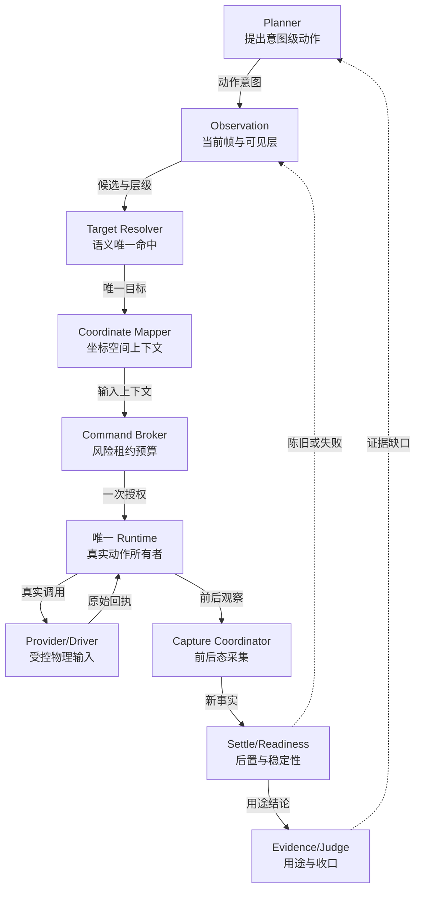
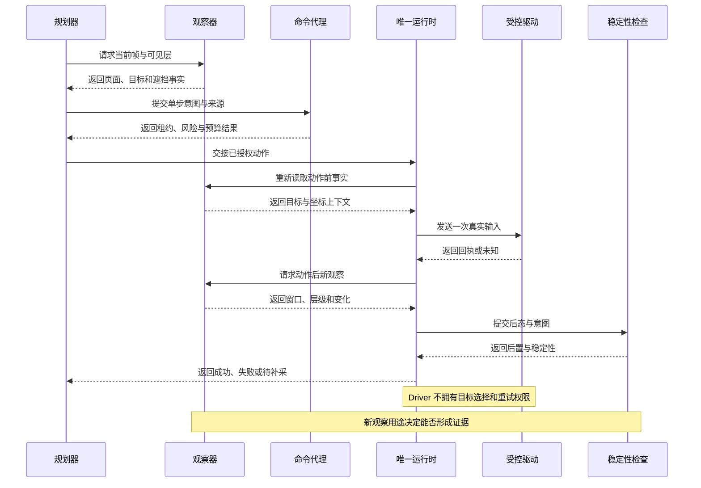
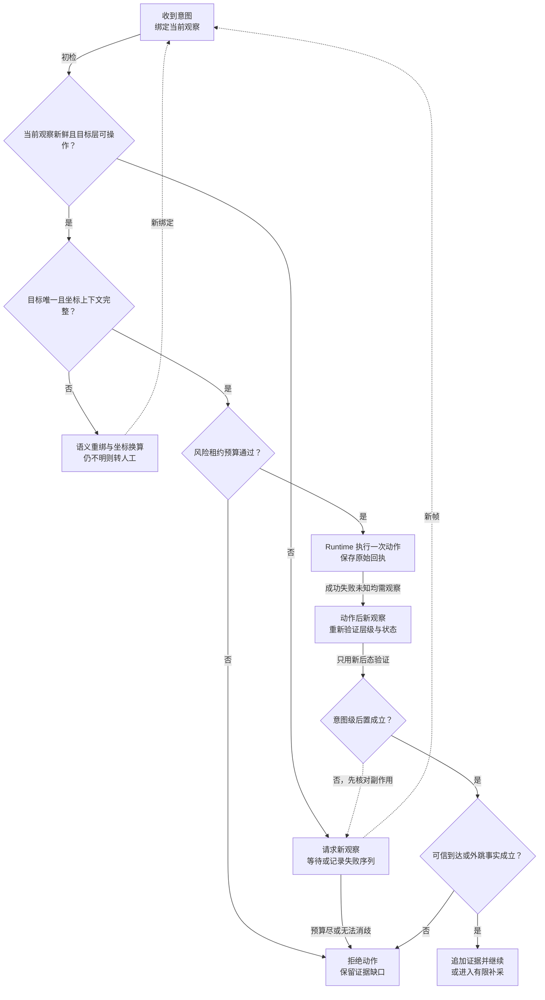

# 专项六：交互精准度、弹窗处理与外跳恢复设计

> 日期：2026-09-04
> 版本：技术深化 v1.1
> 状态：待评审、尚未实施
> 适用范围：H5/Web 与 App 的点击、滑动、返回、外跳、坐标追溯、动作后观察和失败恢复。
> 设计边界：本稿不定义表设计、字段清单、具体 API 或 API 载荷；只定义动作意图、运行时边界、证据角色、排障和验收。
> 关联稿件：同目录的 [受控探索](./01-controlled-exploration.md)、[页面状态图](./02-page-state-graph.md)、[精准补采](./03-targeted-recapture.md)、[页面识别](./04-page-recognition.md)、[Capture Readiness](./05-capture-readiness.md)、[可信证据](./07-trusted-evidence.md)。

## 1. 决策摘要与边界

交互精准度的最小单位不是“发出了一个 tap/click”，而是“从已验证的当前状态，以可追溯的目标和坐标执行一个有界动作，并观察到符合意图的后置结果”。

1. 点击、滑动、返回和外跳都必须绑定当前 Capture epoch；页面、Overlay、Frame、Activity、窗口或坐标变换变化后旧目标立即失效。
2. “先滑到位置再点”作为有界 InteractionPlan 实现：每一步都要经过风险、租约、预算、目标容器、观察和后置条件，禁止盲串命令。
3. 目标来源分为 DOM/AX locator、原生 UIA/语义节点、视觉框和程序派发；它们的可信边界不同，必须在证据中分开。
4. 真实输入要追溯原图、模型缩放、适用的 DPR/旋转/系统栏/insets/letterbox/Frame/窗口、当前滚动和 epoch；不适用的变换要明确注明，不为 Native 虚构 CSS、DPR 或 Frame；不能用归一化坐标替代变换校验。
5. JS `click`、dispatch 或 force click 没有物理点时不编造坐标，也不能声称自然点击通过；既有受约束 fallback 同样属于诊断，不构成另一个自然例外。
6. 动作成功、页面发生变化、动作后置条件满足、可信目标状态到达必须分别结算，只有最后一项才能形成成功页面边。
7. UI 动作是 saga，不是数据库原子事务。崩溃、超时或进程重启后副作用未知，先观察再决定，提交、支付、授权、安装不能自动重按。

本稿不承诺点击命中率、页面覆盖率或反风控能力；UA、分辨率和输入设备配置只用于可复现兼容性，不用于绕过验证码或平台风控。

## 2. 问题 → 机制 → 收益 → 指标

| 问题 | 机制 | 预期收益 | 观察指标 |
| --- | --- | --- | --- |
| 旧 selector/坐标在页面变化后误点 | epoch、指纹、实时可见性和 hit-test 复验 | 降低过期目标和误触 | 过期目标拦截率、误点率 |
| 连续滚动后直接点旧位置 | 每步 Capture、重新解析容器、重新绑定目标 | 提高虚拟列表和懒加载命中 | 复绑成功率、滚动后误点数 |
| CSS 坐标、截图像素和设备坐标混用 | 固定坐标空间与变换链，变换不明即拒绝 | 提高跨 DPR/旋转/letterbox 一致性 | 坐标拒绝率、命中偏差 |
| 关闭控件、取消、支付确认语义混淆 | Overlay 分类、风险语义和动作后置分离 | 防止危险动作被包装成关闭 | 危险语义拦截率、关闭闭环率 |
| 外跳后源页丢失或重复清障 | source/landing/return 三段观察与循环熔断 | 保留失败事实并减少重复副作用 | 外跳回源成功率、循环终止率 |
| 命令送达但没有业务效果 | Receipt、effect、postcondition、arrival 四层结算 | 不把 command success 当页面通过 | 无效果误判率、后置证明率 |

这些指标只用于验证动作链改进，不替代 Completion Gate 的同一 Run/Epoch、覆盖、证据充分性、规则和资源收口判断。

## 3. 现有基础与模块改动

### 3.1 H5/Web 现有基础

- [现有页面采集入口](../../../services/api/app/infrastructure/browser/page_capture.py) 已衔接动作触发、目标定位和视觉观察上下文；后续在既有能力上收敛受控动作计划，不另开任意参数或执行通道。
- 点击前后的导航、弹窗、转场和新页观察已在 [`_capture_on_page_impl`](../../../services/api/app/infrastructure/browser/page_capture.py) 串联；动作后仍需接入统一 Receipt/effect/postcondition 语义。
- [`_collect_scroll_coverage_artifacts`](../../../services/api/app/infrastructure/browser/page_capture.py) 已在一次调用内做有界滚动、每段截图/UI snapshot 和终止原因；它是复合滚动计划的现有基础，不应再造无限滚动器。
- [`_run_single_trigger`](../../../services/api/app/infrastructure/browser/page_capture.py) 已对关闭目标、顶层弹窗、实时结构和部分 fallback 做约束；需要把“点击完成”与“关闭后到达”继续拆开。
- [`_click_popup_close_control_with_offscreen_fallback`](../../../services/api/app/infrastructure/browser/page_capture.py) 仅在已验证的关闭控件 actionability 超时后使用直接派发；它没有自然物理点击点，必须保留诊断语义。

### 3.2 H5 视觉坐标现有基础

- [`_validate_coordinate_context`](../../../services/api/app/infrastructure/browser/h5_visual_navigation_runtime.py) 已校验原始 PNG 尺寸、视口一致性、DPR、像素密度和视口截图限制；这应成为视觉目标执行前的硬门禁。
- [`normalize_flutter_rect_to_visual_viewport`](../../../services/api/app/domain/exploration/h5_visual_navigation.py) 已将 Flutter host 局部矩形经过仿射变换和 viewport offset 映射到视觉视口；不应把局部坐标直接当 CSS 或设备坐标。
- Web Adapter 当前是单一 primary surface，能力声明中的 `same_context_new_surface` 与 `surface_pin` 为 false，不能把通用多标签隔离当成现状。参见 [`surface_driver.py`](../../../services/api/app/infrastructure/browser/surface_driver.py)。

### 3.3 App 现有基础

- [`CanonicalPointTargetResolver._resolve_point`](../../../services/api/app/infrastructure/device/android_target_resolver.py) 已支持 canonical/device/normalized 的点位解析和设备边界校验；它不负责证明目标当前仍可见。
- [`map_point`](../../../services/api/app/infrastructure/device/adb_ops.py) 已完成 canonical 到实际设备的有限映射；旋转、系统栏、窗口 letterbox 等未由该函数单独证明，需由上游 Capture profile 补齐。
- [`AndroidRuntimeObservation.node_at_point`](../../../services/api/app/infrastructure/device/android_runtime_observation.py) 已按可见、启用、边界命中和最小节点面积选择 UIA 目标；UIA 不可用时返回空目标，不可假装命中。
- [`AndroidAdbSurfaceDriver.execute`](../../../services/api/app/infrastructure/device/android_surface_driver.py) 已将 TAP、SCROLL、BACK、INPUT、OBSERVE 等动作转为受控 ADB 操作，并区分会话不匹配、未准备和驱动失败；后续需补动作后 Capture 与未知副作用闭环。
- App 目前截图、显示尺寸、前台身份和 UIA 观察职责分散在 [`android_surface_driver.py`](../../../services/api/app/infrastructure/device/android_surface_driver.py)；没有 H5 同等级的 DOM hit-test、网络生命周期或统一坐标审计链。

### 3.4 需要改动的边界

1. 在现有 Interaction Runtime/Broker 前增加有界 InteractionPlan 的确定性校验和每步状态绑定。
2. 将 H5 locator、Flutter Semantics、视觉框、Android UIA 和设备点位统一映射为“目标已验证/不可验证”的动作前结果。
3. 让 Runtime 在每个子步骤后触发 Capture Readiness 与 postcondition 观察，不能由 Agent 直接串下一步。
4. 让动作 Receipt、原始输入、诊断派发、坐标变换和后置证据进入同一审计链；原有 Capture/Writer/Manifest 继续复用。
5. 工作台只读显示计划步骤、拒绝原因、实际结果和恢复入口，不从浏览器端重发设备动作。

### 3.5 高/中模块改动范围

- **高影响模块**：Interaction Runtime/Broker、H5 目标解析与动作后 Capture、Android Surface Driver/目标解析、Receipt 与后置观察。这些模块决定动作是否真的发生以及能否证明发生了什么。
- **中影响模块**：页面状态图、Overlay/外跳子流程、补采恢复、任务详情只读投影、规则动作 profile。它们消费统一动作结果，不另建一套点击语义。
- **回归关注模块**：旧 selector/坐标兼容、历史任务展示、报告导出、局部失败提示和资源清理。兼容回退不能绕过身份、层级、风险和诊断污染门禁。

设计推论借用官方边界：Playwright 的 [Actionability](https://playwright.dev/docs/actionability) 与 [Input](https://playwright.dev/docs/input) 支持可见、稳定、命中和启用的分离，[Pages](https://playwright.dev/docs/pages) 与 [Authentication](https://playwright.dev/docs/auth#session-storage) 说明多页/会话复用不是原标签状态克隆，[Emulation](https://playwright.dev/docs/emulation) 只支持一致配置。它们不等于当前项目已实现全部动作门禁。

## 4. 职责边界

### 4.1 Explorer/Planner

Explorer 只提出候选和用户意图，例如“关闭当前顶层提示”“滚动到详情按钮”“观察外跳落地”。它不能直接指定未经观察的 DOM、UIA 节点或任意坐标。

### 4.2 Broker/Runtime

Broker 负责会话租约、权限、风险、预算、Surface 所有权、目标复验、动作执行和 Receipt。Runtime 是唯一直接操作浏览器或设备的组件。

### 4.3 Settle Oracle

Oracle 负责动作后身份、展示层、结构/视觉稳定、网络能力和专属后置条件的观察；不选择动作，不决定业务规则 pass，也不重试危险副作用。

### 4.4 Judge 与 Gate

Judge 只消费封存证据，不能操作设备或直接点击；Gate 组合覆盖、证据角色、规则终态、外跳/恢复和资源终态。数据库幂等解决重复写入，不等于动作可重复。

## 5. 核心方案

### 5.1 InteractionPlan 的基本语义

一个用户意图由有限步骤组成，每一步包含“从哪个已验证状态出发、目标如何绑定、风险是什么、允许多少次、完成后要观察什么”。它不是脚本字符串，也不是无检查的命令数组。

计划进入执行前必须通过：当前 Session/Surface 所有权、任务权限、规则 scope、动作风险、剩余时间和副作用预算。任一检查失败则返回 blocked 或 manual，不进入设备。

### 5.2 复合滚动再点击

标准路径是：定位可滚动容器 → 有界 scroll → Capture/Presentation/Readiness → 重新解析候选 → 重新绑定 click → 动作后 Capture/后置条件。

- 每次滚动都有安全轨迹、方向、步长和最大次数；避开系统边缘、固定栏、广告主体和未知可点击层。
- 滚动后只接受当前容器、当前 epoch 的目标；旧矩形、旧 ref、旧 UIA node 一律失效。
- 虚拟列表尚未挂载时只能有限发现；目标未出现就结算未发现/预算耗尽，不用隐藏元素或脚本直接触发。
- 发现新 Overlay、页面变化、跨容器或 Activity 变化立即暂停，进入重新观察和计划重算。

### 5.3 点击前的目标证明

点击前至少要证明：目标唯一、可见、启用、当前层可操作、位于安全内区，实际命中对象与意图和风险语义一致。关闭按钮必须来自当前 Overlay 内可靠识别的关闭角色，不能误命中广告主体，也不能因为模型猜到右上角 X 就执行。规则授权测试广告有效性时，广告主体本身可以是正确目标，真实点击仍须经过风险检查和外跳闭环。

DOM/AX locator 需要当前元素与 hit-test；UIA 需要节点可见、启用、可点击且边界命中；视觉目标需要原始帧、局部模板/锚点、视口和当前帧复核。证明不足就不点。

### 5.4 动作来源与可信等级

1. **真实 Playwright locator click/语义点击**：优先使用运行时 actionability 和命中检查；它由 Playwright 对当前 locator 执行可见性、稳定性、启用和接收点校验，仍必须保存动作后观察。
2. **真实坐标输入**：由同帧视觉或 UIA 目标计算设备点，记录完整变换和复核结果。
3. **既有受约束 fallback**：包括经签名结构复验后的直接派发或关闭兜底；它们全部属于诊断，不是另一个自然例外。DOM 结构签名只能证明当前目标与来源结构相符，不能授权绕过风险或自然可点击性。
4. **HTMLElement.click/DOM 事件派发/force click**：没有浏览器真实输入点或物理触摸，不能生成虚构坐标、不能证明用户可点，也不能计自然点击通过。

### 5.5 坐标空间追溯

每个可执行视觉目标都要能从模型图点/框逆算到原图，再从原图映射到实际输入空间：模型图 → 原图像素 → CSS/视觉视口或 UIA 局部坐标 → Frame/WebView/窗口（若适用）→ 设备输入坐标。不能把源图到模型图的正向缩放直接当作点击点。DPR、旋转、insets、系统栏、滚动偏移、当前 epoch 和变换版本只在该运行面适用时证明；Native 不虚构 CSS、DPR 或 Frame。

归一化坐标只便于传输或比较，不能替代同帧转换。适用的源图和当前帧尺寸、视口、DPR 或设备 profile 不一致，目标过小、边界越界、变换未知或命中不唯一时拒绝执行；不适用的维度要明确记为 not applicable。任一页面变化仍会使旧 epoch 失效并要求重新绑定。

### 5.6 滑动与返回

滑动的后置不是“手势返回成功”，而是容器内容锚点、可见范围、滚动状态或 UIA/视觉发生符合意图的变化。返回的后置不是“调用 back 成功”，而是重新识别后到达可信父状态或明确替代状态。

优先应用内受信返回；其次 Web history/back 或 Android BACK。返回到启动广告、登录、支付、更新或其他弹窗时，先进入对应 Overlay 流程，不能假设已经回到底页。

### 5.7 外跳动作

Web 自然打开新 Tab/Window 时优先捕获真实 popup，保留 source；若规则只需观察已验证的安全 href，可用限域 sidecar 观察内容，但不证明原按钮可点击或 JS/POST 链路正确。source 是实际业务页，按其规则正常计覆盖；只有外部 landing 不计业务覆盖，重复回源不新增覆盖。

JS 路由、POST、一次性 URL、原生 Activity 或外部浏览器不能默认克隆。旁路只允许 open/wait/observe/capture/close，且仍会执行脚本和网络请求，必须受域、重定向、时间和进程预算限制。source、landing、return 三段都要审计：source 可按业务规则计覆盖，landing 不计业务覆盖，return 只用于恢复证明。

这里不泛称“会话克隆”：同一 BrowserContext 的多个 tab 共享部分浏览器状态，可能互相影响；独立 context 也不会自动继承原标签的 sessionStorage、JS 内存或 history。当前 Web Adapter 只有 primary surface，真正增加外部子面还需要 Surface 生命周期和浏览器侧 service；当前 Android 的 [`capabilities.py`](../../../services/api/app/domain/interaction/capabilities.py) 虽列出 `open_external` 能力，具体 [`android_surface_driver.py`](../../../services/api/app/infrastructure/device/android_surface_driver.py) 的 manifest 未完整接线，执行分支也未实现通用外部打开，不能在方案中承诺已支持。

两个最小回退例子：自然 popup 先保留 source，子面只观察 landing 后关闭并回到 source；JS 同标签外跳若回源反复出现同一入口，则在签名循环预算耗尽时熔断，不再重复关弹窗或重启页面。

### 5.8 弹窗关闭闭环

弹窗不是单一广告类别。先按展示形式、业务语义、阻断范围和动作风险分类，再决定关闭路径：广告/营销层、充值或购买层、登录/凭证层、版本更新层、公告/权限层、网址通知或二维码保存提示，都可能表现为图片、对话框、底部抽屉、倒计时、系统层或外部跳转；形式相同不代表风险相同。

标准闭环是：冻结适用采集计划与前态 → 识别当前顶层和安全 dismiss/取消 → 执行低风险关闭 → 采集后态与连续失败证据 → 交给 Judge。可以先处理阻断层，不必等待所有静态 Judge 完成；但关闭性判定必须等待动作后态，不能只看命令 Receipt。

- 关闭一层后重新观察当前顶层；Overlay 的消失或换层不是业务页面成功边。
- 倒计时未到先观察，不先判失败；没有关闭控件需区分已充分证明缺失和识别/能力不足，前者按规则可判失败，后者进入证据不足/人工。
- 规则要求可关闭且动作后仍可证明不可关闭时，可判产品 fail；控件识别不足、网络/结构不可观测或能力缺口则判证据不足/人工。
- 取消、支付、安装、更新确认和权限授予必须按风险分流；确认按钮不能被当作 dismiss。
- 连续重现、无效果、误跳和回源循环分别计入失败/恢复终态，不能因重启把关闭预算归零。

### 5.9 四层动作结果

- **command accepted**：Broker 接受并发送了动作。
- **effect observed**：有可观察的 UI、URL、Activity、滚动或文本变化。
- **postcondition satisfied**：变化符合这一步动作的业务意图。
- **transition arrived**：新页面/状态通过 identity、Presentation、Readiness 后成为可信目标。

只有 transition arrived 才能形成可信成功边；其余结果必须保留为中间事实或失败原因。

## 6. 标准流程

1. 冻结任务、规则 scope、允许域/Package、Session/Surface、设备/视口 profile、风险和预算。
2. 读取当前 Capture，确认身份、展示层、目标来源、epoch 和坐标上下文。
3. 由 Planner 生成有限 InteractionPlan；Broker 校验租约、风险、权限、预算和动作所有权。
4. 执行 preflight：重新解析 locator/UIA/视觉目标，检查唯一性、可见性、启用、hit-test、安全内区和当前层。
5. 发出一个子步骤；保存 command receipt 和原始动作来源。没有物理点的派发不写成物理坐标。
6. 立即取 transition witness，再由 Settle Oracle 进行有限观察和动作专属后置判定。
7. 只有后置条件满足时才生成下一步骤的候选；页面/Overlay/epoch 变化就暂停并重规划。
8. 对 scroll→click 计划重复第 4–7 步，不复用旧 ref、矩形、坐标或 UIA 节点。
9. 对外跳建立 source/landing/return 观察；对返回重新识别父状态，不盲用历史路径。
10. 产物先通过 Capture Writer/Manifest/证据角色校验，再交给 Judge；Judge 不执行恢复动作。
11. 计划完成、失败、预算耗尽或风险升级后结算分支；任务收口另行检查未完成工作、子 Surface、租约和 Gate。

## 7. 异常闭环

### 7.1 目标陈旧或漂移

发现页面文本、Overlay、Frame、Activity、窗口、滚动容器、尺寸、DPR 或 epoch 变化时，立即拒绝旧目标。保留 stale 事实，重新采集并有限重绑；不通过扩大 selector 或容忍范围掩盖漂移。

### 7.2 命中不唯一或被遮挡

命中多个目标、错误父容器、遮罩或未知 top layer 时，结算 target ambiguous/obstructed；意图是关闭却命中广告主体，同样拒绝。规则授权的广告主体点击不属于此类误命中，按广告交互与外跳策略执行。先采集当前 Presentation 和 Overlay，不强行点击“最像”的元素。

### 7.3 点击送达但无效果

保存 receipt 与动作后帧；若无可观察变化，执行有限重观察而不是马上重按。无效果可因控件不可用、事件被拦截、需要滚动、网络未完成或业务不响应，分别进入排障原因。

### 7.4 关闭后仍可见

先判断当前规则是否要求可关闭、前态与后态证据是否充分。若要求可关闭且安全控件已被可靠识别，动作后仍可证明同一 Overlay 可见，可判产品 fail；控件未识别、层级/能力不可观测或前态不足，则判证据不足/人工，而不是笼统判“不可关闭”。

关闭一层仍要重新观察当前层：可能消失、换成下一层、误跳外部、回到同一 Overlay 或暴露底页。Overlay 变化不能自动生成业务页面成功边，也不能通过删 DOM、隐藏样式或改 z-index 规避。

### 7.5 弹窗分类、倒计时与危险确认

广告、充值/购买、登录凭证、版本更新、公告/权限、网址通知和二维码/信息保存提示按展示形式与业务语义分别处理；图片弹层、对话框、底部抽屉、系统层和倒计时只是呈现形式，不决定风险。

倒计时未到先观察并保存倒计时时间证据，达到可关闭条件后重新解析，不能提前判失败。无按钮需要分流：规则要求此时可关闭，且按有界检查充分证明没有任何允许的关闭入口时，可以判产品 fail；若视野、识别或层级能力不足以确认，则是证据不足/人工。可靠关闭动作后仍可证明无效，同样按规则判断失败。取消、支付、安装、更新确认和权限授予是不同风险，其中确认动作不能作为 dismiss 自动执行。

标准闭环仍是前态留证 → 安全关闭 → 后态/连续失败证据 → Judge。可以先处理阻断弹窗，不必等所有静态 Judge 完成；但 Judge 的闭合性判定要等动作后态，关闭一层不代表底页已到达。

### 7.6 坐标变换失败

从模型图点/框逆算到原图，再映射到实际输入空间。仅在相关运行面适用的源帧尺寸、当前视口、DPR、旋转、insets、letterbox、Frame、窗口或设备 profile 缺失/不一致时拒绝坐标动作；Native 不要求也不虚构 CSS、DPR 或 Frame。保留可见目标作为诊断，不以猜测点位补救。

### 7.7 ADB、浏览器或 Surface 瞬断

先检查动作 Receipt、当前前台身份和最新截图，再选择 warm restore、重新绑定或人工。云手机 ADB 的有限重连不等于动作未发生；输入、支付和提交后的重连不能触发重复操作。

### 7.8 外跳回源循环

每次回源前比较入口和 Overlay 签名；同一弹窗/入口连续重现达到预算即终止为 restore loop detected。不能通过无限重启或八次重复关闭来制造“最终回源”。

### 7.9 Runtime 崩溃与晚到结果

崩溃恢复先观察事实，再按 Receipt 判断未知副作用；晚到的 after Capture/判定要校验同一 Run/Epoch，不能覆盖已封存输入，也不能让已经结束的 Run 自动继续补采。不可验证时由新的受控任务/Run 重新过门禁，不自动重放不可幂等动作。

## 8. H5/App 差异

| 维度 | H5/Web | App |
| --- | --- | --- |
| 首选目标 | DOM/AX locator 与 hit-test，视觉用于层级和无结构区域 | UIA/语义节点，有能力时优先；否则视觉点位 |
| 真实输入 | CSS/视觉视口坐标，受 Frame、DPR、页面滚动约束 | 设备输入像素，受旋转、系统栏、letterbox 约束 |
| 滑动 | 先定位 scrollable container，再观察内容锚点 | ADB swipe 后通过截图/UIA/前台状态观察 |
| 外跳 | 真实 popup 优先，sidecar 只作内容观察 | Activity/浏览器/商店按真实转场处理，不默认克隆进程 |
| 网络 | Playwright 请求事件可作为 readiness 辅助 | ADB 不等于应用 HTTPS 请求监听或解密 |
| Flutter | Web Semantics 有则使用；没有才视觉降级 | UIA 可能为空；不可把框架名称当成树能力证明 |

App 现有 UIA 观察明确是运行时内存事实，截图写入仍是单独路径；H5 的 locator 自动滚动能力也不能免除计划级的每步 Capture 与后置验证。

iOS 不走 ADB 路径；若未来接入，应提供独立 Surface Adapter、坐标空间和真实输入验收，不把 Android 规则直接套用。

## 9. 其他专项协作

- **受控探索**：提供候选意图、动作风险和预算；不直接下发任意 selector/坐标。
- **页面状态图**：接收经过 postcondition 和 Readiness 证明的转移；命令接受或局部变化不自动建成功边。
- **页面识别**：定义目标页型、动作语义和必要 landmark；动作 Runtime 不自行推断业务完成。
- **Capture Readiness**：负责身份前后、可见层、网络能力、视觉/结构 quorum；动作只消费其结论。
- **专项六的弹窗子流程**：先冻结适用采集计划与前态，再允许关闭和后态判定；不等所有 Judge 完成才处理阻断层。
- **精准补采**：使用图路径和等价门禁追加证据；不使用 direct URL 或诊断动作伪造自然点击链。
- **可信证据**：传播自然输入、程序派发、诊断、时间序列和外跳角色；原始帧不可覆盖。
- **资源与租约**：为每个 Surface 维护唯一动作所有者；外部子面关闭、回源和租约释放必须进入终态。
- **工作台**：展示计划、每步结果、原因、坐标审计和恢复入口；不提供绕过 Broker 的“重试按钮”。

## 10. 工作台与排障

现有任务详情通过 [`TaskDetailView.vue`](../../../app/workstation/src/modules/tasks/pages/TaskDetailView.vue) 展示页面时间线、当前节点、Frontier 终态和探索摘要，并在同一详情页展示 Publication、质检工作项和尝试状态；精准交互应嵌入这条详情链，不新增主菜单。

建议新增只读区域：

1. 计划总览：当前意图、步骤顺序、已执行/暂停/失败/人工状态和剩余预算。
2. 目标卡片：来源 Capture、当前 epoch、DOM/AX/UIA/视觉来源、命中与遮挡结果。
3. 坐标审计：原图与模型变换、视口/DPR、旋转/insets/letterbox、Frame/窗口、最终输入空间和拒绝原因。
4. 动作后证据：receipt、effect、postcondition、arrival、Readiness、Presentation 和 source/landing/return。
5. 排障分支：重采、重新绑定、恢复路径、循环熔断、人工接管和“不可安全重试”说明。

当前 [`TaskDetailView.vue`](../../../app/workstation/src/modules/tasks/pages/TaskDetailView.vue) 采用 `Promise.allSettled` 并行读取多个明细模块，新增交互投影应允许局部失败而不覆盖已有时间线。当前 [`task-insight.api.ts`](../../../app/workstation/src/services/task-insight.api.ts) 只提供时间线、规则、统计、截图、日志、App 阶段和工作项读取；新投影应保持只读，不在前端计算命中或发动作。

排障页面必须清楚显示：命令已发送不等于效果、效果不等于后置、后置不等于稳定到达；JS fallback、force click、sidecar 和诊断隐藏不能与自然证据混在同一列表。

## 11. 安全、审计与权限

- 所有动作由 Broker 取得当前 Session/Surface 的唯一租约；Agent、Judge、工作台和旁路脚本不能绕过它直接操作设备。
- 风险语义优先于关闭语义；下载、购买、充值、支付、安装、订阅、授权和更新确认不得因为包含“关闭”文案而降级。
- 正式分支禁止删 DOM、隐藏被测层、改 z-index、force click、任意 JS 派发和代理改写；既有受约束 fallback 必须记录诊断污染并阻止自然通过。
- 真实坐标审计不得记录秘密输入值；输入动作只保留必要的动作来源、长度/结果和证据引用。
- 外跳 sidecar 限制域、协议、重定向、时间、下载/安装和权限动作；不得继续点击第三方广告或授予权限。
- UA、分辨率、触摸能力等 profile 要可审计、可复现，不得以兼容配置之名绕过 CAPTCHA 或风控。
- 发生崩溃或超时，副作用未知先观察；不以数据库回滚、删除 Receipt 或重建 Session 伪造撤销。
- 工作台动作入口仅用于查看、人工复核和经授权的恢复申请；恢复仍回到 Runtime 风险检查。

## 12. 分期、兼容与回滚

### A：影子计划与坐标审计

只在现有动作前后旁路计算目标唯一性、坐标链、epoch 和后置条件，不改变动作。对比旧链的点击结果、误拒和漏检，冻结坐标空间、风险词和循环预算。

### B：H5 点击/滑动切换

先启用 DOM/AX 和视觉目标的 preflight、滚动复绑、Readiness after Capture；JS fallback 继续只在诊断开关下可用。旧 selector 结果保留作回归对照。

### C：App 真实点位切换

先接 UIA 可得时的节点命中和 canonical 映射，再接视觉降级；旋转、系统栏和 letterbox 未完成真实验收前，相关 profile 只影子记录或人工。

### D：外跳与恢复

先捕获真实 popup/source/landing，再启用 sidecar 和 warm resume；同标签回源循环必须有终止结果。原生 Activity 不在没有等价验证时启用克隆假设。

### E：Gate 消费与回滚

待真实矩阵证明 postcondition、坐标和恢复指标后，才让 Gate 消费新的交互角色。回滚只切换消费路径和运行开关，保留原始 Receipt、Capture、失败和诊断标记。

### 兼容原则

- 历史动作没有 epoch/坐标审计时显示历史兼容，不补写可信命中。
- 新计划读取失败时保留旧时间线和截图，并明确精准交互投影不可用。
- 新逻辑超时或误拒退回旧动作只适用于低风险、可重复观察动作；高风险动作直接人工，不自动回退重按。
- 任何回滚都不能撤销已经发生的 UI/网络/支付/授权副作用，必须进入未知效果排障。

## 13. 验收场景和指标

| 场景 | 必须看到的结果 |
| --- | --- |
| 虚拟列表滚动后按钮位置改变 | 旧目标失效，重新观察并绑定；不点旧坐标 |
| 目标被广告或遮罩覆盖 | hit-test/Presentation 阻断，保留遮挡证据，不强制点击 |
| Flutter 有 Semantics 与无 Semantics | 有结构时用语义；无结构时视觉降级并标记能力 |
| 不同 DPR、旋转、insets、letterbox | 变换链正确；上下文不一致即拒绝 |
| JS click 无物理点 | 可记录程序派发，但不伪造坐标，不计自然点击通过 |
| 关闭一层后仍有支付/更新确认 | 重新识别顶层并按风险处理，不当作到底页 |
| 倒计时、无按钮、取消无效果 | 合法倒计时不提前判失败；证明没有允许的关闭入口或取消无效时按规则判 fail，能力不足才转不足/人工；预算不因重现归零 |
| 自然新 Tab、JS 同标签、POST/一次性链接 | source/landing/return 可追溯；sidecar 不替代真实点击链 |
| 外部回源反复出现同一入口 | 达到循环预算后熔断，不无限重复清障 |
| ADB/浏览器在动作后崩溃 | 先查 Receipt/当前面再恢复，不盲重按危险动作 |
| Judge 提出补采 | 只写请求，由 Runtime 重新过风险/epoch/等价门禁；Judge 不操作设备 |

建议 A 只建立基线：目标唯一性拦截率、滚动后重绑成功率、真实输入命中率、坐标拒绝准确率、postcondition 证明率、关闭闭环率、外跳回源率、循环熔断率、未知副作用误重试数、诊断动作进入自然通过数。目标值须由 H5/App、Flutter、云手机和真实外部 Activity 矩阵实测后冻结。

## 14. 团队反馈及待冻结参数

### 已裁决反馈

- 采用“先滑动→观察→重新绑定→点击”的复合计划，每一步过风险、租约、预算和后置条件。
- 采用适用维度的坐标审计；模型图点/框先逆算原图，再映射实际输入空间；Native 不虚构 CSS、DPR 或 Frame，变化仍触发重绑。
- 真实 Playwright locator click 与 HTMLElement.click/DOM 事件派发分开；没有物理点就不编造，不计自然点击通过；既有受约束 fallback 全部属于诊断。
- 弹窗按展示形式、业务语义、阻断范围和风险分类；先冻结前态采集计划，再安全关闭，再做后态/连续失败判定；关闭一层不等于到达底页。
- 外跳 Web 以真实新 Tab/source 保留优先；direct URL 只证明内容观察，不能默认克隆 JS、POST、一次性 URL 或原生 Activity。
- sidecar 只允许有限 open/wait/observe/capture/close；仍承认外部页面会执行脚本和请求；只有 external landing 不计业务 coverage，source 按业务规则计入，重复回源不新增覆盖。
- ADB 不等于网络拦截，iOS 不走 ADB；Flutter 按 Semantics 能力决定结构/视觉组合。

### A 待冻结

1. 动作风险等级与不可自动重试的操作集合。
2. InteractionPlan 最大步骤数、滚动方向/步长/次数、每步观察 deadline 和总预算。
3. locator、UIA、视觉和程序派发的可信等级、诊断开关及污染传播。
4. 目标唯一性、可见性、内区、hit-test、遮挡和变换误差阈值。
5. 设备/浏览器坐标空间、DPR、旋转、insets、letterbox、Frame/窗口和 profile 版本。
6. 外跳 sidecar 的允许域、协议、重定向、脚本/网络观察边界、子面生命周期和循环阈值。
7. 崩溃后的 Receipt 查询窗口、未知副作用人工入口和租约释放时限。
8. 真实矩阵中的命中、误点、重绑、恢复、循环和人工接管目标值。

## 15. 技术职责与接入点

本章把精准交互拆成可接入的职责边界：谁产生目标、谁确认当前层、谁完成坐标换算、谁拥有真实动作、谁验证意图后置。它不新增表、字段、接口载荷或数据结构；实现评审只需据此核对既有模块的调用方向和缺口。

### 15.1 职责切面

1. Planner 从规则缺口、Frontier 候选或当前页面观察提出一个意图级动作，例如“展开导航”“关闭可验证的公告层”“进入支付路由页”。Planner 不把屏幕坐标当成稳定目标，也不能自行点击。
2. Observation 读取当前 Surface 的页面身份、可见层级、稳定性、滚动位置和候选目标。启动弹窗、登录层、广告、系统权限框和业务页面分别记录呈现层，不把层级观察直接当成业务节点。
3. Target Resolver 先做语义定位，再把唯一目标绑定到本次观察。它可以使用 H5 locator、可访问性语义、App 页面身份和视觉候选，但不能以标题相同或视觉相似替代对象身份。
4. Coordinate Mapper 只在使用坐标输入时把语义目标转换到该 Driver 声明的输入空间，不默认都是物理像素。它需要保留截图、视口、Frame、滚动、DPR、旋转、系统栏和 letterbox 等上下文；上下文缺失就不向 Driver 交接坐标。
5. Command Broker 复核风险、租约、目标新鲜度、动作来源和预算。唯一 Runtime 仍是动作所有者，Broker 不执行点击，Driver 也不能绕过 Broker。
6. Runtime 串联动作前重观察、一次真实输入、原始回执、动作后新观察和后置判定。命令已提交、实际效果、意图后置和可信到达保持独立阶段。
7. Capture/Readiness 负责稳定性、层级和证据用途。未稳定的新帧不能证明稳定业务到达，但加载或关闭失败的时间序列在满足规则来源与角色时可以支持正式失败判断。
8. Evidence/Judge 只提证据请求并消费同一 Run/Epoch 的事实。外部 Surface 的打开、等待、观察、捕获、关闭由受控边界管理，不由 Judge 直接发送设备动作。

下面的组件图只画一条受控动作路径。虚线是重新观察或补采反馈，不是第二个动作所有者；“坐标换算”也不能替代语义目标和层级确认。



组件图中的 `D` 可能是 H5 的受控 Driver 或 App 的设备输入适配器。两者都必须接受 Runtime 已确认的当前目标和坐标上下文；不存在“先点击、再补身份”的快捷路径。`E` 的补采请求回到 Planner 后，仍需重新经过观察、解析、Broker 和 Runtime。

### 15.2 既有代码的接入位置

- H5 页面捕获和视觉导航继续复用 [`page_capture.py`](../../../services/api/app/infrastructure/browser/page_capture.py)、[`h5_visual_navigation.py`](../../../services/api/app/domain/exploration/h5_visual_navigation.py)、[`h5_visual_navigation_runtime.py`](../../../services/api/app/infrastructure/browser/h5_visual_navigation_runtime.py) 和 [`surface_driver.py`](../../../services/api/app/infrastructure/browser/surface_driver.py)。深化重点是把语义目标、几何上下文和动作后捕获串成同一动作交接。
- App 目标解析、动作执行、运行时身份和动作后采集复用 [`app_interaction_runtime.py`](../../../services/api/app/application/app_interaction_runtime.py)。[`app_screenshot_exploration.py`](../../../services/api/app/application/app_screenshot_exploration.py) 仍负责探索轮次，但不应把截图候选直接视为可点击事实。
- App 的局部恢复由 [`app_frontier_restoration.py`](../../../services/api/app/application/app_frontier_restoration.py) 提出恢复意图；恢复后的可信到达和层级观察必须重新绑定目标。当前有局部恢复和等价实现，不等同于完整页面图规划。
- 动作前后采集和补采用途沿用 [`capture_coordinator.py`](../../../services/api/app/application/capture_coordinator.py)、[`input_set.py`](../../../services/api/app/domain/evidence/input_set.py) 与 [`supplemental_evidence_policy.py`](../../../services/api/app/application/supplemental_evidence_policy.py)。生产补采仍由 `enabled` 与 `runtime_ready` 双门禁控制，未开放时只能保留不足或人工请求。
- Workbench 可以展示坐标审计、层级变化、外跳和后置缺口；它不获得第二套点击权限。现有组合和 Gate 校验继续作为运行入口边界。

### 15.3 语义目标到坐标的职责交接

语义目标先回答“要作用于哪个对象”，坐标换算再回答“Driver 在哪个输入空间落点”。H5 的 CSS 视口、视觉视口、Frame 内容区、页面滚动和设备像素不是同一坐标系；App 截图像素、设备物理像素、旋转方向、状态栏和 letterbox 也不能互相假定。

目标绑定必须带着产生它的观察版本。滚动、窗口切换、旋转、外跳、弹窗层改变或应用重启都会使旧坐标失效；即使新帧中看起来仍在相同位置，也要重新确认语义目标、可见层和命中条件。无法完成换算或命中被遮挡时，目标不进入动作交接。

### 15.4 弹窗与外部 Surface 的职责交接

Overlay 分类由观察层完成，至少区分广告、登录/身份、购买/支付、更新/权限、公告、系统对话框、二维码/信息内联区域和未知层。分类用于决定风险、是否可关闭以及后置要求；“有关闭按钮”不代表可以安全关闭，也不代表关闭后就是首页。

外跳由受控 Surface 边界持有打开、等待、观察、捕获和关闭的生命周期。当前页、同标签页、新标签页、系统浏览器、JS/POST 导航和回源结果分别验证；直接拼 URL 不能代替真实导航。回源后重新读取当前页面和层级，不复用外跳前的目标引用。

## 16. 时序与交接条件

本节给出一条精确交互从意图到后置的最小时序。图中没有把外跳或弹窗分支画成第二条主线；分支条件统一在第 17 节解释，避免“Driver 有回执”被误读为“目标已经到达”。



第一轮观察只产生候选和层级事实。Broker 通过后，Runtime 仍要做动作前重新观察，因为目标可能在等待期间滚动、被覆盖或外跳。Driver 回执只说明输入调用阶段；后态必须来自动作后的新观察，不能使用点击前截图回填。

### 16.1 交接前条件

1. 当前意图有明确的语义目标、动作类别和意图级后置；只有坐标或模糊标题的意图暂停。
2. 当前 Surface、页面身份和可见层已确认；目标位于允许操作的层，且没有未分类遮挡。
3. 目标通过唯一性、可见性、命中区域和坐标上下文检查；Frame、滚动、DPR 或旋转信息缺失时不发物理输入。
4. 风险、设备租约、Session、Run/Epoch 和动作预算通过；同一 Surface 没有另一个 Runtime 动作在途。
5. 若动作将打开外部 Surface 或关闭 Overlay，规则允许该层级转移并定义返回/关闭后的后置观察。

### 16.2 交接后条件

动作完成后至少生成一份动作后新观察。它应能回答：当前 Surface 是否仍是原 Surface、可见层是否改变、目标是否消失或产生预期变化、页面是否稳定、后置是否满足，以及是否形成可信到达。

后置按意图定义，不按点击坐标定义。展开菜单要求新菜单层和目标项可见；滚动要求锚点或内容变化可证；关闭层要求该层确实消失且底层符合规则；返回要求回到预期父位置；外跳要求 landing、必要内容和回源路径分别可证。

### 16.3 层级、外跳和失败时间序列

启动广告关闭事件只能关联随后可信入口观察，不能生成 popup 到首页的业务导航边。层级事件与业务转场分离：Overlay 是质检目标，但不混成业务节点；支付路由页是真实业务页面；二维码内联区域不因悬浮外观自动成为浮层。

若当前长页已到达目标页面，只缺一个局部锚点、按钮状态或展开结果，补采可以只观察、等待或滚动，不必制造回首页动作。若发生外跳，记录离开、landing、返回和原页重绑定；外跳循环或关闭失败达到预算即终止为不足/人工。

未稳定的新帧不能证明稳定业务到达。不过，加载失败、关闭失败、权限拒绝等时间序列在来源可信、角色明确且规则允许时，可以进入正式失败判断。它们不能被改写成成功到达，也不能由相似页面补齐。

## 17. 算法与判断流程

决策图展示从当前观察到一次动作的必要门禁。虚线回流代表重新观察、重新绑定或有限补采，不代表重用旧目标；任何自然分支删除 DOM、改写页面或绕过命中测试都不属于恢复算法。



### 17.1 坐标换算与命中判断

H5 的换算顺序是语义目标到页面几何，再到 CSS/视觉视口、Frame 与滚动上下文，最后映射到 Driver 输入点。需要校验 DPR、缩放、页面偏移、固定头部、iframe 边界和当前滚动；任一上下文来自旧帧，都重新观察。

App 的换算以当前截图和设备窗口为依据，校验旋转、状态栏/导航栏、显示裁剪、letterbox、密度和触控输入范围。不能把 H5 CSS 坐标直接套到 App，也不能把截图像素未经设备上下文校正就当作物理点。

建议把换算拆为可独立校验的数学步骤，而不是在点击函数里散落比例：

```text
截图点 = 解除模型预览图的裁剪与缩放(模型输出点)
可见内容点 = 解除letterbox与截图方向变换(截图点)
输入点 = 当前Surface声明的“可见内容→Driver输入空间”变换(可见内容点)
校验 = 反向变换(输入点)仍落在本次观察中目标的可交互区域
```

这里的变换是带明确来源和有效期的几何关系，不是新的接口结构。只有在确认同向、无裁剪、无偏移时，才允许简化为 `x输入=x截图×W输入/W截图`、`y输入=y截图×H输入/H截图`；存在旋转、Frame 偏移或视觉视口缩放时必须组合相应变换，不能只按分辨率做乘法。DOM locator 已由 Provider 解析时优先使用其语义路径，不再重复换算坐标；输入空间若是 CSS 像素，也不能再次无条件乘 DPR。

命中检查同时看语义唯一性、可见性、顶层遮挡、可交互区域和坐标落点。视觉候选被弹窗、系统层或透明遮挡覆盖时，优先分类遮挡并重新绑定；不通过时不得通过缩小命中框、删除 DOM 或强制 dispatch 来制造成功。

### 17.2 滚动、重观察与重新绑定

滚动不是点击前的无证据前置动作。每一次滚动都要记录滚动前观察、滚动操作、稳定等待和滚动后新观察，再用锚点或语义关系找回目标。目标在新帧中重新解析，旧 bounding box、旧可见性和旧遮挡判断全部失效。

若目标已在当前页面且只缺局部证据，补采可以只观察、等待或滚动，不必制造回首页动作。若页面身份或业务位置变了，才进入 Frontier/恢复流程；无法证明回到同一业务位置时，恢复结论只能是不足。

### 17.3 意图级后置和到达判定

每个意图先定义可观察的后置，再选择动作。后置不能写成“点击返回成功”这种命令回执，而要写成层级、对象、内容或路由的状态变化。例如“展开”需看到展开内容，“关闭”需看到目标层消失，“进入”需验证路由和业务对象，“提交”需验证结果或规则允许的明确失败。

后置成立仍不自动等于可信到达。到达还需要页面身份、稳定性、层级、对象/路由语义和规则要求的证据角色；页面相同不代表广告、用户、价格或登录状态相同。缺一项就只记录效果或待补采。

### 17.4 Overlay 分类与外跳边界

广告、登录、支付、更新、权限、公告和系统对话框采用从严风险。二维码或帮助说明若只是当前页内联区域，保持当前业务页；若有真实 Surface 或业务路由变化，才记录外部转场。未知层不因视觉相似归入低风险。

关闭动作需要证明目标层消失、未误点底层控件且下层状态可解释。嵌套弹窗逐层观察；关闭外层后出现内层不应直接记为“全部关闭”。发生新标签、系统浏览器或第三方支付时，外部 Surface 单独观察，完成后有界回源；没有回源事实不能把离开前页面当作完成。

外部边界默认只允许受控打开、等待、观察、截图和必要清理，不继续点击落地页广告、购买、授权或提交信息。来源页确实被隔离保留时，验证来源仍在即可，不强造一次返回动作；同标签 JS/POST 跳转和原生外跳不能保证克隆会话或另开进程，必须保存真实转场并按能力有界回源。落地留证、回源成功、业务覆盖分别结算。

## 18. 并发、幂等、超时与恢复

### 18.1 写入幂等不等于点击幂等

Capture、回执合并、后置结论和审计写入可以按同一动作交接去重：重复消息返回已有事实，不重复追加同一逻辑写入。但设备点击、关闭、返回、提交和支付不是天然幂等，即使写入端只出现一条记录，也可能已经产生两次真实副作用。

因此同一 Surface 同时只允许一个 Runtime 动作在途。重复计划先查动作交接和当前状态；已知完成时复用原观察，未知时只读观察，不能因为数据库/日志没有第二条写入就再次点击。原动作是否执行必须由 Provider 回执和动作后观察共同证明。

### 18.2 目标引用与并发滚动

滚动、动画、异步加载和弹窗出现都可能让目标引用过期。Target Resolver 产生新绑定前，Broker 不接受旧坐标；并发的补采请求合并为同一缺口的有限请求，不能各自回放滚动或点击。

长页补采优先保持当前业务位置。若一条请求需要“滚动后观察”，另一条请求需要“关闭层后观察”，按同一 Surface 串行化并在每步后重新判断层级；若冲突无法消解，终止为人工，不通过并发动作抢时间。

### 18.3 超时和未知状态

动作前定位、坐标换算、Driver 输入、动作后捕获、稳定等待和外部 Surface 等待使用独立截止点。任何一步超时都要说明最后可信观察和可能的副作用；不能把等待超时改写成点击失败或成功。

Crash、连接断开或租约失效后，恢复先读取同一 Run/Epoch 的回执和当前 Surface。未知动作只允许观察、重新绑定和人工转交；登录、支付、购买、权限提交等不可逆动作禁止自动 fresh 替代或盲重试。

### 18.4 有界恢复和嵌套层

同一缺口共享动作、观察、时间和外部 Surface 预算；新请求不能重置预算。嵌套 Overlay 维护层级深度和关闭次数，出现循环、无新增观察、稳定性反复失败或预算耗尽即终态。终态可为明确失败、证据不足或人工，不继续制造动作。

回滚时先停用新定位/外跳恢复的动作准入，独立观察并结清在途或副作用未知的动作，再对后续安全、重新规划的动作选择既有 Driver；不能用切换 Driver 重放未决点击。证据门禁、可信到达和 required 分母保持不变，回滚完成也不替代一次完整后置。

### 18.5 外部 Surface 的释放

外部 Surface 关闭、回源或超时后，确认原 Surface 的租约和页面身份，并在受控清理分支释放本次创建的外部资源。回源失败也必须执行可安全完成的清理、保留失败证据，不能因等待成功回源而泄漏资源；用户原有标签/进程不得被批量关闭。迟到的外部回执只保留同一动作的审计关联；原 Run 已收口时不改写覆盖，也不把相似 landing 认作回源。

## 19. 故障推演与技术验收

本节要求以真实交互的可归因性验收，而不是以“Driver 返回成功”验收。所有演练都应区分命令、效果、意图后置、可信到达和规则用途；不得删 DOM、强制事件派发或盲重放未知动作。

### 19.1 故障推演

1. 长页滚动后旧坐标仍指向屏幕同一位置：系统必须先采新帧、找锚点和重绑；不能直接点击旧点。若只缺局部证据，就地补采，不回首页。
2. 目标被透明层或嵌套广告遮挡：命中检查失败，先分类层级并记录遮挡；不能缩小区域或通过自然分支删除页面节点。
3. 关闭外层弹窗后出现登录层：外层关闭效果可成立，但业务入口仍未到达；需要单独观察内层并按身份风险决定是否人工。
4. 点击广告后打开新标签或系统浏览器：记录原 Surface 离开、外部 landing、必要捕获和有界回源；没有回源不能写原页完成。
5. 支付或登录状态在原动作后失效：精确补采要求原上下文时，无法证明原发生实例就明确不足/人工，不能把另一次 fresh 状态当作原 exact 结论。
6. Driver 超时但按钮状态改变：动作结果未知，先观察当前层、对象和后置；不能依据写入幂等或缺少重复日志再次点击。
7. H5 locator 缺失或 App 没有可访问性语义：可以退到经过审计的视觉/坐标路径，但仍必须有坐标上下文和后置；能力未就绪则停在不足。
8. 外部 Surface 反复回到同一页面：达到循环或无新增观察阈值即终止；不能用相似页面或另一 Run 证据补通过。

### 19.2 技术验收阶段

阶段 A：静态职责验收。核对 Planner、Observation、Target Resolver、Coordinate Mapper、Broker、Runtime、Driver、Capture 和 Judge 的调用方向；确认只有 Runtime 产生真实动作。

阶段 B：H5 受控交互验收。在可复现的页面中覆盖 locator、滚动、Frame、DPR、遮挡和新标签路径；验证每次滚动后都重新观察和重绑，影子执行只比较计划，不产生第二条设备动作。

阶段 C：App 低风险验收。在隔离测试任务或单 Owner 低风险灰度中覆盖截图坐标、旋转、系统栏、letterbox、App 返回和局部弹窗；不以登录支付等不可逆动作作为首批真实执行。

阶段 D：异常闭环验收。注入未稳定帧、透明遮挡、嵌套层、Driver 超时、Crash、外跳循环和回源失败，确认都能进入重新观察、有限补采、人工或不足终态。

阶段 E：收口与回滚验收。确认同一 Run/Epoch 的动作、观察和证据用途可追溯，补采请求排空后再释放租约；停用新能力后仍保持既有证据门禁，不降低 required 分母。

### 19.3 硬性正确性与待基线指标

硬性正确性包括：目标不唯一或遮挡时零真实输入；旧坐标和旧层引用零执行；未知副作用零盲重试；滚动后零复用旧观察；命令成功与可信到达不混淆；外跳无 landing/回源证据不通过；原 exact 缺口不由 fresh 结果填补；一个动作所有者之外的路径零设备动作。

效率指标待基线验证后冻结，至少观察目标解析耗时、滚动后重绑耗时、坐标拒绝率、误命中率、后置等待、外跳闭环耗时、未知结果占比、就地补采新增证据率和人工转交率。指标优化不能以减少观察或放宽风险为代价。

### 19.4 关联模块与范围提示

后端高范围影响集中在交互 Runtime、目标解析、动作前后捕获、Readiness/补采和外部 Surface 协调；中范围影响 H5/App Driver、Workbench 坐标审计和证据展示。高/中表示接口耦合与验收影响，不是伪精确的工作量百分比。

本技术深化仍未实施。现有局部恢复和等价能力不代表完整页面图、精准补采或生产 Runtime 已开放；必须通过 `enabled` + `runtime_ready` 门禁、同 Run/Epoch 证据和 Completion Gate 后才能谈正式启用。

## 20. 关联文档依据

- 总设计第 16 节“交互精准度”、第 17 节“外部广告落地与边界”、第 14 节“Action Transaction”、第 18–19 节证据与补采。
- 总设计第 35.1、35.2、35.3 节对外跳隔离、滚动复绑、坐标审计、Flutter/UIA、诊断隔离和优先级的裁决；第 36.1–36.6 节对动作、后置、崩溃、补采和真实场景的串联。
- H5 动作与采集基础：[`page_capture.py`](../../../services/api/app/infrastructure/browser/page_capture.py)。
- H5 坐标与视觉基础：[`h5_visual_navigation.py`](../../../services/api/app/domain/exploration/h5_visual_navigation.py)、[`h5_visual_navigation_runtime.py`](../../../services/api/app/infrastructure/browser/h5_visual_navigation_runtime.py)。
- App 目标与动作基础：[`android_target_resolver.py`](../../../services/api/app/infrastructure/device/android_target_resolver.py)、[`adb_ops.py`](../../../services/api/app/infrastructure/device/adb_ops.py)、[`android_runtime_observation.py`](../../../services/api/app/infrastructure/device/android_runtime_observation.py)、[`android_surface_driver.py`](../../../services/api/app/infrastructure/device/android_surface_driver.py)。
- 外部 Surface 现状：[`surface_driver.py`](../../../services/api/app/infrastructure/browser/surface_driver.py)；动作证据合并：[`capture_runtime.py`](../../../services/api/app/infrastructure/browser/capture_runtime.py)。
- 工作台现有入口：[`TaskDetailView.vue`](../../../app/workstation/src/modules/tasks/pages/TaskDetailView.vue)、[`task-insight.api.ts`](../../../app/workstation/src/services/task-insight.api.ts)。
- 同目录设计稿：[Capture Readiness](./05-capture-readiness.md)、[页面状态图](./02-page-state-graph.md)、[精准补采](./03-targeted-recapture.md)、[可信证据](./07-trusted-evidence.md)。

本稿只提供设计边界与实施验收依据；尚未修改任何运行时代码、规则启用状态、数据库或 API。
