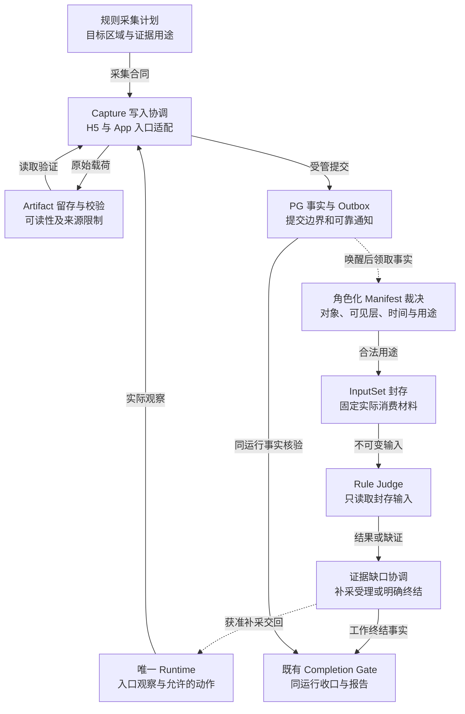
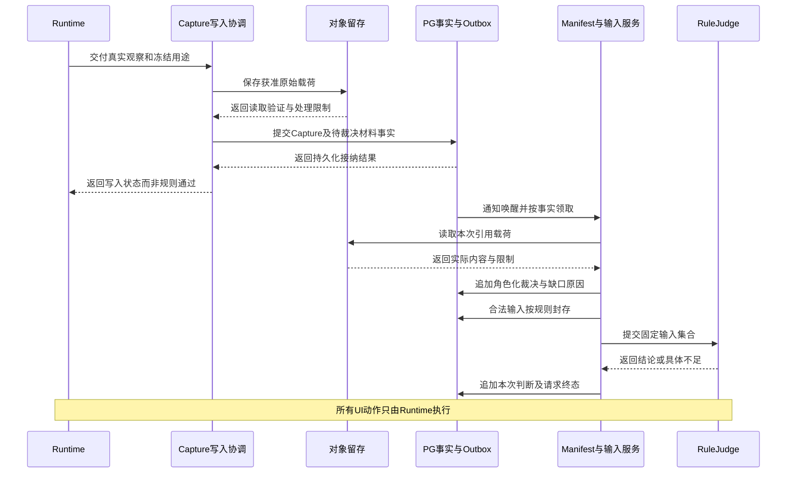
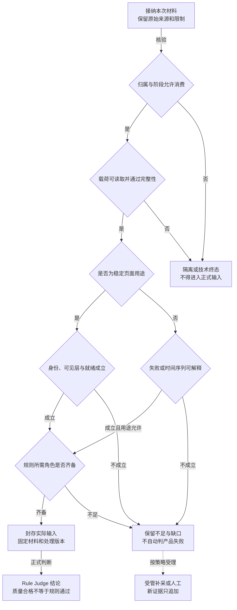

# 专项七：可见层一致、可追溯的可信证据留存设计

> 更新日期：2026-09-04 · 版本：技术深化 v1.1 · 状态：待评审、尚未实现。
>
> 适用范围：H5 / Web 与 App 的采集、留存、补采、规则输入、工作台复核及完成报告。
>
> 本文细化机制、职责、流程、改造和验收，不包含数据库表设计、字段清单、具体数据结构或接口载荷。

## 1. 决策摘要与设计边界

证据可信的核心是“这份材料确实证明了该对象在该条件下发生的事”，不是文件能保存、Hash 正确或格式齐全。
本次优先解决可见层错配：底层详情 DOM 不能解释顶层充值弹窗截图，也不能证明详情已经曝光。

继续复用 Capture、Artifact、Manifest、EvidenceInputSet、RuleExecution 和 Completion Gate，增加贯穿各入口的来源、层级、时间、证据角色与自然/诊断隔离约束。
这些名称表示既有职责或本方案的概念，不意味着再建一套并行证据系统。

支持长图、局部裁剪、DOM 格式化和压缩，但原始采集、派生展示和模型实际读取的内容必须分开。
补采只追加新证据和新的判断尝试，不能覆盖原始失败或用其他运行的材料填补当前缺口。

不以“所有证据都必须是稳定页面”作为统一门禁。持续加载、倒计时和关闭失败需要时间证据；它们可以支持真实失败，但不能冒充稳定业务页面到达。

## 2. 现状问题与优化收益

| 现状问题 | 本专项机制 | 直接优化与系统提升 | 验证方式 |
| --- | --- | --- | --- |
| 标注页型是详情，截图实际是弹窗 | 可见层与目标区域校验贯穿采集和消费 | 防止正确格式承载错误语义，减少规则误判 | 层级错配放行数、人工复核一致率 |
| 截图、DOM、网络摘要来自不同瞬间或不同状态 | 采集前后身份检查、同窗一致性和多帧角色声明 | 让页面与数据对应，避免拼出不存在的事实 | 错帧/错对象拒绝率、时间一致性缺口 |
| 删 DOM、隐藏层或 JS 派发后继续当自然证据 | 诊断路径隔离，影响沿后续证据链传播 | 不把绕过障碍当产品真实可用 | 诊断误入自然输入数、影响追溯完整率 |
| 只有一屏看不到长页，拼图又容易丢上下文 | 原始视口、扩展截图、滚动序列与派生总览分工 | 提升长内容可检性和复核效率 | 必要区域覆盖、长图回溯成功率、缺口显式率 |
| 长 DOM 难读，压缩后仍消耗大量上下文 | 存储无损压缩、派生格式化、按规则有界读取 | 分别优化存储与模型成本，不牺牲来源真实性 | 存储量、模型 Token、必要事实遗漏率 |
| 文件落盘了但 Judge 用错版本或证据不足 | 角色化质量门禁与封存输入 | 提升规则结果重现性，补采有明确目标 | 输入重放一致率、无依据通过数 |
| 探索停止、释放设备、生成报告被混为完成 | 分维度收口与同 Run/Epoch 的 Gate | 正确表达失败、不足和技术异常 | 报告与权威事实一致率、跨运行串证数 |

减少证据误用是正确性收益；减少存储、Token 和人工耗时是效率收益。两类指标必须同时衡量，不能以删除必要证据换成本下降。

## 3. 当前基础与模块改动

| 当前入口 | 已存在的基础 | 本次需要补齐 |
| --- | --- | --- |
| [H5 采集](../../../services/api/app/infrastructure/browser/page_capture.py) | 截图、DOM、Readiness、遮挡处理及部分保护 | 统一证据角色、可见层与诊断影响，不另造截图系统 |
| [浏览器采集运行时](../../../services/api/app/infrastructure/browser/capture_runtime.py)、[Web Agent 采集](../../../services/api/app/application/web_agent_page_capture.py) | 不同 Capture Writer 入口 | 所有写入路径都保留同样的来源与门禁，防止只改一条链 |
| [App 证据采集](../../../services/api/app/application/app_surface_evidence.py)、[App 持久化](../../../services/api/app/application/app_capture_persistence.py) | App 观察、截图、UI Tree 等留存 | 区分运行时可见与已留存证据，补全当前窗口、几何和缺口 |
| [Manifest Writer](../../../services/api/app/application/evidence_manifest_writer.py)、[Manifest 应用服务](../../../services/api/app/application/evidence_manifests.py) | 清单质量与终态版本管理 | 将层级、角色、诊断与采集计划完成度加入统一裁决 |
| [证据输入集合](../../../services/api/app/domain/evidence/input_set.py)、[聚合发布](../../../services/api/app/application/aggregate_inspection_publication.py) | 规则输入封存与聚合 | 约束同一运行、证据角色和复用来源，补采只追加 |
| [规则执行](../../../services/api/app/application/rule_evaluation_runs.py) | 执行结果及部分广告来源/落地处理 | 让结果追溯到实际消费材料，缺证走声明式请求 |
| [任务详情](../../../app/workstation/src/modules/tasks/pages/TaskDetailView.vue)、[任务洞察](../../../app/workstation/src/types/task-insight.ts) | 页面时间线和报告解释 | 展示可见层、原图/派生图、质量缺口及完整来源链 |

当前 H5 DOM 留存会清理部分脚本和样式、替换内联资源，并对超过上限的内容截断；不能称为无限完整的原始页面。
当前受限高层遮挡兜底是默认关闭、带目标校验的样式隐藏，不是普遍删除 DOM 或统一将 z-index 设为负数。
实施应检查实际开启路径及全部后续 Writer，不推断所有历史证据都被污染。

本专项是跨采集、存储、规则、报告的高耦合改造，不能只改前端证据卡片或文件格式。
已有存储服务和质检生命周期继续复用，具体持久化方案留到实现评审。

## 4. 职责边界与可信链

| 参与组件 | 负责什么 | 不应代替什么 |
| --- | --- | --- |
| 规则采集计划 | 指明这个规则需要什么对象、范围、前后态或时间证据 | 不直接操作设备，不在缺证时虚构材料 |
| Capture 协调 | 在受管运行面形成同窗观察，调用就绪与层级检查 | 不把文件成功直接判成规则成功 |
| Artifact 留存 | 保存实际采集载荷、校验完整性、保留来源和处理限制 | 不根据相似 Hash 合并不同观察事实 |
| Manifest 质量门禁 | 判断材料是否满足所声明的证据角色和计划 | 不代表产品规则本身通过 |
| EvidenceInputSet | 冻结一次规则判断实际消费的证据集合 | 不在运行中悄悄换成“最新截图” |
| Rule Judge | 依据封存输入给出规则结论或明确补采需求 | 不驱动设备，不自行搜索别的运行填洞 |
| Completion Gate 与报告 | 检查同一运行的终态、证据和结果，并给出分维度结论 | 不以设备释放或报告生成代替正式验收 |

从一条报告结论应能逆向找到规则输入、清单、原始材料、采集时刻、当前层、动作及实际运行面。
初始入口或被动采集没有业务动作是合法情况；保留其真实来源，不编造点击记录来补齐链条。

## 5. 核心证据设计

### 5.1 五层可信度共同成立

第一层是完整性：文件可读取、内容可解码、尺寸和类型合理，存储与解码后的内容没有静默损坏。
第二层是来源性：材料确实来自本任务获准的运行面、账号环境和采集过程。
第三层是时间一致性：同帧材料属于可解释的同一观察窗口，多帧材料明确时间顺序和状态变化。
第四层是语义与可见层一致性：材料针对哪个业务对象、当前被谁遮挡、哪些区域真实可见。
第五层是规则充分性：上述材料足以证明该规则要求的文案、曝光、动作、落地或时间行为。

这五层不能互相替代。文件完全正确但对象错了，需要拒绝；对象正确但缺少关闭后态，也不能判断“可关闭”。
证据不足不自动等于产品失败；反过来，证据充分地证明失败，也不应因为未获得稳定首页而被全部丢弃。

### 5.2 可见层是正式门禁，不只是一条提示

每次采集先识别当前窗口和展示关系，再确认规则目标实际可见的区域，结合截图与可用结构交叉检查。
Web 需要考虑层叠上下文、顶层窗口、裁剪、透明与命中关系；不能只比较全局 z-index 数值。
W3C 的定位与 Top Layer 草案说明了这些绘制关系，本方案还需要按实际浏览器能力验证。[CSS Positioned Layout Level 4 草案](https://www.w3.org/TR/css-position-4/)

Native 按实际窗口和可访问结构判断；自绘界面采用视觉与连续观察补充，结构或命中测试不可用时明确降级。
不能因为看到了底层节点，就声称它是用户当前可操作的目标。
部分遮挡按规则关注区域判断，不将一个小提示一律等同于全页不可用；全屏遮挡则不能确认背后页面的当前曝光。

例如，“详情正文是否包含某声明”和“该声明是否向用户可见”是不同问题。
隐藏结构能否用于前一种规则，要由规则合同明确；后一种必须有可见区域证据。
旧时刻已经看见的详情可以保留历史事实，但不能冒充当前弹窗背后的新一帧曝光。

### 5.3 页面与数据如何确认对应

采集前检查当前页面/窗口、相关业务对象和局部状态；读取截图、结构与获准摘要；采集后再次验证身份和目标条件。
若页面、账号、商品、价格、过滤条件或顶层发生相关变化，这组材料不能按一个稳定页面事实使用。
必要时有界重采，或拆成清楚标明变化的时间序列。

页面中的数字、文本和网络响应必须有可追溯原文，模型摘要和 OCR 都属于解释层。
不能用后台接口返回成功证明按钮在画面上可用，也不能用同 URL 的另一个商品响应解释当前截图。
结构、截图、OCR、网络之间出现冲突时保留冲突，不自动挑选有利于通过的一份。

前后检查提高时间一致性，但不把真实 UI 变成原子快照系统。
对快速轮播、持续更新行情等无法证明同窗的内容，应缩小目标、使用序列或声明限制，而不是夸大精度。

### 5.4 证据角色决定可消费范围

| 证据用途 | 必需材料 | 不足时如何处理 |
| --- | --- | --- |
| 静态布局、文案曝光、稳定页面到达 | 对应可见区域的稳定观察与来源 | 层级不明或画面未就绪时不作为稳定页面证明 |
| 弹窗可关闭性 | 弹窗前态、允许的关闭尝试、后态或有界失败序列 | 缺前态/动作/后态则补采；不能只看消失后的页面 |
| 导航正确性 | 来源页面、真实动作、目标与转场验证 | 直接打开目标只证明内容可达，不补造点击链 |
| 加载、倒计时、媒体播放和持续失败 | 可解释时间顺序的观察及对应行为 | 不要求每帧都稳定，但不得用它确认稳定曝光 |
| 广告落地一致性 | 源广告、实际转场与落地；必要时回源 | 外部落地不计业务覆盖，旁路内容与真实点击分开 |
| 多状态或跨页一致性 | 经授权且封存的成员集合 | 缺成员明确列出，不能拿首页单例替代 |

质量通过只说明该材料符合其声明用途。加载超时序列可以质量通过并支持规则失败；它不等于页面加载完成。
失败图、诊断图和不可读图可以保留用于排障，但进入哪些正式规则必须分别判断。

### 5.5 自然证据与诊断证据隔离

正式自然分支不通过删除 DOM、隐藏弹窗、改变 z-index、强制点击、派发 DOM 点击事件或修改网络来制造“可用页面”。
平台经过审查的只读观察脚本与上述修改不同：可以读取层级，但不能改变被测页面后仍声称自然状态。

诊断能力确有排障价值时单独开放，明确授权、限制用途，并将影响传播到后续采集、派生材料、Writer、清单、输入和报告。
恢复 CSS 不代表恢复了框架状态、账号、定时器、历史或服务端副作用；不能简单清除标签后继续自然通过。
若要恢复正式自然测试，需要受管重建环境并验证必要前提，原诊断历史仍保留。

任务开始时声明的设备或 UA 配置可以是正式测试条件；运行中临时改配置产生的材料不能混入原环境。
视觉裁剪、标注和拼接是派生处理，不应回写原图，更不能去掉遮挡后拿给 Judge 当原始截图。

### 5.6 长图与长页面采集

| 材料形式 | 主要用途 | 必须保留的边界 |
| --- | --- | --- |
| 原始视口截图 | 用户当前看到的内容、点击、遮挡与弹窗 | 正式可见性主证据，不能被长图替换 |
| 局部裁剪 | 聚焦某规则区域，减少模型输入 | 可回到原图，保留遮挡和上下文限制 |
| Web 全页截图 | 扩展文档内容和复核上下文 | 不代表所有区域同一真实视口曝光，不保证虚拟列表全部加载 |
| 有界滚动原帧序列 | App 长页、懒加载、嵌套滚动与多屏规则 | 各帧保持时间、区域、滚动与状态关系，遇到变化分段 |
| 拼接总览 | 人工快速阅读、定位缺口 | 明确是派生图，保留重叠、断层、固定头和动态区域说明 |

Playwright 提供全页和元素截图能力，但具体项目仍需验证懒加载、虚拟列表与曝光语义。[Playwright Screenshots](https://playwright.dev/docs/screenshots)
App 不承诺一次截屏就能获得完整长页，采用受控滚动、逐帧观察与停止条件。

滚动预算要限制帧数、距离和时间；到底、无新增内容或数据集合变化时停止或分段。
出现广告刷新、账号变化、弹窗插入、排序变化或分页加载失败，不能拼成一张看似同一状态的“完整页”。
不能为了拼接好看，先隐藏固定导航或遮挡层而不标明页面被修改。

### 5.7 DOM 格式化、压缩与模型读取

存储层允许无损压缩经过授权采集与隐私处理的载荷，读取时验证解码后的内容一致。
压缩不能弥补采集时已经截断或脱敏的内容，也不允许无上限保存敏感网络正文、Cookie 和凭证。

阅读层提供格式化 DOM、可见文本和层级摘要，作为有来源的派生视图。
原始采集已经清理或截断时，应明确说明“这是经过处理的留存材料”，不能给它补一个“完整原始 DOM”标签。
格式化改变了空白或排版，不得无记录地覆盖原留存载荷。

模型层按规则目标层和区域读取必要片段，说明未提供内容与截断范围。
压缩文件解码后仍会占上下文，因此“磁盘节省”与“Token 节省”分别优化、分别统计。
没有送给模型的部分不能被判为不存在；需要时通过证据请求读取或补采。

DOM 不包含所有 Canvas 像素、跨源内容或原生界面事实，结构缺失不代表屏幕没有内容。
证据查看器将 HTML 作为文本或受限离线材料展示，不执行页面脚本、表单或远端资源。

### 5.8 封存、去重、补采与报告一致性

原始材料通过校验后再对外发布可消费事实；异步通知可重投，但正式链路不能引用尚不可读的材料。
同内容可以在物理存储上节省重复空间，但每次观察的时间、状态、来源和用途不能因 Hash 相同被合并。

规则执行冻结实际消费集合，重试使用同一集合；需要新证据时形成新的受管输入和尝试。
补采发生在同一运行且满足规则允许的状态等价与时效要求，旧材料和旧结论保持可回溯。

报告输入在收口时固定所属 Run/Epoch，即本次运行与当前执行阶段。
晚到的图片、识别或规则结果先检查归属，不改写已封存报告，不读取其他运行历史通过结果填补缺口。
Gate 不可用要明确显示 unavailable；取消、失败、证据不足和资源清理分别结算。

## 6. 标准证据闭环

> 规则确定采集需求 → 当前层与动作前态 → 允许的动作/被动观察 → 就绪或时间序列采样 → 同窗采集与身份复核 → 材料校验留存 → 角色化质量门禁 → 输入封存 → Judge → 补采或结果 → Gate 与报告。

1. 根据当前目标和规则确认需要稳定图、局部证据、前后态还是时间序列，提前保留不可重现的前态。
2. 捕获入口或动作前态，辨认当前展示层；启动底页未知时仍可有合法会话和弹窗证据。
3. 需要交互时由 Runtime 唯一执行。关闭弹窗前保存必要材料，不等待所有静态 Judge 返回；关闭效果规则必须等待后态。
4. 专项五判断证据适用的就绪程度；持续异常按合法时间角色留存，不把真正失败当采集垃圾全部丢弃。
5. 收集截图、结构与获准摘要，复核身份、目标和层级；不一致则重采、分段或限制用途。
6. 验证文件可读与来源关系；提交材料事实并通过可靠通知交给下游，失败状态可重试且不重复 UI 动作。
7. Manifest 根据声明用途裁决质量；InputSet 冻结本次判断实际材料，Judge 无权替换为其他来源。
8. Judge 缺证时提出具体需求，经专项三恢复、验证与追加后再判断；不能直接要求 Agent“随便找一张相似截图”。
9. 收口排空或明确终结未完成证据请求、规则工作与子运行面，冻结报告输入并执行 Gate。
10. 报告分开展示探索覆盖、证据充分性、规则通过/失败、技术异常和资源释放，不用一个 completed 混淆。

## 7. 异常与恢复闭环

| 异常 | 处理路径 | 正式结论边界 |
| --- | --- | --- |
| DOM 与截图当前层不一致 | 拒绝不符合角色的输入，保留材料，补采当前目标 | 不能据被挡 DOM 宣称曝光或可点 |
| 采集中价格/商品/账号变化 | 重采或拆分序列，重新检查规则需求 | 不组合成单一稳定事实 |
| 页面始终加载或取消按钮无效 | 保存有界前后/时间证据，按规则判断失败或不足 | 不能一律当截图失败丢弃 |
| 原图空白、受系统保护或不可读取 | 标记采集限制，使用规则允许的其他来源或人工 | 不绕过保护，不根据结构伪造图像事实 |
| 文件上传成功但清单发布失败 | 重试事实发布与对账，不重复设备操作 | 未核验材料不得供正式 Judge 使用 |
| DOM 截断、长图漏屏、序列中途状态变化 | 标记缺口、按规则补采或拆分 | 不宣称完整页面证据 |
| 诊断分支修改了页面 | 隔离后续材料，保留诊断用途，必要时受管重建 | 不凭恢复样式清除影响 |
| 补采返回同页但广告/登录状态已变 | 按规则等价政策重新判断，必要时不足或人工 | 不用相似内容覆盖原状态证据 |
| 跨 Run 结果、晚到结果或 Gate 故障 | 归属校验、固定报告输入、技术异常结算 | 不借旧成功结果，不伪造 Gate 通过 |

恢复 UI 是可验证补偿，不是数据库原子回滚。未知副作用先观察确认；证据落盘重试与点击重试是两件不同的事。

## 8. H5 / App 证据差异

Web 可以结合 DOM、可访问语义、浏览器事件和截图，但仍受 Frame、自绘内容、网络可见性和加载方式限制。
App 的运行时 UI Tree 不等于已被保存为可供 Judge 消费的材料，必须检查实际留存链。

Android 可用结构和窗口观察时优先联合使用；Flutter 有 Semantics 则利用，没有则以视觉和连续观察补足，不虚构结构。
iOS 采用其实际 Provider 能力，不能用 ADB 可获取的信息推定 iOS 也完整具备。

网络不可观测与没有网络请求不同。如果规则必须依赖网络事实却无法取得，应保留证据缺口。
落地页同样是外部观察目标，其内容可留存，但不增加被测业务页面覆盖。

## 9. 与其他专项的协作

| 关联专项 | 证据链要求 |
| --- | --- |
| [一：受控探索](01-controlled-exploration.md) | 命令属于正确任务和运行面，观察与动作均可追溯；Provider 不能直接宣告通过 |
| [二：页面状态图](02-page-state-graph.md) | 图从可信事实投影，原始观察与页面身份分开，启动层不强造底页 |
| [三：精准补采](03-targeted-recapture.md) | 先解释缺口再恢复，逐步验证状态等价，所有新增材料只追加 |
| [四：页面识别](04-page-recognition.md) | 类型解释必须绑定可用证据；不以标签替代层级和曝光证明 |
| [五：截图时机](05-capture-readiness.md) | 提供就绪与时间证据适用性，允许真正失败的序列进入合适角色 |
| [六：精准交互](06-interaction-precision.md) | 保存动作前后、目标与坐标来源、误跳及回源；不把诊断点击视为自然操作 |

## 10. 工作台与人工复核设计

证据面板先回答“这是什么用途的材料、来自哪次观察、当前看到哪一层”，再展示文件大小、时间和格式。
原图、裁剪、全页扩展、滚动序列和拼接总览清晰分组，派生图能回到源帧；长页允许逐帧查看缺口与变化。

DOM 默认以安全文本和格式化视图阅读，提示处理、截断和脱敏限制。模型实际消费片段与完整留存载荷分别可查。
不能让复核者误以为 Judge 看过未提供给它的区域。

规则结果页提供“实际输入 → 证据角色 → 当前层/动作 → 原始材料”的追溯入口。
无法通过门禁时展示具体原因和可行补采方向，而不是只显示“证据异常”。
诊断证据始终突出用途限制；时间失败证据突出观察区间，避免与稳定页面截图混淆。

## 11. 权限、隐私与审计

沿用现有租户和任务权限，并区分查看摘要、查看敏感原始材料、下载与诊断操作权限。
账户凭证、令牌、非必要个人信息和网络正文按最小采集原则处理；脱敏应在进入普通模型和展示链前完成。

保留策略同时考虑质检复核和数据最小化。待处理人工审核或受控保留中的证据不能被普通清理误删；到期处理要可审计。
本文不决定具体保留天数或加密实现，交由安全与运营在上线前冻结。

查看留存 HTML 不执行脚本、不提交表单、不加载外链；证据内容中的提示词或指令不能改变审核策略。
派生处理版本、人工更正和补采操作均保留来源，防止无法解释的证据替换。

## 12. 实施分期、兼容与回滚

| 阶段 | 交付内容 | 放行要求 |
| --- | --- | --- |
| A：证据用途与入口盘点 | 盘点全部 Writer、当前处理方式和规则需求 | 清楚知道哪些材料完整、截断、派生或受诊断影响 |
| B：层级与自然/诊断门禁 | 与专项五、六贯通采集到 Judge 的限制 | 全屏弹窗错配和隐藏兜底样本不能进入自然通过 |
| C：封存与失败证据 | 角色化质量、时间序列、输入重试和补采追加 | 真实加载/关闭失败可判断，报告可重放 |
| D：长图与 DOM 优化 | 原帧序列、派生总览、压缩、格式化和局部读取 | 缺口显式，原始来源可回溯，成本改善不丢必要事实 |
| E：全链工作台与收口 | 完善来源追踪、Gate、晚到结果和清理 | 同一运行结论一致，取消/失败也能结算资源 |

历史证据缺少新证明时明确为旧版本证据或适用范围有限，不能凭新规则自动补成已验证状态。
可逐步启用新的采集形式与门禁，但不允许为了兼容旧链而让已发现的错层或诊断污染重新获得自然通过。
回滚关闭新入口和派生能力，保留原材料与版本，不破坏已经封存的判断。

## 13. 验收场景与指标

| 场景 | 必须达到的结果 |
| --- | --- |
| 详情 DOM + 全屏充值截图 | 详情可见性角色被拒绝，充值层可独立留证 |
| 关闭按钮不可用、持续 loading | 合法时间证据被保留；证据充分可判失败，不以“未稳定”一概丢弃 |
| 隐藏弹窗或 JS 派发后继续采集 | 所有 Writer、输入和 Gate 保留诊断限制 |
| 原图与 DOM 之间切换商品/账号 | 拒绝同帧组合，重采或分段 |
| Web full-page、App 长列表、动态广告插入 | 原始视口和分帧可回溯，漏屏和状态变化可见 |
| 超长 DOM、格式化、压缩与局部模型片段 | 可验证处理来源，截断诚实，未读片段不被判为不存在 |
| 相同图片多次出现但来源时刻不同 | 可复用物理存储，不合并观察语义与状态 |
| 发布中断、重复通知、补采与晚到结果 | 幂等恢复，无重复 UI 副作用，无覆盖旧证据或跨运行串证 |
| 规则得到 fail、Gate 不可用、任务取消 | 各自状态独立准确，不能统一显示通过 |

硬性正确性：验收样本中无错层放行、无诊断冒充自然、无伪造动作来源、无跨运行证据混用、无悄悄替换封存输入。
可用性指标：人工复核一致率、规则证据不足原因完整率、从报告回到原帧的成功率、补采关闭缺口比例。
效率指标：每项有效判断的存储量、Token、采集与审核耗时；以相同覆盖与质量要求比较，并报告长页和动态页面分组结果。

## 14. 团队反馈与待冻结事项

| 反馈 | 采纳与调整 |
| --- | --- |
| lichuan：痛点在层级，不在格式 | 完全采纳层级优先，将其升级为正式门禁；格式完整性仍保留为必要基础 |
| lichuan：删 DOM / 改 z-index 让底页露出 | 不作为正式自然方案；诊断允许时隔离，不能证明原页面可关闭 |
| lichuan：Flutter 只能视觉 | 改为按实际可访问语义能力选择，缺失时才视觉降级 |
| lichuan：外跳旁路只截图 | 条件采纳，来源、真实转场与旁路内容分开，外部不计覆盖 |
| qingyunke：支持长图与长 DOM 格式化/压缩 | 采纳，区分原始视口、序列、派生图、存储压缩与模型片段 |
| qingyunke：点击与坐标要可追溯 | 采纳，连到原帧和实际动作；无物理点的派发不编造坐标 |

上线前需冻结：各规则可消费的证据角色、诊断隔离范围、长页预算、缺失/截断处理、敏感材料权限及保留政策、质量抽检与报告验收样本。
质量标准先保证不伪造通过，再根据真实基线优化长图和模型读取成本。

## 15. 技术架构：从采集入口到实际消费的一致约束

### 15.1 证据生产与消费组件图

下面是目标责任图。Capture、Manifest、InputSet、Judge、Outbox 和 Gate 复用既有职责；“角色化可信度”是需要补齐的横切约束，不代表新建一个平行证据服务。



实线表示数据或职责交接，虚线表示异步唤醒或受管回流。对象存储与 PG 不假设同一个原子事务，通知也不承担事实权威。

### 15.2 必须统一的四个技术接口边界

这里描述输入、输出和前置条件，不定义新接口名称、请求载荷或字段结构。

| 边界 | 输入与调用方责任 | 接收方必须独立验证 | 可以输出什么 |
| --- | --- | --- | --- |
| 观察进入 Writer | 本次真实观察、目标用途、平台能力、前后身份与诊断影响 | 任务/运行面归属、载荷存在、必要观察是否实际取得 | 待裁决证据事实；不能直接输出规则通过 |
| Writer 进入 Manifest | 已提交且可读取的材料、冻结的规则需求 | 角色、对象、可见层、时间关系、截断及缺失 | 某用途合格、缺口或技术异常；不能抹去原限制 |
| Manifest 进入 InputSet | 可消费的清单版本、规则范围与候选材料 | 本次规则确实允许该用途、当前运行阶段仍接纳、成员没有被替换 | 一次判断的封存集合；不隐式跟随 latest |
| InputSet 进入 Judge | 实际读取的原文、截图或派生片段及限制 | 不把未提供区域当不存在，不把诊断帧当自然曝光 | 可解释结果、缺口、人工或技术终态 |

落地点要覆盖 `page_capture`、浏览器 Capture Runtime、Web Agent Capture 和 App Capture Persistence，不能只在某个 Tool 返回值中增加说明。前端用于展示，不补判材料是否可信。

### 15.3 对当前代码的具体衔接

- `EvidenceManifestWriter.adjudicate_for_capture` 已具有“需求未到保持 pending、终态幂等返回、追加清单版本”的框架；扩展裁决谓词，保留原生命周期。
- `AppCapturePersistenceService._settle_pending_manifest` 已区分仓储是否原子提交清单；适配前先核对生产仓储路径，不把所有 Provider 一概认作弱一致。
- `EvidenceInputSet` 已封存规则实际输入并绑定 Run / Epoch；增加角色与来源验证时沿此处收敛，不让 Judge 自己拼装最新材料。
- `observation_packet._evaluate_quality_gate` 当前还会因 `loading` 等状态拒绝输入。目标实现需要按角色区别“稳定曝光”和“合法加载失败序列”，不能只让 Writer 放行而在消费者再次一刀切拒绝，也不能全局放宽稳定页面门禁。
- `CompletionGateFacts.gate_passed` 继续作为既有完成条件的组合入口。证据语义门禁与技术故障应在各自工作终态中留下原因，不能把清单通过映射成 Gate 通过。

上述符号在 2026-09-04 的 c9dfb7c73 工作区只读核对；新角色约束和传播链仍是设计要求。

## 16. 技术时序：提交、裁决、封存和重试

### 16.1 一份证据从设备到 Judge



1. 对象写入成功只代表载荷存在。读取校验、事实接纳和用途裁决未完成前，不发布为正式可消费证据。
2. 已承诺的 PG 事务内事实按现有仓储边界提交；对象留存失败先停在入口，通知失败通过 Outbox/对账恢复，不重新操作设备。
3. 消费者收到重复通知后重新读取权威状态。消息顺序不等于事实版本顺序，不能按消息先后来覆盖清单。
4. 对同一次判断进行技术重试时使用同一 InputSet。需要新材料则创建新的判断尝试，保留两次输入和结果的关联，而不是刷新旧集合。
5. 缺口关闭以新材料被规则需求接受为准，不以补采命令完成或图片上传完成为准。

### 16.2 采集中的时间一致性窗口

在一次受控观察中，按“身份与顶层前检查 → 采集截图和可得结构 → 身份与顶层后检查”形成证据窗口。检查覆盖当前窗口、业务对象、账号条件、规则相关状态和诊断影响。

截图和 DOM 无法严格同时取得时，不承诺原子快照。允许短窗口的依据必须来自两端一致、过程中无相关转场或对象变化，以及采集策略明确允许；前后恰好同值也不能排除未被观察到的中间变化。
对于快速更新内容，优先缩小目标、使用连续帧或转为时间序列用途；不能无限延长窗口来提高“采集成功率”。

## 17. 核心算法：按用途接纳，不按文件齐全一刀切

### 17.1 角色化裁决流程



“非稳定页面用途”也必须是规则明确允许的角色，不是通用后门。外跳、诊断、历史、局部和时间序列各自有消费限制。

### 17.2 伪代码与拒绝顺序

以下仅表达判定顺序，不是现有 API 或新的数据结构定义。

```text
按当前受理阶段核对材料归属；不符则拒绝消费并保留诊断记录
核对载荷可读性、完整性和授权处理链；失败则形成技术原因
读取冻结的规则需求，确定允许的证据角色
若材料受诊断影响且规则要求自然行为，则拒绝该用途
若规则要求稳定可见页面：
    验证相关对象、顶层、目标区域和就绪证明
否则：
    验证该角色允许、序列顺序成立、目标及行为可对应
检查规则需要的前态、后态、区域、成员和时效是否齐备
若有缺口：保留已有材料，只请求实际缺失部分
若无缺口：封存实际选择的成员及模型读取视图
Judge 只能消费封存集合；技术重试不更换集合
新补证形成新尝试，不覆盖旧失败或不足
```

### 17.3 可见层、区域和冲突的技术判据

Web 可用结构候选区域、裁剪链、顶层关系、样式与命中观察作为辅助，再与截图中真实可见内容交叉验证。命中到某元素不保证其文字可读；透明或不接收指针事件的覆盖层也不能只靠命中结果判断。
跨源 Frame、Shadow DOM、Canvas 或缺失 Semantics 会限制结构证明，必须暴露能力缺口。部分区域可见只允许证明该区域，不能外推到全页。

针对同一规则目标，DOM 文本、截图/OCR 与获准网络摘要不一致时，不按“多数投票”自动挑一个正确值。先检查时间、对象、可见层与来源能否解释差异；不能解释则重采或不足。
OCR 与模型摘要属于派生解释，不能用它们相互印证同一个原始识别错误。

### 17.4 长图与模型读取的两段式派生

第一段先保存逐帧观察与滚动关系；只有对象、列表集合与顺序未发生相关变化时才形成连续段。第二段从同段原帧制作总览或裁剪，不覆盖原帧。
拼接检查重叠区域、固定导航、重复项、空洞与动态区域；不能以图像相似度证明业务内容完整。列表换序、广告刷新或窗口插入即切段，未覆盖区域仍是缺口。

模型读取计划先确定规则必要区域和上下文，再生成有来源的文本/图像片段。片段超出预算时应缩小任务或提出缺口，不能静默截断后推断“未出现”。存储压缩与模型上下文裁剪分别计量。

## 18. 一致性、幂等与异常恢复的工程约束

### 18.1 三种重试不能混用

| 失败位置 | 可重试什么 | 重试前检查 | 不允许的补偿 |
| --- | --- | --- | --- |
| 对象写入回执丢失 | 查读并确认同一次载荷；必要时重传 | 载荷、授权、归属及处理链未变 | 重点关闭按钮重新制造一帧 |
| 对象已存但事实事务失败 | 重试原事实提交或对账 | 原观察仍可核验，当前阶段是否允许接纳 | 捏造新的采集时间，冒充当前帧 |
| 清单已裁决但需求终态未同步 | 幂等修复需求状态 | 已提交清单确实满足同一需求 | 降低需求来解除离场阻断 |
| 消息重复、乱序或消费者崩溃 | 重新领取并读取权威事实 | 归属、版本、租约与终态 | 按晚到消息覆盖新的清单 |
| Judge 超时 | 使用同一封存集合重试判断 | 输入仍合法，尝试预算与阶段允许 | 临时改成最新图以提高通过率 |
| 原状态无法补采 | 结束为不足/人工或规则允许的独立新评估 | 已冻结等价合同与时效 | 用 fresh 结果关闭旧 exact 缺口 |

### 18.2 收口竞争与晚到结果

收口先建立不再受理新动作的边界，再处理已接纳的 Capture、清单、规则与补采工作。检查阶段归属必须与持久化接纳在同一个受保护边界内完成，不能“先查状态、后无条件写入”。
被下一阶段拒绝的晚到结果可以保留为非正式诊断，不能加入已封存报告。孤立对象的清理由保留策略和对账负责；不能因本次写入失败立即删除仍可能被有效事实引用的载荷。

### 18.3 诊断影响与隐私处理传播

诊断影响随来源关系传播到后续帧、派生图、清单、输入和结果。仅恢复 CSS 或页面外观不能解除影响；重新建立自然分支需受管重建并验证账号、会话和业务前提，旧链仍保留。
脱敏与处理发生在模型及普通展示链之前，并保留处理限制。若脱敏隐藏了规则必须验证的事实，结果应是不足或进入授权人工流程，不能用摘要补造事实。

## 19. 故障推演与技术验收切片

### 19.1 贯穿案例：弹窗被误点后发生外跳

1. 原始观察是充值弹窗覆盖详情。详情 DOM 可留存，但不能作为“详情已曝光”的本帧证据。
2. 关闭意图误触后发生外跳。前态、动作和外部后态均保留，动作结论是效果不符合预期，而不是关闭成功。
3. 如果网络抖动导致截图已存、事实发布失败，恢复写入链，不重放点击。
4. Manifest 可接受这组材料作为误跳或关闭失败的候选证据；是否足以判规则失败仍由该规则合同与 Judge 决定。
5. 外部页面不增加业务覆盖。回源成功后是新观察，不能覆盖原失败发生实例。
6. Gate 分别核对剩余工作、覆盖与人工策略；关闭失败可与“技术执行已收敛”同时成立。

### 19.2 分层验收与观测点

| 技术切片 | 注入或构造 | 必须观察到的结果 |
| --- | --- | --- |
| Writer 一致性 | 分别从 H5 主采集、Web Agent、App 持久化进入 | 相同用途执行相同语义约束，无旁路放行 |
| 消费者角色 | 同一个 loading 状态分别声明稳定曝光和允许的失败序列 | 前者拒绝；后者仅在完整时间证据成立时可消费 |
| 跨模态一致性 | 截图后立即切换商品，再读取 DOM | 拒绝单一稳定事实，保留变化或有界重采 |
| 幂等与对账 | 上传、PG 提交、通知、裁决、封存各处中断 | 不重复 UI 副作用，不产生不可追溯正式输入 |
| 原始与派生 | 拼接漏帧、DOM 截断、脱敏遮住关键事实 | 明确缺口，派生视图可回到实际来源 |
| 终态竞争 | 封存后补采结果返回，或其他 Run 结果混入 | 不改写旧报告，不跨运行串证 |

至少区分采集耗时、载荷重试、角色拒绝原因、缺口类型、输入封存耗时与晚到拒绝。审计串联到实际观察和判断尝试，不记录凭证或完整敏感正文。
这些是拟新增的契约测试与真实场景验收要求；文档、图形渲染或单元测试通过都不等于真实 H5/App 的证据与 Completion Gate 验收。

## 20. 关联文档与依据

- [七项设计总览与完整闭环](README.md)：跨专项流程、共同边界和阅读索引。
- [既有完整方案 v1.1](../2026-09-02-bounded-exploration-optimization-solution.html)：现状问题与反馈裁决。
- [既有实现级设计 v1.1](../2026-09-02-bounded-exploration-page-state-graph-design.md)：第 8、15、18–19、23–24、35–36 节为主要依据；本文不展开其实现级定义。
- 代码和外部资料核验日期：2026-09-03。门禁、长页派生与诊断传播是本方案要求，尚不代表当前链路已经全部实现和验收。

交付判断：拿到任意正式结论，都能说明它看过哪些材料、材料来自什么真实状态、为什么足以支持该规则；如果不能，就保留缺口，不包装成通过。
