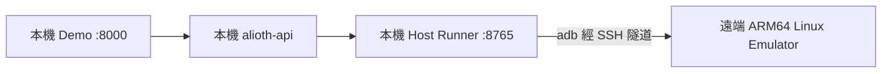

# ARM64 Linux 伺服器 + 官方 Emulator ARM 系統映像（不做轉譯）

> **本包主路線**。宿主 CPU 與 Android 映像同為 `arm64`，**不經過** libhoudini／libndk。  
> **約束**：不使用真機／裝置場；雷電僅過渡、非預設。

## 為什麼不能「本機換裝」

目前開發機是 **x86_64 Windows + WSL**（例如帶 NVIDIA RTX 的 PC）。  
**無法**把這台機器重裝成原生 ARM64 Linux——CPU 架構不支援。

正確形態：



- **本機（x86）**：只跑 API / Host Runner / Airtest 控制面  
- **遠端（ARM64）**：跑官方 Emulator + `arm64-v8a` 系統映像（KVM 加速）

## 建議開機規格（正式 ARM64 宿主）

本機 x86 上的 QEMU ARM64 VM（見下方「本機演練」）**不能**替代此規格：嵌套軟模擬無真正 ARM KVM。

| 項目 | 建議 | 最低可驗收 | 說明 |
|------|------|------------|------|
| 架構 | **aarch64** 裸機／雲實例 | 同左 | `uname -m` 必須是 `aarch64` |
| vCPU | **4** | 2 | Emulator + 系統；2 核會明顯變慢 |
| 記憶體 | **8–16 GB** | 8 GB | 系統約 2GB + Emulator 2–4GB + 餘量 |
| 磁碟 | **40–80 GB SSD** | 30 GB 可用 | SDK + `arm64-v8a` 映像 + AVD |
| 加速 | **`/dev/kvm` 可用** | 同左 | 無 KVM 則不通過正式驗收 |
| OS | Ubuntu **22.04 / 24.04** ARM64 | 同左 | 與安裝腳本對齊 |
| 網路 | 公網出站 + SSH 入站 | SSH 可連 | 下載 Google SDK；本機隧道連 5555 |
| GPU | 可選 | 無 | 有 GPU 較利廣告渲染；無 GPU 仍可驗「App 不閃退」 |

雲實例對照（採購用）：

| 雲 | 類型方向 | 備註 |
|----|----------|------|
| Oracle Cloud | Ampere A1（常有 Always Free 額度） | 4 OCPU / 24GB 額度內可拆一台夠用 |
| AWS | Graviton（如 `t4g.large` / `c7g.xlarge`） | 需開 nested virtualization／確認 KVM |
| Azure / GCP | ARM 系列同等 | 同樣驗 `/dev/kvm` |

## 伺服器採購／驗收檢查表

| # | 條件 | 驗收命令／標準 |
|---|------|----------------|
| 1 | CPU 為 **aarch64** | `uname -m` → `aarch64` |
| 2 | 有 KVM | `ls /dev/kvm` 存在；`kvm-ok` 或同等通過 |
| 3 | 記憶體建議 ≥ 8GB（模擬器另占 2–4GB） | `free -h` |
| 4 | 磁碟建議 ≥ 30GB 可用（SDK + 映像） | `df -h` |
| 5 | （建議）GPU | 有則廣告渲染較穩；無 GPU 仍可驗證「App 不閃退」 |
| 6 | SSH 可從本機連入 | `ssh user@<host>` |
| 7 | 可出網下載 SDK | 或預先離線拷貝 SDK |

不合格範例：x86 VPS、無 `/dev/kvm` 的雲主機、本機 x86 WSL／本機 QEMU ARM64 嵌套 VM（僅能當控制面或腳本演練）。

## 本機演練（x86 上 QEMU ARM64，非正式宿主）

已裝好時：

```powershell
powershell -File scripts/start-local-arm64-vm.ps1
powershell -File scripts/wait-local-arm64-vm.ps1
ssh -p 2222 alioth@127.0.0.1   # 密碼 alioth
```

VM 內可見 `uname -m=aarch64`，但 **沒有** `/dev/kvm`。安裝演練可：

```bash
sudo ALIOTH_ALLOW_NO_KVM=1 bash scripts/arm64-linux-install-android-emulator.sh
```

此路徑只驗證腳本與套件下載；**不能**當成正式跑純 ARM Flutter APK 的宿主。

本機實際結果（2026-07）：

1. 已裝好：Ubuntu aarch64 + Emulator `34.2.3`（linux_aarch64）+ AVD `Alioth_ARM64_API30`  
2. 啟動失敗：日誌出現 `kvm is not enabled on this aarch64 host` 後 `buffer overflow detected` 崩潰  
3. 原因：x86 上 QEMU 嵌套 ARM64，無真正 KVM；Emulator 內再建 `qemu-system-aarch64` 不可用  

正式環境必須：**原生 aarch64 + `/dev/kvm`**（見上方規格表）。

## 遠端一次安裝

在 **ARM64 Ubuntu 22.04/24.04** 上：

```bash
# 上傳或 git clone 本倉庫後：
sudo bash scripts/arm64-linux-install-android-emulator.sh
```

預設：

- SDK：`/opt/android-sdk`
- AVD：`Alioth_ARM64_API30`（`system-images;android-30;google_apis;arm64-v8a`）
- Emulator：AOSP CI `sdk-repo-linux_aarch64-emulator-*.zip`（`sdkmanager` 在 linux-aarch64 **沒有** `emulator` 套件）
- 加速：`emulator -accel on`（KVM）

啟動模擬器：

```bash
bash scripts/arm64-linux-start-android-emulator.sh
# 等待 boot_completed=1 後，本機 adb 看到的是遠端 5555（經隧道）
```

## 本機接 Demo（SSH 隧道）

遠端模擬器預設只聽 `127.0.0.1:5555`。本機開隧道：

```powershell
# 終端 A：保持隧道
ssh -N -L 5555:127.0.0.1:5555 user@<ARM64_HOST>

# 終端 B：Host Runner
$env:ALIOTH_DEVICE_BACKEND = "redroid"
$env:ALIOTH_REDROID_ADB = "127.0.0.1:5555"
powershell -File scripts/start-mobile-demo-remote-arm64.ps1
```

`.env.local`：

```text
ALIOTH_DEVICE_BACKEND=redroid
ALIOTH_REDROID_ADB=127.0.0.1:5555
```

Demo：http://127.0.0.1:8000/api/v1/mobile-demo/demo

## 驗收標準（這支純 ARM Flutter 包）

1. 遠端 `uname -m` = `aarch64`，`/dev/kvm` 可用  
2. `adb shell getprop ro.product.cpu.abi` = `arm64-v8a`（**無** native.bridge／houdini）  
3. 目標 APK `adb install` Success  
4. 啟動後進程存活，**無** SIGILL／SIGSEGV 閃退  
5. （有 GPU 時）再驗廣告素材；無 GPU 時先以「能進 App」為里程碑  

## 與舊路線對照

| 路線 | 狀態 |
|------|------|
| x86 Emulator + libndk | SIGILL，排除 |
| Genymotion + houdini | Flutter SIGSEGV，排除為本包主路線 |
| x86 上跑 arm64 AVD | Emulator 36 禁止；舊版易 hang，排除 |
| **ARM64 宿主 + ARM 映像** | **主路線** |
| 雷電 | 僅 Windows 過渡 |

詳見歷史記錄：[genymotion-kvm.md](./genymotion-kvm.md)（轉譯／x86 失敗紀錄）。
