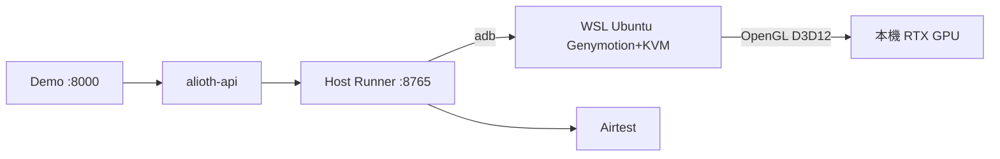

# 本機 x86 轉譯路線失敗紀錄（Genymotion / Emulator）

> **本包主路線已改為**：[`arm64-linux-emulator.md`](./arm64-linux-emulator.md)（ARM64 Linux 伺服器 + ARM 系統映像，不做轉譯）。  
> 本文僅保留本機 x86／WSL 上已排除方案的實測紀錄，避免重複踩坑。

## 問題定性（已實測）

| 方案 | 純 ARM Flutter APK（`me.mfanv.npymci`） | 廣告畫面 |
|------|----------------------------------------|----------|
| 官方 Emulator x86_64 + libndk | **SIGILL**（轉譯崩潰） | — |
| Genymotion x86 + libhoudini | **可安裝**；Flutter `libflutter.so` **SIGSEGV**（轉譯崩潰） | 未達可驗收 |
| 官方 Emulator **arm64-v8a** API30（x86 宿主 + Emulator 36） | **無法啟動**：FATAL「arm64 not supported on x86_64 host」 | — |
| Emulator **31.3.13** + **API27 arm64**（x86 宿主，QEMU 全模擬） | 可啟動 `qemu-system-aarch64`，但約 2–4 分鐘後 **hanging thread** 退出，**未能 boot_completed** | — |
| **ARM64 Linux 宿主** + ARM 系統映像 | **不做轉譯**（唯一主路線） | 取決於 GPU |
| 雷電（Windows） | 可用 | 正常；**僅過渡**，非預設、非伺服器方案 |

> **約束**：不使用真機／裝置場；文件與方案討論也不再把真機當備選。

結論（不做轉譯）：在本機 **x86** 上，API≤27 arm64 + 舊版 Emulator 已實測仍無法穩定開機（QEMU hang）。  
要跑這支包且避開轉譯器，主路線只能是：**ARM64 Linux 伺服器 + ARM 系統映像**。

## 目標架構（本機 = 伺服器同構縮小版）



伺服器落地：把 WSL 換成「有 `/dev/kvm` + GPU 驅動」的 Linux 主機；`ALIOTH_DEVICE_BACKEND=redroid` 遠端 adb、Host Runner、Airtest 不變。

## 本機一次安裝

```powershell
# 1) 安裝 Genymotion 到 WSL（/root/genymotion）
wsl -d Ubuntu-24.04 -e bash /mnt/f/alioth/scripts/wsl-install-genymotion.sh

# 2) 啟動 GUI（需登入試用/授權）
powershell -File scripts/start-genymotion-wsl.ps1

# 3) 建立 Android 11 虛擬機（建議名稱）
#    gmtool admin create "Google Nexus 5" "Android 11.0" "Alioth Nexus5 A11" --root-access on --nbcpu 4 --ram 3072

# 4) 刷入 libhoudini + 修補 arm64 ABI（預設 VM=Alioth Nexus5 A11）
wsl -d Ubuntu-24.04 -e bash /mnt/f/alioth/scripts/wsl-flash-genymotion-houdini.sh
# 若 flash 失敗，腳本會 push zip 內容；並呼叫 wsl-patch-genymotion-arm64-abi.sh
```

工具包：`.alioth-mobile-demo/tools/genymotion-a11-libhoudini-system.zip`（社群 A11 houdini）。

### GPU 環境變數（啟動 player 前必設）

已寫入 `scripts/wsl-start-genymotion.sh` / `wsl-start-genymotion-player.sh`：

- `GALLIUM_DRIVER=d3d12`
- `MESA_LOADER_DRIVER_OVERRIDE=d3d12`
- `MESA_D3D12_DEFAULT_ADAPTER_NAME=NVIDIA`
- `LIBGL_ALWAYS_SOFTWARE=0`

驗證：`glxinfo -B` 或 Genymotion/player 日誌出現 `D3D12 (NVIDIA GeForce ...)`，而非 llvmpipe。

### ABI 驗收

```text
adb shell getprop ro.product.cpu.abilist
# 期望含 arm64-v8a
adb shell getprop ro.dalvik.vm.native.bridge
# libhoudini.so
```

注意：Genymotion 原廠 `init.genymotion.abi.sh` **只開 32-bit ARM**；必須用 `wsl-patch-genymotion-arm64-abi.sh` 補 `abilist64`，否則會走 32-bit 路徑。

## 接回 Alioth Demo

`.env.local`：

```text
ALIOTH_DEVICE_BACKEND=redroid
ALIOTH_REDROID_ADB=127.0.0.1:6562
```

（埠號以 `adb devices` / `gmtool admin list` 為準。）

```powershell
powershell -File scripts/start-genymotion-wsl.ps1
powershell -File scripts/start-mobile-demo-genymotion.ps1
```

Demo：http://127.0.0.1:8000/api/v1/mobile-demo/demo

預設 VM 名：`Alioth Nexus5 A11`（可用環境變數 `ALIOTH_GENYMOTION_VM_NAME` 覆寫）。

## 伺服器搬運檢查表（最低條件）

1. `ls /dev/kvm` 且 `kvm-ok`（或同等 nested virt）通過  
2. 可用 GPU（NVIDIA 驅動 + OpenGL/EGL）；**無 GPU 則只保證能開模擬器，不保證廣告素材**  
3. 同套 Genymotion Desktop + Android 11 + libhoudini + arm64 ABI 補丁  
4. Host Runner / API：`ALIOTH_DEVICE_BACKEND=redroid`，`ALIOTH_REDROID_ADB=<模擬器 serial>`  
5. 現有無 KVM VPS（例如曾測 `192.46.230.40`）標為 **不合格**，需換機或開 nested virt  

### 本支 Flutter APK 額外條件

約束：**不使用真機／裝置場**。

若必須跑**現有純 ARM Flutter 包**且 x86 轉譯仍崩潰：

- **唯一主路線**：**ARM64 Linux 宿主 + ARM 系統映像**（官方 Emulator arm64；宿主與映像 ABI 一致，不做轉譯）
- 可選加速：研發日後提供 **x86_64 / universal APK**（非現況依賴）
- Windows 過渡演示可用雷電，但**不當預設、不當伺服器方案**

## 與其他後端對照

| 後端 | 說明 |
|------|------|
| **本頁 Genymotion WSL** | Linux 可搬運主路線；GPU 用 D3D12→NVIDIA |
| 官方 Emulator（WSL/Windows） | 此 Flutter 純 ARM 包 **SIGILL**，排除 |
| `ldplayer` | 廣告／Airtest 最穩；僅 Windows |
| 遠端無 KVM 雲機 | 不可跑 Genymotion/KVM |

## 常見問題

- 缺 `libpulse-mainloop-glib`：`apt install -y libpulse-mainloop-glib0`（已寫入安裝腳本）  
- `gmtool device flash` 失敗：改手動 `adb remount` + push zip 內容，再跑 arm64 ABI 補丁  
- Android **15** 映像不可用 A11 houdini（zygote 會 restarting）；必須 **Android 11.0**  
- Docker Desktop 與 Ubuntu WSL 共用記憶體，建議 Ubuntu ≥ 8GB  
