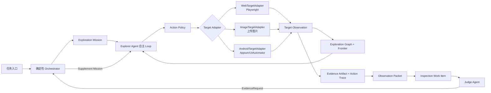

# Alioth V2 Explorer Agent 设计规格

> 日期：2026-07-29
> 状态：已完成交互确认，待书面审阅
> 适用范围：Alioth V2 Explorer Agent
> 当前基线：`dev_1.0_back` / `6bc196d`

## 1. 目标

Alioth V2 首期采用“双核心 Agent + 确定性 Orchestrator”：

- Explorer Agent 负责 Web/H5、上传截图、Android APK 的自主探索、动作留痕、证据留存和覆盖收敛。
- Judge Agent 独立消费标准 Observation Packet，负责规则判定。
- Orchestrator 使用确定性代码负责 Agent 调度、预算、重试、取消、补证回流和完成门禁。
- Explorer 与 Judge 使用持久化协议交接，不共享浏览器、模拟器会话或模型对话历史。

本规格只展开 Explorer Agent。Judge 的内部判定、Review Agent、Report Agent、完整动态 Agent DAG 和真机池不在本次实施范围内。

## 2. 已确认决策

| 决策项 | 结论 |
| --- | --- |
| APK 质检方式 | 安装到 Android 模拟器，使用 Appium/UIAutomator 动态探索 |
| 截图范围 | 探索过程自动截图 + 用户上传截图作为独立质检目标 |
| 首期 Agent 粒度 | Explorer Agent + Judge Agent；确定性 Orchestrator 调度 |
| Android 环境 | 模拟器优先，真机池后置 |
| 动作权限 | 低风险动作自主执行；敏感/高风险动作代码级阻断或转人工确认 |
| 探索完成条件 | Frontier 耗尽或预算耗尽；必须报告已覆盖、未覆盖和停止原因 |
| 补证 | Judge 发结构化请求，Orchestrator 派给 Explorer；最多有限轮次 |
| 实施顺序 | Web 双 Agent 解耦 → 上传截图 → Android 基建 → APK 自主探索 |

## 3. 当前项目基线

### 3.1 已具备能力

当前代码已经具备 V2 Explorer 的主要基础设施：

- `services/api/app/agents/runtime/agent_factory.py`：V1 Main Agent 工厂、运行时护栏和受监督派发。
- `services/api/app/agents/runtime/working_memory.py`：单次 Run 工作记忆。
- `services/api/app/agents/runtime/action_trace.py`：Tool 调用动作轨迹。
- `services/api/app/agents/runtime/loop_guard.py`：步数、时间与无进展保护。
- `services/api/app/agents/tools/page_capture_tools.py`：Playwright 页面采集和证据持久化。
- `services/api/app/infrastructure/browser/page_capture.py`：Web 页面执行与采集。
- `services/api/app/infrastructure/db/page_exploration_repository.py`：Web Frontier 动作持久化。
- `qc_task_page_node`：任务页面节点投影。
- `qc_page_exploration_action`：Web 动态探索动作。
- `qc_page_capture`、`qc_evidence_artifact`、`qc_observation_packet`：页面、证据与 Judge 输入。
- `qc_inspection_work_item`、`producer_agent_run_id`、`consumer_agent_run_id`：探索生产者与质检消费者的持久化交接。
- `waiting_evidence → pending`：证据不足后的回流状态基础。

### 3.2 当前缺口

- `services/api/app/agents/orchestrator/` 仍是规划骨架，没有可运行的 V2 调度器。
- 当前执行入口只创建一个 `MainAgent`，探索和判定仍属于同一 Agent Run。
- 任务模型以 `target_url` 为中心，没有目标类型、APK、上传截图或设备配置契约。
- `qc_task_page_node` 与 `qc_page_exploration_action` 是 Web 页面语义，不能稳定表达 APK 界面和静态图片。
- 没有 Android 模拟器池、设备租约、APK 安装、Appium/UIAutomator Adapter。
- 上传截图目前是证据输出，不是独立任务输入。
- 缺少目标无关的 Exploration Mission、状态图、Coverage Snapshot 和 Evidence Request。

## 4. 方案比较

### 4.1 方案 A：渐进式双核心 Agent（采用）

先在现有 Web 链路拆出 Explorer/Judge，再复用同一协议接入上传截图和 APK。

优势：

- 最大化复用现有工作项、Observation Packet、证据表与运行时中间件。
- 每阶段可独立验收、灰度和回滚。
- 不需要首期实现完整动态 Agent DAG。
- 避免 Web、图片和 APK 形成三套质检状态语义。

代价：

- 首期 Orchestrator 以确定性代码为主。
- Planner、Execution、Evidence 等更细 Agent 角色后置。

### 4.2 方案 B：三套目标专用链路（不采用）

为 Web、图片、APK 分别建设 Explorer/Judge 流水线。短期局部实现直观，但会重复状态机、证据、权限、补证和报告逻辑，长期维护成本最高。

### 4.3 方案 C：一次实现完整 Agent 群（不采用）

直接落地 Planner、Explorer、Execution、Evidence、Judge、Review、Report 动态 DAG。最终形态完整，但状态恢复、跨 Agent 预算、调度和验收复杂度会同时放大，不符合当前渐进演进原则。

## 5. Explorer Agent 职责边界

### 5.1 必须负责

- 读取 `ExplorationMission`，理解目标类型、范围、预算和动作策略。
- 基于当前观察、状态图与 Frontier 自主选择下一步低风险动作。
- 通过受控 Tool 请求执行动作，不直接访问 Playwright、Appium、数据库或对象存储。
- 每步动作前后生成可关联的状态、证据和 Action Trace。
- 维护已访问状态、待探索入口、重复状态、阻断入口、预算消耗和停止原因。
- 输出 `complete / partial / blocked / failed / cancelled` 中的明确终态。
- 接受 Judge 的结构化 `EvidenceRequest`，在独立预算内执行有限定向补采。

### 5.2 明确不负责

- 不判定规则 `pass / fail / warning`。
- 不直接写 `qc_rule_execution`。
- 不持有 Judge 的完整规则执行上下文。
- 不自行提升敏感或高风险动作权限。
- 不把模型对话历史作为持久化事实源。
- 不为三类目标创建互不兼容的状态和证据语义。

## 6. 总体架构



### 6.1 Orchestrator 边界

Orchestrator 不做页面或界面决策，只负责：

- 创建 Mission；
- 分配浏览器或设备会话；
- 选择目标 Adapter；
- 设置预算、Feature Flag、取消与重试策略；
- 启动 Explorer Run；
- 发布工作项；
- 接收并限制 Judge 补证请求；
- 执行最终完成门禁。

### 6.2 Explorer Runtime

首期复用现有 Runtime，并按 Agent 角色组装：

- Explorer 只挂载目标观察、低风险交互、证据和覆盖相关 Tool。
- Judge Tool、正式规则写回 Tool 不对 Explorer 可见。
- `WorkingMemory` 演进为目标无关的 Exploration Working Memory。
- `LoopGuard` 增加状态数量、重复率、Frontier 和补证轮次预算。
- `ActionTraceMiddleware` 增加 Agent 角色、Mission、目标会话、前后状态和风险决策字段。

## 7. Target Adapter

### 7.1 公共接口

每个 Adapter 必须实现稳定的目标无关接口：

```python
class ExplorationTargetAdapter(Protocol):
    async def provision(self, mission: ExplorationMission) -> TargetSession: ...
    async def observe(self, session: TargetSession) -> TargetObservation: ...
    async def execute(
        self,
        session: TargetSession,
        action: ExplorationAction,
    ) -> ActionOutcome: ...
    async def close(self, session: TargetSession) -> None: ...
```

Adapter 只能返回结构化状态和证据引用，不向 Agent 暴露 Playwright Page、Appium Driver、数据库连接或对象存储客户端。

### 7.2 WebTargetAdapter

首期从现有 Playwright 链路抽取：

- 打开 URL、点击、滚动、普通文本输入、返回、等待；
- DOM、可见文本、截图、UI Snapshot、HAR、Console 和媒体状态；
- 同源导航、重复链接归一、弹窗清障和移动端视口；
- 复用 `page_capture_id` 与现有证据落库。

### 7.3 ImageTargetAdapter

上传截图是静态目标，不伪造交互 Loop：

- 校验文件类型、大小、尺寸、解码和哈希；
- 保存原图及规范化副本；
- 提取 OCR、视觉摘要和图片元数据；
- 每张图片生成一个 `TargetObservation`；
- 多图任务生成有序状态集合和统一 Coverage；
- 直接发布 Observation Packet，不启动浏览器或设备。

### 7.4 AndroidTargetAdapter

首期只支持 Android 模拟器：

- 设备租约和健康检查；
- 快照重置；
- APK 哈希、包名和签名元数据；
- 安装、启动、停止、卸载；
- Appium/UIAutomator 会话；
- 当前 Activity、Window、UI 层级树、可操作元素和截图；
- Logcat、崩溃与 ANR 摘要；
- WebView 上下文识别与切换；
- 外部 Intent、系统设置、安装下载、支付和敏感权限阻断。

真机差异、厂商 ROM 和设备云不进入首期验收。

## 8. 动作策略

### 8.1 默认允许

- 打开目标；
- 点击普通导航、标签和展开项；
- 滚动、滑动、返回；
- 普通文本框输入测试文本；
- 等待页面稳定；
- 切换 WebView 上下文；
- 关闭可证明为阻断物的普通弹窗。

### 8.2 默认阻断或转人工

- 登录、验证码和真实账号凭证；
- 提交、发布、删除、退出登录；
- 支付、购买、充值、转账；
- 下载文件、安装其他 APK；
- 打开外部 App 或未知 Intent；
- 授予通讯录、短信、电话、定位、相机、麦克风等敏感权限；
- 修改系统设置；
- 任何无法证明低风险的动作。

策略判定由代码完成。模型输出只能提出动作意图，不能覆盖权限结果。

## 9. 运行状态流

### 9.1 Mission 状态

```text
pending
  -> provisioning
  -> exploring
  -> evidence_ready
  -> completed | partial

任意非终态
  -> blocked | failed | cancelled
```

### 9.2 单步循环

```text
observe
  -> decide
  -> authorize
  -> execute
  -> persist trace/evidence/state
  -> update graph/frontier/coverage/budget
  -> converge or continue
```

持久化成功是进入下一步的前提。证据或状态落库失败时必须 Fail Closed，不得发布工作项。

### 9.3 完成判定

- `completed`：Frontier 耗尽，没有未处理补证请求，所有已执行动作和观察均完成持久化。
- `partial`：预算耗尽或部分入口不可达，但已有可用覆盖；必须记录未覆盖集合和停止原因。
- `blocked`：高风险动作、登录、会话无法恢复、不可清障阻断物或外部 Intent 导致无法继续。
- `failed`：执行器、数据库、对象存储或模型基础设施错误导致没有可信结果。
- `cancelled`：用户或系统取消。

## 10. 核心数据契约

### 10.1 ExplorationMission

```text
mission_id
task_id
target_kind = web | image | android_apk
target_ref
mode = baseline | supplement
producer_agent_run_id
budget
action_policy
scope
viewport_or_device_profile
supplement_request_id
created_at
```

### 10.2 TargetObservation

```text
state_id
mission_id
target_kind
canonical_locator
state_fingerprint
title_or_activity
artifact_ids
interactive_candidates
observed_at
metadata
```

### 10.3 ExplorationTransition

```text
transition_id
mission_id
before_state_id
action_type
action_target
action_arguments
risk_level
policy_decision
after_state_id
status
trace_id
duration_ms
failure
```

### 10.4 CoverageSnapshot

```text
mission_id
visited_state_ids
frontier_count
blocked_count
duplicate_count
budget_used
unresolved_targets
stop_reason
captured_at
```

### 10.5 EvidenceRequest

```text
request_id
task_id
rule_execution_id
source_work_item_id
requested_evidence_roles
target_hint
reason
round_no
max_rounds
status
```

### 10.6 ExplorationResult

```text
mission_id
status
state_ids
artifact_ids
coverage_snapshot_id
unresolved_targets
published_work_item_ids
producer_agent_run_id
```

## 11. 持久化策略

### 11.1 直接复用

- `qc_agent_run`
- `qc_agent_action_trace`
- `qc_page_capture`
- `qc_evidence_artifact`
- `qc_observation_packet`
- `qc_inspection_work_item`
- `qc_inspection_work_item_rule`
- `qc_inspection_attempt`

### 11.2 新增目标无关模型

建议新增：

- `qc_exploration_mission`
- `qc_exploration_state`
- `qc_exploration_transition`
- `qc_exploration_coverage_snapshot`
- `qc_evidence_request`

### 11.3 Web 兼容策略

`qc_task_page_node` 与 `qc_page_exploration_action` 首期继续保留：

- 作为 Web 工作台和历史查询投影；
- 由新的目标无关状态/转换同步写入；
- 不在首期删除或直接改名；
- 新增 APK 和图片逻辑不得继续绑定“page”专属字段。

## 12. Judge 补证闭环

1. Judge 发现证据不足，创建结构化 `EvidenceRequest`。
2. Orchestrator 校验请求是否属于当前任务、规则和工作项。
3. 校验 `round_no <= max_rounds`，首期默认最多 2 轮。
4. 创建 `mode=supplement` 的新 Mission，绑定原状态和证据。
5. Explorer 只执行请求范围内的低风险补采。
6. 新证据产生新的 Observation Packet。
7. 原工作项从 `waiting_evidence` 回到 `pending`。
8. 超过轮次或仍不足时进入 `evidence_insufficient` 或人工复核。

Judge 不直接调用 Web 或 Android Tool。

## 13. 异常和恢复

| 场景 | 处理 | 结果 |
| --- | --- | --- |
| 浏览器/模拟器创建失败 | 基础设施有限重试，不进入 Agent Loop | `failed / provisioning_failed` |
| Tool 暂时失败 | 按幂等性重试，每次尝试留痕 | 恢复或动作失败 |
| 高风险动作 | 代码级拒绝 | 跳过入口或 `blocked` |
| 连续无新状态 | 指纹与 memory delta 检测 | 换 Frontier；无候选则 `partial` |
| 证据落库失败 | Fail Closed | `failed / evidence_persist_failed` |
| 会话丢失 | 新会话 + 持久化 Checkpoint + 低风险路径重放 | 恢复或 `blocked` |
| 模拟器污染 | 释放设备并恢复干净快照 | 重新 provision |
| 预算耗尽 | 保存覆盖和未完成项 | `partial / budget_exhausted` |
| 用户取消 | 取消 Tool、关闭会话、保存最后 Checkpoint | `cancelled` |

## 14. 测试策略

### 14.1 契约测试

- 三个 Adapter 返回相同版本的公共 Schema。
- Explorer 看不到 Judge 或规则写回 Tool。
- Judge 看不到浏览器、图片采集或 Android 执行 Tool。
- Mission、State、Transition、Coverage、EvidenceRequest 的版本和必填字段一致。

### 14.2 状态机测试

- 覆盖全部合法状态迁移。
- 非法回退、重复完成、过期租约和重复补证必须被拒绝。
- 工作项发布必须等待状态、证据和 Coverage 原子落库。

### 14.3 Web 端到端

- 多页导航、重复入口、弹窗清障、移动端视口。
- 登录、支付、下载、退出等敏感入口阻断。
- V1/V2 对同一夹具的页面覆盖和证据完整性对账。

### 14.4 图片端到端

- 单图、多图、重复图、超大图、损坏文件、非图片文件。
- OCR、视觉摘要、原图哈希和对象存储引用。
- 静态图片不得产生伪造交互动作。

### 14.5 Android 端到端

建设专用测试 APK，覆盖：

- 原生页面导航；
- 列表和滚动；
- 普通弹窗；
- 敏感权限弹窗；
- WebView；
- 外部 Intent；
- 崩溃和 ANR；
- 返回栈；
- 重复界面和动态内容。

### 14.6 故障注入

- 模型超时；
- Playwright/Appium Tool 超时；
- 对象存储失败；
- PostgreSQL 写入失败；
- 模拟器重启；
- Appium 会话丢失；
- Worker 取消和重启。

### 14.7 审计完整性

每个实际动作必须能关联：

- Mission 和 Agent Run；
- 前状态和后状态；
- 风险等级与策略决定；
- Tool 输入输出摘要；
- 证据 Artifact ID；
- 耗时、重试、成本和最终状态。

## 15. 交付路线

### M0：契约冻结

目标：确定 Explorer 的稳定领域边界。

交付：

- 六个核心契约；
- Agent 角色权限；
- Mission 状态机和错误码；
- V1/V2 Feature Flag；
- Web 兼容投影策略；
- 契约测试。

出口：所有契约测试通过，不依赖真实浏览器、图片或 Android 驱动。

### M1：Web Explorer/Judge 解耦

目标：在现有 Web/H5 链路真正形成两个 Agent Run。

交付：

- `ExplorerAgent` 工厂和专属 Instructions；
- Explorer Tool 白名单；
- 确定性 Orchestrator 最小实现；
- WebTargetAdapter；
- Explorer 只发布 Observation Packet 与 Inspection Work Item；
- Judge 使用独立 `consumer_agent_run_id` 消费；
- V1/V2 Shadow 对账。

出口：

- Web 双 Agent 端到端通过；
- Explorer 不能写正式规则结果；
- Judge 不能操作浏览器；
- V1/V2 对固定任务集的有效页面和证据口径可对账。

### M2：上传截图目标

目标：图片作为独立任务输入。

交付：

- 任务目标模型支持 `target_kind=image`；
- 多图上传和对象存储；
- ImageTargetAdapter；
- OCR/视觉摘要；
- 静态 Coverage 和 Observation Packet；
- 工作台上传、预览和任务状态。

出口：单图和多图任务都能形成标准 Packet 并交给 Judge。

### M3：Android 执行基础设施

目标：先让确定性代码稳定控制 APK，不立即接 Agent。

交付：

- Android 模拟器镜像；
- 设备池与租约；
- 快照重置；
- APK 存储、校验、安装和卸载；
- Appium 服务和会话；
- UI 层级树、截图、Logcat 与健康检查；
- AndroidTargetAdapter 的确定性测试。

出口：不依赖 LLM 的脚本能完成 APK 安装、启动、观察、低风险动作和清理。

### M4：APK 自主探索

目标：AndroidTargetAdapter 接入 Explorer Loop。

交付：

- Android 界面状态指纹；
- 可操作元素候选；
- 返回栈和 Frontier；
- 权限弹窗与外部 Intent 策略；
- WebView 识别和上下文切换；
- Android Coverage；
- 测试 APK 端到端。

出口：Explorer 能在预算内覆盖测试 APK，并完整报告重复、阻断和未覆盖界面。

### M5：补证与恢复

目标：完成 Judge → Explorer 的有限补证和 Explorer Checkpoint 恢复。

交付：

- EvidenceRequest API 和持久化；
- 最多 2 轮的独立补证预算；
- Supplement Mission；
- 低风险路径重放；
- 重复请求幂等；
- 过期请求和会话丢失处理。

出口：证据不足可补齐并重新消费，或明确进入 `evidence_insufficient/review`。

### M6：灰度与运营

目标：按目标类型逐步把 V2 设为默认。

交付：

- V1/V2 Shadow 对账；
- 覆盖率、证据完整率、重复状态率、阻断率；
- 补证成功率、平均步数、单任务成本、P95 时长；
- Web → 图片 → APK 分目标 Feature Flag；
- 回滚手册和高频回归规则。

出口：各目标达到指标阈值后独立开启 V2 默认路径。

## 16. 优先级

| 优先级 | 范围 | 原因 |
| --- | --- | --- |
| P0 | M0、M1 | 先证明 Explorer/Judge 真正解耦，是所有后续目标的基础 |
| P1 | M2、M3 | 扩展输入和 Android 执行能力，但不提前复制 Agent 逻辑 |
| P2 | M4、M5 | 在稳定 Adapter 上增加 APK 自主性和补证恢复 |
| P3 | M6 | 有稳定数据后再做规模化灰度 |

禁止在 M1 完成前单独建设一套 APK Agent。

## 17. 验收指标

首期建立以下指标，具体生产阈值在 M6 基于 Shadow 数据确定：

- 探索完成率；
- 有效状态覆盖率；
- Frontier 收敛率；
- 重复状态率；
- 高风险动作拦截率；
- Action Trace 完整率；
- 证据持久化完整率；
- 工作项发布成功率；
- 补证成功率；
- 单任务平均步数、Token、成本和 P95 时长；
- 模拟器 provision 成功率；
- 会话恢复成功率。

硬性门禁：

- 高风险动作拦截率必须为 100%；
- Explorer 越权写 `qc_rule_execution` 必须为 0；
- Judge 获得执行器 Tool 的情况必须为 0；
- 没有持久化证据不得发布工作项；
- `partial/blocked/failed` 不得显示为 `completed`。

## 18. 风险与缓解

| 风险 | 缓解 |
| --- | --- |
| 为三类目标过度抽象 | 只统一 Mission、Observation、Transition、Coverage 与 Evidence；底层动作保持 Adapter 专属 |
| APK 环境不稳定 | M3 先做确定性基础设施，Agent 接入后置 |
| Explorer 自由度导致不可控 | Tool 白名单、代码级 Action Policy、预算和无进展检测 |
| 状态图爆炸 | 指纹去重、动态内容归一、目标数量和深度预算 |
| 补证无限循环 | 独立预算、最多 2 轮、过期与重复请求幂等 |
| V1/V2 结果漂移 | Shadow 对账、分目标 Feature Flag 和可回滚投影 |
| Web 专属表阻碍 Android | 新建目标无关主模型，旧表只作兼容投影 |

## 19. 非目标

- 真机池和厂商 ROM 适配；
- iOS IPA；
- 完整 Planner Agent；
- 动态 Agent DAG；
- Judge 内部判定重构；
- Review/Report Agent；
- Agent 配置后台；
- 跨任务长期记忆和自我进化；
- 绕过登录、验证码、支付或系统安全策略。

## 20. 完成定义

Explorer Agent V2 首期完成必须同时满足：

1. Web、上传截图、Android APK 均通过统一 Mission 与结果契约接入。
2. Web 与 APK 的每个实际动作都有可关联的前后状态、风险决定、Action Trace 和证据。
3. Explorer 与 Judge 使用不同 Agent Run，且 Tool 权限严格隔离。
4. Judge 只能通过结构化 EvidenceRequest 请求补采。
5. 每种终态都有明确覆盖、未覆盖与停止原因。
6. V1 兼容路径可通过 Feature Flag 回滚。
7. 相关通用规则同步更新 `docs/专项能力与高频回归规则.md`。
