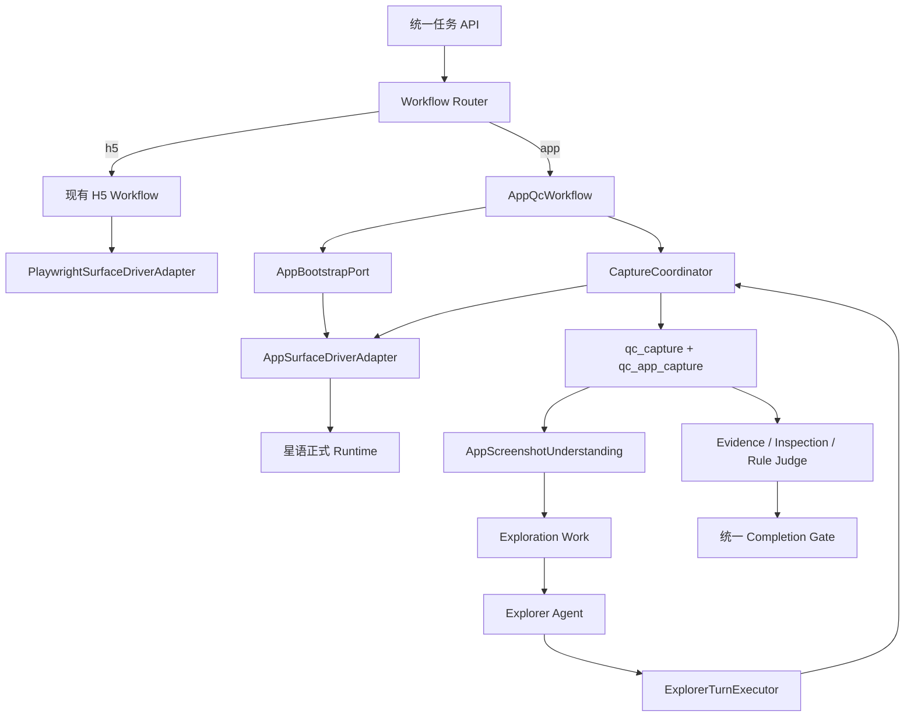

# App 质检 Workflow 与截图探索边界设计

## 1. 文档状态

- 日期：2026-08-04
- 基线分支：`dev_1.5`
- 实施分支：`feat/app-qc-workflow`
- 适用范围：青云负责的 Alioth 任务、Workflow、Interaction Runtime、Capture、Explorer、Evidence、Inspection 和工作台接入
- 外部协作方：星语负责的 Android 设备、APK 安装、App 启动、截图和设备内动作执行服务
- 输入契约：`alioth-app-qc-api-for-qingyun.md`、`alioth-app-capability-manifest-actionintent.md`

本文冻结 H5 与 App 的工作流边界。H5 继续使用 Playwright 移动视口和现有流程；App 新增独立 Workflow，第一期只支持 Android、单设备会话和截图观察，不依赖 DOM、UI Tree 或可见文本。

## 2. 目标与非目标

### 2.1 目标

1. 使用同一任务 API 创建 H5 或 App 质检任务，不增加 `/app-tasks`。
2. App Workflow 显式完成设备会话、APK 安装、App 打开、首屏截图和 Explorer 启动门禁。
3. 青云只通过稳定端口调用星语服务，Explorer、Judge 和业务代码不能接触 ADB、Airtest、Appium、模拟器命令或 Demo URL。
4. App 截图进入统一 Capture、Artifact、Observation、Inspection 和 Rule Execution 事实链。
5. Workflow、Worker 或外部 API 重试时保持幂等，并能从 PostgreSQL 检查点恢复。
6. 正式星语 API 未交付前，使用 FakeApp 完成青云侧端到端开发；Demo API 仅做隔离烟测。
7. H5 现有 Playwright 行为和历史 `qc_page_capture` 查询保持兼容。

### 2.2 非目标

1. 第一期不支持 iOS、矩阵设备、多设备并行或应用商店安装。
2. 第一期不依赖 UI Tree、Appium locator、XPath、CSS selector、OCR 文本或完整可访问性树。
3. 第一期不允许 Explorer 自由输入文字；`input` 能力固定返回 `ACTION_UNSUPPORTED`，不得 no-op。
4. Demo API 的脚本探索结果不计入正式质检结果。
5. 不新增第二套任务终态、规则执行结果或 Redis 业务状态源。

## 3. 契约裁决

### 3.1 Demo 与正式 Runtime

`/api/v1/mobile-demo/*` 是已上线的演示接口。它把上传 APK、占用设备、安装、打开、脚本探索和截图合并为一个异步 Run，不能提供青云 Workflow 所需的动作级控制。因此：

- Demo Client 只能在开发或联调环境启用；
- Demo `run_id`、`queued/running/succeeded/failed` 只属于 Demo Integration Attempt；
- Demo 状态不能覆盖 `qc_task`、`qc_surface_session`、`qc_v2_work_item` 或 `qc_action_execution`；
- Demo 截图路径必须下载、校验并重新存入青云对象存储，不能直接作为平台 `artifact_id`；
- 正式 App Workflow 只能依赖 `AppBootstrapPort` 和 `SurfaceDriver`。

### 3.2 业务平台与运行时 Surface

业务入口和运行时使用不同枚举：

| 业务 `TaskTargetPlatform` | 运行时 `SurfaceKind` | Workflow |
| --- | --- | --- |
| `h5` | `web` | 现有 Playwright 移动视口流程 |
| `app` | `android` | 新 AppQcWorkflow |
| `web` | `web` | 预留桌面 Web 流程 |

外部星语协议的 `surface_kind=app` 在 Adapter 边界映射为青云 `SurfaceKind.ANDROID`。青云内部不增加含义模糊的 `SurfaceKind.APP`。

### 3.3 安装与打开

附件允许把安装并入 `start_session`，也允许使用 `execute.install_apk`。本项目选择显式步骤：

1. `start_session` 只建立和返回设备会话；
2. Workflow 调用 `AppBootstrapPort.ensure_installed` 并等待最终安装结果；
3. 安装成功后，Workflow 调用 `AppBootstrapPort.open_app` 并等待最终打开结果；
4. 打开成功后，Workflow 发起 Bootstrap Capture；
5. 首屏截图校验并提交后，Session 才能进入 `active`，Explorer 才能收到 Exploration Work。

内部 `ActionIntent v1` 强制绑定 `source_capture_id` 和 Capture Profile，适用于已有 Capture 后的 Explorer 动作，不用于首屏前安装和打开。`AppBootstrapPort` 由同一个星语 Adapter 实现，Adapter 再把安装和打开映射为外部 `SurfaceDriver.execute(install_apk/open)` 请求。因此外部仍只有统一 Driver，内部也不会把安装权限交给 Explorer。

### 3.4 观察能力

第一期正式能力固定为：

| 能力 | 状态 |
| --- | --- |
| session / install_apk / open / close_session | `ready` |
| click / scroll / back | `ready` |
| screenshot | `ready` |
| identity.package / identity.activity | 操作元数据，可选，不作为页面内容证据 |
| input | `unsupported` |
| visible_text / OCR | `unsupported` |
| ui_tree / accessibility hierarchy | `unsupported` |

Capability Manifest 必须按能力声明 `ready/partial/stub/unsupported`。上层不得因为缺少能力而构造 App 专用未版本化字段，也不得绕过 Adapter 直连设备工具。

## 4. 总体架构



### 4.1 组件职责

- `WorkflowRouter`：只根据持久化任务目标和锁定的 Workflow 版本选路。
- `AppQcWorkflow`：控制 App Bootstrap、首屏门禁、探索启动、取消、失败收口和 Session 关闭。
- `AppBootstrapPort`：表达安装和打开，不泄露外部 HTTP 或设备句柄。
- `AppSurfaceDriverAdapter`：完成青云合同与星语传输 DTO 的映射。
- `CaptureCoordinator`：保持同一 Session 严格串行，负责 before/action/after 采集顺序。
- `AppScreenshotUnderstanding`：把截图转为有界页面摘要和候选目标，不执行动作。
- `Explorer Agent`：只能从确定性 Frontier 选择 `candidate_id` 或返回终态。
- `ExplorerTurnExecutor`：解析候选目标、获取 Session Command Permit、调用 Runtime 并提交动作结果。
- `Inspection/Rule Judge`：只消费持久化 Observation 和 Evidence，不打开 App、不调用 Driver。

## 5. 任务与 APK 制品

### 5.1 任务目标

统一任务请求增加：

```json
{
  "target_platform": "app",
  "target_url": null,
  "task_config": {
    "app": {
      "platform_build_ref": "app-build:01J...",
      "package_name": "com.example.target",
      "device": {
        "backend": "cloud_phone",
        "profile_id": "default"
      }
    },
    "workflow_version": "v2"
  }
}
```

约束：

- `h5/web` 必须提供 HTTP(S) `target_url`；
- `app` 必须提供 `task_config.app.platform_build_ref`，`target_url` 必须为空；
- App 第一阶段只接受 Android APK；
- `workflow_version` 在任务创建时锁定，重试和恢复不能更换版本；
- 禁止用 `app://` 伪 URL、空字符串或 APK Base64 兼容旧字段。

### 5.2 平台构建制品

APK 是任务输入制品，不是质检输出证据。新增 `qc_platform_build`：

```text
id, platform, original_filename, storage_path, sha256, size_bytes,
package_name, version_name, version_code, status, created_by,
verified_at, created_at, updated_at
```

`POST /api/v1/app-builds` 接收 multipart APK，完成扩展名、文件头、大小、SHA-256 和存储校验，返回 `platform_build_ref`。创建任务只保存引用，不在任务队列和 Agent 上下文中传递 APK 二进制。

向星语传输 APK 时，优先使用短期签名地址、SHA-256 和大小。若正式 API 只接受 multipart，Adapter 从青云存储流式读取并上传；该差异不得进入 Workflow。

## 6. App Bootstrap 与恢复

### 6.1 状态机

```text
VALIDATING
→ ACQUIRING_SESSION
→ RESOLVING_BUILD
→ INSTALLING
→ INSTALLED
→ OPENING
→ OPENED
→ BOOTSTRAP_CAPTURING
→ APP_READY
→ EXPLORING
→ INSPECTING
→ FINALIZING
```

这些值是 App 子流程阶段，不是 `qc_task` 终态。`qc_task` 继续使用现有 `queued/running/review/done/failed/canceled`。

### 6.2 Bootstrap 检查点

新增一条每 Session 唯一的 `qc_app_bootstrap`：

```text
session_id, task_id, platform_build_ref, stage,
install_request_id, install_attempt, installed_package,
open_request_id, open_attempt, bootstrap_capture_id,
error_code, error_message, row_version,
started_at, ready_at, failed_at, updated_at
```

约束：

- `qc_surface_session.status` 在 Bootstrap 期间保持 `starting`；
- 首屏 CaptureCommitted 后，Bootstrap 进入 `APP_READY`，Session 原子切换为 `active`；
- Worker 重启后按 `stage` 恢复；
- 安装幂等键为 `session_id + platform_build.sha256`；
- 打开幂等键为 `session_id + package_name + cold_start_policy`；
- 相同设备、相同 APK checksum 可返回 `reused_existing=true`；
- checksum 不同只能按任务锁定的替换策略安装，Explorer 无权决定强制覆盖；
- 取消时先停止创建新 Work，再关闭当前 Session；
- 旧 lease 或旧 finalization epoch 的返回不得覆盖新 Worker 结果。

### 6.3 APP_READY 门禁

以下条件全部满足才算 `APP_READY`：

1. APK 安装返回最终成功，而非仅“已接收”；
2. App 打开返回成功；
3. 星语可返回前台确认时，`foreground_verified=true`；
4. Bootstrap Screenshot 返回有效 PNG；
5. 青云校验 content type、尺寸、字节数和 SHA-256；
6. 截图写入对象存储、`qc_capture`、`qc_app_capture` 和 Evidence Artifact；
7. `CaptureCommitted` 与 App Bootstrap Checkpoint 在同一数据库事务链中可重放。

## 7. Capture 数据模型

### 7.1 公共父实体

新增 `qc_capture` 作为公共身份和生命周期事实：

```text
id, task_id, agent_run_id, surface_kind, surface_session_id,
parent_capture_id, action_execution_id, capture_role,
session_command_sequence, capture_status, captured_at,
metadata, created_at, updated_at
```

`qc_page_capture` 保持 Web/H5 专属字段，主键以相同 UUID 引用 `qc_capture.id`。新增 `qc_app_capture`：

```text
capture_id, screenshot_artifact_id, package_name, activity,
width, height, orientation, image_signature, device_snapshot
```

`qc_capture` 是公共身份事实，两个子表是平台细节，不构成两个相互竞争的 Capture 状态源。

### 7.2 兼容迁移

1. 创建 `qc_capture`；
2. 以现有 `qc_page_capture.id` 原值回填公共父行；
3. 为后续 Web 写入建立同事务父子写入；
4. 将 V2 通用 FK 改为引用 `qc_capture`；
5. 新增 `qc_app_capture`；
6. 将核心表中的 `page_capture_id` 迁移为 `capture_id`；
7. 迁移窗口内保留只读兼容别名，并用约束保证它与 `capture_id` 一致；
8. 所有查询迁移完成后删除兼容别名。

需改为公共 Capture 的关系包括：Surface Session/Ref、Action Execution、V2 Work Item、Journey、Restoration、Evidence Exit Gate、Evidence Manifest、Evidence Artifact、Observation Packet、Inspection Work Item 和 Rule Execution。Web 专属的页面查询与 DOM 读取继续连接 `qc_page_capture`。

### 7.3 Capture Profile

新增按 Surface 选择的 `CaptureProfilePolicy`：

| 平台 | before/after 基础产物 |
| --- | --- |
| H5 | `screenshot, dom, visible_text, ui_snapshot, action_trace` |
| App | `screenshot, action_trace` |

Explorer 不再使用全局 `_BASE_ARTIFACTS`。Capability 校验在产生 Intent 前执行；App 请求 DOM、UI Tree 或 Visible Text 时立即返回明确能力缺口，不能调用 Driver 后再猜测。

## 8. 截图探索

### 8.1 Observation

`AppScreenshotUnderstanding` 读取已持久化 Screenshot Artifact，构造统一 Observation 和 Frontier Snapshot。数据库、Outbox、Redis 和 Agent JSON 只传 `artifact_id`；仅在受信任的多模态模型调用边界解析图片字节。

App Observation 至少包含：

```text
capture_id, screenshot_artifact_id, width, height, orientation,
image_signature, package_name, activity, visual_page_type,
visual_summary, candidate_targets, previous_action_result,
capability_snapshot
```

现有 `observation_packet.py` 的截图解码、缓存、大小约束和多模态输入装配应抽取复用。现有 `page_detection_tools.py` 中 URL、DOM、H5 Tabbar 和浏览器结构规则不能直接进入 App Understanding。

### 8.2 候选目标与坐标

视觉理解产生：

```text
candidate_id, semantic_name, action_type, normalized_bounds,
confidence, risk_level, purpose, expected_state_hint
```

Explorer 只能选择已有 `candidate_id`。`ExplorerTurnExecutor` 使用产生该候选的 `capture_id` 和截图尺寸，把 `normalized_bounds` 解析为目标点，再由 Adapter 转换成星语要求的坐标空间。Explorer 和公共业务 API 不传 Appium selector、XPath、CSS 或设备原始句柄。

坐标候选必须绑定源 Capture。屏幕发生旋转、尺寸变化或当前 Capture 不一致时，候选立即失效并重新观察，禁止在旧截图上继续点击。

### 8.3 探索动作

第一期 Explorer 可选择 `click/scroll/back/observe`。`install_apk/open/reset_app/input` 不进入 Explorer allowlist。每个页面变化必须有 before/action/after 账本；动作成功但 after capture 失败时保持 `evidence_failed`，不得伪装成 completed。

## 9. Evidence、Inspection 与规则

- `CaptureCommitted`、Evidence Manifest、Inspection Work Item、Inspection Attempt 和 `qc_rule_execution` 继续复用一套状态；
- Rule Matcher 根据锁定的规则版本和 App Capability Snapshot 筛选规则；
- 只需要 Screenshot/Action Trace 的规则可以执行；
- 要求 DOM、UI Tree、Visible Text 或浏览器网络数据的规则返回 `skipped` 或 `evidence_gap`；
- 缺证据不能被模型改写成 `passed`；
- Judge 禁止调用 Driver、重新打开 App 或读取星语 API；
- 最终结论必须关联 Agent 原始输出、规范化规则结果、Evidence 引用、Attempt、模型信息和 contract hash。

## 10. Capability Manifest

青云内部 Manifest 使用版本化描述符：

```text
CapabilityManifest
├── protocol_version
├── adapter_id
├── adapter_version
├── surface_kind
├── platform
├── backends
├── actions: Map[str, CapabilityDescriptor]
├── observations: Map[str, CapabilityDescriptor]
└── artifacts: Map[str, CapabilityDescriptor]

CapabilityDescriptor
├── status: ready|partial|stub|unsupported
├── target_modes
├── fields
└── notes
```

Adapter 将附件 `schema_version=1.0` 映射为内部 Manifest 版本。Manifest 必须在创建 App Session 前校验；正式运行至少要求 session、install、open、click、scroll、back、screenshot 和 close ready。

## 11. Feature Flag 与 Provider

使用以下单一职责配置：

- `ALIOTH_WORKFLOW_VERSION=v1|v2`：平台默认 Workflow 版本；任务创建时写入快照；
- `ALIOTH_APP_QC_ENABLED=false|true`：是否允许创建 App 任务；
- `ALIOTH_APP_RUNTIME_PROVIDER=fake|official`：App Runtime 注册点；
- `ALIOTH_MOBILE_DEMO_SMOKE_ENABLED=false|true`：是否允许调用 Demo Smoke Client。

规则：

- V1 拒绝 `target_platform=app`；
- App 任务必须锁定 V2；
- `mobile_demo` 永远不能成为 production provider；
- 同一个任务不能在运行中切换 provider；
- Feature Flag 只决定路由，不复制业务数据或终态。

## 12. 错误、重试与安全

统一错误至少包括：

```text
DEVICE_NOT_FOUND, DEVICE_BUSY, ADB_TIMEOUT, INSTALL_FAILED,
PACKAGE_MISSING, OPEN_FAILED, SESSION_CRASHED, ACTION_UNSUPPORTED,
ACTION_BLOCKED, CAPTURE_FAILED, CAPABILITY_MISMATCH,
ARTIFACT_CHECKSUM_MISMATCH, STALE_SESSION_LEASE
```

重试策略：

- 设备忙、网络超时和明确 retryable 的 5xx 可按预算退避重试；
- APK 非法、checksum 不一致、能力不支持和包名不匹配不可盲目重试；
- 外部超时后必须使用同一 idempotency key 查询或重放；
- 任何重试先重新 claim PostgreSQL 工作项和 Session Lease；
- Redis 只做唤醒，数据库是工作事实源。

安全约束：

- 鉴权 Token、Cookie、密码、签名密钥和设备句柄不得进入 Agent 上下文、ActionIntent、Redis 或审计明文；
- APK 下载地址使用短期签名并限制单个构建制品；
- APK 文件名不能决定包名和版本，正式元数据来自校验或安装结果；
- Demo `/stop` 必须携带当前青云拥有的 `run_id`，禁止无参数停止全部 Run；
- 截图和 APK 均校验大小、类型和 checksum。

## 13. 工作台

创建任务页面增加 H5/App 选择：

- H5：选择产品后展示只读 H5 URL，行为保持现状；
- App：上传或选择已验证 APK 构建，展示文件名、SHA-256、包名和版本，并选择允许的设备 Profile；
- 列表和详情使用统一 Target Summary，App 目标不渲染成超链接；
- App 任务详情展示 Session、安装、打开、首屏截图、探索、质检和收口阶段；
- App Capture 面板展示截图、包名、Activity、动作轨迹和证据质量，不展示 DOM 面板。

产品表第一阶段不直接保存 APK 二进制。产品快照记录产品身份，任务通过独立 `platform_build_ref` 锁定具体构建版本。

## 14. 青云与星语所有权

| 能力 | 青云 | 星语 |
| --- | --- | --- |
| 任务、Workflow、Work Item、终态 | 负责 | 不负责 |
| APK 制品、checksum、签名地址 | 负责 | 接收并校验 |
| 发起安装和打开 | 负责 | 执行并返回最终结果 |
| 设备、模拟器、ADB、Airtest | 不接触 | 负责 |
| 发起截图 | 负责 | 执行并返回截图 |
| `qc_capture/qc_app_capture` | 负责 | 不写入 |
| 截图视觉理解和 Frontier | 负责 | 不负责 |
| Explorer 与 ActionIntent 编排 | 负责 | 只执行映射后的动作 |
| Evidence、Inspection、Judge、报告 | 负责 | 不负责 |
| 原始设备错误 | 规范化并持久化 | 返回真实错误 |

## 15. Demo Smoke Client

`MobileDemoSmokeClient` 仅提供 `get_version/upload_apk/get_run/download_screenshot/stop_owned_run`。它不实现 `SurfaceDriver`，不注册到 App Workflow，不调用全局设备后端切换参与生产并发。

Smoke 验收只证明 APK 可上传、Run 可轮询、PNG 可下载并重新持久化、错误可读取。它不能证明安装和打开分步恢复、动作级点击、before/after Capture 或正式任务终态。

## 16. 测试策略

### 16.1 合同测试

- H5/App/Web 业务平台到 Surface 的映射；
- App 请求必须绑定 Platform Build，H5 必须绑定 URL；
- Manifest 能力状态、未知字段兼容和不支持能力拒绝；
- Bootstrap 请求/结果、CaptureRef、App Observation 的版本化序列化；
- Adapter 内外 `surface_kind`、Action 和错误代码映射。

### 16.2 持久化测试

- `qc_page_capture` 历史 UUID 原值回填 `qc_capture`；
- Web 父子 Capture 同事务写入；
- App Capture 不能出现 DOM/UI Tree 字段；
- 通用 FK 可引用 Web 或 App Capture；
- Bootstrap Checkpoint、幂等键、row version 和 lease 防止旧 Worker 覆盖；
- Outbox 与业务状态同事务提交，Redis 重复和乱序不改变最终事实。

### 16.3 Workflow 测试

- 安装失败、打开失败、首屏失败均不发布 Exploration Work；
- 首屏 CaptureCommitted 后才激活 Session；
- Worker 在 install/open/capture 任一阶段崩溃后安全恢复；
- 取消停止新工作并关闭 Session；
- FakeApp 可覆盖安装复用、超时、设备忙、截图失败和 Session Crash。

### 16.4 Explorer 与规则测试

- App Capture Profile 只请求 Screenshot/Action Trace；
- 候选绑定源 Capture，旋转或截图变化使候选失效；
- Explorer 不能选择 install/open/reset/input；
- DOM 型规则输出 evidence gap 或 skipped；
- Judge 代码依赖图不允许导入 Driver 或星语 Client。

### 16.5 回归测试

- 现有 H5 Playwright、页面识别、Evidence、Inspection、Rule Judge 和报告测试全部通过；
- 工作台 H5 创建流程不变；
- App Feature Flag 关闭时接口明确拒绝 App 任务；
- Production 配置拒绝 `mobile_demo` provider。

## 17. 交付拆分

该设计分成三个顺序交付、各自可测试和评审的实施计划：

1. **App QC Foundation**：ADR/合同、Task Target、Platform Build、Capability、通用 Capture 与 App Capture 数据迁移。
2. **App Workflow Runtime**：Workflow Router、Bootstrap Checkpoint、FakeApp、Capture Runtime、Session 激活和可靠恢复。
3. **Screenshot Exploration and Workstation**：截图理解、候选目标、Explorer 策略、Evidence/Inspection 能力门禁和工作台页面。

正式星语 HTTP Adapter 在第二项稳定端口上实现，是独立替换任务。接口到达前，前三项使用 FakeApp 完成测试；Demo Smoke Client 作为单独的非生产联调任务，不阻塞正式架构。

## 18. 完成标准

1. H5 继续走现有 Playwright Workflow，App 只走 AppQcWorkflow。
2. App 未达到 `APP_READY` 时没有 Explorer Work。
3. `qc_page_capture` 只承载 Web/H5 详情，`qc_app_capture` 只承载 App 详情，公共引用使用 `qc_capture`。
4. App 不请求 DOM、UI Tree 或 Visible Text。
5. Explorer、Judge 和规则代码不能访问星语 Client、ADB、Airtest 或 Driver 句柄。
6. Demo URL 不进入正式 App Workflow。
7. 重试不会重复安装已确认的同 checksum APK，也不会重复提交成功动作。
8. 旧 Lease 和旧 Finalization Epoch 不能覆盖新 Worker 结果。
9. 缺失证据产生明确 evidence gap 或 skipped，不能伪装 passed。
10. 任务、规则执行和报告继续使用现有统一终态与事实链。
