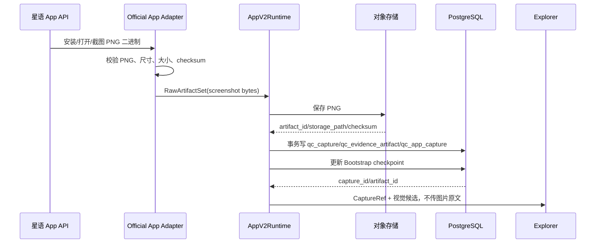

# App PNG 截图与真实 PostgreSQL 集成设计

## 目标

为 App Workflow 建立可上线的 PNG 截图持久化和真实 PostgreSQL 验收链路：星语接口返回 PNG 二进制，由 Official App Adapter 标准化为 `RawArtifact`，对象存储保存图片，PostgreSQL 保存 Capture、Artifact、App Capture、Bootstrap 检查点和视觉理解事实；两个 Worker 并发时只能有一个持有有效租约并写入事实。

## 范围与边界

本设计覆盖：

- 星语 PNG 二进制响应的校验、限流、checksum 和 Runtime 适配；
- Bootstrap 截图、动作前后截图的对象存储和 PostgreSQL 持久化；
- Bootstrap Lease 获取顺序、续期、过期和旧 Worker 拒写；
- 真实 PostgreSQL 单 Worker、双 Worker、租约过期接管和重复投递测试；
- App 截图只能产生 `screenshot` 与 `action_trace`，不产生 DOM、HTML、UI Tree 或 OCR 事实。

不在本阶段范围内：

- 不把 PNG 二进制写入 PostgreSQL `bytea`；
- 不改变 Web/H5 的 `qc_page_capture` 事实表；
- 不新增第二套任务终态、规则执行状态或 Redis 事实表；
- 不在截图入库阶段实现页面规则判断；
- 不在星语 API 未交付前伪造 Official Adapter 的生产能力。

## 核心决策

### 1. 存储分工

PNG 原文件进入现有 MinIO/对象存储；PostgreSQL 只保存可查询事实和对象引用。

| 数据 | 存储位置 |
| --- | --- |
| PNG 二进制 | MinIO 或本地测试对象存储 |
| Capture 身份、任务、Session、父子关系 | `qc_capture` |
| `artifact_id`、存储路径、类型、大小、checksum | `qc_evidence_artifact` |
| App 包名、Activity、宽高、方向、设备快照 | `qc_app_capture` |
| Bootstrap 截图检查点 | `qc_app_bootstrap.bootstrap_capture_id` |
| 截图理解结果、候选目标、结果 hash | `qc_app_visual_observation` |

`AppReadyHandoff`、Redis、Agent Working Memory 只传 `CaptureRef`、`artifact_id` 和引用型元数据，不传 PNG 内容。

### 2. PNG 标准化

Official Adapter 接收星语接口返回的 PNG 二进制，并转换为：

```python
RawArtifact(
    artifact_type="screenshot",
    content=png_bytes,
)
```

Adapter 或 `AppCapturePersistenceService` 必须校验：HTTP 状态、`image/png`、PNG 文件头、IHDR 宽高、最大字节数和 SHA-256。星语响应中的可选签名必须与本地计算值一致。截图元数据不得出现 DOM、HTML、visible text、UI tree 或 OCR 字段。

### 3. 入库事务

对象存储写入成功后，使用同一个 PostgreSQL 事务完成：

1. 插入 `qc_capture`；
2. 插入 `qc_evidence_artifact`；
3. 插入 `qc_app_capture`；
4. 更新 `qc_app_bootstrap.bootstrap_capture_id` 和 `row_version`；
5. 提交后发布只含引用的 `APP_READY` Outbox 事件。

PostgreSQL 事务失败时补偿删除对象；删除失败只记录孤儿对象指标，不能把任务标记为成功。

### 4. 租约顺序

Bootstrap 的正确顺序为：

```text
获取 Bootstrap Lease
→ 创建或确认 Starting Session
→ 调用安装/打开/截图外部 API
→ 持久化 Capture
→ 激活 Session
→ 发布 APP_READY 引用事件
```

每次外部 Driver/API 调用前后都要校验 lease owner、lease token、过期时间和 row version。Bootstrap Lease 需要独立续期；租约过期后旧 Worker 的状态、截图和 APP_READY 写入必须被 PostgreSQL 条件拒绝。

## 数据流



## 代码职责

### Official App Adapter

新增适配层只负责星语 API 和统一 Runtime 端口之间的转换：

- `AppBootstrapPort.ensure_installed`：安装 APK，返回结构化安装结果；
- `AppBootstrapPort.open_app`：打开包名，返回前台确认结果；
- `SurfaceDriver.start_session`：建立或恢复同一 App Session；
- `SurfaceDriver.capture`：请求 PNG，返回 `RawArtifactSet`；
- `SurfaceDriver.execute`：接收语义 `ActionIntent`，不接收 CSS/XPath/Appium locator；
- `SurfaceDriver.close_session`：关闭外部 Session。

Adapter 不直接写 PostgreSQL、不发布 Redis、不创建 Agent。持久化由 `AppCapturePersistenceService` 和 PostgreSQL Repository 完成。

### PostgreSQL 持久化

优先复用现有：

- `AppCapturePersistenceService.persist_bootstrap`；
- `AppCapturePersistenceService.persist_action_capture`；
- `PostgresAppCaptureRepository.save_bootstrap_capture`；
- `PostgresAppCaptureRepository.save_action_capture`；
- `PostgresAppVisualObservationRepository.save`。

仅当真实集成测试发现现有唯一约束无法表达星语请求幂等时，才新增最小迁移；PNG 二进制本身不需要新增数据库字段。

## 真实 PostgreSQL 测试设计

测试通过独立的 `ALIOTH_TEST_DATABASE_URL` 显式启用，执行 `alembic upgrade head` 后运行。对象存储使用隔离临时目录或测试 MinIO bucket。

### 单 Worker 截图入库

- 准备 App 任务、Verified APK Build、Running Agent Run、Starting Session 和 Bootstrap Lease；
- 注入固定合法 PNG 二进制；
- 执行 Bootstrap Capture 持久化；
- 断言三张 Capture 表各有一条记录，checksum、大小、宽高一致；
- 断言数据库没有 PNG 二进制列，Artifact 的 `storage_path` 可以读取原文件。

### 双 Worker 竞争

两个 Worker 使用不同的 owner/token，同时操作同一个 task/session：

- 只能一个 Worker 获取有效 Bootstrap Lease；
- 只能一个 Worker 成功写入 Capture；
- 最终只有一条 `qc_capture`、一条 `qc_app_capture` 和一条 Bootstrap 引用；
- 失败 Worker 必须得到结构化租约或版本冲突；
- 重试不会产生第二个 APP_READY 事实。

### 租约过期接管

- Worker A 获取租约后停止；
- 等待租约过期；
- Worker B 重新 claim 并完成截图入库；
- Worker A 恢复后所有旧 row version/token 写入均被拒绝；
- Worker B 的结果不被覆盖。

### 截图重放与视觉理解

- 同一 Bootstrap 重放返回已存在 Capture；
- 同一动作的 before/after Capture 绑定同一个 `action_execution_id` 和父 Capture；
- 同一 Capture 的视觉理解按 `capture_id/result_hash` 幂等；
- 视觉理解失败不能伪造规则通过，只能保留 evidence gap 或人工复核状态。

## 验收标准

- Official Adapter 可以接收真实 PNG 二进制并返回统一 `RawArtifactSet`；
- PNG checksum、尺寸和对象存储内容一致；
- PostgreSQL 是 Capture、Session、Bootstrap、视觉理解的唯一事实源；
- 双 Worker 竞争不会产生重复 Capture 或重复 APP_READY；
- 旧 Worker 在租约过期后不能继续调用或写回有效结果；
- Redis 和 Agent 上下文中不存在 PNG 原文；
- `qc_page_capture` 仍是 Web/H5 Capture 事实表；
- 真实 PostgreSQL 集成测试默认可跳过，但在设置 `ALIOTH_TEST_DATABASE_URL` 后必须完整通过；
- 现有单元测试、Ruff 和 `alembic heads` 单 head 检查保持通过。

## 风险与后续

- 星语 API 若返回的不是稳定的请求 ID，需要在 Adapter 层生成确定性幂等键；
- 对象存储写入和 PostgreSQL 事务不是同一原子系统，需要孤儿对象清理指标和定期 sweeper；
- 真实双 Worker 测试必须使用隔离数据库，禁止连接开发或生产库；
- Official Adapter 接入前，生产 App Worker 必须保持 fail-closed，不能回退到 H5 Main Agent。

## 星语 Official API 联调闸门与可观测性

星语 API 的本地验收使用 `httpx.MockTransport` 固化 HTTP path、认证头、幂等键、结构化响应和
PNG-only 边界。Adapter 对可重试的 408、429、502、503、504 与网络/超时失败最多重放一次；每次
重放保持相同幂等键。最终向 Runtime 暴露受控的错误码与 `retryable`，不透传服务商响应体、URL、
Token、APK 地址或设备会话句柄。

真实联调不是默认测试路径。只有 `ALIOTH_OFFICIAL_APP_API_BASE_URL`（部署变量兼容
`ALIOTH_OFFICIAL_APP_BASE_URL`）、认证变量和
`ALIOTH_OFFICIAL_APP_CONTRACT_TEST_ENABLED=true` 同时存在时，才允许从隔离环境执行；未满足
条件时安全 skip，不能以 Fake Runtime 声称通过。真实联调只校验外部 API 合同，不写 PostgreSQL。
入口使用星语提供的专用 `platform_build_ref`、包名和 APK SHA-256，依次执行 Session、安装、打开、
截图 PNG 与关闭 Session；不会把 PNG 写入对象存储，也不会创建 Capture 事实。

HTTP 200 不代表合同成功。JSON 缺少必填字段、字段类型错误或 `action_trace` 格式错误，统一映射为
`OFFICIAL_RESPONSE_INVALID` 且 `retryable=false`；Adapter 不保留响应体或第三方异常文本。

Adapter 的结构化日志字段白名单为 `task_id`、`session_id`、`request_id`、`capture_id`、
`artifact_id`、`checksum`、`size` 和 `error_code`。对象补偿删除失败累计
`app_capture_orphan_total`，Bootstrap 续租失败累计 `app_bootstrap_lease_lost_total`；两类指标均
不得携带 PNG、APK、Token 或 Driver handle。
