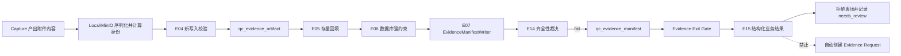

# 青云负责项：证据附件身份与门禁证据不足裁决设计

| 项目 | 内容 |
|---|---|
| 对应任务 | E04、E05、E06、E15 |
| 依赖 | E03 已冻结证据词汇；E14 已提供齐全性裁决器；E15 生产验收还需 E07 能写出 fail Manifest |
| 当前代码基线 | `dev_1.5@2ac4346cade9fb59bda9a72e50fc42b3bce46c05` |
| 设计日期 | 2026-08-13 |
| 设计状态 | 已确认，待拆分实施计划 |
| 数据库影响 | E06 需要 Alembic 迁移；迁移编号在实施时按真实 head 分配 |
| 前端影响 | 不新增菜单或路由；复用现有 `evidence_insufficient` 展示语义 |

## 1. 目标与结论

青云负责项形成两条相互衔接的闭环：

1. **附件可信身份闭环**：新附件写入时生成并校验 `storage_path/checksum/size_bytes`，存量附件按对象真实字节回填，最后由 PostgreSQL 强约束阻止脏数据继续产生。
2. **证据不足阻断闭环**：E07 使用 E14 产生并持久化 `quality_status=fail` 的 Evidence Manifest；Evidence Exit Gate 只读取该结论，将确定性的需求缺口映射成可审计的 `evidence_insufficient` 业务结果，拒绝离场但不自动创建补采请求。

本设计采用“**新写入先收紧、存量独立回填、数据库最后收口、门禁只读清单结论**”的分阶段方案。Alembic 迁移不得访问 Local/MinIO 对象存储，门禁不得重新计算证据齐全性。

## 2. 范围

### 2.1 青云直接负责

- E04：新写入 `qc_evidence_artifact` 的附件身份完整且真实。
- E05：历史附件的 checksum 与 size 可恢复、可重跑、可审计地回填。
- E06：数据库阻止 NULL、空路径、非规范摘要和负数大小继续进入正式证据链。
- E15：将确定性的 Evidence Exit Gate 阻断映射为 `evidence_insufficient`，持久化完整裁决血缘，不发起补采。
- 处理冻结文档已归入 E04-E06 的 `ui_tree` 数据库白名单缺口。

### 2.2 协作边界

- E07 负责 EvidenceManifestWriter 和 E14 的调用位置；青云提供可信附件身份和可供 Writer 消费的约束。
- E16 负责把持久化 Gate 接到全部 Web 生产入口；青云提供类型化阻断结果及稳定错误码。
- E18 负责 Web 集成回归；青云提供 E15 单元、仓储和业务映射测试夹具。
- E20-E23 负责按 Manifest 读取和判定侧退化；本设计不修改 Rule Judge 的业务裁决职责。

### 2.3 不在本设计范围

- 不新增 Evidence Manifest 第四种质量状态。
- 不恢复自动补采，不创建新的 Evidence Request。
- 不重构页面探索、规则匹配或报告生成。
- 不新增前端菜单、路由或独立页面。
- 不在本次设计阶段修改业务代码、迁移或生产数据。

## 3. 当前代码事实与差距

### 3.1 附件身份

`qc_evidence_artifact.storage_path` 已是 `NOT NULL`，但 `checksum` 与 `size_bytes` 仍可为 NULL；大小约束只在字段非空时生效：

- `services/api/migrations/versions/20260706_0001_core_schema.py:152`

正式 Local 和 MinIO 存储实现已经基于序列化后的实际字节计算 SHA-256 与大小：

- `services/api/app/infrastructure/storage/local_evidence_store.py:56`
- `services/api/app/infrastructure/storage/minio_evidence_store.py:65`

Web Capture、App Bootstrap、App Action 三条正式仓储路径也已写入这些字段：

- `services/api/app/infrastructure/db/page_capture_repository.py:167`
- `services/api/app/infrastructure/db/app_capture_repository.py:238`
- `services/api/app/infrastructure/db/app_action_capture_repository.py:251`

当前缺口是：

1. `PersistedEvidenceArtifact` 只是数据类，没有形成统一的新写入信任边界。
2. 仓储仍可接收空字符串、非 SHA-256 文本和不真实的调用方声明。
3. 历史 NULL 记录没有回填工具和执行报告。
4. `EvidenceManifestRepository` 已按三个身份字段严格比对，因此历史 NULL 附件不能进入可信 Manifest。
5. App 正式运行时会产生 `ui_tree`，但数据库附件类型 CHECK 尚未允许该值。

### 3.2 证据不足门禁

E14 已实现 `EvidenceCompletenessAdjudicator`，输入为冻结的 RequirementSet 和 ArtifactReference，输出仅为 pass/fail：

- `services/api/app/application/evidence_completeness.py`

生产 H5 WebCaptureRuntime 已注入 `PostgresEvidenceExitGate`：

- `services/api/app/infrastructure/browser/capture_runtime.py:510`

但现有 Gate Snapshot 只记录 pass 数量、非终态需求数和阻断原因，没有冻结触发阻断的具体 Manifest 身份。`EvidenceExitGateBlockedError` 也没有稳定业务错误码；H5 Runner 最终会将其写成通用 `H5_EXPLORATION_TURN_FAILED`，并上升为基础设施失败：

- `services/api/app/application/evidence_exit_gate.py:77`
- `services/api/app/application/h5_exploration_turn.py:169`

Main Agent 旧 Tool 路径仍显式使用 Noop Gate，该生产接线属于 E16：

- `services/api/app/application/web_agent_page_capture.py:147`

## 4. 方案选择

### 4.1 采用：分阶段收紧

顺序固定为：

1. 部署 E04 新写入强校验。
2. E05 以独立任务扫描并回填存量。
3. 回填报告清零后执行 E06 数据库强约束。
4. E07/E14 产出可追溯 fail Manifest。
5. E15 将 fail Manifest 与 Gate 阻断映射为业务裁决。

该方案允许每阶段独立验证和回滚，不让数据库迁移依赖对象存储，也不会因一条历史丢失对象长期锁住表。

### 4.2 不采用：单次大迁移

在 Alembic upgrade 内读取 Local/MinIO、计算摘要并直接 `SET NOT NULL` 会引入外部 I/O、长事务和不可控锁等待。一条对象丢失即可中断整个部署，因此禁止采用。

### 4.3 不采用：读取时懒回填

读取时修复不能保证覆盖所有历史数据，无法给 E06 提供确定的约束前置条件；并发读取还会产生修复竞态。该方案也不能生成完整执行报告，因此禁止作为正式方案。

## 5. E04 新附件身份设计

### 5.1 信任边界

对象存储适配器是附件字节身份的唯一生产者。业务调用方只能提供附件内容、类型和归属，不能声明 checksum 或 size。

新增统一写入校验函数或值对象，建议放在 `domain/evidence/artifact_identity.py`，并由 Local、MinIO 返回结果和三个 PostgreSQL 写入仓储共同使用。校验规则如下：

| 字段 | 规则 |
|---|---|
| `storage_path` | 字符串、非空、无首尾空格；路径安全由具体存储适配器继续负责 |
| `checksum` | `sha256:` 加 64 位小写十六进制字符 |
| `size_bytes` | 非布尔整数且 `>= 0` |
| `artifact_id` | 非空，正式路径使用 UUID |
| `artifact_type` | 必须属于冻结附件类型词汇 |

`size_bytes=0` 合法，因为空 `visible_text` 是需要被质量门禁识别的真实附件。空内容的 checksum 仍必须是空字节的真实 SHA-256，不得为空。

### 5.2 兼容历史读取

不能在 E04 首次发布时直接把 `ArtifactReference v1` 的反序列化规则收紧为严格 SHA-256，否则现存 Manifest 或测试夹具可能突然无法读取。

实施顺序为：

1. 先在“新对象写入”和“新数据库 INSERT”边界强校验。
2. E05 清理历史数据。
3. E06 完成数据库约束后，再评估是否升级 ArtifactReference 协议；该协议升级不属于 E04-E06 必需交付。

内存测试存储和 Demo fallback 可以继续返回非生产引用，但必须明确为 untrusted，且 E07 Writer 必须拒绝其进入正式 Manifest。

### 5.3 `ui_tree` 白名单

E06 的数据库迁移同时把 `ui_tree` 加入 `ck_qc_evidence_artifact_type`。应用层冻结词汇已经包含该值，数据库必须与之对齐。

该调整只扩大合法类型，不改变已有附件含义。降级时不自动删除 `ui_tree` 数据；若存在该类型，降级前必须由发布流程显式阻止，而不是在 migration downgrade 内删除证据。

## 6. E05 存量回填设计

### 6.1 工具位置和运行方式

新增：

- `scripts/backfill_evidence_artifact_identity.py`

工具默认 dry-run，显式 `--apply` 才允许更新数据库。它使用项目现有 Settings 与 Evidence Storage 工厂连接唯一受控后端，不接受任意 Bucket、任意本地根目录或任意数据库表名参数。

### 6.2 扫描范围

至少扫描以下记录：

- checksum 为 NULL 或空白；
- size_bytes 为 NULL；
- checksum 不符合规范格式；
- size_bytes 小于 0；
- storage_path 为空白。

分页使用 `(created_at, id)` 稳定游标，不使用 OFFSET。支持 batch size、有限并发和对象读取重试；重复执行时已正确记录直接跳过。

### 6.3 对象检查

回填必须从对象真实字节计算 SHA-256 和大小，不能只相信数据库、MinIO metadata 或 ETag。

建议为 Local/MinIO 增加只读流式 Inspector：

- Local：分块读取文件并累计摘要和长度。
- MinIO：流式读取对象响应并累计摘要和长度，确保关闭响应。

不使用现有一次性 `read() -> bytes` 处理全部历史文件，避免大附件导致内存峰值。

### 6.4 更新策略

每条记录按以下规则处理：

| 情况 | 处理 |
|---|---|
| 两字段均缺失 | 计算后补齐 |
| 只缺一字段，已有字段与对象一致 | 补齐缺失字段 |
| 已有字段与对象冲突 | 标记 conflict，不覆盖 |
| 对象不存在 | 标记 missing，不写入伪值 |
| 存储读取失败 | 有界重试后标记 error |
| storage_path 为空 | 标记 invalid，不猜测路径 |

UPDATE 使用旧值条件进行乐观锁；更新行数为 0 时重新读取并分类为 concurrent_changed，而不是盲目重试覆盖。

### 6.5 审计报告

每次执行生成结构化 JSON 报告，存放在受控运维输出目录；设计文档和执行结论放在 `docs`，但报告正文不提交敏感业务内容。

报告字段包括：

- execution_id、开始/结束时间、代码 commit；
- dry-run/apply 模式、后端类型、批大小；
- scanned/skipped/updated/missing/conflict/invalid/error 数量；
- 每个非成功条目的 artifact_id、task_id、capture_id、storage_path 摘要、原值、计算值和原因码；
- 最终 E06 readiness 结论。

禁止记录附件正文、DOM、Cookie、Token、登录凭据、截图 Base64 或对象存储密钥。

退出码：全部可修复数据已处理为 0；存在 missing/conflict/invalid/error 为非 0。E06 不得忽略非 0 报告继续执行。

## 7. E06 数据库约束设计

### 7.1 约束内容

回填清零后，迁移执行：

```sql
CHECK (BTRIM(storage_path) <> '')
CHECK (checksum ~ '^sha256:[0-9a-f]{64}$')
CHECK (size_bytes >= 0)
ALTER COLUMN checksum SET NOT NULL
ALTER COLUMN size_bytes SET NOT NULL
```

同时重建附件类型 CHECK，加入 `ui_tree`。

### 7.2 低锁迁移顺序

1. 添加 checksum 非空、size 非空、格式、路径非空临时 CHECK，使用 `NOT VALID`。
2. 分别 `VALIDATE CONSTRAINT`。
3. 设置列级 `NOT NULL`。
4. 将旧的 nullable size CHECK 替换为明确的 `size_bytes >= 0`。
5. 重建 artifact_type CHECK 加入 `ui_tree`。
6. 删除仅用于低锁转换的临时非空 CHECK；保留格式、路径和非负约束。

若任一验证失败，迁移必须中止并输出违约数量查询，不得用默认 checksum、0 大小或删除历史证据绕过。

### 7.3 迁移编号与并行开发

当前仓库最新迁移为 `20260812_0048`，但 H5 审计整改计划也预期新增迁移。实施时必须从实际 Alembic head 生成 revision：

- 若仍为单 head，使用真实下一个编号；
- 若并行分支已经产生双 head，优先 rebase 或新增显式 merge revision；
- 禁止双方预先硬编码并复用 `0049`。

### 7.4 降级

降级仅移除新增数据库约束，不清空 checksum/size，不删除 `ui_tree` 附件。若旧版本无法接受 `ui_tree`，发布系统应在降级前执行只读预检并阻止不安全降级。

## 8. E15 证据不足裁决设计

### 8.1 唯一裁决原则

E15 不调用 E14、不重新统计附件、不修改 Manifest。完整流程是：

1. E07 获取最新 RequirementSet。
2. E07 调用 E14，一次性生成 pass/fail。
3. E07 持久化版本化 Manifest。
4. Gate 在同一 Session/Capture/Lease 事实下读取最新 Manifest 和 RequirementSet。
5. E15 只把已持久化的 fail 结论分类为 `evidence_insufficient`。

这样保持 `qc_evidence_manifest.quality_status` 是唯一质量权威。

### 8.2 Gate Snapshot v2

现有快照不能稳定追溯“具体哪个 fail Manifest”触发阻断。新增 v2 字段：

- latest_manifest_id；
- latest_manifest_version；
- latest_manifest_hash；
- latest_manifest_quality_status；
- latest_manifest_quality_reason；
- requirement_set_id；
- 原有四项门禁事实与 evaluated_at。

`evaluation_id` 的稳定哈希必须包含 Manifest 身份和 RequirementSet 身份。相同 ActionIntent 面对同一事实幂等；Manifest 新版本或需求快照变化后生成新的 Evaluation。

v1 审计载荷必须继续可读。解析器按 protocol_version 分支，不能把新字段无条件加进 v1 的 required fields。

### 8.3 业务结果

新增结构化 `EvidenceExitBlockedOutcome`，至少包含：

- outcome_id；
- outcome=`evidence_insufficient|evidence_pending|control_plane_incomplete|evidence_integrity_failed`；
- task/session/capture/action_intent/evaluation 身份；
- Manifest identity 与 quality_reason；
- requirement_set_id；
- block_reasons；
- retryable；
- created_at。

分类规则：

| 条件 | outcome | retryable |
|---|---|---|
| 最新 Manifest=`fail`，存在 RequirementSet，缺口可由 E14 quality_reason 核对 | `evidence_insufficient` | false |
| Manifest=`pending` 或 commit in progress | `evidence_pending` | true |
| Manifest 或 RequirementSet 尚未形成 | `control_plane_incomplete` | true |
| Manifest/hash/归属/checksum 事实冲突 | `evidence_integrity_failed` | false |

不能因为 `baseline_pass_manifest_count=0` 就一律判证据不足；否则写入故障、控制面延迟和数据损坏都会被错误掩盖成业务缺口。

### 8.4 持久化

复用 `qc_evidence_exit_gate_evaluation`，增加：

- manifest_id/version/hash；
- manifest_quality_status；
- business_outcome；
- outcome_payload。

阻断 Evaluation、结构化 Outcome 和 Manifest 引用在同一数据库事务中写入。数据库 CHECK 保证：

- `allow_leave=true` 时 business_outcome 为空；
- `allow_leave=false` 时 business_outcome 必须存在；
- `evidence_insufficient` 必须引用 fail Manifest 和 RequirementSet；
- reservation_status=`blocked`，无 expires_at，已有 finalized_at。

无需新建第二张业务裁决表，避免出现 Gate Evaluation 与 Outcome 双轨。

### 8.5 类型化异常和生产交接

`EvidenceExitGateBlockedError` 增加：

- `error_code`；
- `retryable`；
- `decision`；
- `outcome`。

建议稳定错误码：

- `EVIDENCE_INSUFFICIENT`
- `EVIDENCE_COMMIT_PENDING`
- `EVIDENCE_CONTROL_PLANE_INCOMPLETE`
- `EVIDENCE_INTEGRITY_FAILED`

E16 的 Web Runner 消费该类型，不再靠异常字符串判断：

- evidence_insufficient → Work `blocked`、Run/Task `incomplete/needs_review`；
- evidence_pending/control_plane_incomplete → 受预算和 deadline 约束的 retry_wait；
- evidence_integrity_failed → 技术失败并要求人工处理；
- 所有阻断均保证浏览器离场动作未开始。

### 8.6 禁止自动补采

E15 只能读取 `qc_evidence_request` 统计现有在途请求，不得：

- INSERT/UPDATE `qc_evidence_request`；
- 调用 EvidenceRequestPublisher；
- 调用 SupplementalEvidencePolicy 发起 probe；
- 自动生成 Probe Work。

测试必须断言上述写端调用次数为 0。未来恢复补采时需新任务、新评审，不得扩张 E15。

## 9. 数据流



## 10. 错误处理

| 场景 | 处理 |
|---|---|
| 新附件身份缺失/格式错误 | 对象已新建则按 created=true 规则补偿删除；数据库不写入 |
| 数据库写入失败且对象为复用 | 不删除复用对象 |
| 回填对象丢失 | 报告 missing，E06 阻断 |
| 回填摘要冲突 | 报告 conflict，不覆盖数据库或对象 |
| E06 验证失败 | 中止迁移，不写默认值、不删数据 |
| fail Manifest 导致门禁阻断 | evidence_insufficient，动作不执行，记录审计 |
| pending Manifest | evidence_pending，可有界重试 |
| 无 Manifest/RequirementSet | control_plane_incomplete，不伪装证据不足 |
| 身份或 checksum 冲突 | evidence_integrity_failed，不执行离场动作 |

## 11. 测试策略

### 11.1 E04

- Local 与 MinIO 对相同字节生成同一 SHA-256 和 size。
- 空 visible_text 生成真实空字节摘要且 size=0。
- 空 checksum、非规范摘要、负数大小、空路径在 INSERT 前失败。
- Web、App Bootstrap、App Action 三条路径都写入三字段。
- `ui_tree` 通过应用层冻结词汇与身份校验；正式数据库 INSERT 由 E06 集成测试覆盖。
- 同一 Artifact 身份重试只复用相同内容；内容冲突失败。

### 11.2 E05

- dry-run 不更新数据库。
- apply 回填双空、单空记录。
- 已正确记录幂等跳过。
- 对象丢失、摘要冲突、读取超时、并发更新均输出稳定原因码。
- 中断重跑不会重复更新或覆盖冲突。
- 报告不包含附件正文和敏感字段。

### 11.3 E06

- 静态迁移合同覆盖约束文本和 `ui_tree`。
- 真实 PostgreSQL 使用历史 NULL fixture 完成 upgrade。
- 未回填 fixture 必须使迁移失败。
- upgrade 后 NULL、空摘要、错误格式、负数大小和空路径均无法 INSERT。
- `ui_tree` 可在约束升级后正式 INSERT。
- downgrade 不删除已回填数据。

### 11.4 E15

- fail Manifest + RequirementSet → evidence_insufficient。
- pending Manifest → evidence_pending，不误判 fail。
- 无 Manifest/RequirementSet → control_plane_incomplete。
- checksum/归属/hash 冲突 → evidence_integrity_failed。
- Gate Evaluation 冻结 Manifest identity 和 requirement_set_id。
- 同一事实重试幂等；Manifest 新版本产生新 evaluation。
- 阻断后 InteractionExecutor 调用次数为 0。
- EvidenceRequest/Probe 写端调用次数为 0。
- H5 Runner/后续 E16 将业务阻断写成 blocked/needs_review，不再是基础设施 failed。

### 11.5 环境验收

单元测试不能替代：

- 真实 PostgreSQL 大表 VALIDATE 与锁等待观测；
- Local/MinIO 历史对象流式摘要和丢失对象注入；
- H5 + PostgreSQL + Playwright 的真实离场阻断；
- Worker 重启后的 Evaluation/Work 幂等恢复。

当前工作区 `.venv` 指向已不存在的 Python 3.12，bundled Python 未安装 pytest。实施前必须先恢复可执行测试环境，不能以静态检查代替最终回归。

## 12. 可观测性

建议增加以下低基数指标：

- `evidence_artifact_identity_rejected_total{reason}`
- `evidence_identity_backfill_total{result}`
- `evidence_exit_gate_block_total{outcome}`
- `evidence_exit_gate_pending_retry_total`

日志只记录 task/capture/artifact/evaluation/manifest 身份和原因码，不记录附件正文、浏览器敏感状态或存储凭据。

## 13. 发布顺序与回滚

### 13.1 发布顺序

1. 修复测试运行环境并记录当前数据预检。
2. 部署 E04 新写入校验；`ui_tree` 应用词汇继续沿用现有冻结值。
3. E05 dry-run，处理 missing/conflict；再执行 apply。
4. 复跑 E05，确认 readiness 全部清零。
5. 执行 E06 迁移和真实 PostgreSQL 验收。
6. 在 E07 已可生成 fail Manifest 后部署 E15 Snapshot v2、Outcome 和类型化错误。
7. 与立川完成 E16/E18 Web 生产接线和集成回归。

### 13.2 回滚

- E04 回滚只停止新验证，不回滚已写入身份。
- E05 回填结果不回滚为 NULL；发现错误时按执行报告逐条修复。
- E06 可移除新增约束，但保留数据。
- E15 应保留已产生的审计 Evaluation；应用回滚时仍需能读取 v1/v2 payload。

## 14. 验收映射

| 任务 | 截图验收要求 | 本设计验收点 |
|---|---|---|
| E04 | 新附件三项身份信息写全；checksum 与 size 非空 | 新写入边界严格校验，三条正式仓储路径覆盖 |
| E05 | 存量安全回填，迁移回填校验结果可复核 | 可恢复脚本、流式重算、冲突不覆盖、结构化执行报告 |
| E06 | 两字段非空且存量满足约束 | E05 readiness 清零后低锁 VALIDATE + SET NOT NULL，并补齐 `ui_tree` 数据库白名单 |
| E15 | 需求不满足按证据不足处理；Manifest 为 fail；原因可核对；不生成补采请求 | 只读 fail Manifest、冻结 Manifest/RequirementSet/Gate 血缘、零 Evidence Request 写入 |

## 15. 文档同步要求

实施完成后必须同步：

- `docs/专项能力与高频回归规则.md`：增加附件身份三字段、回填失败关闭、门禁分类和禁止自动补采规则。
- `docs/design/2026-08-10-m0-e01-evidence-role-value-table.md`：仅在三方留痕确认后把状态更新为冻结版，不根据代码合入情况推断评审已完成。
- `docs/design/2026-08-10-m0-e02-quality-status-authority.md`：记录 E15 只读 Manifest、不得二次裁决的落地状态。
- E05 实际执行报告和 E06 数据预检结论。

## 16. 完成定义

本批次完成必须同时满足：

1. 新附件不能以缺失或非规范身份进入正式数据库。
2. 历史附件缺口全部回填或以明确阻断项处理，执行报告可复核。
3. PostgreSQL 已强制 checksum/size 非空和摘要格式。
4. `ui_tree` 与冻结附件词汇一致。
5. fail Manifest 的离场阻断形成可追溯 evidence_insufficient 业务结果。
6. 阻断不会启动页面离场动作，不会创建 Evidence Request 或 Probe Work。
7. H5/Web 上层不再把该业务阻断误报为基础设施失败。
8. 真实 PostgreSQL、对象存储和 Web 集成风险已执行验证或明确记录为未覆盖风险。
