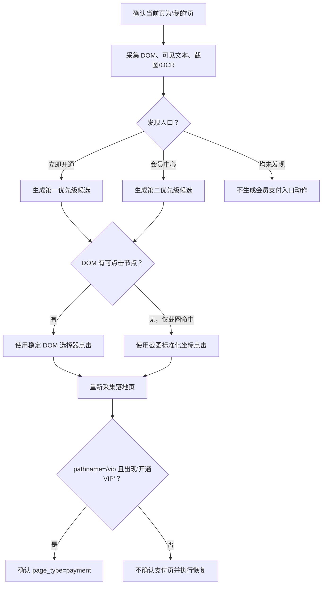

# H5“我的”页会员支付入口专项探索设计

## 1. 背景

Alioth 当前具备通用 H5 页面识别、DOM 导航候选和多模态截图识别能力，但会员支付链路仍以泛化的“支付、购买、会员、VIP”等词为主，未形成可确定回归的专项闭环。

本设计补齐以下链路：在“我的”页发现会员支付入口，安全进入会员支付页，并以 URL 与页面文本双信号确认落地结果。

## 2. 已确认需求

- 支付入口位于“我的”页。
- 入口主词为“立即开通”，后备词为“会员中心”。
- DOM、截图/OCR 任一来源确认入口即可，不要求同时命中。
- 同时出现多个入口时，“立即开通”的优先级高于“会员中心”。
- DOM 无对应节点而截图能够定位入口时，允许使用截图坐标点击。
- 点击后，仅当 URL pathname 为 `/vip` 且页面出现“开通VIP”时，才确认进入支付页。
- “开通VIP”可由 DOM、可见文本或截图/OCR 任一来源确认。
- 真正购买或支付动作继续保持高风险阻断。

## 3. 目标与非目标

### 3.1 目标

1. 建立“我的”页会员支付入口的确定性候选生成规则。
2. 为截图单源入口提供受限、可审计的坐标点击能力。
3. 建立 `/vip` 与“开通VIP”双信号落地确认规则。
4. 保证支付提交动作不会因入口放行而被误放行。
5. 形成目录、模型契约、执行、审计和测试的一致闭环。

### 3.2 非目标

- 不建设任意页面、任意视觉元素的通用坐标点击框架。
- 不自动选择会员套餐、支付渠道或优惠。
- 不自动点击“确认开通”“立即支付”“提交订单”等支付提交控件。
- 不改变非会员场景下其他支付页的既有识别规则。

## 4. 总体方案

采用“专项视觉入口链路”：入口识别由目录和多模态模型提供证据，服务端执行确定性仲裁与安全校验；DOM 可点击时优先使用语义选择器，DOM 不可用时才使用通过校验的截图坐标；点击后重新采集页面并执行双信号验真。



## 5. 领域边界与组件职责

### 5.1 页面类型目录

页面类型目录负责保存稳定知识，不负责执行点击：

- `payment.signals` 补充“开通VIP”。
- 从 `profile` 进入 `payment` 的入口词仅保留“立即开通、会员中心”。
- `payment` 不配置全局 `vip` route prefix，避免非“我的”页或非精确路径生成支付入口。
- 支付风险词补充“确认开通、立即支付、提交订单”等。

`/vip` 只由会员支付专项确认门精确判断，不能作为通用导航或单独识别线索。

### 5.2 页面识别与候选生成

页面识别层负责：

- 确认当前页已识别为 `profile`。
- 从 DOM、可见文本、OCR 和截图中提取入口证据。
- 接收多模态模型返回的可选视觉矩形。
- 对证据进行服务端确定性仲裁。
- 生成带来源和落地预期的候选动作。

模型只提供观测结果，不直接决定是否执行，也不能直接构造浏览器原始参数。

### 5.3 H5 Frontier 与 Explorer

Frontier 保存语义候选及其安全元数据。现有 `CandidateAction` 领域协议不新增顶层字段，视觉定位信息经校验后存入 `metadata.action_parameters`，以保持协议向后兼容。

Explorer 继续只选择平台生成的 eligible candidate，不接受模型自行拼装的坐标或选择器。

### 5.4 Web Interaction Runtime

执行层负责：

- 分别读取候选绑定的原探索 Capture 与动作前 Capture 的可信 UI Snapshot。
- 校验两份快照的 URL、视口、滚动位置、文档尺寸、全屏状态、可见元素几何结构签名和可信主截图摘要一致。
- DOM 模式下解析并点击语义目标。
- 视觉模式下把标准化矩形映射为当前页面 CSS 坐标。
- 必要时滚动到目标区域后点击矩形中心。
- 记录执行结果并触发落地页重新采集。

## 6. 模型与动作契约

页面识别模型的候选动作增加可选视觉定位对象：

```text
visual_bounds:
  screenshot_index: integer
  left_ratio: number
  top_ratio: number
  right_ratio: number
  bottom_ratio: number
  confidence: number
```

所有比例值使用 `[0, 1]` 区间。服务端校验通过后，生成受控动作参数：

```text
target_mode: visual_coordinate
visual_source_capture_id: 原探索采集 ID
visual_source_url: 原探索页面 URL
screenshot_index: 视觉证据对应截图序号
visual_source_artifact_id: 该序号实际对应的截图 Artifact ID
visual_source_sha256: 该张独立 PNG 字节的 SHA-256
left_ratio: 矩形左边界比例
top_ratio: 矩形上边界比例
right_ratio: 矩形右边界比例
bottom_ratio: 矩形下边界比例
visual_confidence: 识别置信度
visual_entry_kind: profile_vip_payment
```

语义目标仍为“立即开通”或“会员中心”，审计和 Frontier 去重不依赖裸坐标。

## 7. 入口仲裁规则

服务端使用以下固定顺序选择候选：

1. “立即开通”DOM 候选。
2. “立即开通”截图坐标候选。
3. “会员中心”DOM 候选。
4. “会员中心”截图坐标候选。

由此保证关键词优先级高于证据来源优先级。例如 DOM 命中“会员中心”而截图命中“立即开通”时，仍优先后者。

同一关键词同时具备 DOM 和截图证据时，优先 DOM；截图坐标仅作为后备。

文本匹配仅做空白、大小写和常规标点归一化，不使用宽泛模糊匹配，避免把普通会员文案误识别为入口。

## 8. 坐标点击安全边界

只有同时满足以下条件才生成可执行的视觉坐标候选：

1. 当前页已识别为 `profile`。
2. 语义目标为“立即开通”或“会员中心”。
3. 模型返回完整矩形、截图序号和达到阈值的置信度。
4. 矩形边界有序且全部位于 `[0, 1]`。
5. 矩形面积处于合理范围，拒绝覆盖页面大面积区域的定位结果。
6. 视觉证据必须来自独立全页 PNG，并绑定原探索 `capture_id`、截图 `artifact_id` 和 PNG 字节摘要；Runtime 精确回读同一 Artifact 后，确认动作前 Capture 与原快照的 URL、稳定页面状态、可见元素几何及截图摘要一致。
7. 时序包和滚动覆盖帧使用视口坐标，不得生成本专项视觉坐标候选。
8. 每个视觉候选针对同一采集最多执行一次。

DOM 入口使用低风险导航级别；视觉坐标入口使用中风险导航级别，但允许自动进入 Frontier。真正支付动作始终为高风险并被阻断。

## 9. 落地确认

会员支付链路使用双信号确认：

1. URL pathname 精确为 `/vip`；query 和 hash 不参与路径判断。
2. DOM、可见文本或截图/OCR 任一来源出现“开通VIP”。

两个条件必须共同成立，才确认 `page_type=payment`。以下情况均不得确认：

- URL 为 `/vip`，但没有“开通VIP”。
- 出现“开通VIP”，但 pathname 不是 `/vip`。
- 模型仅依据通用“会员”或“支付”文案猜测为会员支付页。

该门只约束 `/vip` 会员支付变体，不影响其他路由和形态的既有支付页识别。

## 10. 风险控制

- “我的”页中的“立即开通”是进入支付页的导航入口，可以按本专项规则点击。
- `/vip` 页面中的“立即开通”可能产生购买副作用，必须重新按支付页上下文标为高风险。
- “确认开通”“立即支付”“购买”“支付”“提交订单”及支付渠道确认动作均保持高风险阻断。
- “会员中心”只在 `profile` 页面具有本专项入口语义，其他页面不据此生成支付候选。

## 11. 失败与恢复

- 同一关键词存在 DOM 时不保留截图坐标候选；DOM 点击失败后必须重新采集和识别，不复用旧坐标。
- 坐标无效、过期、越界或低置信度时，直接拒绝执行。
- 点击后未进入 `/vip`，将候选标记为失败，不确认支付页。
- 已进入 `/vip` 但缺少“开通VIP”，标记为证据不足，不确认支付页。
- 双信号验证失败后，安全返回来源“我的”页；相同坐标不得再次执行。
- 若入口打开新标签页，则在新活动页执行双信号验证；失败时关闭新页并恢复来源页。
- 恢复失败不触发新的坐标点击，交由现有任务终态和恢复机制处理。

## 12. 审计要求

每次专项入口候选和执行至少记录：

- 来源页面类型与 `capture_id`。
- 命中的入口词与证据来源。
- DOM 目标或截图序号、矩形、置信度和实际点击点。
- 候选风险等级与仲裁优先级。
- 点击前后 URL。
- `/vip` 路径判定结果。
- “开通VIP”文本判定结果及来源。
- 最终确认、拒绝、失败或恢复结果。

审计数据不得包含原始大图或完整 DOM 回灌到 Main Agent 的结构化结果中；只保存证据引用和紧凑摘要。

## 13. 测试与验收

### 13.1 页面目录与识别单元测试

- 目录能够解析新增入口词、路由线索和风险词。
- DOM 单独命中“立即开通”时生成支付入口。
- 截图单独命中“立即开通”且坐标有效时生成视觉入口。
- 只有“会员中心”时生成后备入口。
- 同时出现两个入口时始终优先“立即开通”。
- DOM 命中“会员中心”、截图命中“立即开通”时仍优先截图候选。
- 非 `profile` 页面不生成本专项坐标动作。
- 无效、越界、异常面积、低置信度、时序/滚动帧、Artifact 身份不一致和过期坐标被拒绝。

### 13.2 Frontier 与执行测试

- DOM 入口以低风险进入 Frontier。
- 视觉坐标入口以中风险进入 Frontier，且不会被当成支付提交动作阻断。
- 视觉动作参数只能由服务端校验结果生成。
- 坐标正确映射到截图对应页面区域并点击矩形中心。
- DOM 失败时最多执行一次视觉后备动作。
- 相同采集与相同坐标不会重复执行。

### 13.3 落地与风险测试

- `/vip?from=profile` 加“开通VIP”确认 `payment`。
- 只有 `/vip` 时返回疑似或证据不足。
- 只有“开通VIP”时不确认会员支付页。
- `/vip` 中的“立即开通”“立即支付”均为高风险并被阻断。
- 验证失败时能够恢复“我的”页。
- 新标签页验证失败时能够关闭新页并恢复来源页。

### 13.4 回归测试

- 现有普通支付页识别不受 `/vip` 专项确认门影响。
- 现有发帖页识别和候选动作保持通过。
- 页面目录、页面识别、H5 Frontier、Explorer、Web Runtime 和审计相关测试通过。

## 14. 文档同步

实现完成后同步更新 `docs/专项能力与高频回归规则.md`，记录以下长期回归基线：

- “我的”页会员支付入口的双来源识别规则。
- “立即开通”高于“会员中心”的仲裁规则。
- 截图坐标点击的限定范围和单次执行约束。
- `/vip` 与“开通VIP”的双信号确认规则。
- 支付页上下文中的高风险动作阻断规则。

## 15. 兼容性与发布

- `CandidateAction` 顶层协议保持不变，坐标信息使用现有 `metadata` 扩展点。
- 页面识别模型新增字段为可选字段，旧模型输出仍可解析。
- 先以单元测试和 Fake Browser 集成测试验证，再运行现有 H5 页面识别与探索回归套件。
- 不引入数据库迁移，不要求前端同步菜单或路由。
