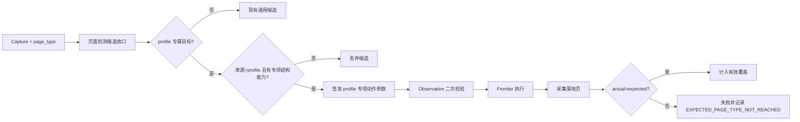

# H5 Profile 专属入口可信能力边界设计

## 1. 背景

2026-08-27 对 8 个 H5 地址执行完整探索后，系统能够调用 PGVector 导航知识、采集页面并驱动 Frontier，但出现三类会污染覆盖结论的问题：

1. `activity`、`settings`、`payment` 候选可从非 `profile` 页面或仅凭截图推断进入 Frontier。
2. 动作执行成功不等于到达预期页型；无跳转或误入其他页仍可能被记作成功探索。
3. 启动广告的全局唯一 `.count-down` 跳过控件未被结构检测识别，通用模型候选反复点击失败。

本设计建立“来源页型 + 服务端结构能力 + 落地页型”三重可信边界。用户确认的业务不变量为：签到（`activity`）、设置（`settings`）、支付（`payment`）入口只存在于 `profile` 页面。

## 2. 目标与非目标

### 2.1 目标

- 只有来源 Capture 已识别为 `profile` 时，才允许生成 `activity`、`settings`、`payment` 导航候选。
- 上述三类候选必须携带页面检测层签发的专项动作参数，不能由模型通用候选或截图坐标单独越权。
- `activity` 不得从 SVG symbol、隐藏定义或普通可见文本回退推断。
- 专项动作执行后必须到达预期页型，否则探索动作失败并保留可审计错误。
- 支持启动广告页面中唯一、可见、文本精确为“跳过”的全局 `.count-down` 结构。
- 保持现有 PGVector 解析顺序和相似度阈值，继续记录调用与命中数据。

### 2.2 非目标

- 不为单个站点硬编码域名或路由。
- 不把支付深链当作从 `profile` 完成的有效导航链路。
- 不放行购买、提交订单、确认支付等高风险动作。
- 不重写 H5 Frontier、页面类型目录或向量嵌入算法。
- 不引入数据库迁移，不修改前端菜单或路由。

## 3. 领域不变量

设来源 Capture 页型为 `source_page_type`，候选预期页型为 `expected_page_type`：

```text
expected_page_type in {activity, settings, payment}
    => source_page_type == profile
    => 存在对应 profile 专项动作参数
```

执行结果还必须满足：

```text
actual_page_type == expected_page_type
```

否则该动作不得增加有效页面覆盖。直接打开支付深链可以作为“原始观察到 payment 页面”记录，但不能满足 `profile -> payment` 旅程覆盖。

## 4. 组件职责

### 4.1 页面检测层

`page_detection_tools.py` 是候选能力的签发边界：

- 在最终候选收口时，移除非 `profile` 来源的 `activity/settings/payment` 候选。
- 在 `profile` 页面中，只有 DOM 可操作结构或既有受信专项结构可生成候选。
- `activity` 移除“可见文本包含签到”回退，避免 SVG `<symbol>`、`data-name` 等非交互元数据产生候选。
- 对启动广告，只在 DOM 存在唯一可见、精确文本“跳过”的 `.count-down` 时签发确定性候选；Van Popup 内既有结构继续兼容。

模型输出仍可提供页面观测，但不能自行授予 profile 专属入口执行能力。

### 4.2 H5 Observation 投影层

`h5_exploration_observation.py` 是 Frontier 写入前的第二道边界：

- `activity` 只接受 `_profile_activity_navigation_action_parameters` 的结果。
- `settings` 只接受 `_profile_settings_navigation_action_parameters` 的结果。
- `payment` 只接受 `_profile_payment_navigation_action_parameters` 的结果。
- 任一专项参数为空时跳过候选，不回退到通用视觉坐标或语义目标参数。
- 来源页型不是 `profile` 时直接跳过三类候选，即使模型给出相同预期页型。
- 启动广告点击只接受页面检测层签发的确定性关闭能力；缺少能力时使用既有倒计时重观察机制。

这样即使上游模型或后续重构重新产生宽泛候选，也无法绕过 Frontier 信任边界。

### 4.3 Working Memory 结果校验层

`page_inspection_memory.py` 将现有 settings 专项落地校验扩展到 profile 专属三类动作：

- 识别签名中的 `profilelocalaction` 和预期页型。
- 新 Capture 的实际页型与预期不一致时，将探索动作标记为失败。
- 使用稳定错误码 `EXPECTED_PAGE_TYPE_NOT_REACHED`，记录 expected/actual/source 信息。
- 只有实际页型吻合才进入 explored/coverage 统计。

浏览器传输层的“点击已完成”与业务探索层的“页面已到达”保持分离。

### 4.4 启动广告结构能力

全局 `.count-down` 规则必须同时满足：

1. 元素可见且文本归一化后精确为“跳过”。
2. 当前 DOM 中只有一个符合条件的控件。
3. 页面类型为 `startup_ad`。
4. 生成固定、受控 selector，不接受模型拼装 selector。

多个同名控件、隐藏控件或仅有普通“跳过”文本时不签发能力，交给倒计时重观察而不是重复盲点。

## 5. 数据流



## 6. 失败与审计

- 非 `profile` 候选在投影前丢弃，不产生浏览器副作用。
- profile 页面缺少受信结构时不执行视觉猜测，保留“未发现入口”的真实结论。
- 动作后页型不符时记录失败，避免把 no-op 或误路由计作探索成功。
- payment 深链单独标注为 raw observation，不回填 profile 旅程。
- 启动广告没有唯一结构时，执行有界重观察；耗尽后报告阻断，不循环点击。
- 向量库继续记录 resolver 的 exact/vector/static 尝试和命中；本修复不通过降低阈值制造命中。

## 7. 测试与验收

### 7.1 单元测试

- 非 profile 的模型候选即使预期 `activity/settings/payment` 也被过滤。
- profile 上没有专项结构能力时，截图/通用候选不进入 Frontier。
- profile 上受信 activity/settings/payment 结构产生对应签名参数。
- SVG `data-name="主页-签到"` 不产生 activity 候选。
- profile 专属动作实际页型不匹配时失败，三类均覆盖；匹配时保持成功。
- startup_ad 全局唯一 `.count-down` 生成确定性候选；重复或非精确文本不生成。
- 未签发启动广告能力时产生重观察候选而非盲点。

### 7.2 回归测试

- 页面检测、H5 Observation、Working Memory、Page Capture 和语义解析相关测试通过。
- Ruff 和 `git diff --check` 通过。
- 用户已有 PageCapture DOMContentLoaded 超时容错改动保持不变。

### 7.3 真实环境复验

- 不 build，只重启 API/worker，镜像 ID 与首轮一致。
- 重新登录并对 8 个地址逐一提交 `scan_mode=full` 任务。
- 等待全部 worker 工作耗尽，统计页型覆盖、有效 profile 旅程、动作失败、向量调用/命中及任务终态。
- 输出修复后报告，并与首轮报告逐项对比。

## 8. 兼容性与发布

- 复用现有 `CandidateAction.metadata.action_parameters`，不新增数据库字段。
- 不改变公开 API 契约。
- 不新增依赖。
- 不要求前端同步菜单或路由。
- 通过容器源码挂载生效，只需重启，不执行 build。
