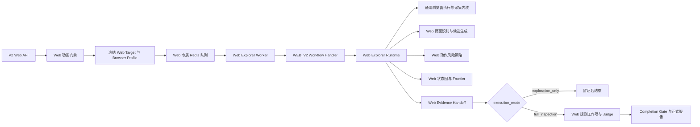

# Alioth Web V2 探索工作流设计

> 日期：2026-08-29  
> 状态：M0/M1 已实现，M2 工作台入口已实现（指标待补）
> 范围：桌面 Web 页面探索、证据留存与后续完整质检接入  
> 固定浏览器视口：1920 × 1080 CSS 像素  
> 约束：Web 专属策略不得改变 H5/App 的默认运行行为

## 1. 目标

为 Alioth 增加一套桌面 Web 探索工作流，在不改变现有 H5 和 App 业务行为的前提下，实现：

1. 使用固定的 `1920 × 1080` 桌面浏览器视口探索指定 Web URL；
2. 支持 `exploration_only` 仅探索留证和 `full_inspection` 完整质检两种执行模式；
3. 复用现有浏览器采集、Surface Session、双采证据和持久化基础设施；
4. 为 Web 建立独立的 Workflow 路由、运行时组合根、页面识别语义和证据交接门禁；
5. 通过独立开关、队列、Worker 资源和灰度策略，避免 Web 任务影响 H5/App 的吞吐与稳定性；
6. 保证 Web 的每个动作、页面状态、证据、规则判定和任务终态都可审计、可回放、可解释。

## 2. 非目标

首期不包含：

- 自定义任意分辨率或一次任务运行多分辨率矩阵；
- 自动登录、验证码、MFA、扫码、OAuth 或凭据代填；
- 跨域无限探索；
- 下载、上传、安装、支付、购买、删除、发布等有副作用动作；
- 将 H5 页面目录、H5 Profile 或 H5 认证状态机直接复用为桌面 Web 语义；
- 为 Web 单独建设微服务；
- 改变现有 H5 `390 × 844` 视口或 App 设备配置。

## 3. 现状与主要风险

当前项目已经具备以下基础：

- `TaskTargetPlatform` 已包含 `web`；
- V2 请求模型已包含 `WebTargetRequest`；
- 工作站创建页已经展示但禁用了 Web 平台；
- Playwright 采集层支持 `viewport_width` 和 `viewport_height`；
- Capture Coordinator、Surface Session、Session Command Gate、Evidence Artifact、Observation Packet 和 Explorer Work 可以复用；
- 完整质检和仅探索已经通过 `TaskExecutionMode` 分流。

当前存在一个必须在 Web 正式开放前消除的风险：Workflow Router 会在特定条件下把 `target_platform=web` 映射到 `H5_V2`，并依赖 `ALIOTH_H5_V2_MODE`。API 目前仍拒绝 Web，因此尚未形成正式业务入口，但该映射不能作为生产方案继续保留。

H5 Runtime 固定注入 `390 × 844`，并包含移动端触控、底部导航、启动广告、H5 页面目录和认证引导等专属行为。仅把视口替换为 `1920 × 1080` 会造成平台语义混用，并可能让 Web 故障直接影响 H5。

## 4. 方案比较

### 4.1 方案 A：Web 直接复用 H5 V2

做法：Web 继续进入 `H5_V2`，只在运行时切换视口。

优点：初始改动少。

缺点：

- Web 与 H5 共用开关、Handler 和组合根；
- 移动端触控、页面目录、认证和清障语义会混入桌面 Web；
- Web 回归可能破坏 H5；
- 无法独立灰度、回滚和统计。

结论：不采用。

### 4.2 方案 B：完整复制 H5 Runtime

做法：复制 H5 Runtime 后改造成 Web Runtime。

优点：初期代码隔离直接。

缺点：

- 双采、会话恢复、证据门禁和 Explorer Work 会形成两套实现；
- 修复需要双向同步；
- 容易产生不同审计口径和状态语义。

结论：不推荐。

### 4.3 方案 C：独立 Web Workflow，复用通用浏览器内核

做法：新增 `WEB_V2` 路由和 Web 专属组合根，只复用目标无关的浏览器执行、采集、会话和证据基础设施。

优点：

- Web/H5 领域边界明确；
- 可独立开关、扩缩容、灰度和回滚；
- 不复制通用浏览器基础设施；
- 便于后续增加新的桌面 Web Profile 或规则能力。

结论：采用。

## 5. 总体架构



稳定路由关系为：

```text
H5  -> H5 / H5_SHADOW / H5_V2
App -> APP
Web -> WEB_V2
```

以下路径必须被禁止：

```text
Web -> H5_V2
Web Handler 缺失 -> 回退 H5
Web 开关关闭 -> 通用 Main Agent
未知 Web Runtime 版本 -> 猜测兼容版本
```

## 6. 领域模型与稳定契约

### 6.1 WebTaskConfig

建议为 Web 目标增加独立值对象：

```text
WebTaskConfig
  browser_profile_id
```

`TaskTarget` 保持 URL 为公共目标属性，并为 Web 目标增加 `web` 配置：

```text
TaskTarget
  platform = web
  target_url
  web.browser_profile_id = desktop_fhd_1920x1080_v1
```

H5 继续只使用现有 H5 目标结构，App 继续使用 `AppTaskConfig`，不得要求旧任务补写 Web 字段。

### 6.2 API 请求

建议 Web 请求使用服务器注册的 Profile ID，而不是让客户端直接提交宽高：

```json
{
  "task_name": "桌面 Web 探索任务",
  "target": {
    "platform": "web",
    "url": "https://example.com",
    "browser_profile_id": "desktop_fhd_1920x1080_v1"
  },
  "scan_mode": "full"
}
```

如果客户端省略 `browser_profile_id`，首期可由服务端补为唯一默认值。未知 Profile 必须返回结构化错误，不能静默使用 Playwright 默认视口。

### 6.3 不可变快照

提交成功时，服务端解析 Browser Profile，并把完整快照锁定到：

- `_task_target.web`；
- `task_config.browser_profile_snapshot`；
- `qc_agent_run.input_context`；
- Capture 和 Evidence Artifact 元数据。

首期可以复用现有 JSONB 配置与运行快照，不需要为了单一 Profile 新增数据库列。后续只有在出现多分辨率查询或统计需求时，再评估规范化字段。

## 7. 浏览器 Profile 与分辨率语义

首期只注册一个 Profile：

```text
profile_id          = desktop_fhd_1920x1080_v1
viewport_width      = 1920
viewport_height     = 1080
screen_width        = 1920
screen_height       = 1080
device_scale_factor = 1
is_mobile           = false
has_touch           = false
color_scheme        = light
```

`1920 × 1080` 表示浏览器内容区的 CSS viewport，不包含浏览器标题栏、地址栏和操作系统窗口边框。

约束：

1. 一个 Run 只允许一个 Browser Profile；
2. Profile 在任务提交后不可修改；
3. Agent 和单个 ActionIntent 不得覆盖宽高、移动端或触控参数；
4. 浏览器会话启动后记录实际 viewport、浏览器版本、UA 摘要和设备缩放比；
5. 每次核心 Capture 校验 `window.innerWidth=1920`、`window.innerHeight=1080`；
6. 声明视口与实际视口不一致时进入 `WEB_VIEWPORT_MISMATCH`，不得发布正式规则工作项。

截图角色必须区分：

- `viewport_screenshot`：严格为 `1920 × 1080`，作为主要视觉质检证据；
- `full_page_screenshot`：宽度为 1920，高度随页面内容变化，只作为补充证据。

首期 Web 仅探索只生成 `viewport_screenshot`。截图编码保持 PNG，采用无损
`optimize + compress_level=9` 压缩文件体积；压缩前后像素宽高必须仍为
`1920 × 1080`，压缩结果反而更大时保留原始 PNG。不得通过 resize、thumbnail、
降低 viewport 或改变 `device_scale_factor` 压缩尺寸。

## 8. Runtime 组件边界

### 8.1 复用的目标无关能力

- Playwright Browser、Context 和 Page 生命周期；
- Surface Session；
- Session Command Gate；
- Capture Coordinator；
- before/action/after 双采；
- screenshot、DOM、visible text、UI Snapshot、Action Trace；
- Explorer Work、租约、取消和持久化；
- Evidence Artifact、Observation Packet；
- Judge 和报告公共收口协议。

### 8.2 Web 专属能力

- `WebWorkflowHandler`；
- `WebRuntimeProvider`；
- `WebV2RuntimeExecutor`；
- `WebBrowserProfileRegistry`；
- `WebPageDetectionService`；
- `WebCandidateGenerator`；
- `WebActionPolicy`；
- `WebEvidenceHandoff`；
- Web 专属运行时组合根。

Web 逻辑不得继续堆入 `h5_runtime_composition.py` 或通过大量 `if platform == web` 分支侵入 H5 Runtime。通用能力可以抽象为稳定端口，但首期必须保持旧 H5 默认参数和行为不变。

## 9. Web 探索循环

探索策略采用：

```text
有界深度优先
  + 覆盖缺口驱动的广度补齐
  + 状态指纹去重
  + 无进展检测
  + 动作、深度、时间和 AI 调用预算
```

主流程：

```text
Web Worker 读取冻结任务配置
  -> WEB_V2 路由
  -> URL 与网络安全预检
  -> 创建独立 1920 × 1080 桌面浏览器会话
  -> 初始 before / navigate / after 双采
  -> 直接把目标 URL 落地页作为首页（不执行 H5 线路加载或启动广告策略）
  -> Web 页面类型与页面状态识别
  -> 当前页面阻断弹窗检测、留痕与有界清障
  -> 清障完成后提取当前页面导航候选
  -> 生成低风险候选动作
  -> Frontier 选择下一步
  -> Policy 授权
  -> before / action / after 双采
  -> 页面识别、状态指纹和谱系持久化
  -> 收敛、预算耗尽或阻断
  -> 排空可处理 Probe
  -> 有序关闭浏览器会话
  -> Web Evidence Handoff
```

### 9.1 首期页面语义

Web 页面识别重点覆盖：

- 顶部导航、侧边栏、面包屑；
- 页签、下拉菜单、悬浮菜单；
- 列表、表格、分页；
- 详情页、Dashboard；
- Modal、Drawer、Popover；
- 空状态、错误页、加载状态；
- 登录门禁和无权限状态；
- 同源新窗口或新标签页。

Web 使用独立页面目录版本，例如 `web_desktop_v1`。H5 页面目录可以作为参考，但不能成为 Web 判定的隐式回退。

Web 页面不存在 H5 的线路加载和启动广告阶段。导航完成且桌面页面达到通用 DOM/
网络稳定条件后，直接进入首页识别；不得扫描 `.loading-page`、线路文案、启动广告
倒计时或 H5 跳过入口。每次进入新的页面类型时，顺序固定为：

```text
页面落地 -> 阻断弹窗检测 -> 安全关闭并验证 -> 页面识别 -> 导航提取 -> 其他候选探索
```

如果弹窗没有唯一、可证明安全的关闭控件，则记录 `llm_fallback_required` 或
`needs_review`，不得为了继续探索而隐藏未知高层 DOM。

### 9.1.1 桌面导航候选

优先对 HTML 元素的 `class` 属性做大小写无关的 `nav` 子串匹配，例如
`nav`、`navbar-nav`、`main-navigation`、`topNav`。命中后，只从该元素
自身或后代的 `ul` / `li` 层级内提取可见 `a[href]`，并保留链接文案、绝对
URL、DOM 来源和页面类型键。
候选必须满足 HTTP(S)、同源、非空 href、去重和低风险条件；`javascript:`、下载、
退出、提交以及跨域链接只能记录阻断事实，不能进入 Frontier。没有任何符合
`class*=nav + ul/li/a[href]` 结构的候选时，再使用后续 Web 页面目录定义的其他
桌面导航来源，禁止写死 `.navbar-nav`，也禁止回退 H5 底部导航语义。

### 9.2 默认允许动作

- 同源页面导航；
- 普通导航、Tab、分页、展开和收起；
- 滚动、返回、刷新；
- Hover；
- 关闭可证明为普通遮挡物的弹窗；
- 同源、只读的新标签页观察。

### 9.3 默认阻断动作

- 保存、删除、提交、发布；
- 支付、购买、充值、转账；
- 登录和凭据输入；
- 上传、下载、安装；
- 退出登录；
- 跨域导航和未知协议；
- 无法证明为只读的表单操作。

首期遇到登录页时进入 `requires_auth` 或 `needs_review`，不复用 H5 自动登录和密钥配置。

## 10. URL、域名和会话安全

Web 目标视为不可信输入。运行前必须完成：

- 只允许 HTTP(S)；
- 拒绝本机、链路本地、私网和受保护网段；
- 检查 DNS 重绑定和重定向后的最终地址；
- 默认只允许初始精确 Origin；
- 额外 Origin 必须在任务提交时显式锁定；
- 禁止 `file:`、`data:`、未知协议和外部应用拉起；
- 禁止浏览器下载；
- 每个 Run 使用干净、独立的 Browser Context；
- 不与 H5 Run 共享 Cookie、LocalStorage、SessionStorage 或浏览器 Session。

同源新标签页可以纳入当前 Session；外部标签页只记录阻断事实并关闭，不能加入 Frontier。

## 11. 证据和交接门禁

公共 Capture 表可以继续复用，但 Web 查询必须同时限定：

```text
task_id
agent_run_id
target_platform = web
surface_kind = web
browser_profile_id
```

不能只依赖 `surface_kind=web`，因为 H5 当前同样属于 Web Surface。

Web Evidence Handoff 至少校验：

1. 当前任务的锁定平台为 Web；
2. Browser Profile 为 `desktop_fhd_1920x1080_v1`；
3. 主页面 before/after Capture 成对；
4. before/after 属于同一 Action Execution；
5. screenshot、DOM 和非空 URL 完整；
6. after Capture 已完成 Web 页面识别；
7. Capture、Session、Task 和 Run 归属一致；
8. 浏览器实际 viewport 为 `1920 × 1080`；
9. Capture 未被 superseded 或 abandoned；
10. Session 已关闭或进入明确的 lost 终态。

门禁失败时：

- 不发布 Inspection Work Item；
- 不执行 Rule Judge；
- 不写正式规则结果；
- 不生成正式报告；
- 保存原始失败原因和当前可用证据。

## 12. 执行模式

### 12.1 exploration_only

```text
共同 Web 探索主链
  -> Session 关闭
  -> Web Evidence Handoff
  -> evidence_ready
  -> 保存覆盖、页面类型、停止原因和阻断摘要
  -> Task / Run 终态
```

明确不执行：

- Inspection Work 发布；
- Rule Judge；
- `qc_rule_execution` 写入；
- Completion Gate；
- 正式报告生成。

### 12.2 full_inspection

```text
共同 Web 探索主链
  -> Web Evidence Handoff
  -> Web 页面目录与规则能力映射
  -> 发布 Web 兼容的 Snapshot Inspection Work
  -> Rule Judge
  -> 正式规则结果
  -> Completion Gate
  -> sealed Report
```

只有显式声明支持以下条件的规则才能执行：

```text
platform = web
page_catalog = web_desktop_v1
browser_profile = desktop_fhd_1920x1080_v1
evidence_roles 与现有 Capture 兼容
```

未声明支持 Web 的规则不得执行，也不得被计为已覆盖。任务应明确进入 `incomplete` 或 `needs_review`，而不是伪装成完整质检成功。

## 13. 功能门禁和错误语义

建议新增独立配置：

```text
ALIOTH_WEB_V2_MODE = off | exploration_only | on
```

- `off`：默认值；所有新 Web 请求在入库和入队前拒绝；
- `exploration_only`：只允许仅探索留证，用于内部灰度；
- `on`：允许仅探索和完整质检。

Web 不得依赖 `ALIOTH_H5_V2_MODE`。

建议冻结以下错误码：

- `WEB_V2_DISABLED`；
- `WEB_FULL_INSPECTION_DISABLED`；
- `WEB_PROFILE_UNSUPPORTED`；
- `WEB_TARGET_URL_REJECTED`；
- `WEB_RUNTIME_NOT_CONFIGURED`；
- `WEB_VIEWPORT_MISMATCH`；
- `WEB_SESSION_FAILED`；
- `WEB_EVIDENCE_INCOMPLETE`；
- `WEB_AUTH_REQUIRED`；
- `WEB_EXTERNAL_NAVIGATION_BLOCKED`。

## 14. 队列和资源隔离

当前 Agent Run 使用单一 Redis 队列。Web 的 `1920 × 1080` 截图、DOM、浏览器会话和多模态判定会增加内存、存储与模型开销。为了避免影响 H5/App，首期应使用：

- Web 专属队列，例如 `alioth:agent-runs:web-v2`；
- Web 专属 Worker 角色 `web_explorer`；
- 初期 Web 并发固定为 1；
- Web 独立动作数、AI 调用数、任务时长和证据容量预算；
- 对象存储使用独立 `web/` 前缀和配额；
- Web 指标使用独立平台标签。

保持同一代码库、公共 PostgreSQL 和公共证据协议，不引入微服务。队列实现可以增加命名空间参数，并保留现有默认队列键，确保 H5/App 无需迁移。

完整质检开放后，Web Inspection Work 还需要平台标签和独立并发上限，避免 Web Judge 工作挤占现有规则判定资源。

## 15. 前端设计

工作站创建任务页应：

- 通过后端能力接口判断 Web 是否可选，不在前端写死部署状态；
- 选择 Web 后显示只读信息：`桌面 Web · 1920 × 1080`；
- Web URL 独立填写，不复用产品的 `h5_url` 自动覆盖；
- 根据 Web 模式决定是否开放 `exploration_only` 和 `full_inspection`；
- 未开启时展示明确原因，不发送必然失败的请求；
- 提交成功后复用现有任务详情路由，不建设第二套任务页面。

任务详情、任务日志、证据和报告需要展示：

- `target_platform=web`；
- Browser Profile ID；
- 声明和实际 viewport；
- 浏览器实际版本；
- execution mode；
- 覆盖、未覆盖和停止原因。

## 16. 运行状态与恢复

沿用目标无关终态：

```text
pending
  -> provisioning
  -> exploring
  -> evidence_ready
  -> completed | partial

任意非终态
  -> blocked | failed | cancelled
```

关键异常处理：

| 场景 | 处理 | 结果 |
| --- | --- | --- |
| Web 开关关闭 | 入库前拒绝 | `WEB_V2_DISABLED` |
| Handler 未配置 | 禁止回退 | `failed / WEB_RUNTIME_NOT_CONFIGURED` |
| URL 或重定向不安全 | 终止启动 | `blocked / WEB_TARGET_URL_REJECTED` |
| 实际视口不一致 | 禁止交接 | `failed / WEB_VIEWPORT_MISMATCH` |
| 需要登录 | 保存已有证据 | `blocked` 或 `needs_review` |
| 跨域导航 | 阻断当前入口并继续其他 Frontier | `partial` 或继续探索 |
| 浏览器会话丢失 | 有界重建并从根 URL 恢复 | 恢复或 `blocked` |
| 证据落库失败 | Fail Closed | `failed / WEB_EVIDENCE_INCOMPLETE` |
| 预算耗尽 | 保存覆盖和未完成入口 | `partial / budget_exhausted` |
| 用户取消 | 关闭 Session 并保存最后状态 | `cancelled` |

## 17. 兼容性和无影响约束

| 能力 | H5 | App | 新 Web |
| --- | --- | --- | --- |
| Workflow Route | 保持现状 | 保持现状 | `WEB_V2` |
| 功能开关 | `ALIOTH_H5_V2_MODE` | App 原开关 | `ALIOTH_WEB_V2_MODE` |
| 视口/设备 | 390 × 844 | 设备 Profile | 1920 × 1080 |
| Worker | 原队列与 Worker | 原队列与 Worker | Web 专属队列与 Worker |
| 页面目录 | H5 目录 | App 页面语义 | `web_desktop_v1` |
| 认证 | H5 既有边界 | App 既有边界 | 首期不自动登录 |
| Evidence Handoff | H5 专属门禁 | App 专属门禁 | Web 专属门禁 |

中央路由和提交入口需要少量增量改动，但不得修改 H5 Runtime 的固定视口、页面判定、认证、清障和证据语义。

## 18. 实施阶段

### M0：契约与隔离门禁

- 冻结 Web Target、Browser Profile、运行模式和错误码；
- 增加 `WEB_V2` 路由设计；
- 移除 Web 到 `H5_V2` 的别名；
- 增加 Web 独立功能开关；
- 审计数据库中的历史 Web 任务；
- 没有明确 Web Runtime 版本的历史记录不得自动重跑。

出口：路由契约测试证明 Web 不会进入 H5/App/Main Agent。

### M1：仅探索 Runtime

- 建立 Web Handler、Provider、Executor 和组合根；
- 接入 Web 专属队列与 Worker；
- 创建 `1920 × 1080` 非移动、非触控 Browser Context；
- 目标 URL 直达首页，不启用 H5 线路加载和启动广告识别；
- 每个页面类型先检测并安全清理阻断弹窗，再从 class 含 `nav` 且满足
  `ul/li/a[href]` 层级的结构提取导航；
- 主截图保持 `1920 × 1080`，只做无损 PNG 体积压缩；
- 完成双采、页面识别、Frontier、终态和 Evidence Handoff；
- 只开放内部 `exploration_only`。

出口：Web 可以稳定探索留证，并且不会发布规则工作项或报告。

### M2：工作台和可观测性

- 开放受能力接口控制的 Web 创建入口；
- 展示固定 Profile 和视口；
- 增加 Web 队列、覆盖率、重复率、阻断率、证据完整率、P95 时长和存储量指标；
- 增加任务详情和证据展示。

出口：内部用户可以创建、观察、取消和审计 Web 仅探索任务。

### M3：完整质检

- 建立 `web_desktop_v1` 页面目录；
- 建立 Web 规则能力映射；
- 接入 Web Snapshot Inspection Work、Judge、Completion Gate 和报告；
- 未支持规则显式进入未覆盖或人工复核。

出口：完整质检只消费明确支持 Web 的规则和合格证据。

### M4：灰度与正式开放

- 内部测试站点；
- 指定项目或租户；
- 少量生产 URL；
- 全量开放；
- 每阶段均可单独关闭 Web 开关并停止新任务。

出口：Web 指标达到门槛，且 H5/App 基线无显著回归。

## 19. 测试和验收

### 19.1 路由与契约

- Web 路由永远不返回 `H5_V2`；
- Web 只支持 `workflow_version=v2`；
- Web Handler 缺失时明确失败；
- 未知 Browser Profile 失败关闭；
- API 请求、任务目标和 Run 快照一致；
- 幂等请求必须包含平台、URL 和 Browser Profile 事实。

### 19.2 分辨率与证据

- Browser Context 为 `1920 × 1080`、`device_scale_factor=1`；
- `is_mobile=false`、`has_touch=false`；
- viewport screenshot 精确为 `1920 × 1080`；
- PNG 压缩前后宽高一致，且压缩结果不得大于原始截图；
- full-page screenshot 使用独立证据角色；
- 声明和实际 viewport 不一致时不得交接；
- 每个动作都有 before/after、Action Execution 和 Trace 关联。

### 19.3 探索与安全

- 顶部导航、侧边栏、Tab、分页、Drawer、Modal 和 Hover；
- class 含 `nav` 的元素存在时，只有同时满足 `ul/li/a[href]` 层级才生成同源导航候选；
- 每个新页面在其他候选探索前完成阻断弹窗检测与有界清障；
- Web 页面不触发 H5 线路加载或启动广告等待；
- 状态指纹去重和无进展收敛；
- 登录、支付、提交、下载、上传和跨域导航阻断；
- 新标签页、会话丢失、超时、取消和证据失败；
- SSRF、DNS 重绑定和重定向安全测试。

### 19.4 无影响回归

- Web 模式为 `off` 时，H5/App API、路由和结果不变；
- H5 仍固定 `390 × 844` 且保持现有触控行为；
- App 设备 Profile、运行时和任务终态不变；
- Web 队列积压时，H5/App 任务仍按原队列延迟执行；
- Web 关闭、失败或回滚不会取消 H5/App Run；
- Web 数据查询不能混入 H5 Capture；
- 现有 H5/App 全量自动化回归通过。

## 20. 灰度、监控和回滚

Web 独立监控指标：

- 任务提交和启动成功率；
- 浏览器 provision 成功率；
- 页面识别成功率；
- Frontier 收敛率；
- 有效状态覆盖率；
- 重复状态率；
- 阻断率和 requires_auth 比例；
- 证据完整率；
- 单任务动作数、AI 调用数、存储量、成本和 P95 时长；
- 视口不匹配次数；
- Web 队列长度和等待时间；
- 对 H5/App 队列延迟与资源使用的旁路影响。

回滚步骤：

1. 将 `ALIOTH_WEB_V2_MODE` 切换为 `off`，停止接收新 Web 任务；
2. 停止 Web Worker 消费新任务；
3. 让执行中的 Web Run 有序结束，或通过现有取消协议终止；
4. 关闭残留 Web Browser Session；
5. 保留已生成证据和审计事实；
6. 不修改 H5/App 开关、队列、Worker 或任务状态。

## 21. 完成定义

Web V2 首期完成必须同时满足：

1. Web 使用独立 `WEB_V2` 路由、开关、Handler、组合根和队列；
2. Web 不会进入 H5 V2、App 或通用 Main Agent；
3. 每个 Run 固定使用 `desktop_fhd_1920x1080_v1`；
4. 主要截图证据精确为 `1920 × 1080`；
5. 每个实际动作都有完整前后证据、风险决定和审计链；
6. `exploration_only` 不产生正式规则结果和报告；
7. `full_inspection` 只执行明确支持 Web 的规则；
8. 高风险动作拦截率为 100%；
9. Web 资源压力不会显著增加 H5/App 队列延迟；
10. 关闭 Web 开关可以独立回滚；
11. H5/App 相关自动化回归全部通过；
12. 实施后将可复用的隔离、分辨率与回归要求同步到 `docs/专项能力与高频回归规则.md`。
