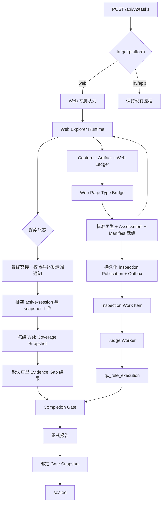

# Web V2 探索到正式报告闭环设计

## 1. 文档信息

- 设计日期：2026-09-02
- 目标分支：`codex/web-v2-exploration`
- 实施分支：`codex/web-v2-exploration-1.1`
- 适用平台：Web
- 不变平台：H5、App
- 目标链路：探索 → 页面类型 → 规则匹配 → 正式报告

## 2. 背景

当前 Web V2 已具备专属队列、浏览器运行时、页面探索、证据留存、页面分类和任务中心展示能力，但正式质检链路尚未闭合：

1. Web 分类器输出 `web_content_list`、`web_content_detail`、`web_video_list`、`web_video_detail`，正式规则 Catalog 使用不带 `web_` 前缀的标准页型。
2. 类型映射已定义，但没有在 Web Capture 到正式规则匹配的边界统一执行。
3. Web Runtime 当前只允许 `exploration_only`，探索完成后不会进入正式 Inspection、Completion Gate 和报告生成。
4. 独立规则评估写入 `qc_rule_evaluation_run`，按设计与正式规则结果、报告和 Completion Gate 隔离，不能充当正式闭环。
5. 本机当前 Web 能力默认关闭，前端任务创建页还有重复导入、重复选项和无效变量，无法作为正式入口使用。

本设计要求复用现有正式质检基础设施，不建设第二套 Web 规则结果或报告体系。Web 的质检发布时机对齐 H5：每个可判定 Capture 完成可靠落库后增量通知质检，探索结束时只做补发、排空和统一收口。

## 3. 目标与非目标

### 3.1 目标

一次 `POST /api/v2/tasks` Web 请求在同一个 `task_id` 下自动完成：

1. 进入 Web 专属队列；
2. 执行 Web 页面探索并持久化可信证据；
3. 将 Web 原始页型转换成正式规则 Catalog 页型；
4. 每个可判定 Capture 完成后立即创建持久化质检通知；
5. 根据标准页型匹配 `target_clients` 包含 `WEB` 的规则；
6. 探索与规则质检流水线并行并写入正式 `qc_rule_execution`；
7. 探索结束后补发遗漏通知、生成 Coverage Gap 并排空在途质检；
8. 通过 Completion Gate；
9. 生成并绑定一份正式报告；
10. 在任务中心展示完整阶段、结果和证据缺口。

### 3.2 非目标

- 不修改 H5、App 的入口、队列、运行时、页面类型、规则匹配或报告语义。
- 不把 `qc_rule_evaluation_run` 提升或复制为正式结果。
- 不创建“探索任务 + 质检任务”两个任务。
- 不伪造缺失页型的 Capture。
- 不把未知页型按字符串删除前缀后自动猜测。
- 不新增 Web 专用规则表、正式结果表或报告表。
- 不重命名或重构现有 H5 Publication、Handoff 和 Worker 合同。

## 4. 已确认的产品决策

1. Web 正式任务从 `/api/v2/tasks` 创建；每个页面探索完成可靠落库后自动通知质检，不等待全站探索结束。
2. Web 请求只要求 `target.platform` 和 `target.url`；浏览器规格由服务端默认提供。
3. 默认浏览器规格为 `desktop_fhd_1920x1080_v1`。
4. `/api/v2/exploration-tasks` 保留为仅探索、调试和证据验证入口。
5. 页面覆盖不完整不导致整单失败；任务继续生成正式报告并标记 `completed_with_gaps`。
6. 首页不可达、证据无法持久化、运行租约失效等基础故障导致任务失败。
7. 缺失页型的关联规则写正式 `evidence_insufficient` 结果，不调用 LLM，不创建虚假 Capture。
8. 结构化 Coverage Gap 不自动创建人工审核项；真实证据损坏、低置信度或模型不确定仍遵守规则的人工审核策略。
9. H5、App 行为必须由非回归测试证明未发生变化。
10. 探索结束时执行与 H5 一致的最终证据交接，负责补发遗漏的 snapshot 质检工作并排空在途工作。
11. Coverage Gap 只能在探索终态后生成，探索过程中“暂未找到”的页型不能提前判为证据不足。
12. Web `full_inspection` 固定使用可靠通知模式；`exploration_only` 固定不发布质检通知。本期不新增可由请求方切换的通知模式参数。
13. 新 Web 任务每站最多执行 5 个同源白名单菜单；首页和每个菜单的一层详情不占菜单额度，第六个及以后菜单只形成 `menu_limit_skipped` 账本终态。历史十菜单预算只保留报告兼容。
14. 年龄门禁只能在操作者真实、显式提供成年自我声明后执行唯一低风险确认；不得伪造成年人声明、登录身份，也不得求解验证码、人机验证、MFA 或 OTP。

## 5. API 契约

### 5.1 Web 正式任务

```http
POST /api/v2/tasks
Content-Type: application/json
Idempotency-Key: <稳定请求键>
```

```json
{
  "task_name": "Web完整链路测试",
  "target": {
    "platform": "web",
    "url": "https://example.com/"
  },
  "ruleset_code": "alioth_first_ruleset",
  "ruleset_version": 1,
  "channel": "workbench",
  "priority": 100,
  "product": {
    "department_name": "本地测试",
    "product_code": "LOCAL-WEB-E2E",
    "product_name": "本地Web完整链路测试"
  },
  "scan_mode": "full",
  "journey_steps": [],
  "remark": "Web V2 完整链路测试"
}
```

服务端锁定：

- `target_platform=web`
- `execution_mode=full_inspection`
- `web_inspection_notification_mode=enforced`
- `browser_profile_id=desktop_fhd_1920x1080_v1`
- `viewport_width=1920`
- `viewport_height=1080`

调用方将来可以传受支持的浏览器规格，但本期不把该字段设为必填，也不在前端暴露自由输入。

### 5.2 Web 仅探索任务

`POST /api/v2/exploration-tasks` 保持现有语义，服务端锁定 `execution_mode=exploration_only`。它只留存探索证据和分类结果，不写正式规则结果，不生成正式报告。

### 5.3 能力发现

Web `full_inspection` 仅在以下条件同时成立时公布：

- `ALIOTH_WEB_V2_MODE=on`
- Worker 角色包含 `web_explorer`
- Worker 角色包含 `judge`
- 数据库、Redis、对象存储和 Completion Gate 使用生产实现

`ALIOTH_WEB_V2_MODE=exploration_only` 时只公布 Web `exploration_only`。

### 5.4 Web 安全边界

正式质检不会扩大 Web Explorer 的浏览器操作权限：

- 复用现有 Web 目标 URL 校验、站点白名单、同源导航和重定向约束。
- 探索阶段只允许已批准的只读导航和证据观察，不提交表单，不执行下载、支付、登录、评论、点赞、关注等写操作。
- 跨域导航按现有策略阻断并记录，不把跨域页面作为当前站点的规则证据。
- 规则阶段优先消费已持久化的 snapshot 证据，不为了补齐规则重新开放浏览器写操作。
- 已有只读动作轨迹满足规则输入契约时可以参与判定；需要未授权主动交互的规则写入 `evidence_insufficient`，原因码为 `web_active_interaction_not_enabled`。
- 与当前登录态矛盾的规则继续使用现有认证门禁记为不适用，不把认证条件不满足误记为质量通过。

以上限制只约束 Web；H5、App 的动作和认证策略保持不变。

## 6. 总体架构



架构采用“一条任务、增量流水线、一次正式收口”：

- Web Explorer 负责探索、Capture、Artifact、Manifest 和分类，每个可判定 Capture 就绪后立即创建持久化质检通知。
- Inspection Publication、Outbox、Work Item 和 Judge 与后续页面探索并行运行，不阻塞 Explorer 继续访问下一个页面。
- 探索终态触发最终证据交接：补发遗漏通知、排空必须依赖活会话的工作、冻结 Coverage Snapshot，再进入 Completion Gate。
- 全链路共用 `task_id`、`agent_run_id`、`finalization_epoch` 和审计链。
- Web 复用现有 H5 风格的发布与收口协议，不复制正式规则执行器和报告生成器。

## 7. 页面类型边界

### 7.1 显式映射

| Web 原始类型 | 标准质检类型 |
|---|---|
| `web_content_list` | `content_list` |
| `web_content_detail` | `content_detail` |
| `web_video_list` | `video_list` |
| `web_video_detail` | `video_detail` |
| `home` | `home` |

映射协议版本固定为 `web-page-type-normalization.v1`。

### 7.2 存储口径

- `qc_page_capture.page_type` 只保存标准质检类型，作为规则匹配的唯一页型来源。
- Capture metadata 保存 `raw_page_type`、`canonical_page_type`、分类置信度、分类器和归一化协议版本。
- `qc_web_menu_ledger_entry` 继续保存 Web 探索原始分类结果，满足分类审计和现场复盘。
- 无法映射的类型不写入猜测值，进入 `unrecognized_page_types`。

### 7.3 单 Capture 通知门禁

一次页面探索只有同时满足以下条件，才能通知质检：

1. Capture、Artifact 和 Evidence Manifest 已可靠提交；
2. Page Type Assessment 已持久化且 `detection_status=recognized`；
3. `qc_page_capture.page_type` 已写入标准质检类型；
4. Capture 属于当前 `task_id`、`agent_run_id` 和 Finalization Epoch；
5. Task 仍处于 `open`，对应 Session 仍有效；
6. Capture 尚未产生相同输入哈希的正式 Publication 或 Work Item。

满足门禁后，在一个数据库事务中创建持久化 Inspection Publication 与 Outbox 事件。事务提交后才能唤醒质检消费者。通知或 Redis 唤醒失败不回滚已经可靠提交的探索证据，由 Outbox 重投和最终交接补偿。

Web 复用现有 Publication、Outbox 和 Inspection Work Item 表，不新增 Web 专用通知表。Web 专属适配器只负责把标准页型、Assessment 身份和 Capture 身份转换成现有发布合同；H5 的触发时机和通知模式保持不变。

### 7.4 探索结束最终交接

Web 达到探索终态后按 H5 收口顺序执行：

1. 停止创建新的页面探索工作；
2. 最终裁决全部 Manifest；
3. 扫描可判定 Capture，幂等补建缺失的 snapshot Publication；
4. 在关闭 Session 前排空 active-session 规则；
5. 推动任务进入 `exploration_draining` 和 `session_draining`；
6. 等待 Publication 与 Inspection Work Item 全部达到终态；
7. 冻结 Coverage Snapshot；
8. 为最终缺失页型生成 Coverage Gap 规则结果；
9. 进入 Completion Gate 和报告绑定。

最终交接不重复发布已经由增量通知创建的规则工作；幂等性由 Publication 输入哈希、Work Item 输入哈希和规则结果唯一键共同保证。

## 8. 状态机

不新增 `qc_task.status` 或 `TaskFinalizationState` 枚举。

```text
queued
  → running / open
      ↳ 页面探索与增量质检并行
  → exploration_draining
  → session_draining
  → finalizing
  → sealed
```

终态映射：

| 条件 | execution_status |
|---|---|
| 探索完整、规则工作终态、Gate 通过 | `completed` |
| 探索可用但存在 Coverage Gap | `completed_with_gaps` |
| 存在必须人工处理的非终态结论 | `needs_review` |
| 首页不可达或基础设施不可恢复失败 | `failed` |
| 用户取消 | `canceled` |

Web Runtime 不再把 `full_inspection` 任务直接标为完成。增量规则结果允许在 `open` 阶段产生，但只有探索终态、最终交接完成且报告成功绑定通过的 Gate Snapshot 后，任务才能进入 `sealed`。

## 9. Coverage Snapshot

新增 `qc_web_coverage_snapshot`，保存探索终态和最终交接共同确认的不可变覆盖事实：

```text
id uuid primary key
task_id uuid not null
agent_run_id uuid not null
finalization_epoch integer not null
required_page_types jsonb not null
observed_page_types jsonb not null
missing_page_types jsonb not null
unrecognized_page_types jsonb not null
normalization_version varchar not null
coverage_status varchar not null
snapshot_hash varchar not null
created_at timestamptz not null
```

约束：

- `UNIQUE(task_id, agent_run_id, finalization_epoch)`
- JSON 页型集合必须规范排序后参与哈希。
- `coverage_status` 只允许 `complete`、`completed_with_gaps`、`failed`。
- Snapshot 一旦写入不可修改；恢复时相同输入返回同一记录，不同输入触发冲突并停止收口。
- Snapshot 只能在探索终态后创建；增量质检阶段不得据“当前尚未发现”生成缺失页型结论。

## 10. 规则匹配与 Coverage Gap

### 10.1 有效页面

对每个已写标准页型的 Capture：

1. 使用默认 Page Type Catalog 校验标准类型；
2. 按 ruleset、版本、channel、状态和 `target_clients=WEB` 过滤规则；
3. 用 `applicable_page_types` 精确匹配；
4. Capture 就绪后幂等创建持久化 Inspection Publication 和 Outbox 事件；
5. 质检消费者按策略创建 Inspection Work Item；
6. active-session 规则在 Session 有效期内执行，snapshot 规则可以异步执行并由最终交接补发；
7. Judge 结果通过现有 RuleExecutionService 写入 `qc_rule_execution`。

增量通知复用现有 Publication 输入哈希和 Work Item 输入哈希；规则结果继续使用 `(task_id, rule_id, page_capture_id)` 幂等语义。

### 10.2 缺失页型

对每个 `missing_page_type`：

1. 查询适用于该标准页型且面向 `WEB` 的规则；
2. 不创建 Inspection Work Item，不调用规则引擎或 LLM；
3. 通过正式 RuleExecutionService 写入 `execution_status=evidence_insufficient`；
4. `page_capture_id` 保持 `NULL`；
5. `judge_input` 记录 Coverage Snapshot、缺失页型和原因码。

本步骤只在探索终态并完成最终 Publication 补发后执行。

```json
{
  "schema_version": "web-coverage-gap.v1",
  "source": "web_coverage_gap",
  "coverage_snapshot_id": "...",
  "missing_page_type": "content_detail",
  "reason": "required_page_type_not_discovered"
}
```

为 `qc_rule_execution` 增加可空的 `source_idempotency_key`，并建立非空部分唯一索引：

```text
UNIQUE(task_id, rule_id, source_idempotency_key)
WHERE source_idempotency_key IS NOT NULL
```

Web Gap 键为：

```text
web-coverage-gap:{coverage_snapshot_id}:{missing_page_type}:{rule_code}
```

H5、App 和现有规则写入均不传该字段，行为不变。

### 10.3 人工审核边界

- “未探索到必需页型”属于结构化 Coverage Gap，不创建人工审核项。
- 页面存在但 Manifest、Artifact、置信度或判定输出不满足要求时，继续遵守规则的 `manual_review_policy`。
- Coverage Gap 不能被展示或汇总为通过。

## 11. Completion Gate 与报告

Completion Gate 的候选库存包含：

- 有效页面产生的正式候选规则；
- 缺失页型产生的正式 `evidence_insufficient` 结果；
- 重试耗尽后的正式 `error` 或人工审核结果。

Gate 只有在以下事实成立时通过：

- 探索已终止；
- 没有待提交 Capture；
- 没有活动 Session 请求；
- 所有强制 Inspection 工作达到终态；
- 候选规则数量与终态规则数量一致；
- 没有后台规则执行；
- 人工审核策略满足；
- Coverage Snapshot 已冻结并与当前 Epoch 一致。

正式报告增加 Web 探索摘要：

- 已发现页型和 Capture 数；
- 缺失及未识别页型；
- 原始类型到标准类型的归一化记录；
- 规则总数及通过、失败、告警、证据不足、人工审核数量；
- Web 探索、规则质检、报告生成各阶段耗时；
- Coverage Gap 原因和关联规则。

报告结论规则：

- 没有 Gap 时按现有质量结论计算。
- 有 Gap 时任务为 `completed_with_gaps`，报告明确展示证据缺口。
- 所有可判定规则均无证据时，整体质量结论为 `unknown`，不能展示为通过。
- 真实规则失败优先展示失败，不被 Gap 覆盖。

## 12. 模块职责与改造边界

### 12.1 新增 Web 专属模块

- `services/api/app/domain/exploration/web_coverage_snapshot.py`
  - Coverage Snapshot 领域模型、状态、哈希和验证。
- `services/api/app/application/web_page_type_bridge.py`
  - 显式类型归一化和分类审计载荷。
- `services/api/app/application/web_page_inspection_notification.py`
  - 在单 Capture 门禁满足后适配现有 H5 风格的 Publication 与 Outbox 协议。
- `services/api/app/application/web_inspection_reconciliation.py`
  - 探索终态校验、遗漏通知补发、Coverage 固化、Gap 结果和 Finalization 推进。
- `services/api/app/infrastructure/db/web_coverage_snapshot_repository.py`
  - Web Coverage Snapshot 和 Gap 结果所需的专属事务操作。

### 12.2 调整现有 Web 模块

- `web_runtime_composition.py`
  - 允许锁定为 `full_inspection` 的 Web 任务；逐 Capture 触发通知，探索结束后调用最终交接。
- `web_capture_evidence_repository.py`
  - 暴露增量通知和最终交接需要的 Capture、Manifest、Assessment 和原始类型事实。
- `web_evidence_bundle.py`
  - 输出标准页型、Coverage Snapshot 和 Gap 摘要。
- `web_evidence_exit_gate.py`
  - 区分基础失败和允许继续的覆盖缺口。

### 12.3 受控公共扩展点

- `v2_task_entries.py`
  - Web 正式入口、服务端默认浏览器规格和锁定的 `web_inspection_notification_mode=enforced`；H5/App 分支不变。
- `worker.py`
  - `web_v2_mode=on` 时把现有浏览器 Live Inspection Publisher 注册到 Composite Publisher，并执行 Web 最终交接；H5/App Worker 分支不变。
- `api/v2/capabilities.py`
  - Web `full_inspection` 能力与实际运行配置一致。
- `rule_execution.py` 及对应仓储
  - 增加可选来源幂等键，现有调用保持兼容。
- 现有 H5 风格的 Evidence Handoff、Inspection Publication、Outbox 和 Capture Inspection Publisher
  - Web 通过现有端口接入；不重命名、不重构、不改变 H5 运行条件和结果。

数据库只新增 `qc_web_coverage_snapshot` 和 `qc_rule_execution.source_idempotency_key`；Publication、Outbox、Inspection Work Item、Rule Execution 与报告仍使用现有正式表。
- 报告读取模型
  - 只增加 `target_platform=web` 的 Coverage 摘要，不改变 H5/App 报告字段语义。

### 12.4 前端范围

- 修复 `TaskCreateView.vue` 的重复导入、重复完整质检选项和无效变量。
- Web 完整质检调用 `/api/v2/tasks`。
- Web 仅探索调用 `/api/v2/exploration-tasks`。
- 任务详情展示 Web 探索、规则质检、报告生成三个阶段。
- `completed_with_gaps` 展示为“已完成，有证据缺口”。
- Gate 未通过或报告未绑定时不开放正式报告入口。

## 13. 错误恢复

| 故障点 | 恢复策略 |
|---|---|
| 重复提交 | 复用现有 Idempotency-Key，不重复创建任务 |
| Redis 投递失败 | 可靠投影和 PostgreSQL Run 扫描重新投递 |
| 浏览器退出 | 在预算内恢复 Session，复用已提交 Capture |
| 未知类型 | 记录未识别类型和 Coverage Gap，不猜测 |
| 增量通知事务失败 | 保留已提交 Capture，由下次唤醒或最终交接幂等补发 |
| Outbox 唤醒失败 | 持久化 Publication 保持待处理，由可靠投递器重投 |
| 最终交接中断 | 根据 Epoch、Publication/Work 输入哈希、Snapshot 哈希和来源幂等键重放 |
| Judge 超时 | 按 Work Item 策略重试，耗尽后写正式错误结果 |
| Gate 尚未满足 | 保持 `session_draining` 并按既有计划重算 |
| 报告生成失败 | 保持未封存，绑定同一 Gate Snapshot 重试 |
| 任务取消 | 停止创建新工作，收敛在途写入后进入取消终态 |

功能开关从 `on` 降为 `exploration_only` 时只阻止新建正式 Web 任务；已受理任务根据自身锁定配置继续排空。

## 14. 可观测性

新增指标：

- Web 正式任务提交、拒绝和取消数量；
- Web 队列长度、等待时间和消费延迟；
- 探索成功、失败和恢复次数；
- 页型归一化失败数量；
- 各标准页型 Capture 数量；
- 单 Capture 通知成功、失败、补发数量和通知延迟；
- Publication、Outbox 和 Inspection Work Item 积压数量；
- Coverage Gap 和未识别页型数量；
- 候选规则、终态规则和重复写入拦截数量；
- `evidence_insufficient`、`error` 和人工审核数量；
- Completion Gate 阻断原因；
- 报告生成耗时、失败和重试次数；
- 从提交到正式报告的总耗时。

关键日志字段：

```text
task_id
agent_run_id
finalization_epoch
coverage_snapshot_id
gate_snapshot_id
target_platform=web
pipeline_stage
```

## 15. 测试策略

### 15.1 单元测试

- 五种 Web 原始页型映射到标准类型。
- 未知类型拒绝猜测。
- Web 请求缺省注入浏览器规格。
- Capture、Manifest、Assessment 和标准页型全部就绪后才允许通知。
- Web 页面类型与正式质检的候选集合以探索账本的 `menu_ready_capture_id`、`detail_ready_capture_id` 为准；菜单/详情探测以及关闭普通阻断产生的动作结果 Capture 只作为审计证据，不要求页面类型 Assessment，也不进入正式 Publication 覆盖盘点或 Completion Gate 的 Web 分类/发布库存。
- 任一账本就绪 Capture 缺少同一 Web 会话的正式 Assessment 时仍失败关闭，禁止通过排除就绪证据掩盖分类缺口。
- 探索预算在 Main Run 返回前封账：任务仍处于 `open` 时只接受该任务最新 Main Run；进入 `exploration_draining` 后只接受已绑定的 finalization Main Run。封账不得依赖尚未由收口状态机写入的 `finalization_agent_run_id`。
- Web 只读评估模型的结构化输出仍由严格 Schema 校验；首次保留 Provider `response_format`，若 SDK 在返回前因单层 JSON Markdown 围栏解析失败，仅允许用同一密封证据重试一次，并把同一 Schema 显式放入控制载荷后由本地严格解析。禁止接受围栏外说明、非法 JSON 或任何 Schema 漂移。
- 同一 Capture 重复通知只创建一个 Publication 和一组 Work Item。
- Coverage Snapshot 规范排序和哈希稳定。
- 缺失页型生成正式证据不足结果。
- Gap 重试不重复写结果。
- H5/App 命令、序列化和分支结果保持不变。

### 15.2 API 测试

- `/api/v2/tasks` 接受最小 Web target 并返回 `202`。
- 创建一条 `qc_task` 和一条正式 Web Agent Run。
- `execution_mode=full_inspection`。
- 消息进入 Web 专属队列。
- `off`、`exploration_only`、缺失 Worker 角色时返回明确门禁错误。
- H5/App API 快照不变。

### 15.3 PostgreSQL 集成测试

- Capture、Artifact、Manifest、标准页型和 Snapshot 的事务边界正确。
- 单 Capture Publication 与 Outbox 在同一事务提交。
- Redis 唤醒失败后可以从持久化 Publication 补投。
- 探索结束最终交接能补发遗漏的 snapshot 工作。
- Snapshot 重放保持唯一，不同哈希被拒绝。
- 标准页型匹配正确的 WEB 规则。
- Gap 结果允许空 `page_capture_id` 并保持幂等。
- Gate 未通过时报告不可见。
- 报告只绑定通过的 Gate Snapshot。
- 交接事务中断不留下半成品。

### 15.4 Worker 与故障注入测试

- Web 队列到正式报告完整执行。
- 第一个 Capture 完成后质检立即开始，同时 Explorer 继续探索后续页面。
- active-session 规则在关闭 Session 前完成或形成明确终态。
- 浏览器退出后恢复。
- Redis 投递丢失后恢复。
- Publication 创建后、Outbox 唤醒前退出再恢复。
- 增量通知失败后由最终交接补发。
- Snapshot 写入后 Worker 退出再恢复。
- Judge 首次超时后成功。
- 规则写回后、Gate 前退出再恢复。
- 报告首次失败后重试成功。
- 重复消息不会产生重复规则结果或报告。

### 15.5 前端测试

- Web 完整质检调用 `/api/v2/tasks`。
- Web 仅探索调用 `/api/v2/exploration-tasks`。
- Web 请求不要求浏览器规格。
- 任务中心和详情页展示 Web 正式任务。
- `completed_with_gaps` 和报告门禁文案正确。
- `vue-tsc`、Vitest 和生产构建通过。

### 15.6 非回归测试

- H5 V2 API、Runtime、Inspection、Completion Gate 和报告测试全部通过。
- App V2 API、Runtime、Inspection、Completion Gate 和报告测试全部通过。
- 后端全量测试通过。
- 前端全量测试和构建通过。

## 16. 上线与回滚

1. 修复 Web 任务创建页编译错误，保持正式能力关闭。
2. 部署数据库迁移、类型桥接和 Coverage Snapshot，保持 `ALIOTH_WEB_V2_MODE=exploration_only`。
3. 用仅探索任务验证标准页型和 Coverage 数据，不发布正式规则工作。
4. 部署逐 Capture Publication、Outbox、最终交接补发、Gap 结果、Completion Gate 和报告支持。
5. 测试环境设置 `ALIOTH_WEB_V2_MODE=on`，并配置 `web_explorer`、`judge` 角色。
6. 使用固定可控测试站完成 PostgreSQL 全链路验收和故障注入。
7. 对六站白名单执行小批量灰度，观察队列、Gap、规则数量和报告结果。
8. 通过幂等、恢复和 Gate 验收后逐步开放。

回滚时把入口降为 `exploration_only`，停止接收新的正式 Web 任务；已受理任务继续排空。数据库新增字段和表保持向后兼容，不要求回滚数据。

## 17. 验收标准

一次 Web 正式任务必须形成：

```text
单一 task_id
→ Web 专属队列
→ 可信 Capture 与 Artifact
→ qc_page_capture 标准页型
→ 持久化 Publication 与 Outbox
→ WEB 候选规则与增量 Inspection Work Item
→ 正式 qc_rule_execution
→ 探索终态最终交接与补发
→ 不可变 Coverage Snapshot
→ 所有候选规则达到终态
→ Completion Gate 通过
→ 报告绑定 Gate Snapshot
→ 任务中心可查看正式报告
```

并同时满足：

- 缺失页型不会被静默忽略或计算为通过。
- 每个可判定 Capture 在可靠落库后独立通知质检，不等待全站探索结束。
- 探索结束能够补发任何遗漏的 snapshot 质检工作。
- Worker 重启后可以恢复到同一正式结果和报告。
- 重试不产生重复规则结果或多份有效报告。
- Web 仅探索入口仍可独立使用。
- H5、App 行为和接口契约不变。
- 数据库集成、后端全量、前端全量与生产构建全部通过后，才允许设置 `ALIOTH_WEB_V2_MODE=on`。
